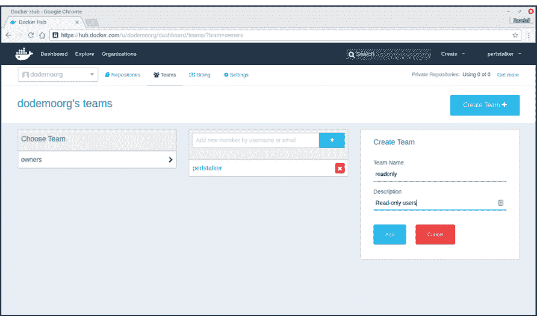
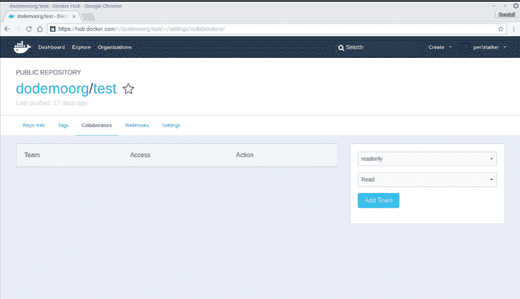
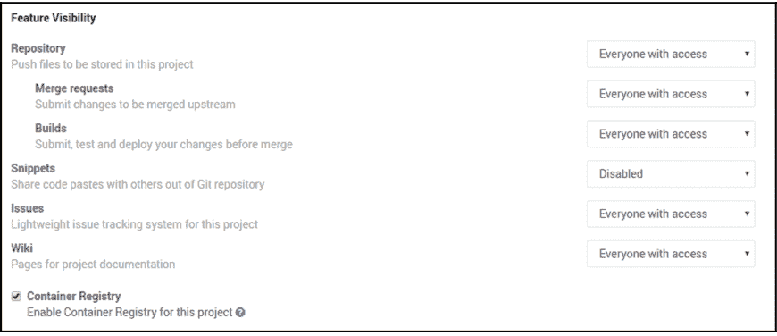

# 集群构建模块 – 注册表、覆盖网络和共享存储

前两章介绍了使用 Docker 的基础知识。现在是时候开始着手构建 Docker 集群了。在构建新集群之前，需要先打好基础。本章将介绍注册表、覆盖网络和共享存储。每个组件对于 Docker 集群中容器的平稳运行都是必不可少的。

Docker 是一个高度可插拔的系统。也就是说，每个组件都有多种选择。每种选择都有其自身的优势和劣势。有些可能比其他选择更适合您的环境。本章将为每个组件提供几个示例，并说明如何使用它们。

好消息是，无论您做出什么选择，都不会被锁定。Docker 的插件系统使得使用您需要的任何组件变得很容易，通常可以按容器为基础。例如，您可以先使用一种共享存储系统，然后决定另一种更适合您的需求。新容器可以立即开始使用新存储，而旧容器则继续使用旧系统。

本章将涵盖以下主题：

- 注册表
- 使用注册表
- Docker Hub
- Docker Cloud
- Docker Datacenter 和 Docker Trusted Registry
- GitLab 注册表
- 自行构建
- 覆盖网络
- 原生 Docker 覆盖网络
- Flannel
- Weave
- 共享存储
- 存储驱动
- Ceph

## 创建 Docker 注册表

**注册表** 只是存储镜像的地方。在本书中，您已经使用过 Docker 注册表。在 *第1章 使用 Docker 进行编排* 中，有一个启动 `nginx` 容器的示例：

```
$ docker run --name webserver -p 80:80 nginx
```

`docker` 命令包含要使用的镜像名称，在此示例中为 `nginx`。Docker 首先在本地查找该镜像，但如果本地未找到该镜像，Docker 会连接到 Docker Hub 上的默认注册表。如果镜像存在于注册表中，则会下载该镜像，您的容器将启动。

想想拥有注册表有多么强大。注册表使您可以轻松地将任何镜像快速部署到集群中的任何节点。如果没有注册表，您必须先在每台机器上手动构建镜像。在我最初使用 Docker 的日子里，我就是这样做的，而且一点也不有趣。每次构建镜像时，库的变更都有可能导致我的应用程序崩溃。使用注册表可以让您在整个集群中获得一致的部署。

### 使用 Docker Hub

迄今为止，开箱即用最容易使用的注册表是 Docker Hub。大多数项目的官方 Docker 镜像都托管在那里。您可以免费创建帐户，并托管您需要的任何数量的公共镜像。私有仓库需要付费。要创建帐户，请访问 https://hub.docker.com。

### 登录

拥有帐户后，就可以使用 `docker login` 登录到注册表了。默认情况下，Docker 会尝试将您登录到 Docker Hub。登录后，您将有权拉取私有镜像并将新镜像推送到仓库：

```
$ docker login
Username: username
Password:
Email: username@example.com
WARNING: login credentials saved in /home/user/.docker/config.json
Login Succeeded
```

请注意输出中的警告。您的注册表登录凭据将保存在 `$HOME/.docker/config.json` 中。此文件可以推送到集群服务器以自动执行注册表操作：

```
$ cat ~/.docker/config.json
{
  "auths": {
    "https://index.docker.io/v1/": {
      "auth": "cG...",
      "email": "username@example.com"
    }
  }
}
```

登录并保存凭据后，您可以再次登录而无需指定密码。还可以使用 `-p` 选项在命令行上传递密码：

```
$ docker login -u username
WARNING: login credentials saved in /home/user/.docker/config.json
Login Succeeded
```

显然，即使密码已被哈希处理，四处留下密码凭据也有点可怕。至少，请确保 `$HOME/.docker/config.json` 仅对您的用户可读。完成后，可以通过运行 `docker logout` 从 `config.json` 中删除凭据。

当您开始编排集群时，如果使用私有仓库，将需要从服务器自动化注册表登录。服务器需要能够从注册表拉取镜像。如果无法做到，您的服务将无法运行。在可能的情况下，您应该有一个单独的只读用户，该用户可以从仓库拉取镜像但无法更新它。在 Docker Hub 中可以实现这一点，但需要几个步骤来设置：

1. 单击“组织”，然后单击“创建组织”。
2. 单击“创建团队”按钮，填写团队名称和描述字段，然后单击“添加”：
  
3. 从列表中单击团队，并将只读用户添加到团队。
4. 创建一个仓库，或单击组织中现有的仓库。
5. 单击“协作者”。从下拉菜单中选择团队。选择“读取”，然后单击“添加团队”：
  

添加到该组的任何用户都将能够从仓库拉取镜像，但无法向其推送。您可以根据需要将只读团队添加到尽可能多的仓库中。这在仍然允许编排工具在需要时从仓库拉取镜像的同时，提供了一定的安全性。

### 使用仓库

在使用仓库之前，不需要先创建仓库。但是，如果仓库将是私有的，应事先创建。这样可以确保推送到仓库的镜像不可见。您可以根据需要创建尽可能多的仓库：

1. 登录 Docker Hub 并单击“创建仓库”。
2. 从列表中选择您的命名空间。这将是您的用户名或组织名称。
3. 为您的仓库输入一个名称。该名称在命名空间中必须唯一。
4. 如有需要，添加简短描述和完整描述。
5. 选择您的可见性（公共或私有），然后单击“创建”。

现在是时候将镜像上传到 Docker Hub 了。您必须先使用 `docker build` 构建镜像。镜像名称必须与您要推送的名称相同。使用 Docker Hub 时，镜像名称由用户名或组织名称以及镜像名称组成，中间用斜杠分隔。例如，如果您的组织是 `domemoorg`，镜像名为 `test`，则镜像名称为 `domemoorg/test`。可选地，还可以包含标签，例如 `domemoorg/test:0.1`。构建完成后，将镜像推送到 Docker Hub：

```
$ docker build -t domemoorg/test .
[output omitted]
$ docker push domemoorg/test
The push refers to a repository [docker.io/domemoorg/test]
2a2c642ec5d1: Pushed
45d6c44ca123: Pushed
07066ce72cdd: Pushed
e4c7c26cda75: Pushed
0cad5e07ba33: Mounted from library/ubuntu
48373480614b: Mounted from library/ubuntu
055757a19384: Mounted from library/ubuntu
c6f2b330b60c: Mounted from library/ubuntu
c8a75145fcc4: Mounted from library/ubuntu
latest: digest: sha256:f1af9d37d7792490f571a572bb17a21936b512b22a2d8650c11a3424f9192033
size: 2198
```

该镜像现在可在 Docker Hub 上使用。如果仓库是公共的，任何人都可以下载和使用该镜像。出于此原因，请不要在镜像中包含密码。在可能的情况下，请使用环境变量，如在 `Chapter 2, Building Multi-Container Applications with Docker Compose` 中讨论的那样，以保持密码的机密性。

从 Docker Hub 下载镜像有两种方法。首先，您可以简单地运行一个容器，例如 `docker run domemoorg/test`。如果服务器上不存在该镜像，它将自动下载。请注意，`docker run` 不会检查 Docker Hub 上的镜像是否有变化。要强制系统下载镜像，请使用 `docker pull`：

```
$ docker pull domemoorg/test
```

在某些情况下，在准备部署之前使用 `docker pull` 下载镜像可能很有用。例如，您可能有一个正在运行容器正在使用的现有镜像的新版本。运行 `docker pull` 可确保在升级之前一切就绪。这将最大限度地减少新容器启动时的潜在停机时间。


## 自动化使用 Docker Hub 构建镜像

Docker Hub 具有一项功能，可根据托管在 GitHub 或 Bitbucket 上的 Git 分支更新自动构建新镜像。要创建自动化构建，请从 **创建** 菜单中选择 **创建自动化构建**。如果您尚未关联，系统会提示您关联 GitHub 或 Bitbucket 帐户。

请注意，关联的 GitHub 或 Bitbucket 帐户只能关联到一个 Docker Hub 帐户。

向导将引导您完成新仓库的创建。系统会要求您为仓库提供名称和描述。创建仓库后，请转到 **构建设置** 来配置自动化构建。Docker Hub 可以跟踪 Git 仓库中的多个分支，并在该分支每次更新时构建一个新的带标签镜像。

您还可以配置 Docker Hub，以便在上游容器更新时重建您的镜像。例如，假设您的容器基于 `ubuntu` 镜像，换句话说，您在 `Dockerfile` 顶部使用了 `From ubuntu`。每当 `ubuntu` 镜像重建时，也会触发您的镜像重建。这是确保您的镜像始终拥有来自上游镜像的最新安全更新的一种方法。

自动化构建是开始使用 **持续集成 (CI)** 和 **持续部署 (CD)** 的好方法。它不具备 **GitLab** 或 **Jenkins** 那样的镜像测试功能，但您仍然可以构建自动化测试流程。例如，当开发人员准备测试其应用程序时，他们可以将更改推送到 GitHub 上的测试分支。此推送将触发 Docker Hub 上的构建，从而构建一个新镜像。一个进程可以在您的某台服务器上运行，定期拉取测试分支，针对其运行测试套件，并向您的团队发送构建报告。如果测试成功，团队随后可以将代码推送到 `master` 分支并触发生产构建。

CI/CD 工具是确保部署过程稳定性和可靠性的一种方法。*第 9 章，使用持续集成来构建、测试和部署容器，* 将向您展示如何使用 GitLab 中内置的 Docker Registry 来自动化测试和部署。

## 与 Docker Cloud 集成

Docker 提供了一个名为 Docker Cloud 的完全云端托管的 Docker 管理平台。Docker Cloud 使用 Docker Hub 提供注册表服务。这意味着，除了与管理环境的紧密集成外，您还可以获得与直接在 Docker Hub 上可用的相同自动化构建服务。除了自动化构建外，Docker Cloud 还提供自动化测试框架。这将在第 9 章“使用持续集成来构建、测试和部署容器”中进一步介绍。

Docker Cloud 对私有仓库的另一项功能是能够对镜像执行安全扫描。它会扫描镜像的每一层以查找已知漏洞，并提供报告。扫描在镜像推送时或触发自动化构建时运行。生成的报告可能会显示您的镜像所基于的镜像中存在漏洞。在这种情况下，您将不得不使用较新版本的基础镜像重建，或自行解决漏洞。

## 使用 GitLab 容器注册表

GitLab 是一款一体化开发套件。它提供 Git 仓库、问题跟踪、CI 和 Docker 注册表。GitLab 中 Git、问题跟踪和 Docker 注册表之间的紧密集成使其成为应用程序开发的理想解决方案。GitLab 是开源的，可以本地安装。企业托管也可在 gitlab.com 上获得。

使用 GitLab 最简单的方式是通过其云端服务，但本地安装也很简单。就我的经验而言，安装 GitLab 的最佳方式是使用 Omnibus 安装程序。它会安装 GitLab 所需的所有软件并管理所有更新。Omnibus 软件包适用于 Ubuntu、Debian、CentOS 和 Raspberry Pi。

有一个可用的 Docker 镜像，但使用起来稍微困难一些。我建议以 gitlab/gitlab-ce 为基础创建自己的镜像，以放置软件包配置和 SSL 证书。GitLab Docker 镜像文档位于 https://docs.gitlab.com/omnibus/docker/。

### 在 Ubuntu 上安装 GitLab

在安装 GitLab 之前，需要安装许多依赖项。Postfix 是可选的。如果您选择不使用它，则需要将 GitLab 配置为使用另一台服务器发送电子邮件：

```
$ sudo apt-get install curl openssh-server ca-certificates postfix
```

GitLab 是另一个希望您下载脚本并直接通过 sudo 管道运行的项目。我再次强调，这样做非常危险。相反，请下载脚本，查看它，如果看起来没问题，则运行它：

```
$ wget -qO script.deb.sh
https://packages.gitlab.com/install/repositories/gitlab/gitlab-ce/script.deb.sh
$ sudo bash script.deb.sh
$ sudo apt-get install gitlab-ce
```

GitLab 配置在 /etc/gitlab/gitlab.rb 中。有关所有选项的完整指南超出了本书范围。相反，让我们专注于配置 Docker Registry 所需的内容：

```
registry['enable'] = true
registry_external_url 'https://registry.example.com'
gitlab_rails['registry_path'] = "/var/opt/gitlab/gitlab-rails/shared/registry"
registry_nginx['ssl_certificate'] = "/etc/gitlab/ssl/registry.example.com.crt"
registry_nginx['ssl_certificate_key'] = "/etc/gitlab/ssl/registry.example.com.key"
gitlab_rails['lfs_enabled'] = true
```

第一行在 GitLab 中启用注册表服务。第二行设置注册表的 URL。它可以使用与 GitLab 其余部分相同的地址，但使用不同的端口。也可以使注册表在单独的主机名上可用。第三行设置注册表在文件系统上的位置。

第四行和第五行定义 SSL 证书和密钥文件。注册表使用的证书必须受客户端信任，否则 Docker 会抛出错误。如果您使用的证书包含中间证书，则需要将证书链添加到证书文件中：

```
$ cat intermediate.pem your_certificate.pem > registry.pem
```

> 不推荐在没有证书的情况下使用 GitLab Docker 注册表，但这是可行的。将 --insecure-registry 和您的注册表地址添加到 Docker 守护进程的启动命令中。完整详情可在 https://docs.docker.com/registry/insecure/ 上找到。

最后一行启用 Git 大文件存储 (LFS)。这并非严格必要，但它确实允许将大文件添加到镜像的 Git 仓库中。例如，我有需要 Oracle Instant Client 的服务。客户端的 ZIP 文件很大，但构建镜像时需要它们。LFS 允许轻松地将客户端添加到 Git。LFS 必须在客户端上安装并配置才能使用。

对 `gitlab.rb` 所做的更改后，需要重新配置 GitLab。这是通过运行 `sudo gitlab-ctl reconfigure` 完成的。升级后也会运行此命令以更新数据库。

> 有关配置 GitLab 容器注册表的完整详情，请参阅：
> https://docs.gitlab.com/ce/administration/container_registry.htm

## 在项目中启用 Docker 注册表

可以为在 GitLab 中创建的任何项目启用 Docker 注册表。单击右上角的齿轮图标并选择 **编辑项目**。向下滚动到 **功能** 部分，启用 **容器注册表**，然后单击 **保存更改**：



启用后，拥有仓库访问权限的用户可以使用其 GitLab 凭据通过 `docker login` 登录。用户可能对仓库具有读取或写入权限，具体取决于其项目访问权限。登录后，镜像可以照常推送或拉取。请注意，镜像名称以注册表地址开头：

```
$ docker pull registry.example.com/namespace/project
$ docker push registry.example.com/namespace/project
```

GitLab CI 有能力自动构建、测试甚至部署镜像。这将在第 9 章“使用持续集成来构建、测试和部署容器”中详细介绍。

> 有关在项目中使用 GitLab 容器注册表的完整文档，请参阅：
> https://docs.gitlab.com/ce/user/project/container_registry.html

## 介绍 Docker Trusted Registry 和 Docker Datacenter

Docker Trusted Repository (DTR) 是 Docker Universal Control Plane (UCP) 可用的应用程序，也是 Docker Datacenter 的一部分。Docker Datacenter 提供了一个本地或基于云的集群管理工具，具备基于角色的访问控制 (RBAC)、LDAP 和 AD 身份验证，以及对 Docker 主机的监控。实际上，Docker Datacenter 是 Docker Cloud，DTR 充当在您自己的网络上运行的 Docker Hub 的角色。

Docker Datacenter 支持带有完整 CI/CD 的镜像自动化构建或测试。它还内置了对高可用性和镜像安全性的支持。Docker Datacenter 使用集成的 Docker Content Trust 对镜像进行数字签名和验证。这确保您获得的镜像就是您想要的镜像。

### 自己构建

如果这些选项都不适合您，还有自己构建的选项。这将允许您根据特定需求自定义注册表，但实现可能需要大量工作。它在较小的环境中也效果良好，这些环境不需要 GitLab 的复杂性或 Docker Datacenter 的费用，但仍然需要私有仓库。


就像 Docker 世界中的许多事情一样，新注册表只需一个 `docker run` 命令即可搞定：

```
$ docker run -d -p 5000:5000 --name registry registry:2
```

此命令将启动一个新的 `registry` 容器，可立即使用，但需注意一些事项。首先，镜像数据存储在容器中。删除容器也会删除所有镜像。最简单的解决方案是使用卷将本地文件系统中的目录挂载到 `/var/lib/registry`。如需更大灵活性，建议考虑使用共享存储而非本地目录：

```
$ docker run -d -p 5000:5000 -v /data/registry:/var/lib/registry --name registry registry:2
```

其次，除非 Docker 已配置为使用非安全注册表，否则这仅适用于 localhost 上的 `docker` 命令。这是因为 `docker` 要求为与注册表的 TLS 连接提供有效证书。你可以将包含证书的目录挂载到容器中，并指定环境变量来告诉注册表从哪里读取证书：

```
$ docker run -d -p 5000:5000 \
-v /data/registry:/var/lib/registry \
-v /data/certs:/etc/certs \
-e REGISTRY_HTTP_TLS_CERTIFICATE=/etc/certs/registry.pem \
-e REGISTRY_HTTP_TLS_KEY=/etc/certs/registry.key \
--name registry registry:2
```

关于证书的同样警告也适用于此。如果你的证书由中间证书签名，则完整的证书链必须包含在证书文件中。

Docker Registry 原生支持基本身份验证。如果你想实现更复杂的功能，需要在注册表前运行代理或使用令牌服务器。代理更简单，但令牌服务器能让你以更精细的粒度控制访问权限。完整详情、代理示例以及运行注册表的 Docker Compose 文件可在 https://github.com/docker/docker.github.io/blob/master/registry/deploying.md 中找到。

## 使用 overlay 网络连接容器

启动 Docker 容器时，会为其分配一个私有 IP 地址。这样可以避免与网络上可能已使用的地址冲突，并允许同一主机上的容器相互通信。这是一个不错的系统，只不过不同主机上运行的容器无法相互通信，除非它们在主机上被暴露出来。为了解决这个问题，包括 Docker 在内的各种项目都开发了 overlay 网络。

Overlay 网络是一种叠加在现有 IP 网络之上的私有网络，用于允许多台主机上的容器相互通信。连接到 overlay 网络的容器仍会分配私有地址，且无法从网络外部访问。端口可以像往常一样使用 `docker run` 的 `-p` 选项公开。

Docker 的可插拔网络基础设施导致 overlay 插件数量增长。它还允许容器使用多个 overlay 网络。使用多个网络可提供网络隔离和分段，并最大限度地降低被攻破的容器嗅探不应看到的网络流量的风险。

### 使用 Docker 原生 overlay 网络

Docker 的原生 overlay 网络是该领域的相对新进入者。它提供 **DNS 服务发现 (DNS-SD)** 和使用多个 overlay 的功能。与 Docker Swarm 结合使用时，它提供跨集群连接。后来进入生态系统的优势在于你可以从该领域的其他条目中学习。Docker 肯定已经做到了这一点。

本节中描述的功能在很大程度上依赖 Docker Swarm，这将在第 4 章《使用 Docker Swarm 进行编排》中详细介绍。目前，可以通过运行 `docker swarm init` 创建单节点 swarm：

```
$ docker swarm init
```

> 使用 Docker Swarm 需要 Docker 1.12 或更高版本。

让我们从创建容器将使用的网络开始。Docker Swarm 确保此网络对连接到 swarm 节点的所有主机均可用：

```
$ docker network create --driver overlay external
```

--driver 选项告诉 Docker 此网络使用 swarm 原生 overlay 驱动程序。末尾是 overlay 网络的名称。在此示例中为 external。这将是服务定义中用于配置所用网络的名称。

--opt encrypted 选项是可选的。如果指定，它告诉 Docker 加密不同节点上容器之间的连接。为此，Docker Swarm 将自动在连接到该网络的容器的任何节点之间构建 IPSEC 隧道。加密密钥会每十二小时自动更新一次。

如果你拥有跨越多个提供商的网络，或者希望简化容器间安全性，使用加密的 overlay 网络尤其有用。例如，MySQL 支持使用 TLS 进行连接。然而，很少有容器为 MySQL 启用了 TLS。使用加密的 overlay 网络可在与数据库通信时提供所需的加密，而无需担心证书分发或是否支持 TLS。

### 使用 DNS-SD

容器的一个问题是每次启动时都会分配新 IP 地址。这使得配置相互连接的容器变得非常困难。当容器运行在不同主机上时，情况会更加困难。幸运的是，Docker overlay 网络具有使用 DNS 的内置服务发现功能。DNS 条目作为 swarm 服务的一部分创建，这些服务将在第 4 章《使用 Docker Swarm 进行编排》中介绍。

考虑以下命令：

```
$ docker service create --network external --name nginx --replicas 2 -p 80:80 nginx 8m2vwm3n9w990kh77vf556k7i
```

此命令使用 Docker Swarm 创建一个名为 nginx 且具有两个副本的服务。当服务启动时，Docker 会为 nginx 创建一个 DNS 记录，该记录解析为启动的两个容器。网络上的任何其他容器都可以使用名称 nginx 连接到该服务。让我们创建一个 busybox 容器进行测试：

```
$ docker service create --name shell --network external busybox sleep 6000 191qi81lvvpnah3eqq8cvaxft4n
```

```
$ docker service ps nginx
ID NAME IMAGE NODE DESIRED STATE CURRENT STATE ERROR
da3hba7mokh0o0qr39eov9n9p nginx.1 nginx swarm-host2 Running
Running 30 seconds ago
4vzfcgjnujawjy6m7ngmbyiwv nginx.2 nginx swarm-master Running
Running 30 seconds ago
$ docker service ps shell
ID NAME IMAGE NODE DESIRED STATE CURRENT STATE ERROR
cbcbx21b5hs0ax06jfaeqzfjrq shell.1 busybox swarm-host1 Running
Running 24 seconds ago
```

这表明 nginx 容器正在名为 swarm-master 和 swarm-host2 的两个主机上运行。busybox shell 服务在 swarm-host1 上启动。使用 docker exec，可以连接到 shell 容器并验证连接性。

首先，使用 docker ps 在主机上获取容器名称：

```
$ docker ps
CONTAINER ID IMAGE COMMAND CREATED STATUS PORTS NAMES
1148d48d5720 nginx:latest "nginx -g 'daemon off'" 2 minutes ago Up 2 minutes 80/tcp, 443/tcp nginx.1.2t914z7ogcdb5nohrujd1tltln
0bc68f9957b1 busybox:latest "sleep 6000" 2 minutes ago Up 2 minutes shell.1.3wul50smhsjjhzpctnnsbeurd
```

```
$ docker exec -it shell.1.3wul50smhsjjhzpctnnsbeurd sh
/ # wget -O - nginx
Connecting to nginx (10.255.0.6:80)
<!DOCTYPE html>
<html>
<head>
<title>Welcome to nginx!</title>
...
```

wget 命令正在向名为 nginx 的主机请求网页。该请求会被转发到 nginx 服务并在屏幕上打印出来。

## 使用网格路由模式发布服务

Docker overlay 网络支持另一个名为 **网格路由** 的有用功能。在创建服务时使用 `--publish` 或 `-p` 选项时，此功能会自动启用。路由器会将请求转发到集群中任意主机上监听请求端口的容器或服务，即使该服务未在接收到请求的主机上运行。在前面的示例中，启动了一个名为 `nginx` 的服务，并使用 `-p` 标志将主机上的端口 80 发送到容器中的端口 80。对任何 Docker 主机上的端口 80 的请求都会导致两个 `nginx` 容器中的一个响应请求。

网格路由会在服务中的所有容器之间负载均衡请求。你可以为诸如 `www.example.com` 之类的主机名设置循环 DNS 条目，该条目包含主机地址，或者指向 swarm 中 Docker 主机地址的外部负载均衡器。后者将允许你将 Docker 节点保留在私有地址上。

Docker Swarm 中网格路由的缺点是，公开的端口必须在整个集群中唯一。换句话说，你不能同时拥有 `web1` 和 `web2` 服务并尝试公开端口 80。其中一个必须使用不同端口。

## 使用 Weave

Weave Net 由 Weaveworks 开发，旨在为 Docker 提供具有弹性和安全性的 overlay 网络。Weave 节点形成网格，即使某个节点故障，集群中的流量仍能继续流动。网格可以加密，以安全地保持跨越其的数据流动。Weave 网络甚至可以跨云提供商，连接运行在 Amazon EC2、Microsoft Azure 或甚至本地 Docker Datacenter 上的容器。Weave 还支持 DNS-SD，允许容器按名称相互通信，即使位于不同主机上。

> 有关 Weave Net 的完整文档可在 `https://www.weave.works/docs/net/latest/using-weave/` 中找到。


### 安装 Weave

第一步是将 `weave` 工具安装到你的桌面或其他管理系统中。`weave` 工具只是一个 shell 脚本。weave 的核心功能在 Docker 容器中运行。该脚本也应直接安装在 Docker 节点本身：

```
$ wget -O weave git.io/weave
$ chmod +x weave; cp weave /usr/local/bin/
```

以下示例假设一个三节点集群，节点名称为 `swarm-master`、`swarm-host1` 和 `swarm-host2`。节点可以使用 Docker Machine 创建，如 *第 1 章，开始使用 Docker 编排* 中所述。可以向集群添加任意数量的主机。网格越大，在发生节点故障时的弹性就越强。

下一步是初始化 Weave。首先使用 Docker Machine 切换到第一台服务器。`consensus` 标志告诉 weave 最初将有三台服务器。以后可以添加更多：

```
$ eval $(docker-machine env swarm-master)
$ weave launch --ipalloc-init consensus=3
```

这将在 `swarm-master` 上下载并启动三个容器。如果要加密网格，请将 `--password` 标志添加到 `weave launch`。密码在连接的每个节点上必须相同：

```
$ weave launch --password XXXX ...
```

你可以使用 `docker ps` 验证它们是否正在运行：

```
$ docker ps
CONTAINER ID        IMAGE                               COMMAND                   NAMES
CREATED             STATUS    PORTS
b645e00cde8d        weaveworks/plugin:1.6.1         "/home/weave/plugin"      weaveplugin
42 seconds ago      Up 41 seconds

e0bc711a0972        weaveworks/weaveexec:1.6.1        "/home/weave/weavepro"    weaveproxy
44 seconds ago      Up 43 seconds

89897514f42d        weaveworks/weave:1.6.1            "/home/weave/weave --"    weave
45 seconds ago      Up 44 seconds
```

接下来，在第二台主机上安装 weave 并将其连接到第一台：

```
$ eval $(docker-machine env swarm-host1)
$ weave launch --ipalloc-init consensus=3
$ weave connect 10.128.0.2
```

最后一条命令中的 IP 地址是主节点的 IP 地址。通常可以在那里使用 `$(docker-machine ip swarm-master)`。如果你在 GCE 等服务上运行主机，则希望使用那里的内部 IP 地址，因为它不会改变。
对第三台主机重复此过程：

```
$ eval $(docker-machine env swarm-host2)
$ weave launch --ipalloc-init consensus=3
$ weave connect 10.128.0.2
```

一旦 weave 在所有三个节点上安装并运行，使用 weave status 检查网络状态：

```
$ weave status
Version: 1.6.1 (up to date; next check at 2016/09/16 23:30:55)
Service: router
Protocol: weave 1..2
Name: 22:b6:71:6d:9c:d2 (swarm-host2)
Encryption: disabled
PeerDiscovery: enabled
Targets: 1
Connections: 2 (2 established)
Peers: 3 (with 6 established connections)
TrustedSubnets: none
Service: ipam
Status: idle
Range: 10.32.0.0/12
DefaultSubnet: 10.32.0.0/12
Service: dns
Domain: weave.local.
Upstream: 169.254.169.254
TTL: 1
Entries: 0
Service: proxy
Address: tcp://104.197.144.79:12375
Service: plugin
DriverName: weave
```

### 将容器连接到 Weave

既然网络已经设置好，是时候启动使用它的容器了。容器将使用启动 weave 时创建的 weave 网络。本示例将启动名为 shell11 和 shell12 的两个容器。shell11 容器将在后台运行：

```
$ docker run --net=weave -h shell1.weave.local $(weave dns-args) -tdi weaveworks/ubuntu
```

```
$ docker run --net=weave -h shell2.weave.local $(weave dns-args) -ti \
weaveworks/ubuntu
```

为了让 DNS-SD 工作，需要在 `docker` `run` 中使用 `--dns` 和 `--dns-search` 选项。weave 提供一个名为 `weave dns-args` 的帮助命令，它将适当地设置这些选项。

执行第二条命令后，你将留在 `shell12` 容器的命令提示符处。从那里，你应该能够 ping `shell11`：

```
root@shell12:/# ping shell11
PING shell11 (10.40.0.0) 56(84) bytes of data.
64 bytes from 89d43b8ac937.weave (10.40.0.0): icmp_seq=1 ttl=64
time=0.180 ms

64 bytes from 89d43b8ac937.weave (10.40.0.0): icmp_seq=2 ttl=64
time=0.099 ms

64 bytes from 89d43b8ac937.weave (10.40.0.0): icmp_seq=3 ttl=64
time=0.069 ms

64 bytes from 89d43b8ac937.weave (10.40.0.0): icmp_seq=4 ttl=64
time=0.104 ms
^C
--- shell11 ping statistics ---
4 packets transmitted, 4 received, 0% packet loss, time 3000ms
rtt min/avg/max/mdev = 0.069/0.113/0.180/0.040 ms
```

## 使用 Flannel

Flannel 是由 CoreOS 开发的覆盖网络。它使用 `etcd` 作为数据存储并进行网络同步。Flannel 缺少 Docker overlay 和 weave 支持的一些功能。没有加密或 DNS-SD 的选项。但是，一旦配置完成，它使用起来非常简单。

### 配置 etcd 和 Flannel

CoreOS 通过 `cloud-config` 配置。`cloud-config` 文件是一个 YAML 文件，通过用户数据选项传递给主机。文件必须以 `#cloud-config` 开头，CoreOS 才能识别它。

在开始之前，必须为 `etcd` 生成一个新令牌。`size` 参数是集群的初始大小。以后可以添加和删除节点：

```
$ wget -qO - 'https://discovery.etcd.io/new?size=3'
https://discovery.etcd.io/c37921aac12231bf487a3ed82c464a4f
```

发现 URL 可以接受其他选项。有关详细信息，请参阅 https://coreos.com/etcd/docs/latest/clustering.html。

生成的令牌将在 cloud-config 文件的 coreos > etcd2 > discovery 选项中使用。你需要为集群中的每个主机使用相同的令牌。每个集群都必须生成一个新令牌：

```
#cloud-config

coreos:
etcd2:
discovery: https://discovery.etcd.io/<token>
advertise-client-urls:
http://$private_ipv4:2379,http://$private_ipv4:4001
initial-advertise-peer-urls: http://$private_ipv4:2380
listen-client-urls:
http://0.0.0.0:2379,http://0.0.0.0:4001
listen-peer-urls: http://$private_ipv4:2380
flannel:
public_ip: $private_ipv4
etcd_endpoints: http://$private_ipv4:2379
fleet:
public_ip: $private_ipv4
units:
- name: etcd2.service
command: start
- name: fleet.service
command: start
- name: flanneld.service
command: start
drop-ins:
- name: 50-networking-config.conf
content: |
[Service]
ExecStartPre=/usr/bin/etcdctl set
/coreos.com/network
config '{"Network":"10.42.0.0/16"}'
- name: docker.service
command: start
drop-ins:
- name: 40-flannel.conf
content: |
[Unit]
Requires=flanneld.service
After=flanneld.service
```

此示例展示了如何在 CoreOS 上使用 Flannel。它假设你的 CoreOS 主机有两个网络接口；一个连接到公共网络，一个连接到专用网络。$private_ipv4 变量将被云提供商分配的专用 IP 地址替换。这受到 Amazon EC2、GCE、Microsoft Azure 和 OpenStack 的支持。

Flannel 将其配置以 JSON 格式存储在 etcd 的 /coreos.com/network/config 路径中。在 Flannel 启动之前，必须将配置写入 etcd。由于 CoreOS 使用 systemd 来管理服务，因此可以创建一个 drop-in 文件，在 Flannel 启动之前将配置添加到 etcd。

前面的示例具有 Flannel 所需的最低限度配置。它所做的只是设置将用于为每个容器分配 IP 地址的网络。你应该将其更改为与你的环境中任何内容都不冲突的内容。如果 Docker 已经在运行，则需要重新启动 Docker。Flannel 文档中提供了完整的选项列表，网址为 https://github.com/coreos/flannel。

### 使用 Flannel 启动 CoreOS 集群

以下命令在 GCE 上启动三台 CoreOS alpha 服务器。--can-ip-forward 标志是 Flannel 正确转换运行中容器的流量所必需的。主机的 cloud-config 文件通过 --metadata-from-file 选项设置：

```
$ gcloud compute instances create core1 core2 core3 --image-project coreos-cloud --image-family coreos-alpha \
--zone us-central1-a --machine-type g1-small --can-ip-forward --scopes compute-rw --metadata-from-file \
user-data=coreos-user-data.yml
```

确保 sshd 已启动：

```
$ gcloud compute instances get-serial-port-output core1 | grep
Starting.*sshd
Starting Generate sshd host keys...
```

一旦主机启动，登录到其中一台以验证 etcd 是否健康。由于 Flannel 依赖于 etcd，如果它不起作用，Flannel 也不会起作用：

```
$ gcloud compute ssh --zone us-central1-a core@core1
X11 forwarding request failed
Last login: Sat Sep 17 21:34:41 2016 from 162.220.127.20 core@core1 ~ $
etcdctl cluster-health
member 9817b5cb6db4b548 is healthy: got healthy result from
http://10.128.0.4:2379
member aa7418b2c3e34652 is healthy: got healthy result from
```


http://10.128.0.2:2379
成员 d9402f140b10154d 运行正常：已从
http://10.128.0.3:2379
获取运行正常的结果
集群运行正常

如果 etcd 显示运行正常，可以使用 sudo systemctl status flanneld 检查 Flannel 的状态。

当 Flannel 启动时，它会创建一个名为 /run/flannel_docker_opts.env 的环境文件。该文件由 docker.service 单元文件加载，用于配置 Docker 的网络以使用 Flannel。由于 Docker 守护进程已配置为使用 Flannel，因此在使用 docker run 时无需指定任何特殊网络选项。

现在，验证 Docker 是否已由 Flannel 正确配置以使用其 Docker 网桥的子网：

```
$ sudo systemctl status docker.service
● docker.service - Docker Application Container Engine
   Loaded: loaded (/usr/lib64/systemd/system/docker.service; disabled; vendor preset: disabled)
   Active: active (running) since Sun 2016-10-30 05:27:48 UTC; 22s ago
     Docs: http://docs.docker.com
   Main PID: 1881 (docker)
      Tasks: 6
      Memory: 14.1M
      CPU: 205ms
   CGroup: /system.slice/docker.service
            └─1881 docker daemon --host=fd:// --exec-opt native.cgroupdriver=systemd --bip=10.42.88.1/24 --mtu=1432 --ip-masq=false --selinux-enabled
```

> 初次运行 Flannel 时，Docker 可能无法读取环境文件。在这种情况下，请使用 sudo systemctl restart docker.service 重启 Docker 或重新启动系统。之后 Docker 应该可以正常工作。

### 连接到 Flannel

将容器连接到 Flannel 与 docker run 一样简单。首先在 core1 上启动一个 busybox 容器并获取其 IP 地址。如果分配的地址不在 Flannel 配置中设置的子网内，则表示 Docker 未读取 Flannel 创建的环境文件：

```
core@core1 ~ $ docker run -it -d --name test1 busybox
ee06605271b8301d27a03a6b4e7aa32d4fc3f558888087e2047eaedd0241c7d
core@core1 ~ $ docker exec test1 -4 ip addr | grep inet
inet 127.0.0.1/8 scope host lo
inet 10.42.88.2/24 scope global eth0
```

接下来，在 core2 上启动另一个 `busybox` 容器。这次，在前台运行容器以便获得命令提示符：

```
core@core2 ~ $ docker run -it --rm --name test2 busybox / # ip -4 addr | grep inet
inet 127.0.0.1/8 scope host lo
inet 10.42.3.2/24 scope global eth0
```

如你所见，此容器也分配到了 Flannel 子网中的 IP。现在 ping 在 core1 上启动的容器：

```
/ # ping 10.42.88.2
PING 10.42.88.2 (10.42.88.2): 56 data bytes
64 bytes from 10.42.88.2: seq=0 ttl=60 time=1.491 ms
64 bytes from 10.42.88.2: seq=1 ttl=60 time=0.528 ms
```

成功！请注意一件事。使用 IP 地址而不是容器名称进行 ping 是有原因的。Flannel 不支持 DNS-SD。如果你尝试按名称 ping 容器，`ping` 将会报告错误：

```
/ # ping test1
ping: bad address 'test1'
```

缺乏服务发现乍看之下可能是个弱点，但实际上并非如此。能够将 Flannel 用作覆盖网络的编排工具（例如 Kubernetes）通常提供自己的服务发现：

```
$ gcloud compute instances delete core1 core2 core3
```

将删除以下实例。配置为自动删除的附加磁盘将被删除，除非它们挂载到任何其他实例。删除磁盘是不可逆的，磁盘上的任何数据都将丢失：

- [core1] 在 [asia-east1-a]
- [core2] 在 [asia-east1-a]
- [core3] 在 [asia-east1-a]
是否要继续 (Y/n)? y

## 使用共享网络存储作为 Docker 卷

运行 Docker 集群时最大的挑战之一是决定如何处理数据。Docker 支持使用 **卷** 来存储数据。默认情况下，卷在 Docker 主机上存储数据。如果该容器在另一台主机上启动会怎样？将无法使用任何数据。对于大多数应用程序来说，这是一个问题。

Docker 通过创建可插拔存储系统解决了这个问题。可以创建连接到各种存储系统的卷。这些系统可以是从传统网络存储（例如 **网络文件系统 (NFS)** 和 **Internet 小型计算机系统接口 (iSCSI)**）到云服务（例如 Amazon S3）或集群存储系统（例如 Gluster 或 Ceph）的任何内容。

每种存储选项都有其优缺点。有些可能更适合某些工作负载。幸运的是，你可以按容器为基础选择最佳解决方案。公共 Web 服务器可能在 Amazon EC2 上运行并需要那里的存储，而本地文件服务器则连接到本地 Ceph 集群。

卷使用 `docker volume create` 命令创建。以下示例使用名为 `foo` 的虚构驱动程序创建名为 `vol1` 的卷：

```
$ docker volume create --driver foo --name vol1 --opt bar=1 --opt baz=2
```

卷使用的驱动程序由 `--driver` 标志定义。每个驱动程序都有自己的选项集，通过添加一个或多个 `--opt` 标志来设置。请务必阅读选择使用的每个存储驱动程序的文档。

## 介绍 Ceph

Ceph 是由 Red Hat 开发的分布式集群存储解决方案。它提供对象存储、块存储和共享文件系统。Ceph 还可以通过 RADOS 网关提供与 Amazon S3 和 OpenStack Swift 的兼容性。还支持多个存储池和存储分层。当集群中出现问题时，它还可以自我修复，因此是为网络服务提供存储的绝佳选择。

设置 Ceph 集群时有两个值得注意的组件。第一个组件是 Ceph Monitor。监视器跟踪集群运行状况和 **可控复制与可扩展哈希 (CRUSH)** 映射，该映射告诉集群如何在集群中查找数据。第二个是 Ceph OSD。这些是实际控制存储的守护进程。最佳实践是为集群中将使用的每个磁盘运行一个 OSD。有关 Ceph 的更多详细信息，请参阅 *Learning Ceph, Karan Singh*，由 Packt Publishing 出版，或访问 http://www.ceph.com/。

### 将 Ceph 与 Docker 配合使用

Docker 可以通过多种存储驱动程序之一使用 Ceph 作为卷。某些编排系统（例如 Kubernetes）内置了 Ceph 支持。一如既往，请自行研究以查看哪个插件适合你的环境。此演示将使用来自 `contiv` 的 `volplugin` 驱动程序，可从以下网址获取：https://github.com/contiv/volplugin。

`volplugin` 驱动程序使用许多守护进程。你可以手动安装它们，但最简单的方法是在 Docker 容器中运行它们：

```
$ sudo docker run -it -v /var/run/docker.sock:/var/run/docker.sock contiv/volplugin-autorun
```

请注意，Docker 套接字作为卷被传递到容器中。这正是允许启动脚本注册并运行所需容器的原因。

初始安装将创建名为 `policy1` 的策略，该策略将在 `rbd` 存储池中创建新镜像。如果你使用的是另一个存储池、设置了不同的默认大小或在镜像上使用了不同的文件系统，可以创建其他策略。这些策略通过 `volcli` 工具管理，该工具可通过 `volplugin` 镜像获得：

```
$ sudo docker exec volplugin volcli policy get policy1
{"name":"policy1","create":{"size":"10MB","filesystem":""},"runtime":{"snapshots":true,"snapshot":{"frequency":"30m","keep":20},"rate-limit":{"write-iops":0,"read-iops":0,"write-bps":0,"read-bps":0},"driver":{"pool":"rbd"},"filesystems":{"ext4":"mkfs.ext4 -m0"},"backends":{"crud":"ceph","mount":"ceph","snapshot":"ceph"}}
```

此示例展示了如何使用 volcli 获取 policy1 的配置。请注意 docker exec 的使用，它允许 volplugin 工具连接到正在运行的守护进程。

## 创建 Docker 卷

volplugin 运行后，可以使用它来创建 Docker 卷。卷的名称以正在使用的策略开头，后跟斜杠，然后是镜像名称：

```
$ sudo docker volume create -d volplugin --name policy1/test
```

在 Ceph 中，新的 rbd 在存储池中创建。请注意名称差异。Ceph 不允许镜像名称中包含斜杠，因此斜杠已更改为点：

```
$ sudo rbd info policy1.test
rbd image 'policy1.test':
    size 10240 kB in 3 objects
    order 22 (4096 kB objects)
    block_name_prefix: rbd_data.372d8625e32
    format: 2
    features: layering
    flags:
```

现在卷可以与正在运行的容器一起使用。它的工作方式与挂载本地目录完全相同，只是使用卷名称而不是本地路径：

```
$ sudo docker run --rm -v policy1/test:/mnt busybox
```

此命令启动一个新的 busybox 容器，并将 Ceph rbd 镜像挂载到 /mnt。请注意，由于它是新文件系统，/mnt 中只有 lost+found 目录。为了用简单示例演示卷的强大功能，让我们在 /mnt 中创建一个新文件：

```
/ # touch /mnt/example
/ # ls /mnt
example  lost+found
```

由于此容器是使用 --rm 启动的，容器在退出时将被删除。但是，存储在卷上的数据将保留以供下一个容器使用。如果你启动使用相同卷的新容器，数据仍然会存在：

```
$ sudo docker run --rm -v policy1/test:/mnt -it busybox
/ # ls /mnt
example  lost+found
```


使用 Ceph 这样的系统作为卷的强大之处在于，你可以在集群中的任何主机上启动容器，你的数据将在那里等着你。也就是说，容器在集群中的哪里启动或某个特定主机是否运行，都无关紧要。

警告一下。Ceph rbd 镜像是块设备，就像主机可用的任何其他块设备一样。如果你使用 iSCSI、OpenStack Cinder 或来自云提供商的存储，情况也是如此。也就是说，关于多个主机尝试挂载同一文件系统的标准警告也适用。多个主机挂载同一个 Ext4 或类似文件系统进行写入，不可避免地会导致数据丢失。这是一件坏事。

如果你需要多个主机访问同一文件系统，请考虑使用 NFS 或 SMB 作为中间层。你也可以使用运行集群感知文件系统（如 OCFS2）的容器，但这会给日益复杂的环境增加更多复杂性。

### 其他共享存储插件

如前所述，有很多存储插件。几乎每个主要存储系统都有一个插件。以下是一些更有趣的插件：

- **Azure 文件存储**：由微软开发的开源插件，用于支持 Azure。参考 `https://github.com/Azure/azurefile-dockervolumedriver`。
- **GlusterFS**：支持来自 Red Hat 的 GlusterFS 集群存储系统。参考 `https://github.com/calavera/docker-volume-glusterfs`。
- **REX-Ray**：由 Dell EMC 开发，用于支持 Docker 和 Mesos 的 ScaleIO 和 Isilon。参考 `https://github.com/emccode/rexray`。
- **Kubernetes**：Kubernetes 编排工具原生支持 iSCSI、NFS、Ceph 以及许多其他系统。

### 总结

在本章中，你了解了 Docker 集群所需的基础构建块。无论使用哪种编排工具，都需要一个用于存储镜像的仓库、用于容器间通信的覆盖网络以及网络存储，以便你的容器无论在集群中的哪里启动都能访问其数据。每个角色都有许多选择。虽然解决方案的选择很重要，但如果需要，在系统之间切换也很容易。有些方案在特定环境和工作负载下表现更好。下一章将深入探讨使用 Docker Swarm 编排 Docker 集群。
