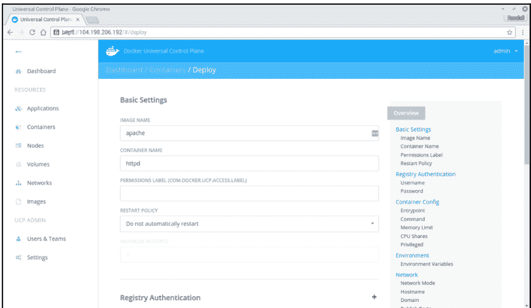
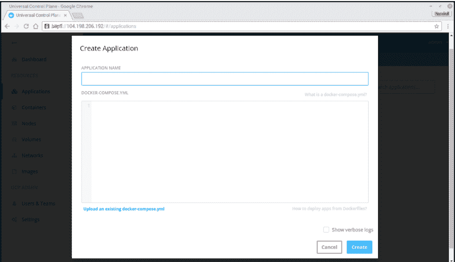
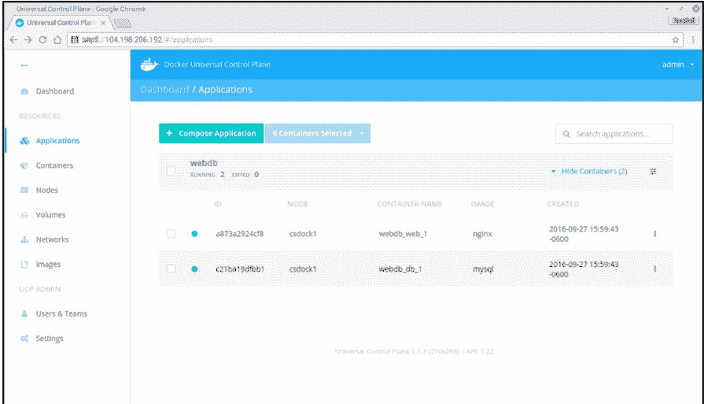

# 4 使用 Docker Swarm 进行编排

Docker Swarm 是 Docker 的原生编排工具。它与 Docker 1.12 版一起被集成到核心 Docker 套件中。最简单来说，使用 Docker Swarm 就像使用 Docker 一样。所有已介绍的工具仍然有效。Docker Swarm 添加了一些功能，使服务的部署和更新变得非常出色。你在 `Chapter 3, Cluster Building Blocks – Registry, Overlay Networks, and Shared Storage` 中一窥了它们的面貌，该章介绍了 Docker 覆盖网络。现在是时候深入细节了。

本章将涵盖以下主题：

- 创建 swarm
- 添加和删除节点
- 更改节点可用性
- Swarm 灾难恢复
- 使用标签对节点进行分组
- 创建和停止服务
- 创建副本
- 使用全局服务
- 使用约束
- 使用滚动更新实现零停机升级
- 与 swarm 一起使用 Docker Compose
- 使用 Docker Datacenter

## 设置 swarm

运行 swarm 的第一步是准备好若干已安装 Docker 的主机。无论你是使用 get.docker.com 的安装脚本还是使用 Docker Machine 都无关紧要。你还需要确保服务器之间打开了几个端口，如下所示：

- 2377 TCP 端口用于集群管理
- 7946 TCP 和 UDP 端口用于节点通信
- 4789 TCP 和 UDP 端口用于覆盖网络

花点时间为将成为 swarm 管理器的主机获取或分配静态 IP 地址。每个管理器都必须有静态 IP 地址，以便工作节点知道如何连接到它们。工作节点地址可以是动态的，但管理器的 IP 必须是静态的。

在规划 swarm 时，花点时间决定需要多少个管理器。在保持容错能力的同时运行所需的最小数量是三个。对于更大的集群，你可能需要五个或七个。很少情况下需要比这更多。无论如何，管理器的数量应该是奇数。只要 50% + 1 的管理器在运行，Docker Swarm 就可以维持法定人数。拥有两个或四个管理器并不比拥有一个或三个提供额外的容错能力。

如果可能，你应该分散部署管理器，以免单点故障导致整个 swarm 瘫痪。例如，确保它们不全运行在同一个 VM 主机上或连接到同一个交换机。整个重点是拥有多个管理器，以便在管理器发生故障时保持 swarm 运行。不要允许其他地方出现单点故障来破坏你的努力，从而导致 swarm 瘫痪。

## 初始化 swarm

如果你是从桌面安装，最好使用 Docker Machine 连接到主机，因为这将设置必要的 TLS 密钥。运行 `docker swarm init` 命令来初始化 swarm。`--advertise-addr` 标志是可选的。默认情况下，它会猜测主机上的一个地址。这可能不正确。为了确保正确，请将其设置为管理器主机的静态 IP 地址：

```
$ docker swarm init --advertise-addr 172.31.26.152
Swarm initialized: current node (6d6e6kxlyj9u9vb9w1uug95zh) is now a
manager.
To add a worker to this swarm, run the following command:
docker swarm join \
--token
SWMTKN-1-0061dt2qjsdr4gabxryrksqs0b8fnhwg6bjhs8cxzen7tmarbi-89mmok3p
f6dsa5n33fb60tx0m \
172.31.26.152:2377
To add a manager to this swarm, run 'docker swarm join-token manager' and
follow the instructions.
```

`init` 命令的输出中包含在每个工作节点主机上运行的命令。如果你已将环境设置为使用工作节点主机，也可以从桌面运行它。你可以将命令保存在某处，但也可以随时通过运行 `docker swarm join-token manager` 再次获取它。

作为加入过程的一部分，Docker Swarm 将创建 TLS 密钥，用于加密管理器与主机之间的通信。但是，它不会加密容器之间的网络流量。证书每三个月更新一次。可以通过运行 `docker swarm update --cert-expiry duration` 来更新时间段。持续时间以小时和分钟数指定。例如，将持续时间设置为 `1000h` 将告诉 Docker Swarm 每 1000 小时重置一次证书。

## 管理 swarm

在编排 Docker 时，最容易被忽略的部分之一是如何管理集群本身。在本节中，你将了解如何管理 swarm，包括添加和删除节点、更改其可用性以及备份和恢复。在 *第 10 章，为什么止步于容器？自动化你的基础设施* 中，我们将深入了解自动化节点部署。

### 添加节点

新的工作节点可以随时添加。安装 Docker，然后运行 `docker swarm join-token worker` 以获取 `docker swarm join` 命令，将主机加入 swarm。添加后，工作节点将可用于运行任务。请注意，加入集群的命令是一致的。这使得将其添加到主机配置脚本并在引导时加入 swarm 变得很容易。

你可以通过在管理节点上运行 `docker node ls` 来获取 swarm 中所有节点的列表：

```
$ docker node ls
ID                                     HOSTNAME   STATUS   AVAILABILITY   MANAGER STATUS
ii3wtacdjz5p509bu313qfbei             worker1   Ready    Active         Reachable
3f2t4wwthgcahs9089b8przv              worker2   Ready    Active         Reachable
6d6e6kxlyjuo9vb9w1uug95zh *           manager   Ready    Active         Leader
```

该列表不仅会显示机器，还会显示它们在 swarm 中是否活跃以及是否是管理器。标记为 `Leader` 的节点是 swarm 的主节点。它协调管理器。

### 提升和降级节点

在 Docker Swarm 中，就像现实生活中一样，管理员也是工作节点。这意味着管理器可以运行任务。这也意味着工作节点可以被提升为管理器。这对于快速替换故障管理器或无缝增加管理器数量非常有用。以下命令将名为 `worker1` 的节点提升为管理器。以下命令必须在已经是管理器的节点上运行：

```
$ docker node promote worker1
Node worker1 promoted to a manager in the swarm.
```

管理器也可以降级为普通工作节点。在管理节点即将停用之前应执行此操作。以下命令将 `worker1` 降级回普通工作节点：

```
$ docker node demote worker1
Manager worker1 demoted in the swarm.
```

无论你出于什么理由提升或降级节点，完成后请确保管理器的数量为奇数。

### 更改节点可用性

Docker Swarm 节点具有可用性概念。节点的可用性决定是否可以在该节点上调度任务。使用 `docker node update --availability <state> <node-id>` 命令设置可用性状态。可以设置三种可用性状态——pause、drain 和 active。


### 暂停节点

将节点的可用性设置为 `pause` 将阻止调度程序向该节点分配新任务。现有任务将继续运行。这对于排查节点上的负载问题或防止向已过载的节点分配新任务很有用。以下命令将暂停 `worker2`：

```
$ docker node update --availability pause worker2
worker2
```

| ID | 主机名 | 状态 | 可用性 | 管理器状态 |
|---|---|---|---|---|
| 1i3wtacdjz5p509bu313qfbei | worker1 | 就绪 | 活动 | 可访问 |
| 3f2t4wwvthgcahs9089b8przv | worker2 | 就绪 | 已暂停 | 可访问 |
| 6d6e6kxlyjguo9vbw91uug95zh * | manager | 就绪 | 活动 | 领导者 |

不要依赖使用 `pause` 来处理过载问题。更好的做法是对服务设置合理的资源限制，并让调度程序自行处理。你可以使用 `pause` 来帮助确定资源限制应为多少。例如，你可以在节点上启动一个任务，然后暂停该节点，以防止新任务运行，同时监控资源使用情况。

### 排空节点

与 `pause` 类似，将节点的可用性设置为 `drain` 将阻止调度程序向该节点分配新任务。此外，`drain` 将停止任何正在运行的任务，并将其重新调度到群集中的其他位置运行。`drain` 模式有两种常见用途。

首先，它对于为节点升级做准备非常有用。容器将以有序的方式停止和重新调度。然后可以应用更新，并在必要时重启节点，而不会造成进一步的中断。更新完成后，可以将节点重新设置为 `active`。

请记住，在排空节点时，运行中的容器必须停止并在其他位置重新启动。如果你的应用程序不是为处理故障而构建的，这可能会造成中断。容器的好处在于它们启动速度很快，但某些服务（例如 MySQL）需要几秒钟来初始化。

drain 的第二种用途是防止服务在管理节点上被调度。管理节点的处理非常依赖于消息及时传递。在管理节点上运行的不受约束的任务可能会导致节点拒绝服务中断，从而给你的集群带来问题。将管理节点长期保持在 drain 状态并不罕见。以下命令将排空名为 manager 的节点：

```
$ docker node update --availability drain manager
manager
```

| ID | 主机名 | 状态 | 可用性 | 管理器状态 |
|---|---|---|---|---|
| 1i3wtacdjz5p509bu313qfbei | worker1 | 就绪 | 活动 | 可访问 |
| 3f2t4wwvthgcahs9089b8przv | worker2 | 就绪 | 活动 | 可访问 |
| 6d6e6kxlyjguo9vbw91uug95zh * | manager | 就绪 | 排空 | 领导者 |

### 激活节点

当节点准备好再次接受任务时，将状态设置为 active。如果节点没有立即填满容器，请不要担心。只有在发生新的调度事件时（例如启动服务）才会分配任务。以下命令将重新激活 worker2 节点：

```
$ docker node update --availability active worker2
worker2
```

| ID | 主机名 | 状态 | 可用性 | 管理器状态 |
|---|---|---|---|---|
| 1i3wtacdjz5p509bu313qfbei | worker1 | 就绪 | 活动 | 可访问 |
| 3f2t4wwvthgcahs9089b8przv | worker2 | 就绪 | 活动 | 可访问 |
| 6d6e6kxlyjguo9vbw91uug95zh * | manager | 就绪 | 活动 | 领导者 |

### 移除节点

出于各种原因，可能需要移除节点，包括升级、故障，或只是消除不再需要的容量。例如，构建新节点而不是在旧节点上执行更新，升级节点可能更容易。新节点将被添加，旧节点将被移除。

对于健康节点，第一步是将 --availability 状态设置为 drain。这将确保所有计划任务都已停止并移至群集中的其他节点。

第二步是从将要离开群集的节点上运行 `docker swarm leave`。这将把节点状态分配为 Down。在以下示例中，`worker2` 已离开群集：

| ID | 主机名 | 状态 | 可用性 | 管理器状态 |
|---|---|---|---|---|
| 1i3wtacdjz5p509bu313qfbei | worker1 | 就绪 | 活动 | 可访问 |
| 3f2t4wwvthgcahs9089b8przv | worker2 | 已停止 | 活动 | |
| 6d6e6kxlyjguo9vbw91uug95zh * | manager | 就绪 | 活动 | 领导者 |

如果要移除的节点是管理节点，则必须先按前文所述将其降级为工作节点，然后再运行 `docker swarm leave`。移除管理节点时，要注意不要丢失法定人数，否则你的集群将停止工作。

一旦节点被标记为 Down，就可以将其从群集中移除。从管理节点，使用 `docker node rm` 将节点从群集中移除：

```
$ docker node rm worker2
```

在某些情况下，你想要移除的节点无法访问，因此无法运行 `docker swarm leave`。发生这种情况时，请使用 `--force` 选项：

```
$ docker node rm --force worker2
```

已移除的节点可以使用 `docker swarm join` 重新添加。

## 从灾难中恢复

在大型集群中，故障是经常发生的。硬盘会故障，服务器会故障，甚至整个数据中心也会断电。将服务迁移到 AWS 和 Azure 等云平台有所帮助，但即使它们也曾出现整个区域宕机的情况。使用容器可能会使你的应用程序更能抵抗故障，但运行这些容器的主机仍然会受到各种因素的影响。经过合理设计，你的集群应该能够应对灾难。以下是一些需要牢记的事项，以保持集群安全。

## 重启整个集群

可能有时需要关闭整个群集。希望有足够的时间正确关闭正在运行的服务和主机。在关闭主机时，先关闭工作节点，再关闭管理节点。在重新启动集群时，先启动管理节点，再启动工作节点。确保管理节点拥有相同的 IP 地址，否则你的节点将启动但无法重新连接到群集。

## 备份和恢复

仅因为 Docker Swarm 对故障具有恢复能力，并不意味着你应该忽视备份。良好的备份可能是在恢复服务和遭遇毁灭性事件之间的区别。需要备份的两个主要组件是群集状态数据和应用程序数据。

## 备份群集

每个管理节点将集群信息保存在 `/var/lib/docker/swarm/raft`。如果出于某种原因，你需要完全重建集群，则需要这些数据。确保至少有一份 `raft` 数据目录的良好备份。从哪个管理节点拉取备份无关紧要。从几个管理节点拉取备份可能是明智的，以防其中一个损坏。

## 恢复群集

在大多数情况下，丢失故障的管理节点是一个容易解决的问题。重启故障的管理节点，一切应该都会好起来。可能需要构建新的管理节点，或将现有工作节点提升为管理节点。在大多数情况下，这将使你的集群恢复健康状态。

如果丢失足够多的管理节点导致丢失法定人数，恢复将变得更加复杂。第一步是启动足够数量的管理节点以恢复法定人数。数据应同步到新的管理节点，一旦恢复法定人数，集群也就恢复了。如果这不起作用，你将不得不重建群集。这就是备份派上用场的地方。

如果你选择用于重建的管理节点具有健康的 raft 数据库，可以从那里开始。如果不是，或者你正在全新的节点上重建，请停止 Docker 并将 raft 数据复制回 /var/lib/docker/swarm/raft。将 raft 数据放置到位后，确保 Docker 正在运行，并运行以下命令：

```
$ docker swarm init --force-new-cluster --advertise-addr manager
```

使用 --advertise-addr 设置的地址与最初创建群集时使用的含义相同。这里的关键是 --force-new-cluster 选项。该选项将忽略 raft 数据库中的群集成员数据，但会记住诸如工作节点列表、运行中的服务和任务等内容。

## 备份服务

服务信息作为 raft 数据库的一部分进行备份，但你应该制定计划，以防数据库损坏而重建它们。备份 docker swarm ls 的输出是一个好的开始。应用程序信息（包括网络和卷）可以从 Docker Compose 文件中获取，这些文件应该被备份。容器配置（包括 Dockerfile 和构建容器所需的一切）以及你的应用程序应放在版本控制中并进行备份。

最重要的是，不要忘记你的数据。如果你有 Dockerfile 和应用程序代码，即使注册表丢失，也可以重建应用程序。在某些情况下，不备份注册表是一个合法的选择，因为镜像可能可以重建。然而，数据通常无法重建。为适合你环境的备份数据制定策略。我建议为每个部署的应用程序创建一个容器，并能够正确备份该应用程序的数据。Docker Swarm 没有原生的计划任务选项，但你可以在工作节点上配置 cron，按计划运行各种备份容器。

pause 可用性选项在此可能很有帮助。配置一个工作节点作为拉取备份的指定主机。将可用性设置为 pause，以便不会在该节点上启动其他容器，并可用资源来执行备份。


使用 `pause` 表示容器可以在后台启动，并且在节点暂停后将继续运行，从而让它们正常完成。然后 `cron` 可以运行一个类似下面这样的脚本。`run-backup-containers` 的内容留给读者作为练习：

```
#!/bin/bash
docker node update --availability active backupworker
run-backup-containers
docker node update --availability pause
```

你还可以添加标签来指定多个节点用于备份，并安排服务忽略这些节点；或者，在备份容器的情况下，在这些节点上运行。标签将在下一节中更深入地介绍。

## 使用标签分组节点

将节点分组通常很有用。例如，你可能有一组拥有外部 IP 地址的节点，以及另一组仅拥有私有 IP 地址的节点。前端服务（如 Web 服务器）应部署在公共节点上，而后端服务（如数据库）应部署在拥有私有地址的节点上。在另一种情况下，你可能有一组配备 SSD 的节点，而另一组拥有较慢的磁盘。Docker Swarm 通过标签实现这种分组。

**标签**使用 `docker node update` 添加到节点。标签可以单独添加，也可以作为键/值对添加。一次可以设置一个或多个标签：

```
$ docker node update --label-add frontend worker1
$ docker node update --label-add backend --label-add env=prod worker2
```

`docker node inspect` 命令会显示节点的所有信息，包括标签。默认情况下，它以 JSON 格式输出。为了更易于阅读，请使用 `--pretty` 标志：

```
$ docker node inspect --pretty worker2
ID: 0c9wmu7elqs8zkxe6k103k1t3
Labels:
- backend =
- env = prod
Hostname: worker2
Joined at: 2016-09-23 04:19:32.236213766 +0000 UTC
Status:
State: Ready
Availability: Active
Manager Status:
Address: 172.31.26.153:2377
Raft Status: Reachable
Leader: No
Platform:
Operating System: linux
Architecture: x86_64
Resources:
CPUs: 1
Memory: 990.7 MiB
Plugins:
Network: bridge, host, null, overlay
Volume: local
Engine Version: 1.12.1
Engine Labels:
- provider = generic
```

可以通过将 Go 模板传递给 `--format` 标志，仅输出标签。该模板使用 JSON 输出中的键名：

```
$ docker node inspect --format '{{ .Spec.Labels }}' worker2
map[backend: env:prod]
```

使用 `docker node update` 的 `--label-rm` 标志可以删除标签。与 `--label-add` 类似，可以通过多次指定 `--label-rm` 一次删除多个标签：

```
$ docker node update --label-rm backend worker1
```

节点标签可以用作服务的约束，以将服务限制在特定节点上。约束将在本章后面部分详细介绍。

## 管理服务

既然 Swarm 已经启动并运行，现在是时候来了解服务了。服务是一个或多个执行特定功能的任务的集合。每个任务都是在 Swarm 中某个位置运行的容器。由于服务可能由多个任务组成，因此有不同的工具来管理它们。在大多数情况下，这些命令将是 `docker service` 的子命令。

在 Swarm 中将容器作为服务运行具有多种好处。如下所示：

- 服务可以快速且轻松地扩展。
- Swarm 可以执行零停机升级，即在添加新版本镜像的同时移除旧版本。
- 轻松创建覆盖网络来连接运行在多个主机上的容器。（覆盖网络在第 3 章“集群构建模块 – 注册表、覆盖网络和共享存储”中已详细介绍。）

### 运行服务

使用 Docker Swarm 运行任务与在普通 Docker 下运行任务略有不同。不使用 `docker run`，而使用 `docker service create` 命令：

```
$ docker service create --name web nginx
```

服务启动时，Swarm 管理器会将任务调度到 Swarm 中的活动工作节点上运行。默认情况下，Swarm 会将运行中的容器分布到 Swarm 中的所有活动主机上。

向 Internet 提供服务需要使用 `-p` 标志发布端口。通过多次指定 `-p` 可以打开多个端口。使用 Swarm 覆盖网络时，你还会获得入口网格路由，这在第 3 章“集群构建模块 – 注册表、覆盖网络和共享存储”中有所描述。无论服务运行在哪里，该网格都会将集群中任何主机的连接路由到该服务。端口发布还会对多个容器进行负载均衡：

```
$ docker service create --name web -p 80 -p 443 nginx
```

### 创建副本

服务可以使用 `--replicas` 选项以多个容器启动。该值为所需副本的数量。启动所有所需副本可能需要一点时间：

```
$ docker service create --replicas 2 --name web -p 80 -p 443 nginx
```

此示例在服务名称 `web` 下启动两个 `nginx` 容器的副本。好消息是，你可以随时更改副本数量：

```
$ docker service update --replicas 3 web
```

更棒的是，服务可以进行扩容或缩容。此示例将服务扩容到三个容器。当副本不再需要时，以后可以将数量缩减。

使用 `docker service ls` 查看运行中服务及其副本数量的摘要：

| ID | 名称 | 副本 | 镜像 | 命令 |
|---|---|---|---|---|
| 4i3jsbsohkxj | web | 3/3 | nginx | |

如果需要查看服务的详细信息，包括任务运行的位置，请使用 `docker service ps` 命令。它以服务名称为参数。此示例显示了属于服务 `web` 的三个 `nginx` 任务：

| ID | 名称 | 镜像 | 节点 | 期望状态 | 当前状态 | 错误 |
|---|---|---|---|---|---|---|
| d993z8o6ex6wz00xtbrv647uq | web.1 | nginx | worker2 | 运行中 | 运行中 31 分钟前 | |
| eueui4hw33eonsin9hfgqcvd7 | web.2 | nginx | worker1 | 运行中 | 准备中 4 秒前 | |
| djg5542upalvq4z0ycz8blgfo | web.3 | nginx | worker2 | 运行中 | 运行中 2 秒前 | |

请注意任务的名称。如果你连接到 `worker1` 并尝试使用 `docker exec` 访问 `web.2` 容器，将会收到错误：

```
$ docker exec -it web.2 bash
Error response from daemon: No such container: web.2
```

使用 `docker service` 命令启动的任务，其名称由服务名称、数字和任务 ID 组成，中间用点分隔。在 `worker1` 上使用 `docker ps`，你可以看到 `web.2` 容器的实际名称：

| 容器 ID | 镜像 | 命令 | 创建时间 | 状态 | 端口 | 名称 |
|---|---|---|---|---|---|---|
| b71ad831eb09 | nginx:latest | "nginx -g 'daemon off'" | 2 天前 | 已运行 2 天 | 80/tcp, 443/tcp | web.2.eueui4hw33eonsin9hfgqcvd7 |

### 运行全局服务

有时你可能希望在 Swarm 中的每个活动节点上运行任务。这对于监控工具很有用：

```
$ docker service create --mode global --name monitor nginx
```

| ID | 名称 | 镜像 | 节点 | 期望状态 | 当前状态 | 错误 |
|---|---|---|---|---|---|---|
| daxkqywp0y8bhip0f4ocpl5v1 | monitor | nginx | worker2 | 运行中 | 运行中 6 秒前 | |
| a45opnrj3dcvz4skgwd8vamx8 | _ monitor | nginx | worker1 | 运行中 | 运行中 4 秒前 | |

需要强调的是，全局服务仅在活动节点上运行。任务不会在可用性设置为 pause 或 drain 的节点上启动。如果将暂停或排空的节点设置为 active，全局服务将立即在该节点上启动：

```
$ docker node update --availability active manager
manager
```

| ID | 名称 | 镜像 | 节点 | 期望状态 | 当前状态 | 错误 |
|---|---|---|---|---|---|---|
| 0mpe2zb0mn3z6fa2ioybjhqr3 | monitor | nginx | manager | 运行中 | 准备中 3 秒前 | |
| daxkqywp0y8bhip0f4ocpl5v1 | _ monitor | nginx | worker2 | 运行中 | 运行中 3 分钟前 | |
| a45opnrj3dcvz4skgwd8vamx8 | _ monitor | nginx | worker1 | 运行中 | 运行中 3 分钟前 | |


## Setting constraints

设置限制往往很有用，用来限制服务可以在哪些节点上运行。例如，依赖于快速磁盘的服务可能仅限于运行在配备 SSD 的节点上。可以通过 `--constraint` 标志将限制添加到 `docker service create` 命令中。可以添加多个限制。结果将是所有限制的交集。

在这个示例中，假设有一个包含三个节点的 swarm —— manager、worker1 和 worker2。worker1 和 worker2 节点具有 env=prod 标签，而 manager 节点具有 env=dev 标签。如果以 env 为 dev 的限制启动服务，则该服务的任务将仅在 manager 节点上运行：

```
$ docker service create --constraint "node.labels.env == dev" --name web-dev --replicas 2 nginx
913jm3v2ytrpxejpvtdkzrfjz
```

```
$ docker service ps web-dev
ID                         NAME         IMAGE   NODE      DESIRED STATE
CURRENT STATE              ERROR
5e93f110k9x6kq013ffotd1wf  web-dev.1    nginx   manager   Running
Running 6 seconds ago
5skcigjackl6b8snptgcjbu12  web-dev.2    nginx   manager   Running
Running 5 seconds ago
```

尽管 swarm 中有另外两个节点，但该服务仅在 manager 上运行，因为它是唯一带有 env=dev 标签的节点。如果以 env 为 prod 的限制启动另一个服务，则任务将在 worker 节点上启动：

```
$ docker service create --constraint "node.labels.env == prod" --name web-prod --replicas 2 nginx
88kfmfbwskl1khg92f4fkcpwx
```

```
$ docker service ps web-prod
ID                         NAME          IMAGE   NODE      DESIRED STATE
CURRENT STATE              ERROR
5f4s2536g0bmm9j7wc02s963   web-prod.1    nginx   worker2   Running
Running 3 seconds ago
5ogcsvmv2bguwpbulndn4i9q65 web-prod.2    nginx   worker1   Running
Running 3 seconds ago
```

如果对服务进行扩缩容，则会遵守限制。无论请求多少个副本，容器都将仅在与限制匹配的节点上运行：

```
$ docker service update --replicas 3 web-prod
web-prod
```

```
$ docker service ps web-prod
ID NAME IMAGE NODE DESIRED STATE
CURRENT STATE ERROR
5f4s2536g0bmm9j7wc02s963 web-prod.1 nginx worker2 Running
Running about a minute ago
5ogcsvmv2bguwpbulndn4i9q65 web-prod.2 nginx worker1 Running
Running about a minute ago
en15vh1d7819hag4xp1qkerae web-prod.3 nginx worker1 Running
Running 2 seconds ago
```

如示例所示，容器都在 `worker1` 和 `worker2` 上运行。这引出了一个重要点。如果无法满足限制，服务将启动但不会实际运行任何容器：

```
$ docker service create --constraint "node.labels.env == testing" --name web-test --replicas 2 nginx
6tfeocf8g4rwk8p5erno8nyia
```

```
$ docker service ls
ID NAME REPLICAS IMAGE COMMAND
6tfeocf8g4rw web-test 0/2 nginx
88kfmfbwkskl web-prod 3/3 nginx
913jm3v2ytrp web-dev 2/2 nginx
```

请注意，请求的副本数为 2，但运行中的容器数为 0。Swarm 找不到合适的节点，因此不启动容器。如果添加带有 `env=testing` 标签的节点，或者将该标签添加到现有节点，swarm 将立即调度任务：

```
$ docker node update --label-add env=testing worker1
worker1
```

```
$ docker service ps web-test
ID NAME IMAGE NODE DESIRED STATE
CURRENT STATE ERROR
7hsjsqo0pqblb6x68qos19olb0 web-test.1 nginx worker1 Running
Running 18 seconds ago
dqajwyqrah6zv83dsfqgene3qa web-test.2 nginx worker1 Running
Running 18 seconds ago
```

在这个示例中，`worker1` 上的 env 标签已从 `prod` 更改为 `testing`。由于现在有满足 `web-test` 服务限制的节点，swarm 在 `worker1` 上启动了容器。但是，限制仅在调度任务时检查。尽管 `worker1` 不再具有设置为 `prod` 的 `env` 标签，但 `web-prod` 服务的现有容器仍在运行：

```
$ docker node ps worker1

ID NAME IMAGE NODE DESIRED STATE
CURRENT STATE ERROR
7hsjs0q0pqlb6x68qs19olb0 web-test.1 nginx worker1 Running
Running 5 minutes ago
daqjwyqrah6zv83dsfqgene3qa web-test.2 nginx worker1 Running
Running 5 minutes ago
5ogcsmv2bquwpbulnd4n1q965 web-prod.2 nginx worker1 Running
Running 21 minutes ago
en15vhl7d7819hag4xp1qkerae web-prod.3 nginx worker1 Running
Running 20 minutes ago
```

## Stopping services

万物皆有终结，运行在 swarm 中的服务也不例外。当不再需要某个服务时，可以使用 `docker service rm` 将其删除。删除服务后，与该服务关联的所有任务都会停止，容器也会从运行它们的节点中移除。下面的示例删除名为 `web` 的服务：

```
$ docker service rm web
```

Docker 假设只有在不再需要服务时才会停止服务。因此，没有与 `docker stop` 命令对应的 Docker 服务命令。由于服务可以轻松重新创建，这可能不是问题。尽管如此，我遇到过需要暂时停止服务进行测试，但又不知道如何重新创建它的情况。

解决方案很简单，但不一定显而易见。与其停止服务并重新创建它，不如将副本数设置为 0。这将停止所有运行中的任务，并在需要时随时准备重新启动：

```
$ docker service update --replicas 0 web
web
```

```
$ docker service ls

ID NAME REPLICAS IMAGE COMMAND
5gdgmb7afupd web 0/0 nginx
```

任务的容器已停止，但仍保留在节点上。`docker service ps` 命令将显示服务的所有任务都处于 `Shutdown` 状态。如果需要，可以检查节点上的容器：

```
$ docker service ps web
ID                         NAME      IMAGE       NODE      DESIRED STATE       CURRENT STATE               ERROR
68v6trav6cf2qgj8pg8wgcbmhu web.1     nginx       worker1   Shutdown            Shutdown 3 seconds ago
060wax426mtqdx79g0ulwu25r  web.2     nginx       manager   Shutdown            Shutdown 2 seconds ago
79uidx4t5rz4o7an9wtya1456  web.3     nginx       worker2   Shutdown            Shutdown 3 seconds ago
```

当需要恢复服务时，请使用 `docker service update` 将副本数设置回所需的数量。Swarm 将像使用 `docker service create` 一样在 swarm 中启动容器。

## Upgrading a service with rolling updates

运行在 swarm 中的服务很可能需要升级。传统的升级过程涉及停止服务、执行升级，然后重新启动服务。如果一切顺利，服务将按预期启动并运行，停机时间将降至最低。否则，管理员和开发人员调试问题并恢复服务可能会导致长时间停机。

Docker 使在部署前测试新镜像变得容易，可以确信服务在生产环境中的表现与测试期间一样。问题是，如何在不引起用户明显停机的情况下部署升级后的服务？对于繁忙的服务，即使是几秒钟的停机也可能成问题。Docker Swarm 提供了一种在后台更新服务的方法，实现零停机。

有三个选项传递给 `docker service create` 以控制滚动更新的应用方式。这些选项也可以在创建服务后使用 `docker service update` 更改。选项如下：

- `--update-delay`：此选项设置每次容器升级之间的延迟。
  延迟由表示小时、分钟和秒的数字后跟 `h`、`m` 或 `s` 来定义。例如，30 秒的延迟写作 `30s`。1 小时 30 分钟 12 秒的延迟写作 `1h30m12s`。


- --update-failure-action: 这告诉 swarm 如何处理升级失败。默认情况下，如果容器升级失败，Docker Swarm 会暂停升级。你可以配置 swarm 即使任务升级失败也继续。允许的值为 pause 和 continue。

- --update-parallelism: 这告诉 swarm 一次升级多少个任务。默认情况下，Docker Swarm 每次只会升级一个任务。如果将其设置为 0（零），所有运行中的容器都会一次性升级。

本示例中，使用 nginx:1.10 镜像启动了名为 web 的服务，并设置了六个副本。该服务配置为每次更新两个任务，并在更新之间等待 30 秒。docker service ps 列出的任务显示，所有六个任务都在运行，并且都运行着 nginx:1.10 镜像：

```
$ docker service create --name web --update-delay 30s --update-parallelism 2 --replicas 6 nginx:1.10
```

```
$ docker service ps web

ID                                         NAME   IMAGE         NODE      DESIRED STATE
CURRENT STATE               ERROR
83p4vi4ryw9x6kbevmplgjrp4  web.1  nginx:1.10   worker2  Running
Running 20 seconds ago

2ybltchas244tmnrpfyzik5jw  web.2  nginx:1.10   worker1  Running
Running 20 seconds ago

f4g3nayyx5yk6x5k8xn31x8klk  web.3  nginx:1.10   worker2  Running
Running 20 seconds ago

6axpogx5rqlg96bqt9qn822rx  web.4  nginx:1.10   worker1  Running
Running 20 seconds ago

2d7n5nhja0efka7qy2boke813  web.5  nginx:1.10   manager  Running
Running 16 seconds ago

5sprz723zv3z779o3zcyj28p1  web.6  nginx:1.10   manager  Running
Running 16 seconds ago
```

已使用 docker service update 命令并指定新镜像启动了更新。在这种情况下，服务将从 nginx:1.10 升级到 nginx:1.11。滚动更新通过停止由 --update-parallelism 定义的若干任务，并基于新镜像启动新任务来工作。随后，Swarm 会等待 --update-delay 设置的延迟时间过去后，再升级下一批任务：更新开始时，每次会更新两个任务。如果节点上未找到该镜像，则会从注册表拉取，这会减慢更新速度。你可以通过在运行更新之前编写脚本在每个节点上拉取新镜像来加快此过程。

可以通过运行 `docker service inspect` 或 `docker service ps` 来监控更新过程：

```
$ docker service inspect --pretty web
ID: 4a6ov04ux70qdf0fzyf3s93er
Name: web
Mode: Replicated
Replicas: 6
Update status:
State: updating
Started: about a minute ago
Message: update in progress
Placement:
UpdateConfig:
Parallelism: 2
Delay: 30s
On failure: pause
ContainerSpec:
Image: nginx:1.11
Resources:
```

```
$ docker service ps web
ID NAME IMAGE NODE DESIRED STATE
CURRENT STATE ERROR
83p4vi4ryw9x6kbevmplgjrp4 web.1 nginx:1.10 worker2 Running
Running 35 seconds ago
29qok95xdrb0whcdy7abvji2p web.2 nginx:1.11 manager Running
Preparing 2 seconds ago
2ybltchas244tmnrpfyzik5jw \_ web.2 nginx:1.10 worker1 Shutdown
Shutdown 2 seconds ago
f4g3nayyx5yk6kx58xn31x8k1k web.3 nginx:1.10 worker2 Running
Running 35 seconds ago
6axpogx5rqlg96bqt9qn822rx web.4 nginx:1.10 worker1 Running
Running 35 seconds ago
3z6ees2748tqsoacy114ol183 web.5 nginx:1.11 worker1 Running
Running less than a second ago
2d7n5nhja0efka7qy2boke813 \_ web.5 nginx:1.10 manager Shutdown
Shutdown 1 seconds ago
5sprz723zv3z779o3zcyj28p1 web.6 nginx:1.10 manager Running
Running 30 seconds ago
```

随着升级开始，web.2 和 web.3 任务已更新并现在运行 `nginx:1.11`。其他任务仍在运行旧版本。每 30 秒，将再升级两个任务，直到整个服务都运行 `nginx:1.11`。

Docker Swarm 不在意镜像标签使用的版本。这意味着你也可以同样轻松地降级服务。在这种情况下，如果在升级后运行 `docker service update --image nginx:1.10 web` 命令，swarm 将经历相同的更新过程，直到所有任务都运行 `nginx:1.10`。如果升级没有按预期工作，这会非常有帮助。

还需要注意的是，没有什么规定新镜像必须与旧镜像使用相同的基础。你可以通过运行 `docker service update --image httpd web` 决定运行 Apache 而不是 Nginx。Swarm 会很乐意将所有运行 nginx 镜像的 web 任务替换为运行 `httpd` 镜像的任务。

滚动更新要求你的服务能够并行运行多个容器。这可能不适用于某些服务，例如 SQL 数据库。某些更新可能需要与旧版本不兼容的架构更改。无论哪种情况，滚动更新可能都不适用于该服务。在这种情况下，你可以设置 `--update-parallelism 0` 来强制所有任务一次性更新，或手动重新创建服务。如果你运行大量副本，应预先拉取镜像以减轻注册表的负载。

## 将 Docker Compose 与 Swarm 一起使用

Docker Compose 可以与 Docker Swarm 一起用于构建多容器应用程序。你可以配置环境以使用 swarm 中的任何节点，然后像与单个 Docker 主机通信一样使用 `docker-compose`。目前使用它存在一些严重问题。

### 构建镜像

问题之一是镜像构建。可以使用 `docker-compose build`，但镜像只会出现在 `docker-compose` 用于构建镜像的那个节点上。在单个主机上运行时这没问题，但由于你正在运行 swarm，这可能不是你想要的。为规避此问题，有必要使用 `docker build` 手动构建镜像并将其推送到注册表。

### 启动应用程序

使用 `docker-compose up` 和 swarm 启动应用程序与在单个主机上运行完全相同。不幸的是，Docker Compose 不使用 swarm 来调度容器。事实上，当你尝试时，它会打印一条警告：

```
$ docker-compose up -d
WARNING: The Docker Engine you're using is running in swarm mode.
Compose does not use swarm mode to deploy services to multiple nodes in a swarm.
All containers will be scheduled on the current node.
To deploy your application across the swarm, use the bundle feature of the
Docker experimental build.
More info:
https://docs.docker.com/compose/bundles
Starting webdb_web_1
Recreating webdb_db_1
```

容器在 swarm 节点上启动，就像你使用单个 Docker 节点一样。使用 `docker-compose scale` 在应用程序内扩展服务也有效，但同样，额外的容器会在同一个 swarm 节点上启动。

### 打包应用程序

Docker **分布式应用程序包 (DAB)** 和栈是一项实验性功能。使用 `docker-compose` 构建包的功能是在 Docker Compose 1.8 和 Docker 1.12 中添加的。在撰写本文时，只能使用 Docker Engine 的实验版本来使用包和栈。因此，在发布之前，用于处理包的工具可能会发生重大变化。

构建包就像运行 `docker-compose bundle` 一样简单。将创建一个与应用程序命名空间对应的 `.dab` 文件。例如，带有 `webdb` 命名空间的应用程序将创建名为 `webdb.dab` 的包文件。创建包文件后，可以使用它来创建栈。

### 部署栈

栈是在 swarm 上运行的服务和资源的集合。部署到 swarm 时，所有所需的服务都会在 swarm 节点上调度和启动。部署后，可以使用 `docker service ls` 显示运行中的服务列表：

```
$ docker deploy stackname
```

前面的命令将部署名为 `stackname` 的栈。由 `docker deploy` 启动的所有服务都带有栈名称前缀。默认情况下，`docker deploy` 会查找与栈名称匹配的 `.dab` 文件。例如，名为 `webdb` 的栈将查找名为 `webdb.dab` 的 `.dab` 文件。可以使用 `--file` 选项指定不同的文件：

```
$ docker deploy --file webdb.dab mystack
```

## 介绍 Docker Datacenter

Docker Datacenter 是 Docker 的商业应用程序。它由商业支持的 Docker Engine、UCP 和 DTR 组成。UCP 提供了一个基于 Web 的界面，用于在集群上运行容器和 Docker Compose 应用程序。

Docker Datacenter 不能叠加在现有的 swarm 上。相反，每个节点的添加方式类似于加入 swarm。从新集群的第一个节点，运行以下命令：

```
$ docker run --rm -it --name ucp -v /var/run/docker.sock:/var/run/docker.sock docker/ucp install -i --host-address <public ip>
```

此命令使用 `docker/ucp` 镜像执行安装。Docker 套接字作为卷传入，以允许安装脚本启动所需的容器。`--host-address` 是用于访问 UCP 的公共 IP 地址。交互式安装会提示你输入管理密码，以便你可以登录 Web 界面。


应用可以像使用 Docker Swarm 一样使用 Docker Compose 运行。不幸的是，与普通 swarm 类似，这里也适用类似的限制。容器都在同一节点上启动。你不会像使用 Docker Swarm 那样获得特殊的调度。你能得到的是一个很好的界面，用于查看集群状态、管理卷和网络，以及运行单个容器和完整的应用程序。

创建新容器非常简单。从仪表板中，单击 **Containers** 和 **Deploy Container**。将出现一个表单，允许你设置容器名称、镜像以及容器可能需要的任何其他选项。也可以使用标准 Docker 命令行工具启动容器：



Docker Datacenter 也支持使用 Docker Compose 运行应用程序。要运行应用程序，请转到 **Applications** 并单击 **Compose Application**。系统会提示你输入应用程序名称和 compose 文件。compose 文件可以粘贴到框中，或从桌面上的文件上传。你也可以从桌面或管理服务器使用 `docker-compose up` 来启动应用程序：



运行中的应用程序会显示在 **Applications** 页面。在那里，你可以缩放服务、重启容器，甚至可以访问正在运行的容器的控制台：



## 摘要

在本章中，你了解了如何使用 Docker Swarm 来编排 Docker 集群。与单节点使用的相同工具也可以与 swarm 一起使用。swarm 可用的其他工具允许轻松地扩展服务和滚动更新，几乎没有停机时间。在下一章中，你将了解如何使用 Kubernetes 来编排集群。
