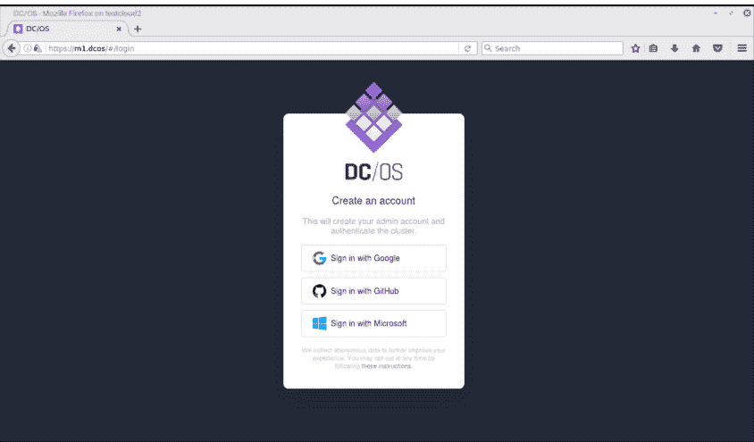
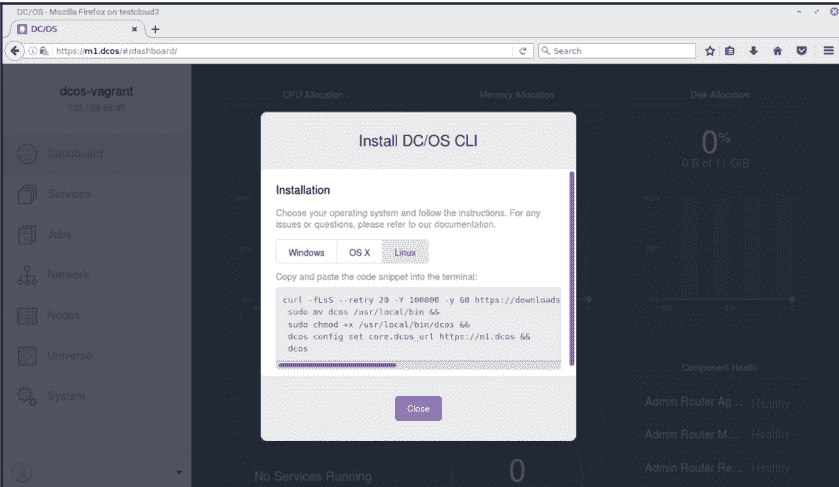
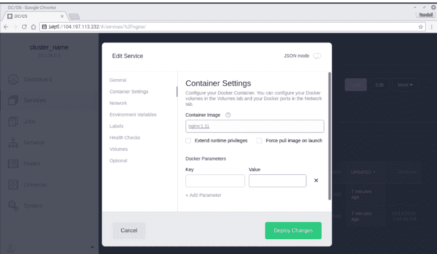
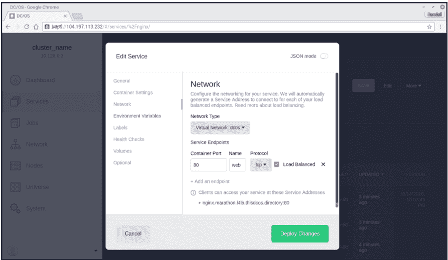

# 使用 Mesosphere

Apache Mesos 是一个分布式内核。它允许你在一组服务器上工作，就像它们是一个单一资源一样。Mesosphere 和 DC/OS 在此基础上构建，为运行任何工作负载（包括 Docker 容器）提供了一个强大的系统。对 Cassandra 和 Jenkins 等分布式工作负载以及 Docker 的原生支持，构成了一个强大的组合。

Microsoft 的 Azure 容器服务（ACS）基于 DC/OS。2016 年 3 月，Mesosphere 将 DC/OS 开源，使入门比以往任何时候都更容易。

本章将探讨使用 Mesosphere 来管理和部署基于 Docker 的应用程序。它将涵盖部署、缩放和升级新应用程序。它还将展示如何使用带有 Marathon 负载均衡功能的内置覆盖网络。最后，本章将介绍使用卷来持久化数据以及如何使用私有镜像仓库。

本章将涵盖以下主题：

- 安装 Mesos 和 DC/OS
- 管理容器和应用程序
- 缩放应用程序
- 使用健康检查
- 缩放应用程序
- 使用零停机升级更新应用程序
- 连接到 Mesos 覆盖网络
- 使用虚拟 IP 和 Marathon 负载均衡器
- 使用本地卷和外部卷
- 使用私有镜像仓库

## 开始使用 DC/OS

安装 DC/OS 是一个在此处不予详述的复杂过程，且说明因环境而异。在开始此过程之前，请务必阅读文档。有些功能（例如主节点的数量或外部持久存储）必须在安装时启用，以后若不重新安装便无法更改。安装说明可在 https://dcos.io/docs/1.8/administration/installing/ 查阅。

让 Mesosphere 运行起来最简单的方法是在 AWS 上使用堆栈安装，或使用运行 Mesosphere 的 ACS。

如果你是手动安装或在本地硬件上安装，需要注意以下几点：

- 节点必须至少拥有两个内核或虚拟处理器。
- DC/OS 节点必须运行 CoreOS 7、RHEL 7 或 CoreOS。
- 集群中的所有节点必须启用 NTP。NTP 服务器在 /etc/systemd/timesyncd.conf 中设置。设置 NTP 服务器后，运行 systemctl enable systemd-timedated.service 和 systemctl start systemd-timedated.service 以启用并启动 systemd 内部 NTP 客户端。以下是用于 GCE 的 timesyncd.conf 示例：

```
[Time]
NTP=time1.google.com time2.google.com
time3.google.com time4.google.com
FallbackNTP=0.pool.ntp.org 1.pool.ntp.org
0.fr.pool.ntp.org
```

## 登录 Web 界面

安装 DC/OS 后，即可使用 Web 界面登录。Mesosphere 使用 OAuth 进行 Google、GitHub 或 Microsoft 账户身份验证。登录后，你将被引导至 Mesosphere **控制面板**。在那里，你可以开始管理应用程序或安装命令行客户端 `dcos`：



## 安装 DC/OS 客户端

安装 DC/OS 后，登录网站。在左下角，弹出菜单中有一个标记为 **安装 CLI** 的链接。点击此链接后打开的窗口中有适用于 Windows、OS X 和 Linux 的客户端安装说明：



客户端也可以手动安装。在 Linux 上，安装命令如下：

```
$ wget -O dcos
https://downloads.dcos.io/binaries/cli/linux/x86-64/dcos-1.8/dcos
$ chmod +x dcos
$ sudo cp dcos /usr/local/bin/
$ dcos config set core.dcos_url https://m1.dcos
```

将 URL 中的版本号更改为与主服务器版本匹配的版本。在本示例中，它是 1.8。最后一条命令配置 DC/OS 主服务器的位置。将传递给 `dcos config` 的 URL 更改为适合你环境的适当地址。如果你没有有效的 SSL 证书，`dcos` 可以配置为忽略验证：

```
$ dcos config set core.ssl_verify false
```

安装 dcos 后，即可登录：

```
$ dcos auth login
```

现在在浏览器中访问以下链接：

```
https://m1.dcos/login?redirect_uri=urn:ietf:wg:oauth:2.0:oob
```

输入身份验证令牌：

转到指示的 URL。DC/OS 将尝试通过 https://auth0.com/ 使用 OAuth 2 对你进行身份验证。复制令牌并将其粘贴到 shell 中。你现在应该已登录并准备好使用命令行。

## 管理应用程序

Mesos 集群使用 dcos 工具和 Web 界面进行管理。Mesos 中的应用程序由 Marathon 调度器处理，并以 JSON 格式定义。

### 运行简单应用程序

让我们从运行 Nginx 的简单容器开始。创建一个名为 nginx.json 的文件，包含以下定义：

```
{
    "id" : "simple-nginx",
    "instances" : 1,
    "cpus" : 0.25,
    "mem" : 64.0,
    "container" : {
        "type" : "DOCKER",
        "docker" : {
            "image" : "nginx:1.11",
            "network" : "HOST"
        }
    }
}
```

id 标签是服务的名称。它在服务列表中显示。instances 标签告诉 Marathon 只需要一个实例。以后可以根据需要增加或减少。

`cpus` 和 `mem` 标签是 Marathon 所需 CPU 百分比和 RAM 用量的提示。它们不会在 Docker 中实际设置资源限制。但是，Marathon 可能会终止使用超过分配资源的任务。在此示例中，应用程序请求 25% 的 CPU 和 64 MB 的 RAM。在应用程序创建后，若不重新部署应用程序，则无法更改这些设置。

`container` 标签是定义 Docker 容器的位置。因为这是 Docker 容器，`type` 标签设置为 `DOCKER`。镜像在 `image` 标签中设置。这与将传递给 `docker run` 的镜像名称相同。

最后，`network` 标签设置为 `HOST`，这告诉 Docker 引擎使用主机网络。本章后面将使用其他网络类型，但目前这足够了。

使用 `dcos marathon app add nginx.json` 启动服务。如果一切顺利，该命令不会产生任何输出。否则，将显示错误。使用 `dcos marathon app list` 验证应用程序是否正在运行：

```
$ dcos marathon app list
ID                MEM   CPUS   TASKS   HEALTH  DEPLOYMENT  CONTAINER  CMD
/simple-nginx     64    0.25   1/1     ---     ---         DOCKER     None
```

Nginx 正在运行，但你如何访问它呢？由于使用了主机网络，你可以将 Web 浏览器指向容器运行所在节点的外部 IP 地址。主机地址可在 Web 界面的服务详细信息中查看，或通过运行 `dcos marathon app show simple-nginx` 获取。

### 停止应用程序

可以使用 `dcos marathon app stop` 命令停止服务而不将其从 Marathon 中移除。Marathon 将创建一个部署，将服务缩放为零个任务。Web 界面将此称为**挂起**应用程序：

```
$ dcos marathon app stop simple-nginx
Created deployment e5be6896-f593-4a32-852f-30bd98551a0e
$ dcos marathon app list
ID                MEM   CPUS   TASKS   HEALTH  DEPLOYMENT  CONTAINER  CMD
/simple-nginx     64    0.25   0/0     ---     ---         DOCKER     None
```


## 删除应用程序

当服务不再需要时，可以使用 `dcos marathon app remove` 将其移除。应用程序不必停止即可移除。Marathon 会停止运行中的容器，并从列表中移除应用程序：

```
$ dcos marathon app remove simple-nginx
```

## 强制 Marathon 拉取镜像

在集群中运行容器时最大的问题之一，就是确保正在运行的镜像是最新的。请记住，Docker 缓存的镜像是从注册表下载的。如果容器使用 `nginx` 镜像启动，而发布了修复安全漏洞的新版本，该主机上的容器将继续运行存在漏洞的版本。

Marathon 提供 `forcePullImage` 选项，强制节点在每次启动应用程序时都拉取新镜像。它位于容器规范的 `docker` 部分中。以下示例演示其工作原理：

```
"docker" : {
    "image" : "nginx:latest",
    "forcePullImage" : true
}
```

确保您的注册表能够处理负载。如果有大量拉取镜像的应用程序启动，则可能会使注册表不堪重负。

## 使用环境变量

某些 Docker 镜像需要使用环境变量才能运行。例如，官方 MySQL 镜像使用它们来设置初始 root 密码。Marathon 使用 `env` 标签将环境变量传递给任务。在此示例中，正在设置环境变量 `MYSQL_ROOT_PASSWORD` 和 `MYSQL_DATABASE`：

```
{
    "id": "/mysql",
    "instances": 1,
    "cpus": 1,
    "mem": 1024,
    "env": {
        "MYSQL_ROOT_PASSWORD": "password",
        "MYSQL_DATABASE": "mydb"
    },
    "container": {
        "docker": {
            "image": "mysql:5.7",
            "forcePullImage": true,
            "network": "HOST"
        }
    }
}
```

## 缩放应用程序

Marathon 使调整应用程序任务数量变得非常容易。这不仅允许扩展以应对增加的负载，还允许进行蓝绿部署，这将在本章后面介绍。

假设有一个名为 nginx 的应用程序正在运行一个实例。要将其增加到两个实例，只需运行 dcos marathon app update：

```
$ dcos marathon app update nginx instances=2
Created deployment 8dbf3d16-44d3-4478-9366-9743658dcfcd
```

此示例将实例数设置为两个。同样，应用程序也可以扩展或缩减。Marathon 会尝试启动或停止所需的实例数量，以满足新要求。

请确保您的应用程序支持运行多个实例。特别是数据库，对其他进程更改其文件的反应不佳。

## 检查应用程序健康状况

Marathon 与 Kubernetes 非常相似，支持为服务设置一个或多个健康检查选项，以确保其在可用于处理请求之前运行正常。有运行自定义检查命令、检查 TCP 连接或检查特定路径 HTTP 状态的选项。

### 使用 TCP 和 HTTP 检查

以下是 MySQL 的 TCP 检查示例。`protocol` 选项指示这是 TCP 检查。`portNumber` 定义要连接的端口。或者，可以将其替换为 `portIndex`，它将检查应用程序定义中 `ports` 或 `portDefinition` 列表的索引。索引从零开始，因此第一个条目是 0，第二个条目是 1，依此类推：

```
"healthChecks": [
{
"protocol": "TCP",
"portNumber": 3306,
"gracePeriodSeconds": 300,
"intervalSeconds": 60,
"timeoutSeconds": 20,
"maxConsecutiveFailures": 3
}
]
```

有许多可用于每种检查类型的设置，如下所示：

- `gracePeriodSeconds`: 在抛出错误前等待的秒数。它允许 MySQL 等需要启动时间的容器在抛出错误前完成初始化。如果在宽限期结束前检查通过，应用程序会立即标记为健康。
- `intervalSeconds`: 检查之间等待的秒数。
- `timeoutSeconds`: 如果在指定的秒数内没有响应，则检查失败。
- `maxConsecutiveFailures`: 如果健康检查连续失败指定次数且没有成功，则任务会被终止并重启。
- `taskKillGracePeriodSeconds`: 当任务失败次数过多时，Marathon 会发送 `SIGTERM` 信号。如果在经过指定秒数后任务仍未停止，Marathon 将发送 `SIGKILL` 任务。默认为三秒。

HTTP 和 HTTPS 协议检查给定路径的 HTTP 状态码。可以设置 `path` 选项，它定义要测试的路径。默认值为 /。HTTP 和 HTTPS 检查还使用前面描述的 `portNumber` 和 `portIndex` 选项。HTTPS 协议用于检查启用 SSL 的网站。它不检查 SSL 证书的有效性。

默认情况下，只有 200-399 范围内的状态码被视为健康。您可以通过将 `ignoreHttp1xx` 设置为 `true` 来配置检查以忽略 100-199 的状态码。其他所有状态码都被视为失败。

### 使用命令检查

也可以使用自定义命令检查健康状态。如果命令以真值退出，则检查被视为成功，通常在 sh 中为 0。其他任何情况都被视为失败。以下示例向应用程序添加命令检查：

```
{
  "id" : "nginx-health",
  "instances" : 1,
  "cpus" : 0.25,
  "mem" : 64.0,
  "labels" : {
    "HAPROXY_GROUP" : "external"
  },
  "container" : {
    "type" : "DOCKER",
    "docker" : {
      "image" : "nginx",
      "network" : "BRIDGE",
      "portMappings" : [
        {
          "hostPort" : 0,
          "containerPort" : 80,
          "servicePort" : 80,
          "name" : "web"
        }
      ]
    }
  },
  "upgradeStrategy" : {
    "minimumHealthCapacity" : 1,
    "maximumOverCapacity" : 1
  },
  "healthChecks" : [
    {
      "protocol" : "COMMAND",
      "command" : {
        "value" : "your_check_health_command.sh"
      }
    }
  ]
}
```

命令传递给 /bin/sh -c "”。命令中的任何双引号都必须转义。为使事情更加复杂，转义字符（\）也必须转义。包含双引号组件的命令类似于以下内容：

```
"healthChecks" : [
  {
    "protocol" : "COMMAND",
    "command" : {
      "value" : "your_check_health_command.sh "Foo""
    }
  }
]
```

## 部署滚动更新

现有应用程序使用 dcos marathon update 进行更新。此命令之前用于调整应用程序实例数量。它也可用于更新应用程序以使用新镜像：

```
{
  "id" : "nginx",
  "instances" : 1,
  "cpus" : 0.25,
  "mem" : 64.0,
  "container" : {
    "type" : "DOCKER",
    "docker" : {
      "image" : "nginx:1.10",
      "network" : "HOST"
    }
  }
}
```

这是一个简单的 Nginx 应用程序。

请注意，镜像标签设置为 nginx:1.10。碰巧 1.11 已发布，现在是时候更新应用程序了。有两种方法可以做到这一点。

最简单的方法是在 Web 界面中编辑应用程序。在 **容器设置** 中，将 **容器镜像** 改为 `nginx:1.11` 并单击 **部署更改**。将创建一个新部署，该部署将创建运行 `nginx:1.11` 镜像的新任务并结束旧任务：



第二种方法是使用 `dcos marathon update`。如果应用程序已在 JSON 文件中定义，此方法效果最佳。创建新文件或编辑定义 Nginx 应用程序的现有文件。将镜像标签更改为 `nginx:1.11`：

```
{
  "id" : "nginx",
  "instances" : 1,
  "cpus" : 0.25,
  "mem" : 64.0,
  "container" : {
    "type" : "DOCKER",
    "docker" : {
      "image" : "nginx:1.11",
      "network" : "HOST"
    }
  }
}
```


文件更改后，可以将其传递给 `dcos`：

```
$ dcos marathon app update nginx < nginx-1.11.json
Created deployment 2c28f5db-0fcd-4605-9d5b-b1abd5986579
```

同样，Marathon 将使用更新后的镜像替换旧任务。部署完成后，可以验证应用程序是否正在运行新镜像：

```
$ dcos marathon app show nginx | grep image
"image": "nginx:1.11",
```

## 设置升级策略

应用程序可以定义升级策略以控制如何替换应用程序任务。默认情况下，Marathon 会在停止旧任务之前启动所有新任务。这可能会出于两个原因造成问题：

- 首先，如果应用程序无法处理多个任务向同一卷写入数据，则更新可能会损坏数据
- 其次，您需要有足够的容量来运行所有这些额外任务

为解决此问题，Marathon 允许为应用程序设置 `upgradeStrategy`：

```
"upgradeStrategy": {
"minimumHealthCapacity": 1
}
```

`minimumHealthCapacity` 选项是 0 到 1 之间的值。设置为 1 时，新实例在停止旧实例之前启动。设置为 0 时，所有旧实例在新实例启动之前停止。这解决了第一个问题。从技术上讲，它也解决了第二个问题，但当实例数量过低，无法为尝试访问它的客户端提供服务时，可能会出现明显的停机时间。

为在尽量减少对客户端影响的情况下平滑更新应用程序，`minimumHealthCapacity` 可以设置为 0 到 1 之间的分数。此值表示将应用程序缩减到的运行实例百分比。例如，如果有十个实例且 `minimumHealthCapacity` 设置为 `0.4`（40% 容量），应用程序将缩减到四个实例，并启动六个新实例。超过 `0.5` 的任何值意味着升级需要额外容量。如果新实例没有错误，其余旧实例将关闭，新实例将启动以取代它们。

## 使用蓝绿部署测试更新

内置更新机制非常适合自动部署应用程序的新版本。但是，在某些情况下，可能需要更缓慢地推出更新以验证不会对最终用户产生影响。如果更新带来重大变化，这尤其有用。

蓝绿部署是用新版本（称为绿色）缓慢替换旧应用程序（称为蓝色）。在 Marathon 中，此手动过程是通过创建使用更新镜像的新应用程序来完成的。为新应用程序指定一个标题，使其明显是新应用程序。

绿色应用程序启动少量任务，通常只有一个。一旦健康检查显示一切就绪，绿色应用程序将被添加到服务的负载均衡器。假设有较多数量的旧蓝色任务正在运行，大多数请求将发送到那里。不过，少量请求将发送到绿色应用程序。

一旦请求开始发送到绿色应用程序，就可以监控可能需要回滚的错误或其他问题。随着测试通过，绿色应用程序可以扩展，蓝色应用程序可以缩减。这是一个可以花费所需时间的手动过程。在选择扩展绿色应用程序之前，等待数小时或数天并不罕见。如果出现问题，绿色应用程序可以缩减或完全从负载均衡器中删除。

当您确信绿色应用程序已完全准备好投入生产时，绿色应用程序可以扩展到所需的任务数量，蓝色应用程序可以缩减到零并从负载均衡器中删除。此时，应用程序已完全升级。一旦明确不再需要蓝色应用程序进行回滚，就可以将其从系统中删除。

有关蓝绿部署及其脚本化的更多信息可在此处查阅：https://mesosphere.github.io/marathon/docs/blue-green-deploy.htm 1.

## 介绍 Pod

随着 1.9 版本的发布，DC/OS 引入了 Pod。DC/OS 和 Marathon 中的 Pod 与 Kubernetes 中的 Pod 非常相似。它们允许将多个容器分组到单个对象中。所有容器可以共享卷并通过 localhost 相互通信。

## 使用网络服务和负载均衡

Mesosphere 提供多种网络服务，使编排更加容易。这些服务为运行中的应用程序提供服务发现和负载均衡。

## 使用 DNS 发现服务

创建的每个服务都会在 Mesos DNS 中分配一个主机名。条目为 service-name.marathon.mesos，其中 service-name 是 id 字段中的服务名称。以下片段来自 id 设置为 simple-nginx 的服务。Mesos DNS 将创建名为 simple-nginx.marathon.mesos 的记录：

```
{
  "id" : "simple-nginx",
  ...
}
```

因为服务直接翻译为 DNS 主机名，存在一些限制，如下所示：

- 首先，名称只能包含字母、数字和短划线 (-)。
- 其次，名称必须短于 24 个字符。较长的名称会被缩短。如果两个服务最终具有相同的主机名，这可能会导致问题。一个服务中运行的任务可能会被返回给另一个服务。

还可以使用 REST API 通过 HTTP 查询 DNS 服务。条目以 JSON 格式返回。以下示例获取 simple-nginx 服务的 IP 信息：

```
$ curl http://master.mesos:8123/v1/hosts/simple-nginx.marathon.mesos
[
  {
    "host": "simple-nginx.marathon.mesos.",
    "ip": "10.128.0.4"
  }
]
```

## 连接到覆盖网络

迄今，示例使用了主机网络。DC/OS 在安装时创建 Docker 覆盖网络。将应用程序连接到覆盖网络可启用负载均衡以及跨网络连接其他服务的功能：

```
{
"id" : "nginx-overlay",
"instances" : 1,
"cpus" : 0.25,
"mem" : 64.0,
"container" : {
"type" : "DOCKER",
"docker" : {
"image" : "nginx",
"network" : "USER"
}
},
"ipAddress":{
"networkName":"dcos"
}
}
```

前面的示例创建了一个名为 nginx-overlay 的服务，该服务连接到覆盖网络。network 标签设置为 USER，networkName 标签设置为覆盖网络的名称，在此例中为 dcos。

## 使用虚拟 IP

Marathon 可以将基于名称的虚拟 IP 分配给服务。虚拟 IP 为其附加的服务提供四层负载均衡。集群中的任务随后可以使用虚拟 IP 访问服务。

若要添加虚拟 IP，请在 Web 界面中单击服务，然后单击 **编辑** 按钮。转到 **网络** 部分。选择 **虚拟网络**。这与将服务连接到覆盖网络相同。输入 **容器端口**、**名称** 和 **协议**，然后单击 **负载均衡** 旁边的复选框。如果需要更多端口，请单击 **添加端点** 链接。完成后，单击 **部署更改**：



服务将被分配一个如 `service-name.marathon.14lb.thisdcos.discovery` 的名称，其中 `service-name` 是服务的名称。对于名为 `nginx` 的服务，名称是 `nginx.marathon.14lb.thisdcos.discovery`。随后可以在集群中的任何位置使用虚拟 IP 访问该服务：

```
$ curl nginx.marathon.14lb.thisdcos.discovery:80
<!DOCTYPE html>
<html>
...
```

## 使用 Marathon 负载均衡器

Marathon 提供名为 Marathon-LB 的第二个负载均衡器。它是基于 HAProxy 的服务，可以处理多个服务，并可根据 Web 服务的主机名进行代理。Marathon-LB 是通过 DC/OS 包管理器安装的插件：

```
$ dcos package install marathon-lb
We recommend a minimum of 0.5 CPUs and 256 MB of RAM available for the
Marathon-LB DC/OS Service.
Continue installing? [yes/no] yes
Installing Marathon app for package [marathon-lb] version [1.4.1]
Marathon-lb DC/OS Service has been successfully installed!
See https://github.com/mesosphere/marathon-lb for documentation.
```

`dcos` 命令将安装 Marathon-LB。默认情况下，安装配置为提供外部请求。负载均衡器在 DC/OS 中显示为名为 marathon-lb 的服务。

将新服务添加到负载均衡器非常简单。以下是运行 nginx 的服务：

```
{
  "id" : "nginx-mlb",
  "instances" : 1,
  "cpus" : 0.25,
  "mem" : 64.0,
  "labels" : {
    "HAPROXY_GROUP" : "external"
  },
  "container" : {
    "type" : "DOCKER",
    "docker" : {
      "image" : "nginx",
      "network" : "BRIDGE",
      "portMappings" : [
        {
          "hostPort" : 0,
          "containerPort" : 80,
          "servicePort" : 10001,
          "name" : "web"
        }
      ]
    }
  },
  "upgradeStrategy": {
    "minimumHealthCapacity": 1,
```


```
"maximumOverCapacity": 1
}
}
```

HAPROXY_GROUP 标签告诉 Marathon，该服务将使用外部 HAProxy 组，该组由 marathon-lb 服务提供。

其他重要设置位于 portMappings 列表中。此示例定义了一个要通过负载均衡器公开的单个端口。containerPort 是容器正在监听的端口。hostPort 是容器将在主机上监听的端口。如果缺失或设置为 0，容器将被分配一个随机端口。即使设置为 0，也需要 hostPort，以便在集群外部提供容器的服务。

最后，servicePort 是负载均衡器上将为该应用程序提供服务的端口。在此示例中，外部客户端将通过端口 10001 连接到负载均衡器以访问此应用程序。在实践中，将使用外部负载均衡器（例如 AWS 上的 ELB）来提供从标准端口到负载均衡器中配置的端口的映射。

默认情况下，Marathon-LB 配置为使用服务端口 10000 到 10100、80 和 443。任何将使用此负载均衡器的服务都必须从这些端口中为 servicePort 选择一个可用端口。请确保端口不重叠。

可以运行多个负载均衡器。但是，负载均衡器在节点上以主机模式运行，这意味着只能运行与工作节点数量相同的负载均衡器。

运行其他负载均衡器非常简单。首先，创建一个名为 options.json 的文件，包含以下内容：

```
{
"marathon-lb": {
	"name": "marathon-lb-internal",
	"haproxy-group": "internal",
	"bind-http-https": false,
	"role": ""
}
}
```

name 选项是新服务的名称。haproxy-group 选项设置 HAProxy 组。此组是要放入服务中的 HAPROXY_GROUP 标签。Marathon 将使用与组匹配的任意负载均衡器。通过运行以下命令创建新的负载均衡器：

```
$ dcos package install --options=lb-options.json marathon-lb
We recommend a minimum of 0.5 CPUs and 256 MB of RAM available for the
Marathon-LB DCOS Service.
Continue installing? [yes/no] yes
```

如果有可用资源，负载均衡器将启动并准备好处理请求。

## 提供持久存储

运行像这样的临时容器固然很好，但更复杂的工作负载需要某种形式的额外存储。DC/OS 和 Marathon 提供了两个选项。第一个是本地存储，它仅在任务启动的节点上可用。第二个是外部卷，它们在集群中的任何位置都可用。

> 在撰写本文时，卷被视为实验性功能。该功能可能会更改。

## 使用本地卷

本地持久卷是分配在节点上的数据块，在应用程序升级和重启后仍然存在。由于卷位于单个节点上，应用程序固定到该节点，并始终在该节点上启动。这意味着数据始终可用于应用程序，但也意味着如果该节点消失，应用程序将无法启动。以下示例演示如何添加本地卷：

```
{
 "id" : "nginx-volume",
 "instances" : 1,
 "cpus" : 0.25,
 "mem" : 64.0,
 "container" : {
 "type" : "DOCKER",
 "docker" : {
 "image" : "nginx",
 "network" : "USER"
 },
 "volumes" : [
 {
 "containerPath" : "website",
 "mode" : "RW",
 "persistent" : {
 "size" : 20
 }
 }
 ],
 "ipAddress" : {
 "networkName" : "dcos"
 },
 "residency": {
 "taskLostBehavior": "WAIT_FOREVER"
 }
 }
```

此示例创建一个具有本地持久卷的应用程序。卷在容器定义中使用 `volumes` 块创建。卷的路径由 `containerPath` 设置。路径不能包含正斜杠 (`/`) 。在容器内，卷将在 `/mnt/mesos/sandbox/containerPath` 中可用。在此示例中，`website` 卷将是 `/mnt/mesos/sandbox/website`。

`mode` 选项只能是 `RW`，它赋予容器对卷的读写访问权限。随着卷功能的开发，可能会添加其他模式。`persistent` 块仅有 `size` 选项，用于定义要分配的空间大小（以 MiB 为单位）。

最后，必须定义一个 `residency` 块，并将 `taskLostBehavior` 设置为 `WAIT_FOREVER`。这向 Marathon 表明该应用程序是有状态的。

某些应用程序不允许更改数据所在的路径。这对 MySQL 等应用程序可能是个问题。由于无法指定特定路径，Marathon 有解决办法。诀窍是指定第二个卷：

```
{
"id" : "nginx-volume",
"instances" : 1,
"cpus" : 0.25,
"mem" : 64.0,
"container" : {
"type" : "DOCKER",
"docker" : {
"image" : "nginx",
"network" : "USER"
},
"volumes" : [
{
    "containerPath" : "website",
    "mode" : "RW",
    "persistent" : {
        "size" : 20
    }
},
{
    "containerPath" : "/var/lib/www",
    "mode" : "RW",
    "hostPath" : "website"
}
],
"ipAddress" : {
    "networkName" : "dcos"
},
"residency" : {
    "taskLostBehavior" : "WAIT_FOREVER"
}
}
```

此示例扩展了前一个示例，将 `website` 卷挂载到 `/var/lib/www`。
第二个卷使用 `hostPath`，它与持久卷的 `containerPath` 匹配。由于使用了 `hostPath`，`containerPath` 可以指向容器文件系统中的任何位置。存储在卷上的数据同时可用于 `/mnt/mesos/sandbox/website` 和 `/var/lib/www`。

### 使用外部卷

本地持久卷最大的缺点是数据被困在单个节点上。如果该节点失败，数据将不再可访问。外部卷允许应用程序在运行应用程序的节点之外存储数据。应用程序可以在集群中的任何位置启动，并仍然访问其数据。

Mesosphere 使用 REX-Ray 来管理对外部存储的访问。REX-Ray 支持 Amazon EC2、GCE、OpenStack 等。支持的存储驱动程序的完整列表可在 `https://rexray.readthedocs.io/en/v0.3.3/user-guide/storage-providers/` 上查看。

安装 Mesosphere 时必须启用外部存储。配置在安装包的 `genconf/config.yaml` 中启用。具体细节将取决于使用的驱动程序。以下是 GCE 的示例：

```
rexray_config:
  rexray:
    loglevel: info
    modules:
      default-admin:
        host: tcp://127.0.0.1:61003
    storageDrivers:
      - gce
    gce:
      keyfile: /path/to/gce-auth.json
```

可以在 `storageDrivers` 部分中设置多个存储驱动程序。每个存储驱动程序将有自己的配置部分。对于 GCE，`keyfile` 是 API 门户中的 JSON 格式凭据。

以下示例展示如何使用外部卷。provider 的唯一选项是 `dvdi`，并将 `dvdi/driver` 选项设置为 `rexray`。`name` 的值是存储提供商中卷的名称。在以下示例中，`testpd` 卷将从存储提供商加载：

```
{
  "id" : "nginx-volume",
  "instances" : 1,
  "cpus" : 0.25,
  "mem" : 64.0,
  "container" : {
    "type" : "DOCKER",
    "docker" : {
      "image": ["nginx"],
      "network" : "USER"
    }
  },
  "volumes" : [
    {
      "containerPath" : "website",
      "mode" : "RW",
      "external" : {
        "size" : 200,
        "name" : "testpd",
        "provider" : "dvdi",
        "options" : {
          "dvdi/driver" : "rexray"
        }
      }
    }
  ]
}
],
"ipAddress" : {
"networkName" : "dcos"
},
"residency": {
"taskLostBehavior": "WAIT_FOREVER"
}
}
```

本地卷的卷命名规则也适用于外部卷。如果卷要挂载到特定路径，则必须使用第二个卷，如前面所示。

Mesosphere 只允许应用程序的单个实例挂载特定外部卷。任务可以缩减到零。卷将持续存在，并在应用程序重新扩展时准备好使用。

使用外部持久卷时，还需牢记以下几点：

- 销毁关联的集群时，卷不会被销毁。您需要负责卷清理。
- 对于某些提供程序，在特定区域或区中创建的映像仅可供在同一区域或区中运行的主机使用。
- 确保卷名称是唯一的，以避免冲突。
- 请确保使用兼容版本的 Docker。REX-Ray 文档建议使用 Docker 1.10.2 或更高版本。

## 使用私有注册表

Mesosphere 有能力使用私有 Docker Registry 来存放镜像。镜像可以从本地注册表中拉取，方法与使用 Docker 相同；使用注册表地址后跟镜像名称。例如，要使用 registry.example.com 上的 myapp 镜像，您将镜像设置为 registry.example.com/myapp。

也可以在 Mesosphere 集群上托管私有注册表。注册表可以使用主机网络设置，也可以将 VIP 或 Marathon-LB 用作负载均衡器。以下示例创建了一个使用 Marathon-LB 的不安全注册表：


 {
  "id" : "registry",
  "cpus" : 0.5,
  "mem" : 128,
  "instances" : 1,
  "labels" : {
    "HAPROXY_GROUP" : "external"
  },
  "container" : {
    "type" : "DOCKER",
    "docker" : {
      "network" : "BRIDGE",
      "image" : "registry:2",
      "portMappings" : [
        {
          "containerPort" : 5000,
          "hostPort" : 0,
          "servicePort" : 10003
        }
      ]
    },
    "volumes" : [
      {
        "containerPath" : "registry",
        "mode" : "RW",
        "persistent" : {
          "size" : 2048
        }
      }
    ]
  },
  "env" : {
    "STORAGE_PATH" : "/mnt/mesos/sandbox/registry"
  },
  "residency" : {
    "taskLostBehavior": "WAIT_FOREVER"
  }
 }

本示例不使用 TLS 密钥来保护注册表。如需使用它们，必须使用 --insecure-registry 标志配置 Docker 守护进程。证书可以通过卷添加。然后可以使用 REGISTRY_HTTP_TLS_CERTIFICATE 和 REGISTRY_HTTP_TLS_KEY 环境变量分别设置证书和密钥的路径。

在前面的示例中，注册表存储在卷上。STORAGE_PATH 环境变量用于配置注册表使用该位置。虽然本示例使用本地持久卷，但应为注册表设置外部卷。注册表不应依赖于在特定节点上运行。

有关运行私有注册表的更多详细信息，请参阅 DC/OS 文档以及位于 https://dcos.io/docs/1.8/usage/tutorials/registry/ 和 https://hub.docker.com/_/registry/ 的注册表文档。

## Summary

本章介绍了使用 Mesosphere 管理应用程序的基础知识。演示了如何创建应用程序、对其进行扩展、在不停机的情况下进行升级以及删除它们。还展示了如何使用内置负载均衡器以及如何运行私有注册表。下一章将介绍其他不太知名的编排工具，包括 CoreOS Fleet 和 Rancher Cattle。
