# 使用更简单的编排工具 – Fleet 和 Cattle

Docker Swarm、Kubernetes 和 Mesosphere 是 Docker 编排领域的主要参与者，但远非唯一选择。在某些情况下，它们过于复杂。本章将介绍另外两种选择——Fleet 和 Cattle。每种工具都有其自身的优势和劣势。Fleet 是一种低级别工具，非常适合小型环境或作为其他工具的基础。Cattle 是一套功能齐全的编排工具集，比 Kubernetes 或 Mesosphere 更简单易用。

本章将涵盖以下主题：

- 使用 Fleet
  - 安装 Fleet
  - 使用 `fleetctl` 启动、停止和移除服务
  - 使用 Fleet 单元文件中的环境变量来配置容器
  - 为高可用性设置服务亲和性和反亲和性
  - 使用 sidekick 服务
  - 运行全局服务
- 使用 Rancher Cattle
  - 安装 Rancher Server、代理和客户端
  - 使用 `rancher-compose` 管理应用程序堆栈
  - 执行零停机升级
  - 配置运行状况检查
  - 使用内置的 DNS 发现和负载均衡服务

## 使用 Fleet

Fleet 由 CoreOS 公司开发，用于管理 CoreOS 集群中的容器。它是一种低级别工具，其他工具可以在此基础上构建。Fleet 的限制大约为 100 个节点和 1,000 个服务。话虽如此，对于小型集群，它可以提供足够的编排来满足组织的需求。它还可以为构建内部流程提供坚实基础。

像所有 Docker 编排工具一样，Fleet 需要一个覆盖网络。CoreOS 预安装了 Flannel，但可以使用任何 Docker 覆盖网络。这包括 Docker 原生覆盖网络和 Weave Net。覆盖网络在第 3 章“集群构建块 – 注册表、覆盖网络和共享存储”中有所描述。需要注意的是，Flannel 和 Fleet 均不提供任何形式的服务发现。如果需要该功能，可以改用提供服务发现的覆盖网络，例如 Weave Net。

### 启动 Fleet

由于 Fleet 是由 CoreOS 开发的，因此使用它是最简单的方法。如第 1 章“使用 Docker 编排入门”中所述，CoreOS 的 Linux Container 是专门为运行容器而设计的 Linux 发行版。它在启动时使用 Cloud-Init 配置整个系统。这包括 Fleet。

Fleet 使用 etcd 来存储集群配置并进行通信。第 3 章“集群构建块 – 注册表、覆盖网络和共享存储”介绍了如何在 CoreOS 上为 Flannel 覆盖网络设置 etcd。Fleet 使用完全相同的过程。所需要做的就是确保在 cloud-config 文件中启用了 Fleet：

```
#cloud-config

coreos:
  etcd2:
    discovery: https://discovery.etcd.io/<token>
    advertise-client-urls:
    http://$private_ipv4:2379,http://$private_ipv4:4001
    initial-advertise-peer-urls: http://$private_ipv4:2380
    listen-client-urls:
    http://0.0.0.0:2379,http://0.0.0.0:4001
    listen-peer-urls: http://$private_ipv4:2380
  flannel:
    public_ip: $private_ipv4
    etcd_endpoints: http://$private_ipv4:2379
  fleet:
    public_ip: $private_ipv4
    etcd_servers: http://$private_ipv4:2379
    units:
    - name: etcd2.service
      command: start
    - name: fleet.service
      command: start
    - name: flanneld.service
      command: start
    drop-ins:
    - name: 50-networking-config.conf
      content: |
        [Service]
        ExecStartPre=/usr/bin/etcdctl set
        /coreos.com/network/config
        '{"Network":"10.42.0.0/16"}'
    - name: docker.service
      command: start
      drop-ins:
      - name: 40-flannel.conf
        content: |
        [Unit]
        Requires=flanneld.service
        After=flanneld.service
```

这是第 3 章“集群构建块 – 注册表、覆盖网络和共享存储”中的示例 cloud-config 文件，其中配置了确保 CoreOS 启动时启动 fleet 服务的部分，已加以突出显示。

对于新集群，请将 <token> 替换为由 `wget -qO - 'https://discovery.etcd.io/new?size=3'` 生成的令牌，其中 size 是集群中的初始主机数量。如果要添加主机，请使用集群中原始主机所用的相同令牌。

### 验证集群

节点启动后，有两个命令可用于验证所有节点是否正在正常通信。首先，使用 etcdctl cluster-health 确保 etcd 可以看到集群中的所有节点：

```
$ etcdctl cluster-health
member 577728b97424518 is healthy: got healthy result from
http://172.17.8.103:2379
member 82f8a69dac8afeb3 is healthy: got healthy result from
http://172.17.8.102:2379
member d263b74b628b0458 is healthy: got healthy result from
http://172.17.8.101:2379
cluster is healthy
```

本示例来自一个三节点集群。etcdctl 的输出将列出集群中的每个主机及其状态。重要的是最后一行，它显示集群状态正常。

另一个命令是 fleetctl list-machines。此命令将列出集群中的每台机器以及已在其上设置的任何元数据：

```
$ fleetctl list-machines
MACHINE		IP		METADATA
86bceaea...	172.17.8.103	-
9c07271b...	172.17.8.102	-
abc0cfa4...	172.17.8.101	-
```

fleetctl 工具使用 SSH 与集群中的其他节点通信。请确保你的公钥位于每个服务器上的 ~/.core/.ssh/authorized_keys 中。它还要求你运行一个 SSH-agent。你可以通过将 -A 传递给 ssh 命令，使用自己桌面上现有的代理。例如，ssh -A core@core-01 将以 core 用户身份连接到 core-01 服务器，并将现有代理转发到服务器。这样就可以使用自己的 SSH 密钥，而无需将私钥复制到所有 Fleet 节点。请注意，这是一个潜在的安全漏洞。

Fleet 中的服务由 systemd 单元文件定义。这些文件的工作方式与 systemd 中的任何其他单元文件相同，但有一些 Fleet 特定的扩展，允许跨集群调度服务。让我们从一个简单的 nginx 服务开始。

在当前工作目录中创建名为 nginx.service 的文件，内容如下：

```
[Unit]
Description=Nginx
After=docker.service
Requires=docker.service

[Service]
TimeoutStartSec=infinity
ExecStartPre=-/usr/bin/docker kill nginx
ExecStartPre=-/usr/bin/docker rm nginx
ExecStartPre=-/usr/bin/docker pull nginx
```


```
ExecStart=/usr/bin/docker run --name nginx -p 80:80 nginx
ExecStop=/usr/bin/docker stop nginx
```

[Unit] 部分设置服务的描述和一些元信息。Description 选项是对服务的简短、自由形式的描述。After 选项
告诉 Fleet 该服务必须在 Docker 之后启动。因为在没有 Docker 的情况下运行 Docker 容器没有意义，因此设置了 Requires 选项。对于 After 和
Requires，值均为 systemd 单元的名称。可以通过添加更多 After 或 Requires 行，或向现有行添加更多单元（用空格分隔）来向两者添加其他单元。

[Service] 部分中设置的启动服务所需的步骤。TimeoutStartSec 选项是等待服务启动的秒数。如果服务在超时窗口内未完成启动，Fleet 会假设服务失败并将其终止。

每个 ExecStartPre 行共同组成一个在启动实际服务之前运行的脚本。在命令前加上减号 (-) 告诉 systemd 允许此步骤失败。否则，任何以非零错误代码退出的命令都将阻止服务启动。

第一条命令终止现有的 nginx 容器。如果容器未运行，该命令会失败，但这没关系。终止服务可能看起来有点极端。如果服务干净地停止，则运行中的容器将处于停止状态，kill 命令将不执行任何操作。如果服务未干净停止，docker kill 可确保服务停止，以便可以重新启动。

第二条命令从 Docker 中删除容器。如果同名容器已存在，则容器无法启动。删除容器可确保以后使用所有正确选项重新创建容器。

第三条也是最后一条 ExecStartPre 行会拉取镜像的新副本。这可确保服务不会运行过时的镜像。有人可能会认为，如果该命令失败，应阻止服务启动。允许其失败意味着，即使注册表宕机（前提是镜像已下载），服务仍可启动。

`ExecStart` 命令是实际启动服务的命令。可以指定多行，但在使用 Docker 容器时，这样做意义不大。重要的是不要将 `-d` 标志传递给 `docker run`。如果传递了，Fleet 将丢失对容器的跟踪并停止服务。

最后，`ExecStop` 是用于停止服务的命令。请记住，`docker stop` 会保留容器。这就是为什么需要在 `ExecStartPre` 中使用 `docker rm` 的原因。你也可以在此处删除容器。保留容器可以方便在出现问题时进行故障排除：

```
$ fleetctl start nginx.service
Unit nginx.service inactive
Unit nginx.service launched on 86bceaea.../172.17.8.103
```

上述命令会加载指定的单元文件并启动它。在此示例中，`nginx.service` 文件位于当前目录中。

可以使用 `fleetctl submit` 命令将单元文件添加到 Fleet 注册表中而无需立即启动。服务可以稍后使用 `fleetctl start` 启动：

```
$ fleetctl submit nginx.service
Unit nginx.service inactive
```

## 监控服务

检查服务状态有两种方法。第一种是使用相同的 `fleetctl list-units` 命令，它还会显示单元名称、分配的机器以及每个单元的当前状态：

```
$ fleetctl list-units
UNIT MACHINE ACTIVE SUB
nginx.service 86bceaea.../172.17.8.103 active running
```

另一种方法是使用 `fleetctl status`。它不仅会显示容器的状态，还会显示服务的最新日志条目以及 `ExecStartPre` 命令的状态代码：

```
$ fleetctl status nginx.service
● nginx.service - Nginx
Loaded: loaded (/run/fleet/units/nginx.service;
linked-runtime; vendor preset
Active: active (running) since Fri 2016-10-21 02:59:31
UTC; 1min 24s ago
Process: 3947 ExecStartPre=/usr/bin/docker pull nginx
(code=exited, status=0/SUCCESS
Process: 3942 ExecStartPre=/usr/bin/docker rm nginx
(code=exited, status=0/SUCCESS
Process: 3933 ExecStartPre=/usr/bin/docker kill nginx
(code=exited, status=1/FAILURE
Main PID: 3953 (docker)
    Tasks: 7
    Memory: 3.7M
    CPU: 40ms
CGroup: /system.slice/nginx.service
    └─3953 /usr/bin/docker run --name nginx -p
        80:80 nginx

Oct 21 02:59:27 core-03 systemd[1]: Starting Nginx...
Oct 21 02:59:27 core-03 docker[3933]: Error response
from daemon: Cannot kill container
Oct 21 02:59:27 core-03 docker[3942]: nginx
Oct 21 02:59:28 core-03 docker[3947]: Using default
tag: latest
Oct 21 02:59:31 core-03 docker[3947]: latest: Pulling
from library/nginx
Oct 21 02:59:31 core-03 docker[3947]: Digest:
sha256:e40499ca855c9edfb212e1c3ee1
Oct 21 02:59:31 core-03 docker[3947]: Status: Image is
up to date for nginx:latest
Oct 21 02:59:31 core-03 systemd[1]: Started Nginx.
```

## 查看服务日志

可以使用 fleetctl journal 查看单元的日志来查看服务的日志。该命令接受感兴趣的单元名称。标记为来自 Docker 的行既包括 docker 命令的输出，也包括 docker logs 的输出。可以添加 -f 标志以在添加新条目时跟踪日志：

```
$ fleetctl journal nginx.service
-- Logs begin at Thu 2016-10-20 00:35:44 UTC, end at Fri 2016-10-21
03:12:36 UTC. --
Oct 21 02:56:45 core-03 systemd[1]: Stopped Nginx.
Oct 21 02:59:27 core-03 systemd[1]: Starting Nginx...
Oct 21 02:59:27 core-03 docker[3933]: Error response
from daemon: Cannot kill container nginx: Container
816e993ec3de47cf48f5ab19900db4a162905a133078f4fbc3bd91b27b5c24b is not
running
Oct 21 02:59:27 core-03 docker[3942]: nginx
Oct 21 02:59:28 core-03 docker[3947]: Using default tag: latest
Oct 21 02:59:31 core-03 docker[3947]: latest: Pulling from library/nginx
Oct 21 02:59:31 core-03 docker[3947]: Digest:
sha256:e40499ca855c9edfb212e1c3ee1a6ba8b2d873a294d897b4840d49f94d20487c
Oct 21 02:59:31 core-03 docker[3947]: Status: Image is up to date for
nginx:latest
Oct 21 02:59:31 core-03 systemd[1]: Started Nginx.
Oct 21 03:12:32 core-03 docker[3953]: 172.16.69.1 - - [21/Oct/2016:03:12:32
+0000] "GET / HTTP/1.1" 200 612 "-" "Wget/1.18 (linux-gnu)" "-"
```

## 停止服务

运行中的服务使用 `fleetctl stop` 停止。它以服务名称作为唯一参数：

```
$ fleetctl stop nginx.service
Unit nginx.service loaded on 86bceaea.../172.17.8.103
```

`stop` 命令会停止运行中的容器，但它仍保留在集群节点上的调度状态。重新启动服务时，它将在之前运行的同一节点上启动。

要取消调度服务，请使用 `fleetctl unload` 命令。这将从活动单元列表中删除该服务。它将保留在 Fleet 注册表中，并可以使用 `fleetctl start` 再次启动：

```
$ fleetctl unload nginx.service
Unit nginx.service inactive
```

服务可以使用 `fleetctl destroy` 命令从集群中永久删除：

```
$ fleetctl destroy nginx.service
Destroyed nginx.service
```

更改单元时也会使用 `destroy` 命令。必须先使用 `fleetctl destroy` 删除服务，然后才能按所需更改重新创建它。

## 使用环境变量

许多 Docker 镜像使用环境变量进行配置并控制其运行方式。Fleet 可以使用 `Environment` 选项在服务的单元文件中定义这些变量：

```
[Unit]
Description=MySQL
After=docker.service
Requires=docker.service

[Service]
Environment=MYSQL_ROOT_PASSWORD=password
Environment=MYSQL_DATABASE=myapp
TimeoutStartSec=infinity
ExecStartPre=-/usr/bin/docker kill mysql
ExecStartPre=-/usr/bin/docker rm mysql
ExecStartPre=-/usr/bin/docker pull mysql
ExecStart=/usr/bin/docker run --name mysql -e MYSQL_ROOT_PASSWORD -e MYSQL_DATABASE -p 3306:3306 mysql
ExecStop=/usr/bin/docker stop mysql
```

此示例启动 MySQL 镜像并定义 MySQL 根密码和初始数据库。变量的值无需在 `docker run` 命令中定义。Docker 将使用 `Environment` 行中设置的值。

与之前在单元中指定所有环境变量不同，可以将它们全部放入 `EnvironmentFile` 中。变量及其值按每行一个定义：

```
MYSQL_ROOT_PASSWORD=password
MYSQL_DATABASE=myapp
```

然后在单元的 `[Service]` 部分的 `EnvironmentFile` 选项中指定该文件：

```
...
[Service]
EnvironmentFile=/etc/mysql.env
...
```

该文件必须存在于服务可能运行的集群中的每个节点上。如果不存在，服务将无法启动。

## 使用亲和性调度服务

通常希望确保服务与另一服务运行在同一主机上。相反，最好强制服务运行在不同主机上。此过程称为亲和性，在单元文件的特殊 `[X-Fleet]` 部分中配置。


### 设置正向亲和性

有两个选项控制容器之间的亲和性。第一个，`MachineOf`，是 Fleet 中的单元文件名称。Fleet 会尝试将带有 `MachineOf` 选项的单元放置在运行名为该服务的同一节点上。

例如，假设上一节中描述的 MySQL 服务正在 Fleet 集群的某个位置运行。出于性能原因，理想的做法是在同一节点上运行使用该数据库的某个 Web 应用程序。在本示例中，`nginx` 将是 Web 应用程序：

```
[Unit]
Description=Nginx Affinity
After=docker.service
Requires=docker.service
Requires=mysql.service

[Service]
TimeoutStartSec=infinity
ExecStartPre=-/usr/bin/docker kill nginx
ExecStartPre=-/usr/bin/docker rm nginx
ExecStartPre=-/usr/bin/docker pull nginx
ExecStart=/usr/bin/docker run --name nginx -p 80:80 nginx
ExecStop=/usr/bin/docker stop nginx

[X-Fleet]
MachineOf=mysql.service
```

这是本章前面定义的同一基本 `nginx` 服务。这里有两点需要注意。首先，添加了一个 `Requires` 选项以确保 `mysql.service` 正在运行。如果它未运行且已定义，Fleet 将启动它。其次是 `[X-Fleet]` 节和 `MachineOf` 选项，它确保 Fleet 会尝试在与 `mysql.service` 相同的主机上运行 `nginx.service`。

需要牢记的是，亲和性定义应始终是单向的。如果不是，就会出现竞态条件。在此示例中，如果 `mysql.service` 也具有 `MachineOf=nginx.service`，Fleet 将无法启动任何一项服务。无法确定在何处启动第一项服务，因为另一项服务尚未启动。

### 使用反向亲和性

有时确保两个服务永远不会在同一节点上运行非常重要。通常，这是出于冗余和高可用性的原因。Fleet 提供了 `Conflicts` 选项以用于此类情况。`Conflicts` 选项可以精确匹配单元名称，也可以使用 glob 匹配匹配一组服务。

使用 glob 匹配时，星号 (*) 用于匹配零个或多个字符。例如，要匹配任何以 `nginx` 开头的服务，模式将是 `nginx*`。以下代码片段显示了一个配置为不会在运行以 `nginx` 开头的服务的任何节点上启动的单元：

```
[Unit]
Description=Nginx Affinity
After=docker.service
Requires=docker.service
...
[X-Fleet]
Conflicts=nginx*
```

## 高可用性

如前所述，反向亲和性通常用于高可用性。Fleet 使用 systemd 模板单元，这使得启动多个相同的服务变得容易。要开始，创建名为 `nginxha@.service` 的文件：

```
[Unit]
Description=Nginx HA
After=docker.service
Requires=docker.service

[Service]
TimeoutStartSec=infinity
ExecStartPre=-/usr/bin/docker kill nginx
ExecStartPre=-/usr/bin/docker rm nginx
ExecStartPre=-/usr/bin/docker pull nginx
ExecStart=/usr/bin/docker run --name nginx -p 80:80 nginx
ExecStop=/usr/bin/docker stop nginx

[X-Fleet]
Conflicts=nginxha@*.service
```

大部分情况下，这与之前使用的 `nginx.service` 单元相同。`Conflicts` 选项已设置，以确保使用此模板的任何单元。

模板的每个实例都命名为 nginxha@id.service，其中 id 是对服务有意义的任何内容。通常，id 是一个数字，但不必是：

```
$ fleetctl start nginxha@1.service
Unit nginxha@1.service inactive
Unit nginxha@1.service launched on 86bceaea.../172.17.8.103
$ fleetctl start nginxha@2.service
Unit nginxha@2.service inactive
Unit nginxha@2.service launched on 9c07271b.../172.17.8.102
$ fleetctl start nginxha@3.service
Unit nginxha@3.service inactive
Unit nginxha@3.service launched on acbccfa4.../172.17.8.101
```

```
$ fleetctl list-units
UNIT                      MACHINE                         ACTIVE      SUB
nginxha@1.service         86bceaea.../172.17.8.103        active      running
nginxha@2.service         9c07271b.../172.17.8.102        active      running
nginxha@3.service         acbccfa4.../172.17.8.101        active      running
```

在此示例中，启动了 nginxha@.service 模板的三个实例。它们分别命名为 nginxha@1、nginxha@2 和 nginxha@3。请注意，它们都在不同的机器上启动。随后可以使用负载均衡器将负载分布到所有实例上。如果任何单元失败，整体服务将保持运行。

## 辅助服务

大多数服务之所以不知道集群中其他正在发生的事情，是出于设计考虑。服务如何让其他事物知道它已启动并准备好响应请求？为此，会启动一个名为 sidekick 的单独服务。sidekick 将通知其他服务容器已启动或停止。具体内容会因环境而异。例如，它可能会向外部负载均衡器发出 API 调用。

Fleet 没有原生方式来通知其他服务已有新单元启动。它拥有的是 etcd。etcd 键值存储正是为此类消息传递而设计的。以下示例是一个简单的 sidekick，在 nginx.service 启动时更新 etcd：

```
[Unit]
Description=Nginx Sidekick
BindsTo=nginx.service
After=nginx.service

[Service]
ExecStart=/bin/sh -c "while [ true ]; do etcdctl set
/services/websites/nginx '{ "host": "%H", "port": 80 }' --ttl 60; sleep 50;
done"
ExecStop=/usr/bin/etcdctl rm /services/websites/nginx

[X-Fleet]
MachineOf=nginx.service
```

`BindsTo` 选项的工作方式类似于 `Requires`，但它告诉 Fleet，如果 nginx.service 因任何原因停止，则停止 sidekick。`ExecStart` 选项运行一个无限循环，用 JSON 片段更新 etcd 中的 /services/websites/nginx 键。使用 --ttl 标志为键添加了 TTL，以确保 sidekick 失败时该键会消失。`sleep` 命令在再次更新键前等待 50 秒。时间可以根据环境需求进行调整，但 `sleep` 应始终小于 TTL 减去更新 etcd 所需的时间。

JSON 中的 %H 变量将被替换为运行 nginx-sidekick.service 的节点的主机名。如果 sidekick 与 nginx.service 启动在不同主机上，这可能会有问题。但是，Fleet 亲和性选项 MachineOf 确保 Fleet 始终将 sidekick 调度到与 nginx.service 相同的主机上。

另一项服务可以监控 etcd 树中的特定文件或目录，并根据树的更新采取行动。Confd 工具正是如此，它可以根据树的内容更新配置模板并重启服务。Confd 的实现留给读者作为练习。Confd 可在 https://github.com/kelseyhightower/confd 上获得。

## 启动全局单元

通常希望在集群中的每个节点上运行日志或监控容器。Fleet 通过 [X-Fleet] 中的 Global 选项实现此功能：

```
[Unit]
Description=Monitor
After=docker.service
Requires=docker.service

[Service]
TimeoutStartSec=infinity
ExecStartPre=-/usr/bin/docker kill monitor
ExecStartPre=-/usr/bin/docker rm monitor
ExecStartPre=/usr/bin/docker pull monitor
ExecStartPre=mkdir -p /var/lib/monitor
ExecStart=/usr/bin/docker run -v /var/lib/monitor:/var/www/rrd --net=host --name=monitor hyper/host-monitor
ExecStop=/usr/bin/docker stop monitor

[X-Fleet]
Global=true
```

此示例启动一个简单的容器，用于创建绘制 CPU、内存和网络数据的 RRD 文件和图像。Global 选项告诉 Fleet 在集群中的每个节点上启动该服务的副本：

```
$ fleetctl start monitor.service
Unit monitor.service Triggered global unit monitor.service start
```

```
$ fleetctl list-units
UNIT MACHINE ACTIVE SUB
monitor.service 86bcea....../172.17.8.103 active running
monitor.service 9c07271b....../172.17.8.102 active running
monitor.service acbccfa4....../172.17.8.101 active running
```

就是这样。集群中的每个节点都有一个 monitor.service。可以根据需要为所需数量的全局服务执行此操作。

## 使用 Rancher Cattle

标题中的“Simpler”一词用于 Rancher Cattle 时有点名不副实。Cattle 是 Rancher 提供的功能齐全的编排系统。它比 Kubernetes 或 Mesosphere 更容易设置。它也更易于使用，因为它拥有强大的 Web 界面和基于 Docker Compose 的命令行工具。如果您已经使用过 Docker Compose，那么使用 Cattle 可能会感觉非常自如。

### 安装 Rancher

Rancher 及其组件在 Docker 容器中运行。这使得几乎在任何地方安装都非常容易。


### 安装 Rancher 服务器

Rancher 服务器可以添加到任何现有的 Docker 集群中。唯一要求是运行 Docker 1.10.3 或更高版本。测试用的快速安装只需运行 `docker run -d -p 8080:8080 rancher/server` 即可。之后，Web 界面将可在 Docker 主机的 8080 端口上访问。

对于永久性方案，Rancher 数据需要存储在卷中，或连接到外部 MySQL 数据库。卷可以是任何 Docker 卷，包括主机服务器上的目录。以下示例将 MySQL 数据存储在 `/var/lib/rancherdb` 中：

```
$ docker run -d -v /var/lib/rancherdb:/var/lib/mysql -p 8080:8080
rancher/server
```

对于外部数据库，创建包含连接信息的环境文件。CATTLE_DB_CATTLE_MYSQL_NAME 中设置的数据库必须已创建，CATTLE_DB_CATTLE_USERNAME 中设置的用户必须已被授予 Cattle 数据库的所有权限。如果架构不存在，Rancher 将自动创建它：

```
CATTLE_DB_CATTLE_MYSQL_HOST=mysql-host
CATTLE_DB_CATTLE_MYSQL_PORT=3306
CATTLE_DB_CATTLE_MYSQL_NAME=cattle
CATTLE_DB_CATTLE_USERNAME=cattle
CATTLE_DB_CATTLE_PASSWORD=cattle-password
```

Rancher Server 可以使用环境文件启动。在本示例中，它名为 `cattle.env`：

```
$ docker run -d --env-file cattle.env --name rancher-server -p 8080:8080
rancher/server
```


Rancher Server 可以安装在多个节点上以实现高可用性。有关更多信息，请参阅 http://docs.rancher.com/rancher/v1.2/en/installing-rancher/installing-server/。

### 安装 Rancher 代理

Rancher 启动后，可以使用 `docker-machine` 支持的任何上游提供商创建新主机。登录 Web UI，在基础架构菜单中转到 **主机**，然后单击 **添加主机**。向导将指导您将主机添加到云环境中：

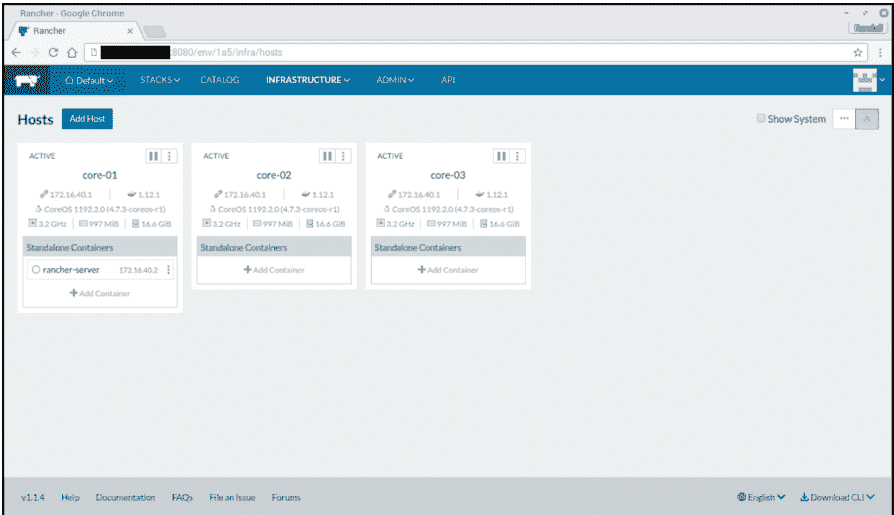

也可以手动添加代理。在 **添加主机** 中选择 **自定义** 选项。将显示一个 Docker 命令，需要在每个添加到集群的 Docker 主机上运行。它看起来将类似于此处列出的命令：

```
sudo docker run -d --privileged -v
/var/run/docker.sock:/var/run/docker.sock -v
/var/lib/rancher:/var/lib/rancher rancher/agent:v1.0.2
http://172.17.8.101:8080/v1/scripts/781E07FE518B7181D563:1477180800000:N3gz
UQgoo3mFPcGkqEimBoNExFC
```

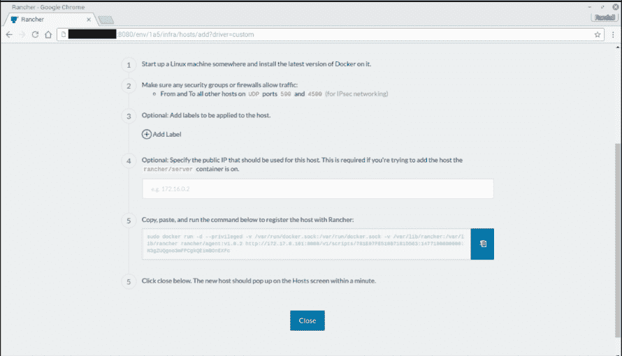

Rancher 代理在环境中所有主机之间创建 IPSEC 链接，以提供安全的覆盖网络。它还会监听 Docker 事件，并将有关运行容器和性能统计信息的定期更新发送到 Rancher 服务器。

### 安装 Rancher Compose

在 Rancher 中创建和管理服务所需的几乎所有操作都可以通过 Web 界面完成。但是，还有一个名为 `rancher-compose` 的命令行工具可供使用。它适用于 Windows、OS X 和 Linux。要安装 Rancher Compose，请执行以下步骤：

- 1. 要下载它，请单击 Web 界面右下角的 **下载 CLI**，并选择您的操作系统。
- 2. 解压下载的存档，并将 `rancher-compose` 工具放置在您的路径中。
- 3. Rancher Compose 需要 API 密钥来对 Rancher 服务器进行身份验证。可以在页面顶部的 API 部分中为环境或特定用户创建新密钥。
- 4. 单击 **添加环境 API 密钥** 或 **添加帐户 API 密钥** 以创建相应的密钥。您将看到访问密钥和密钥。
- 5. 将它们复制到安全位置。创建后无法获取密钥：

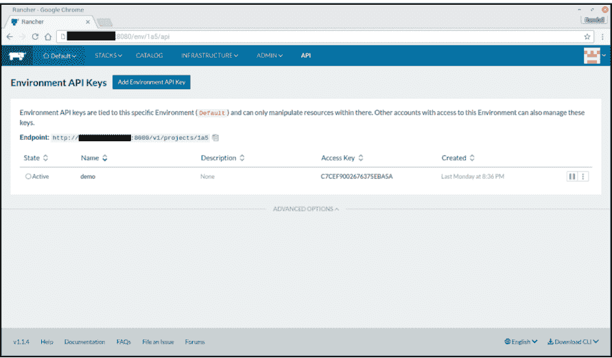

访问密钥、密钥和 Rancher URL 将分别使用 `--access-key`、`--secret-key` 和 `--url` 标志传递给 `rancher-compose`：

```
$ rancher-compose --url http://rancher:8080/ --access-key=CA... --secret-key=C4G...
```

也可以使用 `RANCHER_ACCESS_KEY`、`RANCHER_SECRET_KEY` 和 `RANCHER_URL` 环境变量设置密钥和 URL。将它们添加到客户端系统中 `.bash_profile` 的等效文件中：

```
export RANCHER_URL=http://rancher:8080/
export RANCHER_ACCESS_KEY=CA...
export RANCHER_SECRET_KEY=C4G...
```

### 介绍环境

Rancher 支持运行多个环境。安装后，将创建一个名为 `default` 的环境，它运行 Cattle 编排套件。可根据需要创建其他环境。环境彼此隔离。这样可以轻松地为开发、测试、生产或不同业务单元创建环境。

尽管 Cattle 是默认编排工具，Rancher 还能够创建运行 Docker Swarm、Kubernetes 和 Mesosphere 的新环境。这可能是在本地环境中安装这些系统的最简单方法。创建新环境后，添加新主机。环境的服务（例如 `kubectl` 或 Swarm 代理）将自动添加。

有关使用 Docker Swarm 的更多信息，请参阅第 4 章，使用 Docker Swarm 进行编排；有关 Kubernetes 的更多信息，请参阅第 5 章，使用 Kubernetes 部署和管理服务；有关 Mesosphere 的更多信息，请参阅第 6 章，使用 Mesosphere。

### 管理服务

Cattle 使用 Docker Compose 文件定义服务。自 1.1.4 版起，仅支持 Docker Compose 规范的版本 1。Rancher 1.2 正在添加对版本 2 的支持。

Rancher Compose 在标准 `docker-compose.yml` 文件的基础上有两种扩展方式。首先，可以向服务添加特殊标签以定义亲和性等内容。其次，可以使用名为 `rancher-compose.yml` 的另一个文件来定义 Rancher 特定设置（如运行状况检查）。

> > 以下部分介绍如何使用 Rancher CLI。所有以下操作也可以通过 Web 界面完成。

### 启动堆栈

从设计上讲，`rancher-compose` 工具与 `docker-compose` 非常相似。**堆栈** 是在 `docker-compose.yml` 文件和可选的 `rancher-compose.yml` 文件中定义的服务集合。Rancher 目录中有许多应用程序的预构建堆栈。除了快速部署服务外，它们还可以作为构建您自己的堆栈的绝佳示例。

要创建自己的堆栈，请为包含 docker-compose.yml 文件的应用程序创建一个目录。堆栈名称源自目录名称，但可以使用 -s 标志覆盖。创建 compose 文件后，在目录中运行 rancher-compose up。以下是启动 WordPress 堆栈的 docker-compose.yml 文件：

```
wordpress:
  image: wordpress
  env_file:
    - db.env
db:
  image: mysql:5.6
  env_file:
    - db.env
lb:
  image: rancher/load-balancer-service
  ports:
    - 80:80
  links:
    - wordpress:wordpress
```

此示例启动三个服务。第一个 wordpress 启动 WordPress 应用程序。第二个 db 是 MySQL 数据库。两个服务都使用 db.env 环境文件来加载启动所需的环境变量。环境文件在第 2 章，使用 Docker Compose 构建多容器应用程序中已介绍。

lb 服务为此应用程序配置 Rancher 负载均衡器服务。负载均衡器将在本章后面更详细地介绍。目前，只需知道它被配置为将端口 80 发送到 wordpress 服务即可。

与 docker-compose 类似，可以使用 -f 标志在命令行上指定多个 docker-compose.yml 文件。还可以设置 -d 标志在后台启动堆栈：

```
$ rancher-compose up -f docker-compose.yml -f production.yml -d
```

### 停止堆栈

服务使用 rancher-compose stop 停止。这必须在包含 docker-compose.yml 文件的同一目录中运行。默认情况下，rancher-compose 将停止所有运行中的服务：


$ rancher-compose stop
INFO[0000] [0/3] [lb]: Stopping
INFO[0000] [0/3] [db]: Stopping
INFO[0000] [0/3] [wordpress]: Stopping
INFO[0001] [0/3] [lb]: Stopped
INFO[0001] [0/3] [db]: Stopped
INFO[0001] [0/3] [wordpress]: Stopped

可以通过在命令行中指定服务名来单独停止某个服务：

```
$ rancher-compose stop wordpress
INFO[0000] [0/3] [wordpress]: Stopping
INFO[0001] [0/3] [wordpress]: Stopped
```

### 移除栈

可以使用 `rancher-compose rm` 移除服务。可以通过在命令行中指定服务名来移除单个服务。以下命令用于移除 `lb` 服务：

```
$ rancher-compose rm lb
INFO[0000] [0/3] [lb]: Deleting
INFO[0000] [0/3] [lb]: Deleted
```

移除整个栈需要在命令行中添加 `--force` 标志。如果未包含 `--force`，`rancher-compose` 将退出并报错，提示添加它：

```
$ rancher-compose rm --force
INFO[0000] [0/3] [lb]: Deleting
INFO[0000] [0/3] [wordpress]: Deleting
INFO[0000] [0/3] [db]: Deleting
INFO[0000] [0/3] [db]: Deleted
INFO[0000] [0/3] [wordpress]: Deleted
INFO[0000] [0/3] [lb]: Deleted
```

### 升级栈

升级栈有两种方式。第一种是 **服务内升级**，第二种是 **滚动升级**。两种方式都可实现零停机升级。服务内升级会替换栈中运行的服务，但不更改服务名称。在 WordPress 示例中，`wordpress` 服务仍保持为 `wordpress`。滚动升级需要定义新服务，这需要更改 `docker-compose.yml` 中的服务名称。Rancher 推荐使用服务内升级，且这是通过 Web 界面提供的唯一升级选项。

服务内升级使用 rancher-compose up --upgrade 执行：

```
$ rancher-compose up --upgrade -d
INFO[0006] [0/3] [db]: Starting
INFO[0006] [0/3] [wordpress]: Starting
INFO[0009] [1/3] [db]: Started
INFO[0009] Updating wordpress
INFO[0011] Upgrading wordpress
INFO[0029] [2/3] [wordpress]: Started
INFO[0029] [2/3] [lb]: Starting
INFO[0034] [3/3] [lb]: Started
```

对现有服务的任何更改都会应用。如果升级需要更改运行中的服务，则会先停止容器，再启动该服务的新容器。此行为通过 rancher-compose.yml 中的 upgrade_strategy 选项按服务单独控制。以下示例配置 Rancher 在停止旧服务前先启动新的 wordpress 服务。运行 MySQL 的 `db` 服务将继续使用默认行为，即在启动新容器前先停止旧容器：

```
wordpress:
  upgrade_strategy:
    start_first: true
```

rancher-compose 还提供一些常用于升级的其他标志。第一个是 `--pull` 标志，它会强制 Rancher 拉取镜像的新副本，即使本地已有该镜像。如果你为镜像使用了 `latest` 标签，并且需要确保可用最新副本，这会特别有用。

第二个标志是 `--force-upgrade` 标志。即使 `docker-compose.yml` 和 `rancher-compose.yml` 文件未更改，它也会强制 Rancher 执行升级。与 `--pull` 标志结合使用时，可用于将栈中所有容器升级至其运行的镜像标签的最新版本。同样，这在使用 `latest` 标签或会随点版本更新的标签时最为有用。

默认情况下，rancher-compose 会跟踪栈中所有服务的日志。`-d` 标志会在后台执行升级且不显示日志。

### 回滚和确认升级

在此过程中，仍有机会回滚升级。如果升级出现问题，可以通过运行 `rancher-compose up --upgrade --rollback` 来回滚。只要升级尚未确认，随时都可以执行回滚。

确认升级成功后，可以通过运行 `rancher-compose up --upgrade --confirm-upgrade` 来确认升级。请记住，一旦升级已确认，便无法回滚：

```
$ rancher-compose up --upgrade -d --confirm-upgrade
INFO[0005] [0/3] [db]: Starting
INFO[0005] [0/3] [wordpress]: Starting
INFO[0009] [1/3] [db]: Started
INFO[0013] [2/3] [wordpress]: Started
INFO[0013] [2/3] [lb]: Starting
INFO[0016] [3/3] [lb]: Started
```

在这两种情况下，rancher-compose 都会跟踪栈中服务的日志。可以通过向 rancher-compose 传递 `-d` 标志来禁止此行为：

### 检查服务健康状态

Rancher 支持为服务添加健康检查。检查可以配置为查询 TCP 端口或发出 HTTP 请求。对于 TCP，服务只需接受连接即可。对于 HTTP，请求必须返回 200 到 399 之间的状态码。其他任何情况都会触发错误。以下是一个 `rancher-compose.yml` 文件示例，为 WordPress 定义 HTTP 检查，为 MySQL 定义 TCP 检查：

```
wordpress:
  upgrade_strategy:
    start_first: true
  health_check:
    port: 80
    request_line: GET / HTTP/1.0
    interval: 3000
    initializing_timeout: 60000
    unhealthy_threshold: 3
    strategy: recreate
    response_timeout: 2000
db:
  health_check:
    port: 3306
    interval: 3000
    initializing_timeout: 60000
    unhealthy_threshold: 3
    strategy: recreate
    response_timeout: 2000
```

对于 HTTP 检查，必须设置 request_line。如果为空或未设置，检查将仅测试 TCP 连接。initializing_timeout 选项定义了等待服务启动的时间（毫秒）。检查之间的间隔时间（毫秒）由 interval 设置定义。如果在 response_timeout 定义的毫秒数内检查未成功，则检查将失败。

unhealthy_threshold 选项设置了 Rancher 采取措施之前的失败次数。采取什么措施由 strategy 选项定义。如示例中设置为 recreate 时，Rancher 会重建服务。strategy 还有另外两个选项。第一个选项是 none，表示 Rancher 不执行任何操作。第二个是 recreateOnQuorum，表示当服务中达到给定数量的健康容器时，Rancher 会重启该服务。该数量在 recreate_on_quorum_strategy_config 部分中定义。示例如下：

```
recreate_on_quorum_strategy_config:
  quorum: 1
```

可以通过使用 rancher-compose up --upgrade 升级栈来更新健康检查。

### 调度与亲和性

Rancher 支持手动将服务调度到特定主机上、在环境中的所有主机上全局运行服务，或设置服务亲和性/反亲和性。Rancher 通过 docker-compose.yml 中服务上的标签来实现此功能。可用于调度的标签完整列表可参阅 http://docs.rancher.com/rancher/v1.2/en/cattle/scheduling/。

### 使用网络服务

Rancher 提供几个有用的服务。首先，Rancher 使用 IPSEC 为集群中运行的服务创建安全的覆盖网络。其次，它为栈内服务提供 DNS-SD，并支持跨栈引用服务。最后，Rancher 可以创建负载均衡器，可将请求分发到服务中的容器，或根据 HTTP 请求信息重定向流量。

### 服务发现

Rancher 为集群中运行的所有服务提供 DNS-SD。在栈内，所有服务均可通过服务名访问。在前面的 WordPress 示例中，wordpress 容器可以通过 `db` 主机名访问 MySQL 服务。其他栈中运行的服务可通过 `<service name>.<stack name>` 访问。例如，如果前面的 WordPress 栈命名为 wordpress，则 MySQL 服务为 `db.wordpress`。

每个服务都可以使用 `links` 选项指定别名来引用另一个服务。在以下示例中，wordpress 服务中创建了一个别名。该链接使 `db` 服务可通过 `mysql` 名称访问：

```yaml
wordpress:
  image: wordpress
  env_file:
    - db.env
  links:
    - db:mysql
db:
  ...
```

### 负载均衡器

Rancher 提供基于 HAProxy 的负载均衡器。它可以在四层通过简单转发连接到相应端口来代理，也可以在七层根据 HTTP 信息路由流量。负载均衡器还可以为任何服务提供 SSL 终止。


创建负载均衡器的最简单方法是通过 Web 界面。单击 **Add Service** 旁边的下拉箭头并选择 **Add Load Balancer**。将打开一个窗口，提供配置选项：

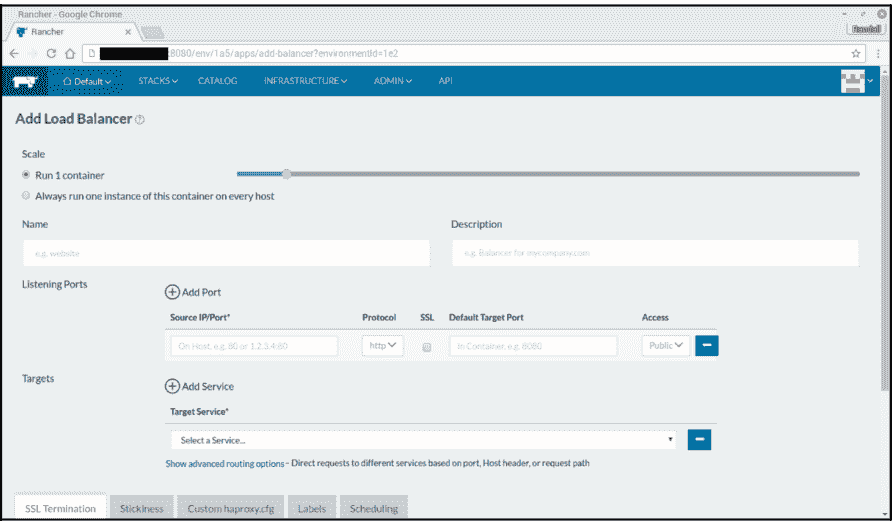

如果负载均衡器提供 SSL 终止，则必须在 **基础架构 | SSL** 中创建证书。可为 Web 服务配置多个证书。负载均衡器将根据请求的服务器名称使用 SNI 提供正确的证书。

如前述 WordPress 示例所示，负载均衡器可作为 `docker-compose.yml` 文件的一部分创建。在该示例中，创建了一个简单的负载均衡器，用于将端口 80 上的 HTTP 连接代理到 `wordpress` 服务的端口 80。要使用纯 TCP，请在目标端口号后附加 `/tcp`。例如，要将端口 25 转发到容器上的 TCP 端口 25，端口条目应为 `25:25/tcp`。

> Web 界面中的所有负载均衡器设置也可以通过 `docker-compose.yml` 实现。有关更多详细信息，请参阅 http://docs.rancher.com/rancher/v1.2/en/cattle/adding-load-balancers/。

### 进一步阅读

本章和前三章仅展示了市面上编排平台中的少数几个。还有许多其他平台，而且似乎每天都会推出一个新平台。以下是一些值得关注的其他编排工具：

- Google、Amazon 和 Microsoft 均在其云产品中提供容器服务。这些通常是在云中使用容器的最简便方式。
- Red Hat OpenShift 是构建在 Kubernetes 之上的 PaaS 平台。它可作为托管平台使用，也可在本地安装。还有一个名为 OpenShift Origin 的开源变体。有关更多详细信息，请参阅 https://www.openshift.com/。
- Panamax 是由 CenturyLink 基于 Fleet 和 CoreOS 开发的开源项目。它提供易于使用的 Web 界面来管理应用程序。有关更多详细信息，请参阅 http://panamax.io/。
- Modera Cloud 是一个与 Docker Swarm 配合使用的开源软件包。它自称为“由开发者为开发者打造”。它使用命令行界面管理应用程序。有关更多详细信息，请参阅 https://mcloud.io/。
- Microsoft Azure Stack 将容器管理与本地云的其他部分统一管理。Windows Server 2016 发布时带有容器支持，与 Docker 兼容。Windows Server 能够在轻量级 VM 中运行基于 Windows 的容器以及基于 Linux 的容器。截至撰写本文时，Azure Stack 仍处于技术预览阶段。有关更多详细信息，请参阅 https://azure.microsoft.com/en-us/overview/azure-stack/。

### 总结

本章介绍了两种不同的工具——Fleet 和 Rancher。Fleet 是一个较低级别的系统，非常适合小型环境或作为更高级别工具的基础。本章展示了如何启动和停止服务、设置服务亲和性、运行高可用服务以及跨集群运行全局服务。

Rancher 使使用不同编排工具（包括 Docker Swarm、Kubernetes、Mesos 和 Rancher Cattle）运行多个环境变得容易。本章还展示了如何使用 rancher-compose 管理应用程序、创建运行状况检查以及负载均衡服务。

下一章将介绍 Docker 集群的日志记录和监控。

# 监控您的集群

为 Docker 集群设置编排只是战斗的一半。还需要对集群有可见性。数据检索为何缓慢？是磁盘还是网络问题？Web 服务器为某个应用程序记录了什么日志？某个应用程序使用了多少内存？迟早会出现这些或类似的问题，作为管理员，您将负责提供这些答案。

本章将介绍可用于协助监控和故障排除的不同工具。有些工具（如 Kibana）可以提供集群运行状况摘要，而其他工具（如 Sysdig）可以提供有关应用程序或单个容器的深入信息。

本章将介绍以下主题：

- Docker 日志驱动程序
- 不向标准输出或标准错误发送日志的容器的日志记录
- 使用 ELK 堆栈记录和查看日志
- 将远程日志记录与 Kubernetes、Mesosphere 和 Docker Datacenter 配合使用
- 收集性能指标
- 使用 Kibana 和 Grafana 绘制指标图表
- 日志记录和故障排除注意事项
- 使用 Sysdig 实时查看容器指标

## 使用容器进行日志记录

几乎每个应用程序都会生成某种日志。它们可能跟踪使用情况（例如 Web 服务器访问日志），也可能仅显示启动或错误消息。无论哪种情况，日志都有其用途，而无法查看日志可能是一个严重问题。

Docker 中的日志记录是一门奇怪的学问。容器在设计上是短暂的。它们被设计为经常创建和销毁。这对应用程序日志构成问题，因为日志文件会随着容器一起被删除。

解决此问题的方法分两方面。首先，Docker 提供日志插件系统，将应用程序打印到标准输出或标准错误的所有内容记录到某个位置。其次，需要一个地方来存放这些日志。换句话说，需要一个日志聚合服务器。

## 使用 Docker 日志插件

Docker 假设打印到标准输出或标准错误的所有内容都是日志。可以通过运行 `docker logs <container name>` 访问这些日志，其中 `<container name>` 是容器的名称。不幸的是，这些日志仅在容器存在期间才有效。Docker 通过创建日志插件系统解决了此问题，该系统允许管理员配置 Docker 将这些日志发送到其他位置。

在编排环境中，日志应发送到日志聚合服务器。如果日志保存在本地，在需要时查找日志将成为一项挑战。有多种远程日志记录选项可供使用。以下是其中几个选项：

- syslog：这是 Unix 和 Linux 系统上经过验证的远程日志记录解决方案。如果已有远程 Syslog 基础设施，这是一个不错的解决方案。最大的缺点是 Syslog 日志未格式化，这使得从日志中自动挖掘有用数据变得困难。
- gelf：Graylog 扩展日志格式 (GELF) 由 Graylog 项目开发，旨在通过提供结构化日志格式来克服 Syslog 的不足。它与 NoSQL 风格的数据库配合使用，可根据 GELF 条目中的键自动索引和搜索。
- fluentd：这一概念将结构化日志进一步推进，使将不同日志发送到不同日志和分析服务（包括 Elasticsearch、MySQL 和 Nagios）变得容易。无论环境如何，Fluentd 都可能与其兼容。
- awslogs 和 gcplogs：这些插件分别将日志发送到 Amazon CloudWatch 和 Google Cloud Logging。如果 Docker 集群专用于 AWS 或 GCE 运行，这些插件是不错的选择。
- etwlogs：此仅限 Windows 的插件将 Docker 日志发送到 **Windows 事件跟踪 (ETW)**。之后，可以使用标准 Windows 工具（如 **System Center Operations Manager (SCOM)**）根据日志进行聚合和告警。

日志驱动程序及其设置的完整列表可在 https://docs.docker.com/engine/admin/logging/overview/ 上找到。

可以使用 `--log-driver` 标志为 Docker 守护进程指定日志驱动程序。该驱动程序适用于服务器上启动的任何容器。还可以将 `--log-driver` 作为参数传递给 `docker run` 以覆盖该容器的日志选项。

每个日志驱动程序都有特定于该驱动程序的若干选项。例如，`syslog` 驱动程序具有远程 Syslog 服务器地址、日志设备和 TLS 选项的选项。以下示例配置 Docker 守护进程使用 `gelf` 驱动程序将日志发送到 Graylog 服务器。地址名称通过 `gelf-address` 选项设置：

```
$ docker daemon --log-driver=gelf --log-opt gelf-address=udp://graylog:12201 ...
```

为特定容器设置日志驱动程序的方式相同。此示例对容器使用 `syslog` 驱动程序：

```
$ docker run --log-driver=syslog ...
```

几乎所有日志插件都禁止使用 `docker logs` 命令。查看这些容器日志的唯一方式是通过聚合服务器。在容器测试期间，将日志驱动程序设置为默认 `json-file` 驱动程序可能会有所帮助。

> 警告：容器的所有输出都会发送到日志服务器。这包括运行 shell 的容器（例如 `docker run -it busybox`）的所有命令输出。通过 `docker exec` 运行的命令输出不包括在内。如果运行的命令将输出不应出现在日志中的敏感信息，请指定本地日志驱动程序。

## 遵循常规之外的容器日志记录

有时候，容器中的应用程序不会向标准输出或标准错误输出日志。对于正在迁移到容器中运行的传统应用程序，这种情况很常见。根据应用程序，处理日志有几种选择。


第一个选项是在容器内运行 Logstash 或 Filebeat 等服务。Logstash 被配置为监视应用程序的日志文件并将它们发送到适当的服务器。像 `supervisord` 这样的服务控制器在 `Dockerfile` 中用作 `entrypoint` 来启动应用程序和 Logstash。要小心，因为日志服务可能会停止且不会被重启。

第二个选项是在 `Dockerfile` 中为日志配置一个卷。然后可以在辅助容器中运行 Logstash 来读取日志并将它们发送到聚合服务器。如果服务在 Kubernetes 集群中运行，可以使用 pod 来对容器进行分组。总体来说，这是一个更好的选项，因为它让日志工具与应用程序分离，从而更容易升级或替换其中每一个。

## 使用 ELK 堆栈进行日志记录

Elasticsearch、Logstash 和 Kibana 的组合构成了 ELK 堆栈。每个组件构成整体的一部分。Elasticsearch 是数据库。所有日志信息最终都会到这里。Logstash 是将日志放入（或缓存到）Elasticsearch 的工具。Logstash 有许多输入插件，包括 `gelf` 和 `syslog`。最后，Kibana 提供了一种简单的方法来搜索日志并根据日志信息创建仪表板。

### 启动 Elasticsearch

Elasticsearch 是一种 NoSQL 风格的数据库，可被多种工具使用。它非常快速，从设计之初就为了能够在多主环境中运行。以下示例启动一个新的 Elasticsearch 容器：

```
$ docker run -d --name es -p 9200:9200 -p 9300:9300 elasticsearch -E 
 node.name="Node1"
```

可以使用 `-E` 标志设置单个配置项。`node.name` 的值是 Elasticsearch 集群中该节点的名称。如果计划运行多个 Elasticsearch 容器，还需要两个选项。第一个是 `cluster.name`，即集群的名称，所有节点必须相同。第二个是 `discovery.zen.ping.unicast.hosts`，它包含要连接的主机列表。它也可以是解析为多个主机的 DNS 名称。这是使用覆盖网络 DNS-SD 中主机名的好地方。

如果需要更复杂的配置，可以将配置设置添加到容器中的 /usr/share/elasticsearch/config，可以是通过卷，也可以通过构建新镜像。以下 Dockerfile 演示了如何实现。这样做的优势在于，你可以构建一个内置配置的镜像，并为集群中的更受控部署对镜像进行版本控制：

```
FROM elasticsearch:5.0
COPY config /usr/share/elasticsearch/config
```

elasticsearch 镜像将其数据存储在 /usr/share/elasticsearch/data 中。这应该是一个持久的网络卷。卷的具体配置将取决于用于共享存储的内容。

### 启动 Logstash

Logstash 是一个从各种来源获取日志并将其存储在 Elasticsearch 中的工具。在 Docker 中使用它的最简单方法是将其配置为监听 GELF 日志。配置将类似于这里所示：

```
input {
  gelf { }
}
output {
  elasticsearch {
    hosts => [ 'es.weave.local' ]
  }
}
```

gelf 块告诉 Logstash 监听 GELF 日志。elasticsearch 块告诉 Logstash 输出将发送到 Elasticsearch。hosts 选项是逗号分隔的主机列表。它也可以是返回一个或多个 IP 地址的 DNS 条目：

```
$ docker run -d --name logstash -p 9200:9200 -p 12201:12201/udp logstash -f /config/logstash.conf
```

要使用的配置文件通过 -f 标志设置。此文件可以作为卷添加到容器中，也可以添加到自定义 logstash 镜像中。将配置添加到镜像可以防止配置漂移，并确保每个 Logstash 服务都在做同一件事：

```
FROM logstash:5.0
COPY logstash.conf /config/logstash.conf
```

在 Docker 中使用 Logstash 有两个选项：

- 第一个是在每个 Docker 主机都使用的中央 Logstash 服务中运行。
- 第二个选项是在每个主机上运行 Logstash 并配置 Docker 将日志发送到本地 Logstash 容器。此选项在大型集群中扩展性更好。

以下示例展示了如何配置 Docker 守护进程将 GELF 日志发送到运行在 localhost 上的服务。如果改用中央 Logstash 服务器，请将 localhost 替换为服务器的地址：

```
$ docker daemon --log-driver=gelf --log-opt gelf-address=udp://localhost:12201
```

### 使用 Kibana 查看日志

将日志发送到远程服务器很好，但如果没有查看方式，就没有任何好处。这就是 Kibana 派上用场的地方。Kibana 提供了一个界面来查看和搜索 Elasticsearch 中的日志。它还可以根据 Elasticsearch 数据库中的任何信息创建图表和图形。

开始使用 Kibana 的最简单方法是使用官方 Docker 镜像。以下示例展示了如何运行它。ELASTICSEARCH_URL 的值是 Elasticsearch API 服务的地址：

```
$ docker run -d --name kibana:5.0 -e ELASTICSEARCH_URL=http://elasticsearch:9200 -p 5601:5601 kibana
```

Kibana 运行后，你可以连接到运行 Kibana 的 Docker 主机。例如，如果 Kibana 运行在 172.17.8.101 上，则 Web 界面的地址是 http://172.17.8.101:5601。默认情况下没有身份验证：

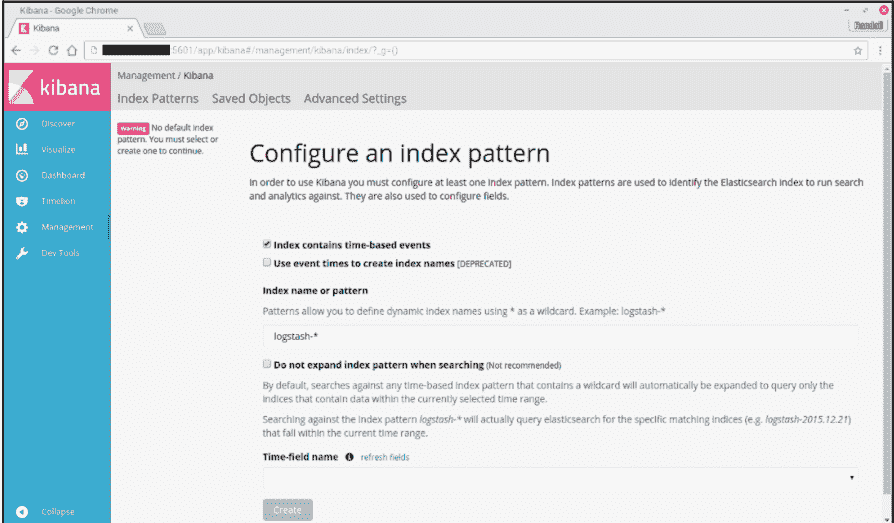

首次登录时，系统会提示你输入 Kibana 将针对其运行分析的索引。Logstash 的日志可在 `logstash-*` 索引下使用。在配置索引之前，所选索引中必须存在条目。**时间字段名称** 字段必须设置为 `@timestamp`。

配置索引模式后，可以在 **发现** 页面上查看日志。当大量来自大量服务的日志开始到达时，一次查看所有日志变得徒劳无功。幸运的是，Elasticsearch 在搜索方面非常出色。例如，可以使用 `container_name:<container>` 查询查看单个容器的日志，其中 `<container>` 是容器的名称。也可以在查询中使用 `image_name:<name>` 根据镜像名称进行搜索。

> 如果使用不同的日志驱动程序将日志添加到 Elasticsearch，字段名称 `container_name` 和 `image_name` 可能会不同。

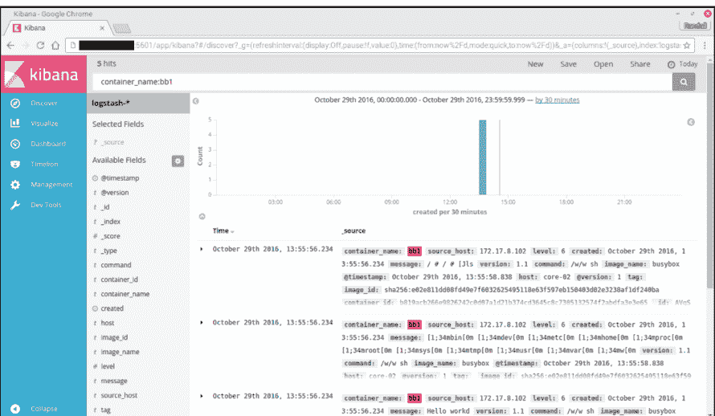

单个日志由多个字段组成。每个字段都可以用作查询术语。这样就可以深入到确切所需的内容。以下截图显示了来自 Docker 的单个日志的字段：

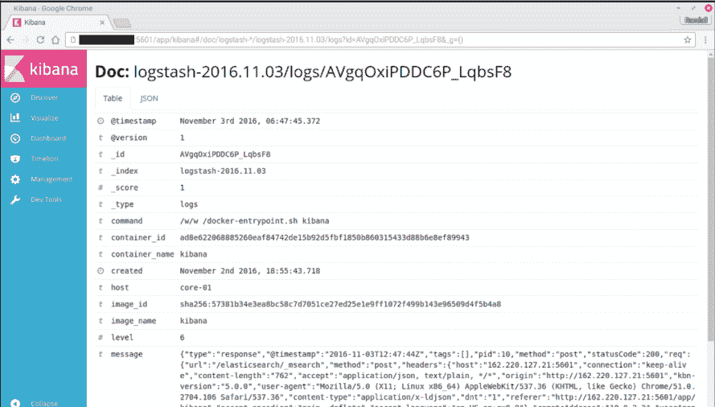

对于 Docker 日志，更有用的字段如下：

- `container_name`: 这是由 `docker run` 的 `--name` 标志指定的容器名称。
- `container_id`: 这是容器的完整 ID。如果多个容器使用相同的名称运行，这将特别有用。
- `image_name`: 这是正在使用的镜像名称。这样就可以查找运行特定镜像的所有容器的日志。
- `host`: 这是容器正在运行的主机的名称。
- `message`: 这是实际的日志消息。这是 `docker logs` 命令将打印的任何内容。

Kibana 中的查询是使用 Elasticsearch 语法构建的。文档可在 https://www.elastic.co/guide/en/elasticsearch/reference/5.0/query-dsl-query-string-query.html#query-string-syntax 找到。

可以保存搜索查询。这样可以轻松重新运行经常需要的查询。保存的搜索也可以添加到仪表板，以将多组日志整合到单个视图中。

## Docker Datacenter 中的远程日志记录

由 Docker Datacenter 管理的 Docker 主机可以配置为使用日志驱动程序，就像任何其他 Docker 主机一样。Docker Datacenter 本身支持将日志记录到远程 Syslog 服务器。转到 Settings，然后转到 LOGS。从那里，可以设置远程 Syslog 服务器、协议和日志级别。完成后，单击 Enable Remote Logging：

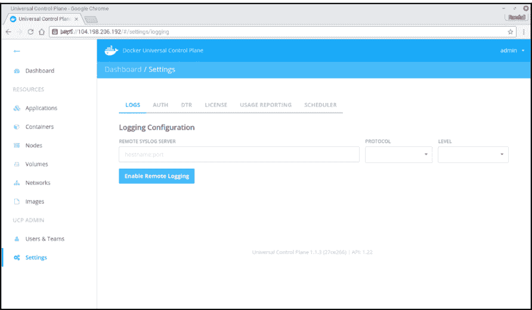

## Kubernetes 日志记录

Kubernetes 的设计初衷就是集中式日志记录。它可以将日志发送到 Google Cloud Logging 或作为 Kubernetes 服务运行的 Elasticsearch。Kibana 也已启动，以提供访问发送到 Elasticsearch 的日志的简便方法。要在安装时启用 Elasticsearch，请在运行 kube-up.sh 之前将 KUBE_LOGGING_DESTINATION 环境变量设置为 elasticsearch：

```
$ KUBE_LOGGING_DESTINATION=elasticsearch kube-up.sh
```

有关完整详细信息，请参阅 http://kubernetes.io/docs/getting-started-guides/。


## Logging from Mesosphere

Mesosphere 通过 Marathon Web 界面提供每个运行服务的日志。不幸的是，一次访问多个服务的日志可能很麻烦。没有原生方法将服务日志发送到聚合服务器。

有几种方法可以绕过这个问题。第一种方法是如前所述，配置 Docker 守护进程使用 GELF 日志驱动程序将日志发送到 Elasticsearch。另一种方法是使用 Logstash 或 Elastic Filebeat 直接读取服务日志并将其发送到 Elasticsearch。

要使用 Filebeat，请从 Elastic 的 yum 仓库在每个主机上安装它。然后将以下内容添加到 `/etc/filebeat/filebeat.yml`。请务必更改 `hosts` 键中 Elasticsearch 主机的名称：

```
filebeat.prospectors:
- input_type: log
 paths:
 - /var/lib/mesos/slave/slaves/*/frameworks/*
 /executors/*/runs/latest/stdout
 - /var/lib/mesos/slave/slaves/*/frameworks/*
 /executors/*/runs/latest/stderr
output.elasticsearch:
 hosts: ["elasticsearch:9200"]
```

## Logging your Docker hosts

请记住，集群日志应包括 Docker 主机以及 Docker 本身。在考虑 Docker 的日志解决方案时，值得确保主机的日志也可以发送到那里。例如，Logstash 有一个选项可以充当 Syslog 服务器。可以将每个主机配置为通过 Logstash 发送日志，Logstash 会将它们添加到 Elasticsearch 中。

将 Docker 主机的日志添加到与 Docker 相同的日志解决方案中，将有助于故障排除和根本原因分析。Kibana 之类的查看器成为 *单一玻璃窗*，用于查看集群中发生的一切。想象一下，收到警告某些容器无法与数据库通信的警报，并在与 Docker 日志相同的视图中看到 Docker 主机上的某个接口已断开连接的日志消息。问题发现得越快，服务恢复得就越快。

## Collecting and graphing performance data

日志很棒，但有时真正需要的是系统性能摘要。
快速查看性能图通常比浏览数百或数千条日志条目能告诉管理员更多信息。诸如“为什么此应用程序运行缓慢？”之类的简单问题，通常需要查看存储节点上的磁盘、每个存储节点之间以及存储与 Docker 主机之间的网络利用率、内存和 CPU 利用率以及主机磁盘性能的数据。这甚至还不包括数据库速度和应用程序低效等因素。好消息是，所有这些数据都可以收集和绘制成图。

### Collecting data with collectd

collectd 守护进程是一个强大的工具，可以从许多不同的来源收集数据并将数据发送到多个数据库。其中两个数据库是 Elasticsearch 和 InfluxDB。使用 Elasticsearch 意味着数据可供 Kibana 构建可视化并包含在仪表板中。InfluxDB 是一个专为存储时间序列数据而设计的高速数据库。有许多工具可以从 InfluxDB 创建图表和图形，包括 Grafana，稍后将讨论。

有时，关于用于存储集群指标的数据库应该使用哪一个这个问题，正确答案是 _两者都用_。Elasticsearch 和 InfluxDB 各有优势和劣势，但它们互补性很好。试着同时运行它们一段时间。以后随时可以停止向其中一个发送数据。

### Running collectd

大多数主要 Linux 发行版都有 collectd 的软件包。在 Debian 和 Ubuntu 中，安装只需 `apt-get install collectd`。其他发行版的软件包和安装说明可在 https://collectd.org/download.shtml 上找到。

`collectd` 守护进程可以从命令行手动运行，如下例所示。`-f` 标志将使 `collectd` 保持在前台。`-C` 标志用于提供配置文件路径：

```
$ collectd -f -C /etc/collectd/collectd.conf
```

collectd 没有官方 Docker 容器。某些插件做出的假设使得在容器中运行它变得有问题。例如，内存插件将 /proc 硬编码为内存信息的来源。在容器中，/proc 仅包含容器的信息，而不是整个系统的信息。

由于为容器创建的虚拟接口，在容器中运行 collectd 时接口数据会很奇怪。可以通过在 docker run 中使用 --net=host 来解决这个问题。

### Configuring collectd

数据通过一系列插件收集。每个插件使用 LoadPlugin 选项加载。如果插件有选项，则使用 <Plugin name> 块进行设置，其中 name 是插件的名称。带有插件选项链接的完整插件列表可在 collectd.conf (5) 手册页或 https://collectd.org/wiki/index.php/Table_of_Plugins 上找到。

以下示例显示了读取 CPU 使用率指标、负载平均值和磁盘使用情况的基本配置：

```
BaseDir "/var/lib/collectd"
PIDFile "/run/collectd.pid"
Interval 10.0

LoadPlugin cpu
LoadPlugin load
LoadPlugin disk
```

Interval 选项是数据收集运行之间的秒数。请确保不要将其设置得太低以至于使服务器不堪重载。可以使用 <LoadPlugin> 标签为每个插件设置间隔，并在此处指定 Interval 选项：

```
<LoadPlugin foo>
 Interval 60
</LoadPlugin>
```

前面的基本示例读取数据但不做任何处理。在集群环境中，数据很可能会发送到数据库。网络插件可以配置为将收集的数据发送到一个或多个服务器。以下片段加载网络插件并配置 collectd 将数据发送到两个服务器。IP 地址后面的数字是 UDP 端口号：

```
LoadPlugin network
<Plugin network>
    Server "172.17.8.102" "25826"
    Server "172.17.8.101" "12203"
</Plugin>
```

## Storing performance data in Elasticsearch

collectd 守护进程数据通过 Logstash 添加到 Elasticsearch。以下示例将 UDP 输入插件添加到 input 块。Logstash 将在 port 选项指定的端口上侦听 collectd 连接。buffer_size 选项设置最大数据包大小。出于性能原因，应将其设置得足够小以适应单个网络帧。

codec 选项告诉 Logstash 传入数据包采用 collectd 的二进制网络格式。为了正确映射数据类型，Logstash 需要 collectd 的 types.db 副本。collectd 守护进程通常将 types.db 安装在 /usr/share/collectd/ 中。

此示例最后做了一件事。它为每个输入插件设置类型。这样可以通过在查询中添加 _type:log 来轻松在 Kibana 中仅查看日志：

```
input {
  gelf {
    type => log
  }
  udp {
    port => 12203
    buffer_size => 1452
    codec => collectd {
      typesdb => [ '/usr/share/collectd/types.db' ]
    }
    type => perf
  }
}
```

如果打算在容器中运行 Logstash，请创建一个添加 `types.db` 的自定义镜像。示例 Dockerfile 如下所示：

```
FROM logstash:5.0
COPY types.db /usr/share/collectd/types.db
```

## Storing performance data in InfluxDB

InfluxDB 是从头开始构建用于处理时间序列数据的。它非常快，并有多种高可用性选项。最棒的是，有官方 Docker 容器可用。启动 InfluxDB 就像运行以下命令一样简单：

```
docker run -d -p 8083:8083 -p 8086:8086 -p 25826:25826/udp --name influxdb \
-v /usr/share/collectd/types.db:/usr/share/collectd /types.db:ro \
-e INFLUXDB_COLLECTD_ENABLED=true \
-e INFLUXDB_COLLECTD_port=25826 \
-e INFLUXDB_COLLECTD_DATABASE=collectd_db \
-e INFLUXDB_COLLECTD_TYPESDB=/usr/share/collectd/types.db\
influxdb
```

环境变量按以下顺序配置 InfluxDB：

- 启用 collectd 支持
- 在 UDP 端口 25826 上侦听 collectd 连接
- 将 collectd 数据的数据库设置为 `collectd_db`
- 将容器内的路径设置为 collectd `types.db`

`influxdb` 镜像将数据库存储在 `/var/lib/influxdb` 中。在生产环境中运行时，这应位于外部卷上。

## Graphing data with Kibana

**可视化** 页面提供创建 Elasticsearch 中数据图表和图形的选项。创建的可视化可以保存以供以后查看，或组合到仪表板中，以提供集群或服务的更完整视图。


### 创建新图表

要创建新图表，单击 Visualize，选择图表类型，然后选择索引名称。Logstash 数据将位于匹配 logstash-* 模式的索引中。随后将被引导至创建图表的页面：

- 1. 单击 Y-Axis 旁边的箭头以显示选项。
- 2. 选择聚合方法。Average 方法在大多数情况下效果良好。
- 3. 选择一个字段。显然，这将取决于正在绘制的数据。
- 4. 可选：为轴设置自定义标签。
- 5. 可以添加更多指标：

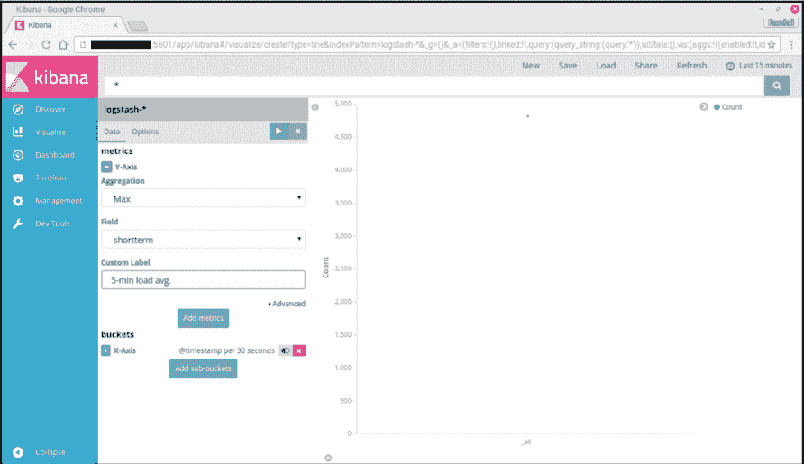

- 6. 在桶部分，单击 X-Axis 旁边的箭头。
- 7. 选择聚合方法。在大多数情况下，这将是 Date Histogram。
- 8. 除非设置了自定义时间戳字段，否则字段应为 @timestamp：

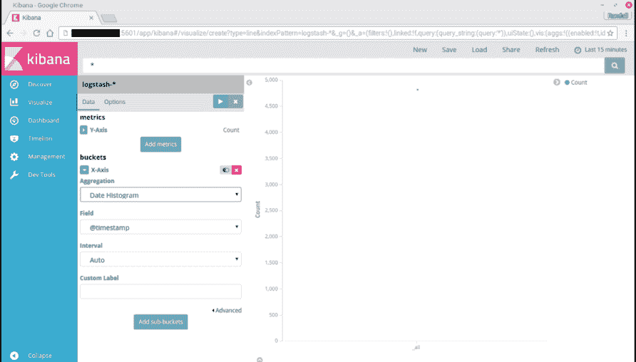

- 9. 单击配置面板顶部的箭头以应用更改并查看图表。
- 10. 单击页面顶部菜单中的 Save 以保存图表。

默认情况下，Kibana 会将所选字段的所有数据聚合到图表中。通常，根据主机或其他元数据来查看细分数据更有意义。为此，单击 Add sub-buckets。然后单击 Split Lines 或 Split Chart。Split Lines 为每个子桶显示一条线。Split Chart 为每个子桶创建单独的图表。如果绘制了许多指标，Split Chart 更适合。

要按主机名细分数据，将子聚合设置为 Significant Terms，将字段设置为 host.keyword，将大小设置为 1。单击顶部的箭头以应用任何更改并查看图表效果。

### 将图表添加到仪表板

仪表板提供了一种在一个位置一起显示保存的图表和搜索的方式。要创建新仪表板，请按照此处提到的步骤操作：

- 1. 单击左侧菜单中的 Dashboard，然后单击顶部菜单中的 New。单击页面顶部的 Add 以向仪表板添加新面板。
- 2. 单击保存的可视化或搜索，它将被添加到仪表板：

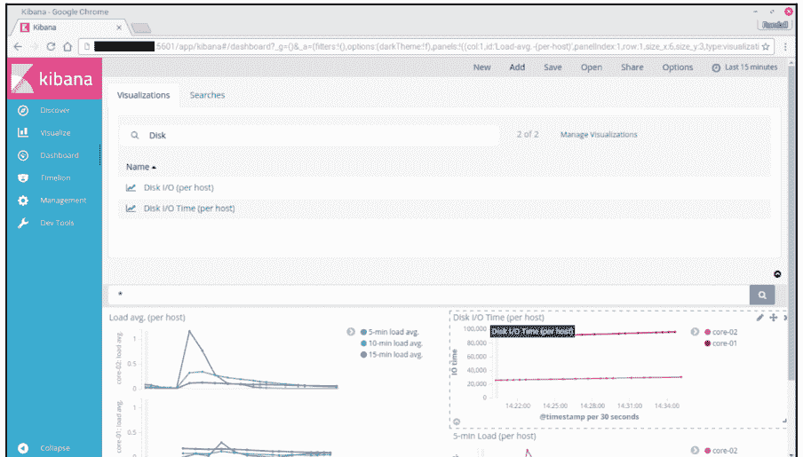

面板可以调整大小并在仪表板上移动，以以最合理的方式呈现信息。仪表板准备就绪后，单击页面顶部的 **保存** 选项。为仪表板命名，然后单击 **保存** 按钮。之前保存的仪表板可以通过单击页面顶部菜单中的 **打开** 选项打开。

## 使用 Grafana 绘制数据

Grafana 是一款非常强大的数据绘图工具。它可以使用 Elasticsearch 和 InfluxDB 作为数据源，但 InfluxDB 提供更多查询选项来处理数据。

Grafana 的最大功能之一是能够创建仪表板模板，从而构建数据集分组以便于显示。例如，可以选择仅显示 Web 服务器、数据库服务器，或标记为 *前端* 的所有服务器。有关更多详细信息，请参阅 http://docs.grafana.org/reference/templating/。

### 安装 Grafana

Grafana 项目创建了一个 Docker 镜像以简化 Grafana 部署。入门的基本命令如下。默认用户名和密码均为 admin。

```
$ docker run -d -p 3000:3000 --name grafana grafana/grafana
```

默认情况下，Grafana 使用 SQLite 在 /var/lib/grafana 中存储数据库和会话信息。可以将其配置为使用 MySQL 或 PostgreSQL。如果选择继续使用 SQLite，请确保 /var/lib/grafana 被挂载为外部卷。完整的配置文档可在 http://docs.grafana.org/installation/configuration/ 中找到。

### 添加数据源

在使用 Grafana 绘制数据之前，它必须知道数据所在的位置。要添加新数据源，请从左上角的下拉菜单中选择 Data Sources。单击 Add new 按钮。具体内容将取决于使用 Type 选项选择的数据源。完成数据源连接信息的设置后，单击 Save & Test。Grafana 将尝试连接到数据源，如果有问题，会打印警告。单个图表中可以添加和使用多个数据源：

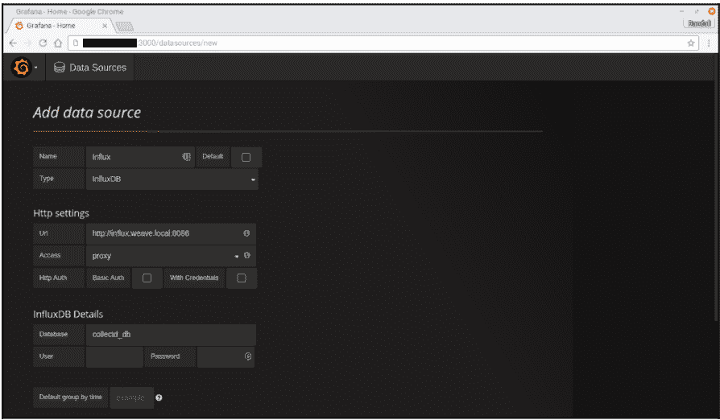

### 创建新仪表板

可以通过从下拉菜单中选择 Dashboard 并选择 +New 选项来创建新仪表板。新仪表板将是空白的，行左侧有一个非常小的弹出菜单。从该弹出菜单中，可以添加新面板。示例仪表板上的菜单如下所示：

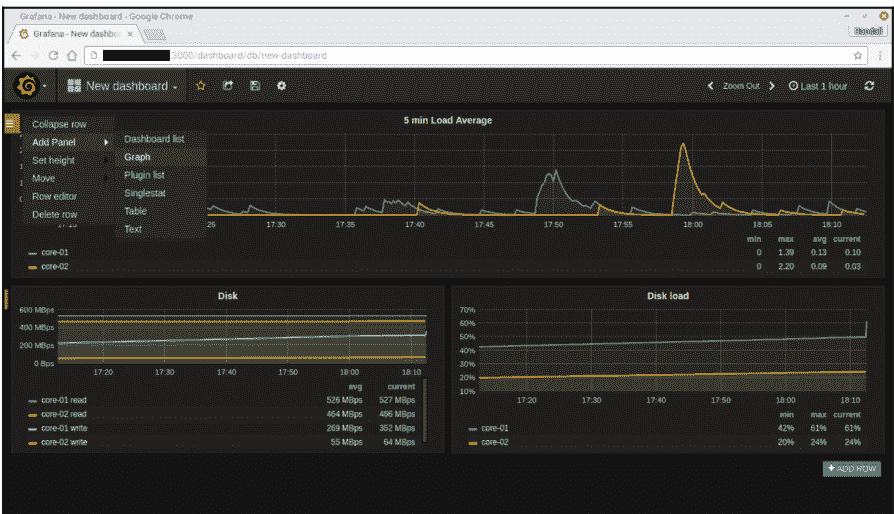

### 创建图表

打开行的弹出菜单，先进入 Add Panel，再进入 Graph。随后将显示图表编辑器。选项很多。不用担心。大多数选项都很简单，功能明显。最复杂的是 Metrics 选项卡。这是选择要在图表上显示的指标的地方。

单击标有 **选择指标** 的按钮，选择要用于此图表的指标。在以下屏幕截图中，已选择 **load_shortterm** 指标。可以使用 **添加查询** 按钮向图表添加更多指标：

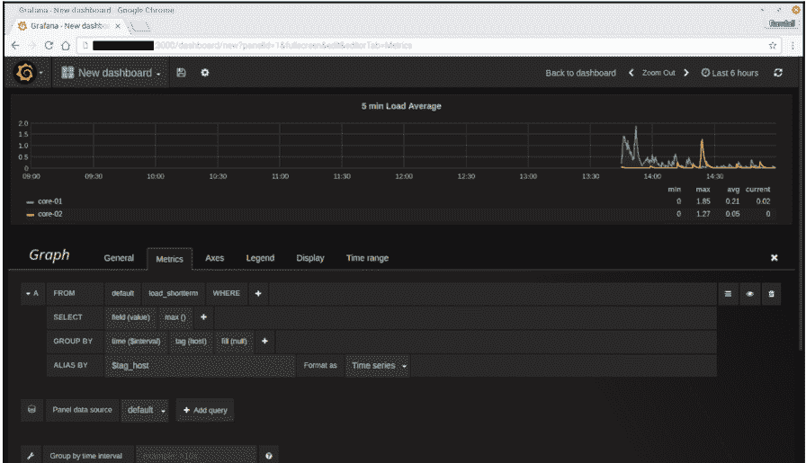

提供许多选项，包括用于处理所选指标的选项。一个有用的选项是按标签对指标进行分组的功能。单击 **GROUP BY** 行中的加号，选择 **tag(host)**，以便将每个主机拆分为单独的行。

图表完成后，单击 **返回仪表板** 返回仪表板。单击顶部的磁盘图标或按 **Ctrl + S** 保存仪表板。仪表板将可从页面顶部的下拉菜单中访问。

## 在 Kubernetes 中使用 Heapster

Heapster 是一种 Kubernetes 服务，用于收集节点和 Pod 指标，并通过 InfluxDB 和 Grafana 或 Google Cloud Monitoring 提供这些指标。使用 `kube-up.sh` 安装 Kubernetes 时，默认会安装它。有关从 Heapster 访问指标的完整详细信息可在 http://kubernetes.io/docs/user-guide/monitoring/ 中找到。

Heapster 的功能之一是按 Pod 对容器指标进行分组。它会根据 Pod 中设置的标签为指标添加标签。这使得在 Grafana 中轻松创建专注于单个 Pod 或由多个 Pod 组成的单个应用程序的图表。

## 监控系统运行状况的注意事项

系统管理员职业生涯早期学到的事情之一是，在客户或老板注意到之前发现问题并修复问题更好。在故障排除方面，日志收集和性能图表至关重要。然而，很少有人会监控每条日志消息和每一条性能数据。信息量实在太大，有些管理员甚至在办公室之外也有生活。幸运的是，计算机非常擅长筛选大量数据，而且很少请假。

大多数多年来用于监控服务器和服务运行状况的工具仍然适用。然而，与旧的独立服务器模型相比，完全编排的环境提供了一些独特的挑战。例如，服务不运行在单个主机上。它可能在集群中的任何位置运行。此外，能够通过 AWS、GCE，甚至本地数据中心中的 VM 快速向 Docker 集群添加或删除容量，使得向监控套件中添加特定主机成为一项挑战。

变化太多，无法提供适用于所有情况的特定解决方案，但以下是一些一般准则。

### 监控服务

请记住，客户使用您的服务时最关心的是：“它是否可用？”。对于管理员来说，问题不仅仅是：“它是否正常运行？”，而是：“我如何保持这种状态？”。可以采取多种措施，以确保管理员在客户之前了解存在问题。

- **使用运行状况检查**：Kubernetes 等一些编排工具可以运行检查来监控服务的运行状况。使用它们并使其有意义。仅仅知道 Web 服务器正在接受 80 端口上的连接是不够的。您还需要知道它是否返回良好的状态码并显示预期的内容。
- **监控所有移动部分**：Web 应用程序通常不仅仅是 Web 服务器。是否存在数据库，并且它是否正常响应？不要害怕编写一个使用 Web 应用程序的凭据登录数据库并执行查询的运行状况检查。


- **不要忘记网络**：在本地运行集群时，很容易忽略或视若理所当然地对待网络基础架构。在可行的情况下，将网络协议栈添加到监控中。一些组织将网络和服务器运维团队分开，这可能会使将网络协议栈添加到 Docker 监控中在政治上存在问题。在这种情况下，与网络团队成为朋友。

- **创建有用的仪表板**：能够在同一位置查看相关组件的日志和指标可以简化故障排除。诀窍在于知道什么值得查看，什么不值得。过多信息与信息过少一样成问题。

### 使用 Sysdig 实时监控服务

Sysdig 是一种实时命令行监控工具。它可以监控大多数主机组件，并支持报告容器统计信息。它还支持查看基于 Kubernetes Pod、复制控制器、服务等的指标。

在可能的情况下，Sysdig 应直接安装并运行在主机上。这样可以使其对系统拥有最大可见性。Debian 和基于 Red Hat 的系统提供了安装包。安装说明可在 http://www.sysdig.org/install/ 找到。

也可以在容器中运行 Sysdig。如果 Docker 主机运行的 Linux 发行版不受直接支持，或者像 CoreOS 这样在容器中运行所有内容的系统，这尤其有用。启动容器的命令如下：

```
$ docker run -it --rm --name=sysdig --privileged=true \
--volume=/var/run/docker.sock:/host/var/run/docker.sock \
--volume=/dev:/host/dev \
--volume=/proc:/host/proc:ro \
--volume=/boot:/host/boot:ro \
--volume=/lib/modules:/host/lib/modules:ro \
--volume=/usr:/host/usr:ro \
sysdig/sysdig
```

需要注意以下几点：

- 首先，在容器中运行 `sysdig` 需要使用 `--privileged` 标志。它需要此权限才能加载 `sysdig` 内核模块并访问所有所需信息。
- 第二，该命令映射了多个重要的文件系统，例如 `/proc`，以实现可见性。
- 第三，/var/run/docker.sock 被映射到容器中，以便 sysdig 可以检索正在运行的 Docker 容器的信息。

安装 sysdig 后，运行命令 `cysdig` 启动 curses 界面。这提供了一个类似 top 的界面，让你查看服务器上正在发生的事情。使用 F2 切换视图。`-pc` 标志将容器信息添加到许多可用视图中：

```
$ cysdig -pc
```

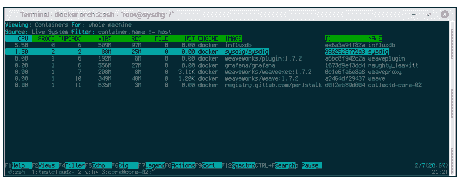

Sysdig 在实时排查系统问题时非常有价值。每个视图都有深入选项，可以查看特定事物的更多信息，该事物可以是容器、网络连接、主机进程或其他许多项目。

## 摘要

本章介绍了如何将 Docker 日志和指标发送到远程服务。它展示了如何使用 Kibana 查看存储在 Elasticsearch 中的日志，以及如何使用 Kibana 和 Grafana 基于存储在 Elasticsearch 和 InfluxDB 中的指标构建图表和仪表板，以快速提供有用信息。还介绍了一些监控 Docker 集群中服务的一般提示。最后，介绍了 Sysdig，它可以提供对主机和容器的实时监控。下一章将介绍如何使用持续集成来构建、测试和部署容器。
