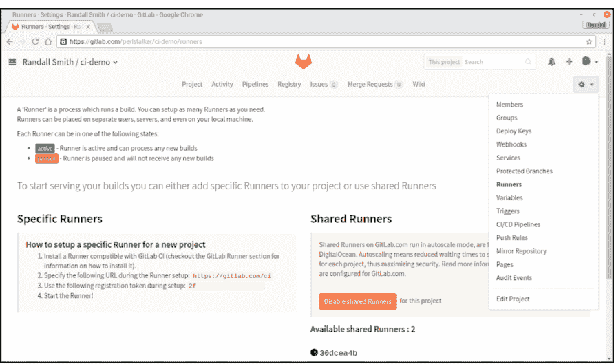
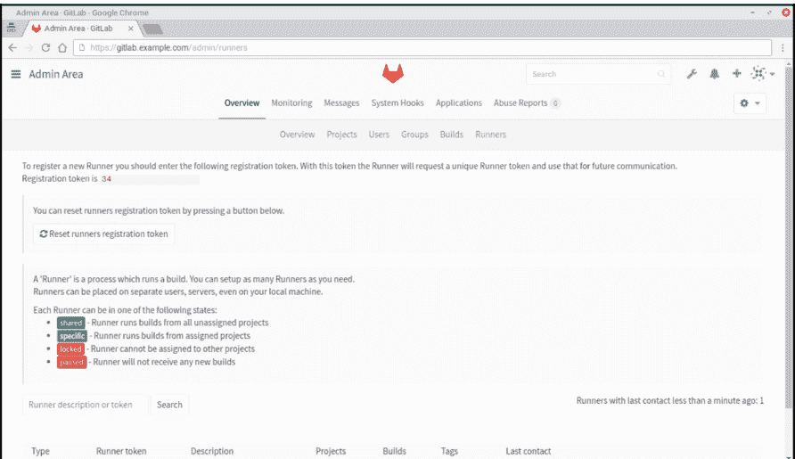
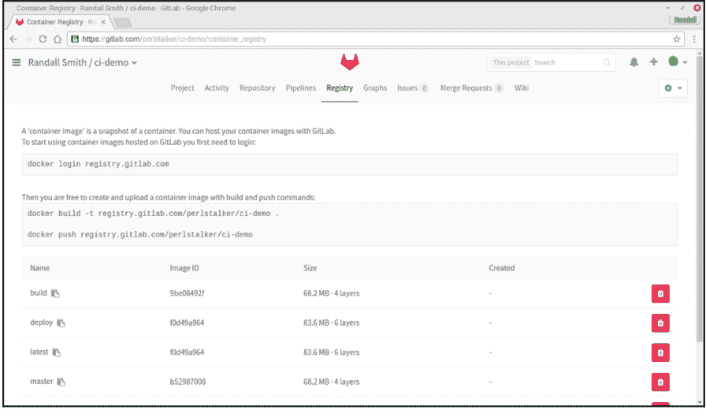
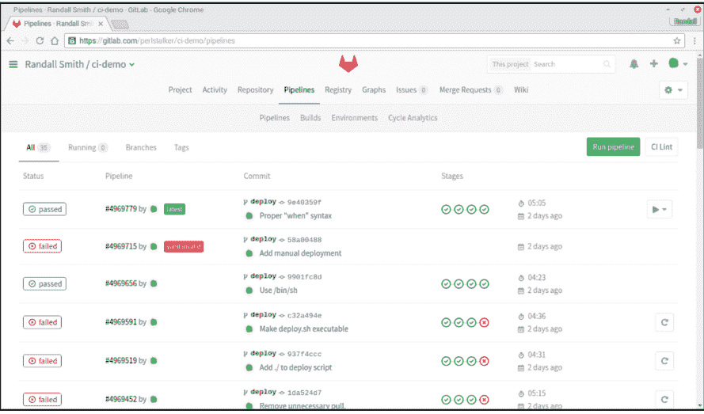
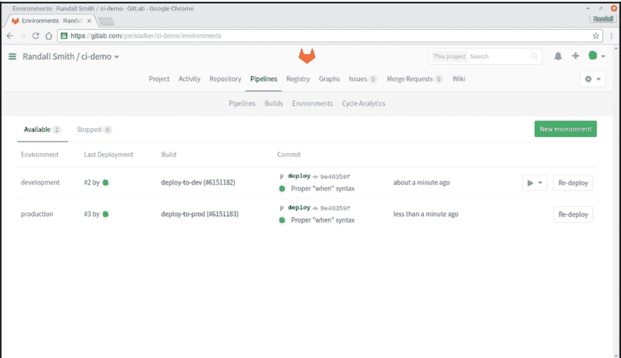
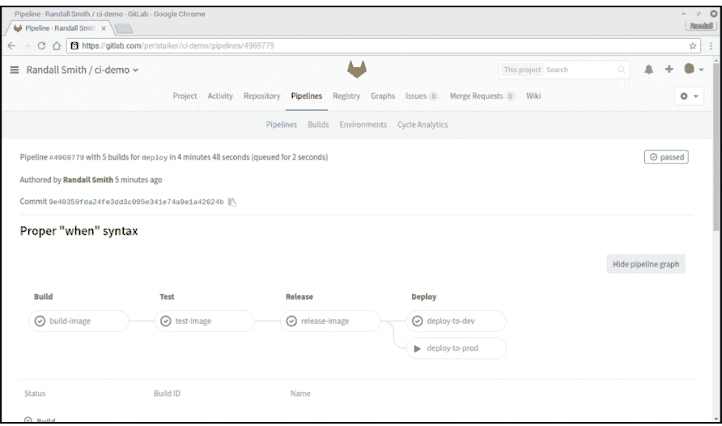
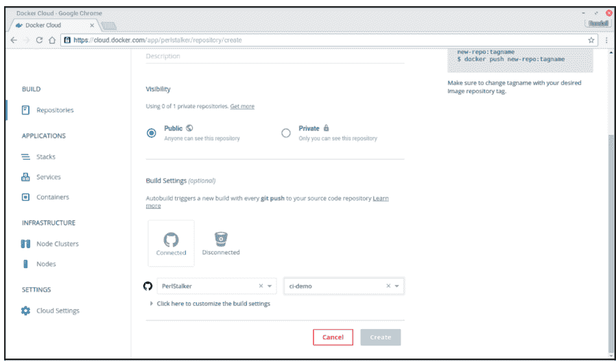
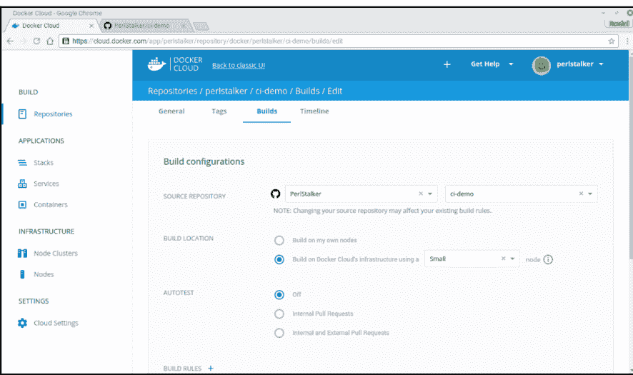
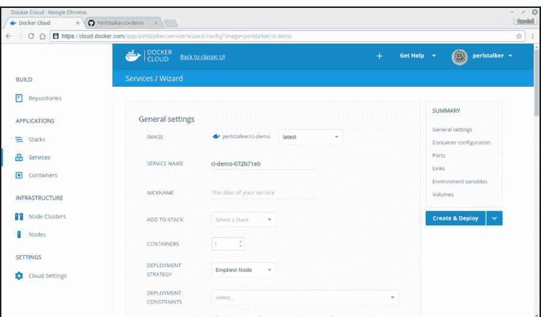
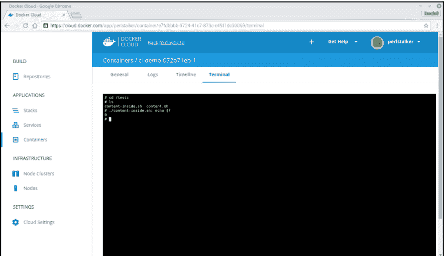

# 使用持续集成构建、测试和部署容器

运行容器最重要的部分之一是构建容器所基于的镜像。毕竟，没有镜像就没有容器。一个挑战是确保 Docker 镜像不仅能够构建，而且在部署 *之前* 也能正常工作。

本章将演示如何使用 GitLab 为 Docker 镜像实施 **持续集成**（CI）。它将展示如何自动构建镜像、针对其运行测试套件、将新镜像推送到 Docker Registry，甚至将新镜像部署到 Docker 集群。

本章将涵盖以下主题：

- 使用 CI 的重要性
- 在 GitLab 中为 CI 设置项目
- 自动构建新镜像
- 针对镜像运行测试
- 发布经过测试的镜像
- 自动部署镜像
- 使用 GitLab CI 创建 DAB 文件
- 使用 Docker Cloud 进行镜像测试

## 使用 CI 的重要性

值得牢记如何定义 Docker 应用程序。在最基本的层面上，Docker 应用程序实际上与任何软件项目没有区别。它只是一个 `Dockerfile`，而镜像所需的资源很可能存储在版本控制中。它是软件。

将 Docker 应用程序视为代码意味着管理员或管理员团队可以从软件开发方法论的所有进步中受益。其中之一就是项目的自动构建和测试。这个过程称为 CI。每当对应用程序进行更改时，无论是配置文件的小改动还是对实际应用程序的升级，都可以自动重新构建和测试镜像，以确保部署时镜像能按预期工作。

我经常开玩笑说，作为系统管理员，我的工作是让其他人或事物为我工作。现实是，我能让组织中其他人获得多少权力，我们就能变得多么高效。例如，想象一个正在开发 Web 应用程序的开发团队。在传统模型中，这些开发人员必须等待管理员将任何更改部署到测试和生产环境，并希望在这个过程中不会出任何问题。使用合适的 CI 工作流意味着，无论开发人员何时准备好部署，CI 工具都可以安全地部署应用程序，而无需等待管理员抽出时间。最终结果是更快、更一致、更可靠的部署。

## 使用 GitLab 进行 CI

GitLab 是 Docker 镜像和服务 CI 与部署的绝佳工具。它将 Git 与问题跟踪、Docker Registry 和 CI 相结合，提供统一的体验。然而，此过程并非 GitLab 特有。本节所学的经验无论使用什么系统都应该适用。

## 为 CI 设置 GitLab

GitLab CI 作为 GitLab.com 提供服务的一部分免费提供。也可以付费购买提供更多资源的企业版许可证。GitLab 的免费社区版和商业企业版也可以本地安装。在第 3 章“集群构建块 – Registry、Overlay Networks 和 Shared Storage”中，我们展示了如何安装 GitLab 以及如何启用 Docker Registry。

**Registry** 是使 CI 工作的重要部分。它为成品镜像在集群中使用提供存储位置。可以使用其他 Registry 代替 GitLab。例如，组织可以选择使用 Docker Hub 或 Docker Datacenter 中的安全 Registry。

从 GitLab 8.0 开始，GitLab CI 已完全集成到主程序包中。除了一个例外外，在 GitLab 中无需再安装或启用其他内容即可使用这些功能。最后需要的组件是 GitLab Runner。

## 在 Ubuntu 上安装 GitLab Runner

GitLab Runner 的工作是执行实际的镜像构建。每个构建都会排队并依次处理。可以使用多个 Runner 来允许并行执行多个构建。Runner 可以打标签以运行特定任务，例如构建 Docker 镜像或为 Microsoft Windows 构建应用程序。

GitLab.com 提供了一个可用于构建镜像的共享 Runner。这对于较小的项目或测试非常有用。较大的组织应考虑购买企业版许可证或在本地安装自己的 Runner。如果镜像测试包含敏感信息，或者需要连接到无法从 Internet 访问的资源，也可能希望使用本地 Runner。

运行 GitLab Runner 的首选方法是将其原生安装在 Debian、Ubuntu、RHEL 或 CentOS 上。但是，也有官方 Docker 镜像。有关使用该镜像的详细信息，请参阅 https://gitlab.com/gitlab-org/gitlab-ci-multi-runner/blob/master/docs/install/docker.md。


安装用于构建 Docker 镜像的 runner 的第一步是安装 Docker。构建过程需要能够拉取镜像、构建新镜像，并将构建完成的镜像推送到仓库中。

GitLab 提供了一个脚本，用于将其 apt 仓库添加到服务器中。下载该脚本，仔细检查它是否会按预期执行，然后运行它。出于安全考虑，请不要将下载内容直接通过管道传输给 sudo bash：

```
$ wget -O script.deb.sh
https://packages.gitlab.com/install/repositories/runner/gitlab-ci-multi-runner/script.deb.sh
$ sudo bash script.deb.sh
```

该脚本将 GitLab 的 GPG 密钥添加到 apt 密钥环，添加仓库，并运行 apt-get update。完成后，即可安装 runner：

```
$ apt-get install gitlab-ci-multi-runner
```

runner 不必部署在 GitLab 服务器上。如果负载是问题，runner 可以安装在多个服务器或云服务提供商上。GitLab 还可以根据 Docker Machine 支持的任何提供商自动扩展 runner 数量。详情请参阅 https://docs.gitlab.com/runner/install/autoscaling.html。

### 注册 runner

安装 runner 后，必须将其注册到 GitLab。有两种方法。第一种是为单个项目注册。在这种情况下，runner 仅针对特定项目的构建运行。另一种选项是全局注册。这将使 runner 可用于 GitLab 中的每个项目。两种方法都有优缺点，但它们并非互斥。可以配置一个或多个全局 runner 用于通用目的，以及专门用于某个项目的其他 runner。

在将 runner 注册到 GitLab 之前，需要注册令牌。对于项目特定的 runner，请转到项目的 Runner 设置页面。特定 Runner 部分将显示注册 runner 时使用的 URL 和令牌：



对于共享 runner，以管理员身份登录后，注册令牌位于 **管理区域** 中的 **Runner** 页面（扳手图标）。URL 与项目特定 runner 的 URL 相同：



有多种方法可以创建可用于构建 Docker 镜像的 runner。最简单的是使用 shell 执行器。它旨在运行任何 shell 命令来构建项目。它适用于几乎任何类型的项目，包括 Docker。`gitlab-runner` 用户必须在 `docker` 组中，或否则拥有运行 `docker` 的权限。

以下命令用于注册 runner。将 `$GITLAB_URL` 替换为项目 **Runner** 页面上列出的 GitLab 安装的 CI URL。如果使用 `GitLab.com`，URL 将是 `https://gitlab.com/ci`。`$REGISTRATION_TOKEN` 令牌是项目特定或全局 **Runner** 页面上的令牌：

```
$ sudo gitlab-ci-multi-runner register -n \
--url $GITLAB_URL \
--registration-token $REGISTRATION_TOKEN \
--executor shell \
--description "Shell Runner"
```

另一种选项是运行 docker-in-docker 执行器。该执行器在包含 Docker 和 Docker Compose 的 Docker 容器中构建项目：

```
$ sudo gitlab-ci-multi-runner register -n \
  --url $GITLAB_URL \
  --registration-token $REGISTRATION_TOKEN \
  --executor docker \
  --description "Docker Runner" \
  --docker-image "docker:latest" \
  --docker-privileged
```

runner 容器必须以特权模式运行，才能运行构建容器。

## 启用 Docker 仓库

在开始构建过程之前，下一步是启用 Docker Registry。GitLab 提供了一个可以按项目启用的注册表服务。设置说明在第 3 章，集群构建模块 – 注册表、覆盖网络和共享存储。如果已经设置好或正在使用 GitLab.com，请转到编辑项目，并确保勾选容器注册表旁边的框。

GitLab 注册表是一个不错的选择，因为它与 GitLab 和 CI 流程集成。如果需要，也可以使用其他注册表。如果使用其他注册表，请为 runner 设置一个具有权限将新镜像推送到注册表的帐户。

## 将项目添加到仓库

最后，需要将项目添加到 GitLab 中的 Git 仓库。这可以使用标准 git 命令完成。以下是基本脚本。如果 Docker 配置已经在 Git 中，只需要最后两个命令。请务必更改远程仓库的 URL 以匹配您的仓库：

```
$ git init
$ git add .
$ git commit -m 'initial commit'
$ git remote add origin http://gitlab.example.com/project/repo
$ git push -u origin master
```

以下示例将使用一个非常简单的 Docker 镜像。它是带有单页网站的 Nginx Web 服务器。以下是 Dockerfile：

```
FROM nginx:1.10
COPY index.html /usr/share/nginx/html/
```

本节描述的 CI 流程的完整示例可在 GitLab 上获得。每个分支都是每个步骤的完整示例。从 https://gitlab.com/perlstalker/ci-demo 下载示例。

## 创建 .gitlab-ci.yml

CI 通过存储库根目录中名为 .gitlab-ci.yml 的文件进行配置。此 YAML 文件定义了构建、测试和部署镜像所需的构建阶段、变量和作业。可以定义任意数量的作业，并且作业可以并行运行。有关 .gitlab-ci.yml 中可用选项的完整详细信息，请参阅 https://docs.gitlab.com/ce/ci/yaml/README.html。

以下 .gitlab-ci.yml 示例是一个简单配置，可以构建镜像并将其推送到注册表。此示例使用 docker-in-docker 执行器。在使用带本地 runner 的 shell 执行器时，可以省略前三行：

```
image: docker:latest
services:
  - docker:dind

stages:
  - build
  - test
  - release
  - deploy

variables:
  DOCKER_CI_IMAGE: registry.gitlab.com/perlstalker/ci-demo:$CI_BUILD_REF_NAME

before_script:
  - docker login -u gitlab-ci-token -p $CI_BUILD_TOKEN registry.gitlab.com

build-image:
  stage: build
  tags:
    - docker
  script:
    - docker build --pull -t $DOCKER_CI_IMAGE .
    - docker push $DOCKER_CI_IMAGE
```

`stages` 选项定义作业可以配置为在其中运行的阶段列表。可以定义任意数量的阶段以满足项目需求。这里列出的四个阶段，`build`、`test`、`release` 和 `deploy`，是典型的。每个阶段按列出的顺序运行。先运行 `build` 阶段的作业，然后是 `test`，依此类推。如果每个阶段中有多个作业，则它们并行运行。

`variables` 选项允许定义用于其余构建过程的变量。在示例中，名为 `$DOCKER_CI_IMAGE` 的变量设置为将要构建的镜像名称。镜像名称包含 `$CI_BUILD_REF_NAME` 变量，这是一个内置变量，设置为分支或标签名称。应为特定项目更改 `$DOCKER_CI_IMAGE` 的值。

使用 `$CI_BUILD_REF_NAME` 非常有用，尤其是在测试新镜像或准备新版本时。在测试期间，创建新分支意味着生成的镜像将标记为分支名称。例如，如果创建名为 `foo` 的分支，则新镜像将是 `image:foo`。

GitLab 提供了一系列可在 CI 配置中使用的有用变量。完整列表可在 https://docs.gitlab.com/ce/ci/variables/README.html 上找到。

Git 标签也会生成带有该标签的镜像。例如，如果将 `1.1` 标签添加到提交，则会创建名为 `image:1.1` 的新镜像。这样可以轻松创建用于部署的版本化镜像。请记住，使用 `image:version` 而不是 `image:latest` 可以更轻松地跟踪集群上运行的确切内容，并在发生故障时轻松回滚到之前的镜像版本。

`before_script` 选项包含一组命令列表，用于在每个作业之前准备环境。在此示例中，它使用特殊 CI 帐户和构建令牌登录到 GitLab Docker 注册表。构建令牌暂时授予构建者触发构建的用户的权限。如果使用不同的注册表，则将使用该注册表的登录凭据。

最后一个块是名为 `build-image` 的作业。`stage` 选项指示此作业将在哪个阶段运行。在此情况下，`build-image` 作业在 `build` 阶段运行。如果在同一阶段中定义了多个作业，则它们并行运行。


作业可以定义一个 `tags` 列表，用于指定使用哪个运行器。在前面的示例中，镜像将由带有 `docker` 标签的运行器构建。如果设置了多个标签，运行器必须匹配所有标签才能被使用。这使得可以创建能够构建某些类型项目而不能构建其他项目的运行器。

最后，`script` 选项是用于构建项目的命令列表。每个命令必须在下一个命令运行之前成功。如果其中任何一个失败，构建将停止并标记为失败。命令可以是示例中的常规系统命令，也可以是来自仓库的脚本。

在此示例中，运行器先构建镜像。`--pull` 标志与 `docker build` 一起使用，以确保使用基础镜像的最新副本来构建新镜像。如果构建成功，新镜像将被推回仓库。可用镜像列表可在项目页面的 **镜像仓库** 部分中查看：



当前构建以及之前构建的状态可在项目的 **流水线** 部分中查看。点击任何构建可深入查看每个构建阶段的状态。点击阶段将显示该阶段的构建日志。失败构建生成的任何错误都将显示在那里：



## 测试镜像

CI 之所以在软件开发者中如此受欢迎，原因之一是它提供了一种方式，可以自动针对新构建运行测试套件，以确保其正常工作。测试提供了一种安全保障，确保无论开发者做出了哪些更改，都不会破坏软件的功能。这对于将要部署到潜在成百上千台服务器的 Docker 镜像同样有价值。

实现测试有多种方式：

- 第一种方法是将测试包含在 `git` 仓库中，但不将其添加到镜像中。这样可以保持镜像较小，但要求运行器上安装了测试所需的所有工具。某些运行器（例如 docker-in-docker 执行器）可能不包含运行测试所需的工具。

- 第二种方法是将测试包含在 Docker 镜像中。然后可以使用 `docker run` 或 `docker exec` 从容器内运行测试。这会导致镜像更大，但确保了测试镜像所需的所有工具都可用。它还使得可以随时在运行中的镜像上运行测试。如果某些问题仅在镜像在生产环境中运行时才会出现，这可能会很有用。

- 第三种选择是创建一个包含验证镜像所需所有测试的单独镜像。该镜像可以由 GitLab 在测试阶段下载并运行，以测试应用程序镜像。这种方法的好处是，随着新测试用例的出现，测试和测试镜像可以独立更新。

让我们看看本示例中使用的非常简单的网页：

```
<html>
<head><title>Docker Orchestration</title></head>
<body>
<h1>Docker Orchestration is fun!</h1>
<p>Automate all the things!</p>
</body>
</html>
```

老板决定网页必须始终宣称 Docker 编排有多么有趣。为此，创建了一个测试以确保它始终有趣。在此示例中，它位于 tests 目录中，并命名为 run-tests.sh：

```
#!/bin/sh
curl -s http://localhost | grep 'fun!</h1>' > /dev/null
```

此测试非常简单。它访问网页并检查 fun! 是否是标题中的最后一项。为了简化，测试将被添加到镜像中。更新后的 Dockerfile 如下。它做了两件事。首先，它添加了测试所需的 curl。其次，它将测试添加到镜像中的 /tests 目录：

```
FROM nginx:1.11
RUN apt-get update && apt-get install -y curl && apt-get clean
COPY index.html /usr/share/nginx/html/
COPY tests /tests
```

要运行测试，需要在 .gitlab-ci.yml 中添加一个新作业。以下代码片段显示了该作业。一旦 .gitlab-ci.yml 在仓库中更新，未来的提交将运行测试：

```
test-image:
  stage: test
  tags:
    - docker
  script:
    - docker pull $DOCKER_CI_IMAGE
    - docker run -d -P --name $CI_BUILD_ID $DOCKER_CI_IMAGE
    - docker run --rm --network container:$CI_BUILD_ID --name $CI_BUILD_ID-test
      --entrypoint /tests/run-tests.sh $DOCKER_CI_IMAGE
    - docker stop $CI_BUILD_ID; docker rm -f $CI_BUILD_ID
```

stage 选项被设置，以便作业将在 test 阶段运行。如果构建阶段失败，此作业不会运行。它还包含 Docker 标签，因此 GitLab 将使用也标记为 Docker 的运行器。

script 部分列出了用于测试镜像的命令。前两个命令下载镜像并在后台运行它。容器名称设置为 $CI_BUILD_ID，这是 GitLab 分配给构建的唯一构建 ID。设置名称很重要，因为运行测试时会用到它。

script 块中的第三个条目运行实际测试。它启动一个新容器，该容器共享目标容器的网络。这样测试就可以连接到 localhost 上的 Web 服务器。测试容器运行前面显示的测试脚本。如果脚本中的模式未匹配，grep 将失败，测试将返回非零退出码，GitLab 将其解释为失败。如果脚本中找到了该模式，测试成功，流程继续。

最后一行停止目标容器并将其删除。运行测试的容器在测试完成后会自动删除，因为启动它时使用了 --rm。

## 清理作业

前面的测试作业在测试成功时效果很好，但当测试失败时，它可能会让测试容器继续运行。当使用 GitLab.com 上的共享运行器时，这不是问题，因为每个测试都会启动一个新 VM，并在构建过程完成后立即将其删除。但是，当使用本地运行器时，这可能会成为问题。在这种情况下，可能需要一个作业在测试后进行清理。

首先，创建一个新的 `cleanup_test` 阶段，并定义一个名为 `cleanup_tests` 的作业在 `cleanup_test` 阶段中运行。通常，如果 `test` 阶段中的作业失败，之后的作业都不会运行。`cleanup_tests` 作业通过使用 `when` 选项来绕过这一限制。将其设置为 `always`，无论 `test` 阶段中发生什么，作业都会运行。`when` 选项还可以设置为 `on_success` 或 `on_failure`，以便仅在作业成功或失败时分别运行该作业。还有一个第四个选项 `manual`，将在本章后面介绍。以下代码片段展示了如何创建一个在 CI 过程完成后进行清理的作业：

```
stages:
  - build
  - test
  - cleanup_test
  - release
  - deploy

...

test-image:
  stage: test
  tags:
    - docker
  script:
    - docker pull $DOCKER_CI_IMAGE
    - docker run -d -P --name $CI_BUILD_ID $DOCKER_CI_IMAGE
    - sh tests/run-tests.sh $CI_BUILD_ID

cleanup_tests:
  stage: cleanup_test
  script:
    - docker stop $CI_BUILD_ID; docker rm -f $CI_BUILD_ID
  when: always
```

## 发布镜像

`build-image` 作业每次将更改推送到 `git` 仓库时都会创建一个更新的镜像。让我们更仔细地看看创建了什么。示例中的 `docker build` 命令正在创建名为 `registry.gitlab.com/perlstalker/ci-demo:$CI_BUILD_REF_NAME` 的镜像。`$CI_BUILD_REF_NAME` 变量是分支或标签的名称。这意味着，到目前为止，唯一创建的镜像是 `registry.gitlab.com/perlstalker/ci-demo:master`。没有 `:latest` 镜像。如果有人尝试运行 `docker run registry.gitlab.com/perlstalker/ci-demo`，该命令将失败，因为带有隐含 `latest` 标签的镜像不存在。


GitLab 不会自动为镜像打上 `latest` 标签，这是一个特性。其理念是在 `.gitlab-ci.yml` 的 CI 计划中显式地为镜像打标签。这通过创建一个新作业来实现。`.gitlab-ci.yml` 的片段如下：

```yaml
variables:
  DOCKER_CI_IMAGE: registry.gitlab.com/perlstalker/ci-demo:${CI_BUILD_REF_NAME}
  DOCKER_RELEASE_IMAGE: registry.gitlab.com/perlstalker/ci-demo:latest
...
release-image:
  stage: release
  tags:
  - docker
  script:
  - docker pull $DOCKER_CI_IMAGE
  - docker tag $DOCKER_CI_IMAGE $DOCKER_RELEASE_IMAGE
  - docker push $DOCKER_RELEASE_IMAGE
  only:
  - master
```

第一个区别是添加了一个名为 `$DOCKER_RELEASE_IMAGE` 的新变量，用于指定发布镜像的名称。


请注意，镜像标签是 `latest`。

与往常一样，工作在 `script` 块中完成。第一步是拉取该分支的最新镜像副本。接下来，`docker tag` 使用发布镜像名称对该镜像打标签。具体来说，它被赋予了 `latest` 标签。最后，`docker push` 命令将新打标签的镜像推送回仓库。

`only` 块很重要。它告诉 GitLab，此作业仅在构建列出的某个分支时才能运行。在此例中，是 `master`。如果没有 `only` 块，任何分支构建的任何新镜像都将替换 `latest` 镜像。

此配置的好处是，可以在不同分支中处理新镜像，并为这些分支创建镜像。这些镜像可以分别运行、测试和调试，而无需修改已发布的镜像。当更改准备就绪时，开发分支可以合并回 `master` 分支，并创建一个新的 `latest` 镜像。

## 部署镜像

让我们停下来看看当前进度。此时，每当更改推送到 GitLab 中的 Git 仓库时，项目的新 Docker 镜像都会自动构建。正在针对新镜像运行测试套件，以确保其按预期工作。如果更改推送到 `master` 分支，则会创建一个新的发布镜像。剩下的唯一工作就是将镜像部署到集群。

镜像的部署方式将取决于所选的编排套件。在大多数情况下，只需运行执行服务滚动更新的命令即可。自动化部署作业的片段如下：

```yaml
deploy-to-dev:
  stage: deploy
  tags:
    - docker
  environment: development
  script:
    - ./deploy.sh $DOCKER_CI_IMAGE development
  only:
    - master
```

此处有几点需要注意。首先，`stage` 设置为 `deploy`。仅当 `build`、`test` 和 `release` 阶段均成功完成时，作业才会运行；`environment` 是可选的。项目中 **流水线** 部分下的 **环境** 页面可以轻松跟踪不同环境的部署：



片段中的 `deploy.sh` 脚本是一个占位符。脚本可以包含在你的环境中部署镜像所需的任何内容。脚本也可以直接包含在 `script` 块中。本章后面将展示如何将镜像部署到 Kubernetes 集群。

> **提示** 在部署的 `only` 部分中，考虑使用 `tags` 关键字而不是分支名称。这样将仅限制对已打标签的提交进行部署。这将确保所有部署的镜像都使用该标签。根据镜像上的标签，更容易判断容器正在运行哪个版本的镜像。

## 手动部署镜像

将镜像自动部署到集群很令人兴奋。也许太令人兴奋了。不是所有人都希望服务自动更新。这并不意味着 GitLab 不能用于部署。GitLab 提供了一种配置作业手动运行的方式。构建过程将照常运行，但当遇到手动作业时，它将等待，直到有人告诉 GitLab 可以继续。这既提供了自动化部署的一致性，又允许人工决定是否执行部署。

以下 .gitlab-ci.yml 片段展示了如何创建带有手动触发器的作业。它基本上与前面的自动化部署相同。唯一的功能变化是 `when` 标签：

```yaml
deploy-to-prod:
  stage: deploy
  tags:
    - docker
  environment: production
  script:
    - ./deploy.sh $DOCKER_CI_IMAGE production
  only:
    - master
  when: manual
```

将 `when` 设置为 `manual` 将暂停构建和部署过程，直到有人进入 Pipelines，点击构建，然后点击部署。以下截图显示了构建管道：



请注意，所有作业都已成功。只有 `deploy-to-prod` 作业未成功。三角形播放按钮显示 `deploy-to-prod` 作业正在等待 `manual` 操作。点击该按钮时，部署将开始。

可以定义任意数量的部署作业以满足各种需求。例如，完全自动化的作业可以将新镜像部署到开发环境。然后，手动作业可以触发部署到 QA 或金丝雀环境。最后，另一个手动作业可以将镜像完全部署到生产环境。这可以通过如图所示的并行作业，或作为单独的构建阶段来完成。使用单独的阶段可确保每个先前的部署在最终推送到生产环境之前均已完成。

## 部署到 Kubernetes

前面的示例使用了一个虚拟部署脚本。让我们看看如何使用 GitLab CI 将新镜像部署到 Kubernetes。在第 5 章《使用 Kubernetes 部署和管理服务》中，我们介绍了在 Kubernetes 中管理部署。

以下 .gitlab-ci.yml 片段做出了几个假设：

- 首先，runner 机器上安装了 kubectl，且 gitlab-runner 用户有权修改 Kubernetes 集群
- 其次，已创建一个将由构建过程更新的部署：

```yaml
variables:
  DOCKER_CI_IMAGE: registry.gitlab.com/perlstalker/ci-demo:$CI_BUILD_REF_NAME
  DOCKER_RELEASE_IMAGE: registry.gitlab.com/perlstalker/ci-demo:latest
DEPLOYMENT: ci-demo
CONTAINER: web
...
deploy-to-kube:
  stage: deploy
  tags:
    - kubectl
  environment: production
  script:
    - kubectl set image deployment/$DEPLOYMENT
      $CONTAINER=$DOCKER_CI_IMAGE
  only:
    - tags
  when: manual
```

配置中添加了两个新变量，DEPLOYMENT 和 CONTAINER。它们分别包含要更新的部署名称以及该部署中的容器名称。

例如，作业上设置了 kubectl 标签。预期是有一个带有 kubectl 标签的 runner 可用，其 kubectl 已配置为管理集群。这使得创建仅用于部署且不用于其他构建作业的 runner 变得容易。

脚本仅包含更新部署中镜像的命令。不需要在 runner 上对镜像做任何操作。运行该部署的 Kubernetes 节点将根据 pod 的部署策略对容器执行更新。

最后，`only` 块告诉 GitLab 仅在构建设置了 git 标签时才运行此作业。这将确保构建的镜像具有与之前运行的不同标签。如果镜像名称与部署当前使用的相同，Kubernetes 将不知道需要更新镜像。

## 构建 DAB 文件

Docker Swarm 正在转向使用分布式应用程序包 (DAB) 来定义部署堆栈。可以使用 GitLab CI 为项目自动构建 DAB 文件。以下片段假设 docker-compose.yml 位于项目的根目录中：

```yaml
build-dab:
  stage: release
  tags:
    - docker
  script:
    - docker-compose bundle
  artifacts:
    paths:
      - *.dab
    name: "${PROJECT_NAME}-${CI_BUILD_REF_NAME}"
```

`script` 块运行 `docker-compose bundle`，这将生成 .dab 文件。如果需要，可以向命令添加其他选项。`artifacts` 块告诉 GitLab，构建过程生成了重要文件。在此示例中，如果构建成功，将保存 .dab 文件。路径列表中匹配的所有文件都将添加到 artifacts 存档文件中。


最后，name 选项提供 artifact 存档的名称。在此示例中，它是存档名称与构建引用名称，中间用连字符分隔。例如，如果项目名为 ci-demo 且正在构建 master 分支，则名称将为 ci-demo-master。artifact 存档文件将命名为 ci-demo-master.zip。

## 使用 Docker Cloud 进行 CI

Docker Hub 和 Docker Cloud 可在关联的 Git 仓库更新时自动更新镜像。如果 GitLab 对于此项工作来说过于复杂，这可以用于轻量级 CI。无论哪种情况，都可以编写自定义工具来针对测试套件运行新生成的镜像，也可以手动运行和测试它们。

Docker Cloud, in particular, can be useful for testing images. It can auto build an image every time the project is updated in GitHub or Bitbucket. Once the image is built, it can be started as a service in a test cluster from the web interface.

To start, click on the Repositories link and click on Create to create a new repository. Link the new repository to GitLab or Bitbucket by clicking on the appropriate icon at the bottom of the creation page. When everything is ready, click on Create:



### Enabling autobuilds

Autobuilds can be created any time after a repository is created by selecting the repository from the **Repositories** page and clicking on the **Builds** tab. Configure the build settings and click on **Save** to save the settings or **Save and Build** to save and immediately build the project.



By default, a new build will be generated every time a commit is pushed to the `master` branch. Additional build rules can be created to fit the needs of the project. For example, whenever a new version tag is pushed to Git, Docker Cloud can build a new image that uses that version for the image label.

### Testing the image

Once a repository has an image, it can be deployed as a service in the following steps:

- Click on the Launch Service button from the General tab and a new page will load with all of the deployment options. That page allows one to set nearly any option that is available with `docker run`.
- When all of the settings are ready, click on Create & Deploy. Docker Cloud will run the service on any nodes that have been configured:



Once the service has started, the list of containers will be available in the Containers list or in the details of the service in the Services section.

- To log in to the container's console, click on the container and go to the Terminal tab. The tests can be run from there:



### Summary

This chapter showed how to use CI with Docker. It showed how to use GitLab to automatically build, test, release, and deploy new images. It also showed how to use Docker Cloud to automatically build images and run them for testing. In the next chapter, you will learn how to automate the infrastructure that the cluster runs on.
