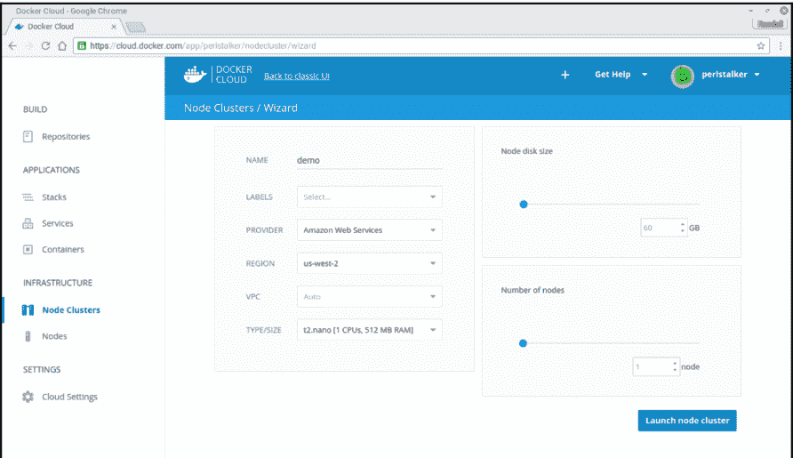
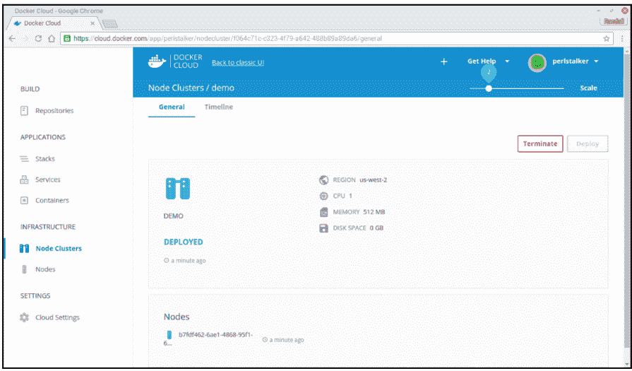

# Why Stop at Containers? Automating Your Infrastructure

The last nine chapters have talked a lot about automating Docker. That is what this book is about, after all. It is important to remember that there is more to a Docker cluster than just Docker. There is the registry, shared storage, overlay networks, and the actual orchestration tool, be it Swarm, Kubernetes, Mesos, or something else. There is one last, very important piece to the puzzle. The servers that all of that run on. Whether those servers are hardware or part of a public cloud, they too need to be managed. After all, what good is it if the Docker orchestration tool can quickly scale an image out if it takes hours to deploy a new Docker host?

This chapter will look at strategies and tools that can be used to automate the server-side of a Docker cluster. It will start by examining the servers themselves, then move on to options for running those machines in the cluster. Finally, it will look at options for removing servers from the cluster.

The following topics will be covered:

- Using configuration management on the server
- Configuring a server on boot with Cloud-Init
- Using and building specialized server images
- Deploying new servers on AWS and Azure
- Using Terraform to orchestrate cloud servers
- Deploying a new cluster with Docker Cloud
- Removing servers from the cluster

## Configuring Docker hosts

In many ways, Docker abstracts the server away from the application. It no longer matters which Linux distribution a server is running. A Docker application can be based on any distribution available. Multiple applications can run on the same server and use different base images. Despite that, without the server, nothing runs.

In Chapter 9, Using Continuous Integration to Build, Test, and Deploy Containers, we discussed the importance of having a consistent build process for Docker images because doing so provides consistency and reliability. The same is true for the servers those applications run on. If the servers are not consistent, it could cause problems for the containers running on them. This section will discuss different ways of ensuring that the server images are consistent.

## Using configuration management

Configuration management has been around on servers in many forms for decades. Sometimes it was as simple as mounting /usr from a remote server or using rcp, scp, or rsync to keep configurations in sync. Later, more powerful tools, such as CFEngine, Puppet, Chef, and Ansible, came along that managed everything from configuration files and installed applications, to managing local users and running services.

Configuration management is an important and powerful tool for any orchestrated cluster. It can perform two important tasks for a server. First, it can set up a server from just the base operating system. It ensures that everything is installed, configured, and running. Second, it makes sure that everything that was installed, configured, and running remains so.

First things first. Puppet needs to be installed on the host:


> Note that this is a manual step on an existing server.

```
$ sudo apt-get install puppet
```

Now that Puppet is installed, a manifest can be created to install Docker. The following sample installs Docker on an Ubuntu server and ensures that the `docker` service is running:

```
node default {
 exec { 'install docker' :
 command => "/usr/bin/wget -O - http://get.docker.com |
 /bin/bash",
 creates => '/etc/apt/sources.list.d/docker.list',
 }
}

package { "docker-engine" :
 ensure => "installed",
 require => Exec['install docker']
 }

service { "docker" :
 ensure => "running",
 require => Package['docker-engine']
 }
}
```

This manifest defines a default node. This means that this manifest will be applied to any node that does not match a more specific node definition. Puppet best practice is to only use modules in node definitions. This example breaks that practice in favor of brevity and simplicity.

The `exec` resource checks to see if `/etc/apt/sources.list.d/docker.list` exists, and if not, runs the install script from `get.docker.com`. The script will create `docker.list` and install Docker. This example uses the security nightmare of downloading the script and piping it directly to bash. In a production environment, the verified script should be added to the server as a puppet resource.

The `package` resource ensures that the `docker-engine` package is installed. If, for some reason, `docker-engine` is uninstalled, Puppet will re-install it on the next run. The `require` option tells Puppet that the `install docker` resource must have happened first.

Finally, the `service` resource ensures that the `docker` service is running. If the service is stopped, Puppet will attempt to restart it. This resource requires that the `docker-engine` package is installed before it tries to start the service.

> There is a very useful module from Puppetlabs to manage Docker, images, and containers on a host. For more details, refer to https://forge.puppet.com/puppetlabs/docker_platform.


当清单准备就绪后，如果在无主模式下运行，可以使用 `puppet apply` 将其应用到服务器，或者在使用 Puppet Server 时使用 puppet agent：

```
$ puppet apply docker-host.pp
Notice: Compiled catalog for ubuntu in environment production in 0.43 seconds
Notice: /Stage[main]/Main/Node[default]/Exec[install docker]/returns:
executed successfully
Notice: Finished catalog run in 31.86 seconds
```

Puppet Server 为向集群中的服务器分发清单提供了便捷方式。关于配置 Puppet Server 的文档可在 https://docs.puppet.com/puppetserver/latest/services_master_puppetserver.html 上找到。

此配置所做的一切就是安装 Docker。将其添加到集群是另一回事。应编写检查以查看主机是否属于集群，如果不是，则运行适当的命令加入集群。这些脚本将根据所使用的编排工具而有所不同。

以下代码片段中的 `exec` 资源运行 `docker swarm join`，如果成功，则触碰 `/root/swarm-joined` 文件：

```
exec { 'join swarm' :
  command => "/usr/bin/docker swarm join --token SWMTKN-... manager:2377
&& /usr/bin/touch /root/swarm-joined",
  creates => '/root/swarm-joined'
}
```

每次运行 `puppet apply` 时，它都会检查 `/root/swarm-joined` 是否存在。如果不存在，Puppet 将重新运行加入 swarm 的命令。这是一个过于简单的检查，因为它不会尝试重新建立与 swarm 的连接。但是，如果节点之前已成功加入，它将尝试自行重新加入。

## 引导时配置服务器

使用配置管理来配置主机很棒，但这也存在一个问题。第一次需要手动安装 Puppet 并运行 `puppet apply`。在自动化环境中，手动步骤越少，出现遗漏或执行不一致的可能性就越小。

有一个名为 **Cloud-Init** 的解决方案，它对运行在云环境中的服务器效果非常好。Cloud-Init 是专门为处理在 AWS 和类似服务中启动的服务器配置问题而创建的。基础镜像初始使用没问题，但在服务器启动时，用户账户和应用程序等内容需要添加或运行，而且人们不想手动登录到每台机器来添加它们。

Cloud-Init 在本书中已经出现过好几次。*第 1 章，Docker 编排入门* 展示了如何使用它为 CoreOS、RancherOS 和 Project Atomic 主机添加登录凭据。它在 *第 3 章，集群构建模块 – 注册表、覆盖网络和共享存储* 和 *第 7 章，使用更简单的编排工具 – Fleet 和 Cattle* 中再次出现，用于在 CoreOS 上启用 Flannel 和 Fleet。Ubuntu、RHEL、Fedora 和 CentOS 的云镜像均支持 Cloud-Init。

Cloud-Init 的配置文件是一个 YAML 文件，第一行以 `#cloud-config` 开头。它通常通过名为 `user-data` 的字段添加到新服务器实例中。它也可以通过挂载的磁盘（例如 CD-ROM）来提供。完整文档可在 https://cloudinit.readthedocs.io/en/latest/index.html 上找到。

首先假设要启动的镜像需要安装 Docker 并加入 Docker Swarm。以下示例展示了如何同时完成这两项工作。它首先下载并运行 Docker 安装脚本。然后 Cloud-Init 将运行加入 Docker Swarm 的命令：

```
#cloud-config
runcmd:
- "/usr/bin/wget -O - http://get.docker.com | /bin/bash",
- ['/usr/bin/docker', 'swarm', 'join', '--token', 'SWMTKN-...',
'manager:2377']
```

runcmd 模块接受在实例首次启动时要运行的命令列表。每个命令可以是字符串或列表。

Cloud-Init 还可以设置并运行 Puppet。以下示例将安装 Puppet 并在引导时运行它：

```
puppet:
install: true
conf:
server: "puppet.example.com"
certname: "%i.%f"
```

conf 部分包含键/值对，它们将被添加到客户端 /etc/puppet/puppet.conf 的 [puppetd] 部分中。server 选项是 Puppet 服务器的地址。certname 选项设置客户端用于身份验证的证书名称。%i 和 %f 变量分别是实例 ID 和完全限定域名。

## 使用自定义镜像

使用配置管理或 Cloud-Init 安装和配置应用程序的问题是，这可能导致已安装软件的版本出现细微差异。此外，在服务器首次启动时安装和配置所有内容还需要额外的时间。更快且更一致的解决方案是使用专为该任务构建的自定义镜像。CoreOS 和 Project Atomic 是两个专为运行 Docker 容器（且几乎不运行其他内容）而构建的发行版。也可以构建一个预安装了所有所需软件的自定义镜像。

## 使用 Packer 构建新镜像

HashiCorp 创建了一个名为 Packer 的工具，可用于为 OpenStack、AWS、Azure、GCE 和 VMWare 创建自定义镜像。它还可以为 Xen、Linux KVM 创建镜像，甚至可以通过 cobbler 部署到硬件上。

Packer 配置是一个 JSON 文件。有三个主要部分，如下所示：

- builders 部分是一个列表，包含要构建的镜像类型列表。
- provisioners 部分是用于配置镜像的任务列表。这包括运行脚本、上传文件和运行配置管理。
- 最后，post-processors 部分包含构建完成后要执行的任务列表。

这些任务可以生成清单、运行本地命令，或将镜像上传到 VMWare vSphere 或 Amazon S3。

可以从同一配置文件构建多个镜像。每个镜像都会在 `builders` 列表中有一个条目。这允许使用相同的 `provisioners` 并行构建多个镜像。例如，这可以用于构建一个新镜像，以部署到 Amazon、Azure 和本地的 OpenStack。

> Packer 的完整文档可在 https://www.packer.io/docs/ 上找到。

### 准备 Ubuntu 云镜像

此示例使用 `qemu` 构建器以便在本地 Linux 机器上轻松测试。`qemu` 构建器从基础镜像工作。默认情况下，新镜像是从 ISO 安装程序安装的，但也可以从现有磁盘镜像克隆。此示例使用 Ubuntu 云镜像。这是大多数云提供商提供的同一基本镜像。该镜像可在 https://cloud-images.ubuntu.com 获取。

云镜像是一个很好的起点，因为它是一个非常最小的服务器安装。在它可以与 Packer 一起使用之前，有两个问题需要修复。首先，`qemu` 构建器使用 SSH 登录到系统进行配置。不幸的是，没有可用的登录账户。其次，`qemu` 构建器只能使用用户名和密码登录，但 SSH 守护进程被配置为拒绝密码身份验证。以下脚本修复了这两个问题。它必须以 root 权限运行，以便挂载镜像并进行必要的更改：

```bash
#!/bin/bash

IMAGES=/packer/images
BASE=xenial-server-cloudimg-amd64-disk1.img
NEW=xenial-server-cloudimg-amd64-prep.img
MNT=/mnt

cd $IMAGES
cp $BASE $NEW

modprobe nbd max_part=16
qemu-nbd -c /dev/nbd0 $NEW
partprobe /dev/nbd0
mount /dev/nbd0p1 $MNT
sed -i 's/^PermitRootLogin .*$/PermitRootLogin yes/'
$MNT/etc/ssh/sshd_config
sed -i 's/^PasswordAuthentication no/PasswordAuthentication yes/'
$MNT/etc/ssh/sshd_config
chroot $MNT sh -c 'echo "root:s3cret-s@uce" | /usr/sbin/chpasswd'
umount $MNT
qemu-nbd -d /dev/nbd0
md5sum $NEW > $NEW.md5sum
```

脚本将原始镜像复制到新文件并挂载新文件。然后它重新配置 sshd 以允许一般密码登录和特定的 root 登录。接下来，它在 chroot 中使用 chpasswd 设置 root 密码。最后，它卸载镜像并创建校验和文件。

与使用 root 用户不同，可以将单独的构建用户添加到镜像中。为了简化构建过程，应配置镜像以允许构建用户无需密码即可使用 sudo。然后可以在构建过程结束时删除该用户。

## 构建镜像

既然镜像已准备就绪，可以使用它来构建新镜像。以下是一个 Packer 配置，它将构建一个新镜像，安装所有可用更新并安装 Docker：

```
{
"builders" : [
{
"type" : "qemu",
"iso_urls" : ["file:///packer/images/xenial-server-cloudimg-amd64-prep.img"
],
"iso_checksum_url" : "file:///packer/images/xenial-server-cloudimg-amd64-prep.img.md5sum",
"iso_checksum_type" : "md5",
"disk_image" : true,
"output_directory" : "/packer/images/xenial-cloudimg",
"vm_name" : "xenial-cloudimg-amd64-custom.img",
"shutdown_command" : "shutdown -P now",
"format" : "qcow2",
"disk_size" : 20000,
"headless" : true,
"ssh_username" : "root",
"ssh_password": "s3cret-s@uce",
"ssh_wait_timeout": "10m"
}
],
"provisioners" : [
{
"type" : "shell",
"scripts" : [
```


"/packer/scripts/install-updates.sh",
"/packer/scripts/install-docker.sh"
  ]
}
]
}

首先是 builders 部分。唯一的条目是 qemu 构建器，由 type 设置指定。iso_* 设置指定要使用的镜像 URL、用于验证镜像的校验和文件以及校验和类型。在此例中，只有一个单独的镜像文件。由于镜像是磁盘镜像而非 ISO，因此 disk_image 设置必须设置为 true。

format 设置将输出格式设置为 qcow2。format 也可以设置为 raw。disk_size 设置以 MB 为单位设置新磁盘镜像的大小。这设置了磁盘的大小但不会更改文件系统。当使用磁盘镜像启动 VM 时，Cloud-Init 会调整根文件系统的大小。输出目录和生成的镜像名称分别在 output_directory 和 vm_name 选项中设置。output_directory 中设置的路径可以是绝对路径，也可以是相对于运行 Packer 的位置的相对路径。

默认情况下，qemu 构建器将使用 SDL 控制台启动 VM。只有在可用 X11 时才有效。在大多数情况下，headless 设置应设置为 true。在预配置过程中，控制台可通过 VNC 访问以查看控制台。

ssh_* 设置控制 qemu 构建器如何为预配置连接到 VM。ssh_username 和 ssh_password 设置设置登录 VM 所需的凭据。在此例中，它配置为使用 root 用户和准备镜像时设置的密码。VM 启动后，qemu 构建器将不断尝试连接到 SSH，但在 ssh_wait_timeout 指定的时间后会放弃。确保超时时间为 VM 启动提供足够的时间。

provisioners 部分是用于预配置镜像的预配置器列表。此示例中有一个 shell 预配置器，它在 VM 上运行 scripts 部分中指定的脚本。install-updates.sh 脚本只是运行 apt-get update && apt-get dist-upgrade -y。第二个脚本 install-docker.sh 是来自 get.docker.com 的安装脚本。

配置就绪后，可以通过运行 `packer build <config>` 来构建镜像，其中 `<config>` 是配置文件的名称。此处给出了一个示例。为简洁起见，大部分输出已被删除：

```
$ packer build xenial-cloudimg.json
qemu output will be in this color.
```

```
==> qemu: Downloading or copying ISO
qemu: Downloading or copying: file:///packer/images/xenial-server-cloudimg-amd64-prep.img
==> qemu: Copying hard drive...
==> qemu: Resizing hard drive...
==> qemu: Found port for communicator (SSH, WinRM, etc): 3475.
==> qemu: Looking for available port between 5900 and 6000 on 127.0.0.1
==> qemu: Starting VM, booting disk image
qemu: The VM will be run headless, without a GUI. If
you want to
qemu: view the screen of the VM, connect via VNC without a password to
qemu: 127.0.0.1:5983
==> qemu: Waiting 10s for boot...
==> qemu: Connecting to VM via VNC
==> qemu: Typing the boot command over VNC...
==> qemu: Waiting for SSH to become available...
==> qemu: Connected to SSH!
==> qemu: Provisioning with shell script: /packer/scripts/install-updates.sh
==> qemu: Provisioning with shell script: /packer/scripts/install-docker.sh
==> qemu: Gracefully halting virtual machine...
==> qemu: Converting hard drive...
Build 'qemu' finished.

==> Builds finished. The artifacts of successful builds are:
--> qemu: VM files in directory: /packer/images/xenial-cloudimg
```


使用 `qemu` 构建器时，请确保运行 Packer 的用户有权使用 KVM。如果用户没有所需的访问权限，Qemu 可能会抛出权限拒绝错误。在 Ubuntu 上，用户需要加入 `kvm` 组。

运行需要几分钟，假设一切正常，新镜像将放置在 `output_directory` 设置的目录中。除非设置了 `-force` 选项以避免意外删除构建镜像，否则如果输出目录已存在，Packer 不会运行。

## 将 Puppet 与 Packer 结合使用

如果需要的更改相对简单，使用脚本预配置新镜像有效。更复杂的更改需要更复杂的脚本。配置管理工具非常适合此任务，可用于预配置新镜像。Ansible、Chef、Puppet 和 Salt 均受支持。

使用配置管理工具预配置镜像的额外好处是，可以使用相同的配置来确保服务器运行时保持正确配置。具体做法会因所使用的工具而异。

以下 Packer 代码片段使用 Puppet 的无主模式来配置镜像。与“使用配置管理”部分中使用的相同 Puppet 清单在此处也被使用。不应包含加入 Docker 集群的命令。在集群中启动新实例后，可以运行加入集群的命令：

```
"provisioners" : [
{
	"type" : "shell",
	"scripts" : [
		"/packer/scripts/install-updates.sh",
		"/packer/scripts/install-puppet.sh"
	]
},
{
	"type" : "puppet-masterless",
	"manifest_file" : "/packer/puppet/docker-host.pp"
}
]
```

第一个区别是 install-docker.sh 脚本被 install-puppet.sh 取代，后者运行 apt-get install -y puppet。第二个是带有 puppet-masterless 类型的新预配置器块。manifest_file 选项指定将用于配置镜像的清单；也可以使用目录。在这种情况下，所有清单都将应用于节点。

## 将基础架构视为代码

让我们停下来考虑一下刚才所做的事情。服务器已完全在一个或多个文件中定义，并具有可脚本化的构建过程。我们刚刚将服务器变成了代码。

服务器镜像可以通过 CI 过程构建。与在运行中的服务器上执行更新不同，可以构建包含更新的新镜像。镜像在部署前可以通过测试套件进行全面测试。在部署到生产环境之前，可以在测试环境中对它们进行全面审查。甚至部署过程也可以通过 CI 过程来控制，就像 Docker 镜像一样。

这种方法的另一个好处是回滚更新非常容易。如果发现问题，可以在先前可用的镜像上启动新服务器以快速恢复服务。有问题的镜像可以离线或在不同环境中进行测试和调试。

基本上，这是运行版本化容器的相同方法。从故障排除角度来看，重要的是日志等重要数据不存储在服务器上。相反，它们应存储在网络存储上或发送到 Elasticsearch 和 Kibana 等服务。

## 构建后配置

使用自定义镜像并不能消除对启动时和持续配置管理的需求。启动时配置可以最小化为主机名或加入集群等简单事项。在多区域或多云环境中运行时，Cloud-Init 会设置特定于区域的信息。

对运行中的系统进行配置管理仍然很重要。它可以确保构建服务器时所做的配置保持不变。它还可以进行简单的更改，例如更新管理员 SSH 密钥，而无需完全重建镜像。

## 自动化主机部署

自动化 Docker 主机部署有很多种方式。具体细节，如往常一样，取决于编排系统。例如，向在 Amazon EC2 上运行的 Docker Swarm 集群添加新主机，就像运行类似下面的内容一样简单：

```
$ docker-machine create --driver amazonec2
$ docker swarm join --token ABC... manager
```

对于 Azure 或 GCE，也是同样的操作。只需更改驱动程序，并将相应的驱动程序特定标志传递给 docker-machine 即可。


本节将介绍几种可用于管理 Docker 集群主机的不同工具。首先是 Terraform，它几乎可以与所有东西配合使用。接下来是 Docker 自己的云管理工具 Docker Cloud。最后，将介绍两个处于公测阶段的工具，Docker for AWS 和 Docker for Azure。

如果您计划在 AWS、GCE 或 Azure 上运行，请考虑使用各提供商提供的容器托管服务。使用每种服务时，创建和管理主机的任务由服务来处理。管理员只需关注容器即可。

## 使用 Terraform 部署主机

Terraform 是一种多云部署工具。它使用配置文件来定义集群应具有的样子。然后根据配置构建创建或更新集群的计划。计划让管理员在操作发生前有机会审查将要执行的内容。如果计划看起来良好，Terraform 将执行计划，使集群符合配置。

Terraform 完全与云提供商无关。它支持 AWS、GCE、Microsoft Azure、OpenStack 等。它可以与 cobble 结合使用，以管理运行在本地硬件上的主机。它甚至对 Docker 有有限的支持。更好的是，它可以同时用于配置多个云。

### 创建 Terraform 配置

让我们看一个 Terraform 配置示例。此示例在 Amazon EC2 上创建两个新实例。文件可以命名为任何名称，但必须以 `.tf` 结尾。Terraform 的完整文档可在 https://www.terraform.io/docs/index.html 上找到。

```
provider "aws" {
  access_key = "ACCESS_KEY"
  secret_key = "SECRET_KEY"
  region = "us-west-2"
}

resource "aws_instance" "docker-hosts" {
  count = 2
  ami = "ami-a9d276c9"
  instance_type = "t2.micro"
  user_data = "${file("cloud-init.yml") }"
  key_name = "aws-key"
  vpc_security_group_ids = [ "sg-ID" ]
}

tags {
  Name = "docker${count.index}"
 }
}
```

每个 provider 块指定一个云服务。在此示例中，provider 是 aws。access_key 和 secret_key 选项是用于管理 EC2 服务的相应密钥。region 选项指定将启动这些实例的区域。可以为将启动实例的每个区域指定一个 provider 块。

resource 块定义将在 provider 上启动的资源。Terraform 将资源与相应的提供者类型匹配。类型为 aws_instances 的资源（如本例所示）将在 aws 提供者上启动。

count 选项指定要启动的相同资源的数量。默认值为 1。以后可以更改此值以扩大或缩小集群。

ami 选项设置此实例要使用的 AMI。这可以是公共 AMI，例如本示例中的 Ubuntu Xenial 云映像。也可以使用私有 AMI。例如，Packer 可以构建新镜像并将其作为 AMI 提供。instance_type 是要启动的实例类型。

> 特定的 AMI 将取决于镜像的版本以及它将运行的区域。Ubuntu 云映像的完整 AMI 列表位于 https://cloud-images.ubuntu.com/locator/ec2/。

可以为每个资源指定一个 Cloud-Init 文件，使用 user_data 选项。最简单的方法是使用 file() 函数指定文件。路径相对于运行 Terraform 的位置。创建实例时，配置将被编码并添加到实例中。

key_name 指定要添加到默认用户的 SSH 密钥。密钥必须已存在于 EC2 中。可以使用 vpc_security_group_ids 选项设置 VPC 安全组列表。安全组必须存在，此示例才能工作。请确保安全组允许 SSH 访问，否则您可能会发现自己被锁定在实例之外。

Terraform 可用于创建 VPC、安全组以及可能需要的任何其他内容。完整文档可在 https://www.terraform.io/docs/providers/aws/index.html 上找到。

最后，tags 选项提供了一种在实例上设置标签的方法。此示例设置 Name 标签。如果从同一资源创建多个实例，${count.index} 变量是当前计数。在此示例中，这两个实例名为 docker0 和 docker1。

### 运行 Terraform

使用 Terraform 创建或更新集群分两步进行。第一步是生成计划，虽然并非严格必要，但计划会显示 Terraform 将要做的确切事情，这样就不会有意外。要查看计划，请在带有配置的目录中运行 `terraform plan`。它将从目录中的 `.tf` 文件读取配置并创建一个计划：

```
$ terraform plan
Refreshing Terraform state in-memory prior to plan...
The refreshed state will be used to calculate this plan, but will not be
persisted to local or remote state storage.
The Terraform execution plan has been generated and is shown below.
Resources are shown in alphabetical order for quick scanning. Green resources
will be created (or destroyed and then created if an existing resource
exists), yellow resources are being changed in-place, and red resources
will be destroyed. Cyan entries are data sources to be read.
Note: You didn't specify an "-out" parameter to save this plan, so when
"apply" is called, Terraform can't guarantee this is what will execute.
+ aws_instance.docker-hosts.0
    ami:                       "ami-a9d276c9"
    associate_public_ip_address: "<computed>"
    availability_zone:         "<computed>"
    ebs_block_device.#:        "<computed>"
    ephemeral_block_device.#:  "<computed>"
    instance_state:            "<computed>"
    instance_type:             "t2.micro"
    key_name:                  "aws-key"
    network_interface_id:      "<computed>"
    placement_group:           "<computed>"
    private_dns:               "<computed>"
    private_ip:                "<computed>"
    public_dns:                "<computed>"
    public_ip:                 "<computed>"
    root_block_device.#:       "<computed>"
    security_groups.#:            "<computed>"
    source_dest_check:            "true"
    subnet_id:                    "<computed>"
    tags.%:                       "1"
    tags.Name:                    "docker0"
    tenancy:                      "<computed>"
    user_data:
      "23845b687111f6870657ecb38214e6a8f18b231e"
    vpc_security_group_ids.#:     "1"
    vpc_security_group_ids.839449168: "sg-..."
+ aws_instance.docker-hosts.1:
  ami:                        "ami-a9d276c9"
  associate_public_ip_address: "<computed>"
  availability_zone:          "<computed>"
  ebs_block_device.#:         "<computed>"
  ephemeral_block_device.#:   "<computed>"
  instance_state:             "<computed>"
  instance_type:              "t2.micro"
  key_name:                   "aws-key"
  network_interface_id:       "<computed>"
  placement_group:            "<computed>"
  private_dns:                "<computed>"
  private_ip:                 "<computed>"
  public_dns:                 "<computed>"
  public_ip:                  "<computed>"
  root_block_device.#:        "<computed>"
  security_groups.#:          "<computed>"
  source_dest_check:          "true"
  subnet_id:                  "<computed>"
  tags.%:                     "1"
  tags.Name:                  "docker1"
  tenancy:                    "<computed>"
  user_data:
    "23845b687111f6870657ecb38214e6a8f18b231e"
  vpc_security_group_ids.#:   "1"
  vpc_security_group_ids.839449168: "sg-..."
```

```
Plan: 2 to add, 0 to change, 0 to destroy.
```

如果计划看起来良好，可以通过运行 `terraform apply` 将其付诸实行。以下输出为了简洁已被精简：

```
$ terraform apply
aws_instance.docker-hosts.1: Creating...
  ami:        "" => "ami-a9d276c9"
...
aws_instance.docker-hosts.0: Creating...
  ami:        "" => "ami-a9d276c9"
...

aws_instance.docker-hosts.1: Still creating... (10s elapsed)
aws_instance.docker-hosts.0: Still creating... (10s elapsed)
aws_instance.docker-hosts.1: Still creating... (20s elapsed)
aws_instance.docker-hosts.0: Still creating... (20s elapsed)
aws_instance.docker-hosts.0: Creation complete
aws_instance.docker-hosts.1: Creation complete
Apply complete! Resources: 2 added, 0 changed, 0 destroyed.
The state of your infrastructure has been saved to the path below. This state is required to modify and destroy your infrastructure, so keep it safe. To inspect the complete state use the `terraform show` command.
State path: terraform.tfstate
```

生成的 terraform.tfstate 文件很重要。它提供了从配置中定义的资源到实际运行内容的映射。任何在同一 Terraform 集群上操作的人都必须使用相同的 terraform.tfstate 文件。状态文件足够小，可以存储在版本控制中，但这可能会导致合并冲突。相反，Terraform 有一个选项可以将状态远程存储。支持多种后端，包括 S3、Azure 和 etcd。包括后端列表在内的完整文档可在 https://www.terraform.io/docs/state/remote/index.html 上找到。

要更新集群，只需更改配置并再次运行 terraform plan 和 terraform apply。请求的更改将在整个集群中进行。请注意，某些更改将要求 Terraform 删除并重新创建运行中的实例。有可能足够多的实例将被停止，以至于影响服务。

## 显示集群状态

查看集群处于什么状态可能很有用。要查看状态，请运行 terraform show。输出可能很长，具体取决于集群的大小。以下示例显示可用的信息类型。特别值得注意的是私有和公有 IP 地址：

```
$ terraform show
aws_instance.docker-hosts.0:
  id = i-0095dceada25205bf
  ami = ami-a9d276c9
  associate_public_ip_address = true
  availability_zone = us-west-2c
  disable_api_termination = false
  ebs_block_device.# = 0
  ebs_optimized = false
  ephemeral_block_device.# = 0
  iam_instance_profile =
  instance_state = running
  instance_type = t2.micro
```


```
key_name = aws-key
monitoring = false
network_interface_id = eni-44e0df15
private_dns = ip-172-31-12-31.us-west-2.compute.internal
private_ip = 172.31.12.31
public_dns = ec2-35-164-109-235.us-west-2.compute.amazonaws.com
public_ip = 35.164.109.235
root_block_device.# = 1
root_block_device.0.delete_on_termination = true
root_block_device.0.iops = 100
root_block_device.0.volume_size = 8
root_block_device.0.volume_type = gp2
security_groups.# = 0
source_dest_check = true
subnet_id = subnet-7160dc29
tags.% = 1
tags.Name = dock0
tenancy = default
user_data = 23845b687111f6870657ecb38214e6a8f18b231e
vpc_security_group_ids.# = 1
vpc_security_group_ids.839449168 = sg-...
aws_instance.docker-hosts.1:
id = i-08eb6ebb75b788823
...
```

## 使用 Docker Cloud 部署主机

Docker Cloud 是一个用于管理各种云服务上 Docker Swarm 的出色工具。它可以轻松创建新集群，并根据集群上运行的服务的需求进行扩展或缩减。

要创建新集群，请单击节点集群，然后单击创建。将弹出一个窗口，要求提供诸如集群名称、云提供商、磁盘大小和初始节点数等信息。配置完成后，单击启动节点集群。新节点将启动，几分钟后即可准备运行容器：



添加新节点非常简单。单击 **节点集群** 并选择要添加节点的集群。页面右上角有一个滑块，可用于扩展节点数量。调整滑块并单击 **缩放** 链接。将添加其他节点，它们将准备好运行容器：



## Docker for AWS 和 Docker for Azure 简介

Docker for AWS 是一个使用 CloudFormation 在 AWS 上自动构建 Docker Swarm 的过程。该过程为 Swarm 创建一个新 VPC，包括子网和安全组。还创建了两个 Auto Scaling 组；一个用于管理节点，一个用于工作节点。可以通过更改相应 Auto Scaling 组中的实例数量来调整每个组的数量。新实例将自动加入 Swarm。

Docker for Azure 为运行在 Azure 上的集群提供类似服务。它会自动创建运行 Docker Swarm 所需的所有服务。它与 Azure 的缩放功能集成，以便轻松扩展主节点和工作节点的数量。

更多信息可在以下位置找到：

- 适用于 AWS 的 Docker: https://beta.docker.com/docs/aws/
- 适用于 Azure 的 Docker: https://beta.docker.com/docs/azure/

## 缩减节点

云计算的好处之一是在不再需要主机时能够缩减主机数量。例如，网上商店可能在圣诞购物季增加主机数量，然后在 1 月份缩减。这将如何发生，同样取决于所选的编排解决方案及其运行的平台。

大多数编排系统都有一个命令，可关闭特定节点上的容器并将其重新调度到集群中的其他位置。这使编排工具有机会在删除节点之前干净地在集群中移动服务。Docker Cloud 和 GKE 等服务会自动处理此操作。

可将更改节点可用性的命令添加到关机脚本中。但是，必须注意确保在系统关闭之前所有容器都已停止。在大多数情况下，需要运行另一个命令才能将节点永久从集群中删除。同样，具体命令将取决于所使用的编排工具。

## 总结

本章探讨了用于运行 Docker 集群的基础设施自动化的不同方法。它研究了在节点运行时使用配置管理、使用 Cloud-Init 在引导时配置节点，以及使用 Packer 构建自定义镜像。我们还介绍了使用 Terraform 和 Docker Cloud 管理集群。最后，分享了一些在不再需要节点时取消配置的技巧。

接下来去哪里取决于你。本书使用多种工具介绍了 Docker 编排。成功运行 Docker 集群需要多种不同的服务，包括注册表、覆盖网络、共享存储、编排工具本身、日志和资源监控以及持续集成。特定工具和工作流程会因集群而异。本书只能触及可能性的表面。希望您能将在这里学到的知识应用于使用 Docker 为您的组织构建可扩展、可靠的服务。
