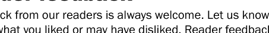

# DotNetNuke 5.4 秘籍：超过100个安装、配置和自定义使用 DotNetNuke CMS 构建您自己的网站的配方


## Credits

| 角色 | 姓名 |
| --- | --- |
| 作者 | John K. Murphy |
| 编辑团队负责人 | Mithun Sehgal |
| 审阅者 | Jeff Cochran, Sebastian Leupold |
| 项目团队负责人 | Lata Basantani |
| 收购编辑 | Darshana Shinde |
| 项目协调员 | Vincila Colaco |
| 开发编辑 | Rakesh Shejwal |
| 校对 | Lynda Sliwoski |
| 技术编辑 | Kavita Iyer, Conrad Sardinha |
|  graphics | Geetanjali Sawant |
| 索引 | Hemangini Bari |
| 生产协调员 | Melwyn D'sa |
| 封面工作 | Melwyn D'sa |

## About the Reviewers

**Jeff Cochran** 是佛罗里达州那不勒斯市的一名高级网络专家。他工作的很大一部分包括网页设计和编码，以及 Web 服务器管理。Jeff 在互联网方面拥有近二十年的经验，曾创办了西南佛罗里达最早的互联网服务提供商之一，并曾使用基于 Windows 和 Unix 的 Web 服务器工作。现在主要专注于 Windows 技术，Jeff 已近十年担任微软互联网信息服务器的微软 MVP，并在 ASP Classic 和 ASP.NET 社区也很活跃。Jeff 共同撰写了 Packt 的 *"Building an ASP.NET Content Management System"*，并为其他出版商的几本书籍做过工作。

**Sebastian Leupold** 在卡尔斯鲁厄大学学习经济学和商业工程后，已在软件应用领域积累了约 20 年的专业经验。他是 Gamma Concept 的首席执行官，该公司是 dnnWerk 的一部分，dnnWerk 是德国领先的 DotNetNuke 专家联合体，提供围绕 DotNetNuke 的所有服务，包括托管、培训、咨询、皮肤制作和模块开发。

作为 DotNetNuke 核心团队的成员，Sebastian 为 DotNetNuke 核心框架添加了一些增强功能，主要负责模块发布测试。同时作为用户体验团队的成员，他专注于 DNN 可用性的改进。过去，他曾担任 UserDefinedTable 模块的项目负责人。Sebastian 创建并维护了数百个 DotNetNuke 框架和模块的德语语言包。

Sebastian 是德国 DotNetNuke 用户组的联合创始人和联合负责人。他也是 DNN-Europe 的发起人之一，DNN-Europe 是 DotNetNuke 专业人士的网络，他组织了 2010 年在巴黎举行的首届欧洲 DotNetNuke 日。Sebastian 在欧洲和美国的 OpenForce DotNetNuke 大会上以及多个用户组会议上发表过多次演讲。微软以“最有价值专业人员”称号表彰了他的活动。

## 前言

DotNetNuke 5.4 是一个强大且灵活的内容管理系统，用于构建网站。它提供了许多用于发布内容的功能，包括创建博客、横幅广告、新闻源等工具。本书中的章节提供了示例，展示如何使用您自己的插件模块下载、安装、配置和定制DotNetNuke。

## 本书涵盖内容

第1章“安装与设置”解释了下载和安装创建自己的DotNetNuke网站所需的工具。

第2章“管理用户和站点设置”解释了创建用户、分配安全权限以及配置站点。

第3章“现有模块的实用技巧”讨论了最流行模块的安装和配置。

第4章“创建自己的模块”解释了安装开发工具并创建您的第一个自定义模块。

第5章“构建、调试和部署模块”提供了模块开发和调试的深入示例。

第6章“数据录入技巧”介绍了DotNetNuke常见的数据录入控件。

第7章“酷炫的Web控件”展示了诸如TreeView、TabStrip和CAPTCHA验证等Web控件的示例。

第8章“基础皮肤设计”解释了如何通过创建自定义皮肤来为您的站点设置样式。

第9章“处理外语”解释了如何使用本地化创建双语网站。

第10章“现有模块的高级技巧”展示了更复杂模块的示例，演示了Flash、jQuery、XML源、URL重写等内容。

第11章“挑战自定义模块”展示了在自定义模块中进行搜索、导入和导出的示例。

第12章“高级模块与安全”解释了高级模块示例和安全技术。

第13章“高级皮肤设计”更详细地探讨了皮肤设计，包括动画菜单、CSS和小部件。

## 本书所需环境

DotNetNuke 是一个基于Web的内容管理系统，使用Windows Internet Information Server（IIS）和.NET Framework。要跟随本书中的示例，您需要满足以下条件：

- Windows Server 2003、2008 或 2008 R2 中附带的 IIS 5 或更高版本。对于开发环境，您可以使用 Windows XP Professional、Windows Vista 或 Windows 7（家庭高级版及以上）。
- Microsoft .NET Framework 3.5 或更高版本。

## 本书读者对象

如果您是一名 .NET 开发人员，具有初学者到中级水平的 Visual Basic 或 C# 知识，并希望使用 DotNetNuke 开发网站/CMS，那么本书适合您。

需要熟悉 DNN 操作、CSS 以及基本的 Web 开发（ASP.NET）技能。

## 约定

在本书中，您会发现多种文本样式，用于区分不同类型的信息。以下是这些样式的一些示例及其含义说明。

文本中的代码字以如下方式显示：“我们可以通过使用 include 指令来包含其他上下文。”

代码块如下：

```
<asp:TextBox ID="txtSalary" runat="server"></asp:TextBox>
<asp:RequiredFieldValidator ID="valSalary" resourcekey="valSalary.ErrorMessage" ControlToValidate="txtSalary" CssClass="NormalRed" Display="Dynamic" ErrorMessage="<br>Salary is required" Runat="server" />
```

当我们希望您注意代码块中的特定部分时，相关行或项目会以粗体显示：

```
<tr valign="top">
<td class="SubHead" width="125">
<dnn:label id="lblSalary" runat="server" controlname="lblSalary" suffix=":">
</dnn:label>
</td>
```

新术语和重要词语以粗体显示。在屏幕上（例如菜单或对话框）看到的文字在文本中以下列方式出现：“如果您喜欢它的外观，请单击“应用”以将容器应用到您的站点。”




## 读者反馈

始终欢迎读者的反馈。请告诉我们您对本书的看法——您喜欢哪些内容，或者可能不喜欢哪些内容。读者反馈对我们编写出您真正受益的书籍非常重要。

要向我们发送一般性反馈，只需发送电子邮件至 feedback@packtpub.com，并在邮件主题中提及书名。

如果您需要某本书并希望我们出版，请通过 www.packtpub.com 上的“SUGGEST A TITLE（推荐书名）”表单发送消息，或发送电子邮件至 suggest@packtpub.com。

如果您在某主题上具有专业知识，并有意撰写或参与编写一本书，请参阅 www.packtpub.com/authors 上的作者指南。

## 客户支持

既然您已经成为 Packt 图书的骄傲拥有者，我们提供多项服务帮助您充分利用所购书籍。


### 下载本书示例代码

您可以从您的账户 `http://www.PacktPub.com` 下载您所购买的所有 Packt 图书的示例代码文件。如果您从其他渠道购买了本书，可以访问 `http://www.packtpub.com/support` 并注册，以便将文件直接通过电子邮件发送给您。

### 勘误

尽管我们已尽一切努力确保内容的准确性，但错误仍可能发生。如果您在我们的某本书中发现错误——也许是文本或代码中的错误——我们将不胜感激您向我们报告。这样做可以帮助其他读者避免困惑，并帮助我们改进本书的后续版本。如果您发现任何勘误，请访问 `http://www.packtpub.com/support`，选择您的图书，点击 **勘误提交表单** 链接，并输入勘误详情。一旦您的勘误得到验证，您的提交将被接受，勘误会上传到我们的网站，或添加到该图书“勘误”部分下的现有勘误列表中。您可以通过 `http://www.packtpub.com/support` 选择您的图书来查看任何现有勘误。

### 盗版

互联网上对受版权保护材料的盗版是所有媒体持续存在的问题。在 Packt，我们非常重视对版权和许可的保护。如果您在互联网上以任何形式发现我们作品的非法副本，请立即向我们提供地址或网站名称，以便我们采取补救措施。

请通过 `copyright@packtpub.com` 联系我们，提供疑似盗版材料的链接。

我们感谢您帮助保护我们的作者以及我们为您提供有价值内容的能力。

### 问题

如果您在本书的任一方面遇到问题，可以通过 `questions@packtpub.com` 联系我们，我们将尽力解决。


