## 安装和设置

在本章中我们将介绍以下主题：

- 下载 Microsoft Web Platform Installer
- 安装 SQLServer Express
- 下载并安装 DotNetNuke 包
- 运行 DotNetNuke 安装
- 设置站点名称和信息
- 为站点选择皮肤
- 为站点选择容器
- 向页面添加模块
- 安装标准 DNN 模块
- 下载扩展（皮肤或模块）
- 安装新扩展

### 引言

DotNetNuke（为简洁起见，之后我们称其为“DNN”）是一个功能强大且灵活的内容管理系统，用于构建网站。它附带了许多用于发布内容的特性，包括创建博客、横幅广告、新闻源等工具。所有这些功能开箱即用，如果你使用社区版，全部都是免费的。

但从零开始搭建网站可能具有挑战性。涉及多个组件，每个组件都必须正确才能整体运行。幸运的是，本章中的配方将安全地引导你绕过障碍，很快就能让你的网站运行起来。重要的是要仔细阅读配方的说明，确保每一步都按描述执行。遵循这些配方非常类似于遵循烹饪配方——如果你遗漏了配料或将烤箱温度设置错误，结果可能会一团糟。

在本章的配方中，你会看到短语 web server 和 database server。如果你为公司构建网站，很可能 web server 和 database server 是网络上两台不同的机器。要安装和运行 DNN，你需要对每台机器都有登录访问权限，并且具有安装软件的权限。

另一方面，如果你正在开发一个小型测试网站，一切都将安装在你的台式机或笔记本电脑上，而术语 web server 和 database server 指的就是你的机器，当然你已经拥有完全访问权限。

需要互联网访问来下载 DNN 代码和安装文件，但如果你已经走到这一步，我们假设你已配备妥当。

让我们开始吧。

### 下载 Microsoft Web Platform Installer

在本配方中，我们将展示如何通过安装 Microsoft Web Platform Installer（Web PI）为 DNN 安装准备一台机器。Microsoft Web Platform Installer 是一个免费工具，用于从互联网下载应用程序，包括 DotNetNuke 安装、Internet Information Services（IIS）、SQL Server Express、.NET Framework 和 Visual Web Developer。为了让安装 DNN 尽可能简单，最好先安装 Web PI。

#### 如何操作...

1. 打开你喜欢的网页浏览器并访问网站 http://www.microsoft.com/web/Downloads/platform.aspx。
2. 点击页面右侧的 Download It Now 按钮。
3. Web PI 现在将开始下载。当出现 Run/Save 对话框时，点击 Run。
4. 如果出现 Security Warning 提示，点击 Run。
5. 如果浏览器提示你，点击浏览器顶部的 security bar 并允许文件下载。
6. 最后，如果提示允许访问以运行程序，点击 Allow。
7. Web PI 现在将启动并显示可供下载的产品。

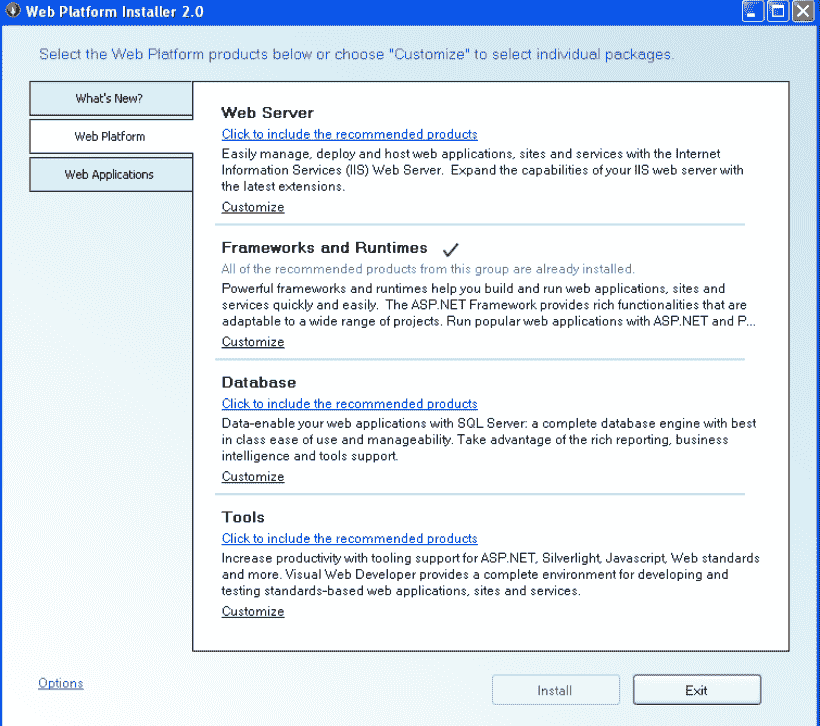

8. 从此对话框中你可以选择要下载的软件。下载产品完成后点击 Exit。

#### 另请参阅

安装 Web PI 后，你可以轻松下载本章其余部分所需的工具。请参阅各个配方以获取说明。

### 安装 SQLServer Express

本配方将向你展示如何下载并安装 Microsoft 的 SQLServer 免费版本，称为 Microsoft SQL Server 2008 Express。DNN 目前支持 SQL Server 2005 和 2008，但 SQL Server Express 对于希望从单台机器运行 DNN 的网站开发者来说也是一个不错的解决方案。

#### 准备工作

对于本配方，你应拥有 Windows Server 2003、2008 或 2008R2。对于开发，你可以使用 Windows XP Professional、Windows Vista、Windows 7（家庭高级版及以上）。

此外，你应完成以下配方：

- *Downloading the Microsoft Web Platform Installer*

#### 如何操作...

1. 首先启动 Microsoft Web Platform Installer。
2. 当显示可用产品列表时，点击 **Web Platform** 选项卡。
3. 在 **Database** 部分，点击 **Customize** 链接。

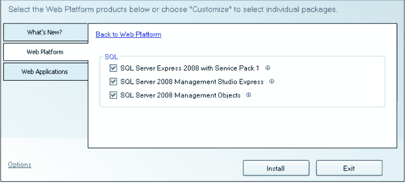

4. 确保以下产品已选中：

- SQL Server Express 2008
- SQL Server 2008 Management Studio Express
- SQL Server 2008 Management Objects

5. 点击 **Install** 按钮开始安装。
6. 下一个对话框将列出你正在下载的文件并提示 **I Decline** 或 **I Accept**。点击 **I Accept**。
7. 最后，你必须选择如何在数据库中对用户进行身份验证。由于此安装可能仅用于本地使用，你可以选择 **Mixed Mode Authentication**。
8. 为 SQL Server 管理员（SA）选择一个密码。它必须是强密码，因此请尝试包含数字、特殊字符和混合大小写。提供一个良好的密码并点击 **Continue**。

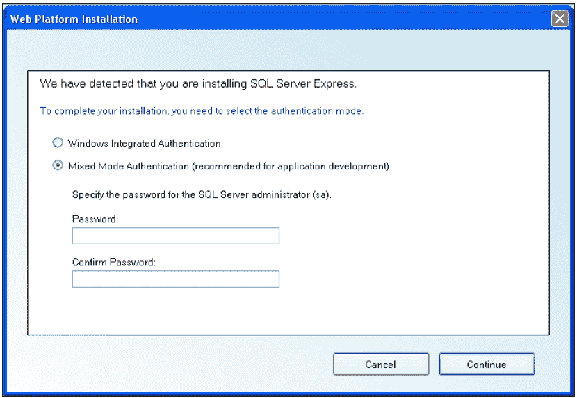

9. 现在文件将通过双击下载并安装。即使连接很快，也需要几分钟时间。安装进行到一半时可能会提示是否要重新启动，点击 **No** 以便安装继续。
10. 安装完成后你将看到一条祝贺信息。如果提示重新启动，点击 Yes。

#### 其工作原理...

Microsoft 的 Web Platform Installer 处理文件下载和安装的细节。完成后，你的机器上将运行 SQL Server Express。

### 下载并安装 DotNetNuke 包

在本配方中，我们将逐步介绍如何使用 Web PI 工具下载并安装 DotNetNuke 包。

安装 DNN 的其他方式有：

| 由托管提供商预装 | 这绝对是最简单的方式。许多托管提供商将 DNN 作为托管套餐的一部分提供。 |
| 手动上传并安装 | 如果你熟悉 SQL Server 数据库和 IIS，你可以下载 DNN 安装文件并手动安装包。这是一个了解各个组件如何组合在一起的好方法。 |
| 使用 DNN Starter Kit for Visual Studio 2008 | 你也可以从开发工具运行 DNN。有关更多信息，请参阅第 5 章，Building, Debugging, and Deploying Modules |

#### 准备工作

对于本配方，你应拥有 Windows Server 2003、2008 或 2008R2。对于开发，你可以使用 Windows XP Professional、Windows Vista、Windows 7（家庭高级版及以上）。

此外，你应完成以下配方：

- Downloading the Microsoft Web Platform Installer

#### 如何操作...

1. 首先启动 Microsoft Web Platform Installer。
2. 当显示可用产品列表时，点击 Web Applications 选项卡。
3. 向下滚动直到看到 DotNetNuke 并确保它已选中。

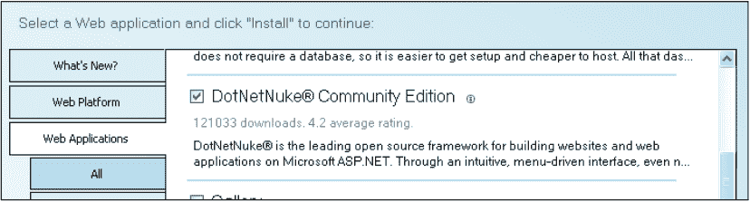

4. 点击 **Install** 按钮开始安装。
5. 下一个对话框将列出你正在下载的文件并提示 I **Decline** 或 I **Accept**。点击 I **Accept**。

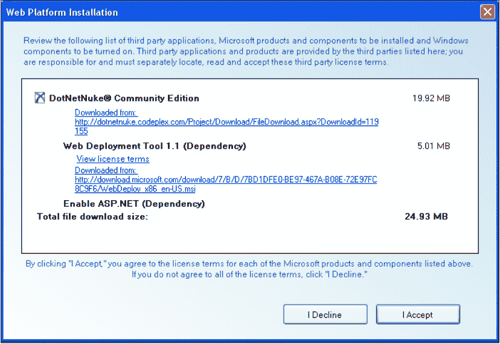

6. 现在 DotNetNuke 将开始下载。通过双击安装。即使连接很快，也需要几分钟时间。安装进行到一半时可能会提示是否要重新启动，点击 **No** 以便安装继续。
7. 一旦 DotNetNuke 包下载完成，Web PI 将立即启动安装。它首先提示输入新 DNN 站点的详细信息：

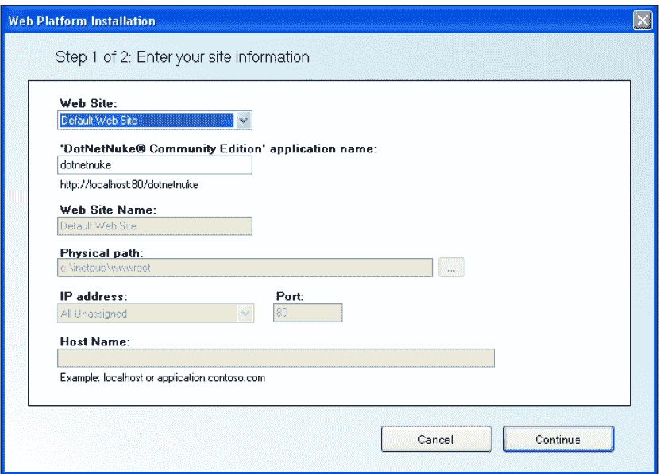

8. 保留默认值并点击 Continue。
9. 接下来是应用程序信息的提示：


## 第 2 步，共 2 步：输入应用程序信息

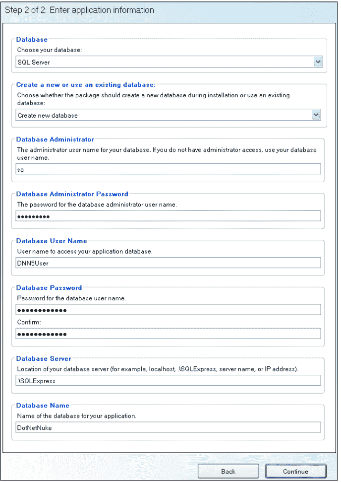

- 10. 输入应用程序信息：
  - **数据库：** SQL Server
  - **新建数据库或使用现有数据库：** 新建数据库
  - **数据库管理员：** sa

## 安装与设置

- **数据库管理员密码：** 使用数据库安装时选择的密码
- **数据库用户名：** 选择一个用户名（例如 DNN5User）
- **数据库密码：** 选择一个密码（例如 DNN5User2010）
- **数据库服务器：** `.\SQLExpress`
- **数据库名称：** DotNetNuke

- 11. 单击**继续**。
- 12. 接下来，安装过程中将显示状态屏幕。如果看到的是登录失败，请检查数据库是否正在运行，以及是否为 sa 用户提供了正确的密码。
- 13. 现在应该会看到祝贺屏幕。单击**完成**。
- 14. 单击**退出**以关闭 Web 平台安装程序。

## 工作原理...

在本操作指南中，我们使用 Web PI 安装程序下载并安装 DNN 站点。要完成安装，请参阅下一个操作指南 *运行 DotNetNuke 安装*。

## 运行 DotNetNuke 安装

当所有组件就绪后，最后一步是访问 DNN Web 并运行最终安装代码。

### 准备工作

此时，你必须已成功完成以下操作指南：

- *下载 Microsoft Web 平台安装程序*
- *安装 SQL Server Express*
- *下载并安装 DotNetNuke 包*

### 操作步骤...

- 1. 打开你喜欢的 Web 浏览器并访问新站点（例如 `http://localhost/DotNetNuke`）。

- 15. 单击“下一步”。创建数据库表和存储过程时，你会看到状态消息。最后应出现“数据库安装完成”的消息。如果安装成功，拍拍自己的肩膀，单击“下一步”。

- 16. 现在，向导将首先创建两个用户：控制整个 DNN 安装的超级用户（SuperUser）和管理门户且权限有限的管理员用户（Administrator）。

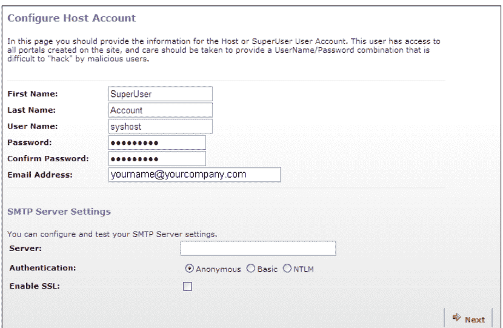

- 17. 对于“名”，保留默认的 SuperUser。
- 18. 对于“姓”，输入 Account。
- 19. 选择一个用户名（避免使用标准的 host 作为用户名，它太常见了）。
- 20. 选择一个好的密码并确认。然后将它写下来，稍后你会用到。
- 21. 提供你的电子邮件地址以接收系统消息。

- 22. 单击“下一步”并提供管理员用户的详细信息。

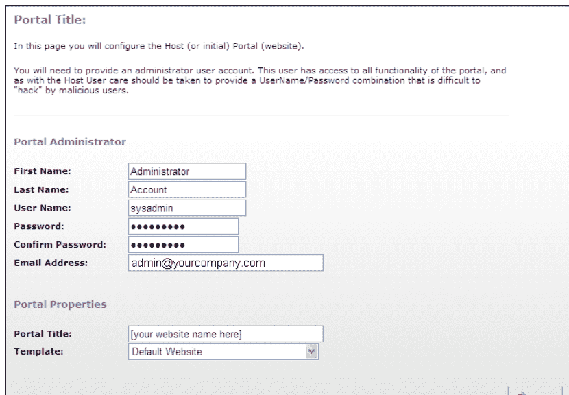

- 23. 对于“名”，保留默认的 Administrator。
- 24. 对于“姓”，输入 Account。
- 25. 选择一个用户名（避免使用标准的 admin 作为用户名，它太常见了）。
- 26. 选择一个好的密码并确认。然后将它写下来，稍后你会用到。
- 27. 提供你的电子邮件地址以接收系统消息。
- 28. 最后，向导会提示输入站点的基本信息。为你的站点选择一个标题，并将其输入到“门户标题”中。
- 29. 为模板选择“默认网站”。
- 30. 单击“下一步”。
- 31. 当看到祝贺屏幕时，单击“完成（转到站点）”以完成安装。
- 32. 稍等片刻后，你会看到新网站的欢迎屏幕。恭喜！你已成功安装并设置了 DNN 网站。

- 4. 你会首先注意到页面顶部的“控制面板”。它包含维护站点的实用工具，分为四个类别：常用任务、当前页面、管理和主机。其中一些工具也可以在主机或管理菜单下找到，但在“控制面板”中更容易找到。

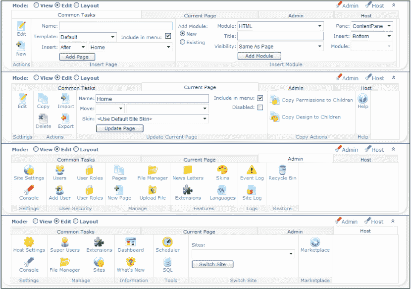

- 5. 单击“管理”以显示管理任务，然后点击左上角的“站点设置”图标。
- 6. 这将显示“站点设置”表单。这是 DNN 中典型的数据输入表单。你看到的字段带有标签，也有一些标题（如“基本设置”）旁边带有小减号。这些是可折叠面板。你可以通过单击减号来隐藏表单的某些部分。你还会看到所有字段旁边有小的“帮助”图标，点击这些图标可能会提供有关该字段的更多信息。

## 站点设置

### 基本设置

在此部分，你可以设置站点的基本设置。

### 站点详细信息

- 7. 开始填写此表单，输入以下信息：
  - 标题：My Own Personal DNN Website
  - 描述：My first DNN site
  - 版权：Copyright 2010 by DNN Newbee

- 8. 单击“外观”旁边的小加号以展开面板，显示与站点外观相关的字段。
- 9. 你可以通过单击“徽标：”提示旁边的“上传文件”链接，将自己的徽标上传到站点。

### 外观

- 10. 这将使“浏览”按钮和两个新链接出现。单击“浏览”按钮。
- 11. 当出现“选择文件”对话框时，浏览你的文件并选择要上传的图像文件。通常，徽标图像最好是较宽，但不要太高，大约 300×100 像素。

- 12. 单击**确定**关闭文件对话框。
- 13. 然后点击**保存文件**链接，将文件真正上传到 Web 服务器供 DNN 显示。现在，文件名将出现在表单中。

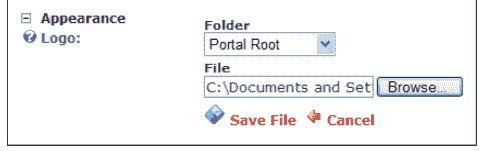

- 14. 单击页面底部的**更新**以保存更改。

## 工作原理...

**站点设置**页面提供多种可设置的选项，其中许多将在后续章节中探讨。你可以随意尝试不同的选项。如果看起来不对，你可以回到此屏幕并将其改回。

## 为站点选择皮肤

这是一个快速简便的操作指南，用于更改 DNN 站点的配色方案（称为“皮肤”）。下载 DNN 时，它自带一个基本皮肤。不过，你可以下载不同的皮肤，选择你希望访问者看到的那一款。你甚至可以为站点管理员选择不同的皮肤。

### 准备工作

DNN 的典型安装只有一个皮肤。要遵循本操作指南，你需要至少下载另一个皮肤才能切换。如果你的站点只有一个皮肤，你仍然可以跟着操作，了解如何更改。或者尝试操作指南 *下载扩展（皮肤或模块）* 为你的站点下载更多皮肤，然后再回来了解如何更改它们。

### 操作步骤...

- 1. 以门户管理员身份登录（在我们的示例中为 `sysadmin`）。
- 2. 从**管理**菜单中选择**皮肤**。

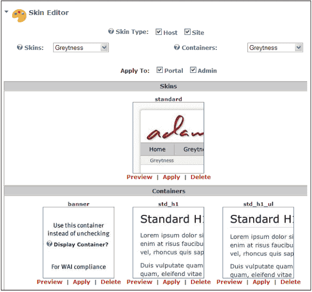

- 3. 找到显示站点上已安装可用皮肤的下拉列表。如果没有看到所需皮肤，请参阅操作指南 *下载扩展（皮肤或模块）* 以安装更多皮肤。
- 4. 从下拉列表中选择你想要的皮肤。然后会显示皮肤的样例。
- 5. 单击**预览**以查看应用所选皮肤后站点的外观。
- 6. 如果你喜欢它的外观，单击**应用**将皮肤应用到你的站点。
- 7. 如果你只想为管理员用户设置不同的皮肤，请找到标记为**门户**和**管理**的两个复选框。取消选中**门户**，保持**管理**选中，然后按上述方式应用皮肤。

## 工作原理...

DNN 中的皮肤是一种布局。DNN 中的视觉元素（如登录链接、版权短语和站点徽标）以简单标记的形式呈现在皮肤中，这些标记可以轻松地重新定位在布局中。皮肤的目的是将站点的功能与视觉布局分离。它允许美工设计站点而无需担心代码的工作原理；反过来，程序员可以编写站点代码而无需担心图形的工作原理。它为网站的所有页面提供了一致的外观。

## 另请参阅

参见下一个操作指南以了解更改站点视觉外观的更多方法。

## 为站点选择容器

皮肤控制站点的布局和配色方案，但 DNN 站点的实际内容（博客、新闻文章等）包含在称为“容器”的视觉块中。容器帮助你布局站点，但你也可以像为页面本身选择视觉样式一样，为这些容器选择视觉样式。

### 操作步骤...

- 1. 以门户管理员身份登录（在我们的示例中为 `sysadmin`）。
- 2. 从管理菜单中选择**皮肤**。
- 3. 找到显示站点上已安装可用皮肤的下拉列表。
- 4. 从下拉列表中选择一个皮肤。然后会显示皮肤样例以及皮肤内的容器。

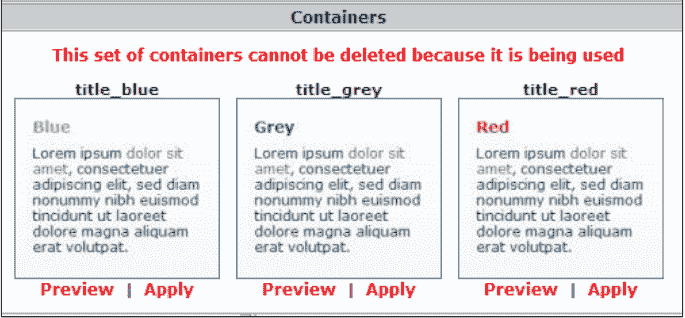


5. 查看可用的容器并点击 **Preview** 查看选择容器后网站的外观。
6. 如果您喜欢其外观，请点击 **Apply** 将容器应用到您的网站。
7. 如果您希望仅为 Administrator 用户使用不同的容器，请找到标记为 **Portal** 和 **Admin** 的两个复选框。取消选中 **Portal** 并保留 **Admin** 选中，然后按上述方式应用容器。

## How it works...

容器通常位于皮肤内，因此容器可用的样式由您选择的皮肤决定。这就是为什么您必须先选择皮肤才能看到可用的容器。然而，DNN 非常灵活，允许您将一种皮肤分配给网站的页面，同时也允许使用来自完全不同皮肤的容器。您可以自由混合搭配容器和皮肤，以实现网站的最佳外观。

## See also

有关如何更改网站页面外观的更多信息，请参阅食谱 *Choosing a skin for the site.*

## Adding a module to a page

DNN 中的模块是一种将内容组织成易于使用（也易于重用）的插件的方式。您只需创建一次论坛或博客，但您可以“将其插入”到网站的任何页面中任意多次。这就是您通过创建页面并插入您拥有的模块来构建网站的方式。

## Getting ready

本食谱所需的唯一条件是您网站中的一个页面。您可以将模块添加到主页或创建一个新页面来容纳您的模块。在此示例中，我们将把一个 Banner Ads 模块添加到名为 **Our Sponsors** 的新页面。

## Installation and Setup

## How to do it...

- 1. 以 Portal Administrator 身份登录（在我们的示例中为 `sysadmin`）。
- 2. 确保控制面板显示在页面的顶部（控制面板是您以管理员身份登录时看到的一组图标）。

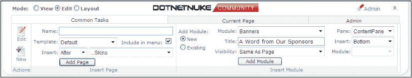

- 3. 点击左侧的 **New** 图标。这将创建一个新页面。
- 4. 对于 **Page Name**，使用 Our Sponsors。
- 5. 对于 **Page Title**，使用 Our Sponsors。
- 6. 保持其余设置默认为默认值并点击 **Update** 以创建页面。
- 7. 接下来，查看控制面板顶部中央并确保选择了 **Add Module: New**。
- 8. 找到出现在 **Module:** 提示符旁边的下拉列表。选择 **Banners**。
- 9. 找到 **Pane:** 提示符旁边的下拉列表并确保选择了 **ContentPane**。
- 10. 在 **Title** 框中，输入 A Word from Our Sponsors。
- 11. 在标记为 **Insert:** 的下拉列表中，确保显示 **Bottom**。
- 12. 点击 **Add Module** 按钮将 Banners 模块插入您正在查看的页面。
- 13. 就这些。一旦模块被添加到页面，您必须在开始使用之前设置模块的选项。有关设置特定模块的更多详细信息，请参阅 *Chapter 3, Easy tricks with existing modules.*

## How it works...

将模块添加到页面是一项简单的任务，您会经常执行。 在 DNN 中构建网站只是将模块添加到页面以创建您需要的功能。

控制面板提供其他用于在页面上定位模块的选项。示例使用了 ContentPane（即中心窗格），但您也可以将模块定位在左侧、右侧、顶部和底部窗格中。

当页面上已有模块时，Insert 下拉列表控制新模块应显示在现有模块的上方还是下方。同样，这些只是帮助您在所选页面上定位模块的选项。请随意尝试模块定位，以更好地了解什么在您的网站上看起来更好。

## Installing standard DNN modules

DNN 开箱即用包含许多模块，但最初只安装了最受欢迎的模块。这是 DNN 制作者有意识的决定，以便新的 DNN 网站不会因运行大量不需要的模块而变慢。这使得安装更高效，但也意味着您在创建网站后需要安装几个标准模块。

## How to do it...

- 1. 以 SuperUser 身份登录（在我们的示例中为 syshost）。
- 2. 查看控制面板并确保您处于编辑模式。
- 3. 在 Host 菜单下选择 Extensions。
- 4. 滚动到底部并点击 Install Available Extensions 链接或将鼠标悬停在模块操作菜单上并选择它。

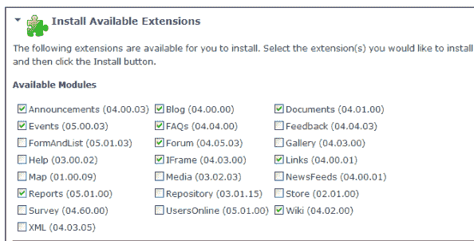

- 5. 选中您想要安装的模块。对于本书中的食谱，请选择以下模块：
  - Announcements
  - Blog
  - Documents
  - Events
  - FAQs
  - Forum
  - IFrame
  - Links
  - Reports
  - Wiki
- 6. 滚动到页面底部并点击 **Install Selected Extensions.**
- 7. 现在这些模块中的每一个都将出现在控制面板中。

## How it works...

通过安装这些额外的模块，您可以在页面上放置更多功能。

## Downloading an extension (skin or module)

DNN 中的扩展由一组文件组成，放在一个压缩文件夹中（也称为 ZIP 文件）。要安装新扩展，您只需提供 ZIP 文件，DNN 扩展向导就会完成其余工作。只有 SuperUser 才能安装新的皮肤和模块。

获取 DNN 网站新扩展的一种好方法是将其从互联网下载。有时它们是免费的或只需少量费用。在后面的章节中，您将看到如何制作自己的扩展。无论您如何获取扩展，它都将由一个单一的 ZIP 文件组成，您需要将其上传到 DNN 服务器并安装，然后它才会像我们在 Adding a module to a page 中看到的那样出现在控制面板下拉列表中。

下载 DNN 扩展的热门网站有 www.codeplex.com（免费开源模块）、DotNetNuke Forge（www.dotnetnuke.com）和 www.snowcovered.com（主要是商业模块）。您可能需要为该网站注册一个帐户，但注册是免费的。

本食谱将展示如何下载扩展（本示例中为免费皮肤），但该过程对于所有不同类型的扩展（例如模块和外语包）基本相同。

## How to do it...

- 1. 打开您喜欢的浏览器并前往 www.snowcovered.com。
- 2. 在屏幕顶部找到 **Register** 链接（在 **Help** 图标旁边）并点击它。如果您已在此网站拥有 ID，可以点击 **Login**，提供您的用户名和密码，然后跳到步骤 4。
- 3. 填写您的姓名并选择在此网站使用的用户名和密码。填写任何其他必填字段并点击 Register。
- 4. 成功登录或注册后，您将看到欢迎页面，显示最新的模块和皮肤。在左上角，点击浏览链接列表中的 DotNetNuke 5。

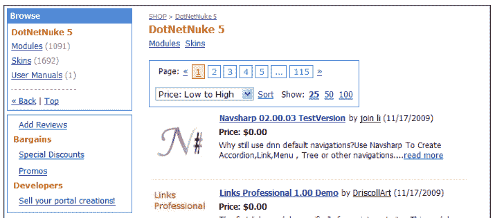

- 5. 这将显示 DNN 5 的所有模块和皮肤的列表。我们正在寻找免费皮肤，因此在左上角的浏览列表中找到并点击 Skins 链接。
- 6. 接下来，找到显示为 Release Date 的下拉列表并选择 Price: Low to High。然后点击 Sort 链接。这将首先显示免费皮肤。

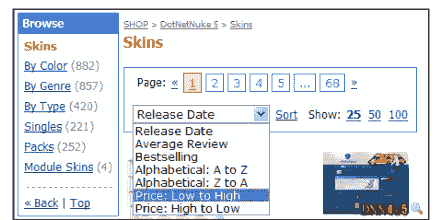

- 7. 查看免费皮肤并选择一个您认为在网站上看起来不错的皮肤。在此示例中我们将选择一个名为 Greyt ness 的皮肤，但您可以选择您喜欢的任何一个。点击它以进入皮肤详细信息屏幕。
- 8. 检查皮肤的详细信息（尤其是价格，如果是免费皮肤则为 $0）。然后点击页面右侧的 Add to Cart 链接。
- 9. 消息将确认皮肤已添加到您的购物车。现在点击 View Cart 链接以完成交易。

## Installation and Setup

- 10. 下一个屏幕显示您正在下载的皮肤。点击 **Proceed to Checkout** 按钮。

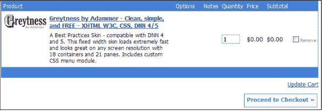

- 11. 在付款页面，输入您的电子邮件地址。点击 **Continue** 按钮。
- 12. 如果您尚未登录 SnowCovered 网站，您将被要求输入用户名和密码。否则您将直接进入付款页面。
- 13. 付款页面将显示您的帐户信息。确保所有必填字段都已填写并点击 **Continue**。
- 14. 下一个屏幕将显示销售协议和条款。点击 **Agree to terms** 复选框并点击 **Confirm Order**。
- 15. 最后一页将提供一个名为 **My Downloads** 的链接。点击此链接。
- 16. 在待处理下载列表中，点击皮肤旁边的 **Downloads**。

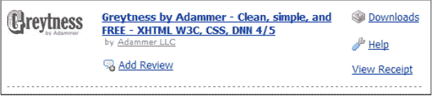

- 17. 在下一页，点击 **Download** 链接。
- 18. 文件下载对话框将询问您是否要打开或保存。点击 **Save** 并选择一个临时文件夹来保存 ZIP 文件。
- 19. 这就是我们从 SnowCovered 网站需要做的全部内容，因此关闭浏览器。
- 20. 还有一件事我们需要做。通常当我们下载扩展时，我们真正需要的 ZIP 文件在我们下载的 ZIP 文件内部。我们需要查看我们刚刚获得的 ZIP 文件并提取我们需要的 ZIP 文件。前往您保存下载文件的位置的临时文件夹。
- 21. 右键点击您下载的文件并选择 **Open With | Compressed (zipped) Folders**。


## 安装和设置

- 3. 查看控制面板并确保你处于编辑模式（不是查看模式）。
- 4. 进入菜单 **Admin | Extensions**。
- 5. 滚动到页面底部并点击名为 **Install Extension Wizard** 的链接。你也可以从模块操作菜单中选择它。
- 6. 点击 **Browse** 按钮并选择 ZIP 文件（在我们的示例中为 `Greyt ness_01.00.00_Install.zip`）。
- 7. 点击 **Next**。
- 8. 如果你看到一个关于缺少清单的警告屏幕，不要惊慌！这可能意味着你跳过了下载配方中的步骤，并且正在尝试加载你直接从 SnowCovered 获取的 ZIP 文件。点击 **Cancel** 并重复配方 *Downloading an extension (skin or module)* 中的步骤来提取 DNN5 的 ZIP 文件。
- 9. 如果一切正常，你将看到 **Install Extension** 页面。它显示了皮肤文件的详细信息。点击 **Next** 来安装它。

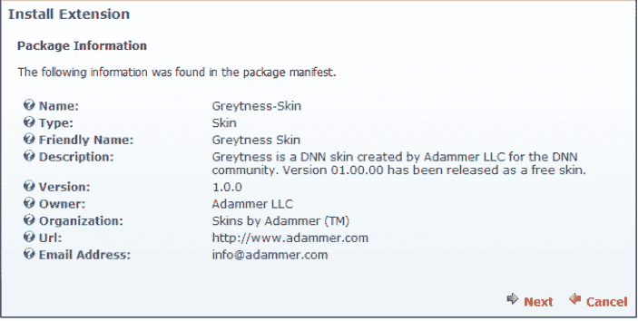

- 10. 在发行说明页面，点击 **Next**。
- 11. 如果你看到 **Review License** 页面，勾选 **Accept License** 并点击 **Next**。
- 12. 最后一个屏幕是 **Package Installation Report**，它应列出为皮肤加载的所有项目，并在底部显示最终信息 **Installation Successful**。如果看到错误信息，则皮肤文件可能存在问题。尝试加载不同的皮肤。
- 13. 点击 **Return** 完成皮肤安装。
- 14. 皮肤现在可在你的网站上使用。如果你进入菜单 **Admin | Extensions**，你现在会看到新皮肤出现在皮肤下拉列表中。

## 为你的网站启用用户注册

一旦你安装了 DNN 网站，你首先要考虑的就是如何为其创建用户。在 DNN 中，用户是通过用户注册流程创建的。你可以通过选择四种会员选项之一来控制用户如何加入网站：

- None：用户无法自行注册。相反，门户管理员必须根据需要创建每个用户。
- Private：用户自行创建注册，但门户管理员在用户可以访问网站之前批准用户注册。
- Public：用户自行创建注册并立即获得访问权限。
- Verified：用户自行创建注册并通过点击确认邮件中的链接获得访问权限。

在本配方中，我们将展示如何设置网站的用户注册并演示 Verified 会员的工作方式。

### 准备工作

使用 Private、Public 或 Verified 会员时，门户管理员和新用户在注册过程中都会收到电子邮件提醒。为了在本配方中看到整个流程的演示，你需要一个有效的电子邮件地址，并且网站必须设置好发送电子邮件。要以这种方式设置你的网站，请参阅本章末尾的配方 *Setting up a SMTP server with Gmail*。

### 如何操作...

- 1. 首先以门户管理员身份登录（在我们的示例中为 sysadmin）。
- 2. 查看控制面板并确保你处于编辑模式。
- 3. 在 **Admin** 菜单下选择 **Site Settings**。
- 4. 在 **Advanced Settings** 下展开 **Security Settings**。

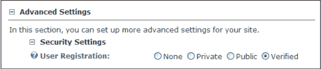

- 5. 将注册类型选择为 **Verified**。
- 6. 点击页面底部的 **Update** 保存更改。

7. 要测试新设置，通过点击注销链接退出网站。

8. 通过选择非 None 的会员类型，你现在会在登录链接旁边看到注册链接：

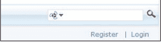

9. 注册链接现在也会出现在登录页面上：

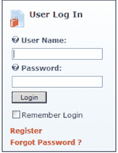

10. 点击注册链接将显示用户注册表单，用户可以在其中提供其信息：

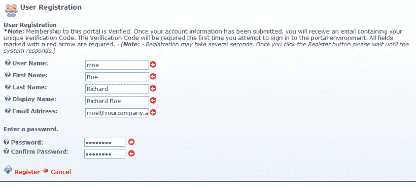

11. 点击注册链接创建用户。

12. 由于会员为 Verified，新用户将收到一封包含完成注册并将用户添加到网站的链接的特殊电子邮件。电子邮件看起来像这样：

```
From: admin@mycompany.abc [mailto:admin@mycompany.abc]
Sent: Friday, September 17, 2010 12:59 PM
To: Richard Roe
Subject: MyCompany Intranet New User Registration

Dear Richard Roe,

We are pleased to advise that you have been added as a Registered User to MyCompany Intranet. Please read the following information carefully and be sure to save this message in a safe location for future reference.

Portal Website Address: www.mycompany.abc
Username: sjones
Password: dnnuser
Verification Code: 0-7

You can use the following link to complete your verified registration:

http://www.mycompany.abc/default.aspx?ctl=Login&username=rroe&verificationcode=0-7

Thank you, we appreciate your support...

MyCompany Intranet
```

13. 当新用户点击电子邮件中的链接时，他们会被带到登录页面，其中现在会出现额外的验证码字段。提供密码和验证码后，用户即可获得访问权限：

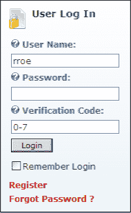

## 工作原理...

允许用户自行在你的网站上注册，可以减轻管理员创建用户的负担。通过 Private、Public 和 Verified 选项，你可以根据需要尽可能多或尽可能少地控制用户注册流程。

## 更多内容...

当用户尝试在网站上注册时，门户管理员会收到电子邮件提醒，以便管理员采取适当的步骤完成注册。以下是示例：

```
From: admin@mycompany.abc [mailto:admin@mycompany.abc]
Sent: Friday, September 17, 2010 12:59 PM
To: System Administrator
Subject: MyCompany Intranet New User Registration

Date: Friday, September 17, 2010
First Name: Richard
Last Name: Roe
Unit:
Street:
City:
Region:
Country: N/A
Postal Code:
Telephone:
Email: rroe@mycompany.abc
```

## 另请参阅

用户注册表单上出现的字段（名字、姓氏等）是用户资料的一部分。要了解如何添加自己的字段并使其成为注册必填项，请参阅本章后面的配方 *Managing profile properties*。

## 创建用户并授予访问权限

在之前的配方中，我们看到了如何允许用户通过用户注册流程在你的门户中自行创建。在管理员方面，你也有直接创建用户的选项（事实上，如果你关闭用户注册，你必须直接创建用户）。本配方将向你展示如何创建自己的用户，为其分配密码，并授予他们访问你门户不同页面的权限。

### 准备工作

要创建用户，你只需要门户管理员登录。但有一些决定需要做出。新用户在账户创建时是否应收到电子邮件通知？是否应自动授权他们以便立即登录？是否应为他们分配随机密码并强制他们在首次登录时更改？本配方展示了如何设置这些选项。

### 如何操作...

- 1. 首先以门户管理员身份登录（在我们的示例中为 `sysadmin`）。
- 2. 查看控制面板并确保你处于编辑模式。
- 3. 在 **Admin** 菜单下选择 **User Accounts**。你也可以在控制面板的 Admin 选项卡中选择用户图标。
- 4. 页面显示用户列表。

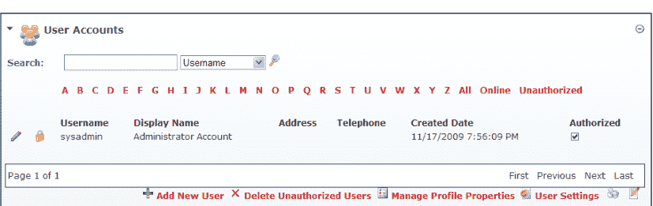

- 5. 要创建新用户，请查看页面底部并点击 **Add New User** 链接（或从操作菜单中选择它）。


## 管理用户与站点设置

6. 此时会显示“添加新用户”表单。使用以下信息填写表单：

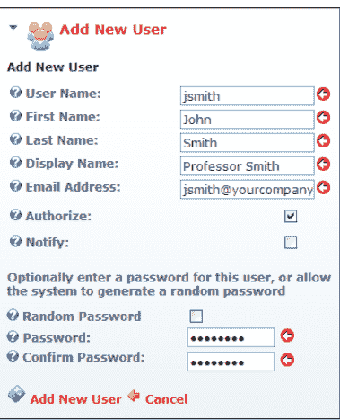

- 用户名：jsmith
- 名：John
- 姓：Smith
- 显示名：Professor Smith
- 电子邮件地址：jsmith@yourcompany.com
- 授权：选中
- 通知：未选中
- 随机密码：未选中
- 密码/确认密码：rfid2010

7. 单击“添加新用户”以保存更改并创建用户。

8. 接下来，我们需要分配安全角色。新用户会自动获得“注册用户”角色和“订阅者”角色。我们也可以将自己的安全角色授予 jsmith。

9. 在用户帐户列表中找到 `jsmith`。单击名称旁边的锁形图标，显示**管理角色**页面。

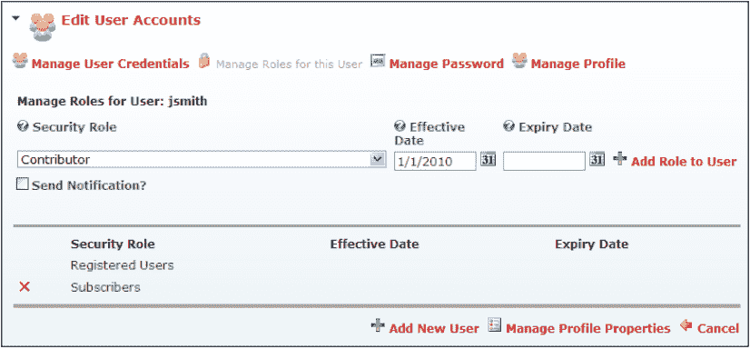

10. 在左侧，你会看到**安全角色**标签，其下方是一个下拉列表，列出门户中的所有角色。在列表中找到**贡献者**角色并选择它。

11. 将**生效日期**设为今天，并将**到期日期**留空。

12. 取消勾选**发送通知？**

13. 单击**向用户添加角色**链接以保存更改。

14. **贡献者**角色现在应出现在页面左下角的角色列表中。

15. 单击**取消**关闭页面，因为我们的更改已完成。

### 工作原理...

由于这是一个测试用户，我们让**通知**保持未选中，因此不会发送电子邮件。如果选中**通知**，则创建帐户时用户会收到一封电子邮件。如果我们选择**随机密码**，则随机密码会出现在电子邮件中。包含随机密码的通知电子邮件如下所示：

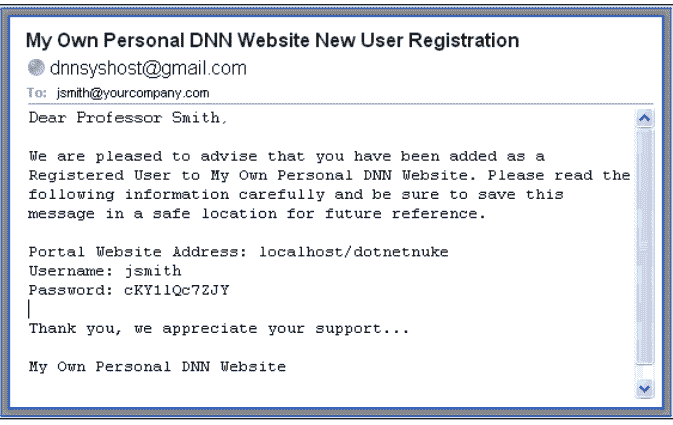

警报电子邮件中显示的文本是完全可自定义的。你可以通过从**管理**菜单（或控制面板）中选择**语言**，再点击门户语言旁边的铅笔图标来找到它。要了解有关此类文本本地化的更多信息，请参阅第9章“编辑语言资源文件”中的操作指南。

### 更多内容...

创建用户并定义安全访问权限后，剩下的最后一件事是定义哪些安全角色可以查看门户模块。

### 另请参阅

要了解如何为不同模块分配安全访问权限，请参阅本章后面的**授予模块访问权限**操作指南。

### 创建并分配安全角色

作为门户管理员，你必须首先做的事情之一就是定义门户的安全设置。安全角色将访问权限授予分配给该角色的所有用户，并且与权限结合使用时，可以允许某些页面公开，某些页面私有。

### 准备工作

要创建安全角色，你需要使用宿主或门户管理员登录。要确定你需要哪些安全角色，请考虑访问站点的不同类型用户。例如，如果你有一个新闻网站，可以创建一个名为“贡献者”的组。通过为这个组创建安全角色，你可以赋予他们编辑内容的权限，而普通用户则没有这种权限。

### 操作步骤...

1. 首先以门户管理员身份登录（在我们的示例中为 `sysadmin`）。
2. 查看控制面板，确保你处于编辑模式。
3. 在**管理**菜单下，选择**安全角色**。
4. 此页面将显示你当前拥有的所有安全角色。

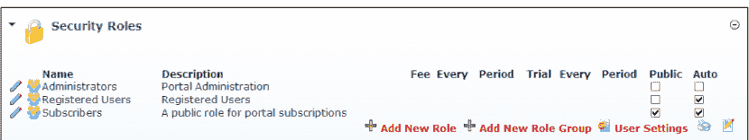

5. 单击标记为**添加新角色**的链接（或从操作菜单中选择它）。

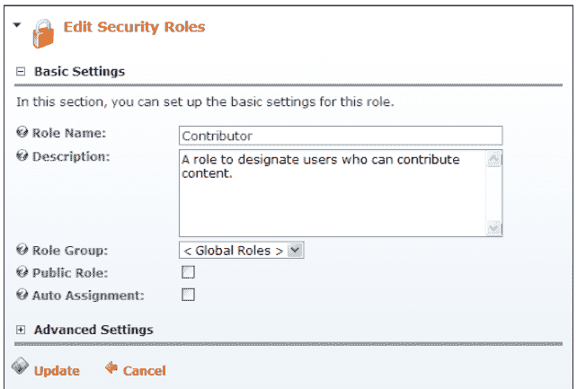

6. 显示**编辑安全角色**页面时，输入以下信息：

- 角色名称：贡献者
- 描述：用于指定可以贡献内容的用户的角色
- 角色组：<全局角色>
- 公共角色：未选中
- 自动分配：未选中

7. 单击**更新**按钮以创建角色。

### 工作原理...

创建安全角色后，你可以将其分配给用户，然后利用 DNN 灵活的安全机制，将其分配到门户中的页面或模块。这样可以控制对门户内容的访问。

### 更多内容...

安装 DNN 时，系统会为你创建五个安全角色：

- 管理员：此角色授予对所选门户的完全访问权限。
- 注册用户：这是任何已获得网站用户名和密码的用户。
- 订阅者：这是一个公共角色的示例，适用于新闻简报模块。用户可以自行注册和取消注册该角色成员资格。
- 未注册用户：这些是访问你的站点但尚未登录的公共用户。
- 所有用户：当你希望向所有用户授予访问权限时（无论他们是否已登录），使用此特殊角色。

这些安全角色可以满足门户所需的大部分安全控制，但有时你需要创建更符合业务需求的安全角色。

### 另请参阅

有关如何使用你创建的角色的示例，请参阅接下来的两个操作指南：

- 授予模块访问权限
- 封禁和删除用户

### 授予模块访问权限

定义安全角色并将其分配给用户后，最后一步是决定哪些用户可以访问门户中的模块。你可以通过两种方式指定模块的访问权限：模块可以从其所在页面继承访问权限，也可以关闭继承并直接在模块上指定哪些安全角色可以访问它。有些模块对所有用户可用，而另一些模块则是私有的。如果你没有模块所需的安全角色，则门户页面显示时将看不到该模块。

### 准备工作

对于本操作指南，你需要一个模块。默认的 DNN 门户包含一个名为 **Sponsors** 的小型 HTML 模块，它显示一些支持 DNN 的公司。我们将把通常私有的模块设为公共，让每个人都能看到它。请记住，下面的操作指南适用于 DNN 中的任何模块，而不仅仅适用于 Sponsors。

### 操作步骤...

1. 首先以门户管理员身份登录（在我们的示例中为 `sysadmin`）。
2. 查看门户首页，向下滚动到页面底部。找到 **Sponsors**，或使用页面上看到的任何模块。
3. 找到模块操作菜单。它是模块名称旁边的小三角形。将鼠标悬停在小三角形上，操作菜单就会显示。

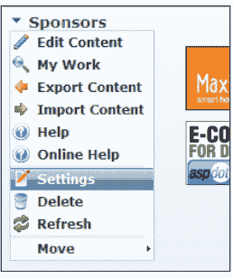

4. 从操作菜单中选择**设置**。此时会显示**模块设置**表单。

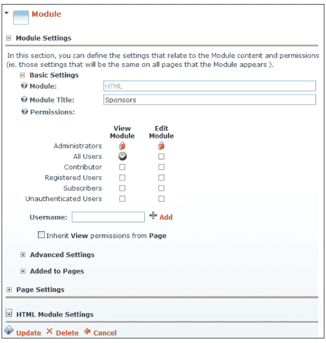

5. 确保**从页面继承查看权限**未被选中。这将允许你在模块级别设置安全性。

6. 在**权限**提示下，将列出 DNN 随附的五个安全角色以及你创建的任何安全角色。要授予未注册用户（即普通公众）查看权限，请确保：

- **所有用户**已选中
- **注册用户**未选中
- **未认证用户**未选中

7. 单击页面底部的**更新**以保存更改。

8. 要测试安全性，请单击**退出登录**链接，成为未认证用户。

9. 查看首页并滚动到页面底部。即使未登录，**Sponsors** 模块现在也应该出现。它现在是一个公共模块。

### 更多内容...

在本操作指南中，我们看到了一个在模块级别控制用户访问的简单示例，但 DNN 中的安全性由多个不同级别决定。你可以在页面级别控制访问权限，并让页面上的模块继承相同的访问权限，也可以在模块级别覆盖这些权限以进行额外控制。但在为站点选择安全设置时，可能还需要考虑其他因素。用户可以拥有多个安全角色，某些模块（例如博客模块）还内置了额外的安全层。最好仔细考虑你的安全决策，并在部署到生产站点之前进行测试。

### 另请参阅

有关用户帐户安全的更多示例，请参阅下一个操作指南：*封禁和删除用户*。

### 封禁和删除用户

创建用户并授予他们访问门户的权限后，你有两种不同的方式来移除该访问权限。你可以通过剥夺他们的权限来封禁他们，也可以完全删除并移除他们。

### 准备工作

对于本操作指南，你需要一些测试用户来封禁和删除。更多信息请参阅操作指南 *创建用户并授予访问权限*。

### 操作步骤...

1. 首先以门户管理员身份登录（在我们的示例中为 `sysadmin`）。
2. 查看控制面板，确保你处于编辑模式。
3. 在**管理**菜单下选择**用户帐户**，或单击控制面板中的**用户**图标。
4. **用户帐户**页面将显示门户中的所有用户。查找现有用户或创建测试用户。不要选择管理员用户！管理员用户不能被封禁或删除。


5. 若要封禁用户而不删除，需先取消其授权。 在列表中找到要封禁的用户，点击其姓名旁的小铅笔图标。 这将显示“编辑用户账户”页面。

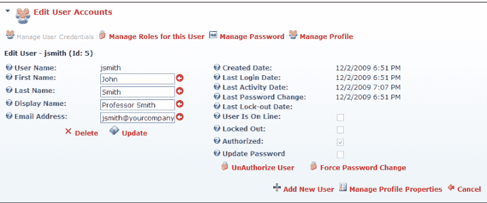

6. 点击页面底部的 Unauthorize User 链接。 你会看到一条消息显示 User successfully Un-Authorized。

7. 点击 Cancel 返回用户列表。

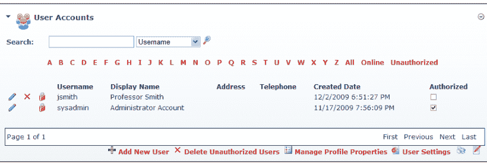

8. 测试用户仍在列表中，但 Authorized 复选框现在未选中。 该用户现已被封禁，无法再登录门户。

9. 若要彻底移除用户及其个人资料，可通过点击其姓名旁的小红 X 删除用户。 如果有多个未授权用户需要删除，可点击 Delete Unauthorized Users 链接。

10. 在被要求确认决定时，点击 OK。

11. 暂停后，会显示一条消息确认用户已删除。

4. 点击 Manage Profile Properties（或从操作菜单中选择）。

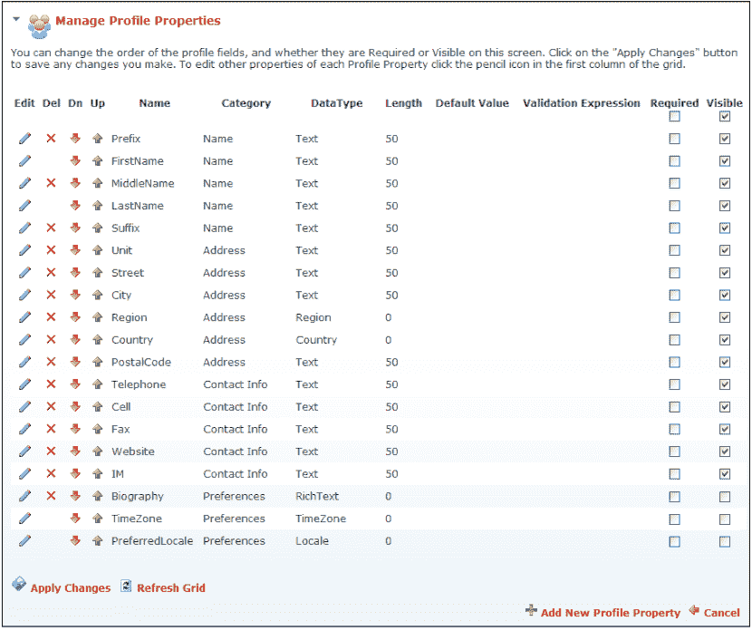

5. 你会看到所有当前个人资料属性的列表。 若要隐藏其中一些，请在 Visible 列下取消选中以下项：

   - Biography: Unchecked
   - TimeZone: Unchecked
   - PreferredLocale: Unchecked

6. 点击 Apply Changes。

7. 若要添加新属性，点击 Add New Profile Property（或从操作菜单中选择）。

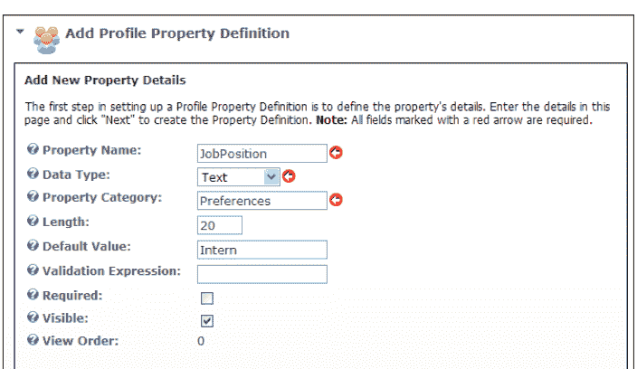

8. 填写以下信息：

   - Property Name: JobPosition (no space)
   - Data Type: Text
   - Property Category: Preferences
   - Length: 20
   - Default Value: Intern
   - Validation Expression: Leave blank
   - Required: Unchecked
   - Visible: Checked

9. 点击 **Next.**

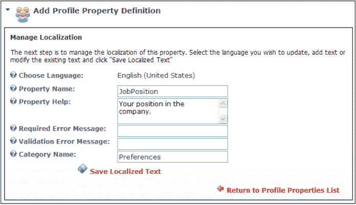

10. 在此页面我们为新的个人资料属性提供 Help、Validation 和 Error 消息。 填写以下信息：

    - **Property Name:** JobPosition (no space)
    - **Property Help:** Your position in the company
    - **Category Name:** Preferences

11. 点击 **Save Localized Text.**

12. 点击 **Return to Profiles Properties List.**

13. 新属性将出现在属性列表中。 点击 **Cancel** 返回 User Accounts。

14. 若要检查结果，点击铅笔图标编辑用户。

15. 点击 **Manage Profile.**

16. 确认 JobPosition 现在作为用户的属性出现。

17. 你也可以将个人资料属性用作用户注册流程的一部分。 如果我们想将示例 JobPosition 添加到用户注册中，我们首先进入 **Admin** 菜单下的 **User Accounts**。

18. 从操作菜单中选择 **User Settings** 或点击页面底部的链接。

19. 向下滚动页面底部，直到看到 **Require a Valid Profile for Registration.**

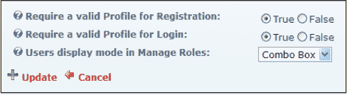

20. 将 **Require a Valid Profile for Registration** 设置为 **True**。

21. 点击 **Update** 保存更改。

22. 若要查看用户注册表单的外观，点击 **Logout** 链接。

23. 然后点击 **Register** 链接。

24. 新的 JobPosition 属性现在会与其他属性一起显示：

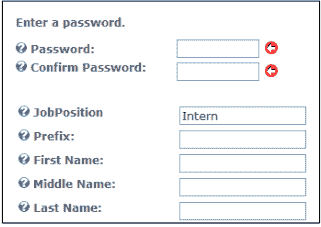

## Creating and organizing pages

在此示例中，我们将创建几个空白页面，以展示如何创建新内容并在菜单中组织。 我们将创建一个页面作为多个较小页面的父级。

那么什么是页面？ DNN 中的页面实际上是一个占位符。 当你创建新页面时，它会出现在网站菜单中，并作为一个空白布局来容纳你的模块。

在本教程中，我们将创建几个空白页面，将它们组织成层次结构，然后删除其中一些以查看其操作方式。

### How to do it...

1. 首先以 Portal Administrator 身份登录（在我们的示例中为 `sysadmin`）。

2. 查看 Control Panel 并确保处于 Edit 模式。

3. 在 Admin 菜单下选择 Pages（或从 Control Panel 的 Admin 选项卡中选择 Pages）。

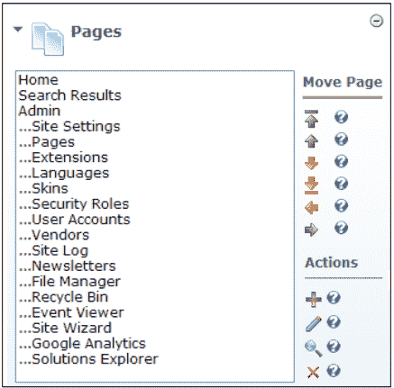

4. 在左侧可以看到门户中所有页面的列表，按层次排列，就像它们在菜单中出现的方式一样。 缩进的页面代表子菜单。

5. 点击左侧 **Actions** 下的 **Add New Page** 图标。

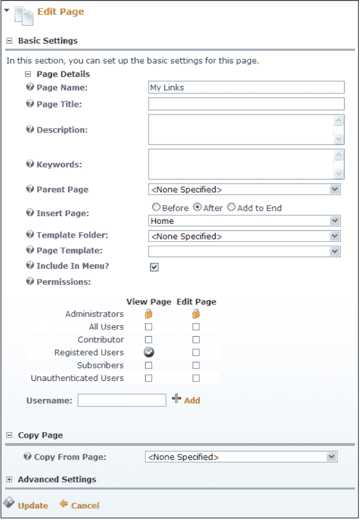

6. 提供以下信息：

   - **Page Name:** `My Links`
   - **Parent Page:** `<None Specified>`
   - **Insert Page:** 点击 **After** 并从下拉列表中选择 **Home**
   - Template Folder: `<None Specified>`
   - Include in Menu? Checked
   - Permissions: Check View Page for Registered Users

7. 点击 Update 保存你的信息。

8. 现在我们有一个新的菜单项出现在网站的每个页面上（如 Home 或 Admin 菜单）。 让我们再创建一个页面，但将其放在这个新菜单项下。

9. 再次点击 Add New Page。

10. 提供以下信息：

    - Page Name: Announcements
    - Page Title: Announcements
    - Parent Page: My Links
    - Template Folder: `<None Specified>`
    - Include in Menu? Checked
    - Permissions: Check View Page for Registered Users

11. 点击 Update 保存你的信息。

12. 看看我们的第二个页面出现在第一个页面下方。 这是因为我们选择了第一个页面作为我们的 Parent Page。

13. 再添加一个名为 My Blog 的页面并将其放在 MY LINKS 下。

14. 在 MY LINKS 下添加另一个名为 My Forum 的页面。

15. 在 MY LINKS 下添加另一个名为 Useful Documents 的页面。

16. 在 MY LINKS 下添加另一个名为 Delete Me 的页面。

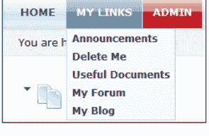

17. 我们现在在原始父页面下有五个页面，但它们的顺序错误。 我们可以将 Delete Me 页面移动到菜单底部。

18. 在左侧页面列表中找到 Delete Me 并选择它。

19. 按下向下箭头按钮将页面向下移动，直到它成为 MY LINKS 下列出的最后一个页面。

20. 现在我们知道如何移动菜单中的页面，让我们看看如何删除页面。

21. 在左侧页面列表中选择 **Delete Me**。

22. 点击页面右侧 **Actions** 下的小红 **X**。

23. 你将被提示 **Are you Sure You Wish To Delete This Item?** 点击 **OK**。

24. 页面被发送到 Recycle Bin 并从菜单和页面列表中消失。 如果你删除了页面后来改变主意，请参阅下一教程 *Using the Recycle Bin* 了解如何将其恢复。

### How it works...

创建页面、在菜单中组织它们并向其添加模块是使用 DNN 构建网站的重要部分。 在下一章中我们将看到更多关于添加页面和创建内容的示例。

### See also

现在你在网站上有空白页面，可以使用本章剩余的教程和 *Chapter 3* 开始添加模块。

## Using the Recycle Bin

当你在 DNN 中删除页面和模块时，它们实际上并未被删除。 相反，它们被保存在 Recycle Bin 中，就像你电脑上的文件一样。 本教程将向你展示如何“取消删除”页面和模块。

### Getting ready

要跟随本教程，你需要一个已删除的页面。 请参阅教程 *Creating and organizing pages* 了解如何删除页面。

### How to do it...

1. 首先以 Portal Administrator 身份登录（在我们的示例中为 sysadmin）。

2. 查看 Control Panel 并确保处于 Edit 模式。

3. 在 **Admin** 菜单下选择 **Recycle Bin**。

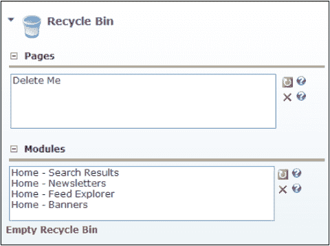

4. Recycle Bin 维护你已删除的页面和模块。 若要恢复页面，点击页面以选择它。

5. 点击小绿色的 recycle 图标。

6. 暂停后，页面将再次激活并重新出现在菜单中。

7. 若要恢复模块，在列表中选择该模块。

8. 点击 recycle 图标。

9. 暂停后，模块将重新出现在其被删除的页面上。

### How it works...

Recycle Bin 让你可以取消删除页面和模块，但它也提供了一个清空 Recycle Bin 的链接。 如果你点击此链接，则 Recycle Bin 中的所有页面和模块将被永久删除。 请谨慎使用此链接。

## Setting up an SMTP server with Gmail

DNN 在许多方面使用电子邮件：当创建新用户时、当你设置供应商时，或当有人回复博客帖子时。

你可以配置站点使用 **Simple Mail Transfer Protocol (SMTP)** 发送电子邮件，但这需要一个 SMTP 服务器。

在本教程中，我们将演示如何使用免费的 Gmail 账户（来自 Google）作为你的 SMTP 服务器，以及如何配置 DNN 通过此账户发送电子邮件。


**准备工作**

要按照本教程操作，你必须具备以下条件：

- 一个 Gmail 账号（你可以通过访问 `http://mail.google.com` 并点击 **创建账号** 按钮免费获取一个）
- 你的 Gmail 账号的用户名和密码

**如何操作...**

1. 以主机身份登录（在我们的示例中为 `syschost`）。
2. 在 **主机** 菜单下选择 **主机设置**。
3. 在 **基本设置** 下，填写以下信息：
   - **主机电子邮件：**（在此输入你的 Gmail 地址，例如 `dnnsyschost@gmail.com`）
4. 向下滚动并展开 **高级设置**。
5. 找到 **SMTP 服务器设置** 并展开它。

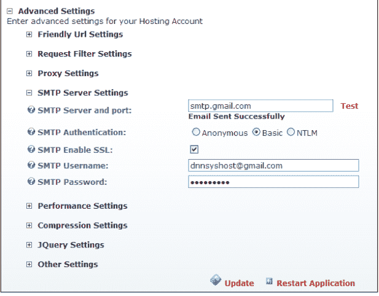

6. 填写以下信息：

- **SMTP 服务器和端口：** `smtp.gmail.com`
- **SMTP 认证：** 基本
- **SMTP 启用 SSL：** 已勾选
- **SMTP 用户名：**（你的 Gmail 电子邮件地址 `dnnsyschost@gmail.com`）
- **SMTP 密码：**（你的 Gmail 密码）

7. 点击 **更新** 按钮保存更改。
8. 点击 **测试** 链接测试你的配置。
9. 你应该会看到消息 **电子邮件发送成功**。如果看到错误，请检查是否按上述显示输入了所有内容，并提供了正确的 Gmail 地址和密码。

**工作原理...**

你提供的信息允许 DNN 连接到你的 Gmail 账号并通过它发送电子邮件。
