## 使用现有模块的简单技巧

在本章中我们将介绍以下主题：

- 使用 HTML 模块
- 创建公告
- 在线分发文档
- 发布新闻通讯
- 创建活动日历
- 创建 Wiki
- 发布热门链接集
- 显示 RSS 新闻源
- 配置 RSS 新闻源
- 发布简单报告
- 发布调查问卷

### 引言

在本章中，我们将介绍 DotNetNuke 社区版中包含的最受欢迎的模块。我们将从公告到发布内容再到从数据库显示报告等各个方面进行探索。这些教程将为你构建一个受欢迎且有用的门户提供所需的一切。

本章描述的大多数模块都包含在 DNN 的当前版本中，但未安装。限制已安装模块的数量可使新的 DNN 站点尽可能简单高效。请查看 *第 1 章，安装标准 DNN 模块* 中的教程，在遵循这些教程之前安装这些附加模块。

### 使用 HTML 模块

HTML 模块是一个非常简单的模块，但它提供了很多可能性。把它想象成你可以放在 DNN 页面容器内的 HTML 文件。你在模块中放置的任何代码都将像放在 Web 服务器上的 HTML 文件一样被解释。

从积极的一面来看，这意味着你的 HTML 模块可以包含你在任何 HTML 文件中都能找到的同类代码：HTML、JavaScript、VBScript，甚至 JQuery。从消极的一面来看，由于 HTML 模块位于 DNN 页面内部，这意味着 HTML 模块的功能存在一些重要限制。主要考虑因素是，你在 HTML 模块中放置的任何代码都必须与页面外部运行的其他所有代码和谐共存。这也意味着你有责任确保你的 HTML 代码语法正确。HTML 模块中的代码不会进行错误检查。

在本教程中我们将演示简单的 HTML 和 CSS 代码。有关 HTML 模块的更多示例，可以提前查看 *第 10 章*。

**准备工作**

要跟随本教程，最好熟悉 HTML 和 CSS。

**如何操作...**

1. 以门户管理员身份登录（在我们的示例中为 `sysadmin`）。
2. 将 HTML 模块添加到新页面或现有页面。
3. 从模块菜单中选择 **编辑内容**（或点击 **编辑内容** 图标）。
4. 在 **编辑内容** 页面上，你会看到编辑器，它具有不同的模式。你可以选择 **基本文本框** 进行简单文本输入。你也可以选择 **富文本编辑器**，如果你更喜欢使用自动 HTML 格式化功能。如果你直接在 HTML 中工作，可以点击底部的 **HTML** 选项卡以避免任何自动格式化。

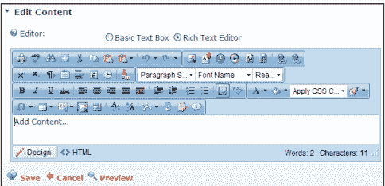

5. 由于我们正在 HTML 中工作，点击底部的 HTML 选项卡。
6. 在编辑器中输入以下 HTML 以创建 DNN 供应商的示例图片列表：

```html
<div class="imagebar">
<ul class="image">
<li></li>
<li></li>
<li></li>
<li></li>
<li></li>
<li></li>
</ul>
</div>
```

7. 点击保存以保存更改。
8. 一个简单的列表将以垂直条的形式显示图片。

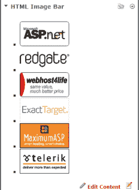

9. 这演示了模块如何渲染简单的 HTML，但为了格式化显示，我们需要添加一些样式信息。从模块菜单中选择编辑内容（或点击编辑内容图标）并点击 HTML 按钮。
10. 在编辑器的顶部，在 HTML 代码之前添加以下样式信息：

```html
<p><style type="text/css">
.imagebar {
    height: 70px;
    width: 780px;
    border: 1px solid #ddd;
}
ul.image {
    float: left;
    list-style: none;
    margin: 0; padding: 0;
}
ul.image li {
    margin: 0; padding: 5px;
    float: left;
    position: relative;
    width: 120px;
    height: 60px;
}
</style></p>
<div class="imagebar">
<ul class="image">
    <li></li>
    <li></li>
    <li></li>
    <li></li>
    <li></li>
    <li></li>
</ul>
</div>
```

11. 点击 **保存** 并查看结果：

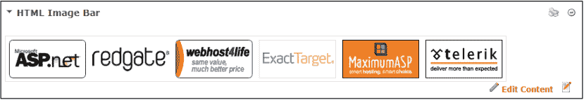

12. 样式创建了一个边框并将图片排列成 *水平* 行。

**更多内容...**

这是在 HTML 模块中显示 HTML 和 CSS 的一个简单示例。有关其他可能性，请参阅 *第 10 章，使用 HTML 模块与 JQuery* 中的教程。

### 创建公告

公告模块是发布定期新闻或小块内容的一种简便方式。公告由标题和正文组成，可选配说明图片和继续链接。在本教程中，我们将使用前面创建的空白页面之一，将公告模块添加到其中并创建我们的第一个公告。

**准备工作**

我们需要一些文本和图片放入公告中。对于本示例，我们假设我们有一个技术新闻网站，我们想添加一些关于名为 "Mirror" 的新产品用于在家庭电脑上读取 RFID 标签的新闻。

**如何操作...**

1. 首先以门户管理员身份登录（在我们的示例中为 *sysadmin*）。
2. 查看控制面板并确保你处于编辑模式。
3. 导航到空白页面（例如在教程 *创建和组织页面* 中创建的 **公告**）。
4. 从控制面板中，选择 **常用任务** 选项卡并从下拉列表中选择公告模块（如果看不到公告模块列表，请参阅 *第 1 章，安装标准 DNN 模块* 了解更多信息）。
5. 点击添加模块按钮。

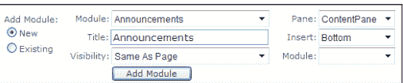

6. 现在我们已将模块放置在页面上，可以使用它来创建公告。点击添加新公告链接。

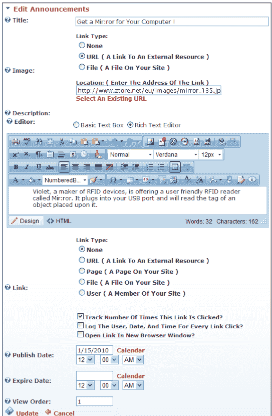


- 7. 填写以下信息：
  - 标题：Get a Mir:ror for Your Computer!
  - 图片：Select URL (A Link To An External Resource)
  - 位置：http://www.thinkgeek.com/images/products/front/ba0d_violet_rfid_mirror.jpg

- 8. 在编辑器中，输入以下文本：

  Violet, a maker of RFID devices, is offering a user friendly RFID reader called Mir:ror. It plugs into your USB port and will read the tag of an object placed upon it.

- 9. 然后完成剩余信息：
  - 链接：None
  - 跟踪此链接被点击的次数？已勾选
  - 记录每次链接点击的用户、日期和时间？未勾选
  - 在新浏览器窗口中打开链接？未勾选
  - 发布日期：使用今天的日期（公告要到此日期才显示）
  - 视图顺序：1

- 10. 点击 Update 按钮查看您的更改。

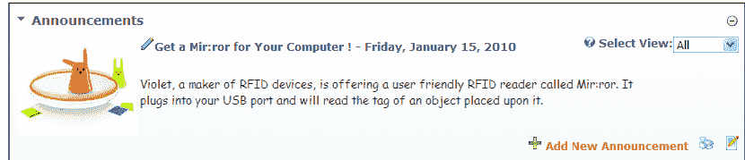

- 11. 您将看到新的公告已显示。如果没有，请在右侧查找 Select View 下拉列表并选择 All。

### How it works...

公告是一种非常简单的方式在您的门户上发布信息。这对于简单的文本公告和图片效果很好。如果您有更复杂的内容或需要用户反馈选项，请改用 Blog 模块。

## Distributing documents online

### Getting ready

要遵循本食谱，您必须在 DNN 站点上安装 Documents 模块。有关说明，请参阅第 1 章 Installing standard DNN modules 中的食谱。

DNN 中的文档分发有四个步骤：

- 1. 主机用户决定允许哪些文档类型。
- 2. 主机用户创建文件分类列表以保持文件有序。
- 3. 用户（如门户管理员）上传文档。
- 4. 另一用户下载文档。

### How to do it...

- 1. 以主机用户身份登录（在我们的示例中为 `syshost`）。
- 2. 在 Host 菜单下选择 Host Settings。
- 3. 滚动到底部并查找名为 Other Settings 的部分并展开它。

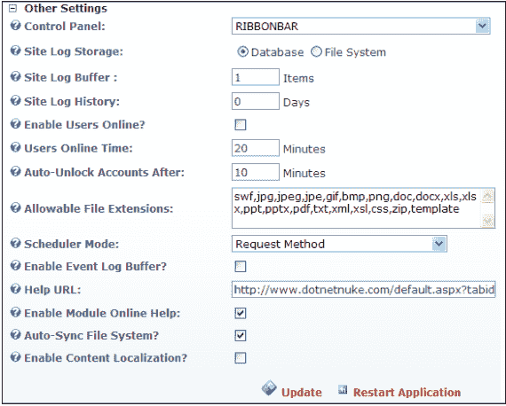

- 4. 找到 Allowable File Extensions。此列表影响可供下载的文件以及允许上传的文件。例如，如果您想为 HTML 模块上传 JPG，扩展名必须在此列出。查看列表并删除您在站点上不支持的任何扩展名。
- 5. 点击 Update 保存更改。
- 6. 以主机身份注销并以门户管理员身份登录（在我们的示例中为 sysadmin）。
- 7. 导航到空白页面（例如在第 2 章 Creating and organizing pages 食谱中创建的 Useful Documents）。
- 8. 查看 Control Panel 并确保您处于 Edit 模式。
- 9. 从 Control Panel 中，选择 Common Tasks 选项卡并从下拉列表中选择 Documents 模块。
- 10. 从下拉列表中选择 ContentPane 并点击 Add Module 按钮。
- 11. Documents 模块现在将出现在您的空白页面上并显示当前可用的文档列表。在添加文档之前，让我们先编辑模块的设置。
- 12. 将鼠标悬停在 Documents 模块菜单上并选择 Settings。
- 13. 滚动到 Documents Module Settings。

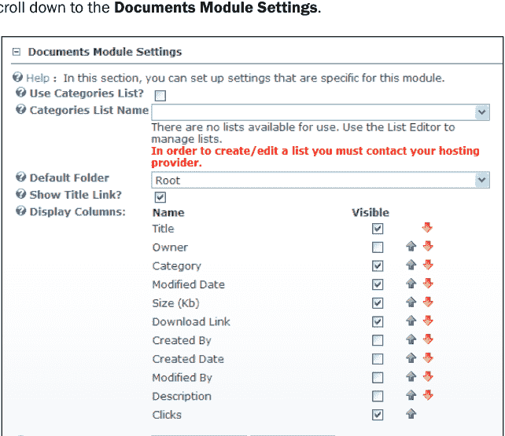

- 14. 填写如上图所示的信息。
- 15. 点击 Update 保存更改。
- 16. 现在我们可以添加供他人下载的文档。返回 Documents 页面，点击 Add New Document 链接。

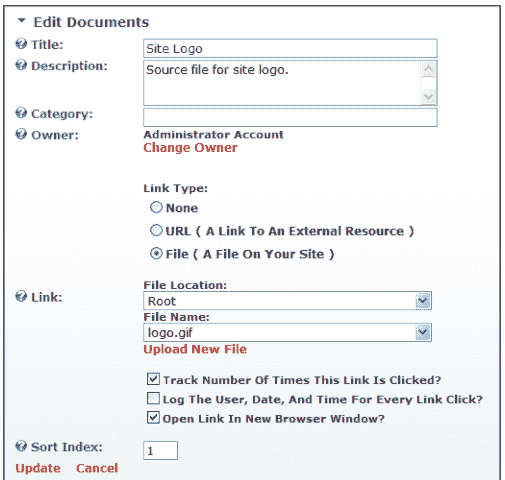

- 17. 当 Edit Documents 页面显示时，填写如上图所示的信息。
- 18. 点击 Update 保存更改。
- 19. 此图像文件现在可供您的门户用户使用。他们可以通过点击 Download 链接下载它。

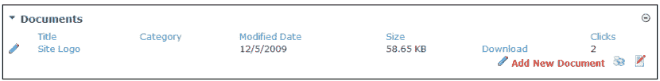

### How it works...

主机用户必须指定允许分发的哪些文件的原因是某些类型的文件（如可执行文件）更容易受到病毒和恶意代码的侵害。通过控制您的门户可以分发或从用户接收的文件类型，您可以降低这种情况发生的几率。

在本示例中，我们选择了 Track Number Of Times This Link Is Clicked? 这用于跟踪用户查看文档的频率。由于我们已将 Clicks 作为显示列之一，我们可以在页面上列出文档时看到计数。

### There's more...

如果用户可以看到 Documents 模块，则他们有权下载其中的文档。通过设置模块或页面的安全性来限制对文档的访问，如第 2 章 Granting access to modules 食谱中所述。

## Publishing a Newsletter

一种很好的方式是通过新闻通讯向用户通报当前新闻和活动或提醒他们门户的更改。在 DNN 中，新闻通讯是定期发送给注册到您站点的用户的电子邮件。

### Getting ready

新闻通讯发送到您站点中定义的 security groups，以及您认为必要的任何个人电子邮件地址。发送新闻通讯要求您的 DNN 站点已设置好发送电子邮件。有关说明，请参阅第 2 章 Setting up the SMTP Server with Gmail 食谱。此外，由于本示例中使用了 Subscribers 角色，您应该至少有一名具有 Subscriber 角色且具有有效电子邮件地址的用户来接收新闻通讯。

### How to do it...

- 1. 以门户管理员身份登录（在我们的示例中为 `sysadmin`）。

- 2. 从 **Admin** 菜单中选择 **Newsletters**。

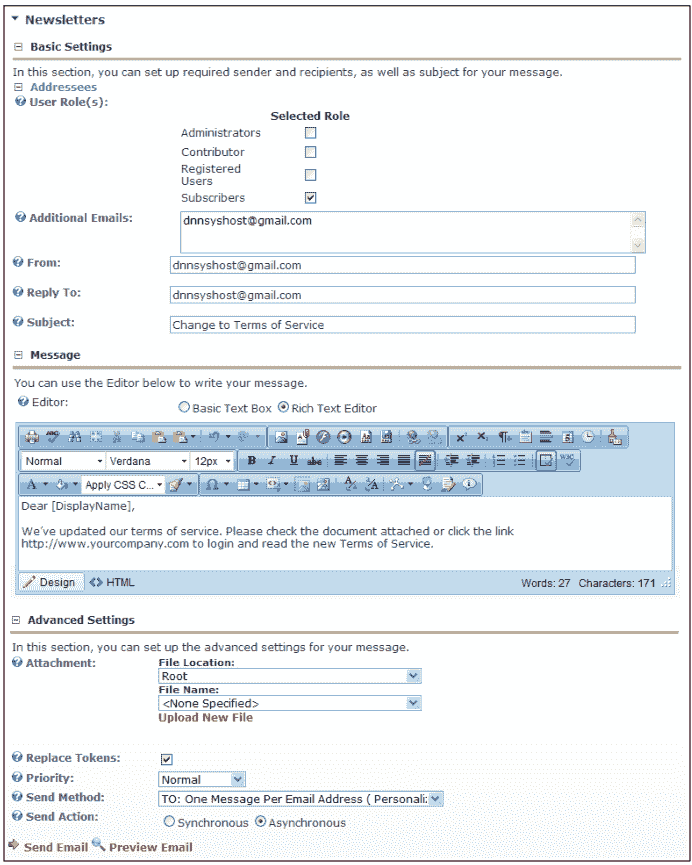

- 3. 填写如上图所示的信息。
- 4. 点击 **Preview Email** 查看并确认消息正确。
- 5. 点击 **Send Email** 发送您的新闻通讯。
- 6. 一旦您点击链接，新闻通讯电子邮件将立即发出。此外，会向门户管理员发送一封摘要电子邮件，其中包含已发送电子邮件的数量。

- 5. 从下拉列表中选择 ContentPane 并点击 Add Module 按钮。

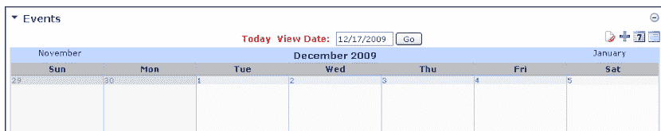

- 6. 将 Events 模块添加到页面会立即为您的用户创建日历。要向日历添加事件，请查看日历顶部的小图标栏。点击看起来像 + 的 Add Event 图标。

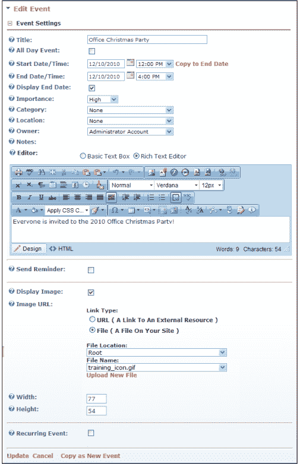

- 7. 当 **Edit Event** 表单显示时，提供如上图所示的信息。
- 8. 点击 **Update** 保存更改。
- 9. 当您返回日历时，在顶部的文本框中输入 12/20/2010 并点击 **Go** 按钮。这将带您进入 2010 年 12 月，您可以看到新事件。
- 10. 如果将鼠标悬停在事件上，标题和描述将被显示。点击 **Event** 以显示完整详细信息。

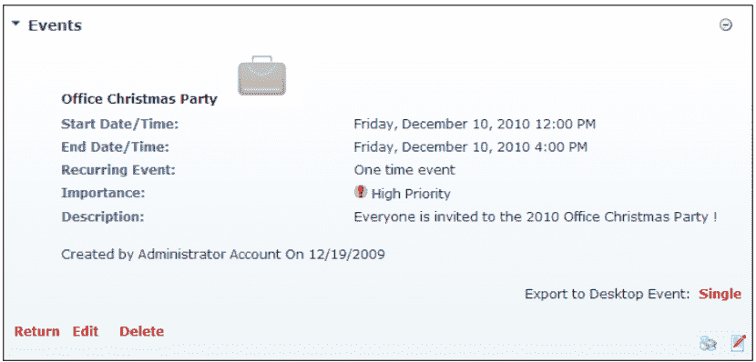

- 11. 点击 **Return** 关闭 Event 表单。

### There's more

通过在模块菜单下选择 **Settings**，您可以探索 Events 模块中的许多功能，这些功能允许人们报名参加活动或通过 PayPal 售票的能力。

## Creating a Wiki

Wiki 是一种特殊的发布内容方式，其中文章可以相互链接，读者可以获得编辑内容的权限。名称 Wiki 来自夏威夷语 *Quick*，而最著名的 Wiki 可能是 Wikipedia。本食谱将向您展示如何为您的 DNN 门户创建自己的 Wikipedia，主题不限。

在本示例中，我们将创建一个包含三个示例主题的小型 Wiki：

- Arduino
- Physical Computing
- Transduction

### Getting ready

要遵循本食谱，您必须在 DNN 站点上安装 Wiki 模块。有关说明，请参阅第 1 章 _Installing standard DNN modules_ 食谱。

### How to do it...

- 1. 以门户管理员身份登录（在我们的示例中为 sysadmin）。
- 2. 查看 Control Panel 并确保您处于 Edit 模式。
- 3. 导航到将容纳 **Wiki** 的页面。
- 4. 从 Control Panel 中，选择 **Common Tasks** 选项卡并从下拉列表中选择 **Wiki** 模块。
- 5. 从下拉列表中选择 **ContentPane** 并点击 **Add Module** 按钮。
- 6. 要创建我们的第一个主题，点击底部的 **Add** 链接以显示新页面：

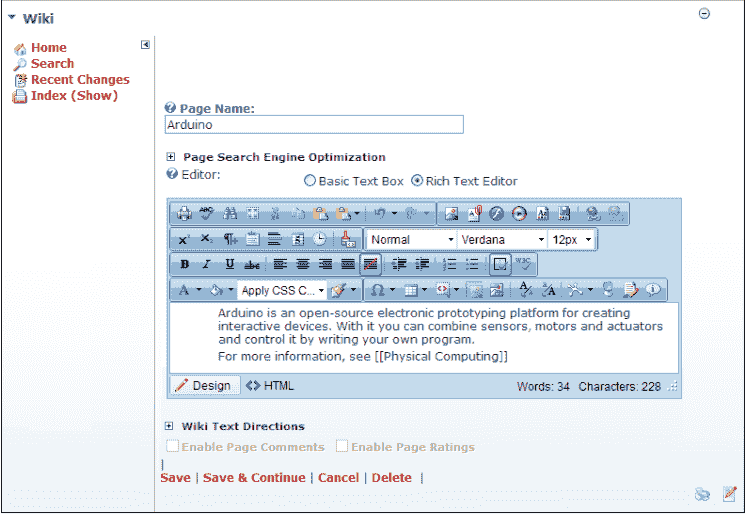


7. 填写以下信息：

- 页面名称：Arduino
- 在编辑器中：
  Arduino 是一个开源电子原型平台，用于创建交互式设备。通过它，你可以组合传感器、电机和执行器，并通过编写自己的程序来控制它。
  有关更多信息，请参阅 [[Physical Computing]]

8. 点击底部的保存。主题现在会显示出来，其中 Physical Computing 一词显示为超链接。

9. 点击新的 Physical Computing 链接。

10. 系统会自动创建一个新主题。点击“编辑”链接并提供以下内容：

- 页面名称：Physical Computing
- 在编辑器中：
  Physical Computing 是一个术语，描述将计算机连接到物理世界并赋予它感知和响应环境的能力的过程。
  物理计算背后的关键原理是 [[Transduction]]

11. 点击保存。

12. 点击新的 Transduction 链接，然后点击“编辑”以创建第三个主题：

- 页面名称：Transduction
- 在编辑器中：
  Transduction 是能量从一种形式转换为另一种形式的过程。麦克风就是转换的一个例子，因为它将声波转换为变化的电压。

## 现有模块的实用技巧

13. 点击**保存**。

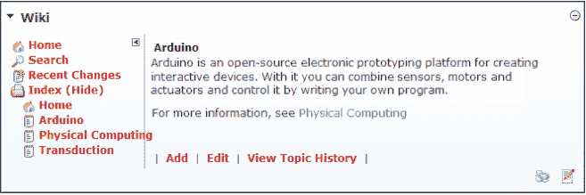

14. 点击左侧的**索引（显示）**以显示所有三个主题。你可以从显示的索引中选择主题，或点击主题本身显示的链接来选择主题。

15. 要直接向安全角色分配编辑权限，请将鼠标悬停在模块菜单上并选择**管理**。

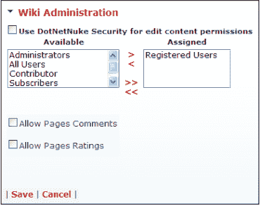

16. 取消选中**使用 DotNetNuke 安全**。

17. 选择可以编辑主题的安全角色。

18. 点击**>**链接将该角色分配给 Wiki。

19. 点击**保存**以保存更改。

## 工作原理...

DNN 中的 Wiki 实际上是通过超链接连接起来的主题集合。你可以在 Wiki 主题中，通过将目标页面名称放在双方括号（[[ 和 ]]）中来指定超链接。请确保括号中的页面名称与主题的实际页面名称一致，否则链接将无法工作。你还可以使用标签 [[Target Page Name|Caption]] 为链接指定不同的标题。例如，[[Physical Computing|点击此处查看物理计算]] 将创建一个指向 Physical Computing 主题的链接，但链接将显示“点击此处查看物理计算”。

## 发布热门链接集合

DNN 提供的一个非常有用的功能是链接模块。链接模块是你为用户提供的一组热门网站链接。这些链接不仅方便了用户，还可以作为收集统计数据的一种手段。

## 准备工作

要遵循本教程，你的 DNN 站点必须安装有“链接”模块。有关说明，请参阅第 1 章中的“安装标准 DNN 模块”教程。

## 操作步骤...

1. 以门户管理员身份登录（在我们的示例中为 `sysadmin`）。
2. 查看控制面板，确保你处于编辑模式。
3. 导航到将容纳链接列表的页面。
4. 在控制面板中，选择**常用任务**选项卡，然后从下拉列表中选择**链接**模块。
5. 从下拉列表中选择**内容窗格**，然后点击**添加模块**按钮。

## 现有模块的实用技巧

6. 点击**添加链接**链接。

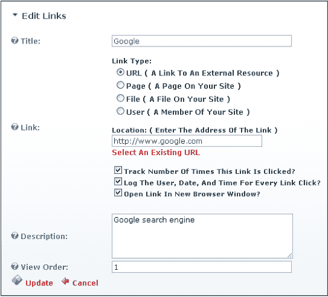

7. 按照上面的截图填写以下信息。
8. 点击**更新**以保存更改。
9. 返回链接列表，再次点击**添加链接**。

- **标题：** Digg
- **链接类型：** URL（指向外部资源的链接）
- **网址：** `http://www.digg.com`
- **跟踪此链接被点击的次数？** 已选中
- **记录每次链接点击的用户、日期和时间？** 已选中
- **在新浏览器窗口中打开链接？** 已选中
- **描述：** `Digg News`
- **查看顺序：** 2

10. 点击**更新**以保存更改。
11. 再次点击**添加链接**。

- **标题：** `I Can Has Cheezburger?`
- **链接类型：** URL（指向外部资源的链接）
- **网址：** `http://icanhascheezburger.com`

- 跟踪此链接被点击的次数？已选中
- 记录每次链接点击的用户、日期和时间？已选中
- 在新浏览器窗口中打开链接？已选中
- 描述：LOL Cats
- 查看顺序：3

12. 点击“更新”以保存更改。

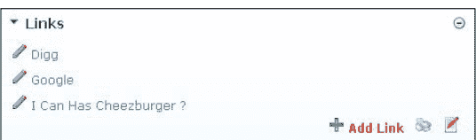

13. 如果要更改链接的显示方式，请将鼠标悬停在模块菜单上，然后选择“设置”。

14. 向下滚动，直到看到“链接设置”。

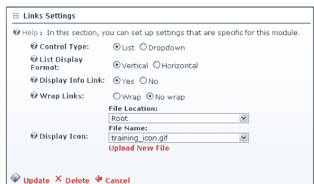

15. 通过选择以下选项，可以添加图像并随链接显示描述：

- 显示链接信息：是
- 显示图标：从下拉列表中选择 Root 和 training_icon.gif

16. 点击**更新**以保存对**设置**的更改。

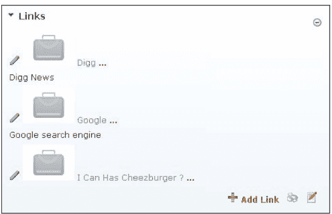

## 显示 RSS 新闻源

新闻源是一种频繁更新的信息来源，类似于由 Google 和 CNN 等网站发布的博客或新闻头条。DNN 提供了一个模块，可以在你的门户上显示来自互联网的新闻源。

这些源所采用的格式称为**真正简单的聚合（RSS）**，因此它们通常被称为 RSS 新闻源。

## 准备工作

要遵循本教程，你的 DNN 站点必须安装有“新闻源”模块。请参阅*安装标准 DNN 模块*教程（见*第1章*）的说明。

要使用 RSS 新闻源，你需要该源的网址（URL）。在本示例中，我们将显示来自名为 Digg 的热门技术新闻网站的新闻源。该源的 URL 是 http://feeds.digg.com/digg/container/technology/popular.rss。

```
http://feeds.digg.com/digg/container/technology/popular.rss
```

## 操作步骤...

1. 以门户管理员身份登录（在我们的示例中为 `sysadmin`）。
2. 查看控制面板，确保你处于编辑模式。
3. 导航到将容纳新闻源的页面。
4. 在控制面板中，选择**常用任务**选项卡，然后从下拉列表中选择**新闻源（RSS）**模块。

5. 从下拉列表中选择**内容窗格**，然后点击**添加模块**按钮。
6. 现在选择我们想要的源。点击**编辑新闻源**链接。
7. 这将显示**编辑新闻源（RSS）**页面，其中显示我们已拥有的任何源。点击**添加源**以创建新源。

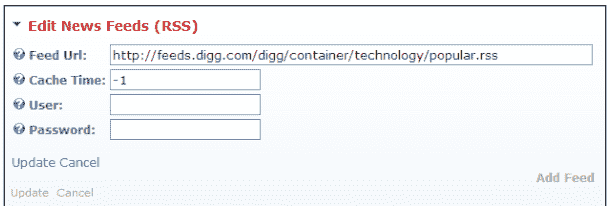

8. 按照上面的截图填写信息。
9. 点击**更新**以保存更改。

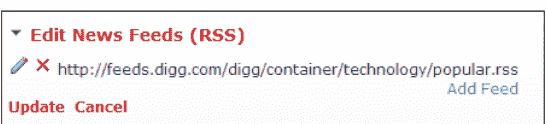

10. 现在新源出现在列表中。点击**更新**以保存更改并显示该源。
11. 你将看到一个简短的状态栏，然后新闻故事将出现在你的 DNN 页面上。

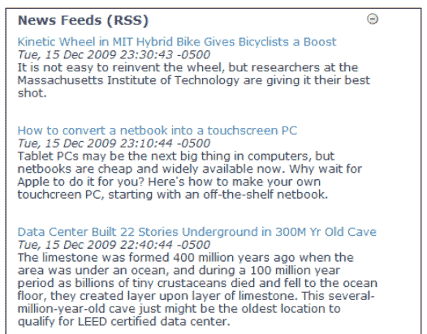

## 现有模块的实用技巧

## 工作原理...

RSS 实际上是一组用于聚合新闻故事的不同的 XML 格式。它通常包含故事的摘要以及指向全文的链接。DNN 的一个不错的功能是能够将多个源聚合到页面上的单个源中。只需使用**添加链接**来添加更多源。要在“新闻源”模块中显示源，该源必须符合 RSS 标准。

## 更多内容...

如果将模块放置在 DNN 页面的右侧或左侧，源通常看起来效果更好。可以尝试调整位置，看看在你的门户上哪种效果最佳。

## 配置 RSS 新闻源

在*显示 RSS 新闻源*教程中，我们了解了如何在 DNN 站点中显示 RSS 源。在本教程中，我们将了解如何配置“新闻源”模块，以控制源的格式化和显示方式。

## 准备工作

要遵循本教程，你的 DNN 站点必须安装有“新闻源”模块。有关说明，请参阅*第1章中的安装标准 DNN 模块*教程。你还必须完成上一教程：

- *显示 RSS 新闻源*

本教程将演示两个配置功能：

- 使用**设置**控制页面上显示的故事数量
- 使用 XSL 转换文件将源显示为新闻滚动条

## 操作步骤...

1. 以门户管理员身份登录（在我们的示例中为 `sysadmin`）。
2. 查看控制面板，确保你处于编辑模式。
3. 导航到包含上一教程中创建的新闻源的页面。


+   4. 要控制显示的故事数量，将鼠标悬停在模块菜单上，选择**设置**。

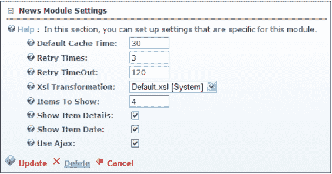

+   5. 向下滚动，直到看到名为**新闻模块设置**的部分。
+   6. 找到标记为**要显示的项目**的选项，在值中输入 4。
+   7. 点击**更新**以保存更改。
+   8. 现在，您的 DNN 页面上仅显示四条新闻故事。另一种显示订阅源的方式是沿 DNN 页面底部运行的新闻滚动条。要创建新闻滚动条：

+   - 将鼠标悬停在模块菜单上，选择**移动**，然后从子菜单中选择**移动到底部面板**。这会将模块放置到页面底部。

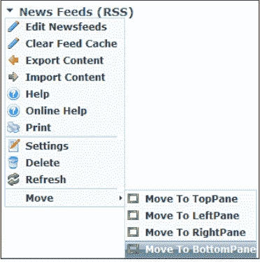

+   再次将鼠标悬停在模块菜单上，并从模块菜单中选择**设置**。

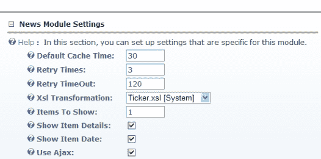

+   向下滚动，直到看到名为**新闻模块设置**的部分。

+   找到**XSL 转换**，并从下拉列表中选择 **Ticker.xsl [系统]**。

+   对于**要显示的项目**，输入 1。

+   点击**更新**。

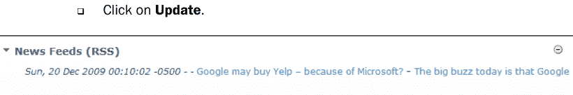

## 更多内容...

如果您有喜欢的新闻订阅源，但发现它无法使用新闻订阅模块正确显示，您可以通过使用 XML/XSL 模块和类似的 XSL 转换文件来更好地控制订阅源的显示方式。要了解更多信息，请参阅第十章中的*显示 XML 订阅源*食谱。

## 发布简单报告

DNN 提供了一个优秀的报告模块，可以使用**结构化查询语言（SQL）**从数据库中查询信息，并将结果显示在 DNN 页面上。要有效使用报告模块，您需要了解 SQL 查询语言的基础知识，并知道数据库中要使用哪些表。

## 操作步骤...

+   1. 以门户管理员身份登录（在我们的示例中是 sysadmin）。
+   2. 查看控制面板，确保您处于编辑模式。
+   3. 导航到将放置调查的页面。
+   4. 从控制面板中，选择“常见任务”选项卡，并从下拉列表中选择“调查”模块。
+   5. 从下拉列表中选择 ContentPane，然后点击“添加模块”按钮。
+   6. 点击“添加问题”链接。

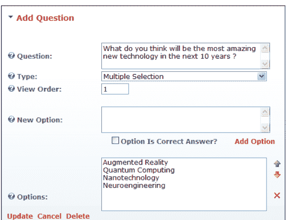

+   7. 填写以下信息：
+     - 问题：您认为未来十年最令人惊叹的新技术是什么？
+     - 类型：选择“多项选择”
+     - 查看顺序：1
+     - 新选项：增强现实

+   8. 重复此步骤以创建另外三个选项：
+     - 量子计算
+     - 纳米技术
+     - 神经工程

## 现有模块的简单技巧

+   9. 点击**更新**以保存您的调查。

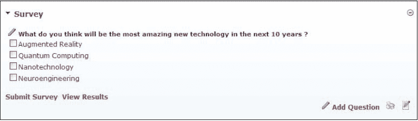

+   10. 勾选**增强现实**和**量子计算**复选框，然后点击**提交调查**。

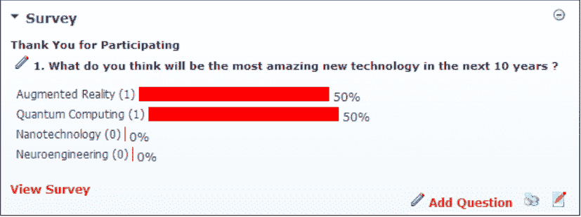

+   11. 您现在将看到所有调查响应的图表。随着更多响应的提交，图表将发生变化。

## 更多内容...

如果您希望调查只允许单一答案（单选按钮而不是复选框），请选择**单项选择**作为您的**调查类型**。

对于测试，您还可以指定正确答案。

## 4
