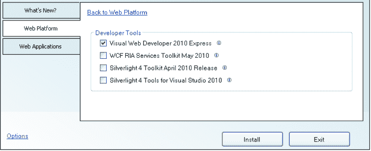
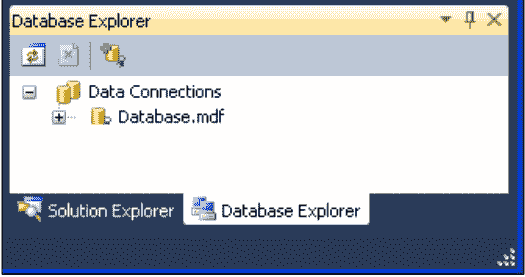
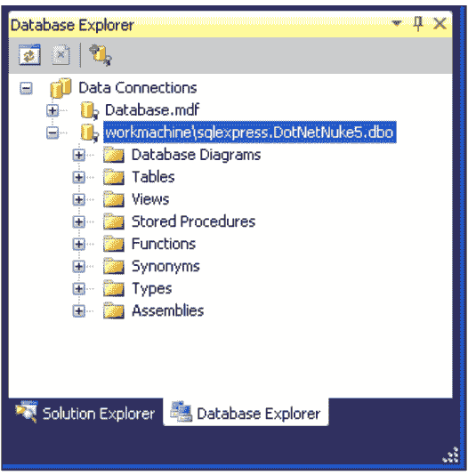
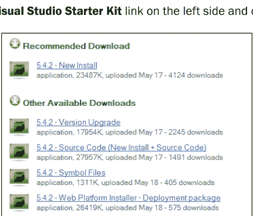
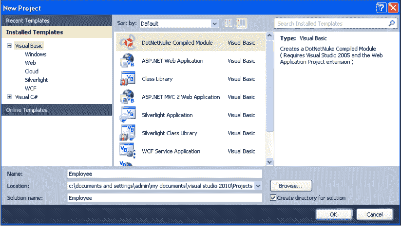
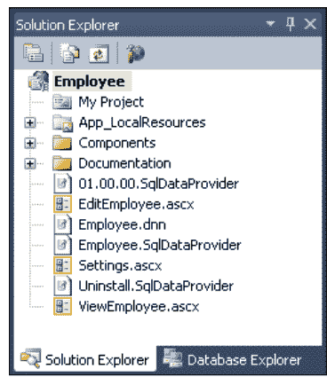
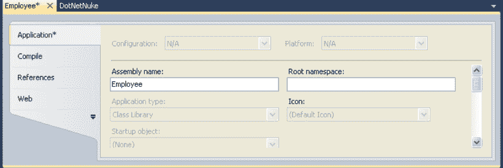
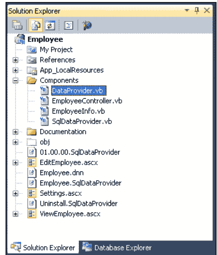

## 创建自己的模块

在本章中，我们将涵盖以下主题：

+   - 安装 Visual Web Developer 2010 Express
+   - 从 Web Developer 查看数据库
+   - 安装 DNN 5 Starter Kit
+   - 使用 Starter Kit 创建新模块
+   - 创建带键的数据库表
+   - 创建存储过程
+   - 将模块连接到数据库
+   - 创建卸载脚本

## 简介

前面的章节介绍了 DNN，并展示了如何将现有模块添加到您的 DNN 站点。在本章中，我们将展示如何下载和安装开始编写您自己的 DNN 模块所需的工具。我们还将展示如何通过使用 DNN Starter Kit 创建模块以及将其连接到数据库所需的步骤来快速入门。

## 安装 Visual Web Developer 2010 Express

在本食谱中，我们将下载并安装 Visual Web Developer 2010 Express——免费的 .NET 开发工具。

## 准备工作

要遵循本食谱，您必须先完成*第一章*中的*下载 Microsoft Web Platform Installer* 食谱。

## 操作步骤...

+   1. 首先启动 Microsoft Web Platform Installer。
+   2. 当显示可用产品列表时，点击**Web Platform**选项卡。
+   3. 在**工具**部分下，点击**自定义**链接。



+   4. 确保选择了以下产品：
+      - **Visual Web Developer 2010 Express**
+   5. 点击**安装**按钮开始安装。
+   6. 下一个对话框将列出您正在下载的文件，并提示**我拒绝**或**我接受**。点击**我接受**。
+   7. Web Platform 安装将开始。您可能会被提示一次或多次重启。点击**是**重启您的机器，安装将在重启后自动继续。
+   8. 当安装完成并显示**恭喜**屏幕时，点击**完成**。

+   9. 点击**退出**关闭 Web Platform Installer。
+   10. 要确认安装成功，请查看**开始菜单 | 所有程序**，**Microsoft Visual Web Developer 2010 Express Edition** 应该出现在 `Microsoft Visual Studio 2010 Express` 文件夹下。

## 另请参阅

完成本食谱后，您就拥有了开始编程的工具，但要开发 DNN 模块，您还需要完成*安装 DNN 5 Starter Kit* 食谱。

## 从 Web Developer 查看数据库

由于您将在 Visual Web Developer 中花费大量时间，因此创建数据库连接以查看您的模块将使用的表、视图和存储过程是非常有用的。

## 准备工作

要遵循本食谱，您需要已安装 Visual Web Developer，并且能够访问运行您的 DNN 站点的本地数据库。

## 操作步骤...

+   1. 首先启动您偏好的开发工具（Visual Studio 或 Visual Web Developer Express）。
+   2. 在**视图**菜单下，选择**数据库资源管理器**（在 Visual Studio 中为**解决方案资源管理器**）。这将显示您拥有的任何数据库连接。



+   8. 对于**用户名**和**密码**，使用创建数据库时使用的用户名和密码（在*第一章*中为 `DNN5User` 和 `DNN5User2010`）。
+   9. 勾选**保存我的密码**。
+   10. 在**连接到数据库**部分，选择您安装 DNN 时创建的 DotNetNuke 数据库名称（在这些示例中为 DotNetNuke5）。
+   11. 点击**测试连接**按钮。
+   12. 如果您没有看到**测试连接成功**的消息，请检查您是否为您的站点输入了正确的服务器名称和 DNN 数据库名称。
+   13. 点击**确定**以创建数据库连接。



14. 您的 DNN 数据库现在将出现在**数据库资源管理器**窗口中。在该数据库下，您将看到您的 DNN 安装中的表、视图和存储过程。

## 安装 DNN 5 Starter Kit

在本食谱中，我们将下载并安装 DNN 5 Starter Kit。Starter Kit 将仅根据模块名称生成一个近乎完整的 DNN 模块。它创建的模块仍需要编辑，但会为我们节省大量输入工作。

## 准备工作

Starter Kit 需要 Visual Studio 或 Visual Web Developer Express Edition。要为您的开发环境安装 Visual Web Developer 2010 Express，请参阅之前的食谱“安装 Visual Web Developer 2010 Express”。

## 操作步骤...

+   1. 转到 http://dotnetnuke.codeplex.com。
+   2. 点击页面顶部的“下载”选项卡。
+   3. 在左侧查找“Visual Studio Starter Kit”链接，然后点击该链接。



+   4. 当提示许可条款时，点击“我同意”。


## 使用 Starter Kit 创建新模块

在本教程中，我们将演示如何创建你的第一个 DNN 模块。我们将创建一个简单的模块，用于在 DNN 数据库中存储员工信息。

## 准备工作

要创建你的第一个 DNN 模块，你必须完成前面两个教程：
- 安装 Visual Web Developer 2010 Express
- 安装 DNN 5 Starter Kit

我们将使用 Visual Web Developer，但该过程在 Visual Studio 中几乎相同。

## 操作步骤...

1. 启动你首选的开发工具（Visual Studio 或 Visual Web Developer Express）。
2. 在**文件**菜单下，选择**新建项目...**
3. 在**新建项目**对话框中，在**我的模板**下查找，然后选择 **DotNetNuke Compiled Module** 作为模板。如果你在模板中没有看到 DotNetNuke，请参阅前面的教程 *安装 DNN 5 Starter Kit*。
4. 为项目名称和**解决方案名称**键入 **Employee**。



5. 单击**确定**以创建项目。



6. 在开始之前，我们需要进行一个快速配置更改。屏幕右上角是**解决方案资源管理器**。找到标记为 **Employee** 的第一个图标，然后右键单击它以显示弹出菜单。
7. 从弹出菜单中选择**属性**。
8. 清空名为**根命名空间**的字段。



9. 在**文件**菜单下，选择**全部保存**以保存更改。

## 工作原理...

选择一个好的模块名称非常重要。Starter Kit 会使用模块名称来创建过程和生成代码。要为模块选择名称，请确定模块最重要的功能是什么，并用一个单数单词来描述它。例如，*Employee* 就是一个很好的名称，适合用于跟踪公司员工的模块。

## 更多内容...

在本示例中，我们保持简单，将模块命名为 **Employee**。在专业的开发环境中，更好的做法是将你的公司名称或缩写作为模块名称的前缀（例如 `YourCompany.Employee`）。这可以防止来自不同公司但恰好同名的两个模块之间发生冲突。

## 另请参阅

项目向导会创建模块所需的文件，但在项目部署到 DNN 站点之前，你必须编辑这些文件。请参阅本章中的其他教程，以创建表、存储过程和必要的代码更改。

## 创建带有键的数据库表

由于 DNN 是一个由数据库驱动的**内容管理系统（CMS）**，你的模块很可能会包含一个或多个数据库*表*。数据库表用于保存模块的信息。与电子表格类似，表由称为 `Fields` 的列和称为 `Records` 的行组成。由于我们正在创建一个名为 **Employee** 的模块，因此表中的字段将保存员工信息，例如名字和姓氏。表中的每条记录将保存一名员工。

数据库表比简单电子表格更强大的一个功能是，它能够自动验证记录中的信息。例如，表中的每条员工记录都有一个唯一值来标识该记录（称为 `Item ID`），这一点非常重要。数据库可以通过 `PRIMARY KEY`（主键）来强制执行该唯一值（之所以这样命名，是因为 `Item ID` 是员工记录最重要的键）。

幸运的是，Starter Kit 已经创建了用于创建 `Employee` 表和必要键的代码。在 Employee 项目中，你会找到一个名为 `01.00.00.SqlDataProvider` 的脚本。该创建脚本在模块部署到 DNN 站点时运行，它负责创建模块所需的表、视图、键和存储过程。

## 准备工作

在本教程中，我们将修改创建脚本，以创建一个名为 Employee 的表以及必要的键。该脚本会在部署模块时创建表，你也可以直接将脚本内容复制并粘贴到数据库中，以便在开发时就能让表存在。

要跟进本教程，你必须已完成之前的教程“使用 Starter Kit 创建新模块”。

## 操作步骤...

1. 首先，启动你首选的开发工具（Visual Studio 或 Visual Web Developer Express）。
2. 在屏幕左侧找到“最近项目”。单击 Employee 以加载项目。
3. 在屏幕右侧的解决方案资源管理器中，双击 01.00.00.SqlDataProvider。这将在编辑器中显示创建脚本。
4. 在文件的最顶部，你会看到 CREATE TABLE 部分。Starter Kit 向导已经创建了一条单独的 CREATE TABLE 语句，以及一个 PRIMARY KEY、一个索引和一个指向标准 DNN 模块表的外键。向导生成的脚本如下所示：

```
/** Create Table **/

if not exists (select * from dbo.sysobjects where id = object_id(N'{databaseOwner} [{objectQualifier} YourCompany_Employee]') and OBJECTPROPERTY(id, N'IsTable') = 1)
BEGIN
    CREATE TABLE
        {databaseOwner} [{objectQualifier}YourCompany_Employee]
    (
        [ModuleID] [int] NOT NULL,
        [ItemID] [int] NOT NULL IDENTITY(1, 1),
        [Content] [ntext] NOT NULL,
        [CreatedByUser] [int] NOT NULL,
        [CreatedDate] [datetime] NOT NULL
    )

    ALTER TABLE {databaseOwner}
    [{objectQualifier}YourCompany_Employee]
        ADD CONSTRAINT [PK_{objectQualifier}YourCompany_Employee] PRIMARY KEY CLUSTERED ([ItemID])
    CREATE NONCLUSTERED INDEX
        [IX_{objectQualifier}YourCompany_Employee]
```

```
ON {databaseOwner}][{objectQualifier}
YourCompany_Employee] ([ModuleID])

ALTER TABLE {databaseOwner}
  [{objectQualifier}YourCompany_Employee] WITH NOCHECK ADD
CONSTRAINT [FK_{objectQualifier}
YourCompany_Employee_{objectQualifier} Modules] FOREIGN
KEY ([ModuleID]) REFERENCES {databaseOwner}
  [{objectQualifier}Modules] ([ModuleID]) ON DELETE CASCADE
NOT FOR REPLICATION
END
GO
```

5. 我们需要做的第一件事是更改脚本中的 YourCompany 文本。你可以将 YourCompany 替换为你实际的公司名称或其缩写。我们可以通过简单的查找和替换来完成——在编辑菜单下，查看“查找和替换”，然后选择“快速替换”（或直接按 Ctrl+H）。
6. 出现提示时：
   - 查找内容：YourCompany
   - 替换为：ACME
   - 范围：当前文档
7. 单击“全部替换”。
8. 接下来，我们将所需的字段添加到表中。向导将 Content 作为单个字段。我们将用我们自己的字段名替换 Content。将单行 [Content] [ntext] NOT NULL, 替换为以下六行：

```
[EmpFirstName] [nvarchar] (30) NOT NULL,
[EmpLastName] [nvarchar] (30) NOT NULL,
[ManagerNo] [int] NULL,
[HireDate] [datetime] NOT NULL,
[Salary] [float] NOT NULL,
[DeptNo] [int] NOT NULL,
```

9. 我们的建表代码现在应该如下所示：

```
/** Create Table **/

if not exists (select * from dbo.sysobjects where id =
object_id(N'{databaseOwner}][{objectQualifier}ACME_Employee]')
and OBJECTPROPERTY (id, N'IsTable') = 1)
BEGIN
CREATE TABLE {databaseOwner}][{objectQualifier}ACME_Employee]
(
[ModuleID] [int] NOT NULL,
[ItemID] [int] NOT NULL IDENTITY(1, 1),
[EmpFirstName] [nvarchar] (30) NOT NULL,
```

使用存储过程而不是直接在项目代码中编写 SQL，有几个原因。首先，存储过程通常性能更好；其次，与硬编码的 SQL 相比，代码更易于维护，并且我们能受益于更强的封装性。如果代码只处理数据库表和记录，那么将其保留在数据库中是有意义的。

在本教程中，我们将演示如何修改向导生成的代码，以执行模块所需的实际添加、更新和删除操作。

## 准备工作

要跟进本教程，你必须已完成以下之前的教程：
- 使用 Starter Kit 创建新模块
- 创建带有键的数据库表

> 在本教程中，我们将再次查找并替换 YourCompany 短语的所有出现。如果你已经按照之前的教程操作，这一步已经完成，你可以直接跳到第 8 步。

## 操作步骤...

1. 首先，启动你首选的开发工具（Visual Studio 或 Visual Web Developer Express）。
2. 在屏幕左侧找到“最近项目”。单击 Employee 以加载项目。
3. 在屏幕右侧的解决方案资源管理器中，双击 01.00.00.SqlDataProvider。这将在编辑器中显示创建脚本。
4. 向下滚动，越过脚本中的 CREATE TABLE 部分，直到你看到“Drop Existing Stored Procedures”。

```
/** Drop Existing Stored Procedures **/

if exists (select * from dbo.sysobjects where id = object_id(N'{databaseOwner} [{objectQualifier} YourCompany_GetEmployees]') and OBJECTPROPERTY (id, N'IsProcedure') = 1)
    drop procedure {databaseOwner} {objectQualifier} YourCompany_GetEmployees
GO

if exists (select * from dbo.sysobjects where id = object_id(N'{databaseOwner} [{objectQualifier} YourCompany_GetEmployee]') and OBJECTPROPERTY (id, N'IsProcedure') = 1)
```


## 创建自己的模块

+   15. 将第二部分改为：

```
values (
    @ModuleId,
    @EmpFirstName,
    @EmpLastName,
    @ManagerNo,
    @HireDate,
    @Salary,
    @UserID,
    getdate()
)
```

+   16. 因此整个存储过程应为：

```
create procedure {databaseOwner}{objectQualifier}
                         ACME_AddEmployee

    @ModuleId       int,
    @EmpFirstName   nvarchar(30),
    @EmpLastName    nvarchar(30),
    @ManagerNo      int,
    @HireDate       datetime,
    @Salary         float,
    @UserID         int

as

insert into {objectQualifier}_Employee (
    ModuleId,
    EmpFirstName,
    EmpLastName,
    ManagerNo,
    HireDate,
    Salary,
    CreatedByUser,
    CreatedDate
)
values (
    @ModuleId,
    @EmpFirstName,
    @EmpLastName,
    @ManagerNo,
    @HireDate,
    @Salary,
    @UserID,
    getdate()
```

)

```
GO
```

17. 下一个存储过程 ACME_UpdateEmployee 类似，因此我们有两个地方需要进行更改。将五个字段添加到存储过程的参数列表中，然后将五个字段添加到更新语句中。存储过程现在应如下所示：

```
create procedure
{databaseOwner}.{objectQualifier}ACME_UpdateEmployee

@ModuleId          int,
@ItemId            int,
@EmpFirstName      nvarchar(30),
@EmpLastName       nvarchar(30),
@ManagerNo         int,
@HireDate          datetime,
@Salary            float,
@UserID            int

as

update {objectQualifier}ACME_Employee
set    EmpFirstName   = @EmpFirstName,
       EmpLastName    = @EmpLastName ,
       ManagerNo      = @ManagerNo,
       HireDate       = @HireDate,
       Salary         = @Salary,
       CreatedByUser  = @UserID,
       CreatedDate    = getdate()
where  ModuleId = @ModuleId
and    ItemId = @ItemId

GO
```

18. 最后的存储过程 ACME_DeleteEmployee 无需修改，因为它不引用任何字段。

## 其工作原理...

DNN 中的模块遵循 Microsoft 的 N-Tier 架构。这是一种将应用程序逻辑与业务和数据库逻辑分离的机制。在本教程中，我们构建了数据库层的存储过程。

> 你可以从 David Chappell 和 Steve Kirk 的这篇优秀文章中了解更多关于 N-Tier 架构的信息，网址为 http://msdn.microsoft.com/en-us/library/ms978384.aspx。

## 还有更多...

创建存储过程后，为新模块的最后一步是将其连接到数据库。教程《将模块连接到数据库》演示了如何创建支持数据库和业务逻辑层的过程。

## 将模块连接到数据库

要将向导生成的代码连接到模块的数据库表，我们必须遍历项目代码并用我们的字段和数据类型替换名为 Content 的占位符。

## 准备工作

要跟随本教程，你必须已完成以下先前的教程：

-   - 使用 Starter Kit 创建新模块
-   - 创建带键的数据库表
-   - 创建存储过程

## 如何操作...

-   1. 首先启动你喜欢的开发工具（Visual Studio 或 Visual Web Developer Express）。
-   2. 在屏幕左侧查找“最近的项目”。点击 Employee 以加载项目。
-   3. 在屏幕右侧查看“解决方案资源管理器”，展开名为 Components 的文件夹并双击 DataProvider.vb。



4. 滚动到文件底部并查找名为 Abstract methods 的代码区域。我们必须在这两个地方用实际的字段名替换占位符 Content。将代码改为：

```
#Region "Abstract methods"

Public MustOverride Function GetEmployees(ByVal ModuleId As Integer) As IDataReader
Public MustOverride Function GetEmployee(ByVal ModuleId As Integer,ByVal ItemId As Integer) As IDataReader
Public MustOverride Sub AddEmployee(ByVal ModuleId As Integer, ByVal EmpFirstName As String, ByVal EmpLastName As String, ByVal ManagerNo As Integer, ByVal HireDate As Datetime, ByVal Salary As Double, ByVal UserId As Integer)
Public MustOverride Sub UpdateEmployee(ByVal ModuleId As Integer, ByVal ItemId As Integer, ByVal EmpFirstName As String, ByVal EmpLastName As String, ByVal ManagerNo As Integer, ByVal HireDate As Datetime, ByVal Salary As Double, ByVal UserId As Integer)
```

## 创建自己的模块

```
```vb
Public MustOverride Sub DeleteEmployee(ByVal ModuleId As
                                        Integer,ByVal ItemId As
Integer)

#End Region
```
```

-   5. 现在我们在下一个文件中重复该过程。双击 `SqlDataProvider.vb` 并滚动到文件底部的 Public Methods 区域。我们需要在两个参数列表和两个参数列表中更改代码：

```
```vb
#Region "Public Methods"

Public Overrides Function GetEmployees(ByVal ModuleId As
                                       Integer) As IDataReader
    Return CType(SqlHelper.ExecuteReader(ConnectionString,
                         GetFullyQualifiedName("GetEmployees"),
                         ModuleId), IDataReader)
End Function

Public Overrides Function GetEmployee(ByVal ModuleId As
    Integer, ByVal ItemId As Integer) As IDataReader
    Return CType(SqlHelper.ExecuteReader(ConnectionString,
                         GetFullyQualifiedName("GetEmployee"), ModuleId,
                         ItemId), IDataReader)
End Function

Public Overrides Sub AddEmployee(ByVal ModuleId As
    Integer, ByVal EmpFirstName As String,
    ByVal EmpLastName As String, ByVal ManagerNo As
                                             Integer,
    ByVal HireDate As DateTime,
    ByVal Salary As Double, ByVal UserId As Integer)
    SqlHelper.ExecuteNonQuery(ConnectionString,
                GetFullyQualifiedName("AddEmployee"),
                ModuleId, EmpFirstName,
                EmpLastName, ManagerNo, HireDate,
                Salary, UserId)
End Sub

Public Overrides Sub UpdateEmployee(ByVal ModuleId As
                                    Integer, ByVal ItemId As Integer,
                                    ByVal EmpFirstName As String,
                                    ByVal EmpLastName As String,
                                    ByVal ManagerNo As Integer,
                                    ByVal HireDate As DateTime,
                                    ByVal Salary As Double,
                                    ByVal UserId As Integer)
    SqlHelper.ExecuteNonQuery(ConnectionString,
                GetFullyQualifiedName("UpdateEmployee"),
                ModuleId, ItemId, EmpFirstName,
                EmpLastName, ManagerNo, HireDate,
```

8. 到目前为止一切顺利。现在我们需要在两个地方更新 EmployeeInfo 文件。双击 EmployeeInfo.vb 并向下滚动一点到本地属性声明部分。

9. 将包含 Content 的一行改为我们字段的五行：

```
' local property declarations
Private _ModuleId As Integer
Private _ItemId As Integer
Private _EmpFirstName As String
Private _EmpLastName As String
Private _ManagerNo As Integer
Private _HireDate As DateTime
Private _Salary As Double
Private _CreatedByUser As Integer
Private _CreatedDate As DateTime
Private _CreatedByUserName As String
```

10. 在文件的其余部分，我们需要再次删除 Content 属性并用我们的五个字段替换它。向下滚动并找到包含 Content 属性的部分。现在将代码改为我们的五个属性过程：

```
Public Property ItemId() As Integer
    Get
        Return _ItemId
    End Get
    Set(ByVal Value As Integer)
        _ItemId = Value
    End Set
End Property
```

```
Public Property EmpFirstName() As String
    Get
        Return _EmpFirstName
    End Get
    Set(ByVal Value As String)
        _EmpFirstName = Value
    End Set
End Property
```

```
Public Property EmpLastName() As String
    Get
        Return _EmpLastName
    End Get
    Set(ByVal Value As String)
        _EmpLastName = Value
    End Set
End Property
```


```
End Property

Public Property ManagerNo() As Integer
    Get
        Return _ManagerNo
    End Get
    Set(ByVal Value As Integer)
        _ManagerNo = Value
    End Set
End Property

Public Property HireDate() As Datetime
    Get
        Return _HireDate
    End Get
    Set(ByVal Value As Datetime)
        _HireDate = Value
    End Set
End Property

Public Property Salary() As Double
    Get
        Return _Salary
    End Get
    Set(ByVal Value As Double)
        _Salary = Value
    End Set
End Property

Public Property CreatedByUser() As Integer
    Get
        Return _CreatedByUser
    End Get
    Set(ByVal Value As Integer)
        _CreatedByUser = Value
    End Set
End Property
```

11. 从文件菜单中选择保存全部以保存项目文件。

# 创建自己的模块

# 其工作原理...

完成本菜谱将创建数据库和业务逻辑层使用的过程。使用过程连接到数据库可以使我们的代码无需直接使用 SQL 调用数据库。它提供了数据库逻辑和业务逻辑的更好分离。

# 创建卸载脚本

当 Starter Kit 创建一个模块时，它还会构建一个在从 DNN 卸载模块时运行的卸载脚本。该脚本负责删除模块创建的所有内容：存储过程、数据库、视图、表等。

在本菜谱中，我们将使用 Starter Kit 创建的卸载脚本，并将公司名称更改为与安装脚本中使用的公司名称相匹配。

# 准备工作

要跟随本菜谱，你必须已完成上一菜谱 _使用 Starter Kit 创建新模块_

# 如何操作...

+   1. 首先启动你喜欢的开发工具（Visual Studio 或 Visual Web Developer Express）。
+   2. 在屏幕左侧查找 **最近项目**。点击 **Employee** 以加载项目。
+   3. 在屏幕右侧查看 **解决方案资源管理器**，双击 `Uninstall.SqlDataProvider`。这将在编辑器中显示卸载脚本。
+   4. 我们需要做的唯一事情就是更改脚本中的文本 `YourCompany_`。不要使用 `YourCompany`，你可以放置你的实际公司名称或缩写。我们通过简单的查找和替换来完成此操作——在 **编辑** 菜单下，查找 **查找和替换** 并选择 **快速替换**（或直接按 _Ctrl+H_）。
+   5. 提示时：
+      - **查找内容：** `YourCompany`
+      - **替换为：** `ACME`
+      - **查找范围：** `当前文档`
+   6. 点击 **全部替换**。

7. 脚本现在应如下所示：

```
/* ************************************************************ */
/*****              SqlDataProvider              *****/
/*****                                            *****/
/*****                                            *****/
/***** Note: To manually execute this script you must      *****/
/*****       perform a search and replace operation        *****/
/*****       for {databaseOwner} and {objectQualifier}     *****/
/*****                                            *****/
/**************************************************************/

/** Drop FAQs Table **/

ALTER TABLE {databaseOwner}[{objectQualifier}ACME_Employee] DROP CONSTRAINT [FK_{objectQualifier}Employee_{objectQualifier}Modules]
GO

ALTER TABLE {databaseOwner}[{objectQualifier}ACME_Employee] DROP CONSTRAINT [PK_{objectQualifier}ACME_Employee]
GO

DROP INDEX {databaseOwner}[{objectQualifier}ACME_Employee].[IX_{objectQualifier}ACME_Employee]
GO
DROP TABLE {databaseOwner}[{objectQualifier}ACME_Employee]
GO

/** Drop Stored Procedures **/

DROP PROCEDURE {databaseOwner}[{objectQualifier}ACME_GetEmployees]
GO

DROP PROCEDURE {databaseOwner}[{objectQualifier}ACME_GetEmployee]
GO

DROP PROCEDURE {databaseOwner}[{objectQualifier}ACME_AddEmployee]
GO

DROP PROCEDURE {databaseOwner}[{objectQualifier}ACME_UpdateEmployee]
GO

DROP PROCEDURE {databaseOwner}[{objectQualifier}ACME_DeleteEmployee]
```

GO

```
/*************************************************/
/*****          SqlDataProvider          *****/
/*************************************************/
```

+   8. 从 **文件** 菜单中选择 **全部保存** 以保存你的更改。

# 其工作原理...

保持卸载脚本与安装脚本同步非常重要。如果你在模块中添加表或存储过程，你必须记住在模块卸载时提供删除它们的代码。
