# 构建、调试和部署模块

在本章中我们将介绍以下主题：

+   - 构建视图控件
+   - 构建编辑控件
+   - 编辑清单文件
+   - 为发布或调试而构建
+   - 将模块作为独立包部署
+   - 下载 DNN 5 源代码
+   - 设置调试环境
+   - 为调试准备模块
+   - 设置断点并逐步执行模块代码
+   - 从已安装的模块创建清单

# 简介

在上一章中我们看到了如何安装 Web Developer Express 并开始创建自定义模块。在本章中，我们将看到如何创建可工作的 *View* 和 *Edit* 控件，如何部署自定义模块以及如何为模块调试配置开发工具。

# 开发工具

本章及后续章节中的菜谱在使用 Visual Studio 2008 或 Visual Web Developer Express 2010 时效果相同。你可以使用你更熟悉或可用的工具。在这些示例中我们将使用 Web Developer Express，但为了方便，我们在指 Visual Studio 或 Web Developer 时使用术语开发工具。

# WAP 与 WSP

构建自定义模块有两种方法。采用哪种方法取决于你的需求：

+   - 你可以将其构建为 Web 应用程序项目（WAP）。如果只是想编码、构建和部署项目，这是不错的选择。本章最后描述了这种方法。
+   - 你可以将模块代码与 DNN 源代码放在一起，并将网站构建为一个 Web 站点项目（WSP）。这提供了设置断点并逐步执行模块代码的能力。这种方法在本章末尾演示。

# DNN 中的控件

在正式开始之前，这里是对我们想要完成的工作的快速概述。当我们在 DNN 中谈论模块开发时，我们实际上是在谈论四个关键部分：

+   - 用户控件：这些是模块的用户界面元素。它们将根据你在 DNN 门户中查看模块的哪一部分而动态放置在页面的上。在本章的示例中，首先显示的是 View 用户控件。点击员工记录时显示 Edit 控件，点击设置链接时显示 Settings 控件。
+   - 程序集：用户控件背后的代码（*.vb 文件）在构建 Employee 项目时会被编译成程序集（DLL 文件）。部署模块时，程序集将被放置在门户的 /bin 文件夹中。
+   - 数据库脚本：如上一章所见，模块依赖数据库表来保存信息。作为模块的一部分，你将有一个安装脚本来创建模块数据库表，以及一个在模块卸载时删除它们的卸载脚本。
+   - 模块清单：一个 XML 文件，告诉 DNN 模块应如何安装。在 DNN 版本五中，清单可以包含发行说明和许可协议。

## #构建视图控件

尽管 DNN 模块在控件的数量和种类上有所不同，但一种常见的方法（也是 Starter Kit 生成的方法）包含三个用户控件：

+   - 视图控件：用于在 DNN 页面上显示模块
+   - 编辑控件：用于编辑模块数据
+   - 设置控件：用于更改模块的设置

当你在页面上放置 DNN 模块时，模块的视图控件负责显示模块的初始状态。在本菜谱中，我们将查看 Starter Kit 创建的视图控件并扩展它以包含示例员工表的字段。

我们将创建的视图控件将像这样显示表中的所有员工记录：

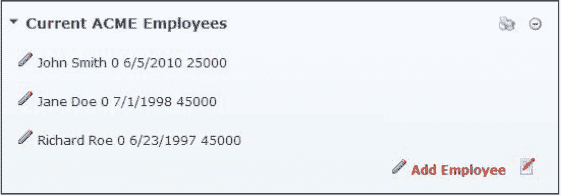

### ####准备工作

要跟随本菜谱，你必须已完成 *第 4 章* 中的以下菜谱：

+   - *使用 Starter Kit 创建新模块*

### ####如何操作...

+   1. 首先启动你喜欢的开发工具（Visual Studio 或 Visual Web Developer Express）。
+   2. 在屏幕左侧查找最近项目。点击 **Employee** 以加载项目。
+   3. 双击打开 `ViewEmployee.ascx` 文件。


4. 当模块显示时，它会显示 Employee 表中的 Employee 记录。Starter Kit 已为我们提供了一个 datalist 控件，用于从数据库中显示记录。我们需要将我们的 Employee 字段放入此控件中。我们通过用我们五个字段的标签控件替换 lblContent 标签控件来实现。

```
<%@ Control language="vb"
    Inherits="YourCompany.Modules.Employee.ViewEmployee"
    AutoEventWireup="false" Explicit="True"
    Codebehind="ViewEmployee.ascx.vb" %>
<%@ Register TagPrefix="dnn" TagName="Audit"
    Src="~/controls/ModuleAuditControl.ascx" %>
<asp:datalist id="lstContent" datakeyfield="ItemID" runat="server" cellpadding="4">
<itemtemplate>
<table cellpadding="4" width="100%">
<tr>
<td valign="top" width="100%" align="left">
<asp:HyperLink ID="HyperLink1" NavigateUrl='<%# EditURL("ItemID",DataBinder.Eval(Container.DataItem,"ItemID")) %>' Visible="<%# IsEditable %>" runat="server"><asp:Image ID="Image1" Runat=server ImageUrl="~/images/edit.gif" AlternateText="Edit" Visible="<%#IsEditable%>" resourcekey="Edit"/></asp:hyperlink>
<asp:Label ID="lblEmpFirstName" runat="server" CssClass="Normal"/>
<asp:Label ID="lblEmpLastName" runat="server" CssClass="Normal"/>
<asp:Label ID="lblManagerNo" runat="server" CssClass="Normal"/>
<asp:Label ID="lblHireDate" runat="server" CssClass="Normal"/>
<asp:Label ID="lblSalary" runat="server" CssClass="Normal"/>
</td>
</tr>
</table>
</itemtemplate>
</asp:datalist>
```

5. 接下来我们必须添加代码来填充 datalist 控件。双击打开 ViewEmployee.ascx.vb 文件（如果在 Solution Explorer 中看不到它，请单击 Solution Explorer 工具栏上的显示所有文件图标——从左数第二个）。

> datalist 控件是 DNN Web 控件库的一部分。它会从数据库中显示记录，但我们必须告诉它要显示表中的哪些字段。

6. 滚动到 Starter Kit 创建的 `Page_Load` 过程。该过程调用 `GetEmployees` 函数来提取 employee 表中的所有员工并将结果绑定到 `datalist` 控件。我们希望更改代码，以便只有在找到某些员工时才绑定。所以找到下面突出显示的行：

```
Private Sub Page_Load(ByVal sender As System.Object,
                     ByVal e As System.EventArgs) Handles MyBase.Load
    Try
        Dim objEmployees As New EmployeeController
        Dim colEmployees As List(Of EmployeeInfo)

        ' get the content from the Employee table
        colEmployees = objEmployees.GetEmployees(ModuleId)

        If colEmployees.Count = 0 Then
            ' add the content to the Employee table
            Dim objEmployee As EmployeeInfo = _
                                      New EmployeeInfo
            objEmployee.ModuleId = ModuleId
            objEmployee.EmpFirstName = _
                                      Localization.GetString _
                                      ("DefaultContent", LocalResourceFile)
            objEmployee.CreatedByUser = Me.UserId
            objEmployees.AddEmployee(objEmployee)
            ' get the content from the Employee table
            colEmployees = _
                         objEmployees.GetEmployees(ModuleId)
        End If

        ' bind the content to the repeater
        lstContent.DataSource = colEmployees
        lstContent.DataBind()

    Catch exc As Exception          'Module failed to load
        ProcessModuleLoadException(Me, exc)
    End Try
End Sub
```

7. 现在将代码更改为如下所示：

```
Private Sub Page_Load(ByVal sender As System.Object,
                     ByVal e As System.EventArgs) Handles MyBase.Load
    Try
        Dim objEmployees As New EmployeeController
        Dim colEmployees As List(Of EmployeeInfo)

        ' get the content from the Employee table
```

```
colEmployees = objEmployees.GetEmployees(ModuleId)

If colEmployees.Count > 0 Then
    ' bind the content to the repeater
    lstContent.DataSource = colEmployees
    lstContent.DataBind()
End If

Catch exc As Exception        'Module failed to load
ProcessModuleLoadException(Me, exc)
End Try
End Sub
```

8. 最后一步是将我们的五个员工字段添加到 Starter Kit 创建的绑定事件处理程序中。向下滚动一点，直到看到 lstContent_ItemDataBound 过程：

```
Protected Sub lstContent_ItemDataBound(ByVal sender As Object,
    ByVal e As System.Web.UI.WebControls.DataListItemEventArgs)
    Handles lstContent.ItemDataBound
    Dim strContent As String = ""

    ' add content to template
    If CType(Settings("template"), String) <> "" Then
    strContent = CType(Settings("template"), String)
    Dim objProperties As ArrayList = Common.Utilities.CBO.GetPropertyInfo(GetType(EmployeeInfo))

    Dim intProperty As Integer
    Dim objPropertyInfo As PropertyInfo
    For intProperty = 0 To objProperties.Count - 1
        objPropertyInfo = CType(objProperties(intProperty), PropertyInfo)

        strContent = strContent.Replace("[" & objPropertyInfo.Name.ToUpper & "]",
            DataBinder.Eval(e.Item.DataItem, objPropertyInfo.Name).ToString())

    Next intProperty
    Else
    strContent = DataBinder.Eval(e.Item.DataItem, "Content")
    End If

    ' assign the content
    Dim lblContent As Label = CType(e.Item.FindControl("lblContent"), Label)

    lblContent.Text = strContent
End Sub
```

9. 再次删除突出显示的代码并将其替换为以下代码：

```
Protected Sub lstContent_ItemDataBound(ByVal sender As Object, _
                         ByVal e As System.Web.UI.WebControls.DataListItemEventArgs)
                         Handles lstContent.ItemDataBound

    ' assign the content
    Dim lblEmpFirstName As Label =
                         CType(e.Item.FindControl("lblEmpFirstName"), Label)
    Dim lblEmpLastName As Label =
                         CType(e.Item.FindControl("lblEmpLastName"), Label)
    Dim lblManagerNo As Label =
                         CType(e.Item.FindControl("lblManagerNo"), Label)
    Dim lblHireDate As Label =
                         CType(e.Item.FindControl("lblHireDate"), Label)
    Dim lblSalary As Label =
                         CType(e.Item.FindControl("lblSalary"), Label)

    lblEmpFirstName.Text = DataBinder.Eval(e.Item.DataItem,
                                           "EmpFirstName")
    lblEmpLastName.Text = DataBinder.Eval(e.Item.DataItem,
                                          "EmpLastName")
    lblManagerNo.Text = DataBinder.Eval(e.Item.DataItem,
                                        "ManagerNo")
    lblHireDate.Text = DataBinder.Eval(e.Item.DataItem,
                                      "HireDate")
    lblSalary.Text = DataBinder.Eval(e.Item.DataItem, "Salary")
End Sub
```

10. 我们在这里所做的是更改代码，以便当我们将员工绑定到 datalist 时，绑定处理程序会提取员工信息并将其放入我们在步骤 4 中创建的标签字段中。

11. 从 **File** 菜单中单击 **Save All** 以保存您的更改。

## How it works...

View 控件来自两个文件，ViewEmployee.ascx 和代码隐藏文件 ViewEmployee.ascx.vb。要完成控件并将其连接到我们的字段，我们更改 ViewEmployee.ascx 以显示我们的字段，并更改 ViewEmployee.ascx.vb 以填充它们。

在本教程中，我们看到了一个重要的子程序 Page_Load。页面加载例程在页面加载时被调用，因此它通常是处理在页面显示之前需要执行的所有设置的一个常见位置。

## There's more...

本教程展示了显示数据的最简单方法。在第 6 章中，我们将看到如何用更强大的 datagrid 控件替换 datalist 控件。

## See also

我们已迈出第一步，将 Starter Kit 创建的模块更改为可部署到 DNN 门户的模块。请参阅教程 Building an Edit control 以了解该过程的下一步。

## Building an Edit control

在本教程中，我们将从 Starter Kit 生成的代码创建一个基本的 Edit 控件。Edit 控件使用文本框从数据库中显示单条记录，以便我们可以编辑值。它还包括 Update、Cancel 和 Delete 链接，用于保存、取消或删除记录。

Starter Kit 使用一个标记为“Content”的单个字段、一个文本框和一个验证控件创建控件，如果在没有值的情况下保存记录则打印警告消息。这是一个良好的开端，但我们希望取出内容字段并将其替换为来自示例 Employee 表的五个字段，创建一个看起来像这样的控件：

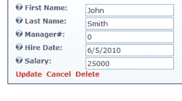

在本教程中，我们将更详细地了解 EditEmployee 控件，并了解它如何使用四个特殊部分显示选定的员工记录：

- Label：显示编辑字段名称的常用控件，并包含一个小帮助图标（？）以提供更多信息。
- TextBox：用于输入文本的标准输入控件。
- Required field validator：一个特殊控件，如果我们在 TextBox 中未提供值，则会显示错误消息。
- Update link button：单击时将触发我们可以捕获并编写代码的事件。


## 准备工作

要继续本示例，您必须先完成第4章中的以下示例：

- 使用 Starter Kit 创建新模块

## 操作步骤...

1. 首先启动您偏好的开发工具（Visual Studio 或 Visual Web Developer Express）。
2. 在屏幕左侧查找“最近项目”（Recent Projects）。点击“Employee”以加载项目。
3. 双击打开 `EditEmployee.ascx` 文件。我们需要修复的部分是一个包含 Employee 字段的 HTML 表格。Starter Kit 在 HTML 表格中创建了一行，我们再次需要用字段名替换占位符 Content。该表单包含一个文本标签、一个输入控件和一个验证控件，因此我们需要将其替换为我们五个字段的标签、输入控件和验证控件。

```
<%@ Control language="vb"
    Inherits="YourCompany.Modules.Employee.EditEmployee"
    AutoEventWireup="false" Explicit="True"
    Codebehind="EditEmployee.ascx.vb" %>
<%@ Register TagPrefix="dnn" TagName="Label"
    Src="~/controls/LabelControl.ascx" %>
<%@ Register TagPrefix="dnn" TagName="TextEditor"
    Src="~/controls/TextEditor/TextEditor.ascx"%>
<%@ Register TagPrefix="dnn" TagName="Audit"
    Src="~/controls/ModuleAuditControl.ascx" %>
<table width="650" cellspacing="0" cellpadding="0" border="0"
    summary="Edit Table">
    <tr valign="top">
        <td class="SubHead" width="125"><dnn:label id="lblContent"
            runat="server" controlname="lblContent" suffix=":">
            </dnn:label>
        </td>
        <td>
            <dnn:texteditor id="txtContent" runat="server"
                height="200" width="500" />
            <asp:RequiredFieldValidator ID="valContent"
                resourcekey="valContent.ErrorMessage"
                ControlToValidate="txtContent"
                CssClass="NormalRed" Display="Dynamic"
                ErrorMessage="<br>EmpFirstName is required"
                Runat="server" />
```

```
</td>
</tr>
</table>
<p>
<asp:linkbutton cssclass="CommandButton" id="cmdUpdate" resourcekey="cmdUpdate" runat="server" borderstyle="none" text="Update">
</asp:linkbutton>&nbsp;
<asp:linkbutton cssclass="CommandButton" id="cmdCancel" resourcekey="cmdCancel" runat="server" borderstyle="none" text="Cancel" causesvalidation="False">
</asp:linkbutton>&nbsp;
<asp:linkbutton cssclass="CommandButton" id="cmdDelete" resourcekey="cmdDelete" runat="server" borderstyle="none" text="Delete" causesvalidation="False">
</asp:linkbutton>&nbsp;
</p>
<dnn:audit id="ctlAudit" runat="server" />
```

4. 修改上面突出显示的代码，将控件重命名，使用 EmpFirstName 代替 Content。我们还将使用 textbox 控件而不是 texteditor 控件。修改后的代码如下：

```
<tr valign="top">
<td class="SubHead" width="125"><dnn:label id="lblEmpFirstName" runat="server" controlname="lblEmpFirstName" suffix=":">
</dnn:label>
</td>
<td>
<asp:TextBox ID="txtEmpFirstName" runat="server"></asp:TextBox>
<asp:RequiredFieldValidator ID="valEmpFirstName" resourcekey="valEmpFirstName.ErrorMessage" ControlToValidate="txtEmpFirstName" CssClass="NormalRed" Display="Dynamic" ErrorMessage="<br>EmpFirstName is required" Runat="server" />
</td>
</tr>
```

5. 这样完成了一个字段（员工名字）。接下来是最难的部分——我们需要再重复这个过程四次，以创建其他四个字段。因此，将您刚刚为名字编辑的代码复制并粘贴四次。

6. 这样 HTML 表格中就有五行来存放我们的字段。最后需要做的是编辑代码以显示员工字段。整个 HTML 表格现在应该如下所示：

```html
<table width="650" cellspacing="0" cellpadding="0" border="0" summary="Edit Table">
    <tr valign="top">
        <td class="SubHead" width="125"><dnn:label
                                      id="lblEmpFirstName"
             runat="server" controlname="lblEmpFirstName" suffix=":">
                                  </dnn:label>
        </td>
        <td>
        <asp:TextBox ID="txtEmpFirstName" runat="server"></asp:TextBox>
        <asp:RequiredFieldValidator ID="valEmpFirstName"
                         resourcekey="valEmpFirstName.ErrorMessage"
                         ControlToValidate="txtEmpFirstName"
        CssClass="NormalRed" Display="Dynamic"
          ErrorMessage="<br>EmpFirstName is required" Runat="server" />
        </td>
    </tr>
```

7. 表格的第二行是员工的姓氏：

```html
<tr valign="top">
    <td class="SubHead" width="125"><dnn:label id="lblEmpLastName"
             runat="server" controlname="lblEmpLastName" suffix=":">
                                  </dnn:label>
    </td>
    <td>
    <asp:TextBox ID="txtEmpLastName" runat="server"></asp:TextBox>
    <asp:RequiredFieldValidator ID="valEmpLastName"
                         resourcekey="valEmpLastName.ErrorMessage"
                         ControlToValidate="txtEmpLastName"
    CssClass="NormalRed" Display="Dynamic" ErrorMessage="<br>
                 EmpLastName is required" Runat="server" />
    </td>
</tr>
```

8. 表格的第三行是员工的主管编号：

```html
<tr valign="top">
    <td class="SubHead" width="125"><dnn:label id="lblManagerNo"
             runat="server" controlname="lblManagerNo" suffix=":">
                                  </dnn:label></td>
    <td>
    <asp:TextBox ID="txtManagerNo" runat="server"></asp:TextBox>
    <asp:RequiredFieldValidator ID="valManagerNo"
                         resourcekey="valManagerNo.ErrorMessage"
                         ControlToValidate="txtManagerNo"
```

9. 表格的第四行是员工的入职日期：

```
<tr valign="top">
<td class="SubHead" width="125"><dnn:label id="lblHireDate" runat="server" controlname="lblHireDate" suffix=":">
</dnn:label></td>
<td>
<asp:TextBox ID="txtHireDate" runat="server"></asp:TextBox>
<asp:RequiredFieldValidator ID="valHireDate" resourcekey="valHireDate.ErrorMessage" ControlToValidate="txtHireDate" CssClass="NormalRed" Display="Dynamic" ErrorMessage="<br>HireDate is required" Runat="server" />
</td>
</tr>
```

10. 表格的第五行是员工的薪水：

```
<tr valign="top">
<td class="SubHead" width="125"><dnn:label id="lblSalary" runat="server" controlname="lblSalary" suffix=":">
</dnn:label>
</td>
<td>
<asp:TextBox ID="txtSalary" runat="server"></asp:TextBox>
<asp:RequiredFieldValidator ID="valSalary" resourcekey="valSalary.ErrorMessage" ControlToValidate="txtSalary" CssClass="NormalRed" Display="Dynamic" ErrorMessage="<br>Salary is required" Runat="server" />
</td>
</tr>
</table>
```

11. 要检查结果，请将编辑器模式切换到“源代码”（Source）。页面现在应该如下图所示（如果您看到缺少控件的错误，请不要担心。这些控件属于 DNN 站点的一部分，编辑器无法识别它们。要正确查看这些字段，您需要将模块部署到测试 DNN 站点）：

```
CssClass="NormalRed" Display="Dynamic" ErrorMessage=
"<br>ManagerNo is required" Runat="server"/>
</td>
</tr>
```

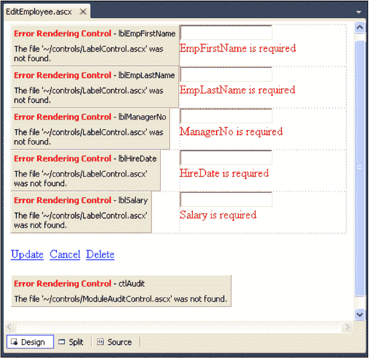

12. 现在编辑表单已完成，我们需要添加代码，以便在表单打开时填充字段。双击打开 `EditEmployee.ascx.vb` 文件。
13. 向下滚动到 `Page_Load` 过程。
14. 在该过程中间查找注释行“get content”下方。

```
Dim objEmployees As New EmployeeController
Dim objEmployee As EmployeeInfo = _
                         objEmployees.GetEmployee(ModuleId, ItemId)
If Not objEmployee Is Nothing Then
    txtContent.Text = objEmployee.EmpFirstName
    ctlAudit.CreatedByUser = objEmployee.CreatedByUserName
    ctlAudit.CreatedDate = objEmployee.CreatedDate.ToString
Else ' security violation attempt to access item not related to
this Module
    Response.Redirect(NavigateURL(), True)
End If
```


## 生成、调试和部署模块

15. 这里我们需要将那一行内容替换为五行代码，以填充我们的字段。此外，入门套件还会生成由审计控件使用的两行代码。你也可以注释掉这两行审计代码，这有助于窗体编译，因为这两行并不是必需的：

```vbnet
Dim objEmployees As New EmployeeController
Dim objEmployee As EmployeeInfo =
    objEmployees.GetEmployee(ModuleId, ItemId)
If Not objEmployee Is Nothing Then
    txtEmpFirstName.Text = objEmployee.EmpFirstName
    txtEmpLastName.Text = objEmployee.EmpLastName
    txtManagerNo.Text = objEmployee.ManagerNo
    txtHireDate.Text = objEmployee.HireDate
    txtSalary.Text = objEmployee.Salary
    'ctlAudit.CreatedByUser = objEmployee.CreatedByUserName
    'ctlAudit.CreatedDate = objEmployee.CreatedDate.ToString
Else ' security violation attempt to access item not related to this Module
    Response.Redirect(NavigateURL(), True)
End If
```

16. 最后，当用户单击**更新（Update）**时，我们必须从窗体中获取这些值并将其保存到数据库。为此，我们需要更改 Update 链接处理程序中的代码。当用户单击**编辑员工（Edit Employee）**窗体底部的 Update 链接时，会调用该链接处理程序。下面的代码会将用户输入的内容保存回数据库。我们需要做的是用我们的五个字段替换单个 Content 字段。首先向下滚动到 `cmdUpdate_Click` 过程。找到该行 Content 字段：

```vbnet
Private Sub cmdUpdate_Click(ByVal sender As Object, ByVal e As EventArgs) Handles cmdUpdate.Click

    Try
        Dim objEmployees As New EmployeeController

        Dim objEmployee As EmployeeInfo = New EmployeeInfo

        objEmployee.ModuleId = ModuleId
        objEmployee.ItemId = ItemId
        objEmployee.EmpFirstName = txtContent.Text
        objEmployee.CreatedByUser = Me.UserId
```

17. 用五行代码替换那一行，以获取我们的字段：

```vbnet
objEmployee.EmpFirstName = txtEmpFirstName.Text
objEmployee.EmpLastName = txtEmpLastName.Text
objEmployee.ManagerNo = txtManagerNo.Text
objEmployee.HireDate = txtHireDate.Text
objEmployee.Salary = txtSalary.Text
```

## 编辑清单文件

在部署新模块之前，应查看并更新由入门套件生成的清单文件。

清单文件是一个 XML 文件，它告诉 DNN 如何安装和配置模块以供门户使用。当你部署模块时，DNN 会读取此文件并将其保存到数据库中。在部署之前，我们特别需要编辑其中的五个元素。

| 元素 | 说明 |
| --- | --- |
| `<name>` | 这是模块的内部名称。模块部署后，除非先完全卸载该模块，否则不应更改此名称。 |
| `<friendlyname>` | 这是模块的友好名称。当主机列出已安装模块时，会显示该名称；当你将模块放置到页面上时，该名称也会出现在下拉列表中。 |
| `<description>` | 模块的说明，显示在已安装模块列表中。 |
| `<module><friendlyname>` | 显示在容纳该模块的容器上。 |
| `<src>` | 给出用户控件的路径。 |

### 准备工作

要按本操作指南进行操作，你必须已完成第 4 章中的以下操作指南：

- 使用入门套件创建新模块

### 操作步骤...

1. 首先启动你偏好的开发工具（Visual Studio 或 Visual Web Developer Express）。
2. 在屏幕左侧找到“最近的项目”。单击 Employee 以加载项目。
3. 双击打开 `Employee.dnn` 文件。在文件顶部，你应该会看到以下内容：

```xml
<dotnetnuke version="3.0" type="Module">
<folders>
<folder>
<name>YourCompany.Employee</name>
<friendlyname>Employee</friendlyname>
<foldername>YourCompany.Employee</foldername>
<modulename>YourCompany.Employee</modulename>
<description>A Employee module</description>
<version>01.00.00</version>
<businesscontrollerclass>YourCompany.Modules.Employee.EmployeeController</businesscontrollerclass>
<compatibility></compatibility>
<modules>
    <module>
        <friendlyname>Employee</friendlyname>
        <cachetime>0</cachetime>
        <controls>
```

4. 生成的大多数行都没问题，但有些行需要修改。首先，通过简单的查找和替换，将 `YourCompany` 替换为你的实际公司名称：在**编辑**菜单下，找到**查找和替换**，单击**快速替换**（或直接按 Ctrl+H）。

5. 当**查找和替换**对话框弹出时，请提供以下信息：
   - **查找内容：** `YourCompany`
   - **替换为：** `ACME`
   - **查找范围：** `Current Document`

6. 单击**全部替换**。

7. 接下来，更新以下三行：
   - 将 `<friendlyname>` 改为 `ACME Employees`
   - 将 `<description>` 改为 `A list of current ACME employees`
   - 将 `<module><friendlyname>` 改为 `Current ACME Employees`

8. 现在，文件顶部应如下所示：

```xml
<dotnetnuke version="3.0" type="Module">
    <folders>
        <folder>
            <name>ACME.Employee</name>
            <friendlyname>ACME Employees</friendlyname>
            <foldername>ACME.Employee</foldername>
            <modulename>ACME.Employee</modulename>
            <description>A list of current ACME employees.</description>
            <version>01.00.00</version>
            <businesscontrollerclass>ACME.Modules.Employee.EmployeeController</businesscontrollerclass>
            <compatibility></compatibility>
            <modules>
                <module>
                    <friendlyname>Current ACME Employees</friendlyname>
                    <cachetime>0</cachetime>
                    <controls>
```

9. 接下来需要修改的是文件存放位置的文件夹名称。

   a. 首先，将 `<src>DesktopModules/Employee/ViewEmployee.ascx</src>` 改为 `<src>DesktopModules/ACME.Employee/ViewEmployee.ascx</src>`

   b. 接下来，将 `<src>DesktopModules/Employee/EditEmployee.ascx</src>` 改为 `<src>DesktopModules/ACME.Employee/EditEmployee.ascx</src>`

   c. 然后，将 `<src>DesktopModules/Employee/Settings.ascx</src>` 改为 `<src>DesktopModules/ACME.Employee/Settings.ascx</src>`

10. 在“文件”菜单下，选择**全部保存**以保存你的更改。

## 生成 Release 或 Debug 版本

当你按照前面操作指南中的说明成功编辑完入门套件项目后，你应该能够无错误地生成项目。你可以生成 Release 版本或 Debug 版本。在本操作指南中，我们将演示如何将开发工具设置为 Release 生成或 Debug 生成。

### 操作步骤...

1. 首先启动你偏好的开发工具（Visual Studio 或 Visual Web Developer Express）。
2. 在屏幕左侧找到“最近的项目”。单击 Employee 以加载项目。
3. 首先，如果你使用的是 Web Developer 2010 Express，并且没有看到“生成”菜单，可以通过“工具”菜单下的“设置”菜单，选择“专家设置”来启用它。

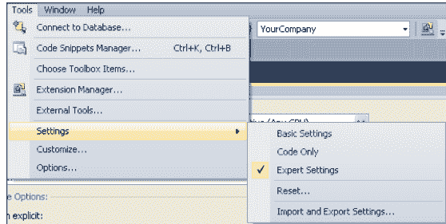

4. 现在，在“生成”菜单下，选择“配置管理器”。

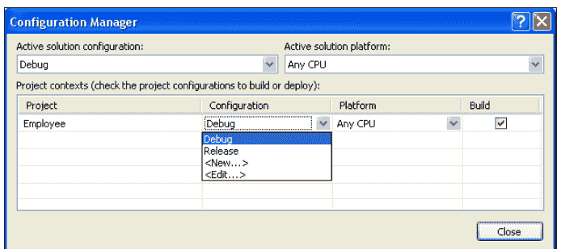

5. 你将看到列出的项目。若要更改项目的生成方式，请从下拉列表中选择 Debug 或 Release。
6. 单击“关闭”以保存更改。
7. 生成项目时，编译后的库（*.dll 文件）将出现在项目文件夹下的 /obj/Debug 或 /obj/Release 文件夹中。
8. 项目重新生成后，你可以通过将 DLL 文件复制到 DNN 站点的 /bin 文件夹中，将其直接部署到 DNN 门户。

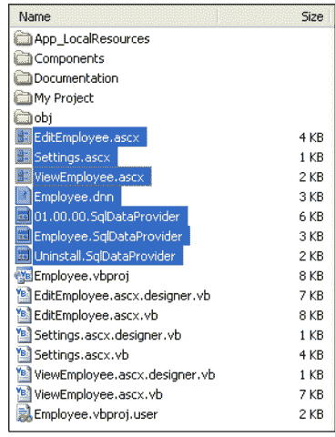

2. 请从此文件夹中选择以下文件：

- EditEmployee.ascx
- Settings.ascx
- ViewEmployee.ascx
- Employee.dnn
- 01.00.00.SqlDataProvider
- Employee.SqlDataProvider
- Uninstall.SqlDataProvider

3. 右键单击选中的这些文件，然后选择“发送到 | 压缩(zipped)文件夹”。这将创建一个新的 ZIP 文件。
4. 将新文件重命名为 `Employee_01.00.00_Install.zip`。


+   5. 还有更多文件需要添加，因此打开 ZIP 文件并选择文件夹 `App_LocalResources`。将这三个文件点击拖拽到打开的 ZIP 文件中：

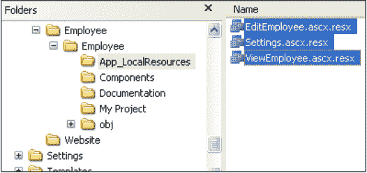

+   6. 最后，选择文件 `\obj\Debug\Employee.dll`（如果未进行调试，则为 `\obj\Release\Employee.dll`）并将其添加到 ZIP 文件中。

> 如果在任一文件夹中都看不到项目的 DLL 文件，请按照上一教程 *Building for release or debug* 中的步骤创建 DLL 文件。

+   7. ZIP 文件现在应包含以下内容：

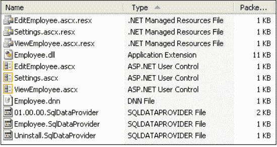

+   8. 要在 DNN 站点上安装模块，首先以主机用户身份登录（在我们的示例中为 syshost）。
+   9. 查看控制面板并确保处于编辑模式。
+   10. 在 **Host** 菜单下查看并选择 **Extensions**。

11. 从操作菜单中选择 Install Extension Wizard 或点击底部的链接。

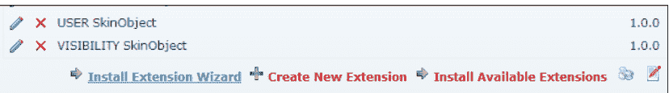

12. 向导将提示输入 ZIP 文件（称为扩展包）。

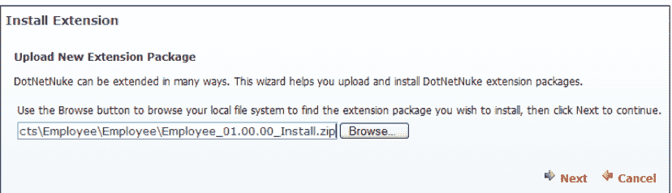

13. 点击 Browse 按钮并选择文件 Employee_01.00.00_Install.zip。点击 Open 然后点击 Next。

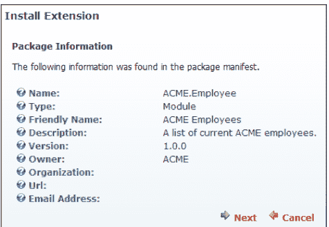

14. 向导将显示您的模块信息。点击 Next。

15. 向导将显示您的发行说明。点击 Next。

16. 在许可页面，勾选 Accept License? 并点击 Next。

17. 现在安装脚本将运行，为模块创建表和存储过程。最后您应看到消息“Installation successful”。

18. 点击 **Return**。

19. 现在导航到空白页面并将模块添加到页面（有关详细信息，请参阅 *Chapter 1* 中的教程 *Adding a module to a page*）注意我们在清单文件 `<friendlyname>` 元素中放置的名称就是在下拉列表中显示的名称。

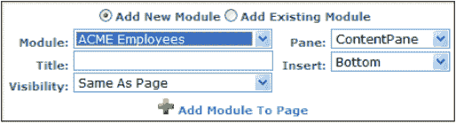

20. 还要注意我们在 `<module><friendlyname>` 元素中放置的名称就是在容器标题中显示的名称：

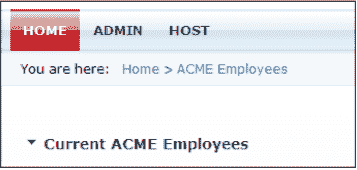

# 下载 DNN 5 源代码

为了帮助我们为 DNN 开发自己的模块，我们可以下载源代码，以便我们的编译器可以访问随 DNN 5 提供的库。在本教程中，我们将下载压缩的 ZIP 文件并将其提取到项目的某个文件夹中。

# 如何操作...

+   1. 转到 `http://dotnetnuke.codeplex.com/`。
+   2. 点击页面顶部的 **Downloads** 选项卡。
+   3. 向下滚动一点并点击标有 **Source Code (New Install + Source Code)** 的按钮。
+   4. 如果提示许可条款，点击 **I Agree**。
+   5. 在提示 **Open** 或 **Save** 时，点击 **Save**。
+   6. 选择一个临时文件夹来存放 ZIP 文件。
+   7. 下载完成后，将文件提取到一个易于记住的文件夹中，例如 `My Documents\DNNSource`。

# 如何工作...

这是一个可选教程。虽然您不需要源文件来运行 DNN 站点，也不是创建模块所必需的，但如果您想在调试时逐步查看 DNN 代码，它们很有用，并且能深入了解 DNN 的编写方式。

# 另请参阅

本教程中下载的文件在下一个教程 *Setting up a debugging environment* 中使用。

# 设置调试环境

模块部署后，如何进行调试？如何逐步跟踪模块代码或设置断点？

在本教程中，我们将配置开发工具，通过将 DNN 源代码和模块源代码组合为一个解决方案来创建强大的测试环境。然后我们可以设置断点并逐步查看模块和 DNN 代码。

请注意，如果您已经使用本教程创建了测试环境，就不能再次运行教程来重建环境。如果需要重新安装开发环境，必须在再次使用本教程重新安装之前完全删除环境。

# 准备工作

要跟随本教程，您必须已完成 *Chapter 4* 中的以下教程：

+   ▸ *Installing Visual Web Developer 2010 Express*
+   ▸ *Downloading the DNN 5 source code*

# 如何操作...

+   1. 首先找到您下载 DNN 源文件的文件夹（在这些示例中为 `My Documents\DNNSource\website`）。
+   2. 找到文件 `release.config`。复制此文件并将其命名为 `web.config`。
+   3. 现在启动您首选的开发工具（Visual Studio 或 Visual Web Developer Express）。
+   4. 从 **File** 菜单中选择 **Open Web Site....**
+   5. 在 **Open Web Site** 对话框中，选择 DNN 源文件夹（`My Documents\DNNSource\website`）并点击 **Open.**

# 构建、调试和部署模块

+   6. 网站加载后，通过查看 **Debug** 菜单并选择 **Start Without Debugging**（或按 Ctrl+F5）来构建整个站点。
+   
+   7. 网站的所有源代码都将被编译，网站将在浏览器中启动。

> 如果在构建时遇到错误，您可能需要添加额外的引用。例如，在 DNN 5.02 源代码中，在构建之前需要添加对 `\Library\Components\Telerik\Telerik.Web.UI.dll` 的引用。

+   8. 如果这是第一次构建站点，则它将经历 DNN 安装过程，就像在 *Chapter 1* 的教程 *Running the DotNetNuke installation* 中一样。但是这次我们将为测试模块创建一个新的数据库。
+   
+   9. 在第一个屏幕上将提示安装类型。选择 **Typical** 并点击 **Next**。
+   
+   10. 下一页将测试文件权限。点击 **Test Permissions**。稍等片刻后您应看到消息 **Your site passed the permissions check.** 点击 Next。
+   
+   11. 在下一页我们选择数据库。为调试我们将创建一个新数据库，而不是现有的 DNN 数据库。在页面顶部的单选按钮中选择 **SQL Server 2005/2008 (Express) File**。

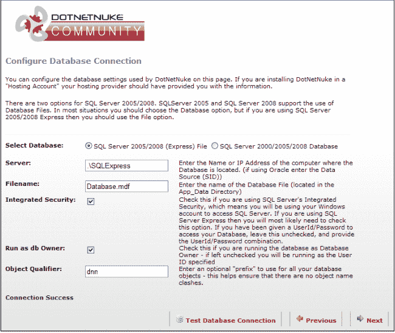

12. 输入以下信息：

- Server: .\SQLEXPRESS
- Filename: Database.mdf
- Integrated Security: Checked
- Run as db Owner: Checked
- Object Qualifier: dnn

13. 点击 Test Database Connection。您应看到消息 Connection Success。

14. 点击 Next。您现在将看到状态消息，因为数据库表和存储过程正在创建。最后应显示消息 Installation of Database Complete。

15. 现在向导将创建两个初始用户：控制整个 DNN 安装的主机用户和管理门户且权限更有限的管理员用户。

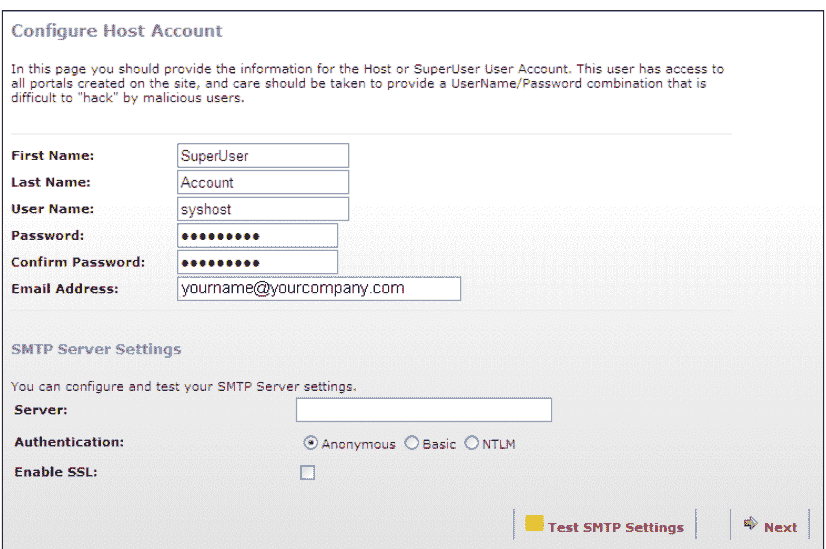

16. 对于名字，保留默认的 SuperUser。

17. 对于姓氏，输入 Account。

# 构建、调试和部署模块

+   18. 对于 **User Name**，输入 `syshost`（不要使用标准主机作为用户名。它太为人所知了）。  
+   19. 选择一个良好的密码并确认。然后写下来，因为稍后您需要它。  
+   20. 提供您的电子邮件地址以接收系统消息。  
+   21. 可以跳过 SMTP 部分。点击 **Next** 并提供管理员用户的详细信息。

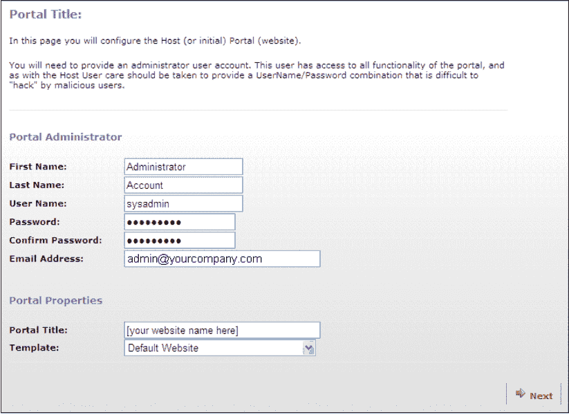

+   22. 对于 **First Name**，保留默认的 `Administrator`。  
+   23. 对于 **Last Name**，输入 `Account`。

24. 对于 **User Name**，输入 `sysadmin`（不要使用标准的 `admin` 作为用户名。它太为人所知了）。

25. 选择一个良好的密码并确认。然后也写下来。

26. 提供您的电子邮件地址以接收系统消息。

27. 最后，向导将提示输入站点的基本信息。为您的站点选择一个标题并输入到 **Portal Title**。

28. 为 **Template** 选择 **Default Website**。

29. 点击 Next。

30. 当您看到祝贺屏幕时，点击 **Finished**（Goto Site）以完成安装。

31. 稍等片刻后您应看到新网站的欢迎屏幕。此时您已成功创建了一个用于调试的 DNN 网站。

# 为调试准备模块

一旦我们创建了调试环境，我们就可以将模块添加到 DNN 网站项目中并在 DNN 环境中调试我们的模块。

# 准备工作

要跟随本教程，您必须已完成以下教程

+   - *Setting up a debugging environment*
+   - *Deploying a module as a standalone package*

# 如何操作...

+   1. 首先启动您首选的开发工具（Visual Studio 或 Visual Web Developer Express）。
+   2. 从 **File** 菜单中选择 **Open Web Site**.....
+   3. 在 **Open Web Site** 对话框中，选择 DNN 源文件夹（`My Documents\DNNSource\website`）。
+   4. 现在我们将添加现有的 Employee 项目。查看 **File** 菜单并选择 **Add/Existing Project**.....
+   5. 浏览到 Employee 项目文件夹（可能为 `My Documents\Visual Studio 2010\Projects\Employee\Employee`）并选择 `Employee.vbproj` 文件。


+   9. 现在滚动到“解决方案资源管理器”顶部，右键单击网站。选择 **属性**。

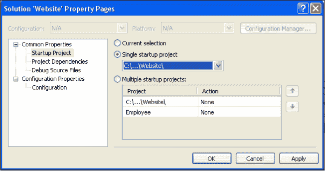

+   10. 从单选控件中选择 **单个启动项目**。
+   11. 从下拉列表中选择 **网站**。
+   12. 单击 **确定**。
+   13. 现在我们可以构建员工项目并将其部署到站点。在 **解决方案资源管理器** 中，右键单击 Employee 文件夹并选择 **生成**。你应该会看到 **生成成功** 消息。
+   14. 按照 *将模块作为独立包部署* 中描述的步骤，创建一个包含 Employee 模块的 ZIP 文件。
+   15. 通过查看“调试”菜单并选择 **不调试启动**（或按 Ctrl+F5）来启动站点。
+   16. 站点的所有源代码现在都会编译，并且站点将在浏览器中启动。稍作停顿后，你应该会看到欢迎屏幕。
+   17. 以主机身份登录测试站点（本示例中为 `syshost`）。
+   18. 按照 *将模块作为独立包部署* 中描述的步骤安装新的 ZIP 文件。
+   19. ACME Employee 模块现在应该出现在“控制面板”下拉列表中。创建一个新的空白页面并将 Employee 模块添加到其中。

> 创建新页面时请授予所有用户访问权限。然后你可以在不每次都登录的情况下调试你的模块。

20. 一旦 Employee 模块被放置在页面上，控制权将传递给 ViewEmployee.ascx。如果 Employee 模块出现错误，请不要担心。它将为我们提供调试的内容。

21. Employee 模块现在已成为网站的一部分并且已准备好进行调试。

## 另请参阅

现在你的模块已准备好进行调试，接下来的三个菜谱将展示三种有用的调试技术：逐步执行代码、设置断点以及使用监视变量。

## 设置断点并逐步执行模块代码

在本菜谱中，我们将了解如何在调试环境中设置断点并逐步执行模块代码。这里的目标是停止操作并花点时间检查模块中的变量，查看它们保存的值。然后我们可以逐行“走查”代码，查看其运行方式。这是 Visual Studio 功能所实现的一种强大的调试技术。

### 准备工作

要跟随本菜谱，你必须已完成以下菜谱

-   - 使用 Starter Kit 创建新模块
-   - 设置调试环境
-   - 为调试准备模块

### 如何操作...

+   1. 首先启动你喜欢的开发工具（Visual Studio 或 Visual Web Developer Express）。
+   2. 从“文件”菜单中，选择“打开网站”.....
+   3. 在“打开网站”对话框中，选择 DNN 源文件夹（我的文档\ DNNSource\website）。
+   4. 查看右侧的“解决方案资源管理器”。你应该会在网站下看到 Employee 项目列出。如果看不到，请确保你已完成上一个菜谱“为调试准备模块”的步骤。
+   5. 双击 ViewEmployee.ascx 文件以在编辑器中显示它。
+   6. 滚动到 Page_Load 过程。

7. 右键单击第 60 行，选择“断点”，然后选择“插入断点”（或按 F9）。

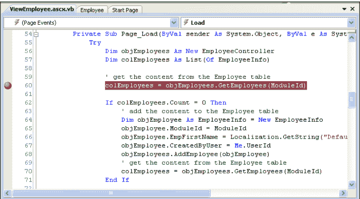

8. 查看“调试”菜单并选择“开始调试”（或按 F5）。

9. 网站将开始构建。如果这是你第一次调试网站，将提示你启用调试：

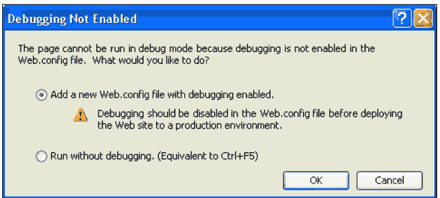

10. 选择“添加启用调试的新 Web.config 文件”并单击“确定”。

11. 浏览器将启动并显示欢迎页面。

12. 导航到包含 Employee 模块的页面。

## 构建、调试和部署模块

13. 稍作停顿后，程序将停止并返回编辑器。第 60 行现在将显示为黄色，表示控制已在此处停止。

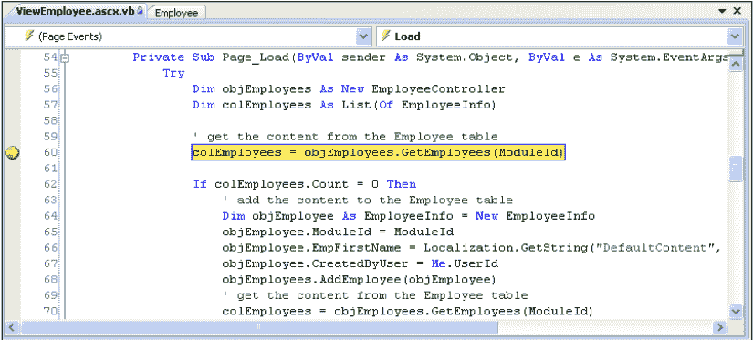

14. 你现在可以通过从“调试”菜单中选择“进入”（或按 F11）逐行逐步执行模块代码。

15. 要逐过程或逐函数执行，请从“调试”菜单中选择“逐过程”或按 F10。

16. 如果将鼠标悬停在变量上，将弹出显示变量中保存的值。

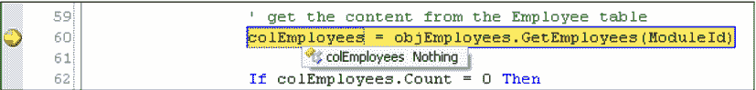

17. 你还可以选择要监视的变量，值将出现在“监视”窗口中。

18. 右键单击变量并选择 **添加监视**。

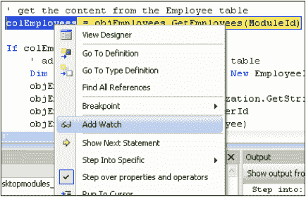

19. 变量及其当前值将出现在 **监视** 窗口中。

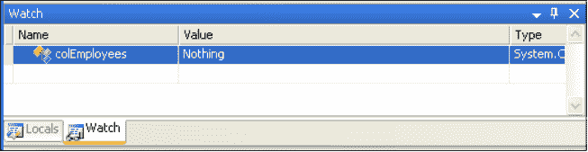

20. 要继续运行程序，请从 **调试** 菜单中选择 **继续**（或再次按 F5）。

21. 要停止调试，请从 **调试** 菜单中选择 **停止调试**（或按 Shift+F5）。

## 从已安装的模块创建清单

在上一个菜谱中，我们看到了如何修改 Starter Kit 在部署模块时创建的清单文件。这种方法的一个缺点是 Starter Kit 创建的清单并不总是适用于 DNN 的最新版本。这是为了使入门模块可在最广泛的 DNN 版本上使用。但如果你知道你的模块只会部署到 DNN 的最新版本，你可以从已安装的模块生成新的、最新的清单文件。

### 准备工作

要跟随本菜谱，你必须已完成上一个菜谱：

-   - *将模块作为独立包部署*

### 如何操作...

+   1. 首先以主机用户身份登录（本示例中为 `syshost`）。
+   2. 查看“控制面板”并确保你处于“编辑”模式。
+   3. 在 **主机** 菜单下选择 **扩展**。
+   4. 找到 Employee 模块并单击名称旁边的编辑图标。
+   5. 滚动到底部并单击链接 **创建包**。
+   6. 由于我们要创建新的清单，请保持 **使用现有清单** 未选中，并确保 **查看清单** 已选中。

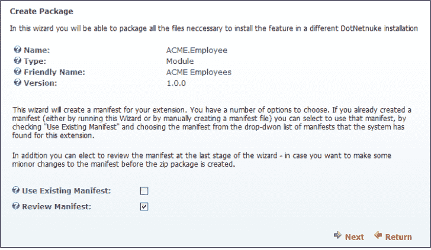

+   7. 单击 **下一步**。
+   8. 向导将显示模块中的文件。保持文件不变并单击 **下一步**。
+   9. 在提示输入程序集时，在编辑框中输入 `Employee.dll` 并单击 **下一步**。

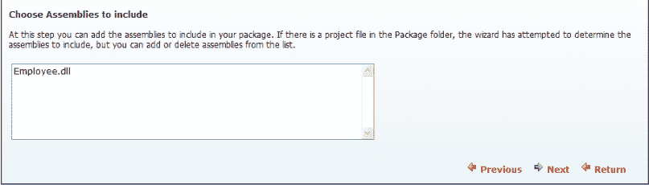

10. 向导将显示生成的清单文件。单击“下一步”。

11. 在“创建包”屏幕上，按如下方式调整名称：

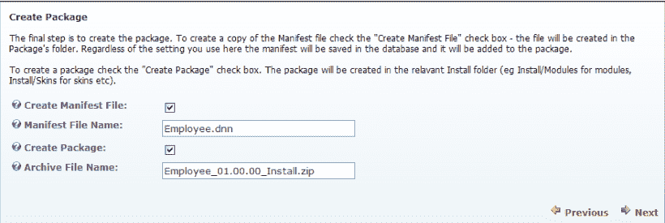

12. 单击“下一步”。

13. 向导将显示成功消息，描述生成文件的存放位置：

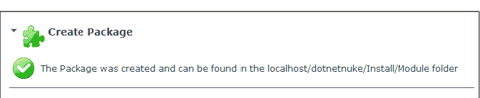

14. 单击“返回”关闭向导。

## 另请参阅

清单文件的最新版本提供了新的选项，如所有者姓名、电子邮件地址和 URL。要了解有关这些新选项的更多信息，请参阅第 11 章中的菜谱“在清单中使用 HTML”。

## 6
数据输入技巧

在本章中，我们将涵盖以下主题：

-   - 从资源文件显示标签
-   - 创建可折叠面板
-   - 从 DNN 列表填充下拉列表
-   - 从存储过程填充下拉列表
-   - 显示带筛选控件的数据网格
-   - 向数据网格添加分页控件

## 简介

在本章中，我们将查看用于基本数据输入和数据显示的工具和技巧。我们将使用第 4 章中的示例 Employee 项目并扩展它以包含新的数据输入控件。我们将看到如何使用资源文件，用数据库中的数据填充控件，在存储过程中运行查询，并在页面上显示结果。

-   - **Page_Load 过程**
     在 .NET 框架中，当 Web 表单加载时，会发生一个名为 `Page_Load` 的特殊事件。该事件经常用于在用户控件显示之前准备数据。在本章中，你将看到使用 `Page_Load` 事件填充下拉列表或准备数据网格的示例。在 `Page_Load` 例程内部，常见的做法是检查页面是否正在回发到服务器。这告诉你页面是首次查看，你可以据此填充控件。


# 区域

区域由 Visual Studio 用于将代码组织成逻辑组。它们在代码中不是必需的，但推荐使用。在本章的配方中，你将看到 Starter Kit 创建的多个区域（例如 Private Members 或 Public Methods），当你尝试查找需要更新的例程时，它们会很有帮助。

# 从资源文件显示标签

DNN 中的数据输入表单通常具有标签来标识页面上的字段。这些是特殊的控件，用于显示文本，但也带有“帮助”图标，点击时会显示解释。

但这些文本来自哪里？我们可以在代码中硬编码标签的文本，但这会限制我们轻松更新文本的能力，并且我们将错过 DNN 提供的强大的本地化功能。本地化是 DNN 根据用户选择的语言自动翻译标签和系统消息的一种方式。你可以从第 9 章的配方中了解更多关于本地化的信息。

在本配方中，我们将把标签文本和帮助说明存储在资源文件中，并通过唯一的 ID 将它们链接到标签。

# 准备工作

在本配方中，我们将使用来自示例 Employee 项目的 EditEmployee 控件。要跟随操作，你必须已完成第 4 章中的以下配方：

- 使用 Starter Kit 创建新模块

# 如何操作...

- 1. 启动 Development Tool 并加载 Employee 项目。
- 2. 双击打开 EditEmployee.ascx 文件。
- 3. 第 5 章中 Building an Edit control 配方创建了五组用于编辑值的控件。以下是编辑 Salary 的控件示例。注意标签控件 lblSalary：

```
<tr valign="top">
<td class="SubHead" width="125">
<dnn:label id="lblSalary" runat="server" controlname="lblSalary" suffix=":">
</dnn:label>
</td>
```

```
<td>
<asp:TextBox ID="txtSalary" runat="server"></asp:TextBox>
<asp:RequiredFieldValidator ID="valSalary" resourcekey="valSalary.ErrorMessage" ControlToValidate="txtSalary" CssClass="NormalRed" Display="Dynamic" ErrorMessage="<br>Salary is required" Runat="server" />
</td>
</tr>
```

- 4. 这五个标签中的每一个都将从 Edit 资源文件获取其值。因此双击打开 App_LocalResources 文件夹中的 EditEmployee.ascx.resx 文件。

- 5. 使用资源编辑器并为以下五个字段中的每一个输入文本和帮助消息：

```
ControlTitle_edit.Text: Edit Employee
lblEmpFirstName.Text: First Name
lblEmpFirstName.Help: Enter the first name of the employee
lblEmpLastName.Text: Last Name
lblEmpLastName.Help: Enter the last name of the employee
lblManagerNo.Text: Manager #
lblManagerNo.Help: Enter the ID number of employee's manager
lblHireDate.Text: Hire Date
lblHireDate.Help: Enter employee's date of hire
lblSalary.Text: Salary
lblSalary.Help: Enter employee's annual salary
```

# 数据输入技巧

- 6. 文件现在应该如下所示：

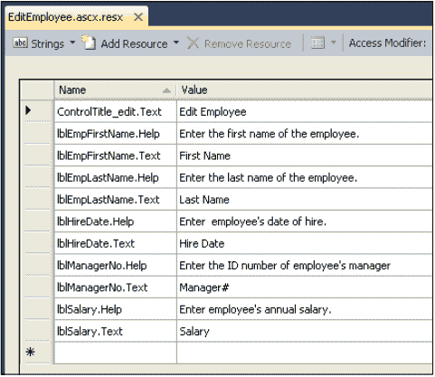

- 7. 从 **File** 菜单中选择 **Save All**。

- 8. 要检查结果，请构建并将模块部署到你的 DNN 站点（有关说明，请参阅 *Chapter 5* 中的配方 *Deploying a module as a standalone package*）。

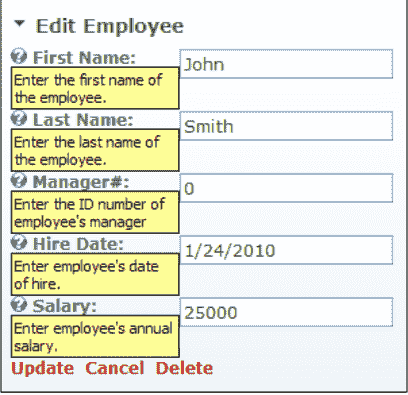

# 创建可折叠面板

DNN 提供的另一个有用控件是 `SectionHead` 控件，它在数据输入表单上创建可折叠面板。此面板在 DNN 模块中经常出现，当你不想在页面上浪费空间用于用户并不总是需要的东西时很有用。

在本配方中，我们将创建一个可折叠面板，显示或隐藏包含示例文本的 HTML 表格。在配方 *Populating a drop-down list from a DNN list* 和 *Populating a drop-down list from a stored procedure* 中，我们将用真实控件替换示例文本以创建更实用的示例。

## 准备工作

要跟随本配方，你必须已完成以下配方：

- *Creating a new module with the Starter Kit*

## 如何操作...

- 1. 首先启动 Development Tool 并加载 Employee 项目。
- 2. 双击打开 `ViewEmployee.ascx` 文件。
- 3. 查看文件的顶部并在 Datalist 控件之前找到 register 指令：

```
<%@ Control language="vb"
    Inherits="ACME.Modules.Employee.ViewEmployee"
    AutoEventWireup="false" Explicit="True"
    Codebehind="ViewEmployee.ascx.vb" %>
<%@ Register TagPrefix="dnn" TagName="Audit"
    Src="~/controls/ModuleAuditControl.ascx" %>
<asp:datalist id="lstContent" datakeyfield="ItemID" runat="server"
    cellpadding="4">
    <itemtemplate>
```

- 4. 在 Datalist 控件之前插入一个新的 register 指令：

```
<%@ Register TagPrefix="dnn" TagName="SectionHead"
    Src="~/controls/SectionHeadControl.ascx" %>
```

- 5. 文件的顶部现在应该如下所示：

```
<%@ Control language="vb"
    Inherits="ACME.Modules.Employee.ViewEmployee"
    AutoEventWireup="false" Explicit="True"
    Codebehind="ViewEmployee.ascx.vb" %>
<%@ Register TagPrefix="dnn" TagName="Audit"
    Src="~/controls/ModuleAuditControl.ascx" %>
```

```
<%@ Register TagPrefix="dnn" TagName="SectionHead" Src="~/controls/SectionHeadControl.ascx" %>
<asp:datalist id="lstContent" datakeyfield="ItemID" runat="server" cellpadding="4">
    <itemtemplate>
```

- 6. 接下来，我们添加一个简单的 HTML 表格并将其链接到 SectionHead 控件。按如下方式在文件的顶部插入此代码：

```
<%@ Control language="vb" Inherits="ACME.Modules.Employee.ViewEmployee" AutoEventWireup="false" Explicit="True" Codebehind="ViewEmployee.ascx.vb" %>
<%@ Register TagPrefix="dnn" TagName="Audit" Src="~/controls/ModuleAuditControl.ascx" %>
<%@ Register TagPrefix="dnn" TagName="SectionHead" Src="~/controls/SectionHeadControl.ascx" %>
<dnn:SectionHead ID="dshPanel" runat="server" CssClass="Head" ResourceKey="Settings" Section="tblPanel" Text="Collapsible Panel">
</dnn:SectionHead>
<table id="tblPanel" cellspacing="2" cellpadding="2" border="0" runat="server">
    <tr>
        <td width="20%" class="SubHead">
            [Put a label here]
        </td>
        <td width="25%">
            [Put a control here]
        </td>
        <td width="10%">
            &nbsp;
        </td>
        <td width="20%" class="SubHead">
            [Put a label here]
        </td>
        <td width="25%">
            [Put a control here]
        </td>
    </tr>
</table>
<asp:datalist id="lstContent" datakeyfield="ItemID" runat="server" cellpadding="4">
    <itemtemplate>
```

> SectionHead 控件必须知道要隐藏或显示什么。我们通过将表格的 ID（tblPanel）分配给 Section 属性（Section="tblPanel"）来告诉它。

- 7. 当模块构建并部署时，它看起来像这样：

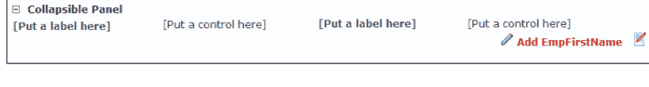

- 8. 你可以通过单击标题 Collapsible Panel 旁边的 small minus sign 来显示和隐藏控件。

# 它是如何工作的...

在这个示例中，我们通过将 SectionHead 控件连接到 HTML 表格创建了一个可折叠面板。此控件的强大之处在于你可以将任何内容放在表格内：标签、下拉列表或图像，它们都将一起显示或隐藏。当你有一些占用页面大量空间但不需要一直看到的东西时，这很有效。

# 从 DNN 列表填充下拉列表

本配方将展示如何从我们作为 Host 用户创建的 DNN 列表填充下拉列表控件。使用 DNN 列表填充数据输入控件意味着我们可以通过站点更新列表，而无需更改和重新部署我们的自定义模块。

# 准备工作

要跟随本配方，你必须已完成以下配方：

- 使用 Starter Kit 创建新模块

# 如何操作...

- 1. 以 Host 用户身份登录（在我们的示例中为 syshost）。

- 2. 在 Host 菜单下查找并选择 Lists。


## 数据录入技巧

3. 通过点击 Add List 创建一个新列表。

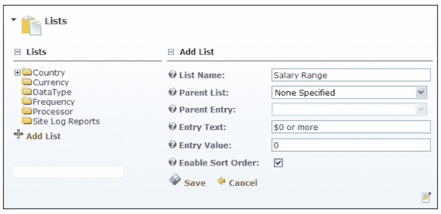

4. 输入我们第一个条目的详细信息：

   - List Name: Salary Range
   - Parent List: None Specified
   - Parent Entry: blank
   - Entry Text: $0 or more
   - Entry Value: 0
   - Enable Sort Order: Checked

5. 点击 Save。

6. 点击 Add Entry 并创建第二个列表条目：

   - Entry Text: $30,000 or more
   - Entry Value: 30000

7. 点击 Save。

8. 点击 Add Entry 并创建第三个列表条目：

   - Entry Text: $60,000 or more
   - Entry Value: 60000

9. 点击 Save。

10. 点击 Add Entry 并创建第四个列表条目：

    - Entry Text: $100,000 or more
    - Entry Value: 100000

11. 点击 **Save**。

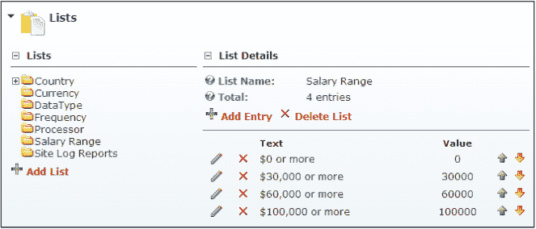

12. 现在我们有了 DNN 列表，我们可以在自定义模块中使用它。启动 Development Tool。

13. 在屏幕左侧查找 Recent Projects。点击 **Employee** 加载项目。

14. 双击打开 `ViewEmployee.ascx` 文件。

15. 查看文件顶部：

```aspx
<%@ Control language="vb"
    Inherits="ACME.Modules.Employee.ViewEmployee"
    AutoEventWireup="false" Explicit="True"
    Codebehind="ViewEmployee.ascx.vb" %>
<%@ Register TagPrefix="dnn" TagName="Audit"
    Src="~/controls/ModuleAuditControl.ascx" %>
<%@ Register TagPrefix="dnn" TagName="Label"
    Src="~/controls/LabelControl.ascx" %>

<asp:datalist id="lstContent" datakeyfield="ItemID"
    runat="server" cellpadding="4">
    <itemtemplate>
```

16. 在最后一个 register 指令之后、Datalist 之前添加以下 HTML 表格代码：

```aspx
<%@ Register TagPrefix="dnn" TagName="Label" Src="~/controls/LabelControl.ascx" %>

<table id="tblPanel" cellspacing="2" cellpadding="2" border="0"
       runat="server">
    <tr>
        <td width="20%" class="SubHead">
            [Put a label here]
        </td>
        <td width="25%">
            [Put a control here]
        </td>
        <td width="10%">
            &nbsp;
        </td>
        <td width="20%" class="SubHead">
            <dnn:Label ID="lblSalaryRange" runat="server"
                ControlName="ddlSalaryRange" Suffix=":">
            </dnn:Label>
        </td>
        <td width="25%">
            <asp:DropDownList ID="ddlSalaryRange"
                runat="server" DataTextField="Text"
                DataValueField="Value" AutoPostBack="true">
            </asp:DropDownList>
        </td>
    </tr>
</table>
```


> 如果你遵循了之前的配方并且这里已经有一个 HTML 表格，只需将其替换为这个新的 HTML 表格。

17. 接下来，打开 `ViewEmployee.ascx.vb` 文件。

18. 第一步是导入 Lists 命名空间。向下滚动一点并添加 import 语句：

```vb
Imports System.Web.UI
Imports System.Collections.Generic
Imports System.Reflection

Imports DotNetNuke
Imports DotNetNuke.Services.Exceptions
Imports DotNetNuke.Services.Localization
Imports DotNetNuke.Common.Lists
```

### How it works...

我们可以直接将下拉列表控件绑定到 DNN 列表。这允许主机用户在无需重新部署模块的情况下向列表添加值。

### There's more...

由于我们在页面显示时绑定到列表，你可以向 DNN 列表添加更多值，并且它们会在页面刷新时自动出现在下拉列表中。

## 从存储过程填充下拉列表

在本配方中，我们将看到如何从存储过程填充下拉列表。这与绑定到 DNN 列表类似，但现在我们可以使用数据库中存储的任何数据作为列表。

### Getting ready

要跟随本配方，你必须已完成以下配方：

- *Creating stored procedures*（来自 *Chapter 4*）
- *Populating a drop-down list from a DNN list*

### How to do it...

1. 首先启动 Development Tool 并加载 Employee 项目。
2. 双击打开 `ViewEmployee.ascx` 文件。
3. 找到从上一个配方添加的表格和薪资控件。查找两个占位符并用以下标签和控件代码替换它们，使 HTML 表格现在看起来像这样：

```html
<table id="tblPanel" cellspacing="2" cellpadding="2" border="0"
       runat="server" >
    <tr>
        <td width="20%" class="SubHead">
            <dnn:Label ID="lblManagerNo" runat="server"
                      ControlName="ddlManagerNo" Suffix=":" />
        </td>
        <td width="25%">
            <asp:DropDownList ID="ddlManagerNo" runat="server"
                DataTextField="ManagerName"
                DataValueField="ItemId" AutoPostBack="true">
            </asp:DropDownList>
        </td>
        <td width="10%">
            &nbsp;
        </td>
        <td width="20%" class="SubHead">
            <dnn:Label ID="lblSalaryRange" runat="server" ControlName="ddlSalaryRange" Suffix=":">
            </dnn:Label>
        </td>
        <td width="25%">
            <asp:DropDownList ID="ddlSalaryRange" runat="server" DataTextField="Text" DataValueField="Value" AutoPostBack="true">
            </asp:DropDownList>
        </td>
    </tr>
</table>
```

4. 现在我们有了下拉控件，下一步是添加我们需要例程来从数据库中的存储过程填充下拉控件。让我们先创建存储过程。

5. 双击打开 01.00.00.SqlDataProvider 文件。

> 如果你已经安装过一次此模块，你可以创建一个名为 01.00.01.SqlDataProvider 的新文件来保存新过程。详情请参阅第 11 章中的配方 Deploying a new module version。

6. 我们将向脚本添加一个新过程，它与 Starter Kit 创建的 GetEmployees 过程非常相似，但稍有调整。在示例 Employee 表中，有一个名为 ManagerNo 的字段保存员工经理的 ID。如果 ManagerNo 为 0，则表示该员工是经理。因此，为了获取下拉控件的所有经理列表，存储过程需要选择所有 ManagerNo 为 0 的员工。过程的代码如下：

```sql
create procedure {databaseOwner}{objectQualifier}ACME_GetManagers

    @ModuleId int

as

select Emp.ModuleId,
Emp.ItemId,
Emp.FirstName,
Emp.LastName,
ManagerNo,
HireDate,
Salary,
CreatedByUser,
Emp.CreatedDate,
'CreatedByUserName' = Usr.FirstName + ' ' + Usr.LastName
from {objectQualifier}ACME_Employee As Emp
inner join {objectQualifier}Users As Usr on Emp.CreatedByUser = Usr.UserId
where ModuleId = @ModuleId And ManagerNo = 0

GO
```

7. 接下来我们需要创建将员工控制器连接到此存储过程的例程。双击打开 DataProvider.vb 文件。

8. 滚动到文件底部并查找名为 Abstract methods 的代码区域。添加以下函数定义：

```vb
Public MustOverride Function GetManagers(ByVal ModuleId As Integer) As IDataReader
```

9. 现在，打开 SqlDataProvider.vb 并滚动到文件底部 Public methods 区域。添加新函数：

```vb
Public Overrides Function GetManagers(ByVal ModuleId As Integer) As IDataReader
    Return CType(SqlHelper.ExecuteReader(ConnectionString,
        GetFullyQualifiedName("GetManagers"),
        ModuleId), IDataReader)
End Function
```

10. 接下来我们需要更改 EmployeeController 文件。双击 EmployeeController.vb 并滚动到 Public methods 区域底部。添加以下代码：

```vb
Public Function GetManagers(ByVal ModuleId As Integer) As List(Of EmployeeInfo)

    Return CBO.FillCollection(Of EmployeeInfo)(DataProvider.Instance().GetManagers(ModuleId))

End Function
```

11. 在这一点上我们有了填充下拉列表所需的例程，但最后一步是在 EmployeeInfo 对象中提供一个新属性，以便在下拉控件中显示格式良好的经理姓名。双击 EmployeeInfo.vb 并向下滚动一点以添加以下代码：

```vb
' public properties

Public ReadOnly Property ManagerName() As String
    Get
        Return _EmpLastName + ", " + _EmpFirstName
    End Get
End Property
```

12. 现在，为了将所有内容连接起来，我们需要进入 ViewEmployee 代码隐藏并将下拉列表绑定到我们刚刚创建的例程。双击打开 ViewEmployee.ascx.vb 文件。

13. 滚动到 Page_Load 过程并找到来自上一个配方的 BindSalaryDropDown 过程调用。在它之前添加 BindManagerDropDown 调用：

```vb
If Page.IsPostBack = False Then

    BindManagerDropDown()
    BindSalaryDropDown()

End If
```

14. 滚动到 Private methods 区域并在 BindSalaryDropDown 之前添加此新过程：

```vb
Private Sub BindManagerDropDown()

    Dim objEmployeeController As New EmployeeController

    ddlManagerNo.DataSource =
        objEmployeeController.GetManagers(ModuleId)
    ddlManagerNo.DataTextField = "ManagerName"
    ddlManagerNo.DataValueField = "ItemId"

    Try
    ddlManagerNo.DataBind()

    ' add an extra value to always show a prompt in the drop down

    ddlManagerNo.Items.Insert(0, New ListItem
        (Localization.GetString("ManagerPrompt",
            LocalResourceFile), "-1"))
```


```
Catch ex As Exception
End Try
End Sub

Private Sub BindSalaryDropDown()
…
```

- 15. 如果你仔细观察之前的示例，我们会通过调用 `ddlManagerNo.Items.Insert()` 例程，向下拉控件添加一条提示消息以及经理姓名。插入中的“-1”是该选择的值，而不是实际的经理编号。此外，我们遵循良好的编程实践，从资源文件中提取提示文本。但这意味着我们需要将提示以及新控件的标签添加到资源文件中。打开 `ViewEmployee.ascx.resx` 资源文件（位于 `/App_LocalResources` 下），并添加以下内容：

   `lblManagerNo.Text`: **经理 #**

   `lblManagerNo.Help`: **选择经理**

   `ManagerPrompt.Text`: **所有经理**

   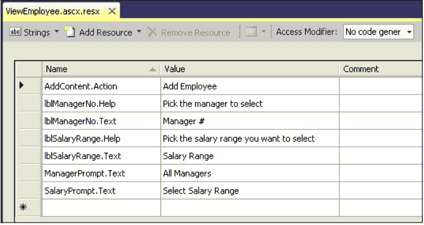

- 16. 我们最后要做的一件事是将新的存储过程添加到卸载脚本中，以确保在卸载模块时删除该存储过程。

- 17. 打开文件 `Uninstall.SqlDataProvider`。

- 18. 滚动到脚本底部并添加以下内容：

```
DROP PROCEDURE {databaseOwner}[{objectQualifier}ACME_GetManagers]
GO
```

- 19. 从**文件**菜单中选择**全部保存**。

- 20. 要检查结果，请将模块生成并部署到你的 DNN 站点（有关说明，请参阅第 5 章中的*将模块作为独立包部署*）。

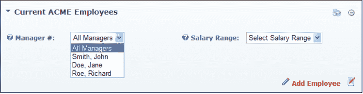

### 工作原理...

HTML 表格通常用于在页面上排列控件。在本方案中，我们在一个 HTML 表格内放置了两个带有标签的下拉列表。这些筛选器将使用户能够控制 DataGrid 中显示的记录。

### 另请参阅

你可以在下一个方案中了解如何使用这些筛选器。

## 使用筛选控件显示 DataGrid

在本方案中，我们将用功能更强大的 DataGrid 控件替换简单的 DataList 控件，并添加一个带有筛选器的可折叠面板。这是一个有用的数据输入控件组合，可以搜索和显示模块记录。

### 准备工作

要继续本方案操作，必须先完成以下方案：

- *创建可折叠面板*
- *从 DNN 列表填充下拉列表*
- *从存储过程填充下拉列表*

### 操作步骤...

- 1. 启动开发工具并加载 Employee 项目。

- 2. 展开 `References` 文件夹，确保显示了 `DotNetNuke.WebControls`。

- 3. 双击打开 `ViewEmployee.ascx` 文件。

- 4. 在文件顶部添加代码，以注册 DotNetNuke.UI.WebControls 命名空间。

```aspx
<%@ Register TagPrefix="dnn" Namespace="DotNetNuke.UI.WebControls"
    Assembly="DotNetNuke" %>
```

- 5. 向下滚动到底部，直到看到现有的 DataList 代码：

```aspx
<asp:datalist id="lstContent" datakeyfield="ItemID" runat="server"
    cellpadding="4">
    <itemtemplate>
        <table cellpadding="4" width="100%">
        ...
        <asp:Label ID="lblSalary" runat="server" CssClass="Normal" />
        </td>
        </tr>
        </table>
    </itemtemplate>
</asp:datalist>
```

- 6. 删除此代码，并替换为以下内容：

```aspx
<asp:datagrid id="grdResults" AutoGenerateColumns="false"
    width="100%" CellPadding="2" GridLines="None"
    cssclass="DataGrid_Container" Runat="server">
    <headerstyle cssclass="NormalBold" verticalalign="Top"
        horizontalalign="Center"/>
    <itemstyle cssclass="Normal" horizontalalign="Left" />
    <alternatingitemstyle cssclass="Normal" />
    <edititemstyle cssclass="NormalTextBox" />
    <selecteditemstyle cssclass="NormalRed" />
    <footerstyle cssclass="DataGrid_Footer" />
    <pagerstyle cssclass="DataGrid_Pager" />
    <columns>
        <dnn:imagecommandcolumn CommandName="Edit"
            ImageUrl="~/images/edit.gif" EditMode="URL"
            KeyFieldId="ItemID" />
        <dnn:imagecommandcolumn CommandName="Delete"
            ImageUrl="~/images/delete.gif" KeyFieldId="ItemID" />

        <dnn:textcolumn datafield="EmpFirstName" headertext="First" />
        <dnn:textcolumn datafield="EmpLastName" headertext="Last"/>
        <dnn:textcolumn datafield="ManagerNo"
            headertext="Manager #" />
        <dnn:textcolumn datafield="FormattedHireDate"
                headertext="Hire Date"/>
        <dnn:textcolumn datafield="Salary" headertext="Salary"/>

    </Columns>
</asp:datagrid>
```

- 7. 双击打开 `01.00.00.SqlProvider` 文件。

> 如果你已经安装过此模块，可以创建一个名为 `01.00.01.SqlDataProvider` 的新文件来保存新过程。有关详细信息，请参阅第 11 章中的*部署新模块版本*。

- 8. 在 `Drop Existing Procedures` 部分的末尾添加：

```sql
if exists (select * from dbo.sysobjects where id =
           object_id(N'{databaseOwner}{objectQualifier}ACME_GetEmployeesByFilter') and
           OBJECTPROPERTY(id, N'IsProcedure') = 1)
    drop procedure {databaseOwner}{objectQualifier}ACME_GetEmployeesByFilter
GO
```

- 9. 滚动到底部并添加以下新过程。这是包含筛选器的标准 `GetEmployees` 过程的修改版本。如果仔细查看，当筛选器的值为 `-1` 时，我们会忽略它们。这就是我们在前面几个方案中放入下拉列表的 `-1`。

```sql
CREATE procedure {databaseOwner}{objectQualifier}ACME_GetEmployeesByFilter
    @ModuleID int,
    @MgrFilter int,
    @SalaryFilter int
AS

/** If we pass -1 for a numeric filter it means ignore the filter
**/

/** create a temp table to hold the Ids of our results **/

    CREATE TABLE #PageIndex
    (
        IndexID    int IDENTITY (1, 1) NOT NULL,
        ItemId     int
    )
```

- 10. 由于我们已向模块添加了新过程，还必须将其添加到卸载脚本中，以便在卸载模块时将其删除。双击打开 Uninstall.SqlDataProvider 文件。

- 11. 向下滚动到底部，添加以下 Drop Procedure：

```sql
DROP PROCEDURE {databaseOwner}[{objectQualifier}ACME_DeleteEmployee]
GO

DROP PROCEDURE {databaseOwner}[{objectQualifier}ACME_GetEmployeesByFilter]
GO
```

/**************************************************************/
/*****              SqlDataProvider              *****/
/**************************************************************/

- 12. 接下来，双击打开 DataProvider.vb 文件。

- 13. 现在我们需要将新的筛选函数定义为抽象方法。这定义了函数的参数（我们将传递哪些筛选器）和返回类型（找到的记录数据集）。滚动到文件底部，在“Abstract Methods”区域的末尾添加新函数：

```vbnet
#Region "Abstract methods"

    Public MustOverride Function GetEmployees(ByVal ModuleId As Integer) As IDataReader
...
    Public MustOverride Sub DeleteEmployee(ByVal ModuleId As Integer, ByVal ItemId As Integer)

    Public MustOverride Function GetEmployeesByFilter(ByVal ModuleId As Integer, ByVal MgrFilter As Integer, ByVal SalaryFilter As Integer) As IDataReader

#End Region
```

- 14. 双击打开 SqlDataProvider.vb 文件。

- 15. 现在我们提供函数体。我们调用存储过程，并将找到的记录作为数据集返回。滚动到文件底部，在“Public Methods”区域的末尾添加此新过程：

```vbnet
Public Overrides Function GetEmployeesByFilter
    (ByVal ModuleId As Integer,
     ByVal MgrFilter As Integer,
     ByVal SalaryFilter As
```

- 19. 找到“Public Properties”部分，并添加属性 FormattedHireDate，以提供格式良好的日期。

```vbnet
' public properties

Public Property FormattedHireDate() As String
    Get
        Return _HireDate.ToShortDateString
    End Get
    Set(ByVal Value As String)
        _HireDate = CDate(Value)
    End Set
End Property

Public Property ModuleId() As Integer
```

- 20. 双击打开 ViewEmployee.ascx.vb 文件。

- 21. 确保文件顶部有以下两个导入语句：

```vbnet
Imports DotNetNuke.Common.Lists
Imports DotNetNuke.UI.WebControls
```

- 22. 向下滚动到“Private Methods”区域，并添加此新的 BindData 过程：

```vbnet
Private Sub BindData()
    Dim objEmployees As New EmployeeController
    Dim colEmployees As ArrayList

    Dim TotalRecords As Integer

    ' use the filter procedure to retrieve the records

    colEmployees = objEmployees.GetEmployeesByFilter(ModuleId, ddlManagerNo.SelectedItem.Value, ddlSalaryRange.SelectedItem.Value, TotalRecords)

    If colEmployees.Count > 0 Then
        grdResults.Visible = True
        grdResults.DataSource = colEmployees
        grdResults.DataBind()
    Else
        ' hide the controls that need data
        grdResults.Visible = False
    End If

End Sub
```


23. 接下来，滚动到 `Page_Load` 过程并添加 `BindData()` 过程调用：

```vb
If Page.IsPostBack = False Then

    BindManagerDropDown()
    BindSalaryDropDown()

    BindData()

End If
```

24. `Page_Init` 例程在 `Page_Load` 例程之前发生，并且经常用于在 `Page_Load` 之前初始化控件。在本例中，我们在用数据填充之前先格式化 DataGrid。我们通过创建一个循环来检查网格的每一列并查找两件事来实现：

- 如果列是名为 "Delete" 的图像，则我们从系统资源文件中提取删除确认消息。
- 如果列是 Edit（像 DNN 在记录旁边显示的小编辑铅笔）则我们使用记录中的 `ItemID` 构造一个指向模块的 `EditEmployee` 表单的链接。

25. 稍微向上滚动到 Event Handlers 区域并在顶部添加此过程：

```vb
Private Sub Page_Init(ByVal sender As System.Object,
    ByVal e As System.EventArgs) Handles MyBase.Init

    ' Format the columns of the grid control

    For Each column As DataGridColumn In grdResults.Columns

        ' if the column is the edit or delete icon, build the URL for the icon
        If column.GetType Is GetType(ImageCommandColumn) Then
            'if it is the delete icon, load the confirmation message from the resource file
            Dim imageColumn As ImageCommandColumn = CType(column, ImageCommandColumn)
            If imageColumn.CommandName = "Delete" Then
                imageColumn.OnClickJS = Localization.GetString("DeleteItem")
            End If

            'Create a URL to pass the selected ItemId to the EditEmployee form
            If imageColumn.CommandName = "Edit" Then
                Dim formatString As String = EditUrl("ItemId", "KEYFIELD", "Edit")
                formatString = formatString.Replace("KEYFIELD", "{0}")
                imageColumn.NavigateURLFormatString = formatString
            End If

        End If

    Next

End Sub
```

26. 接下来，我们需要将出现在 DataGrid 中的删除图标连接到将删除员工记录的处理程序例程。我们所需要做的就是从收到的事件中提取 `ItemId` 值，使用 `Int32` 将其转换为整数，并将其传递给 Starter Kit 创建的 `DeleteEmployee` 例程。向下滚动并将此过程放在 `Page_Load` 过程之后：

```vb
Private Sub grdResults_DeleteCommand(ByVal source As Object, ByVal e As System.Web.UI.WebControls.DataGridCommandEventArgs) Handles grdResults.DeleteCommand
    Try
        Dim objEmployeeController As New EmployeeController
        objEmployeeController.DeleteEmployee(ModuleId, Int32.Parse(e.CommandArgument.ToString()))
        'redisplay results in the DataGrid
        BindData()
    Catch exc As Exception
        ProcessModuleLoadException(Me, exc)
    End Try
End Sub
```

27. 最后，我们想要捕获筛选选择更改时。 在 Event Handlers 区域底部添加这两个新过程：

```vb
Private Sub ddlManagerNo_SelectedIndexChanged(ByVal sender As System.Object, ByVal e As System.EventArgs) Handles ddlManagerNo.SelectedIndexChanged
    BindData()
End Sub

Private Sub ddlSalaryRange_SelectedIndexChanged(ByVal sender As System.Object,
                                               ByVal e As System.EventArgs) Handles ddlSalaryRange.SelectedIndexChanged
    BindData()
End Sub
```

28. 从 **File** 菜单中选择 **Save All**。

29. 要检查结果，请将模块构建并部署到您的 DNN 站点（有关说明，请参阅第 5 章中的配方 *Deploying a module as a standalone package in Chapter 5*）。

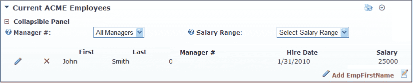

### How it works...

在本配方中，我们采用了 Starter Kit 中的基本模块并以三种方式扩展了它：

- 我们添加了来自上一个配方的筛选控件
- 我们用 DataGrid 控件替换了 DataList 控件
- 我们创建了一个新的数据库过程，用筛选器扩展了基本的 `GetEmployees` 过程

### There's more...

如果您查看本配方中的存储过程，您可能会觉得它在筛选 Employee 记录方面做了不必要的工作（创建临时表等）。存储过程中额外的代码是为了支持分页，我们将在下一个配方中看到。

### See also

在下一个配方中，我们将通过添加分页控件进一步扩展 DataGrid，以便我们可以将 DataGrid 结果限制为可管理的大小。

## Adding a paging control to a DataGrid

在本配方中，我们将通过向 DataGrid 和筛选器添加分页控件来扩展上一个配方。DNN 提供了一个非常好的分页控件，它会根据我们选择的页面大小将筛选后的搜索结果拆分为多个页面。

在本配方中，我们将在 `ViewEmployee` 表单上添加一个新的下拉列表来控制页面的大小。然后我们将修改我们的筛选过程以接受并使用分页变量。

### Getting ready

要跟随本配方，您必须已完成以下配方：

- Displaying a DataGrid with filter controls

### How to do it...

1. 首先启动 Development Tool 并加载 Employee 项目。
2. 双击打开 `ViewEmployee.ascx` 文件。
3. 文件顶部有一个 HTML 表格，用于保存我们在前几章中创建的筛选器。我们需要添加另一个下拉控件来保存页面大小的选项。找到上一个配方中的 HTML 表格并按如下方式更改代码：

```aspx
<table id="tblPanel" cellspacing="2" cellpadding="2" border="0"
      runat="server">
    <tr>
        <td width="12%" class="SubHead">
            <dnn:Label ID="lblManagerNo" runat="server"
                      ControlName="ddlManagerNo" Suffix=":" >
            </dnn:Label>
        </td>
        <td width="18%">
            <asp:DropDownList ID="ddlManagerNo" runat="server"
                      DataTextField="ManagerName"
                      DataValueField="ManagerNo"
                      AutoPostBack="true">
            </asp:DropDownList>
        </td>
        <td width="5%">
            &nbsp;
        </td>
        <td width="12%" class="SubHead">
            <dnn:Label ID="lblSalaryRange" runat="server"
                       ControlName="ddlSalaryRange" Suffix=":">
            </dnn:Label>
        </td>
        <td width="18%">
            <asp:DropDownList ID="ddlSalaryRange" runat="server"
                              DataTextField="Text" DataValueField="Value"
                              AutoPostBack="true">
            </asp:DropDownList>
        </td>
        <td width="5%">
            &nbsp;
        </td>
        <td width="12%" class="SubHead">
            <dnn:Label ID="lblRecordsPage" runat="server"
                       CssClass="SubHead"
                       ResourceKey="RecordsPerPage" Suffix=":">
            </dnn:Label>
        </td>

        <td width="18%">
            <asp:DropDownList ID="ddlRecordsPerPage"
                              runat="server" AutoPostBack="True">
                <asp:ListItem Value="10">10</asp:ListItem>
                <asp:ListItem Value="25">25</asp:ListItem>
                <asp:ListItem Value="50">50</asp:ListItem>
                <asp:ListItem Value="100">100</asp:ListItem>
                <asp:ListItem Value="250">250</asp:ListItem>
            </asp:DropDownList>
        </td>

    </tr>
</table>
```

4. 接下来，滚动到文件底部并在 DataGrid 之后添加此分页控件代码：

```aspx
<br />
<dnn:PagingControl ID="ctlPagingControl" runat="server">
</dnn:PagingControl>
<br />
```

5. 双击打开 `ViewEmployee.ascx.vb` 文件。

6. 为了使分页工作，我们需要记住当前选择的页码。为此我们创建一个私有变量来保存 Page Index。索引从 0 开始（第一页），我们将其传递给存储过程，以便它可以计算哪些记录应出现在页面上。查看文件顶部并添加 Private Members 区域，其中包含单个变量声明。将其放在 Private Methods 区域之前：

```vb
#Region "Private Members"

    Dim PageIndex As Integer = 1

#End Region

#Region "Private Methods"

    Private Sub BindData()
```

7. 稍微向下滚动到 `BindData()` 过程并进行以下更改：

```vb
Private Sub BindData()
    Dim objEmployees As New EmployeeController
    Dim colEmployees As ArrayList

    Dim TotalRecords As Integer
    Dim PageSize As Integer = Convert.ToInt32(ddlRecordsPerPage.SelectedValue)

    Dim CurrentPage As Integer = PageIndex
    If CurrentPage > 0 Then CurrentPage = CurrentPage - 1

    ' use the filter procedure to retrieve the records
    colEmployees = objEmployees.GetEmployeesByFilter(ModuleId, ddlManagerNo.SelectedItem.Value,
                    ddlSalaryRange.SelectedItem.Value,
                    CurrentPage, PageSize, TotalRecords)

    If colEmployees.Count > 0 Then
        grdResults.Visible = True
        grdResults.DataSource = colEmployees
        grdResults.DataBind()

        ctlPagingControl.Visible = (PageSize < TotalRecords)
        InitializePaging(ctlPagingControl, TotalRecords, PageSize)
    Else
        ' hide the controls that need data
        grdResults.Visible = False
        ctlPagingControl.Visible = False
    End If

End Sub
```


- 8. 在 `BindData` 过程之后添加这个新过程：

```vb
Private Sub InitializePaging(ByVal ctlPagingControl As DotNetNuke.UI.WebControls.PagingControl,
                             ByVal TotalRecords As Integer,
                             ByVal PageSize As Integer)

    ctlPagingControl.TotalRecords = TotalRecords
    ctlPagingControl.PageSize = PageSize
    ctlPagingControl.CurrentPage = PageIndex
    Dim strQuerystring As String = ""
    If ddlRecordsPerPage.SelectedIndex <> 0 Then
        strQuerystring += "&PageRecords=" +
                          ddlRecordsPerPage.SelectedValue
    End If

    ctlPagingControl.QuerystringParams = strQuerystring
    ctlPagingControl.TabID = TabId
End Sub
```

- 9. 接下来，找到 `Page_Init` 过程并在最顶部添加这段代码：

```vb
Private Sub Page_Init(ByVal sender As System.Object,
                      ByVal e As System.EventArgs)
                      Handles MyBase.Init

    If Not Request.QueryString("CurrentPage") Is Nothing Then
        PageIndex = CType(Request.QueryString("CurrentPage"),
                          Integer)
    End If

    ' Format the columns of the grid control

    For Each column As DataGridColumn In grdResults.Columns
```

- 10. 滚动到 `Page_Load` 过程，并在 `IsPostBack` 检查内部、绑定调用之前添加这段代码：

```vb
If Not Page.IsPostBack Then

    If Not Request.QueryString("PageRecords") Is Nothing Then
        ddlRecordsPerPage.SelectedValue =
            Request.QueryString("PageRecords")
    End If

    BindManagerDropDown()
    BindSalaryDropDown()

    BindData()

End If
```

## 数据录入技巧

- 11. 最后，滚动到事件处理程序区域底部并添加这段代码以捕获下拉列表更改时：

```vb
Private Sub ddlRecordsPerPage_SelectedIndexChanged
        (ByVal sender As System.Object,
         ByVal e As System.EventArgs) Handles
                ddlRecordsPerPage.SelectedIndexChanged
    PageIndex = 1
    BindData()
End Sub
```

- 12. 双击打开 `DataProvider.vb` 文件。

- 13. 用包含分页参数的这个新版本替换 `GetEmployeesByFilter`：

```vb
Public MustOverride Function GetEmployeesByFilter
        (ByVal ModuleId As Integer,
         ByVal MgrFilter As Integer,
         ByVal SalaryFilter As Integer,
         ByVal PageIndex As Integer,
         ByVal PageSize As Integer) As IDataReader
```

- 14. 双击打开 `SqlDataProvider.vb` 文件。

- 15. 用这个新版本替换 `GetEmployeesByFilter`：

```vb
Public Overrides Function GetEmployeesByFilter
        (ByVal ModuleId As Integer,
         ByVal MgrFilter As Integer,
         ByVal SalaryFilter As Integer,
         ByVal PageIndex As Integer,
         ByVal PageSize As Integer)
                As IDataReader
    Return CType(SqlHelper.ExecuteReader
        (ConnectionString, GetFullyQualifiedName
        ("GetEmployeesByFilter"), ModuleId,
         MgrFilter, SalaryFilter, PageIndex,
         PageSize), IDataReader)
End Function
```

- 16. 双击打开 `EmployeeController.vb` 文件。

- 17. 由于我们为 `GetEmployeesByFilter` 例程添加了新参数，请按如下方式更改代码：

```vb
Public Function GetEmployeesByFilter(ByVal ModuleId As Integer,
                                     ByVal MgrFilter As Integer,
                                     ByVal SalaryFilter As Integer,
                                     ByVal PageIndex As Integer,
                                     ByVal PageSize As Integer,
                                     ByRef TotalRecords As Integer) As ArrayList

    Dim dr As IDataReader =
        DataProvider.Instance.GetEmployeesByFilter
        (ModuleId, MgrFilter, SalaryFilter, PageIndex, PageSize)
    Dim retValue As ArrayList = Nothing
    Try
        While dr.Read
            TotalRecords = Convert.ToInt32(dr("TotalRecords"))
        End While
        dr.NextResult()
        retValue = CBO.FillCollection(dr, GetType(EmployeeInfo))
    Finally
        If Not dr Is Nothing Then
            dr.Close()
        End If
    End Try
    Return retValue

End Function
```

- 18. 我们使用 Try/Finally 结构来捕获可能由存储过程引起的任何错误。如果出现问题，Finally 子句将关闭数据读取器以实现干净退出。

- 19. 接下来，双击打开 01.00.00.SqlDataProvider 文件。

> 如果你已经安装过此模块，可以创建一个名为 01.00.01.SqlDataProvider 的新文件来保存新过程。详情请参阅第 11 章中的配方部署新模块版本。

- 20. 要更新存储过程，我们需要从上一个配方中取出原始的 GetEmployeesByFilter 过程并添加提供分页的代码。它通过将过滤后的结果保存到临时表中，为每条记录分配一个索引值，然后仅返回属于所选页面范围的记录来实现。例如，如果我们每页显示十条记录（PageSize=10）并且我们查看的是第三页（PageIndex 为 2），该过程应返回记录 21-30。请查看存储过程代码并添加下面突出显示的行：

```sql
CREATE procedure {databaseOwner}
    {objectQualifier}ACME_GetEmployeesByFilter
    @ModuleID int,
    @MgrFilter int,
    @SalaryFilter int,
    @PageIndex int,
    @PageSize int
AS

/** If we pass -1 for a numeric filter it means ignore the filter **/

DECLARE @PageLowerBound int
DECLARE @PageUpperBound int

/** Calculate the upper and lower bounds based on the PageIndex and PageSize **/

SET @PageLowerBound = @PageSize * @PageIndex
SET @PageUpperBound = @PageLowerBound + @PageSize + 1

/** create a temp table to hold the Ids of our results **/
CREATE TABLE #PageIndex
(
    IndexID    int IDENTITY (1, 1) NOT NULL,
    ItemId     int
)

/** populate the temp table with the filtered results **/
INSERT INTO #PageIndex (ItemId)
SELECT ItemId
FROM {objectQualifier}ACME_Employee
WHERE (ModuleId = @ModuleId) AND (ManagerNo = @MgrFilter OR @MgrFilter = -1) AND (Salary >= @SalaryFilter)
ORDER BY ItemId DESC

/** remember the count of the results **/
SELECT COUNT(*) as TotalRecords
FROM #PageIndex

/** join the filtered Ids to the employee table to get our fields **/
select Emp.ModuleId,
       Emp.ItemId,
       EmpFirstName,
       EmpLastName,
       ManagerNo,
       HireDate,
       Salary,
       Emp.CreatedByUser,
       Emp.CreatedDate,
       'CreatedByUserName' = Usr.FirstName + ' ' + Usr.LastName
FROM {objectQualifier}ACME_Employee As Emp
INNER JOIN {objectQualifier}Users As Usr on Emp.CreatedByUser = Usr.UserId
INNER JOIN #PageIndex PageIndex
    ON Emp.ItemId = PageIndex.ItemId
WHERE ( (PageIndex.IndexID > @PageLowerBound) OR @PageLowerBound is null )
AND ( (PageIndex.IndexID < @PageUpperBound) OR
@PageUpperBound is null )
ORDER BY
PageIndex.IndexID

GO
```

> 如果你直接将此代码粘贴到主机菜单下的 SQL 表单中，请将第一行更改为 ALTER PROCEDURE...，因为该过程已存在。

- 21. 从 **File** 菜单中选择 **Save All**。

- 22. 通过重新构建和重新部署模块来测试结果。新的每页记录数控件将显示，如果记录数超过可容纳的数量，页面控件将出现在底部（在本例中你至少需要十一条记录才能看到分页控件）。

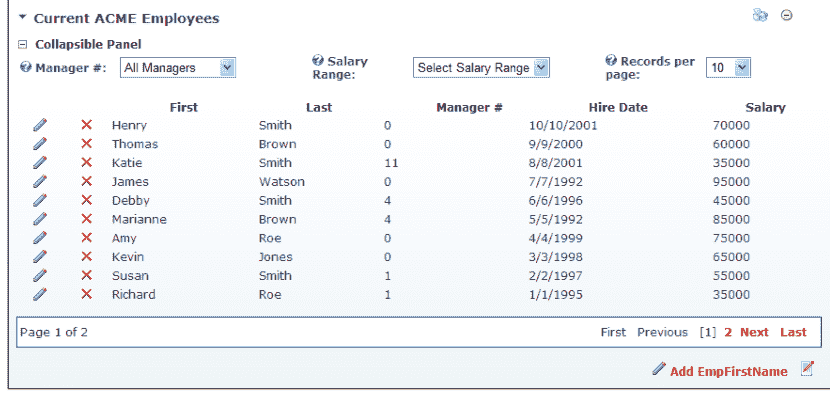

## 如何工作...

本章的最后一个配方将本章的所有组件整合在一起。我们有一个带有从数据库填充的过滤控件的 DataGrid 控件。我们有一个分页控件和可调整的页面大小。最后，我们有一个可折叠面板，可以显示或隐藏过滤器。


