## 酷炫的 Web 控件

在本章中，我们将介绍以下主题：

- 将 Web 控件添加到工具箱
- 在 DataGrid 中显示电子邮件链接
- 在 DataGrid 中显示复选框
- 在 DataGrid 中显示缩略图
- 创建可编辑的标签
- 在输入时提供文本建议
- 在树形视图中显示数据
- 使用标签条分隔内容
- 使用 CAPTCHA 控件保障安全
- 创建多状态复选框

### 简介

DNN 的强大功能之一，就是提供了多种灵活且可复用的控件，用于自定义模块开发。其中包括核心 DNN 页面上的许多 Web 控件，例如可编辑标签、树形视图、CAPTCHA 控件和 Tab 控件。在本章中，我们将了解如何将这些 Web 控件添加到自定义模块，并将它们与数据库中的表关联起来。

通常，使用这些控件只需四个简单步骤：

- 将控件代码添加到 View 或 Edit 的 `.ascx` 文件中
- 向 info 对象添加一个新属性，用于为控件提供值
- 将控件绑定到这些值
- 从控件获取值并保存到数据库（如果是 Edit 页面）

由于本章的实例主要关注 Web 控件和数据库中的值，因此你需要先构建并部署*第6章*中的示例员工模块。我们还将扩展*第6章*中的 DataGrid，并展示它可以显示的不同类型的列。

### 将 Web 控件添加到工具箱

如果你经常使用开发工具中的可视化编辑器来布局页面，那么这个简短实例将向你展示如何将 DNN Web 控件添加到工具箱中。

### 操作步骤...

1. 启动开发工具。
2. 将编辑器切换到设计模式。
3. 确保工具箱已显示。
4. 右键单击工具箱，然后选择 **选择项...**。
5. 单击 **浏览** 按钮。
6. 在 DNN 源代码中导航到 `/bin` 文件夹（`DNNSource/website/bin`）。

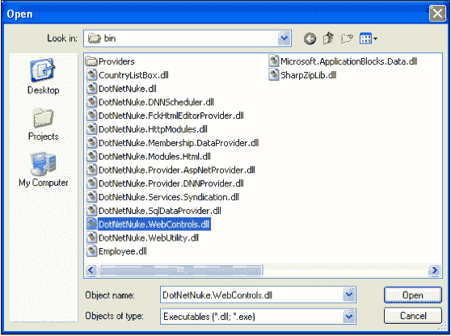

7. 选择 DotNetNuke.WebControls.dll，并单击 **打开**。
8. 确保 DNN 控件已勾选，并单击 **确定**。
9. 现在，当你编辑代码时，这些 Web 控件将出现在工具箱的 **常规** 部分下。

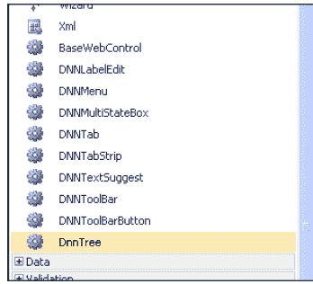

10. 接下来，我们需要添加对 DotNetNuke.WebUtility.dll 的引用。在解决方案资源管理器中右键单击 Employee 项目，然后选择 **添加引用...**。
11. 在弹出的对话框中，单击 **浏览** 选项卡，然后导航到存放 DNN 源文件的文件夹（例如，我的文档\DNNSource\Website\bin）。
12. 选择 DotNetNuke.WebUtility.dll 文件，并单击 **确定**。

### 在 DataGrid 中显示电子邮件链接

正如我们在上一章中所看到的，DataGrid 控件非常适合以格式整齐的表格显示数据库中的记录。但 DataGrid 还可以显示许多其他类型的信息，在本实例中，我们将了解如何在一列中显示电子邮件超链接。

### 准备工作

在本实例中，我们将扩展第6章末尾创建的 DataGrid。要继续操作，你需要先成功完成并部署*使用筛选控件显示 DataGrid* 项目。

> 在本实例中，我们使用一个函数来为示例生成电子邮件地址。这使实例保持简单，但并不太实用。在真实的生产环境中，你会将其作为 Employee 表的一部分存储在数据库中。

### 操作步骤...

1. 启动开发工具并加载 **Employee** 项目。
2. 双击打开 `ViewEmployee.ascx` 文件。
3. 在代码中找到 DataGrid，并在 **Salary** 列之后添加一个新列：

```aspx
<dnn:textcolumn datafield="Salary" headertext="Salary"/>

<asp:TemplateColumn HeaderText="Email Contact">
    <ItemTemplate>
        <asp:HyperLink id="hlEmail"
                       NavigateUrl='<%# "mailto:" & DataBinder.Eval(Container.DataItem,"ContactEmail") %>'
                       Text='<%# DataBinder.Eval(Container.DataItem,"ContactEmail") %>'
                       Target="_new"
                       runat="server" />
    </ItemTemplate>
</asp:TemplateColumn>

</Columns>
</asp:datagrid>
```

4. 接下来，打开 `EmployeeInfo.vb` 文件。
5. 找到“公共属性”部分，并添加只读属性 `EmailAddress`，该属性根据员工姓名构造一个电子邮件地址：

```vb
' public properties

Public ReadOnly Property EmailAddress() As String
    Get
        Return _EmpFirstName.Substring(0, 1) + _EmpLastName + "@yourcompany.com"
    End Get
End Property
```

6. 从 **文件** 菜单中选择 **全部保存**。
7. 要检查结果，请构建模块并将其部署到开发门户进行测试（相关说明请参阅第5章中的*将模块作为独立包部署*实例）。
8. 转到 ACME Employee 页面查看员工列表。新的电子邮件超链接将出现在右侧。

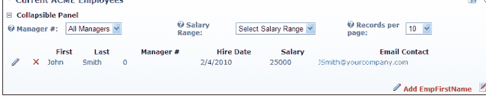

### 工作原理...

在本实例中，我们完成了在 DataGrid 控件中显示电子邮件超链接的任务：

- 我们采用了上一实例中的 DataGrid 控件，并添加了一个包含电子邮件超链接控件的新模板列。
- 我们向 EmployeeInfo 对象添加了一个新属性，用于为 DataGrid 提供电子邮件地址。

### 在 DataGrid 中显示复选框

DataGrid 中一个有用的显示元素是类似复选框的图像，用于指示数据库记录的状态。这些并不是真正可用的复选框，而是一种视觉指示器，用于显示数据为 true 或 false。

该控件通过两张图像工作：一张带有对勾，当值为 true 时显示；另一张为未勾选图像，当值为 false 时显示。

> 本实例适用于任何表示 true 或 false 的图像。类似复选框的图像在其他 DNN 模块中也有使用，因此用户会很熟悉，但你也可以尝试使用自己的图像。

本实例有两个基本步骤：

- 我们将创建 EmployeeInfo 对象的一个新属性，名为 `NewHire`。该属性检查数据库中的入职日期，如果员工的入职时间在 30 天以内，则返回 true。
- 我们将向 DataGrid 添加一个新列，该列会计算 `NewHire` 属性，如果 `NewHire` 为 true 则显示一张图像，如果 `NewHire` 为 false 则显示另一张图像。

### 准备工作

在本实例中，我们将扩展在*第6章*中创建的 DataGrid。要继续操作，你需要先成功完成并部署*使用筛选控件显示 DataGrid* 项目。

### 操作步骤...

1. 启动开发工具并加载 **Employee** 项目。
2. 双击打开 `ViewEmployee.ascx` 文件。
3. 第一步是向 DataGrid 添加一个新列，用于显示复选框图像。我们将使用 `Eval` 函数来检查 `NewHire` 属性。找到 DataGrid，并在 `Salary` 列之后添加一个新列：

```aspx
<dnn:textcolumn datafield="Salary" headertext="Salary"/>

<asp:TemplateColumn HeaderText="New Hire">
    <ItemTemplate>
        <asp:Image Runat="server" ID="imgApproved"
                   ImageUrl="~/images/checked.gif" Visible='<%# DataBinder.Eval(Container.DataItem,"NewHire") = "1" %>'/>
        <asp:Image Runat="server" ID="imgNotApproved"
                   ImageUrl="~/images/unchecked.gif" Visible='<%# DataBinder.Eval(Container.DataItem,"NewHire") = "0" %>'/>
    </ItemTemplate>
</asp:TemplateColumn>

</Columns>
</asp:datagrid>
```

4. 接下来，打开 `EmployeeInfo.vb` 文件。
5. 找到 `Public Properties` 部分，并添加只读属性 `NewHire`。如果员工在过去 30 天内入职，该属性返回 true 或 false：

```vb
' public properties

Public ReadOnly Property NewHire() As Boolean
    Get
        Return (Today - _HireDate).Days < 30
    End Get
End Property
```


6. 从“文件”菜单中选择“全部保存”。

7. 要检查结果，请构建模块并将其部署到开发门户进行测试（有关说明，请参阅第5章中的“以独立包方式部署模块”配方）。

8. 转到 ACME Employee 页面查看员工列表。新的复选框将出现在右侧。

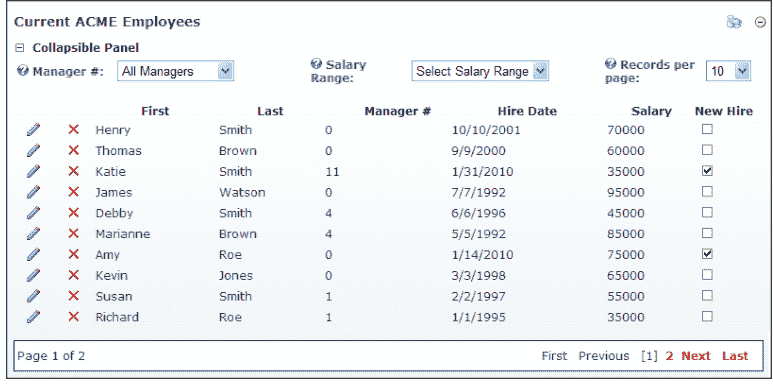

9. 尽管您无法点击这些复选框，但它们确实为记录提供了清晰且易于理解的视觉状态。

## 工作原理...

在本配方中，我们完成了在 Datagrid 控件中显示复选框图像的任务：

- 我们从上一个配方中获取 Datagrid 控件，并添加了一个新的模板列，其中包含两个图像控件，一个选中，另一个未选中。
- 我们向 EmployeeInfo 对象添加了一个新属性，该属性根据数据库记录返回 true 或 false。
- 我们将该属性绑定到控件，这样如果属性为 true，则显示选中的图像；如果属性为 false，则显示未选中的图像。

## 在 Datagrid 中显示缩略图

Datagrid 是一种灵活的控件，可以显示多种信息。在本配方中，我们将了解如何根据 Employee 表中的信息在 Datagrid 中显示小缩略图。

### 准备工作

在本配方中，我们将扩展在 *第6章* 中创建的 Datagrid。要继续操作，您应该已成功完成并部署 *显示带筛选控件的 Datagrid* 项目。

### 操作步骤...

- 1. 首先准备一些要显示的缩略图。通常 64x64 是不错的尺寸，但您可以尝试看看效果。为简单起见，请根据员工姓名命名图像——名字首字母和姓氏，扩展名为 .PNG。
- 2. 现在我们需要将图像上传到 DNN 网站。以 Host 用户身份登录（在我们的示例中为 `syshost`）。
- 3. 查看 **管理** 菜单并选择 **文件管理器**。确保左侧出现 **门户根目录**：
- 4. 在文件夹名称文本框中输入 **SiteImages**，然后点击 **添加文件夹**。
- 5. 点击 **上传** 链接。

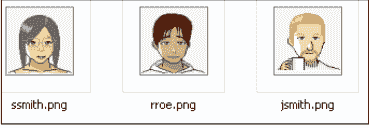

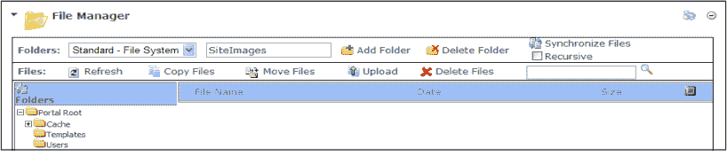

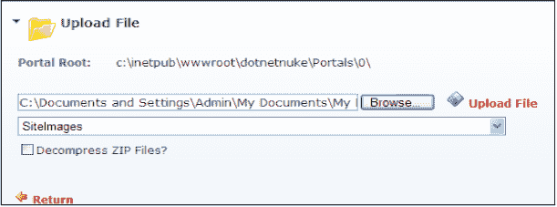

- 6. 点击 **浏览** 按钮并选择一个示例图像。
- 7. 点击 **上传文件** 上传图像。对每个图像重复此操作。

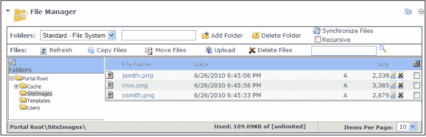

- 8. 一旦图像对网站可用，我们就在模块中编写代码，以便在显示员工时显示图像。
- 9. 启动开发工具并加载 **Employee** 项目。
- 10. 双击打开 `ViewEmployee.ascx` 文件。
- 11. 找到 Datagrid，并在 **编辑** 和 **删除** 链接之后添加一个新列：

```
<columns>
    <dnn:imagecommandcolumn CommandName="Edit" ImageUrl="~/images/edit.gif" EditMode="URL" KeyField="ItemID" />
    <dnn:imagecommandcolumn CommandName="Delete" ImageUrl="~/images/delete.gif" KeyField="ItemID" />

    <asp:TemplateColumn HeaderText="Icon">
        <itemtemplate>

            <asp:HyperLink id="imgView"
                ImageUrl='<%# DataBinder.Eval
                    (Container.DataItem,"ImageURL") %>'>
```

- 12. 接下来，打开 `EmployeeInfo.vb` 文件。
- 13. 找到 **公共属性** 部分，并添加只读属性 `ImageURL`，该属性返回我们上传图像的 URL（基于员工姓名）：

```
' public properties

Public ReadOnly Property ImageURL() As String
    Get
        Return "~\\Portals\\_default\\SiteImages\\" + _
               _EmpFirstName.Substring(0, 1) + _EmpLastName + ".png"
    End Get
End Property

Public ReadOnly Property ContactInfo() As String
    Get
        Return _EmpFirstName + " " + _EmpLastName + " Hired: " +
                                      FormattedHireDate()
    End Get
End Property
```

- 14. 从 **文件** 菜单中选择 **全部保存**。
- 15. 要检查结果，请构建模块并将其部署到开发门户进行测试（有关说明，请参阅 *第5章中的“以独立包方式部署模块”* 配方）。
- 16. 转到 **ACME Employee** 页面查看员工列表。员工图像将出现在左侧。

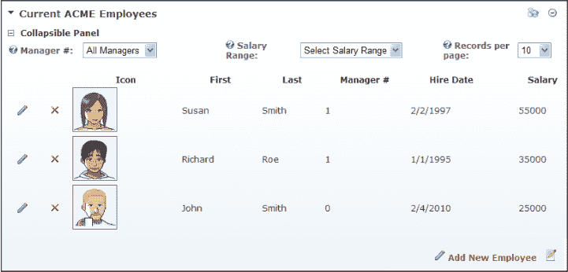

## 工作原理...

在本配方中，我们完成了在 Datagrid 控件中显示图像的任务：

- 我们创建了一组图像并将其上传到 DNN 网站。
- 我们从上一个配方中获取 Datagrid 控件，并添加了一个新的模板列，其中包含一个图像超链接控件。
- 我们向 `EmployeeInfo` 对象添加了一个新属性，该属性为超链接提供图像 URL。

## 更多内容...

在本配方中，图像显示在 Datagrid 中，但没有附带导航。要了解如何创建可点击并导航的缩略图，请参阅第12章中的 *使用 NavigateURL 控制导航* 配方了解详情。

## 创建可编辑的标签

我们在之前的配方中已经见过标签控件，但在本配方中，我们将了解如何使用 `DNNLabelEdit` 控件创建可编辑的标签。您可以在 DNN 网站的模块标题中看到 `DNNLabelEdit` 控件的工作方式，它允许管理员直接在页面上编辑模块标题。

### 准备工作

要跟随本配方操作，您必须已完成以下配方：

- *以独立包方式部署模块*
- *将 Web 控件添加到工具箱*

本配方的重要部分之一是，一旦标签被更改，我们必须将新文本保存到某个地方。幸运的是，DNN 提供了一个保存位置：模块设置。模块设置适用于模块的所有实例，无论它们出现在多少页面上（不同于 Tab 模块设置，Tab 模块设置是针对特定模块实例的设置）。要访问模块设置，我们使用 `UpdateModuleSetting` 例程，传入我们的模块 ID、设置名称和设置值。

### 操作步骤...

- 1. 启动开发工具并加载 **Employee** 项目。
- 2. 双击打开 `EditEmployee.ascx` 文件。
- 3. 确保以下注册指令位于文件顶部：

```
<%@ Register tagprefix="DNN" assembly="DotNetNuke.WebControls"
           namespace="DotNetNuke.UI.WebControls" %>
```

- 4. 找到包含标签和文本控件的 HTML 表格，并注意现有的用于员工名字的标签控件：

```
<table width="650" cellspacing="0" cellpadding="0" border="0"
       summary="Edit Table">

<tr valign="top">
        <td class="SubHead" width="125">
            <dnn:label id="lblEmpFirstName" runat="server"
                      controlname="lblEmpFirstName" suffix=":">
            </dnn:label>
        </td>

        <td>
            <asp:TextBox ID="txtEmpFirstName" runat="server"></asp:TextBox>
```

- 5. 删除原始标签控件，并用以下新的标签代码替换它。源代码现在看起来像这样：

```
<table width="650" cellspacing="0" cellpadding="0" border="0"
       summary="Edit Table">

<tr valign="top">
        <td class="SubHead" width="125">
            <DNN:DNNLabelEdit ID="dleEmpFirstName" runat="server">[click
                                                        here to edit]
            </DNN:DNNLabelEdit>
```

```
</td>
<td>
<asp:TextBox ID="txtEmpFirstName" runat="server"></asp:TextBox>
```

- 6. 这足以让我们编辑标签，但我们也想保存文本更改。为此，我们必须处理标签被重新输入时的事件并保存信息。首先打开 `EditEmployee.ascx.vb` 文件。

- 7. 通过将此代码粘贴到 **事件处理程序** 区域的末尾来创建新的事件处理程序：

```
Private Sub dleEmpFirstName_Updatelabel(ByVal sender As Object,
        ByVal e As DotNetNuke.UI.WebControls.DNNLabelEditEventArgs)
        Handles dleEmpFirstName.UpdateLabel

    Dim modCtrl As New
        DotNetNuke.Entities.Modules.ModuleController
    Dim strLabel As String = e.text.tostring()

    ' save the updated label text in the module settings

    modCtrl.UpdateModuleSetting(ModuleId, "EmpFirstName",
                                strLabel)

End Sub
```

- 8. 最后，将以下代码添加到 `Page_Load` 过程中：

```
If Page.IsPostBack = False Then

    ' load the label text from the module settings

    Dim strLabelText As String = CType(Settings("EmpFirstName"),
                                       String)

    ' if no text was saved in module settings, set it to [click
    '                                             here to edit]
    If strLabelText Is Nothing Then
        ' pull the default label text from the resource file
        strLabelText = Localization.GetString("lblEmpFirstName",
                                              LocalResourceFile)

    End If
    dleEmpFirstName.Text = strLabelText
```

- 9. 从 **文件** 菜单中选择 **全部保存**。


10. 要检查结果，请将模块构建并部署到开发门户以进行测试（有关说明，请参阅第 5 章中的配方《将模块作为独立包部署》）。

11. 转到 ACME 员工页面并单击员工旁边的编辑图标（小铅笔），以显示编辑员工页面。

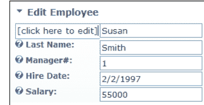

12. 单击标签即可解锁它并允许您输入新标签。离开页面时文本会自动保存。返回时，标签将显示新文本。

## How it works...

在本配方中，我们看到了创建 DNNLabelEdit 控件的任务：

- 我们将控件放置在 .ascx 文件中
- 在文件的代码后台中，我们添加了一个事件处理程序以在标签文本更改时保存标签文本
- 我们更改了 Page_Load 过程以从数据库读取标签文本

## Suggest text while typing

DNNTextSuggest 控件是一个文本框，它会监视用户输入并在用户输入时建议文本。这种行为在搜索引擎和其他网站上经常看到。

该控件的工作方式是拥有一个可能的文本短语列表，可以在用户输入时进行搜索。在本配方中，我们将通过使用 DNN 站点的一部分的美国地理州列表以及编辑员工页面上的新字段来演示此控件。

## Getting ready

要跟随本配方，您必须已完成以下配方：

- Deploying a module as a standalone package
- Adding web controls to your Toolbox

## How to do it...

1. 启动开发工具并加载 **Employee** 项目。
2. 在 **Solution Explorer** 中，在引用下查看并确保您的项目包含对 `DotNetNuke.WebUtility.dll` 的引用。
3. 双击打开 `EditEmployee.ascx` 文件。
4. 确保文件顶部有以下注册指令：
```
<%@ Register tagprefix="DNN" assembly="DotNetNuke.WebControls" namespace="DotNetNuke.UI.WebControls" %>
```
5. 我们将向保存员工字段的 HTML 表格添加一行。找到 HTML 表格并在 `</TABLE>` 标签之前插入以下代码。
```
<tr valign="top">
    <td class="SubHead" width="200"><dnn:label id="lblSalary" runat="server" controlname="lblSalary" suffix=":">
    </dnn:label>
    </td>
    <td>
    <asp:TextBox ID="txtSalary" runat="server"></asp:TextBox>
    <asp:RequiredFieldValidator ID="valSalary" resourcekey="valSalary.ErrorMessage" ControlToValidate="txtSalary" CssClass="NormalRed" Display="Dynamic" ErrorMessage="<br>Salary is required" Runat="server" />
    </td>
</tr>

<tr valign="top">
    <td class="SubHead" width="200">
    <dnn:label id="lblState" runat="server" controlname="lblState" suffix=":">
    </dnn:label>
    </td>
    <td>
    <DNN:DNNTextSuggest ID="txtState" runat="server">
    </DNN:DNNTextSuggest>
    </td>
</tr>
</table>
```

6. 接下来，打开 EditEmployee.ascx.vb 文件。

7. 检查文件顶部并确保它具有以下导入：
Imports DotNetNuke.UI.WebControls
Imports DotNetNuke.Common.Lists

8. 滚动到 Private Methods 区域并添加此过程：
#Region "Private Methods"

Private Sub SuggestText(ByVal objNodes As DNNNodeCollection, ByVal strTypedText As String)

    Dim nodeStates As DNNNode
    Dim objList As New ListController()
    Dim lstStates As ListEntryInfoCollection = objList.GetListEntryInfoCollection("Region", "Country.US")

    Dim state As ListEntryInfo

    'loop through the collection and add it to the result set

    For Each state In lstStates
        If txtState.MaxSuggestRows = 0 Or objNodes.Count < (txtState.MaxSuggestRows + 1) Then
            ' add the state to the list of suggestions
            nodeStates = New DNNNode(state.Text)
            nodeStates.ID = state.Value
            objNodes.Add(nodeStates)
        End If
    Next

End Sub

9. 接下来，我们必须捕获在控件中输入文本时。滚动到 Event Handlers 区域底部并添加以下过程：
Private Sub txtState_UpdateLabel(ByVal sender As Object, ByVal e As DotNetNuke.UI.WebControls.DNNTextSuggestEventArgs) Handles txtState.PopulateOnDemand

    ' call the suggestion procedure and pass the text typed into the control
    SuggestText(e.Nodes, e.Text)

End Sub

#End Region

## See also

在本配方中，我们看到了 SuggestText 网页控件的工作原理以及如何使用它来提示文本值。为了使配方保持简单，它没有包含将值加载和保存到数据库所需的代码。要快速回顾向数据库添加字段以及加载和保存值的例程，请参阅第 4 章中的配方《将模块连接到数据库》。

## Showing data in a Treeview

当您拥有按层次结构排列的信息（如公司的组织结构图）时，会使用 Treeview 控件。Treeview 控件将显示层次结构中的每个级别，并带有用于向下钻取或展开到下一级的图标。

## Getting ready

要跟随本配方，您必须已完成以下配方：

- Deploying a module as a standalone package (from Chapter 5)
- Displaying a Datagrid with filter controls
- Adding web controls to your Toolbox

Treeview 控件要求 Employee 表中的员工已分配给经理。以下是本配方中使用的數據：

| ItemID | EmpFirstName | EmpLastName | ManagerNo | HireDate | Salary | CreatedByUser | CreatedDate |
|---|---|---|---|---|---|---|---|
| 1 | John | Smith | 0 | 2/4/2010 12:00:... | 25000 | 1 | 2/4/2010 9:33:0... |
| 13 | Richard | Roe | 0 | 1/1/1995 12:00:... | 35000 | 1 | 2/11/2010 7:25:2... |
| 14 | Susan | Smith | 0 | 2/2/1997 12:00:... | 55000 | 1 | 2/11/2010 12:00:... |
| 23 | Kevin | Jones | 1 | 3/3/1998 12:00:... | 65000 | 1 | 2/11/2010 12:00:... |
| 24 | Amy | Roe | 1 | 4/4/1999 12:00:... | 90000 | 1 | 2/12/2010 8:27:... |
| 25 | Marianne | Brown | 13 | 5/5/1992 12:00:... | 30000 | 1 | 2/12/2010 8:28:... |
| 26 | Debby | Smith | 14 | 6/6/1996 12:00:... | 90000 | 1 | 2/12/2010 8:27:... |
| NULL | NULL | NULL | NULL | NULL | NULL | NULL | NULL |

在此示例中，员工按简单的两级层次结构排列。如果您的 ManagerNo 为 0，则表示您是经理。否则，您记录上的经理编号是您经理的 ItemID。因此 John Smith 是经理（他的 ManagerNo=0），他管理 Kevin Jones 和 Amy Roe（因为他们的 ManagerNo 是 John Smith 的 ItemID）。

## How to do it...

1. 启动开发工具并加载 **Employee** 项目。
2. 在 **Solution Explorer** 中，在引用下查看并确保您的项目包含对 `DotNetNuke.WebUtility.dll` 的引用。
3. 双击打开 `ViewEmployee.ascx` 文件。
4. 首先在文件顶部添加一个新的注册指令：
```
<%@ Register tagprefix="DNN" assembly="DotNetNuke.WebControls" namespace="DotNetNuke.UI.WebControls" %>
```
5. 接下来，我们将通过在文件底部、分页控件之后放置以下代码来创建一个简单的树控件：
```
<dnn:PagingControl ID="ctlPagingControl" runat="server">
</dnn:PagingControl>
<br />

<DNN:DnnTree ID="treeManager" runat="server" CollapsedNodeImage="~/images\plus.gif" ExpandedNodeImage="~/images\minus.gif">
</DNN:DnnTree>
```
6. 接下来，打开 `ViewEmployee.ascx.vb` 文件。
7. 查看文件顶部并确保以下导入存在：
```
Imports System.Data.SqlClient
Imports DotNetNuke.UI.WebControls
```
8. 我们必须创建一个过程来使用数据库中的记录填充树控件。找到文件顶部的 `Private Methods` 区域并添加以下新过程：
```
#Region "Private Methods"

Private Sub PopulateTreeControl()

    ' set the images to use for the nodes
    treeManager.ImageList.Add("..\images\icon_hostusers_16px.gif")
    treeManager.ImageList.Add("..\images\icon_users_16px.gif")

    ' reset the tree control
    treeManager.TreeNodes.Clear()

    Dim objParentNode As TreeNode
```


# 酷炫的 Web 控件

```
' get the list of all managers and create a parent node for
' each one

Dim objEmployeeController As New EmployeeController
Dim drMgr As SqlDataReader
drMgr = objEmployeeController.GetManagersDR(ModuleId)

If drMgr.HasRows Then
    Do While drMgr.Read()

        objParentNode = New TreeNode()

        objParentNode.Text = drMgr("EmpLastName") + ", " +
                             drMgr("EmpFirstName")
        objParentNode.ImageIndex = 0 ' manager image
        objParentNode.ClickAction = eClickAction.Expand ' when
                                                         ' click on a manager, expand
        objParentNode.HasNodes = True
        treeManager.TreeNodes.Add(objParentNode)

        PopulateEmployeeNodes(objParentNode, drMgr("ItemId"))
    Loop

End If

drMgr.Close()

End Sub

Private Sub PopulateEmployeeNodes(ByRef objParentNode As TreeNode,
                                  ByVal ParentItemId As Integer)

    Dim objChildNode As TreeNode

    ' get the list of all employee with the given manager

    Dim objEmployeeController As New EmployeeController
    Dim colEmployees As ArrayList
    Dim objEmployeeInfo As EmployeeInfo
    Dim TotalRecords As Integer
    colEmployees = objEmployeeController.GetEmployeesByFilter
                     (ModuleId, ParentItemId, -1, 0, 1000,
                      TotalRecords)
```

```
If colEmployees.Count > 0 Then
    ' add a node to the parent that was passed

    For intEmp = 0 To colEmployees.Count - 1
        objEmployeeInfo = CType(colEmployees(intEmp), EmployeeInfo)
        objChildNode = New TreeNode(objEmployeeInfo.EmpLastName +
                                    ", " + objEmployeeInfo.EmpFirstName)
        objChildNode.ImageIndex = 1 ' employee image
        objParentNode.TreeNodes.Add(objChildNode)
    Next intEmp

End If

End Sub

#End Region
```

- 9. 这里我们做的是为树的第一级调用一个新的 `GetManagersDR` 函数，然后调用第 6 章的 `GetEmployeesByFilter` 函数来获取每个经理下属的员工列表。

- 10. 接下来，我们需要在页面加载时调用这些新过程，因此向下滚动到 `Page_Load` 过程，并在 `IsPostBack` 检查中添加以下代码：

```
If Page.IsPostBack = False Then

    If Not Request.QueryString("PageRecords") Is Nothing Then
        ddlRecordsPerPage.SelectedValue =
                                    Request.QueryString("PageRecords")
    End If

    BindManagerDropDown()
    BindSalaryDropDown()

    BindData()

    PopulateTreeControl()
End If
```

- 11. 接下来，打开 `EmployeeController.vb` 文件。

```
<table width="650" cellspacing="0" cellpadding="0" border="0" summary="Edit Table">
<tr valign="top">
<td class="SubHead" width="125"><dnn:label id="lblEmpFirstName" runat="server" controlname="lblEmpFirstName" suffix=":"></dnn:label></td>
<td>
<asp:TextBox ID="txtEmpFirstName" runat="server"></asp:TextBox>
<asp:RequiredFieldValidator ID="valEmpFirstName" resourcekey="valEmpFirstName.ErrorMessage" ControlToValidate="txtEmpFirstName" CssClass="NormalRed" Display="Dynamic" ErrorMessage="<br>EmpFirstName is required" Runat="server" />
</td>
</tr>
<tr valign="top">
<td class="SubHead" width="125"><dnn:label id="lblEmpLastName" runat="server" controlname="lblEmpLastName" suffix=":"></dnn:label></td>
<td>
<asp:TextBox ID="txtEmpLastName" runat="server"></asp:TextBox>
<asp:RequiredFieldValidator ID="valEmpLastName" resourcekey="valEmpLastName.ErrorMessage" ControlToValidate="txtEmpLastName" CssClass="NormalRed" Display="Dynamic" ErrorMessage="<br>EmpLastName is required" Runat="server" />
</td>
</tr>
</table>
</dnn:DNNTabs>
<dnn:DNNTabs Label-Text="Information" ID="tab2">
<table width="650" cellspacing="0" cellpadding="0" border="0" summary="Edit Table">
<tr valign="top">
```

```
```aspx
<td class="SubHead" width="125"><dnn:label
    id="lblManagerNo" runat="server"
    controlname="lblManagerNo" suffix=":">
</dnn:label>

</td>
<td>
<asp:TextBox ID="txtManagerNo" runat="server">
</asp:TextBox>
<asp:RequiredFieldValidator ID="valManagerNo"
    resourcekey="valManagerNo.ErrorMessage"
    ControlToValidate="txtManagerNo"
    CssClass="NormalRed" Display="Dynamic"
    ErrorMessage="<br>ManagerNo is required"
    Runat="server" />
</td>
</tr>

<tr valign="top">
    <td class="SubHead" width="125"><dnn:label
        id="lblHireDate" runat="server"
        controlname="lblHireDate" suffix=":">
    </dnn:label>

    </td>
    <td>
    <asp:TextBox ID="txtHireDate" runat="server">
    </asp:TextBox>
    <asp:RequiredFieldValidator ID="valHireDate"
        resourcekey="valHireDate.ErrorMessage"
        ControlToValidate="txtHireDate"
        CssClass="NormalRed" Display="Dynamic"
        ErrorMessage="<br>HireDate is required"
        Runat="server" />
    </td>
</tr>

<tr valign="top">
    <td class="SubHead" width="125"><dnn:label
        id="lblSalary" runat="server"
        controlname="lblSalary" suffix=":">
    </dnn:label>

    </td>
    <td>
    <asp:TextBox ID="txtSalary" runat="server">
    </asp:TextBox>
    <asp:RequiredFieldValidator ID="valSalary"
```

# 酷炫的 Web 控件

```
resourcekey="valSalary.ErrorMessage"
ControlToValidate="txtSalary"
CssClass="NormalRed" Display="Dynamic"
ErrorMessage="<br>Salary is required" Runat="server" />
</td>
</tr>

</table>
</dnn:DNNTab>
</dnn:DNNTabStrip>
<br /><br />

<p>
    <asp:linkbutton cssclass="CommandButton" id="cmdUpdate"
                    resourcekey="cmdUpdate" runat="server"
                    borderstyle="none" text="Update">
    </asp:linkbutton>&nbsp;
```

> 选项卡条的外观由我们应用在其上的样式控制（CssTabContainer、CssContentContainer、DefaultLabel-CssClass、DefaultLabel-CssClassHover 和 DefaultLabel-CssClassSelected）。在本示例中，我们使用了与 DNN 登录页面相同的样式，因此具有相似的外观和感觉。这些样式默认定义在 `/portals/_default/default.css` 中。

- 6. 从**文件**菜单中选择**全部保存**。
- 7. 要检查结果，请构建模块并将其部署到开发门户进行测试（有关说明，请参阅第 5 章中的食谱*将模块作为独立包部署*）。
- 8. 转到 **ACME Employee** 页面，单击员工旁边的编辑图标（小铅笔）以显示**编辑员工**页面。
- 9. 编辑员工记录时，您将看到字段被分隔到两个单独的选项卡中。单击**员工姓名**显示包含姓名字段的第一个选项卡：

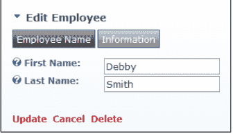

10. 单击**信息**显示其余字段：

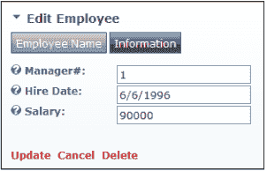

# 工作原理...

在本食谱中，我们看到了使用 TabStrip 控件需要执行的任务：

- 我们将控件放置在 .ascx 文件中
- 我们将现有内容分隔到单独的选项卡上

# 更多内容...

虽然 TabStrip 是一种最大化屏幕“可用空间”的技术，但它不应与我们在第 6 章中看到的分页混淆。TabStrip 在 ASCX 文件中使用，通过将内容分隔到不同的选项卡上来节省空间。分页则通过将数据库记录在从数据库检索时分成组来节省空间。

# 使用 CAPTCHA 控件实现安全

CAPTCHA 是一种检测是否有人在键盘前真实输入的技术。它的工作原理是呈现一个单词或短语的图像，该图像经过足够的扰乱，以致计算机无法读取，但人可以读取。

> 旧版 DNN 在 CAPTCHA 控件中存在缺陷。要跟随本食谱进行操作，您应确保您的 DNN 版本为 5.1 或更高版本。

在本食谱中，我们将展示如何向数据输入表单添加 CAPTCHA 控件，以阻止自动化过程更新记录。

> CAPTCHA 是“Completely Automated Public Turing test to tell Computers and Humans Apart”（全自动区分计算机和人类的图灵测试）的缩写。您可以在 `http://www.captcha.net` 了解更多关于 CAPTCHA 的信息。


## 准备就绪

要遵循本教程，您必须已完成以下教程：

- 将Web控件添加到工具箱
- 将模块作为独立包部署（来自第5章）

## 操作步骤...

1. 启动开发工具并加载**员工**项目。
2. 在解决方案资源管理器中，查看引用，确保你的项目包含对 `DotNetNuke.WebUtility.dll` 的引用。
3. 双击打开 `EditEmployee.ascx` 文件。
4. 确保文件顶部包含以下注册指令：

```aspx
<%@ Register tagprefix="DNN" assembly="DotNetNuke.WebControls"
             namespace="DotNetNuke.UI.WebControls" %>
```

5. 滚动到文件底部，注意包含编辑控件的表格结束以及保存、取消或删除链接显示的位置：

```aspx
</table>
<p>
    <asp:linkbutton cssclass="CommandButton" id="cmdUpdate"
                    resourcekey="cmdUpdate" runat="server"
                    borderstyle="none" text="Update">
    </asp:linkbutton>&nbsp;
```

6. 将以下代码放在HTML表格之后、链接之前：

```aspx
</table>

<p>
<dnn:CaptchaControl ID="btnCaptcha" CaptchaHeight="40"
                    CaptchaWidth="150"
ErrorStyle-CssClass="NormalRed" cssclass="Normal" runat="server"
                    resourcekey="Captcha"
ErrorMessage="The typed code is case sensitive, must match the
              image and cannot be left blank. Please try again."/>
</p>

<p>
    <asp:linkbutton cssclass="CommandButton" id="cmdUpdate"
                    resourcekey="cmdUpdate" runat="server"
                    borderstyle="none" text="Update">
    </asp:linkbutton>&nbsp;
```

7. 接下来，打开 `EditEmployee.ascx.vb` 文件。

8. 由于CAPTCHA控件在允许更改之前进行验证，我们需要修改更新过程，以便在执行更新之前检查是否已提供CAPTCHA值。滚动到 `cmdUpdate_Click` 过程。

9. 在过程顶部添加IF语句的第一部分，并将其余部分放在过程底部。整个过程现在应如下所示：

```vb
Private Sub cmdUpdate_Click(ByVal sender As Object,
                             ByVal e As EventArgs) Handles cmdUpdate.Click
    Try

        If btnCaptcha.IsValid Then

            Dim objEmployees As New EmployeeController

            Dim objEmployee As EmployeeInfo =
                                      New EmployeeInfo

            objEmployee.ModuleId = ModuleId
            objEmployee.ItemId = ItemId
            objEmployee.EmpFirstName =
                                      txtEmpFirstName.Text
            objEmployee.EmpLastName = txtEmpLastName.Text
            objEmployee.ManagerNo = txtManagerNo.Text
            objEmployee.HireDate = txtHireDate.Text
            objEmployee.Salary = txtSalary.Text

            objEmployee.CreatedByUser = Me.UserId

            If Common.Utilities.Null.IsNull(ItemId) Then
                ' add the content within the Employee
                                                  table
                objEmployees.AddEmployee(objEmployee)
            Else
                ' update the content within the Employee
                                                  table
                objEmployees.UpdateEmployee(objEmployee)
            End If

            ' Redirect back to the portal home page
            Response.Redirect(NavigateURL(), True)

        End If

    Catch exc As Exception     'Module failed to load
        ProcessModuleLoadException(Me, exc)
    End Try
End Sub
```

10. 从**文件**菜单中选择**全部保存**。

11. 要检查结果，请将模块构建并部署到开发门户进行测试（有关说明，请参阅第5章中的*将模块作为独立包部署*教程）。

12. 转到**ACME员工**页面，单击员工旁边的编辑图标（小铅笔）以显示**编辑员工**页面。CAPTCHA控件将出现在页面底部。

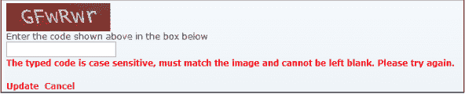

13. 当您单击**更新**链接保存对记录的任何更改时，它将检查您是否填写了正确的CAPTCHA值。如果该值与图像不匹配，则会显示错误消息，并且不保存记录。

## 工作原理...

在本教程中，我们了解了使用CAPTCHA控件的任务：

- 我们将控件放在`.ascx`文件中并设置了属性
- 我们修改了常规更新过程以检查CAPTCHA控件，并且仅在输入正确值时才保存

## 另请参阅

您可以设置的其他控件属性：

| 属性 | 含义 |
|---|---|
| `CaptchaChars` | 可用于创建CAPTCHA的字符集。 |
| `CaptchaHeight` | CAPTCHA图像的高度。 |
| `CaptchaLength` | CAPTCHA中使用的字符总数上限。 |
| `CaptchaWidth` | CAPTCHA图像的宽度。 |
| `CssClass` | 控件的CSS类。 |
| `Text` | 使用的提示文本。 |

## 创建多状态复选框

复选框控件通常有两个可能的值（或状态）：选中和未选中。DNN多状态复选框控件用于希望显示控件状态的视觉指示器，但需要的状态多于选中和未选中的情况。

您可以在DNN页面安全中看到此示例，您可以授予、拒绝或忽略对DNN页面的访问：

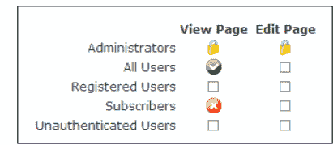

在本教程中，我们将向“编辑员工”页面添加一个四状态复选框，表示员工的奖金级别（无、小、中、大），由颜色编码的星级图标表示。

## 准备就绪

要遵循本教程，您必须已完成以下教程：

- 将Web控件添加到工具箱
- 将模块作为独立包部署（来自第5章）

## 操作步骤...

1. 启动开发工具并加载员工项目。
2. 在解决方案资源管理器中，查看引用，确保你的项目包含对 DotNetNuke.WebUtility.dll 的引用。
3. 双击打开 EditEmployee.ascx 文件。
4. 确保文件顶部包含以下注册指令：

```
<%@ Register tagprefix="DNN" assembly="DotNetNuke.WebControls" namespace="DotNetNuke.UI.WebControls" %>
```

5. 滚动到文件底部，找到包含编辑控件的表格。通过插入以下代码添加一个新的表格行：

```
<tr valign="top">
    <td class="SubHead" width="125"><dnn:label id="lblBonus" runat="server" controlname="msbBonus" suffix=":">
    </dnn:label>
    </td>
    <td>
        <dnn:DNNMultiStateBox ID="msbBonus" runat="server" ImagePath="~/images/">
            <States>
                <dnn:DNNMultiState Key="1" ImageUrl="unchecked.gif" DisabledImageUrl="lock.gif" />
                <dnn:DNNMultiState Key="2" ImageUrl="ratingminus.gif" DisabledImageUrl="lock.gif" />
                <dnn:DNNMultiState Key="3" ImageUrl="ratingzero.gif" DisabledImageUrl="lock.gif" />
                <dnn:DNNMultiState Key="4" ImageUrl="ratingplus.gif" DisabledImageUrl="lock.gif" />
            </States>
        </dnn:DNNMultiStateBox>
    </td>
</tr>

</table>
```

6. 接下来，打开 EditEmployee.ascx.vb 文件。

7. 检查文件顶部，确保包含以下导入：

```
Imports DotNetNuke.UI.WebControls
```

8. 要在显示员工信息时设置复选框，请滚动到 Page_Load 过程，并在现有设置值代码之后添加以下代码：

```
txtHireDate.Text = objEmployee.HireDate
txtSalary.Text = objEmployee.Salary

msbBonus.SelectedStateKey = objEmployee.BonusLevel
```


+   9. 接下来，稍微向下滚动到 `cmdUpdate_Click` 过程并添加以下代码行：

```
objEmployee.HireDate = txtHireDate.Text
objEmployee.Salary = txtSalary.Text

objEmployee.BonusLevel = msbBonus.SelectedState.Key

objEmployee.CreatedByUser = Me.UserId

If Common.Utilities.Null.IsNull(ItemId) Then
```

+   10. 最后，我们需要创建一个新的属性来将员工的薪水转换为奖金等级。打开 `EmployeeInfo.vb` 文件并添加以下代码：

```
' public properties

Public Property BonusLevel() As Integer
    Get
        ' use integer division to get 0,1,2,3...
        Return (_Salary \\ 30000)
    End Get
    Set(ByVal Value As Integer)
        _Salary = Value * 30000
    End Set
End Property
```

+   11. 由于我们使用新的多状态复选框添加了一个新的标签控件，请打开 `ViewEmployee.ascx.resx` 文件（位于 `/App_LocalResources` 下）并设置标签文本和帮助提示：

+   
+   `lblBonus.Text:` **Bonus Level**
+   
+   `lblBonus.Help:` **Click on the icon to set the salary bonus level.**

|  |  |
|---|---|
| lblBonus.Help | Click on the icon to set the salary bonus level. |
| lblBonus.Text | Bonus Level |

+   12. 从 **File** 菜单中选择 **Save All**。

+   13. 要检查结果，请将模块构建并部署到开发门户进行测试（有关说明，请参阅 *Chapter 5* 中 *Deploying a module as a standalone package* 的配方）。

14. 转到 **ACME Employee** 页面并单击员工旁边的编辑图标（小铅笔）以显示 **Edit Employee** 页面。**Bonus Level** 将出现在底部。

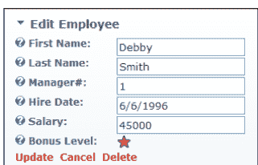

15. 单击 **Bonus Level** 星形图标将更改奖金等级，这将在您更新员工记录时提高或降低薪水。

## How it works...

在本配方中，我们看到了使用多状态复选框的任务：

+   - 我们将控件放置在 .ascx 文件中并定义了它具有的状态数
+   - 对于每个状态，我们选择了一张图片
+   - 在页面加载时我们设置当前状态
+   - 当记录被更新时我们将状态保存到数据库

## There's more...

在此示例中，我们使用了 DNN 站点中的现有图片，但您也可以自由上传并使用自定义图片。要快速回顾如何将图片上传到门户，请参阅本章前面关于在 Datagrid 中显示缩略图图片的配方。

## See also

可以设置的其他控件属性：

| Property | Meaning |
|---|---|
| ImagePath | The path on the server to the folder containing the images for the different checkbox states. |
| ImageUrl | The name of the image file to display for the state. |
| Text | A text message to display next to the image. |
| ToolTip | A message displayed when you hover over the image. |

## 8

## Basic Skinning

在本章中我们将涵盖以下主题：

+   - Downloading and installing a skin
+   - Creating a simple HTML skin
+   - Creating a simple ASCX skin
+   - Deploying your skins and containers
+   - Exploring skin objects
+   - Creating a simple HTML container
+   - Creating a basic ASCX container
+   - Creating custom container images
+   - Styling a container with images
+   - Styling a menu with images

## Introduction

在 DNN 中，skinning 指的是自定义 DNN 门户的外观和感觉的过程。DNN 的强大功能之一是门户的功能与演示分离。这意味着我们可以更改门户的外观而不影响门户的工作方式。

要在 DNN 中创建皮肤，我们将使用三种类型的文件：HTML、ASCX 和 CSS。HTML 或 ASCX 文件描述页面的布局，而 CSS 文件提供样式。如果您以前使用过 HTML 和 CSS，那么您就可以立即开始。然而，如果您熟悉 ASCX（作为 DNN 开发人员很可能如此），您可以通过 HTML 更快地实现相同的结果。在配方中，我们将主要展示 ASCX skinning，并附带一些简短的 HTML skinning 示例。

## Basic Skinning

### ▸ **Skin Objects**

在开始查看配方之前，我们需要快速了解一下 Skin Objects。Skin Objects 在 HTML 和 ASCX 皮肤文件中的用途都是作为不同动态功能占位符。在 HTML 皮肤中，您在代码中放置诸如 `[CURRENTDATE]` 这样的文本标记，当代码被皮肤引擎解析时，它会插入匹配的皮肤对象。如果您在 ASCX 中工作，您将皮肤对象作为控件注册并直接放置在代码中。

DNN 提供了许多不同的皮肤对象，例如 CurrentDate、Logo、Login link 等，我们将在本章的配方中看到其中的许多。

## Downloading and installing a skin

通常开始 skinning 的最简单方法是下载现有的皮肤包并查看用于 skinning 的不同文件。在本配方中，我们将下载 Jon Henning 从名为 CodePlex 的站点创建的一个优秀皮肤，该皮肤演示了最常见的皮肤对象和布局。

开始使用现有皮肤的另一个原因是它允许增量开发。我们可以从一个完全功能齐全的皮肤开始，将其部署到我们的 DNN 门户，然后直接在服务器上编辑源文件。这样我们所做的更改会立即显示，问题很容易被发现和修复。然而，由于应用皮肤可能会影响整个站点，因此最好在生产站点上使用之前在开发 DNN 站点上创建和测试皮肤。

最后，还应注意皮肤实际上只是 DNN 中的另一种扩展类型，因此您已经熟悉其中的一些步骤。

### How to do it...

+   1. 打开您喜欢的网络浏览器并访问站点  
+      `http://codeendeavortemplate.codeplex.com/`。

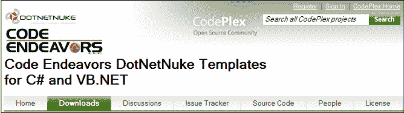

+   2. 在工具栏中单击 **Downloads**。

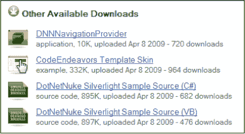

+   3. 稍微向下滚动并单击 **CodeEndeavors Template Skin** 链接。
+   4. 在提示许可协议时，单击 **I Agree**。
+   5. 文件下载对话框会询问您是否要 **Open** 或 **Save**。单击 **Save** 并选择一个临时文件夹来保存 ZIP 文件。
+   6. 这就是我们从 CodePlex 站点所需的所有内容，因此关闭浏览器。
+   7. 要将皮肤安装到 DNN 站点，首先以 SuperUser 身份登录。
+   8. 查看 Control Panel 并确保您处于 Edit 模式。
+   9. 在 **Host** 菜单下选择 **Extensions**。
+   10. 滚动到底部并单击 **Install Extension Wizard** 链接。
+   11. 助手将提示输入 ZIP 文件（称为扩展包）。
+   12. 单击 **Browse** 按钮并选择您刚刚下载的文件（例如 CodeEndeavors.TemplateSkin.install.v01.01.07.00.zip）。单击 **Open** 然后单击 **Next**。

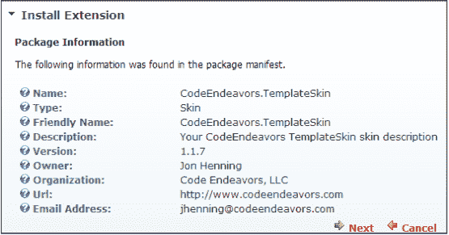

+   13. 助手将显示扩展信息。单击 **Next**。
+   14. 助手将显示发行说明。单击 **Next**。

15. 在许可页面，选中 **Accept License?** 并单击 **Next.**

16. 现在安装脚本将运行，创建皮肤。最后您应该看到消息“Installation successful”。

17. 单击 **Return.**

18. 要使皮肤处于活动状态，请在 **Admin** 菜单下选择 **Skins**。

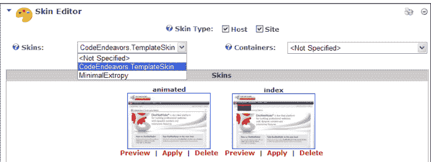

19. 从 **Skins** 下拉列表中，选择 **CodeEndeavors.TemplateSkin.**

20. 在本章中，我们将使用 **Index** 皮肤作为示例。单击 **index** 皮肤下的 **Apply** 链接使其处于活动状态。

21. 要查看皮肤文件，您可以在 DNN 实例的根文件夹中查看 \Portals\_default\Skins\CodeEndeavors.TemplateSkin。

22. 以下是您可能在此类皮肤中看到的关键文件的摘要：

| File name | Description |
|---|---|
| animated.ascx | An ASCX skin file. |
| container.ascx | An ASCX container file. |
| index.html | An HTML skin file. |
| skin.css | The stylesheet for the skin. |
| container.css | The stylesheet for the container. |
| TemplateSkin.dnn | The manifest file for the skin package. |
| thumbnail_animated.jpg | A preview image of the ASCX skin. |
| thumbnail_container.jpg | A preview image of the ASCX container. |
| thumbnail_index.jpg | A preview image of the HTML skin. |
| license.txt | The text of the license agreement. |
| releasenotes.txt | The text of the release notes. |
| version.txt | The version number. |
| Images folder | A folder holding the graphic images supporting a skin or container. |


## 基础皮肤设计

### 如何操作...

- 1. 首先，在测试 DNN 门户中找到默认皮肤文件夹（`\Portals\_default\Skins`）。
- 2. 然后，创建一个新文件夹用于存放皮肤文件。将这个文件夹命名为 `SampleHTMLSkin`。
- 3. 启动开发工具。
- 4. 从 **文件** 菜单中，选择 **新建文件...**。
- 5. 在 **新建文件** 对话框中，选择 **HTML 页面**，然后点击 **打开**。
- 6. 这将生成一个基本的 HTML 文件。接下来，我们需要添加一个简单的 HTML 表格来布局页面。要创建示例图中所示的布局，我们的 HTML 表格代码应如下所示：

  ```html
  <!DOCTYPE html PUBLIC "-//W3C//DTD XHTML 1.0 Transitional//EN"
      "http://www.w3.org/TR/xhtml1/DTD/xhtml1-transitional.dtd">
  <html xmlns="http://www.w3.org/1999/xhtml">
  <head>

  <link id="skin_css" href="skin.css" type="text/css"
        rel="stylesheet" />

      <title>Untitled Page</title>

  </head>
  <body>

          <table width="100%">
                  <tr>
                          <td width="60%">
                                  [MENU]
                          </td>
                          <td width="40%">
                                  [USER]

                                  &nbsp;&nbsp;&nbsp;&nbsp;
                                  [LOGIN]
                          </td>
                  </tr>
                  <tr>
                          <td>
  <div id="ContentPane" runat="server"></div>
  </td>
  <td>
      <div id="RightPane" runat="server"></div>
  </td>
  </tr>

  </table>

  </body>
  </html>
  ```

- 7. 这里我们创建了一个与布局图对应的两列两行 HTML 表格。然后我们将皮肤对象和 DIV 放置到表格中。
- 8. 从 **文件** 菜单中，选择 **将 HTMLPage1.htm 另存为...**。
- 9. 浏览到 `SampleHTMLSkin` 文件夹，并将文件保存为 `SampleHTMLSkin.htm`。
- 10. 接下来，我们需要为皮肤创建 CSS 文件。从 **文件** 菜单中选择 **新建文件...**。
- 11. 在 **新建文件** 对话框中，选择 **样式表**，然后点击 **打开**。
- 12. 将文件内容替换为：

  ```css
  /* General Styles */
  body                         {background: #CCCCCC; height: 100%; margin: 0px; padding: 0px;}
  a, a:link, a:visited, a:active {color: #800000; text-decoration: none; font-family: Verdana, Arial, Helvetica, sans-serif; font-weight: normal;}
  a:hover                      {color: #C00; text-decoration: none;}

  /* Styles for Controlling the Layout */
  .template_style              {width: 960px; margin: auto;}
  .content                     {background: white; border-left: solid 1px #EAEAEA; border-right: solid 1px #EAEAEA; padding: 10px; margin: 0 5px 0 5px;}
  ```

- 13. 从 **文件** 菜单中，选择 **将 StyleSheet1.css 另存为...**。
- 14. 浏览到 `SampleHTMLSkin` 文件夹，并将文件保存为 `skin.css`。
- 23. 虽然内容不多，但你可以看到 HTML 表格布局已正确地将菜单放在左上角，**登录/注销**链接位于右上角。内容出现在我们放置它的左下角 ContentPane 中，空的 RightPane 位于右下角。
- 24. 要确切了解皮肤安装做了什么，请查看包含皮肤的文件夹。就在你创建的 `SampleHTMLSkin.htm` 文件旁边，解析器创建了 `SampleHTMLSkin.ascx` 和一个缩略图 `samplehtmlskin.jpg`（如果你为皮肤包含了一张图片）。

  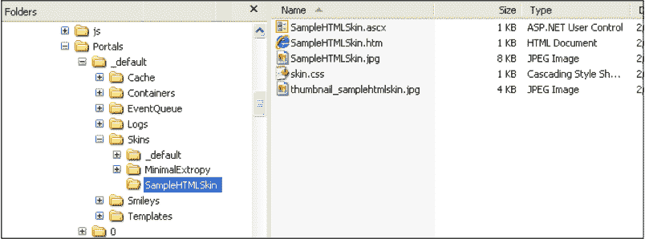

- 25. 要了解如何将此皮肤部署到生产门户，请参见 *部署你的皮肤和容器* 一节。

### 工作原理...

皮肤部署后，皮肤引擎将自动解析皮肤包并生成所需的 `SampleHTMLSkin.ascx` 文件。如果你仍在开发皮肤并在服务器上编辑 `SampleHTMLSkin.htm` 文件，则必须点击 **解析皮肤包** 链接，更改才会出现在门户中。

如果你熟悉 HTML 并想开始学习创建 ASCX 皮肤，可以查看解析器生成的 ASCX 皮肤，了解 HTML 是如何转换的。你甚至可以直接编辑 ASCX 文件，查看你的更改对皮肤的影响。

### 更多内容...

在本操作指南中，我们使用了 HTML 表格来定位皮肤对象。虽然这对 HTML 开发者来说可能是一种熟悉的技术，但通过使用 CSS 文件，我们可以对对象的定位获得更强大的控制。此外，还可以使用更复杂的令牌（token）并向其传递参数。你可以在第 13 章 *高级皮肤设计* 中看到相关示例。

## 创建简单的 ASCX 皮肤

虽然你可以在 HTML 中开发皮肤并将其解析为 ASCX，但许多开发者更喜欢直接使用 ASCX 工作。这样做的好处是文件中的更改可以立即显示，而无需先进行解析。你选择哪种方法通常取决于你的背景。如果你更熟悉 ASCX，可能会觉得它比使用 HTML 更容易。但是，如果你确实改用 ASCX，请确保删除原始 HTML 文件，否则你的更改可能会被任何修复原始 HTML 文件的人覆盖。

在开发基于 ASCX 的皮肤时，有一些小的差异。当在 ASCX 中使用皮肤对象的控件时，你首先要在文件顶部放置一个控件注册指令，然后在 ASCX 文件主体中引用它。控件注册后，你可以根据需要多次使用它，只要为每个控件提供唯一的 ID。

下面是我们将创建的页面布局示意图：

| 菜单 | 用户登录 |
|---|---|
| ContentPane | RightPane |

### 如何操作...

- 1. 首先，在测试 DNN 门户中找到默认皮肤文件夹（`\Portals\_default\Skins`）。
- 2. 然后，创建一个新文件夹用于存放皮肤文件。将这个文件夹命名为 `SampleASCXSkin`。
- 3. 启动开发工具。
- 4. 从 **文件** 菜单中，选择 **新建文件...**。
- 5. 在 **新建文件** 对话框中，选择 **Web 用户控件**，然后点击 **打开**。
- 6. 第一步是在文件顶部放置以下指令：

  ```aspx
  <%@ Control language="vb" AutoEventWireup="false" Explicit="True"
               Inherits="DotNetNuke.UI.Skins.Skin" %>
  ```

  > 旧版皮肤（5.x 之前）不继承自 DotNetNuke.UI.Skins.Skin，因此，如果要将旧版皮肤转换为 5.x，则需要添加这一行。

- 7. 下一步是为我们要使用的每个皮肤对象添加注册指令：

  ```aspx
  <%@ Register TagPrefix="dnn" TagName="NAV"
               Src="~/Admin/Skins/Nav.ascx" %>
  <%@ Register TagPrefix="dnn" TagName="USER"
               Src="~/Admin/Skins/User.ascx" %>
  <%@ Register TagPrefix="dnn" TagName="LOGIN"
      Src="~/Admin/Skins/Login.ascx" %>
  ```

- 8. 要创建导航菜单，我们将添加一个 DIV 并插入 NAV 控件：

  ```html
  <div>
      <dnn:NAV runat="server" id="dnnNAV"
          ProviderName="DNNMenuNavigationProvider"
          IndicateChildren="false"
          ControlOrientation="Horizontal" />
  </div>
  ```

- 9. 然后添加代码来创建用户和登录/注销链接：

  ```html
  <div id="login_style" class="user">
      <dnn:USER runat="server" id="dnnUSER" CssClass="user" />
      &nbsp;&nbsp;|&nbsp;&nbsp;
      <dnn:LOGIN runat="server" id="dnnLOGIN" CssClass="user" />
  </div>
  ```

- 10. 最后，我们使用 HTML 表格创建内容窗格，但将其包裹在 DIV 中：

  ```html
  <div class="content">
      <table width="100%" border="0" cellspacing="0" cellpadding="0">
          <tr>
              <td valign="top" id="LeftPane" class="LeftPane"
                  runat="server" visible="false">
              </td>
              <td valign="top" id="ContentPane" class="ContentPane"
                  runat="server" visible="false">
              </td>
              <td valign="top" id="RightPane" class="RightPane"
                  runat="server" visible="false">
              </td>
          </tr>
      </table>
  </div>
  ```

- 11. 现在整个文件应如下所示：

  ```aspx
  <%@ Control language="vb" AutoEventWireup="false" Explicit="True"
      Inherits="DotNetNuke.UI.Skins.Skin" %>

  <%@ Register TagPrefix="dnn" TagName="NAV"
      Src="~/Admin/Skins/Nav.ascx" %>
  <%@ Register TagPrefix="dnn" TagName="USER"
      Src="~/Admin/Skins/User.ascx" %>
  <%@ Register TagPrefix="dnn" TagName="LOGIN"
  ```


## 基本皮肤设计

```
Src="~/Admin/Skins/Login.ascx" %>

<div >
    <dnn:NAV runat="server" id="dnnNAV"
             ProviderName="DNNMenuNavigationProvider"
             IndicateChildrens="false"
             ControlOrientation="Horizontal" />
</div>

<div id="login_style" class="user">
    <dnn:USER runat="server" id="dnnUSER" CssClass="user" />
    &nbsp;&nbsp;|&nbsp;&nbsp;
    <dnn:LOGIN runat="server" id="dnnLOGIN" CssClass="user" />
</div>

<div class="content">
    <table width="100%" border="0" cellspacing="0" cellpadding="0">
        <tr>
            <td valign="top" id="LeftPane" class="LeftPane"
                runat="server" visible="false">
            </td>
            <td valign="top" id="ContentPane" class="ContentPane"
                runat="server" visible="false">
            </td>
            <td valign="top" id="RightPane" class="RightPane"
                runat="server" visible="false">
            </td>
        </tr>
    </table>
</div>
```

- 12. 从**文件**菜单中选择**将 WebUserControl1.ascx 另存为...**。
- 13. 浏览到 `SampleASCXSkin` 文件夹，并将文件保存为 `SampleASCXSkin.ascx`。
- 14. 要创建 CSS 文件，请从**文件**菜单中选择**新建文件...**。
- 15. 在**新建文件**对话框中，选择**样式表**并单击**打开**。
- 16. 将文件内容替换为：

```
/* General Styles */
body                         {background: #CCCCCC; height:
100%; margin: 0px; padding: 0px;}
a, a:link, a:visited, a:active  {color: #800000; text-decoration:
none; font-family: Verdana, Arial, Helvetica, sans-serif; font-
weight: normal;}
```

```
a:hover {
    color: #C00;
    text-decoration: none;
}

/* Styles for Controlling the Layout */
.template_style {
    width: 960px;
    margin: auto;
}
.content {
    background: white;
    border-left: solid 1px #EAEAEA;
    border-right: solid 1px #EAEAEA;
    padding: 10px;
    margin: 0 5px 0 5px;
}

/* Control Styles */
#login_style {
    float: right;
    padding: 10px 17px 0px 10px;
}

/* Pane Styles */
.ContentPane {
    padding: 0px;
    margin: 0px;
}
.MiddlePane {
    padding: 0px 0px 0px 10px;
    width: 10em;
    margin: 0px;
}
.LeftPane {
    padding: 0px 10px 0px 0px;
    width: 10em;
    margin: 0px;
}
.RightPane {
    padding: 0px 0px 0px 10px;
    width: 10em;
    margin: 0px;
}

/* User Styles */
.user, a.user:link, a.user:active, a.user:visited {
    color: #800000;
    font-size: 12px;
}
a.user:hover {
    color: #C00;
}
```

- 17. 通过这些样式，我们将登录链接定位在右侧，定义窗格，并设置用户链接的颜色和大小。
- 18. 从**文件**菜单中选择**将 StyleSheet1.css 另存为...**。
- 19. 浏览到 `SampleASCXSkin` 文件夹，并将文件保存为 `skin.css`。
- 20. 另一件有用的事情是为皮肤创建预览图像。这有些困难，因为连皮肤都还没有创建，不过你可以使用简单的绘图程序（如 MS Paint）来绘制一幅你计划中皮肤外观的图片。类似这样：

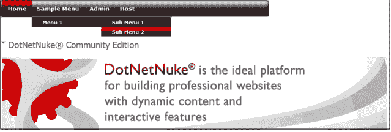

## 基本皮肤设计

- 21. 将图像文件保存为 `SampleASCXSkin.jpg`。
- 22. 要查看新皮肤在网站上的效果，请首先以超级用户身份登录。
- 23. 在**管理**菜单下查找并选择**皮肤**。
- 24. 新的**SampleASCXSkin**皮肤将会出现：

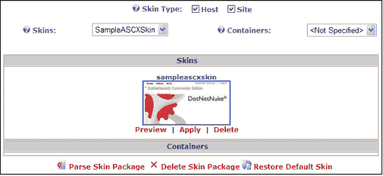

25. 要查看皮肤的外观，请单击**预览**链接。

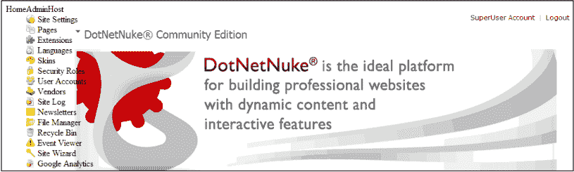

26. 虽然效果不多，但它正确包含了皮肤对象和一个非常简单的布局。本章中的其他方案将展示如何添加样式元素和额外的皮肤对象。

## 另请参阅

这个示例 ASCX 皮肤将成为*探索皮肤对象*和*使用图像设计菜单样式*两个方案的基础。

## 部署皮肤和容器

与模块一样，皮肤必须打包并部署到 DNN 服务器上。部署后，它们将出现在**管理**菜单下的**皮肤**页面中，以供预览并应用到门户。

在之前的方案中，我们看到了如何在测试 DNN 门户上直接创建新皮肤。这样你可以编辑文件，并只需刷新浏览器即可立即看到效果。但是，当皮肤完全开发完成后，本方案将向你展示如何使用打包向导将皮肤打包为可移植的 ZIP 文件。

创建完成后，你可以通过超级用户身份登录 DNN 站点，然后上传 ZIP 文件并将皮肤包作为扩展安装。皮肤安装在 \Portals\_default\Skins 文件夹中。

> 从 DNN 5.x 开始，只有超级用户才能部署皮肤。这是出于安全考虑，因为皮肤现在可以包含用户编写的代码。

### 准备工作

对于本方案，你需要准备要部署的皮肤文件。我们将使用前一个方案“创建简单的 ASCX 皮肤”中的皮肤文件。

### 操作步骤...

- 1. 首先以超级用户身份登录。
- 2. 在主机菜单下查看并选择扩展。
- 3. 首先查看已安装的扩展，并在皮肤部分找到 SampleASCXSkin。如果看到它，请跳到步骤 8，否则必须先创建扩展。首先从操作菜单中选择**创建扩展**（或单击页面底部的链接）。
- 4. 从“扩展类型”下拉列表中选择“皮肤”，并按如下所示填写表单：

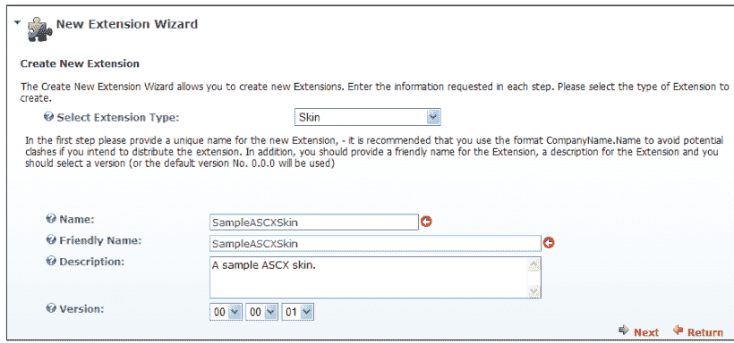

## 基本皮肤设计

- 5. 单击**下一步**。
- 6. 提供所有者信息，然后点击**下一步**。
- 7. 新的**SampleASCXSkin**皮肤将出现在扩展列表中。
- 8. 单击名称旁边的**编辑**图标。
- 9. 滚动到底部，并点击**创建包**链接。
- 10. 将显示**创建包**界面。单击**下一步**。
- 11. 在下一个界面上，你将看到皮肤文件。单击**下一步**。
- 12. 接下来，显示清单。单击**下一步**。
- 13. 向导将使用所有者名称和皮肤名称生成 ZIP 文件的文件名。单击**下一步**。
- 14. 向导将显示摘要页面并完成。你将在 `/Install/Skin` 文件夹中找到 ZIP 文件。单击**返回**关闭向导。
- 15. 文件打包为 ZIP 文件后，你可以按照*下载并安装皮肤*方案中的说明进行上传和安装。

## 探索皮肤对象

在之前的方案中，我们看到了皮肤对象通过文本标记（在 HTML 中）或控件（在 ASCX 中）插入 DNN 功能的示例，例如登录链接和菜单。在本方案中，我们将扩展示例 ASCX 皮肤，并演示你可以使用的其他皮肤对象。

### 准备工作

要继续本方案，你必须先完成以下方案：

- - _创建简单的 ASCX 皮肤_

下面是我们将创建的新页面布局示意图：

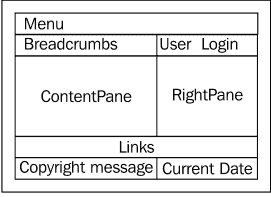

### 操作步骤...

- 1. 首先在你的测试 DNN 门户中找到默认皮肤文件夹（`\\Portals\\_default\\Skins`）。
- 2. 接下来，创建一个新文件夹来存放皮肤文件。将此文件夹命名为 `DetailedASCXSkin`。
- 3. 启动开发工具。
- 4. 从*创建简单的 ASCX 皮肤*方案中打开 `SampleASCXSkin.ascx` 文件。
- 5. 在现有指令之后添加以下注册指令：

```
<%@ Register TagPrefix="dnn" TagName="BREADCRUMB"
    Src="~/Admin/Skins/BreadCrumb.ascx" %>
<%@ Register TagPrefix="dnn" TagName="TEXT"
    Src="~/Admin/Skins/Text.ascx" %>
<%@ Register TagPrefix="dnn" TagName="LINKS"
    Src="~/Admin/Skins/Links.ascx" %>
<%@ Register TagPrefix="dnn" TagName="COPYRIGHT"
    Src="~/Admin/Skins/Copyright.ascx" %>
<%@ Register TagPrefix="dnn" TagName="CURRENTDATE"
    Src="~/Admin/Skins/CurrentDate.ascx" %>
```

- 6. 接下来，将现有的 `Login_Style` DIV 替换为一个同时包含登录和用户链接的新 DIV：

```
<%--By placing the SkinObjects inside a parent DIV they share the
same style--%>

<div class="bread_bg">
    <div id="bread_style">
        <dnn:TEXT runat="server" id="dnnTEXT"
            CssClass="breadcrumb_text" Text="You are here"
            ResourceKey="Breadcrumb" />
        &nbsp;<span>
            <dnn:BREADCRUMB runat="server" id="dnnBREADCRUMB"
                CssClass="Breadcrumb"
                RootLevel="0" Separator="&nbsp;>&nbsp;" />
        </span>
    </div>
    <div id="login_style" class="user">
        <dnn:USER runat="server" id="dnnUSER" CssClass="user" />
        &nbsp;&nbsp;|&nbsp;&nbsp;
        <dnn:LOGIN runat="server" id="dnnLOGIN" CssClass="user" />
    </div>
</div>
```


- 7. 最后，保持 ContentPane DIV 不变，并在其正下方添加这些新的 DIV：

```html
<div class="bot_bg links">
<dnn:LINKS runat="server" id="dnnLINKS" CssClass="links" Level="Root" Separator="&nbsp;&nbsp;&nbsp;| &nbsp;&nbsp;&nbsp;" />
</div>

<div class="bot_pad">
<div id="copy_style" class="footer">
<dnn:COPYRIGHT runat="server" id="dnnCOPYRIGHT" Align CssClass="footer" />
</div>
<div id="date_style" class="footer">
<dnn:CURRENTDATE runat="server" id="dnnCURRENTDATE" Align CssClass="footer" />
</div>
</div>
```

> 将 Copyright 和 Date 分到单独的 DIV 中，可以让我们将一个放在页面左下角，另一个放在页面右下角。

- 8. 从 File 菜单中选择 Save SampleASCXSkin.ascx As...

- 9. 浏览到 DetailedASCXSkin 文件夹并将文件保存为 DetailedASCXSkin.ascx。

- 10. 这些新的 Skin 对象需要样式。打开来自 Creating a simple ASCX skin recipe 的 skin.css 文件。

- 11. 在 skin.css 文件底部添加以下样式：

```css
/*breadcrumbs*/
.Breadcrumb, a.Breadcrumb:link, a.Breadcrumb:active, a.Breadcrumb:visited {color: #800000; font-size: 13px;}
a.Breadcrumb:hover {color: #C00;}

.bread_bg {background-color: #EAEAEA; font-family: Verdana, Arial, Helvetica, sans-serif; border-left: solid 1px #EAEAEA; border-right: solid 1px #EAEAEA; margin: 0 5px 0 5px; height: 30px;}
#bread_style {float: left; padding: 10px 0px 0px 17px; color: #000000; font-size: 13px;}

/* for the bottom of the page */

.bot_bg {background-color: #EAEAEA;
border-left: solid 1px #EAEAEA;border-right: solid 1px #EAEAEA;
border-bottom: solid 1px #EAEAEA; padding: 10px;   margin: 0 5px 0 5px;}
.bot_pad {font-family: Verdana, Arial, Helvetica, sans-serif; margin-bottom: 20px; padding: 0 30px 0 20px;}

#terms_style {float: left;}
#copy_style {float: left;}
#date_style {float: right; padding: 0px 0px 0px 10px; }

/*links*/
.links {text-align: center;}
.links, a.links:link, a.links:active, a.links:visited {font-weight: bold; color: #800000; font-size: 11px;}
a.links:hover {color: #C00;}

/* Sets the font size and text color of the footer at the bottom of the page */
.footer, a.footer:link, a.footer:active, a.footer:visited {color: #800000; font-size: 12px;}
a.footer:hover {color: #C00;}
```

- 12. 有了这些样式，我们将面包屑链接定位在菜单正下方左侧。登录和用户链接仍保留在右侧，ContentPane 和 RightPane 保持不变，而新的 Links、Copyright 和 CurrentDate 控件沿页面底部排列。

- 13. 从 File 菜单中选择 Save skin.css As...

- 14. 浏览到 DetailedASCXSkin 文件夹并将文件保存为 skin.css。

- 15. 要查看新皮肤在网站上的效果，请以 SuperUser 身份登录。

- 16. 在 Admin 菜单下选择 Skins。

- 17. 新的 DetailedASCXSkin 现在会出现：

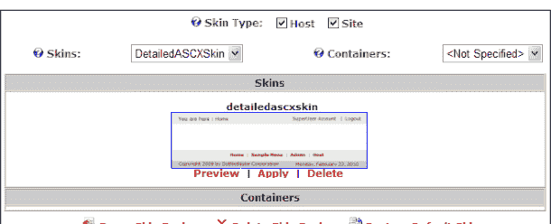

## Basic Skinning

- 18. 点击 **Preview** 查看皮肤的外观：

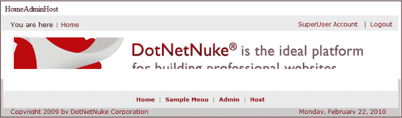

- 19. 可以看到面包屑（**You are here**）出现在菜单下方左侧，用户和登录在右侧，链接沿底部排列，版权信息和当前日期出现在底部角落。

### There's more...

如果你好奇在你的 DNN 站点上有哪些 Skin 对象可用，可以以 SuperUser 身份登录并在 **Host** 菜单下选择 **Extensions**。这将列出所有皮肤对象及其版本号。

> 某些皮肤对象可能默认未安装，在安装前不会出现在此列表中。

## Creating a simple HTML container

虽然皮肤设置了整个页面的样式，但 DNN 也允许在模块容器级别进行皮肤设置。你可以将容器视为模块内容的周围区域。它包括模块标题以及通常出现在内容下方的主菜单和操作链接。

在本教程中，我们将使用 HTML 创建一个简单的容器。我们还将介绍容器可用的一些 Skin 对象。

容器有自己的标记，与皮肤中使用的标记不同。本教程将使用以下标记：

| Token | Description |
|---|---|
| `[ACTIONS]` | 创建模块悬停菜单。 |
| `[TITLE]` | 模块的标题。 |
| `[VISIBILITY]` | 提供展开或折叠容器的能力。 |
| `[PRINTMODULE]` | 管理员的链接，映射到不同的 ModuleActionTypes（本例中为打印模块）。 |

以下是我们将创建的容器的示意图：

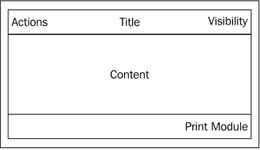

### How to do it...

- 1. 首先在你的测试 DNN 门户中定位默认容器文件夹（`\Portals\_default\Containers`）。

- 2. 接下来，创建一个新文件夹来存放容器文件。将此文件夹命名为 HTMLContainer。

- 3. 启动 Development Tool。

- 4. 从 **File** 菜单中选择 **New File...**。

- 5. 在 **New File** 对话框中，选择 **HTML Page** 并点击 **Open**。

- 6. 这将给你一个基本的 HTML 文件。接下来我们需要添加所需 CSS 文件的链接。

```html
<!DOCTYPE html PUBLIC "-//W3C//DTD XHTML 1.0 Transitional//EN" "http://www.w3.org/TR/xhtml1/DTD/xhtml1-transitional.dtd">
<html xmlns="http://www.w3.org/1999/xhtml">
<head>
    <title>Untitled Page</title>

    <link id="container_css" href="container.css" type="text/css"
          rel="stylesheet" />
</head>
<body>
</body>
</html>
```

- 7. 接下来，我们需要添加将控制容器布局的 HTML 表格：

```html
<body>
<div class="container_bkg">
<TABLE cellPadding="0" width="100%" border="0">
<TR>
<TD width="25"></TD>
<TD align="center">[ACTIONS]</TD>
<TD width="100%" align="center">[TITLE]</TD>
<TD align="center">[VISIBILITY]</TD>
<TD width="25"></TD>
</TR>
<TR>
<TD width="25">&nbsp;</TD>
<TD id="ContentPane" colspan="3" align="center" runat="server">
</TD>
<TD width="25">&nbsp;</TD>
</TR>
<TR>
<TD width="25"></TD>
<TD colspan="3" align="right">[PRINTMODULE]</TD>
<TD width="25"></TD>
</TR>
</TABLE>
</div>
</body>
```

- 8. 整个文件现在应如下所示：

```html
<!DOCTYPE html PUBLIC "-//W3C//DTD XHTML 1.0 Transitional//EN" "http://www.w3.org/TR/xhtml1/DTD/xhtml1-transitional.dtd">
<html xmlns="http://www.w3.org/1999/xhtml">
<head>
<title>Untitled Page</title>

<link id="container_css" href="container.css" type="text/css" rel="stylesheet" />

</head>
<body>

<div class="container_bkg">
<TABLE cellPadding="0" width="100%" border="0">
<TR>
<TD width="25"></TD>
<TD align="center">[ACTIONS]</TD>
<TD width="100%" align="center">[TITLE]</TD>
<TD align="center">[VISIBILITY]</TD>
<TD width="25"></TD>
</TR>
<TR>
<TD width="25">&nbsp;</TD>
<TD id="ContentPane" colspan="3" align="center" runat="server">
</TD>
<TD width="25">&nbsp;</TD>
</TR>
<TR>
<TD width="25"></TD>
<TD colspan="3" align="right">[PRINTMODULE]</TD>
<TD width="25"></TD>
</TR>
</TABLE>
</div>

</body>
</html>
```

- 9. 从 **File** 菜单中选择 **Save HTMLPage1.htm As...**。

- 10. 浏览到 `HTMLContainer` 文件夹并将文件保存为 `HTMLContainer.htm`。

- 11. 这些新的 Skin 对象需要样式。从 **File** 菜单中选择 **New File...**。

- 12. 在 New File 对话框中，选择 Style Sheet 并点击 Open。

- 13. 用以下内容替换文件内容：

```css
/* General Styles */
.TitleLabel{color:GrayText;font-size: 15px;}
.container_bkg {background-color:#DAE7F2;border:solid 1px #4F839F;}
```

- 14. 从 File 菜单中选择 Save StyleSheet1.css As...

- 15. 浏览到 HTMLContainer 并将文件保存为 container.css。

- 16. 你还可以为新的容器制作一个预览图片，例如：

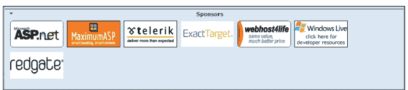

- 17. 将图片文件保存为 HTMLContainer.jpg。

- 18. 要查看新容器在我们网站上的效果，首先以 SuperUser 身份登录。

- 19. 在 Admin 菜单下选择 Skins。

- 20. 从 Containers 下拉列表中选择 HTMLContainer。

- 21. 点击 Parse Skin Package 链接。

- 22. 新的 HTMLContainer 现在会出现：

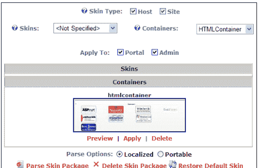


23. 若要查看容器的外观，请单击 **预览** 链接。

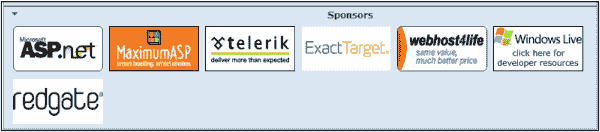

24. 这是一个简单的容器，但查看 **赞助商** 之类的模块时，你会看到左侧的悬停菜单，以及模块标题在容器中居中显示，背景为浅蓝色。

## 创建基本的 ASCX 容器

正如皮肤可以使用 HTML 或 ASCX 创建一样，容器也可以用这两种方式开发。在本教程中，我们将看到一个简单的 ASCX 容器。

下面是我们将要创建的容器示意图：

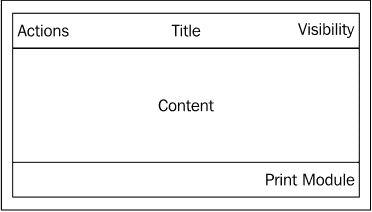

### 操作步骤...

- 1. 首先，在你的测试 DNN 门户中找到默认容器文件夹（`\\Portals\\_default\\Containers`）。
- 2. 接下来，创建一个新文件夹来存放容器文件。将此文件夹命名为 ASCXContainer。
- 3. 启动开发工具。
- 4. 从 **文件** 菜单中，选择 **新建文件...**。
- 5. 在 **新建文件** 对话框中，选择 **Web 用户控件**，然后单击 **打开**。
- 6. 第一步是在文件顶部放置以下指令：

```
<%@ Control Language="VB"
    CodeBehind="~/admin/Containers/container.vb"
    AutoEventWireup="false" Explicit="True"
    Inherits="DotNetNuke.UI.Containers.Container" %>
```

7. 下一步是为我们计划使用的每个皮肤对象添加注册指令：

```
<%@ Register TagPrefix="dnn" TagName="ACTIONS"
    Src="~/Admin/Containers/SolPartActions.ascx" %>
<%@ Register TagPrefix="dnn" TagName="TITLE"
    Src="~/Admin/Containers/Title.ascx" %>
<%@ Register TagPrefix="dnn" TagName="VISIBILITY"
    Src="~/Admin/Containers/Visibility.ascx" %>
<%@ Register TagPrefix="dnn" TagName="PRINTMODULE"
    Src="~/Admin/Containers/PrintModule.ascx" %>
```

8. 要创建容器的结构，我们将使用 HTML 表格来布局皮肤对象：

```
<div class="container_bkg">
    <TABLE cellPadding="0" width="100%" border="0">
        <TR>
            <TD width="25"></TD>
            <TD align="center"><dnn:ACTIONS runat="server"
                id="dnnACTIONS" />
            </TD>
            <TD width="100%" align="center"><dnn:TITLE runat="server"
                id="dnnTITLE" />
            </TD>
            <TD align="center"><dnn:VISIBILITY runat="server"
                id="dnnVISIBILITY" />
            </TD>
            <TD width="25"></TD>
        </TR>
        <TR>
            <TD width="25">&nbsp;</TD>
            <TD id="ContentPane" colspan="3" align="center"
                runat="server" >
            </TD>
            <TD width="25">&nbsp;</TD>
        </TR>
        <TR>
            <TD width="25"></TD>
            <TD colspan="3" align="right">
                <dnn:PRINTMODULE runat="server" id="dnnPRINTMODULE" />
            </TD>
            <TD width="25"></TD>
        </TR>
    </TABLE>
</div>
```

9. 现在整个文件应该如下所示：

```
<%@ Control language="vb"
    CodeBehind="~/admin/Containers/container.vb"
    AutoEventWireup="false" Explicit="True"
    Inherits="DotNetNuke.UI.Containers.Container" %>

<%@ Register TagPrefix="dnn" TagName="ACTIONS"
    Src="~/Admin/Containers/SolPartActions.ascx" %>
<%@ Register TagPrefix="dnn" TagName="TITLE"
    Src="~/Admin/Containers/Title.ascx" %>
<%@ Register TagPrefix="dnn" TagName="VISIBILITY"
    Src="~/Admin/Containers/Visibility.ascx" %>
<%@ Register TagPrefix="dnn" TagName="PRINTMODULE"
    Src="~/Admin/Containers/PrintModule.ascx" %>

<div class="container_bkg">
    <TABLE cellPadding="0" width="100%" border="0">
        <TR>
            <TD width="25"></TD>
            <TD align="center"><dnn:ACTIONS runat="server"
                    id="dnnACTIONS" /></TD>
            <TD width="100%" align="center"><dnn:TITLE runat="server"
                    id="dnnTITLE" />
            </TD>
            <TD align="center"><dnn:VISIBILITY runat="server"
                    id="dnnVISIBILITY" />
            </TD>
            <TD width="25"></TD>
        </TR>
        <TR>
            <TD width="25">&nbsp;</TD>
            <TD id="ContentPane" colspan="3" align="center"
                runat="server" >
            </TD>
            <TD width="25">&nbsp;</TD>
        </TR>
        <TR>
            <TD width="25"></TD>
            <TD colspan="3" align="right">
                <dnn:PRINTMODULE runat="server" id="dnnPRINTMODULE" />
            </TD>
            <TD width="25"></TD>
        </TR>
    </TABLE>
</div>
```

## 基本皮肤制作

10. 从“文件”菜单中选择“将 WebUserControl1.ascx 另存为...”。

11. 浏览到 ASCXContainer 文件夹，并将文件保存为 ASCXContainer.ascx。

12. 接下来，通过从“文件”菜单中选择“新建文件...”来创建 CSS 文件。

13. 在“新建文件”对话框中，选择“样式表”，然后单击“打开”。

14. 将文件内容替换为：

```
/* General Styles */
.TitleLabel{color:GrayText;font-size: 15px;}
.container_bkg {background-color:#DAE7F2;border:solid 1px #4F839F;}
```

15. 从“文件”菜单中选择“将 StyleSheet1.css 另存为...”。

16. 浏览到 ASCXContainer 文件夹，并将文件保存为 container.css。

17. 你还可以制作新容器的预览图像，例如：

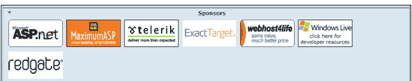

18. 将图像文件保存为 ASCXContainer.jpg。

19. 要查看新容器在站点上的效果，首先以超级用户身份登录。

20. 查看“管理”菜单，然后选择“皮肤”。

21. 从“容器：”下拉列表中选择 ASCXContainer。

22. 新的 ASCXContainer 将立即出现：

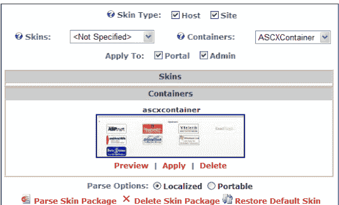

23. 若要查看容器的外观，请单击“预览”链接。

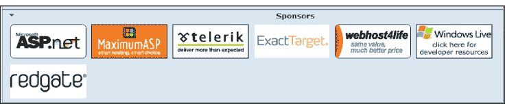

24. 这是一个简单的容器，但查看“赞助商”之类的模块时，你会看到左侧的悬停菜单，以及模块标题在容器中居中显示，背景为浅蓝色。

## 创建自定义容器图像

容器不仅仅充当模块内容的占位符。通过扩展容器皮肤以包含图像，我们可以创建更精致的容器，仅受限于我们的创造力。

使用图像设置 DNN 容器样式是一个分为两部分的过程。首先，我们必须创建所需的图像，并将它们保存为一组图形文件。然后，我们必须设计容器，将图像定位在容器周围。在本教程中，我们将了解如何创建用于设置容器样式的自定义图像。在下一个教程 “使用图像设置容器样式” 中，我们将了解如何定位这些图像以创建最终的容器。

### 准备工作

下面的示意图显示了最终容器的外观。我们需要创建图中以红色突出显示的五个图像。正如你在该图中所见，我们只需为特色元素创建图像。CSS 可以通过根据需要重复背景图像来填补空白，以适应容器的大小。

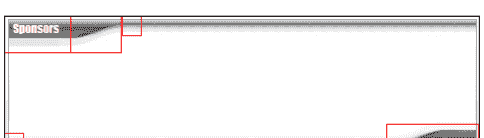

为容器创建图像是一个四步过程：

-   决定容器的哪些边使用图像。在此示例中，我们将为容器的顶部和底部边缘创建图像，并让左侧和右侧保持简单的边框线。
-   决定图像的尺寸。容器边框可以非常窄，也可以非常宽。在此示例中，我们将使用这些图像创建一个 27 像素宽的边框。
-   决定哪些图像将平铺以支持可变尺寸的容器。由于容器可以拉伸或收缩，我们需要使用能够平铺的图像。也就是说，可以重复该图像任意多次，以填满容器的宽度。在此示例中，我们将选择一个图像在顶部平铺，另一个图像在底部平铺。由于两侧只是边框线，我们无需担心垂直平铺的问题。
-   选择一个绘图应用程序（例如 MS Paint）来创建图像，并将它们保存到临时文件夹。你可以使用各种格式——在此示例中，我们将图像保存为 GIF 文件以节省空间。

### 操作步骤...

- 1. 首先启动你喜欢的绘图应用程序（例如 MS Paint）。
- 2. 将图像尺寸设置为 98 像素宽、27 像素高。这些尺寸没有特别之处，只是对于这个特定的设计来说效果不错。
- 3. 绘制容器左上角的图像。该图像将作为模块标题的背景，因此它需要是一个可以水平平铺的图像，因为容器标题的长度会变化。

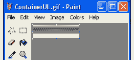

- 4. 将图像保存为名为 ContainerUL.gif 的 GIF 文件。
- 5. 接下来，创建一个尺寸为 80 × 27 像素的新图像。该图像标志着模块标题的结束和顶部容器边框的开始。它不会平铺，在此示例中用于将左上角与横跨容器顶部的边框图像连接起来。

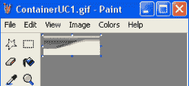


6. 将图像保存为名为 `ContainerUC1.gif` 的 GIF 文件。

7. 下一张图像是容器的顶部边框，并且会随着容器宽度的变化水平平铺。将属性设置为 12 像素宽 27 像素高。

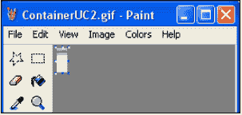

8. 将图像保存为名为 `ContainerUC2.gif` 的 GIF 文件。

9. 对于容器底部的边框，我们需要再两张图像。第一张是左下角。使此图像为 90 像素宽 27 像素高。此图像将沿底部平铺以适应容器的宽度。

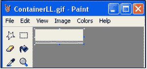

10. 将图像保存为名为 `ContainerLL.gif` 的 GIF 文件。

11. 最后一张图像用于右下角。此图像不平铺。使其为 100 像素宽 27 像素高。

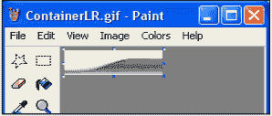

12. 将图像保存为名为 `ContainerLR.gif` 的 GIF 文件。

13. 此时你应该在临时文件夹中有五张图像，看起来像这样：

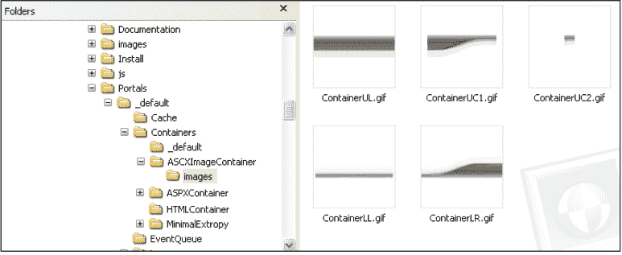

### 还有更多...

在本教程中，我们看到了如何为容器创建图像，以及图像如何构成容器边框的原理。在下一个教程中，我们将看到如何创建将使用这些图像的容器。

## 使用图像设置容器样式

正如我们在上一教程中所见，使用图像设置容器样式的第一步是创建图像。在本教程中，我们将迈出第二步，通过添加将创建容器图形边框的图像来扩展简单的 ASCX 容器。我们还将演示如何更改字体和文本颜色。

### 准备工作

要跟随本教程，你必须已完成以下教程：

- *创建简单的 ASCX 容器*
- *创建自定义容器图像*

### 如何操作...

1. 首先在测试 DNN 门户中定位默认容器文件夹（`\Portals\_default\Containers`）。

2. 接下来，创建一个新的文件夹来存放容器文件。将此文件夹命名为 `ASCXImageContainer`。

3. 在其中创建新的文件夹来存放图像：`ASCXImageContainer\images`。

4. 将你在上一教程中创建的五张图像复制到此新文件夹。你现在应该有以下文件：

- ContainerUL.gif：容器的左上角
- ContainerUC1.gif：第一个上部居中图像
- ContainerUC2.gif：第二个上部居中图像
- ContainerLL.gif：左下角
- ContainerLR.gif：右下角

5. 将图像放在正确的文件夹后，启动开发工具。

6. 要创建 ASCX 文件，从 **File** 菜单中选择 New File...。

7. 在 New File 对话框中，选择 Web User Control 并单击 Open。

8. 第一步是在文件顶部放置以下指令：

```
<%@ Control language="vb"
    CodeBehind="~/Admin/Containers/container.vb"
    AutoEventWireup="false" Explicit="True"
    Inherits="DotNetNuke.UI.Containers.Container" %>
```

9. 接下来，放置我们需要支持容器的 Skin Objects 的必要注册指令：

```
<%@ Register TagPrefix="dnn" TagName="ACTIONS"
    Src="~/Admin/Containers/SolPartActions.ascx" %>
<%@ Register TagPrefix="dnn" TagName="ICON"
    Src="~/Admin/Containers/Icon.ascx" %>
<%@ Register TagPrefix="dnn" TagName="TITLE"
    Src="~/Admin/Containers/Title.ascx" %>
<%@ Register TagPrefix="dnn" TagName="VISIBILITY"
    Src="~/Admin/Containers/Visibility.ascx" %>
<%@ Register TagPrefix="dnn" TagName="ACTIONBUTTON1"
    Src="~/Admin/Containers/ActionButton.ascx" %>
<%@ Register TagPrefix="dnn" TagName="ACTIONBUTTON2"
    Src="~/Admin/Containers/ActionButton.ascx" %>
<%@ Register TagPrefix="dnn" TagName="ACTIONBUTTON3"
    Src="~/Admin/Containers/ActionButton.ascx" %>
<%@ Register TagPrefix="dnn" TagName="ACTIONBUTTON4"
    Src="~/Admin/Containers/ActionButton.ascx" %>
<%@ Register TagPrefix="dnn" TagName="ACTIONBUTTON5"
    Src="~/Admin/Containers/ActionButton.ascx" %>
```

10. 为了定位图像，我们首先使用一个包含的表格来设置容器的样式，然后包含容器的顶部表格、ContentPane 的位置，然后是另一个表格来容纳容器底部的图像：

```html
<table width="100%" border="0" align="center" cellpadding="0" cellspacing="0" class="ASCXImage_Master">
<tr>
<td class="ContainerUC2">
<table height="27" border="0" cellpadding="0" cellspacing="0">
<tr>
<td valign="top" class="ContainerUL">
<dnn:ACTIONS runat="server" id="dnnACTIONS" />
</td>
<td valign="top" class="ContainerUL">
<dnn:ICON runat="server" id="dnnICON" />
</td>
<td valign="top" class="ContainerUL">&nbsp;
<dnn:TITLE runat="server" id="dnnTITLE" CssClass="ASCXImage_Title"/>
</td>
<td valign="top" class="ContainerUC1">&nbsp;</td>
<td valign="bottom" class="ContainerUC2">&nbsp;</td>
</TR>
</table>
<table width="100%" border="0" align="center" cellPadding="0" cellSpacing="0">
<tr>
<td class="ASCXImage_Content">
<div runat="server" id="ContentPane">
</div>
</td>
</TR>
</table>
<table width="100%" height="21" border="0" cellpadding="0" cellspacing="0">
<tr>
<td valign="middle" class="ContainerLL">&nbsp;</td>
<td valign="middle" class="ContainerLR">&nbsp;</td>
</tr>
</table>
</td>
</tr>
</table>
```

11. 最后，我们创建表格来容纳操作按钮，这些按钮位于边框图像之外：

```html
<table width="100%" height="25" border="0" cellpadding="2"
       cellspacing="0">
    <tr valign="bottom">
        <td align="left" nowrap>
            <dnn:ACTIONBUTTON1 runat="server"
                id="dnnACTIONBUTTON1"
                CommandName="AddContent.Action"
                DisplayIcon="True" DisplayLink="True" />
        </td>
        <td height="22" align="right" nowrap>
            <dnn:ACTIONBUTTON2 runat="server"
                id="dnnACTIONBUTTON2"
                CommandName="SyndicateModule.Action"
                DisplayIcon="True"
                DisplayLink="False" />&nbsp;
            <dnn:ACTIONBUTTON3
            runat="server" id="dnnACTIONBUTTON3"
            CommandName="PrintModule.Action"
            DisplayIcon="True"
            DisplayLink="False" />&nbsp;
            <dnn:ACTIONBUTTON4
            runat="server" id="dnnACTIONBUTTON4"
            CommandName="ModuleSettings.Action"
            DisplayIcon="True"
            DisplayLink="False" />
            <dnn:ACTIONBUTTON5
            runat="server" id="dnnACTIONBUTTON5"
            CommandName="ModuleHelp.Action"
            DisplayIcon="True" DisplayLink="False" />
        </td>
    </tr>
</table>
```

12. 从 **File** 菜单中选择 **Save WebUserControl1.ascx As...**。

13. 浏览到 `ASCXImageContainer` 文件夹并将文件保存为 `ASCXImageContainer.ascx`。

14. 接下来我们创建 CSS 文件，从 **File** 菜单中选择 **New File...**。

15. 在 **New File** 对话框中，选择 **Style Sheet** 并单击 **Open**。

16. 用以下内容替换文件内容：

```css
/* Set the containing width and border color */
.ASCXImage_Master { width: 100%; background-color: transparent;
BORDER: #A0A0A0 1px solid; padding: 0px; }

/* Set the title font */
.ASCXImage_Title { font-family: Impact; font-size: 12px; color:
#ffffff; font-weight: normal; }

/* Set the padding */
.ASCXImage_Content { padding-left: 5px; padding-right: 5px;
padding-top: 5px; padding-bottom: 0px; font-size: 15px; color:
#404040; }

/* Set the images to draw the box around the container */

.ContainerUL { background: url(images/ContainerUL.gif) repeat-x;
height: 27px; }
.ContainerUC1 { background: url(images/ContainerUC1.gif) no-repeat;
width: 80px; height: 27px; }
.ContainerUC2 { background: url(images/ContainerUC2.gif) repeat-x;
height: 27px; }
.ContainerLL { background: url(images/ContainerLL.gif) repeat-x;
height: 27px; }
.ContainerLR { background: url(images/ContainerLR.gif) no-repeat;
width: 100px; height: 27px; }
```

17. 从 **File** 菜单中选择 **Save StyleSheet1.css As...**。

18. 浏览到 ASCXImageContainer 文件夹并将文件保存为 container.css。

19. 你还可以制作新容器的预览图像，例如：

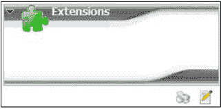

20. 将图像文件保存为 ASCXImageContainer.jpg。

21. 要查看新容器在我们网站上的外观，首先以 SuperUser 身份登录。

22. 在 **Admin** 菜单下选择 **Skins**。

23. 从 **Containers:** 下拉列表中选择 **ASCXImageContainer**。


24. 新的 ASCXContainer 现在将会显示：

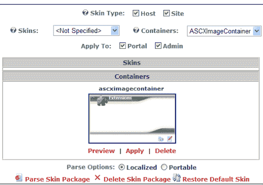

25. 若要查看容器的外观，请单击“预览”链接。

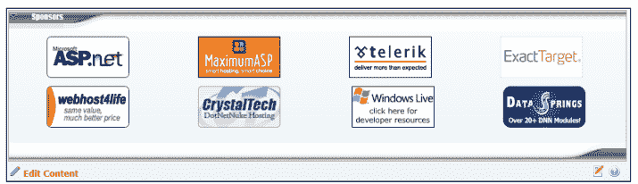

26. 我们可以看到，这些图像在容器周围形成边框，模块标题位于左侧，紧邻悬停菜单。此外，可以看到我们在步骤11中创建的操作按钮出现在容器下方。还要注意，顶部和底部的线条图像会自动填充到容器的整个宽度。

## 使用图像设置菜单样式

在本教程中，我们将使用简单的 ASCX 皮肤，并展示如何通过将菜单控件与背景图像相结合来为菜单设置外观。

使用图像为 DNN 菜单设置外观包括两部分：第一部分是构成菜单背景的一组图像；第二部分是由菜单控件提供的菜单中显示的文本。

## 基本外观设置

在本教程中，我们将详细研究为模板皮肤创建的专业外观菜单。我们将看到构成菜单的所有部分、如何为其创建背景图像以及如何设置文本样式。当所有部分到位后，我们将会得到一个如下所示的菜单：

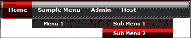

## 准备工作

要继续本教程，您必须已完成以下教程：

- 下载并安装皮肤
- 创建简单的 ASCX 皮肤

## 操作步骤

1. 首先，在测试 DNN 门户中找到默认皮肤文件夹（`\\Portals\\_default\\Skins`）。
2. 接下来，创建一个新文件夹来存放皮肤文件。将此文件夹命名为 `ASCXMenuSkin`。
3. 在其中创建一个新文件夹以存放图像：`ASCXMenuSkin\\images`。
4. 找到 *下载并安装皮肤* 教程中模板皮肤所在的文件夹。
5. 找到以下图像并将其复制到 `ASCXMenuSkin\\images` 文件夹中。
   - `menu_bg.png`
   - `menu_hov.png`
   - `menu_left.png`
   - `menu_right.png`
   - `submenu_hov.png`

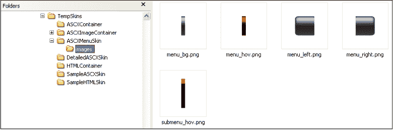

6. 图像就位后，我们现在可以打开 *创建简单的 ASCX 皮肤* 教程中创建的示例 ASCX，并进行扩展以使用菜单图像。
7. 启动开发工具。
8. 从**文件**菜单中选择**打开文件...**。
9. 浏览到 SampleASCXSkin 文件夹，并选择 SampleASCXSkin.ascx 文件。
10. 在注册 DIV 和登录 DIV 之间找到菜单皮肤对象：

```
<%@ Register TagPrefix="dnn" TagName="LOGIN" Src="~/Admin/Skins/Login.ascx" %>

<div >
    <dnn:NAV runat="server" id="dnnNAV"
        ProviderName="DNNMenuNavigationProvider"
        IndicateChildren="false"
        ControlOrientation="Horizontal" />
</div>

<div id="login_style" class="user">
```

11. 用下面这个使用 CSS 样式的 DIV 替换包含菜单的 DIV：

```
<%@ Register TagPrefix="dnn" TagName="LOGIN" Src="~/Admin/Skins/Login.ascx" %>

<div class="menu_style">
    <dnn:NAV runat="server" id="dnnNAV"
        ProviderName="DNNMenuNavigationProvider"
        IndicateChildren="false"
        ControlOrientation="Horizontal"
        CSSControl="mainMenu" />
</div>
<div id="login_style" class="user">
```

12. 从**文件**菜单中选择**将 SampleASCXSkin.ascx 另存为...**。
13. 浏览到 ASCXMenuSkin 文件夹，并将文件保存为 ASCXMenuSkin.ascx。
14. 由于真正的工作在 CSS 文件中，我们需要定义样式，为菜单提供图像、字体和颜色。从**文件**菜单中选择**打开文件...**。
15. 浏览到 SampleASCXSkin 文件夹，并选择 skin.css 文件。
16. 滚动到文件底部，首先添加以下类：

```
/* step 1: the main menu */

.mainMenu                 {font-family: Verdana, Arial,
Helvetica, sans-serif; cursor: pointer; font-size: 13px; font-
weight: bold;}
.mainMenu_bg              {background: url(images/menu
bg.png) repeat-x top left; margin: 0 19px 0 7px; height: 40px;}
.mainMenu_left            {background: url(images/menu_left.
```

```
png) no-repeat top left;}
.mainMenu_right                    {background: url(images/menu_right.png) no-repeat top right;}
.mainMenu .root                    {text-align: center; line-height: 40px; padding: 12px 12px 12px 12px; color: White;}
```

17. 如果此时保存文件，然后从门户查看皮肤，菜单将如下所示：


18. 接下来要添加的是菜单悬停和活动菜单。这些图像将在鼠标悬停在主菜单文本上或菜单处于活动状态时显示。这是一张窄图像，但 repeat-x 会使其水平扩展，以填满菜单文本的长度。将此代码添加到 CSS 文件底部：

```
/* Main menu hover */
.mainMenu .hov{ color:#fff; background:url(images/menu_hov.png) repeat-x top left;}
```

```
/* Main menu selected */
.mainMenu .sel, .mainMenu .bc {
color:#FFF;
background:url(images/menu_hov.png) repeat-x top left;
}
```

19. 这创建了一个在鼠标悬停在菜单项上时显示的图像，我们将在菜单处于活动状态时使用相同的图像：

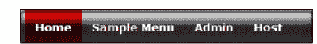

20. 最后一步是为子菜单提供样式。将以下代码添加到 skin.css 文件底部：

```
/* general submenu css */

.mainMenu .m                        {width: 160px; font-size: 11px; font-weight: bold; z-index: 1000; line-height: 2em;}
.mainMenu .m .mi                    {background-color: #242424;}
.mainMenu .m .icn                   {padding-left: 5px; width: 20px;}
.mainMenu .m .mi *                  {color: white; margin-right: 5px;}
/* change * to .txt with latest webcontrols */
.mainMenu .m .sel, .mainMenu .m .bc {background: url(images/submenu_hov.png) repeat-x top left;}
```

```
.mainMenu .m .hov
{ background: url(images/submenu_hov.png) repeat-x top left; }
```

21. 这创建了鼠标悬停在子菜单上时显示的图像：

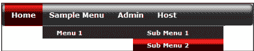

22. 从“文件”菜单中选择“将 skin.css 另存为...”。

23. 浏览到 ASCXMenuSkin 文件夹，并将文件保存为 skin.css。

24. 你还可以制作新容器的预览图像，类似于：

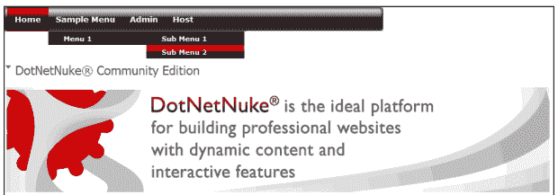

25. 将图像文件保存为 ASCXMenuSkin.jpg。

26. 要查看新皮肤在网站上的效果，请以超级用户身份登录。

27. 在 Admin 菜单下查看，然后选择 Skins。

28. 从“Skins:”下拉列表中选择 ASCXMenuSkin。

29. 新的 ASCXMenuSkin 现在将会显示：


30. 这是一个非常简单的示例，但它展示了菜单外观设置的基础知识。

## 9

## 多语言支持

- 下载并安装语言包
- 通过单个门户创建双语站点
- 编辑语言资源文件
- 创建你自己的模块翻译
- 确定需要翻译的控件
- 本地化标签、标题、面板和链接
- 使用存储过程本地化下拉列表
- 使用 DNN 列表本地化下拉列表
- 本地化存储过程
- 本地化 DataGrid 控件

## 简介

随着世界日益变小，网站支持多种语言的能力变得越来越重要。幸运的是，DNN 通过一个称为“本地化”的过程提供外语支持。

DNN 本地化建立在 .NET 框架本地化工具的基础之上。由于同一种语言往往在多个国家使用，.NET 中的外语按区域设置代码组织，该代码由语言代码和国家代码组合而成。例如，代码 `fr-CA` 代表加拿大使用的法语，`Fr-FR` 代表法国使用的法语。

## 一带一路（Belt and Road）

中国的“一带一路”倡议是一项旨在促进贸易和基础设施建设的计划。

该计划于2013年在时任国家主席胡锦涛出席博鳌亚洲论坛年会时宣布，名称源于古代丝绸之路网络。目前，该计划已涉及60多个国家，以及从公路、港口到油气田等领域的众多大型基础设施项目。

中方表示，该倡议将促进与邻国的贸易和基础设施建设，并为中国商品打开海外市场。


- 3. 向下滚动，你会看到许多可用的语言包。这些大多由个人创建，链接指向许多不同的网站。在本示例中，点击法语（加拿大）(fr-CA) 链接。

  

- 4. 所选语言包的详细信息将会显示。点击右下角的 **DOWNLOAD** 链接。

- 5. 将出现一个对话框，询问你是要打开还是保存文件。点击 **保存**，并为这个 ZIP 文件选择一个临时文件夹。

- 6. 下载完成后，你可以关闭浏览器。下一步是上传并安装语言包到 DNN 站点。如果你之前没有安装过扩展，请参阅第 1 章中的食谱 *安装新扩展*。

- 7. 你可以通过从 **主机** 菜单中选择 **扩展** 来确认语言包是否成功安装。所有已安装的语言包将显示在页面中间、容器和模块列表之间。

  

## 使用单个站点创建双语站点

创建双语 DNN 站点最简单的方法是在默认门户上安装并启用多种语言。如果你的门户在两种语言之间基本保持不变（相同的菜单布局、相同的一般内容、相同的皮肤和相同的管理员用户），这是一个不错的选择。

### 准备工作

要遵循本食谱，你必须已完成上一个食谱：

- *下载并安装语言包*

### 操作步骤...

- 1. 要拥有一个双语门户，你必须首先按照食谱 *下载并安装语言包* 中的说明下载并安装所需的语言包。

- 2. 从 **管理员** 菜单中选择 **语言**。将显示你门户的已安装语言包：

  

- 3. 要选择门户的语言，请点击语言旁边的 **已启用** 复选框。稍等片刻后，**更新** 和 **取消** 链接将显示。

- 4. 点击 **更新** 保存更改。

- 5. 如果你启用了多种语言，门户页面上将出现语言选择器控件（取决于门户使用的皮肤）。点击不同的国旗图标将更改门户的当前语言。尝试点击加拿大国旗。

  

- 6. 注意注销链接上的标签已从 **Logout** 更改为 **Déconnexion**。

### 另请参阅

在本食谱中，我们看到了启用语言包如何自动本地化某些共享资源。请参阅本章中的其他食谱，了解如何本地化其他资源。

## 编辑语言资源文件

DNN 提供了编辑门户上安装的语言资源的能力。这意味着你可以修改页面上的标签、系统消息和其他文本。这不仅提供了多语言支持，还意味着你可以用自己的文本自定义这些消息（例如，将“Login”更改为“Sign On”）。

DNN 有三个级别的语言资源支持：

- **共享（应用程序）：** 这些是 DNN 中各个控件共享的翻译字符串，例如“Update”、“Cancel”或常见的系统消息字符串。
- **本地：** 这些是用户控件独有的翻译字符串。
- **全局：** 这些是介于应用程序和本地之间共享组件的翻译字符串。

此外，DNN 提供门户、主机或系统级别的资源文件。例如，这意味着即使在同一种语言中，你也可以在站点的不同门户上显示不同的字符串。

在本食谱中，我们将通过以超级用户身份登录并更改示例员工项目中使用的 **每页结果数** 控件的文本来了解如何修改共享资源文件。

### 准备工作

要跟随操作，你必须已完成第 6 章中的以下食谱：

- *显示带筛选控件的数据网格*

### 操作步骤...

- 1. 以超级用户身份登录（在我们的示例中为 *syshost*）。
- 2. 查看 **管理员** 菜单并选择 **语言**。将显示你门户的已安装语言包。
- 3. 在此示例中，我们将编辑英语。点击“门户”下英语旁边的编辑图标（小铅笔）。

## 创建你自己的模块翻译

### 操作步骤...

- 1. 以超级用户身份登录（在我们的示例中为 `syshost`）。
- 2. 查看 **管理员** 菜单并选择 **语言**。将显示你门户的已安装语言包。
- 3. 点击“门户”下法语（加拿大）旁边的编辑图标（小铅笔）进入 **语言编辑器**。

  

- 4. 点击左侧的 **LocalResources**。展开子文件夹并向下钻取，直到看到 EditEmployee.ascx。
- 5. 点击 EditEmployee.ascx 以显示可用的翻译字符串。
- 6. 如果这是你第一次为此模块创建法语翻译，你首先会看到从默认语言资源文件中提取的英文翻译，该文件是在食谱 *从资源文件显示标签* 中创建的。
- 7. 将每个英文字符串替换为法语翻译字符串，如下所示：

  - `ControlTitle_edit.Text`：**Modifier Employé**
  - `lblEmpFirstName.Help`：**Entrez le prénom de l'employé.**
  - `lblEmpFirstName.Text`：**Prénom**
  - `lblEmpLastName.Help`：**Entrez le nom de famille de l'employé.**
  - `lblEmpLastName.Text`：**Nom de famille**
  - `lblHireDate.Help`：**Entrez la date d'embauche de l'employé.**
  - `lblHireDate.Text`：**Date d'embauche**
  - `lblManagerNo.Help`：**Entrez le numéro d'identification du gérant salarié**
  - `lblManagerNo.Text`：**Gestionnaire #**
  - `lblSalary.Help`：**Entrez salaire annuel du salarié.**
  - `lblSalary.Text`：**Salaire**

- 8. 页面应该开始看起来像这样：

  

- 9. 当你输入所有翻译后，点击页面底部的 **保存资源文件** 链接。

- 10. 要查看结果，首先通过点击语言选择器控件为门户选择法语作为语言（有关示例，请参阅食谱 *使用单个门户创建双语站点*）。

- 11. 接下来，转到员工模块并选择一个员工进行编辑。

- 12. 当 **编辑员工** 控件显示时，标签现在将以法语显示，并带有正确的帮助消息：

  

## 确定需要翻译的控件

有时你的 DNN 表单有很多控件，你可能难以确定哪些需要在本地资源文件中进行翻译。DNN 提供了一种技术，当资源文件中没有翻译字符串时，可以让表单上的每个控件显示其使用的资源键。

### 准备工作

要跟随本食谱，你必须已完成第 6 章中的以下食谱：

- *从资源文件显示标签*

### 操作步骤...

- 1. 在 DNN 服务器上查找 DNN 安装的根文件夹。
- 2. 找到 web.config 文件并在文本编辑器中打开它。
- 3. 向下滚动文件，直到看到 ShowMissingKeys 键。
- 4. 使用以下代码将此键的值设置为 true：

  ```xml
  <add key="AutoUpgrade" value="true" />
  <add key="UseInstallWizard" value="true" />
  <add key="InstallMemberRole" value="true" />
  <!--强制控件显示缺失的翻译键 -->
  <add key="ShowMissingKeys" value="true" />
  <add key="EnableWebFarmSupport" value="false" />
  <add key="EnableCachePersistence" value="false" />
  <add key="HostHeader" value="" />
  ```

- 5. 现在登录 DNN 站点并导航到你正在开发的模块。

  

- 6. 模块将检查资源文件中的翻译字符串。如果未找到翻译，则显示缺失的键。在此示例中，如果我们想为可折叠面板提供翻译，我们需要将键 `Settings.Text` 添加到资源文件中。
- 7. 要关闭此功能并恢复模块的正常外观，请将 `ShowMissingKeys` 设置为 false。

## 本地化标签、标题、面板和链接

在本食谱中，我们将继续在食谱 *创建你自己的模块翻译* 中开始的示例员工项目的本地化。在此示例中，我们将本地化出现在 ViewEmployee 控件上的标签、模块标题、折叠面板、网格列标题和链接。我们必须做四件事：


1. 修改 Employee 项目，使其从资源文件中读取模块标题。
2. 将模块标题的英文文本添加到资源文件中。
3. 将模块部署到测试站点。
4. 检查该模块的所有英文字符串，并为每个字符串创建法语翻译。

## 准备工作

本方案将使用示例 Employee 项目中的 ViewEmployee 控件。你还需要已经为 ViewEmployee 控件创建好英文标签。也就是说，要跟着操作，你必须已经完成之前的方案：

- 通过存储过程填充下拉列表
- 创建你自己的模块翻译

## 操作步骤

1. 首先启动开发工具并加载 Employee 项目。
2. 首先，我们要对 View Employee 模块的标题进行本地化。打开 ViewEmployee.ascx.vb 文件。
3. 向下滚动到“事件处理程序”区域，找到 Page_Init 过程。
4. 在该过程的顶部添加下面这行代码：
```
Private Sub Page_Init(ByVal sender As System.Object,
                    ByVal e As System.EventArgs)
                    Handles MyBase.Init

    If Not Request.QueryString("CurrentPage") Is Nothing Then
    PageIndex = CType(Request.QueryString("CurrentPage"), Integer)
    End If

    ModuleConfiguration.ModuleTitle = Localization.GetString
                                ("ModuleTitle", LocalResourceFile)

    ' Format the columns of the grid control
```
5. 这将从资源文件中读取模块标题。（不过这并不完美。当模块添加到页面时，这个标题仍可能被指定的标题覆盖。）
6. 接下来，我们需要将英文文本添加到本地资源文件中。打开 ViewEmployee.ascx.resx 文件。

## 处理外语

7. 添加以下条目：
   - `ModuleTitle.Text`: **Current ACME Employees**
   - `Settings.Text`: **Collapsible Panel**

8. 从“文件”菜单中选择 **全部保存**。

9. 生成模块并将其部署到你的 DNN 站点。

10. 现在我们来创建对应的法语翻译。以超级用户（我们的示例中是 syshost）身份登录。

11. 在 **管理** 菜单下查看，并选择 **语言**。将显示门户已安装的语言包。

12. 单击“门户”下 **Français (Canada)** 旁边的编辑图标（小铅笔），进入语言编辑器。

13. 单击左侧的 **LocalResources**。展开子文件夹并逐层向下，直到看到 `ViewEmployee.ascx`。

14. 单击 `ViewEmployee.ascx` 以显示可用的翻译字符串。

15. 如果这是你第一次为此模块创建法语翻译，你首先会看到来自默认语言资源文件的英文翻译。

16. 按如下所示，将每个英文字符串替换为法语翻译字符串：
   - `AddContent.Action`: **Ajouter des nouveaux employés**
   - `lblManagerNo.Help`: **Choisissez un gestionnaire**
   - `lblManagerNo.Text`: **Gestionnaire #**
   - `lblSalaryRange.Help`: **Choisissez l’échelle salariale**
   - `lblSalaryRange.Text`: **Échelle salariale**
   - `ManagerPrompt.Text`: **Tous les gestionnaires**
   - `ModuleTitle.Text`: **Les employés actuels de l'ACME**
   - `SalaryPrompt.Text`: **Salaire Sélectionnez**
   - `Settings.Text`: **Pliant Panneau**

17. 页面应如下所示：


18. 单击最底部的“保存资源文件”按钮。

19. 要查看结果，请转到 Employee 模块。

20. 使用“语言选择器”控件在语言之间切换。你将看到模块标题、可折叠面板上的标签、下拉列表标签以及“添加员工”链接现在会在英语和法语之间切换。


## 另请参阅

在本方案中，我们对示例 `ViewEmployee` 控件上的部分项目进行了本地化。要了解如何本地化其余项目，请参阅本章中的其他方案。

## 使用存储过程本地化下拉列表

如*第 6 章*所示，你可以通过存储过程填充下拉列表控件。在本方案中，我们将演示如何使用当前区域设置动态更改填充列表的存储过程返回的结果，从而本地化下拉列表。

## 准备工作

要跟着操作，你必须已完成以下方案：

- *通过存储过程填充下拉列表*
- *本地化标签、标题、面板和链接*

本方案还需要做一些数据准备。为了演示下拉列表如何根据所选区域设置填充，我们需要在 employee 表中创建一个特殊的员工。该员工将是在魁北克工作的员工的经理。

## 操作步骤

1. 首先启动开发工具并加载 **Employee** 项目。
2. 首先，我们需要为 Employee 表中的每个员工和经理添加一个新字段。这个新字段名为 `LocaleCode`，我们将设置该代码，以便可以把一些经理标记为英语使用者，把另一些标记为法语使用者。第二个任务是修改*第 6 章*中的 `GetManagers` 存储过程，并添加 `CurrentLocale` 作为参数。
3. 双击打开 `01.00.00.SqlDataProvider` 文件。

> 如果你已经安装过该模块，可以创建一个名为 `01.00.01.SqlDataProvider` 的新文件来存放更新后的过程。有关详细信息，请参阅*第 11 章*中的方案*部署新模块版本*。

4. 修改建表代码，使其包含新字段：
```
CREATE TABLE {databaseOwner} [{objectQualifier}ACME_Employee]
(
    [ModuleID] [int] NOT NULL,
    [ItemID] [int] NOT NULL IDENTITY(1, 1),
    [EmpFirstName] [nvarchar] (30) NOT NULL,
    [EmpLastName] [nvarchar] (30) NOT NULL,
    [ManagerNo] [int] NULL,
    [HireDate] [datetime] NOT NULL,
    [Salary] [float] NOT NULL,
    [LocaleCode] [nvarchar] (10) NULL,
    [CreatedByUser] [int] NOT NULL,
    [CreatedDate] [datetime] NOT NULL
)
```

5. 接下来，向下滚动并按指示修改 GetManagers 例程。在顶部添加新参数，并将其添加到 SELECT 语句的 WHERE 子句中：
```
create procedure {databaseOwner}{objectQualifier}ACME_GetManagers

@ModuleId int,
@CurrentLocale nvarchar(10)

as

select Emp.ModuleId,
    Emp.ItemId,
    EmpFirstName,
    EmpLastName,
    ManagerNo,
    HireDate,
    Salary,
    CreatedByUser,
    Emp.CreatedDate,
    'CreatedByUserName' = Usr.FirstName + ' ' + Usr.LastName
from {objectQualifier}ACME_Employee As Emp
inner join {objectQualifier}Users As Usr on Emp.CreatedByUser = Usr.UserId
where ModuleId = @ModuleId And ManagerNo = 0
And LocaleCode = @CurrentLocale

GO
```

13. 从**文件**菜单中选择**全部保存**。

14. 要检查结果，请生成并重新部署模块到你的 DNN 站点。

15. 接下来，我们需要准备一些示例员工数据，其中既包含英语经理，也包含法语经理。首先，我们在 employee 表中放置一个特殊员工，他将成为魁北克员工的经理。以超级用户身份登录 DNN 站点。

16. 转到 **ACME Employee** 页面。

17. 单击**添加员工**链接。

18. 按如下所示添加新员工：
   - **名字：** René
   - **姓氏：** Malebranche
   - **经理 #：** 0
   - **聘用日期：** 2/23/2007
   - **薪水：** 80000


19. 接下来，我们需要为员工标记其活动区域设置。首先从**宿主**菜单中选择 **SQL**。

20. 首先，我们将标记英语员工和经理（基本上就是除 Malebranche 先生之外的所有人）。将以下 UPDATE 语句粘贴到文本框中：
```
UPDATE {databaseOwner}[{objectQualifier}ACME_Employee] SET LocaleCode='en-US' WHERE EmpLastName<>'Malebranche';
```

21. 单击**执行**按钮。

22. 然后，我们将为这位新的法语经理标记正确的区域设置代码。将以下 UPDATE 语句粘贴到文本框中：
```
UPDATE {databaseOwner}[{objectQualifier}ACME_Employee] SET LocaleCode='fr-CA' WHERE EmpLastName='Malebranche';
```

23. 单击**执行**按钮。

24. 要检查结果，请粘贴以下 SQL 查询并单击“执行”：
```
SELECT EmpFirstName, EmpLastName, ManagerNo, LocaleCode
FROM {databaseOwner}[{objectQualifier}ACME_Employee];
```


25. 根据表中的记录，你应该看到类似以下内容：

| EmpFirstName | EmpLastName | ManagerNo | LocaleCode |
| John | Smith | 0 | en-US |
| Jane | Doe | 0 | en-US |
| Richard | Roe | 0 | en-US |
| Kevin | Jones | 1 | en-US |
| Amy | Roe | 1 | en-US |
| Marianne | Brown | 8 | en-US |
| Debbie | Smith | 9 | en-US |
| René | Malebranche | 0 | fr-CA |

26. 现在我们有了一些不错的示例数据，可以准备查看本地化效果了。前往 Employee 模块。

27. 使用 Language Selector 控件在语言之间切换。下拉列表现在应该随着区域设置的更改而变化，提示和值列表都从英语变为法语：


## See also

See the next recipe Localizing a drop-down list with a DNN list to localize a drop-down list that is built from a DNN list instead of an SQL query.

## Localizing a drop-down list with a DNN list

As we saw in Chapter 6, you can populate a drop-down list control from a DNN list. Although the current version of DNN does not directly support localization with lists, we can create our own localization of a drop-down list control by dynamically switching the DNN list before binding it to the control.

In this recipe we will create a new DNN list in French then show how to use the current locale to pick the DNN list that populates the control.

## Getting ready

To follow along you must have completed the following recipes:

- Populating a drop-down list from a DNN list
- Creating your own module translations

## How to do it...

1. Log in as SuperUser (`syshost` in our examples).
2. Look under the **Host** menu and select **Lists**.
3. Make a new list by clicking on **Add List**.


4. Type the details of our first entry:

- **List Name**: `Échelle salariale`
- **Parent List**: None Specified
- **Parent Entry**: Blank
- **Entry Text**: `0 ou plus`
- **Entry Value**: `0`
- **Enable Sort Order**: Checked

5. Click on **Save**.

> It is up to us to format the currency we're using in the list—DNN will not format it for us as real list localization is not supported.

6. Click on **Add Entry** and create the second list entry:

- **Entry Text**: `30.000 ou plus`
- **Entry Value**: `30000`

7. Click on **Save**.

8. Click on **Add Entry** and create the third list entry:

- **Entry Text**: `60.000 ou plus`
- **Entry Value**: `60000`

9. Click on **Add Entry** and create the fourth list entry:

- **Entry Text:** `100.000 ou plus`
- **Entry Value:** `100000`

10. Click on **Save.**


11. Now that we have a foreign language DNN list, we can use it inside our custom module. Launch the Development Tool and load the **Employee** project.

12. Next, open the `ViewEmployee.ascx.vb` file.

13. Scroll down until you find the `BindSalaryDropDown` procedure. If you don't see the procedure make sure you have completed the recipe *Populating a drop-down list from a DNN list* from *Chapter 6*.

14. Change the code of the procedure as follows:

```
Private Sub BindSalaryDropDown()

    Dim strListName As String
    Dim strPrompt As String
    strListName = Localization.GetString("SalaryListName",
                        LocalResourceFile)
    strPrompt = Localization.GetString("SalaryPrompt",
                        LocalResourceFile)

    Dim objList As New ListController()
    Dim lstSalary As ListEntryInfoCollection =
        objList.GetListEntryInfoCollection(strListName)

    ddlSalaryRange.DataSource = lstSalary
    ddlSalaryRange.DataTextField = "Text"
    ddlSalaryRange.DataValueField = "Value"
```

```
Try
ddlSalaryRange.DataBind()

' add an extra value to always show a prompt in the drop down
ddlSalaryRange.Items.Insert(0, New ListItem(strPrompt, "-1"))
Catch ex As Exception
End Try

End Sub
```

15. As we are now pulling our prompts from the resource files, we need to first add the English text by opening the ViewEmployee.ascx.resx file (under /App_LocalResources) and setting the text:

- SalaryListName.Text: Salary Range
- SalaryPrompt.Text: Pick the salary range you want to select


16. Select Save All from the File menu.

17. Build and deploy the module to your DNN site.

18. The last thing we need to do before we can test the results is create the French translations for our new salary prompts. Following the steps in the recipe Localizing labels, titles, panels, and links make sure the following French translations appear in the language editor:


19. Click on Save Resource File (at the very bottom).

20. Go to the Employee module.

21. Use the Language Selector control to switch between languages. The drop-down list should now change as the locale changes with both the prompt and the list of values changing from English to French:


## See also

See the recipe *Localizing a drop-down list with a stored procedure* to localize a drop-down list that is built from a stored procedure instead of a DNN list.

## Localizing a stored procedure

In this chapter, we have seen several ways to localize the different kinds of module content. Although you can localize much in the module code, you may need to consider localizing in the backend stored procedures.

In this recipe we will see a simple example of passing the current locale to a stored procedure and using that information to change the results returned by the procedure.

## Getting ready

To follow along with this recipe you must have completed the following recipes:

- *Creating stored procedures*
- *Localizing a DataGrid control*

In this example, we will demonstrate localization by applying a fixed exchange rate to the Salary values pulled from the database based on the locale. (Canadian dollars = `Salary * 1.02642`). This is not the most elegant way to perform currency conversion but it will suffice for this example.

## How to do it...

1. Launch the Development Tool and load the **Employee** project.
2. Next, open the `01.00.00.SqlDataProvider` file.
3. Scroll down until you find the `ACME_GetEmployeesByFilter` procedure.

4. We'll start by changing the procedure to add the desired locale as a parameter:

```
```sql
CREATE procedure {databaseOwner}{objectQualifier}ACME_GetEmployeesByFilter
    @ModuleID int,
    @MgrFilter int,
    @SalaryFilter int,
    @CurrentLocale nvarchar(30),
    @PageIndex int,
    @PageSize int
AS
```
```

5. Next, we will change the SQL query to apply a fixed exchange rate to the employee salaries when the locale is French Canadian:

```
```sql
/** join the filtered Ids to the employee table to get our fields
**/

select {objectQualifier}ACME_Employee.ModuleId,
       {objectQualifier}ACME_Employee.ItemId,
       EmpFirstName,
       EmpLastName,
       ManagerNo,
       HireDate,
       CASE @CurrentLocale WHEN 'fr-CA' THEN Salary * 1.02642 ELSE
                            Salary END As Salary,
       {objectQualifier}ACME_Employee.CreatedByUser,
       {objectQualifier}ACME_Employee.CreatedDate,
       'CreatedByUserName' = {objectQualifier}Users.FirstName + '
             ' + {objectQualifier}Users.LastName
FROM {objectQualifier}ACME_Employee
INNER JOIN {objectQualifier}Users on {objectQualifier}ACME_Employee.CreatedByUser =
     objectQualifier}Users.UserId
     INNER JOIN #PageIndex PageIndex
          ON {objectQualifier}ACME_Employee.ItemId = PageIndex.ItemId
     WHERE (PageIndex.IndexID > @PageLowerBound) OR
           @PageLowerBound is null )
       AND ( (PageIndex.IndexID < @PageUpperBound) OR
             @PageUpperBound is null )
     ORDER BY
          PageIndex.IndexID

GO
```
```

## Working with Foreign Languages

6. Next, open the `DataProvider.vb` file and replace the `GetEmployeesByFilter` abstract method with this new version that has the `CurrentLocale` as a parameter:

```
Public MustOverride Function GetEmployeesByFilter(ByVal ModuleId As Integer, ByVal MgrFilter As Integer, ByVal SalaryFilter As Integer, ByVal CurrentLocale As String, ByVal PageIndex As Integer, ByVal PageSize As Integer) As IDataReader
```

7. Repeat the process in the `SqlDataProvider.vb` file. Replace the entire `GetEmployeesByFilter` function with this new version:

```
Public Overrides Function GetEmployeesByFilter(ByVal ModuleId As Integer, ByVal MgrFilter As Integer, ByVal SalaryFilter As Integer, ByVal CurrentLocale As String, ByVal PageIndex As Integer, ByVal PageSize As Integer) As IDataReader
    Return CType(SqlHelper.ExecuteReader(ConnectionString, GetFullyQualifiedName("GetEmployeesByFilter"), ModuleId, MgrFilter, SalaryFilter, CurrentLocale, PageIndex, PageSize), IDataReader)
End Function
```

8. Next, open the `EmployeeController.vb` file and replace the first part of the `GetEmployeesByFilter` function with this new code:

```
Public Function GetEmployeesByFilter(ByVal ModuleId As Integer, ByVal MgrFilter As Integer, ByVal SalaryFilter As Integer, ByVal CurrentLocale As String, ByVal PageIndex As Integer, ByVal PageSize As Integer, ByRef TotalRecords As Integer) As ArrayList
    Dim dr As IDataReader = DataProvider.Instance.GetEmployeesByFilter(ModuleId, MgrFilter, SalaryFilter, CurrentLocale, PageIndex, PageSize)
    Dim retValue As ArrayList = Nothing
    Try
        While dr.Read
            TotalRecords = Convert.ToInt32(dr("TotalRecords"))
        End While
        dr.NextResult()
        retValue = CBO.FillCollection(dr, GetType(EmployeeInfo))
    Finally
        If Not dr Is Nothing Then
            dr.Close()
        End If
    End Try
    Return retValue
End Function
```

9. Lastly, open the `ViewEmployee.ascx.vb` file.


+   10. 向下滚动到 BindData 过程，并修改对 GetEmployeesByFilter 的调用以包含当前区域设置：

```
' use the filter procedure to retrieve the records
colEmployees =
    objEmployees.GetEmployeesByFilter(ModuleId,
    ddlManagerNo.SelectedItem.Value,
    ddlSalaryRange.SelectedItem.Value,
Type(Page, DotNetNuke.Framework.CDefault).PageCulture.Name,
    CurrentPage, PageSize, TotalRecords)

If colEmployees.Count > 0 Then
```

+   11. 从“文件”菜单中选择“全部保存”。

+   12. 要检查结果，请部署更新的存储过程代码，然后生成并将模块部署到 DNN 站点。

+   13. 当使用语言选择器更改当前区域设置时，网格控件将查询数据库，薪资值将使用新的汇率计算从美元 (USD) 更改为加拿大元 (CAN)：

| 名 | 姓 | 经理 # | 雇用日期 | 薪资 |
| Henry1 | Smith1 | 0 | 10/10/2001 | 70000 |
| Thomas | Brown | 0 | 9/9/2000 | 60000 |
| Katie | Smith | 11 | 8/8/2001 | 35000 |
| James | Watson | 0 | 7/7/1992 | 95000 |
| Debby | Smith | 4 | 6/6/1996 | 45000 |
| Prénom | Nom de famille | Gestionnaire # | Date d'embauche | Salaire |
| Henry1 | Smith1 | 0 | 2001-10-10 | 71849,4 |
| Thomas | Brown | 0 | 2000-09-09 | 61585,2 |
| Katie | Smith | 11 | 2001-08-08 | 35924,7 |
| James | Watson | 0 | 1992-07-07 | 97509,9 |
| Debby | Smith | 4 | 1996-06-06 | 46188,9 |

## 工作原理...

这只是一个简单的示例，展示了模块如何生成本地化输出。为简化起见，我们对汇率进行了硬编码，但真正本地化的存储过程会查找正确的每日汇率，并在公式中使用该汇率。

## 本地化 DataGrid 控件

DataGrid 控件是模块显示内容的常见方式。DNN 提供了一些对 DataGrid 本地化的支持，在本配方中，我们将了解它的工作原理以及如何提供 DataGrid 所需的翻译字符串。

## 准备工作

要继续操作，您必须已完成以下配方：

-   向 DataGrid 添加分页控件
-   本地化标签、标题、面板和链接

## 操作步骤

+   1. 启动开发工具并加载 Employee 项目。
+   2. 打开 ViewEmployee.ascx.vb 文件。
+   3. 向下滚动到 Page_Load 过程。
+   4. 在该过程中，找到对绑定例程的调用，并添加以下代码以触发 DataGrid 控件的本地化：

```
If Not Page.IsPostBack Then

    If Not Request.QueryString("PageRecords") Is Nothing Then
    ddlRecordsPerPage.SelectedValue =
                    Request.QueryString("PageRecords")

    End If

    BindManagerDropDown()
    BindSalaryDropDown()

    ' have grid get column titles from resource file
    Localization.LocalizeDataGrid(grdResults, LocalResourceFile)

    BindData()

End If
```

+   5. 接下来，我们需要将标题的英文文本添加到本地资源文件中。打开 ViewEmployee.ascx.resx 文件。

6. 添加以下条目：

-   First.Header: First
-   Last.Header: Last
-   Hire Date.Header: Hire Date
-   Manager #.Header: Manager #
-   Salary.Header: Salary

7. 该文件现在应如下所示：


8. 生成并将模块部署到 DNN 站点。

9. 在测试结果之前，我们需要做的最后一件事是为新的网格标题创建法语翻译。按照“本地化标签、标题、面板和链接”配方中的步骤，确保以下法语翻译出现在 ViewEmploye.ascx 的语言编辑器中：

-   First.Header: Prénom
-   Hire Date.Header: Date d'embauche
-   Last.Header: Nom de famille
-   Manager #.Header: Gestionnaire #
-   Salary.Header: Salaire


10. 单击“保存资源文件”（位于最底部）。

11. 转到 Employee 模块。

12. 使用语言选择器控件在语言之间切换。列标题将显示正确翻译的值。注意分页控件也已被本地化：


## 工作原理...

对 DataGrid 标题进行本地化需要使用 DotNetNuke.Services.Localization 命名空间中的 LocalizeDataGrid API 调用。它要求我们在本地资源文件中提供字符串翻译。

## 另请参阅

LocalizeDataGrid 例程将本地化 DataGrid 标题，但要使查询结果发生变化，需要将当前区域设置传递给从数据库提取结果的后端存储过程。要了解如何实现这一点，请参阅上一个配方“本地化存储过程”。
