# 现有模块的高级技巧

-   将 HTML 模块与 jQuery 配合使用
-   将 HTML 模块与替换令牌配合使用
-   将 HTML 模块与 Flash 配合使用
-   显示 XML 源
-   控制友好 URL 重写
-   使用 Google Analytics 跟踪站点
-   将日历事件发布为 RSS 源
-   设计自己的表单
-   样式化自己的表单

## 简介

在前面的章节中，我们看到了如何配置和使用 DotNetNuke 核心模块的配方。随着您越来越熟悉管理 DNN 门户和开发自己的自定义模块，您会希望更深入地挖掘，看看这些模块还提供哪些功能。

在本章中，我们将介绍一些新模块，并探索 DNN 中可用的其他功能。我们将了解 HTML 模块是多么灵活，一些底层处理是如何发生的，以及如何使用自己的自定义表单扩展 DNN 数据库。

## 将 HTML 模块与 jQuery 配合使用

jQuery 是一个简洁的 JavaScript 库，专注于 JavaScript 与 HTML 之间的交互。从版本 5 开始，DNN 支持在 DNN 页面中使用 jQuery 代码。

在本配方中，我们将演示一个小型 jQuery 程序，该程序扩展了之前的“图像条”示例，添加了悬停在当前所选图像上的缩略图。

## 准备工作

要继续操作本配方，您必须已完成第 3 章中的配方：

-   *使用 HTML 模块*

## 操作步骤

+   1. 在使用 jQuery 编码之前，检查 DNN 安装所支持的版本很重要。要查看版本，请先以超级用户身份登录（在我们的示例中为 `sys...`）。
+   2. 从 **主机** 菜单中选择 **主机设置**。
+   3. 向下滚动越过 **高级选项**，直到看到 **jQuery 设置**。

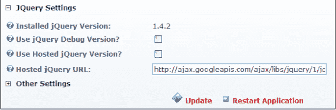

+   4. 在 **jQuery 设置** 下，您将看到安装支持的版本。除了 jQuery 版本，您还可以看到可用选项。以下是一个简要说明：
+      - 取消选择 **使用 jQuery 调试版本** 将使 DNN 使用更小、更紧凑的库，但提供的调试信息更少。
+      - **使用托管 jQuery 版本** 意味着 DNN 将使用给定 URL 处的库。如果未选中，将使用库的本地副本。
+   5. 要了解如何在 HTML 模块中使用 jQuery，请转到 *使用 HTML 模块* 配方中创建的页面。

```css
border: 1px solid #ddd;
}
ul.image {
    float: left;
    list-style: none;
    margin: 0; padding: 0;
}
ul.image li {
    margin: 0; padding: 5px;
    float: left;
    position: relative;
    width: 120px;
    height: 60px;
}
ul.image li img {
    width: 120px; height: 60px;
    border: 1px solid #ddd;
    padding: 2px;
    background: #f0f0f0;
    position: absolute;
    left: 0; top: 0;
    -ms-interpolation-mode: bicubic;
}
#main_view {
    float: left;
    padding: 2px 0;
}
</style></p>
<script type="text/javascript">
$(document).ready(function(){

$("ul.image li").hover(function() {
    $(this).css({'z-index' : '10'});
    $(this).find('img').addClass("hover").stop()
        .animate({
            marginTop: '-100px',
            marginLeft: '-120px',
            top: '50%',
            left: '50%',
            width: '194px',
            height: '134px',
            padding: '20px'
        }, 400);

    }, function() {
        $(this).css({'z-index' : '0'});
        $(this).find('img').removeClass("hover").stop()
            .animate({


## 使用现有模块的高级技巧

```html
marginTop: '0',
marginLeft: '0',
top: '0',
left: '0',
width: '120px',
height: '60px',
padding: '5px'
}, 400);
});
});
</script>
<div class="imagebar">
<ul class="image">
<li></li>
<li></li>
<li></li>
<li></li>
<li></li>
<li></li>
</ul>
</div>
```

11. 点击保存以查看结果。jQuery 代码定义了一个函数，当鼠标悬停在图像上时显示该图像的较大缩略图，然后在鼠标移开时将其移除。

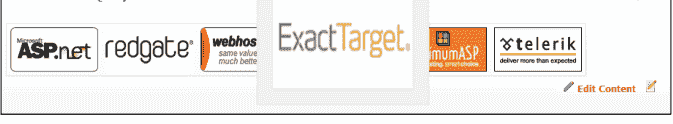

### 它是如何工作的...

jQuery 是一套功能强大的 JavaScript 库，其功能远超本书范围。除了本菜谱中的简单示例之外，几乎所有 jQuery 函数都可以用相同的方式添加到 HTML 模块中，包括 jQuery 画廊、菜单系统等。要了解有关 jQuery 的更多信息以及如何编写自己的 jQuery 程序，请访问 jQuery 网站 http://www.jquery.com。

### 使用 HTML 模块与替换标记

HTML 模块允许将动态内容替换为特殊文本标记。通过标记，您可以在 HTML 内容中包含来自 DNN 数据库的信息。

以下是本菜谱中我们将使用的一些标记：

| 标记 | 描述 |
|---|---|
| `[Portal:Email]` | 主要管理员的电子邮件。 |
| `[Portal:FooterText]` | 网站版权文本。 |
| `[Portal:HomeDirectory]` | 门户的 home 目录。 |
| `[Portal:PortalName]` | 门户的名称。 |
| `[User:DisplayName]` | 当前用户的显示名称。 |
| `[User:Email]` | 当前用户的电子邮件。 |
| `[Tab:Description]` | 当前页面的描述。 |
| `[Tab:TabName]` | 当前页面的名称。 |
| `[DateTime:Now]` | 当前日期和时间。 |

> 要查看更多标记替换示例，Data Springs 网站上有很好的列表：`http://www.datasprings.com/resources/ArticlesInformation/DNNTextHTMLTokenReplacementOptions.aspx`。

### 准备工作

要跟随本菜谱，您应熟悉来自 *第 2 章，管理用户和站点设置* 的基本内容管理任务（例如 *向页面添加模块*）。

### 如何操作...

1. 以门户管理员身份登录（在我们的示例中为 `sysadmin`）。
2. 向新页面或现有页面添加 HTML 模块。
3. 从 **HTML 模块** 菜单中选择 **设置**（或点击设置图标）。
4. 滚动到 **HTML 模块设置**：

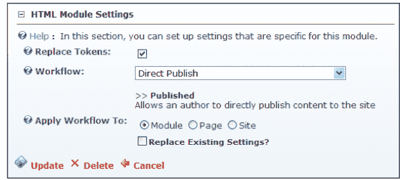

5. 确保已勾选 **替换标记**。
6. 点击 **更新** 保存更改。
7. 从模块菜单中选择 **编辑内容**（或点击 **编辑内容** 图标）。
8. 当 HTML 编辑器显示时，点击底部的 **HTML** 按钮。这将使我们能够直接编辑 HTML，避免任何自动格式。
9. 在编辑器中输入以下 HTML：

```html
<p>Site Status Report ([DateTime:Now])</p>
<hr />
<p><strong>Current User:</strong></p>
<p>Display Name: [User:DisplayName]</p>
<p>Email: [User:Email]</p>
<p><strong>Current Page:</strong></p>
<p>Name: [Tab:TabName]</p>
<p>Description: [Tab:Description]</p>
<p><strong>Portal Information:</strong></p>
<p>Name: [Portal:PortalName]</p>
<p>Contact: [Portal:Email]</p>
```

10. 点击 **保存** 保存更改。
11. 当页面被查看时，标记将被替换为来自门户设置的当前值：

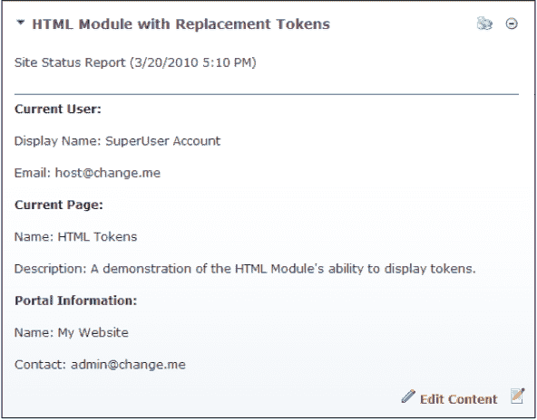

### 它是如何工作的...

文本标记替换使您能够为通常静态的 HTML 模块提供来自动态内容的支持。标记易于使用，可让您直接访问 DNN 数据库中存储的值。话虽如此，标记的使用存在一些限制。标记替换是在线进行的，与希望保留页面副本以便快速检索的页面缓存相冲突。如果过度使用，这会扼杀性能。

### 使用 HTML 模块与 Flash

由于 HTML 模块可以显示与普通 HTML 文件相同的代码，因此我们可以像在普通网页中一样将 Flash 动画嵌入到模块中。在本菜谱中，我们将了解如何使用编辑器将 .swf 文件添加到 HTML 模块。

### 准备工作

要跟随本菜谱，您应熟悉来自 *第 2 章，管理用户和站点设置* 的基本内容管理任务（例如 *向页面添加模块*）。您还需要一个示例 Flash .swf 文件。对于本示例，我们将使用来自 Adobe 网站的示例 Flash，网址为 http://www.adobe.com。

### 如何操作...

1. 首先我们需要一个 SWF 文件作为示例。打开浏览器到以下 URL：http://www.adobe.com/jp/events/cs3_web_edition_tour/swfs/perform.swf 并将 SWF 文件下载到临时文件夹。
2. 接下来，以门户管理员身份登录（在我们的示例中为 `sysadmin`）。
3. 向新页面或现有页面添加 HTML 模块。
4. 从模块菜单中选择编辑内容（或点击编辑内容图标）。
5. 将光标放在编辑器中并点击编辑器工具栏上的 Flash 管理员图标。

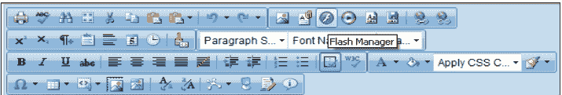

6. 当 Flash 管理员对话框显示时，点击选择按钮并导航到保存示例 SWF 文件的临时文件夹。

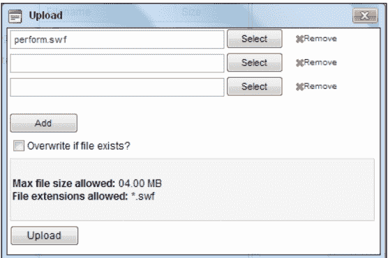

7. 点击上传以加载 SWF 文件。

8. 返回 Flash 管理员对话框，将宽度设置为 600，高度设置为 400。

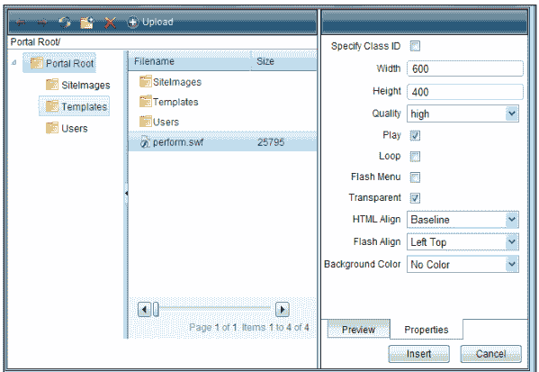

9. 保持其他选项为默认值并点击插入。
10. 点击保存以保存更改。
11. Flash 动画现在将在您的页面上显示。

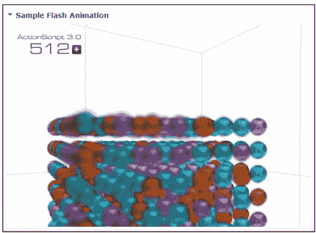

### 还有更多...

在本菜谱中我们看到了如何在 HTML 模块中显示 SWF 文件。但您可以使用其他 Flash 格式。然而，这些取决于用户的浏览器是否具有适当的插件，因此作为管理员，是否在您的站点上使用其他格式由您决定。

### 显示 XML 订阅源

XML/XSL 模块用于在 DNN 页面上显示格式化的 XML 数据订阅源。有许多不同种类的公开可用的 XML 订阅源，在本菜谱中我们将了解如何配置和格式化其中一个。

### 准备工作

要使用 XML/XSL 模块，您需要一个本地或远程 XML 订阅源的 URL。在本菜谱中，我们将使用一个名为 Digg 的热门技术新闻网站的订阅源。我们还将创建一个样式表来描述 XML 订阅源应如何显示。这称为 XSL 转换（XSLT）文件。

### 如何操作...

1. 在向页面添加 XML 订阅源之前，我们必须创建一个文本文件来描述信息应如何显示。
2. 启动您的正常开发工具。
3. 从文件菜单中选择新建文件...。

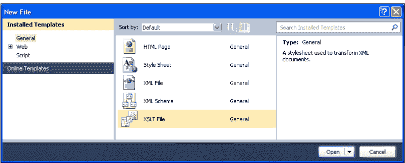

4. 选择常规作为类别并选择 XSLT 文件作为模板。
5. 点击打开。
6. 模板 XSL 文件将在编辑器中出现。通过添加以下代码来修改文件以描述如何显示 XML 元素：

```xml
<?xml version="1.0" encoding="utf-8"?>
<xsl:stylesheet version="1.0"
    xmlns:xsl="http://www.w3.org/1999/XSL/Transform"
    xmlns:msxsl="urn:schemas-microsoft-com:xslt"
    exclude-result-prefixes="msxsl"
>

<xsl:param name="TITLE"/>

<xsl:template match="rss">

    <xsl:for-each select="channel/item">
        <br>
            <strong>
                <xsl:value-of select="title"/>
            </strong>
        <br></br>

        <!-- only display markup for description if it's
                present -->
        <xsl:value-of select="description"
                disable-output-escaping="yes"/>

        <a href="{link}" target="_main">
            [Click Here for More...]
        </a>

        </br>
        <br></br>
    </xsl:for-each>
</xsl:template>

<xsl:template match="description">
    <br>
        <xsl:value-of select="."/>
    </br>
</xsl:template>

</xsl:stylesheet>
```

7. 从 **文件** 菜单中选择 **另存为 XSLTFile1.xslt...**。
8. 浏览到临时文件夹并将文件保存为 `news_feed.xsl`。
9. 现在我们有了 XSL 文件，以门户管理员身份登录（在我们的示例中为 `sysadmin`）。
10. 向新页面或现有页面添加 XML/XSL 模块（如果在模块下拉列表中看不到 XML/XSL 模块，请参阅 *第 1 章，安装和设置* 中的菜谱 *安装标准 DNN 模块*）。


11. 从模块菜单中，选择 **编辑XML/XSL选项**（或点击 **编辑XML/XSL选项** 链接）。

12. 提供以下链接信息：

    - **链接类型：URL（指向外部资源的链接）**
    - **位置：** `http://feeds.digg.com/digg/container/technology/popular.rss`

    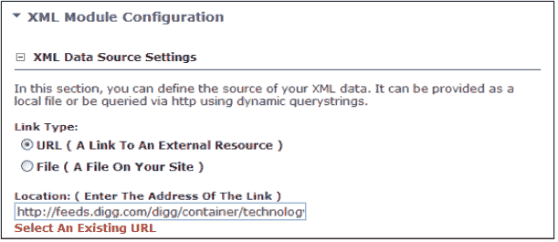

13. 在 **XSL转换设置** 下：

    - **链接类型：文件（站点上的文件）**

    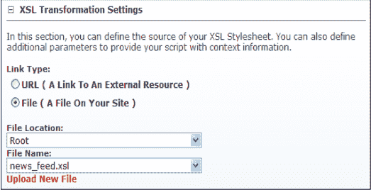

14. 点击 **上传新文件**，然后点击 **浏览** 按钮。
15. 浏览到您在临时文件夹中创建的 `news_feed.xsl` 文件。
16. 点击 **上传所选文件**。
17. 点击 **更新** 以保存更改。

    

18. XML 源现在将按照 XSLT 文件中描述的格式进行显示。

## 控制友好 URL 重写

自版本 3 起，DNN 提供了一种机制，可自动将用于 DNN 页面的真实 URL 转换为对用户和搜索引擎更友好的“友好”URL。例如，由于搜索引擎往往忽略使用参数的页面，URL http://www.dotnetnuke.com/default.aspx?tabid=527 可以被转换为更友好的 URL http://www.dotnetnuke.com/tabid/527/default.aspx。

此 URL 重写是通过遵循一组规则自动完成的，这些规则保存在位于 DNN 安装根文件夹中的名为 SiteUrls.config 的特殊文件中。但在某些情况下，您可能希望更改自动重写的执行方式。

在本教程中，我们将展示如何覆盖 URL 重写，以创建我们自己的指向特定 DNN 页面的友好 URL 映射。

### 准备工作

对于本教程，假设我们创建了一个 DNN 页面，其 URL 为 http://localhost/dotnetnuke/default.aspx?tabid=123。由于这是一个不友好的 URL，我们将创建一个指向同一位置的友好“别名” http://localhost/dotnetnuke/SamplePage.aspx。

> URL 重写规则使用正则表达式编写。您可以在 http://www.regular-expressions.info 了解更多关于正则表达式语法的信息。

3. 要创建我们自己的 URL 重写，请添加以下规则：

   ```xml
   <?xml version="1.0" encoding="utf-8" ?>
   <RewriterConfig>
       <Rules>
           <RewriterRule>
               <LookFor>.*/SamplePage.aspx</LookFor>
               <SendTo>~/default.aspx?tabid=123</SendTo>
           </RewriterRule>
           <RewriterRule>
               <LookFor>.*DesktopDefault.aspx(.*)</LookFor>
               <SendTo>~/Default.aspx$1</SendTo>
           </RewriterRule>
       </Rules>
   </RewriterConfig>
   ```

4. 保存该文件。

5. 使用此规则后，任何访问 http://www.yoursite.com/SamplePage.aspx 的用户都将自动重定向到 http://www.yoursite.com/default.aspx?tabid=123。

### 另请参阅

创建您自己的重定向 URL 时有一条警告：如果您重定向到站点调用的另一个位置中存在的类似名称的文件，可能会得到意外结果。因此，请始终在开发站点上测试您的更改，然后再在生产站点上进行修改。

## 使用 Google Analytics 跟踪您的站点

Google Analytics 是 Google 提供的一种工具，用于跟踪您网站上的活动。它的工作原理是在您的页面上放置一个跟踪 ID，当用户访问您的站点时，Google 可以记录并报告该 ID。

要在 DNN 中使用 Analytics，您需要配置 Google Analytics 模块，并且需要一个可公开访问的 DNN 门户，以便跟踪访问者。您还需要注册一个 Analytics 帐户，不过如果您有 Google Gmail 帐户，也可以使用它。

### 准备工作

在本教程中，我们将使用一个示例 Gmail 帐户登录 Google Analytics，并获取一个可在 DNN 站点中使用的跟踪编号。

要跟随本教程操作，您必须具备以下条件：

- 一个 Analytics 或 Gmail 帐户（您可以访问 http://mail.google.com 并点击 **创建帐户** 按钮免费获取）。
- 您帐户的用户名和密码。

### 操作步骤...

1. 第一步是从 Google 获取 Analytics 跟踪 ID。如果您已有跟踪 ID，请跳到步骤 13，否则请先打开您常用的网络浏览器，转到 Google Analytics 主页（`http://www.google.com/analytics`）。

   

2. 如果您已经注册过 Analytics，请点击 **访问 Analytics** 按钮。否则，请点击 **立即注册** 链接。

3. 您可以使用 Gmail 地址和密码登录。

4. 如果您是 Analytics 的新用户，您将看到 Google Analytics **注册** 按钮。

   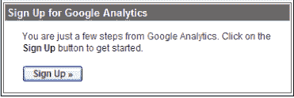

5. 点击 **注册** 按钮。

   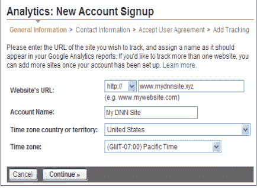

16. 输入 Analytics 概览页面中的跟踪 ID。

    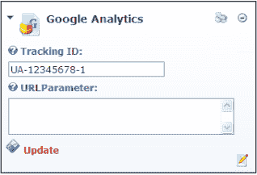

17. 点击 **更新** 以保存更改。您应该会看到一条消息，表明您的配置已成功更新。

18. 要确认 Google 正确跟踪了您的站点，请返回 Google Analytics 概览页面。

    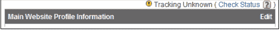

19. 在站点配置文件顶部附近查找 **检查状态** 链接。点击该链接，Google 将检查您的站点是否存在跟踪 ID，并确认跟踪已安装。

### 工作原理...

Google Analytics 的工作原理是将一小段包含唯一跟踪 ID 的 JavaScript 代码插入到您要跟踪的每个页面中。当访问者浏览您的 DNN 页面时，Google 会记录该 ID，并在您的 Analytics 概览页面上提供结果。此外，如果您使用 Google 网站管理员帐户，它还将允许您访问其他 Google 选项。

## 将日历事件发布为 RSS 源

正如我们在*第 3 章，现有模块的简单技巧*中看到的，事件模块以日历格式显示即将发生的事件列表。除了基本的日历功能外，事件模块还提供了用于管理和发布事件的其他功能。

在本教程中，我们将了解如何将日历事件发布为 RSS 源，以便您的用户订阅并在 DNN 站点之外查看。

- 包含天数：365
- 源标题：2010 日历
- 源描述：2010 办公室活动

7. 点击 **更新** 以保存更改。

8. 当您返回事件页面时，您会看到日历顶部出现了一个小的 RSS 图标：

   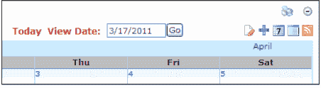

9. 点击该图标将允许用户订阅 RSS 并在浏览器中查看事件。例如，在 Firefox 等浏览器中，该源将显示为：

   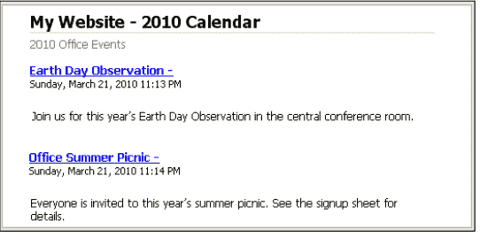

### 更多内容...

您可以使用日历事件源做的一件事是通过在您自己的门户内消费该源来创建“即将发生的事件”页面。

## 设计您自己的表单

表单和列表（用户定义表的后继者）是一个功能强大的 DNN 模块，用于创建您自己的表单并将其显示在页面上。作为门户管理员，您可以定义要收集的数据，并授予用户添加、更新和删除记录的权限。

在本教程中，我们将了解如何使用 DNN 提供的数据类型定义一个新表单，以及如何收集数据并将其显示在可搜索的列表中。

为了更容易定义表单，DNN 提供了特殊的数据类型来描述数据。此表显示了本教程中将使用的一些可用类型。

| 数据类型 | 描述 |
| --- | --- |
| 文本 | 用于保存来自编辑框、单选按钮或下拉列表的文本信息。 |
| 货币 | 保存一个四舍五入到 2 位小数的值，并使用当前区域性设置的货币符号进行格式化。 |
| 日期 | 保存日期值。在表单中使用时，DNN 将提供一个弹出式日历。 |
| 下载 | 保存附加到记录的文件。 |
| 电子邮件 | 创建 mailto 链接。 |
| 图片 | 保存具有可选尺寸的图像。 |
| 整数 | 保存整数。 |
| 用户资料链接 | 显示指向用户资料的超链接。 |
| 分隔符 | 用于在表单上对列进行分组。 |
| 是/否 | 显示复选框。 |
| URL | 保存格式化后的 URL。 |

### 准备工作

在本教程中，我们将定义一个部门表单，用于记录公司中的各个部门。我们将存储唯一的部门编号、部门名称以及其他相关信息。

### 操作步骤...

1. 首先以门户管理员身份登录（在我们的示例中为 `sysadmin`）。

2. 将 **表单和列表** 模块添加到新页面或现有页面（如果在模块下拉列表中没有看到表单和列表模块，请参阅*第 1 章，安装与设置*中的*安装标准 DNN 模块*教程）。

3. 要定义一个新表单，请点击 **表单和列表配置** 链接或图标。

   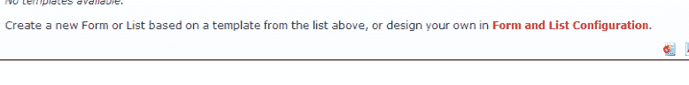


4. 将显示一个表单模板，显示基本审核列。要添加自己的列，请点击 Add New Column 链接。

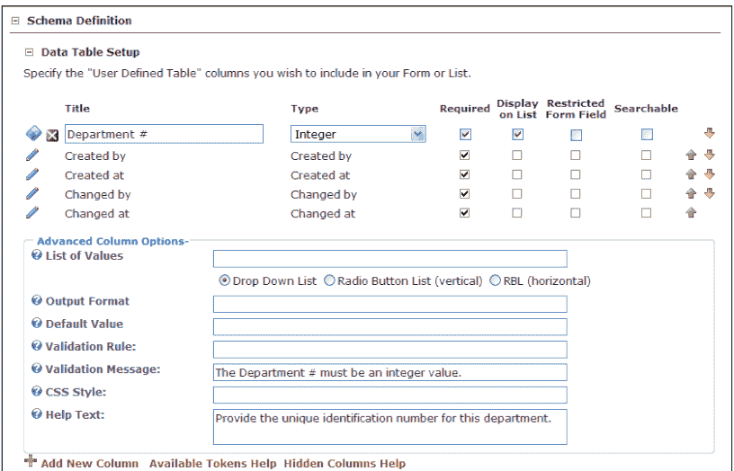

5. 定义第一列：
- Title: Department #
- Type: Integer
- Required: Checked
- Display on List: Checked
- Restricted Form Field: Unchecked
- Searchable: Unchecked

6. 你可以通过滚动到 Advanced Column Options 并添加以下文本来添加帮助信息：
- Help Text: Provide the unique identification number for this department.

7. 点击 **Add Column** 保存更改并添加下一列。

8. 重复这些步骤以添加以下所示的剩余列：

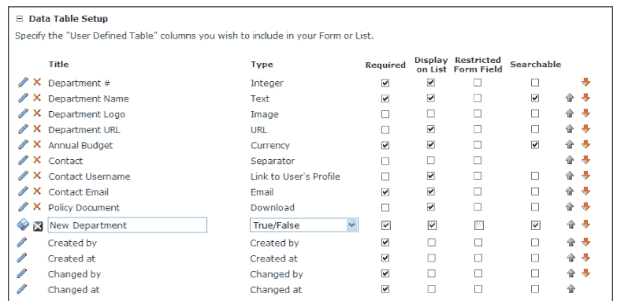

9. 当所有列都已添加后，点击页面底部的 **Save Configuration and Return** 链接。

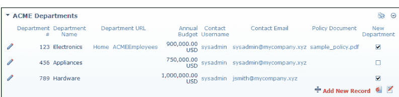

10. 表单现在可以使用了。点击 **Add New Record** 链接添加部门记录。

11. 根据你定义的列，编辑表单将显示。注意你为列提供的帮助信息如何在表单上显示为 ? 图标：

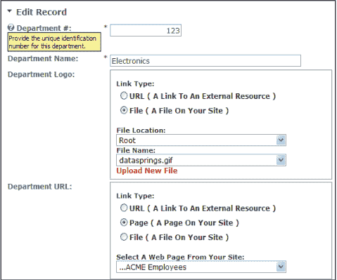

12. 此外，编辑表单还提供根据你选择的列数据类型附加文档、指定 URL 或上传图像的方式。

13. 表单还将根据列数据类型执行基本验证。例如，我们将 Department # 定义为整数，因此如果我们尝试对部门编号使用文本，我们将看到验证消息：

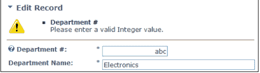

14. Form and List 模块的另一个功能是能够对记录进行搜索。要了解搜索的工作原理，首先点击右下角的 **Form and List Configuration** 链接。

15. 滚动到 **List Settings** 并展开它。
- 16. 确保以下选项已勾选：
- **Show Search Box:** Checked
- **Simple Search:** Checked
- **Show no records until Search:** Checked

17. 点击页面底部的 **Save Configuration and Return** 链接。
18. 现在部门列表被隐藏并替换为简单的搜索框。
要执行搜索，在搜索框中输入并点击 **Search** 链接。

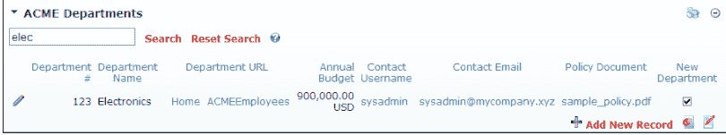

## How it works...

Form and List 模块将你的表单定义保存在 DNN 数据库中名为 UserDefinedFields 的表中。随着新记录的创建，每个列的值将保存在名为 UserDefinedData 的表中。如果你想从 DNN 数据库导出自定义记录，请参阅 *Chapter 11, Challenging Custom Modules* 中的配方 *Exporting from a user defined form*。

## There's more...

简单搜索将在任何可搜索列中查找包含的文本。如果你正在寻找以给定文本开头的字段，请使用 "| elec" 或使用 "onics|" 查找尾部部分，并使用 "| electronics|" 进行精确匹配。高级搜索在下拉列表中提供这些选项，并允许你指定要搜索的列。

## See also

要了解有关 Form and List 模块的更多信息并了解如何控制列表的格式，请参阅下一个配方 *Styling your own forms*。

## Styling your own forms

正如我们在配方 *Designing your own forms* 中看到的，Form and List 模块将收集自定义数据并将其显示为记录列表。但该模块还允许你控制记录的显示方式。

在本配方中，我们将使用上一配方中创建的 Department 表单，并使用 XSL 样式表格式化部门列表。

## Getting ready

要跟随本配方，你必须已完成上一配方：
- Designing your own forms

## How to do it...

1. 首先以 Portal Administrator 身份登录（在我们的示例中为 sysadmin）。
2. 转到包含上一配方中部门表单的页面。
3. 点击右下角的 **Form and List Configuration** 图标。
4. 滚动到 **List Settings** 并展开它。

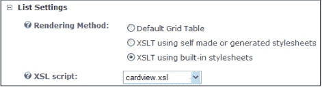

5. 对于 **Rendering Method**，选择 **XSLT using built-in stylesheets**。
6. 使用下拉列表选择 **cardview.xsl**。
7. 点击页面底部的 **Save Configuration and Return** 链接。
8. 现在部门以格式化的列表显示，所有字段都显示出来：

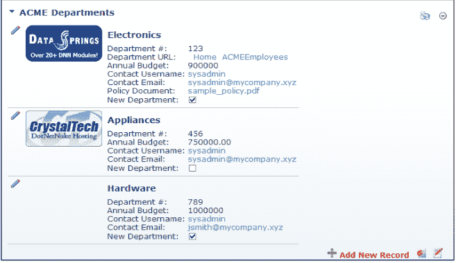

9. 你可以尝试其他可用的样式表，看看哪种在你的页面上看起来最好。

## Advanced Tricks with Existing Modules

## How it works...

XSL 样式表描述了表单的列应如何显示。你可以通过选择 XSLT using self-made or generated stylesheets 选项并上传自定义样式表来创建自己的样式表。

> 有关 XSL 样式表的更多信息，请访问
>
> `http://www.w3.org/Style/XSL.`


## 11

## Challenging Custom Modules

- Making modules searchable
- Exporting module data
- Importing module data
- Exporting and importing user defined tables
- Creating custom module actions
- Using HTML in the manifest
- Deploying a new module version
- Using multiple database connections

## Introduction

到目前为止，本书中我们已经了解了 DNN 中可用的不同模块以及如何开发自己的自定义模块。在本章中，我们将研究一些高级模块开发技术。我们将更多地了解 DNN 用于搜索、导入、导出和更新模块的接口。我们还将探索一些鲜为人知的技术，例如在 manifest 中使用 HTML 和使用多个数据库连接。

DNN 为开发人员提供了多个模块接口。与以前 DNN 版本中使用的单向 API 不同，这些接口代表开发人员与门户框架之间的双向交互。所有模块都可以访问这些接口，因为它们继承自 PortalModuleBase 类，但自定义模块需要自定义代码来链接到接口。本章中的配方演示了四个接口：
- iSearchable
- iPortable
- iActionable
- iUpdatable

## Making modules searchable

大多数网站都提供让访客搜索网站内容的选项。DNN 提供内置搜索引擎以及用于索引来自你的模块的内容的接口。

在本配方中，我们将向示例 Employee 模块添加代码，该代码将从 GetEmployees 存储过程获取内容并将其编入 DNN 默认数据存储的索引。当数据已被索引后，它就可以使用 DNN 搜索工具进行搜索（根据你的网站皮肤，这显示为门户右上角的小放大镜）。

## Getting ready

要跟随本配方，你必须已完成第 5 章 *Building, Debugging, and Deploying Modules* 中的以下配方：
- Deploying a module as a standalone package

作为开发人员，你还必须决定模块的哪些列可搜索。你不需要使所有字段都可搜索。相反，选择最能帮助识别唯一记录的重要字段。例如，最好对文档的描述和摘要进行索引，而不是对整个文档本身进行索引。在本示例中，我们将使用员工全名、雇佣日期和薪水作为可搜索字段。作为文本字段最适合搜索，我们将日期和薪水字段格式化为可搜索的文本字符串。

为了帮助识别模块的值应如何被索引，DNN 提供了我们可以分配给模块数据的不同属性：

| Property | Description |
|---|---|
| Title | 在搜索结果中显示的文本（本示例中为名和姓）。 |
| Description | 总结搜索结果内容的文本（本示例中为姓名、雇佣日期和电子邮件地址）。 |
| Content | 用户可以搜索的字段（本示例中为薪水、雇佣日期、电子邮件地址、新雇佣标志和 imageURL）。 |


```vb
' build the strings with the fields we want to index
strTitle = ModInfo.ModuleTitle + " - " + objEmployee.ContactInfo()
strDescription = objEmployee.EmpFirstName & " " & objEmployee.EmpLastName & " - Hired " & objEmployee.FormattedHireDate & " New Hire: " & objEmployee.NewHire & " Email:" & objEmployee.EmailAddress
intAuthor = objEmployee.CreatedByUser
dtePubDate = objEmployee.CreatedDate
strSearchKey = objEmployee.ItemId.ToString
strContent = System.Web.HttpUtility.HtmlDecode(objEmployee.EmpFirstName & " " & objEmployee.EmpLastName & " " & objEmployee.Salary.ToString & " " & objEmployee.HireDate.ToString & " " & objEmployee.EmailAddress)

' Create a search item and pass the strings as arguments
Dim SearchItem As SearchItemInfo = New SearchItemInfo(strTitle, strDescription, intAuthor, dtePubDate, ModInfo.ModuleID, strSearchKey, strContent, "ItemId=" & objEmployee.ItemId.ToString)
SearchItemCollection.Add(SearchItem)

Next

Return SearchItemCollection

End Function
```

- 5. 现在我们已经定义了模块中可搜索的内容，重建并重新部署模块。
- 6. 下一步是对模块数据进行索引以使其可搜索。以 SuperUser 身份登录。
- 7. 从 **Host** 菜单中选择 **Search Admin**。

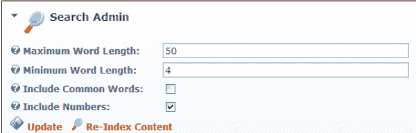

## 导出模块数据

DNN 模块提供的一项功能是可以将数据库中的数据导出到 XML 文件中。这使得可以通过一个门户收集的数据保存或传输到另一个门户或其他应用程序。此功能出现在模块操作菜单中，也出现在页面导出和门户模板创建中。导出和导入使用 `iPortable` 接口完成，并且需要定义模块中应包含在导出中的字段。

在本教程中，我们将使用来自 *第 5 章，构建、调试和部署模块* 的示例 Employee 模块，并查看我们必须添加的代码以实现接口并执行导出。

### 准备工作

要跟随本教程，你必须已完成 *第 5 章* 中的以下教程：

- - *作为独立包部署模块*

### 如何操作...

- 1. 首先启动开发工具并加载 Employee 项目。
- 2. 双击打开 `EmployeeController.vb` 文件。
- 3. 滚动到 **Optional Interfaces** 区域并查找 `ExportModule` 函数。
- 4. 我们需要定义模块中可用于导出的字段。原始 Starter Kit 创建了一个名为 Content 的临时字段。我们需要用实际的模块字段替换 Content，方法如下：

```
Public Function ExportModule(ByVal ModuleID As Integer) As String
    Implements DotNetNuke.Entities.Modules.IPortable.ExportModule

    Dim strXML As String = ""

    Dim colEmployees As List(Of EmployeeInfo) = _
                                      GetEmployees(ModuleID)
    If colEmployees.Count <> 0 Then
        strXML += "<Employees>"
        Dim objEmployee As EmployeeInfo
        For Each objEmployee In colEmployees
            strXML += "<Employee>"

                strXML += "<EmpFirstName>" &
```

```vb
XMLEncode(objEmployee.EmpFirstName) & "</EmpFirstName>"
strXML += "<EmpLastName>" &
    XMLEncode(objEmployee.EmpLastName) & "</EmpLastName>"
strXML += "<ManagerNo>" &
    XMLEncode(objEmployee.ManagerNo) & "</ManagerNo>"
strXML += "<HireDate>" &
    XMLEncode(objEmployee.HireDate) & "</HireDate>"
strXML += "<Salary>" &
    XMLEncode(objEmployee.Salary) & "</Salary>"

strXML += "</Employee>"
Next
strXML += "</Employees>"
End If

Return strXML

End Function
```

- 5. 这就是所需的所有代码。要测试结果，首先重建并重新部署模块。
- 6. 转到包含 Employee 模块的页面并从模块操作菜单中选择 **Export Content**。

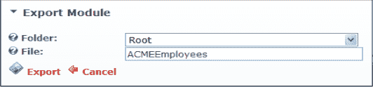

- 7. 选择一个临时文件夹（例如 Root）并单击 **Export** 链接。
- 8. 要查看它创建的 XML 文件，请查看门户的根文件夹（例如，`dotnetnuke\\Portals\\0`）。查找文件 content `.ACMEEmployee.ACMEEmployees.xml`。
- 9. 根据员工表中记录的数量，该文件看起来可能如下所示：

```
```xml
<?xml version="1.0" encoding="utf-8" ?>
- <content type="ACMEEmployee" version="01.00.00">
  - <Employees>
    - <Employee>
      - <EmpFirstName>
        - <![CDATA[ John
]]>
```

## 具有挑战性的自定义模块

```xml
</EmpFirstName>
- <EmpLastName>
  - <![CDATA[ Smith
]]>
</EmpLastName>
- <ManagerNo>
  - <![CDATA[ 0
]]>
</ManagerNo>
- <HireDate>
  - <![CDATA[ 3/23/2010
]]>
</HireDate>
- <Salary>
  - <![CDATA[ 25000
]]>
</Salary>
</Employee>
</Employees>
</content>
```

### 工作原理...

向 `ExportModule` 函数添加代码提供了保存自定义数据到 XML 文件所需的 XML 标签。`iPortable` 接口完成了其余工作。

### 还有更多...

你可能想导出模块中的所有字段，但在选择导出字段时有几个简单的规则：

- - 不要包含 ModuleId 或 ItemId，因为系统在导入时会重新生成它们
- - 同样，没有必要导出创建和更新日期
- - 除非导出是用于另一个模块或应用程序，否则你不需要包含计算字段
- - 通常，只导出你的导入代码使用的插入例程所需的字段（例如 `AddEmployee` 例程）

### 另请参阅

要了解如何使用此导出加载模块表中的记录，请参阅下一个教程  
*导入模块数据。*

## 导入模块数据

正如我们在导出模块数据教程中看到的，DNN 提供了使用 iPortable 接口在数据库中导入和导出数据的工具。要使用该接口，我们必须定义导出文件中的字段并定义导入文件时如何保存这些字段。

在本教程中，我们将使用上一教程中的导出文件导入到示例 Employee 模块中。

### 准备工作

要跟随本教程，你必须已完成以下先前教程：

- - 部署模块作为独立包
- - 导出模块数据

### 如何操作...

- 1. 首先启动开发工具并加载 Employee 项目。
- 2. 双击打开 EmployeeController.vb 文件。
- 3. 滚动到 Optional Interfaces 区域并查找 ImportModule 子程序。
- 4. 我们需要定义可以在 XML 文件中导入的字段。原始 starter kit 创建了一个名为 Content 的临时字段。我们需要用实际字段替换 Content，方法如下：

```
Public Sub ImportModule(ByVal ModuleID As Integer,
    ByVal EmpFirstName As String, ByVal Version As String,
    ByVal UserId As Integer) Implements
        DotNetNuke.Entities.Modules.IPortable.ImportModule

Dim xmlEmployee As XmlNode
Dim xmlEmployees As XmlNode = GetContent(EmpFirstName,
    "Employees")

For Each xmlEmployee In xmlEmployees.SelectNodes("Employee")
Dim objEmployee As New EmployeeInfo
objEmployee.ModuleId = ModuleID

objEmployee.EmpFirstName =
    xmlEmployee.SelectSingleNode("EmpFirstName").InnerText
objEmployee.EmpLastName =
    xmlEmployee.SelectSingleNode("EmpLastName").InnerText
objEmployee.ManagerNo =
```

```
xmlEmployee.SelectSingleNode("ManagerNo").InnerText
objEmployee.HireDate =
    xmlEmployee.SelectSingleNode("HireDate").InnerText
objEmployee.Salary =
    xmlEmployee.SelectSingleNode("Salary").InnerText

objEmployee.CreatedByUser = UserId
AddEmployee(objEmployee)
    Next

End Sub
```

- 5. 这就是导入方所需的所有代码。要测试结果，首先重建并重新部署模块。
-   
- 6. 转到包含 Employee 模块的页面并从模块操作菜单中选择 **Import Content**。

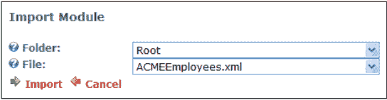

- 7. 为文件夹选择 Root 并选择上次导出中的文件。
-   
- 8. 单击 Import 链接。
-   
- 9. 记录现在将从 XML 导出文件加载到 Employee 表中。如果导入回创建导出的表，你可能会看到重复记录。这是因为我们没有在导出中包含 ItemID。当新记录被导入时，会生成新的 ItemID。

### 工作原理...

向 `ImportModule` 函数添加代码定义了 XML 文件中的字段如何映射到 `EmployeeInfo` 对象，该对象将数据保存到数据库中。

### 导出和导入用户定义表

在前两个教程中，我们看到了如何使用 XML 文件在模块中导入和导出数据。这是所有 DNN 模块都可用的内置功能。使用 Form 和 List 模块，你有额外的选项可以使用逗号分隔值 CSV 文件而不是 XML 来导入和导出自定义表中的数据。


