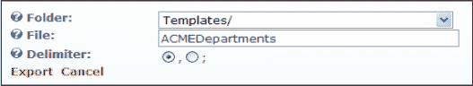
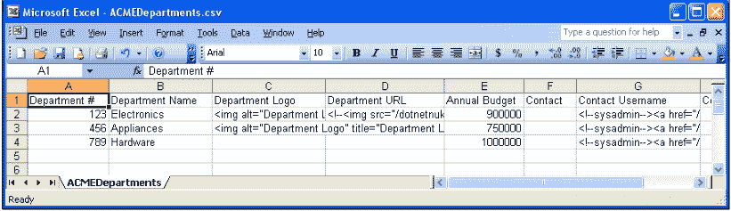
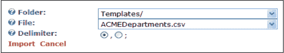

# 第11章

## 准备工作

要继续本教程，您必须已完成来自 *第10章，使用现有模块的高级技巧* 中的以下教程：

- 设计自己的表单

## 如何操作...

1. 首先以门户管理员身份登录。
2. 转到包含 *设计自己的表单* 教程中的部门表单的页面。
3. 从模块操作菜单中，选择 **导出到 CSV 文件**。

4. 选择一个临时文件夹（如 `Templates/`）并将文件命名为 `ACMEDepartments`。
5. 选择逗号（,）作为分隔符。
6. 点击 **导出** 链接。
7. 这将在门户的 Templates 文件夹中创建一个名为 `ACMEDepartments.csv` 的 CSV 文件（例如 `\dotnetnuke\Portals\0\Templates`）。如果您有电子表格应用程序，如 Microsoft Excel 或 OpenOffice Calc，您可以打开该文件并查看您的用户自定义记录：此外，您可以编辑这些记录并重新保存为 CSV 文件，以便导入到表单和列表模块中。

8. 要将 CSV 文件重新导入到表单和列表模块中，过程非常相似。首先从模块操作菜单中选择 **从 CSV 文件导入**。

9. 选择保存 CSV 文件的文件夹，并选择逗号（,）作为分隔符。
10. 点击 **导入** 以加载文件。

> 因为此示例中的导出文件包含唯一标识符，所以它不会导入自定义表中已存在的记录。要查看导入效果，您可能需要在尝试导入之前删除表中的一些记录。
