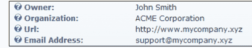
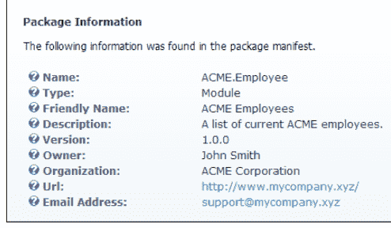
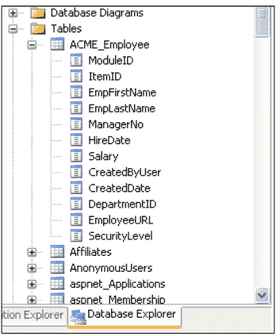
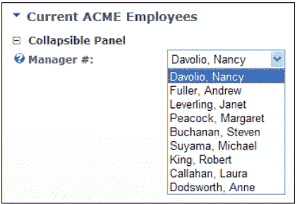

# 在清单中使用 HTML

虽然清单文件主要用于告诉 DNN 在何处安装模块的各个部分，但清单确实包含发布说明和用户许可等文本。对于这些文档，可以使用 HTML 来格式化信息，而不是使用纯文本。

在本教程中，我们将通过使用 HTML 格式来增强清单文件。

## 准备工作

要继续本教程，您必须已完成来自 *第5章，构建、调试和部署模块* 中的以下教程：

- 编辑清单文件


## 如何操作...

- 1. 首先启动开发工具并加载 Employee 项目。
- 2. 双击打开 Employee.dnn 文件。
- 3. 向下滚动直到看到标记为 <license> 的部分。
   `<license src="license.txt" />.`
- 4. 将对 license.txt 的引用替换为字符数据标签（CDATA）以及代表你格式化的许可文本的 HTML：
```
<license>
<![CDATA[
<h1>SAMPLE END USER LICENSE AGREEMENT (EULA)</h1>
This End-User License Agreement ("EULA") is a legal agreement made and entered into by you ("LICENSEE"), the person, business or other entity which will be bound by and subject to the terms and conditions set forth in this EULA, and ACME Incorporated ("ACME"), the author of SOFTWARE (as defined below). By installing and using the SOFTWARE, LICENSEE agrees to be bound by all of the terms and conditions of this EULA. If LICENSEE does not agree to the terms of this EULA, LICENSEE may not install or use the SOFTWARE.
<p>
<h3>INTRODUCTION</h3>
<h3>DEFINITIONS</h3>
<h3>MORE STUFF LIKE THIS...</h3>
]]>
</license>
```
- 5. 同样的技巧也适用于发行说明部分。尝试以下用于发行说明的代码：
```
<releaseNotes>
<![CDATA[
<h1>RELEASE NOTES</h1>
These are some sample release notes demonstrating HTML formatting.
<h3>Version 01.00.00</h3>
<table border="1">
<tr>
<th>Change ID</th>
<th>Date</th>
<th>Description</th>
</tr>
<tr>
<th>Change ID</th>
<th>Date</th>
<th>Description</th>
</tr>
<tr>
<td>12345</td>
```
```
<td>10/01/2010</td>
<td>Fixed bug in manifest file.</td>
</tr>
</table>
]]>
</releaseNotes>
```

6. 最后，你可以使用相同的技术在 Owner 部分提供更好的公司 URL 和电子邮件链接。通常当在包信息中显示所有者时，URL 和电子邮件显示为固定文本：



7. 你可以使用以下代码将公司 URL 变成真正的超链接，并将电子邮件地址变成 mailto: 链接：

```
<owner>
  <name>John Smith</name>
  <organization>ACME Corporation</organization>
  <url><![CDATA[<a href="http://www.mycompany.xyz/">http://www.mycompany.xyz/</a>]]></url>
  <email><![CDATA[<a href="mailto:support@mycompany.xyz">support@mycompany.xyz</a>]]></email>
</owner>
```

8. 要检查结果，以 SuperUser 身份登录并使用安装扩展向导部署模块。

9. 当向导显示包信息页面时，新链接将出现：



## 部署新的模块版本

在之前的食谱中，我们已经看到了如何创建和部署 DNN 模块。但当你有一个想要部署的新版本时会发生什么？你如何重新部署模块使其升级之前的版本而不是替换它？

在本食谱中，我们将看到如何为模块分配版本号并更新清单文件以创建无缝的模块升级。

规划模块升级时需要考虑三件事：

- - 你需要对数据库进行哪些更改？
- - 程序集（DLL 文件）是否已更改？
- - 你是否添加了任何新文件（图像、表单等）？

### 准备工作

要跟随本食谱，你必须已完成 *第 5 章，构建、调试和部署模块* 中的以下食谱：

- - *作为独立包部署模块*

在本食谱中，我们将通过向 employee 表添加三个新字段来增强示例 Employee 项目：`DepartmentID`、`EmployeeURL` 和 `SecurityLevel`。这意味着添加新的表列、更新存储过程并重写清单文件。

### 如何操作...

- 1. 我们将首先创建一个新的 `SqlDataProvider` 脚本，该脚本将在数据库中创建新的字段。启动开发工具并加载 Employee 项目。
- 2. 在解决方案资源管理器中，右键单击 Employee 项目。
- 3. 从 **Add** 弹出菜单中选择 **New Item...**。
- 4. 选择 **Text File** 作为模板并将其命名为 `01.01.00.SqlDataProvider`。
- 5. 单击 **Add** 创建文件。
- 6. 要在 Employee 表中创建三个新字段，将以下代码添加到文件顶部：

```
```sql
/** Alter Table **/

if not exists (select * FROM syscolumns WHERE (name =
    'DepartmentID') AND (id = OBJECT_ID(N'{databaseOwner}
    [{objectQualifier}ACME_Employee]')))
```
```
```
BEGIN

ALTER TABLE {databaseOwner}][{objectQualifier}ACME_Employee]
ADD DepartmentID VARCHAR (30) ;

ALTER TABLE {databaseOwner}][{objectQualifier}ACME_Employee]
ADD EmployeeURL VARCHAR (120);

ALTER TABLE {databaseOwner}][{objectQualifier}ACME_Employee]
ADD SecurityLevel VARCHAR (30);

END

GO
```

7. 接下来，我们将添加代码以从版本一中删除现有的 GetEmployeesByFilter 过程并用改进的版本替换它：

```
/** Drop Existing Stored Procedures **/

if exists (select * from dbo.sysobjects where id =
    object_id(N'{databaseOwner}][{objectQualifier}
    ACME_GetEmployeesByFilter]') and OBJECTPROPERTY(id,
        N'IsProcedure') = 1)
    drop procedure {databaseOwner}{objectQualifier}ACME_
GetEmployeesByFilter
GO
```

```
/** Recreate stored procedure with new columns **/

CREATE procedure {databaseOwner}{objectQualifier}ACME_
GetEmployeesByFilter
@ModuleID int,
@MgrFilter int,
@SalaryFilter  int,
@PageIndex int,
@PageSize int
AS
```

```
/** If we pass -1 for a numeric filter it means ignore the filter **/

DECLARE @PageLowerBound int
```
```
DECLARE @PageUpperBound int

/** Calculate the upper and lower bounds based on the PageIndex and PageSize **/

SET @PageLowerBound = @PageSize * @PageIndex
SET @PageUpperBound = @PageLowerBound + @PageSize + 1

/** create a temp table to hold the Ids of our results **/

CREATE TABLE #PageIndex
(
    IndexID    int IDENTITY (1, 1) NOT NULL,
    ItemId     int
)

/** populate the temp temp with the filtered results **/

INSERT INTO #PageIndex (ItemId)
SELECT ItemId
FROM {objectQualifier}ACME_Employee
WHERE (ModuleId = @ModuleId) AND  (ManagerNo = @MgrFilter OR @MgrFilter = -1) AND (Salary >= @SalaryFilter)
ORDER BY ItemId DESC

/** remember the count of the results **/

SELECT COUNT(*) as TotalRecords
FROM #PageIndex

/** join the filtered Ids to the employee table to get our fields **/

select {objectQualifier}ACME_Employee.ModuleId,
       {objectQualifier}ACME_Employee.ItemId,
       EmpFirstName,
       EmpLastName,
       ManagerNo,
       HireDate,
       Salary,
       DepartmentID,
```
```
EmployeeURL,
SecurityLevel,
{objectQualifier}ACME_Employee.CreatedByUser,
{objectQualifier}ACME_Employee.CreatedDate,
'CreatedByUserName' = {objectQualifier}Users.FirstName + ' ' + {objectQualifier}Users.LastName
FROM {objectQualifier}ACME_Employee
INNER JOIN {objectQualifier}Users on
    {objectQualifier}ACME_Employee.CreatedByUser =
    {objectQualifier}Users.UserId
INNER JOIN #PageIndex PageIndex
ON {objectQualifier}ACME_Employee.ItemId = PageIndex.ItemId
WHERE ( (PageIndex.IndexID > @PageLowerBound) OR
        @PageLowerBound is null )
    AND ( (PageIndex.IndexID < @PageUpperBound) OR
        @PageUpperBound is null )
ORDER BY
    PageIndex.IndexID
GO
```

- 8. 接下来我们需要更新清单文件以包含新的 01.01.00. SqlDataProvider 文件。双击打开 Employee.dnn 文件。

- 9. 在文件顶部，将版本号更新为 01.01.00：

```
<packages>
  <package name="ACME.Employee" type="Module"
          version="01.01.00">
    <friendlyName>ACME Employees</friendlyName>
```

- 10. 向下滚动直到看到 <scripts> 部分并添加以下代码：

```
<scripts>
  <basePath>DesktopModules\ACME.Employee</basePath>
  <script type="Install">
    <name>01.00.00.SqlDataProvider</name>
    <version>01.00.00</version>
  </script>
  <script type="Install">
    <name>01.01.00.SqlDataProvider</name>
    <version>01.01.00</version>
  </script>
  <script type="UnInstall">
    <name>Uninstall.SqlDataProvider</name>
    <version>01.00.00</version>
  </script>
</scripts>
```


11. 对清单的最后一次更改是更新程序集上的版本号：

```
<assemblies>
    <assembly>
        <path>bin</path>
        <name>Employee.dll</name>
        <version>01.01.00</version>
    </assembly>
</assemblies>
```

12. 从文件菜单中选择保存全部以保存您的更改。

13. 重新构建项目并根据第 5 章《构建、调试和部署模块》中菜谱《将模块作为独立包部署》中说明创建安装 ZIP 文件。包含 01.00.00 和 01.01.00 SqlDataProvider 文件。

14. 将新的 ZIP 文件命名为 Employee_01.01.00_Install.zip。

15. Employee_01.01.00_Install.zip 文件现在应包含以下内容：

| Name | Type | Packe... | Has ... | Size |
|---|---|---|---|---|
| App_LocalResources | File Folder | 0 KB |  | 0 KB |
| Bin | File Folder | 0 KB |  | 0 KB |
| EditEmployee.ascx | ASP.NET User Control | 1 KB | No | 4 KB |
| Settings.ascx | ASP.NET User Control | 1 KB | No | 1 KB |
| ViewEmployee.ascx | ASP.NET User Control | 2 KB | No | 5 KB |
| Employee.dnn | DNN File | 2 KB | No | 6 KB |
| 01.00.00.SqlDataProvider | SQLDATAPROVIDER File | 2 KB | No | 8 KB |
| 01.01.00.SqlDataProvider | SQLDATAPROVIDER File | 1 KB | No | 3 KB |
| Employee.SqlDataProvider | SQLDATAPROVIDER File | 1 KB | No | 3 KB |
| Uninstall.SqlDataProvider | SQLDATAPROVIDER File | 1 KB | No | 2 KB |

16. 要检查结果，请以 SuperUser 身份登录并使用安装扩展向导部署新的 ZIP 文件。模块应无错误地覆盖现有模块。

17. 您可以使用开发工具中的数据库资源管理器确认升级已添加新列：



18. 数据库资源管理器还将显示更新后的存储过程。

## How it works...

在模块升级中，您需要进行的更改非常重要。务必记住，您必须在不影响之前模块版本的情况下执行升级。例如，为了向 Employee 表添加列，我们使用了 ALTER TABLE 命令而不是 DROP TABLE 命令。这保留了表中可能已有的任何记录。

这种增量更新很棘手，在发布更新之前应进行充分测试。它们还需要对 SQL 有扎实的理解。

## There's more...

在此示例中，我们没有创建任何新对象，因此原始卸载文件仍然适用。如果我们例如创建了一个新表，那么我们必须使用新版本号更新卸载文件。由于我们从不进行增量卸载，因此我们只需要一个卸载文件即可。

## Using multiple database connections

有些情况下，您需要访问的数据库不是运行 DNN 安装的数据库。也许您需要针对旧数据库运行查询或从不同公司的数据库中提取信息。

在本菜谱中，我们将看到如何创建第二个数据库连接并使用它从菜谱 *Populating a drop-down list from a stored procedure* 中填充 **Manager** 下拉列表。

在本菜谱中，我们将使用随 MS Access 提供的示例 Northwind 数据库。

## Getting ready

要跟随本菜谱，您必须已完成 *Chapter 6, Data Entry Tricks* 中的以下菜谱：

- *Populating a drop-down list from a stored procedure*

## How to do it...

- 1. 通过访问 http://www.microsoft.com/downloads 并搜索 **Northwind Traders Sample Database.** 从 Microsoft 网站下载示例 Northwind 数据库。
- 2. 选择 **Access 2000 Tutorial: Northwind Traders Sample Database** 并单击 **Download** 按钮开始下载。
- 3. 在提示时，选择运行并同意安装和许可协议。
- 4. 将文件放在 DNN 服务器的 C 盘上 (c:\Nwind.mdb)。
- 5. 在 DNN 服务器上查找并定位 DNN 安装的根文件夹。
- 6. 找到 web.config 文件并在文本编辑器中打开它。
- 7. 向下滚动文件直到看到 <connectionStrings> 并添加以下键：
  ```
  <add name="LegacyAccess"
      connectionString="Provider=Microsoft.Jet.OLEDB.4.0;Data Source=C:\Nwind.mdb; User Id=admin;Password=" />
  ```
- 8. 接下来，双击打开 ViewEmployee.ascx.vb 文件。
- 9. 由于本菜谱中我们访问的是旧的 MS Access 数据库，因此我们需要使用 OLE DB 提供程序。因此首先在文件顶部添加必要的导入指令：
  ```
  Imports System.Data.OleDb
  ```
- 10. 接下来我们将创建一个新的例程，使用我们在 web.config 文件中保存的连接字符串连接到 MS Access 数据库文件。滚动到 Public Methods 区域底部并添加以下代码：
  ```
  Public Function GetLegacyManagers() As OleDbDataReader
  
      Dim sqlConn As OleDbConnection
      Dim sqlCmd As OleDbCommand
      Dim strConnection As String
  ```

14. 转到包含 Employee 模块的页面。Manager 下拉列表中的名称现在来自对 MS Access 数据库的第二个数据库连接。



## How it works...

在此示例中，我们使用了对 MS Access 2000 数据库的 OLE 连接，但此技术适用于其他数据库类型。以下是不同类型数据库的其他示例连接字符串：

| Database type | Sample connection string |
| --- | --- |
| Oracle Database using a TNSNames. ora file | <add name="LegacyOracle" connectionString="Data Source=LEGACY;User Id=legacyuser; Password=legacypassword;" /> |
| MS Access | <add name="LegacyAccess" connectionString="Provider=Microsoft.Jet.OLEDB.4.0; Data Source=C:\northwind.mdb;User Id=legacyuser;Password=legacypassword;" /> |
| SQL Server Express | <add name="LegacyExpress" connectionString="Data Source=.\SQLEXPRESS;Initial Catalog=LegacyDatabase;User ID=legacyuser;Password=legacypassword" /> |
| MySQL | <add name="LegacyMySQL" connectionString="Server=localhost;Port=3306;Database=LegacyMySQL;Uid=legacyuser;Pwd=legacypass word;" /> |

## 12
