## Advanced Modules and Security

- Creating a secondary View control
- Controlling navigation with NavigateURL
- Module messages and event Logging
- Creating your own CBO Hydrator
- Using Active Directory with DNN
- Synchronizing security roles with DNN
- Correcting Active Directory issues

## Introduction

在本章中，我们将介绍一些高级模块开发主题并查看扩展 DNN 安全性的内容。我们将首先了解如何创建二级视图控件及其导航链接。然后我们将了解如何创建自定义显示消息并使用事件日志进行调试消息。最后我们将了解如何添加 Active Directory 身份验证并将其与 DNN 同步。

4. 从 **Add** 弹出菜单中选择 **New Item...**。

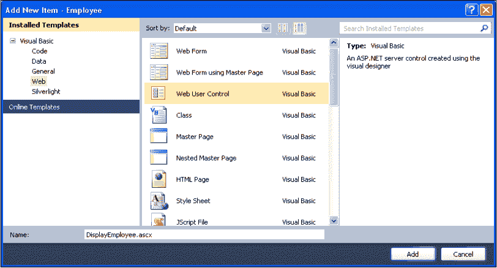

- 5. 选择 **Web User Control** 作为模板并将其命名为 `DisplayEmployee.ascx`。
- 6. 单击 **Add** 创建文件。
- 7. 双击打开新的 `DisplayEmployee.ascx` 文件。
- 8. 为了显示员工信息，我们将创建一些标签控件并将它们组织在 HTML 表格中。将以下代码添加到文件顶部：

```
<%@ Control Language="vb" AutoEventWireup="false"
    CodeBehind="DisplayEmployee.ascx.vb"
    Inherits="ACME.Modules.Employee.DisplayEmployee" %>
<%@ Register TagPrefix="dnn" TagName="Label"
    Src="~/Controls/LabelControl.ascx" %>
```

- 9. 在其下方放置一个包含控件的 HTML 表格：

```
<table width="650" cellspacing="0" cellpadding="0" border="0"
       summary="Display Table">
    <tr>
        <td width="40%" valign="top" align="center">
            <asp:Image ID="imgEmployee" runat="server"
                ImageUrl="~/images/thumbnail.jpg" />
        </td>
        <td width="60%">
            <table width="100%" >
                <tr valign="top">
                    <td class="SubHead" width="125">
```


```
<dnn:label id="lblEmpFirstName"
    runat="server"
    controlname="lblEmpFirstNameValue"
    suffix=":">
</dnn:label>
</td>
<td>
<dnn:label id="lblEmpFirstNameValue"
    runat="server" >
</dnn:label>
</td>
</tr>
<tr valign="top">
<td class="SubHead" width="125">
<dnn:label id="lblEmpLastName"
    runat="server"
    controlname="lblEmpLastNameValue"
    suffix=":">
</dnn:label>
</td>
<td>
<dnn:label id="lblEmpLastNameValue"
    runat="server" >
</dnn:label>
</td>
</tr>
<tr valign="top">
<td class="SubHead" width="125">
<dnn:label id="lblManagerNo"
    runat="server"
    controlname="lblManagerNoValue"
    suffix=":">
</dnn:label>
</td>
<td>
<dnn:label id="lblManagerNoValue"
    runat="server" >
</dnn:label>
</td>
</tr>
<tr valign="top">
<td class="SubHead" width="125">
<dnn:label id="lblHireDate" runat="server"
    controlname="lblHireDateValue"
    suffix=":">
</dnn:label>
</td>
<td>
<dnn:label id="lblHireDateValue"
runat="server" >
</dnn:label>
</td>
</tr>
<tr valign="top">
<td class="SubHead" width="125">
<dnn:label id="lblSalary" runat="server"
controlname="lblSalaryValue"
suffix=":">
</dnn:label>
</td>
<td>
<dnn:label id="lblSalaryValue"
    runat="server" >
</dnn:label>
</td>
</tr>
</table>
</td>
</tr>
</table>
```

10. 接下来，我们在控件底部添加一个“返回”链接，以便导航回 View 控件：

```
<p>
<asp:linkbutton cssclass="CommandButton" id="cmdReturn"
resourcekey="cmdReturn" runat="server"
borderstyle="none" text="Return"
causesvalidation="False">
</asp:linkbutton>
</p>
```

11. 接下来，双击打开新的 DisplayEmployee.ascx.vb 文件。

12. 在此文件中，我们需要在 Page_Load 例程中添加代码，用所选员工的值来填充标签。将空的 Page_Load 例程替换为以下代码：

```
Private Sub Page_Load(ByVal sender As Object, ByVal e As
System.EventArgs) Handles MyBase.Load
Try
```

```
' Determine ItemId of Employee to Update
If Not (Request.QueryString("ItemId") Is Nothing) Then
    ItemId = Int32.Parse(Request.QueryString("ItemId"))
End If

If Page.IsPostBack = False Then
    If Not Common.Utilities.Null.IsNull(ItemId) Then
        ' get content
        Dim objEmployees As New EmployeeController
        Dim objEmployee As EmployeeInfo = objEmployees.GetEmployee(ModuleId, ItemId)
        If Not objEmployee Is Nothing Then
            lblEmpFirstNameValue.Text = objEmployee.EmpFirstName
            lblEmpLastNameValue.Text = objEmployee.EmpLastName
            lblManagerNoValue.Text = objEmployee.ManagerNo
            lblHireDateValue.Text = objEmployee.HireDate
            lblSalaryValue.Text = objEmployee.Salary
        Else ' security violation attempt to access item not related to this Module
            Response.Redirect(NavigateURL(), True)
        End If
    End If
End If

Catch exc As Exception    'Module failed to load
ProcessModuleLoadException(Me, exc)
End Try
End Sub
```

13. 此文件的最后一段代码是在最底部为“返回”链接添加一个处理程序：

```
#Region "Optional Interfaces"

Private Sub cmdReturn_Click(ByVal sender As Object, ByVal e As EventArgs) Handles cmdReturn.Click
    Try
        Response.Redirect(NavigateURL(), True)
    Catch exc As Exception    'Module failed to load
```

```
ProcessModuleLoadException(Me, exc)
End Try
End Sub

#End Region

End Class
```

+   14. 最后一步是为 View 控件创建一个新的资源文件，我们将在其中保存标签文本。在解决方案资源管理器中，右键单击 `App_LocalResources` 文件夹。
+   15. 从**添加**弹出菜单中选择**新建项...**。
+   16. 选择**资源文件**作为模板，并将其命名为 `DisplayEmployee.ascx.resx`。

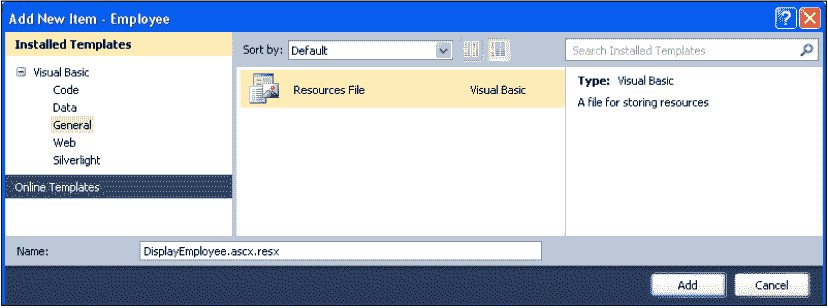

+   17. 单击**添加**创建文件，然后添加以下条目：
+   
+   - `ControlTitle_display.Text`：**显示员工**
+   - `lblEmpFirstName.Text`：**名字**
+   - `lblEmpLastName.Text`：**姓氏**
+   - `lblManagerNo.Text`：**经理编号**
+   - `lblHireDate.Text`：**雇用日期**
+   - `lblSalary.Text`：**薪资**

18. 文件现在应如下所示：

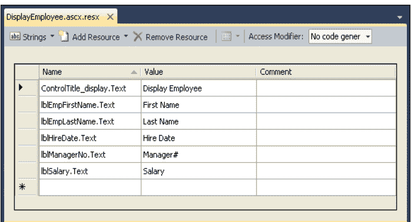

19. 新用户控件就位并创建好资源文件后，剩下要做的就是将新文件添加到清单中。双击打开 Employee.dnn 文件。

20. 向下滚动并添加以下文本：

```
<control>
    <src>DesktopModules/ACME.Employee/ViewEmployee.ascx</src>
    <type>View</type>
    <helpurl></helpurl>
</control>
<control>
    <key>AcmeEmployeeDisplay</key>
    <title>Display Employee</title>
    <src>DesktopModules/ACME.Employee/DisplayEmployee.ascx</src>
    <type>View</type>
    <helpurl></helpurl>
</control>
```

21. 再向下滚动一点，并添加：

```
<file>
    <name>ViewEmployee.ascx</name>
</file>
<file>
    <name>DisplayEmployee.ascx</name>
</file>
<file>
    <name>EditEmployee.ascx</name>
</file>
```

22. 继续向下滚动一点，并添加：

```
```xml
<file>
    <path>App_LocalResources</path>
    <name>ViewEmployee.ascx.resx</name>
</file>
<file>
    <path>App_LocalResources</path>
    <name>DisplayEmployee.ascx.resx</name>
</file>
<file>
    <path>App_LocalResources</path>
    <name>EditEmployee.ascx.resx</name>
</file>
```
```

23. 从**文件**菜单中选择**全部保存**以保存所有更改。

24. 生成并部署模块到你的 DNN 站点（有关说明，请参阅第 5 章 *生成、调试和部署模块* 中的 *将模块作为独立包部署* 操作指南）。请同时包含两个新文件：`DisplayEmployee.ascx` 和 `DisplayEmployee.ascx.resx`。

25. 虽然我们还无法导航到新控件（因为它仍需要连接到 Datagrid），但部署后它看起来如下所示：

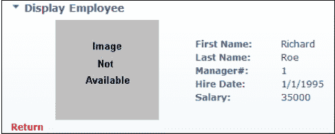

26. 下一个操作指南将演示如何从员工 Datagrid 调用这个新的 View 控件。

## 工作原理...

在本操作指南中，我们使用 HTML 表格来布局新控件，但这只是为了保持示例简单。正如我们在前面章节中所看到的，最好使用 CSS 样式来控制布局，因为它在外观定制（skinning）方面灵活得多。

## 更多内容...

本操作指南中一个非常重要的部分出现在将控件添加到清单时。要使辅助 View 控件正常工作，它必须有一个唯一的键，以便我们在导航到它时用该键来标识控件。在此示例中，我们在清单中使用 `<key>AcmeEmployeeDisplay</key>` 元素定义新控件时，为它指定了键“AcmeEmployeeDisplay”。

## 使用 NavigateURL 控制导航

在本操作指南中，我们将了解如何使用 NavigateURL 控制模块内的导航。在此示例中，我们将连接员工 Datagrid，以便当点击某个员工的链接时，导航会转到上一个操作指南中创建的辅助 View 控件，并显示该员工的详细信息。

> 注意：此技术仅用于模块内的导航，不能用于向其他模块或页面外部导航。

## 准备工作

要按本操作指南操作，你必须先完成以下操作指南：

-   - 创建辅助 View 控件

## 操作步骤...

-   1. 首先启动开发工具并加载 Employee 项目。
-   2. 第一步是向员工 Datagrid 添加一个指向辅助 View 控件的链接。双击打开 ViewEmployee.ascx 文件。
-   3. 我们在 Datagrid 中添加一个新列，代码如下：
+   ```
+   <dnn:imagecommandcolumn CommandName="Display" ImageUrl="~/images/view.gif" EditMode="URL" KeyField="ItemID" />
+   <dnn:imagecommandcolumn CommandName="Edit" ImageUrl="~/images/edit.gif" EditMode="URL" KeyField="ItemID" />
+   <dnn:imagecommandcolumn CommandName="Delete" ImageUrl="~/images/delete.gif" KeyField="ItemID" />
+   ```
-   4. 下一步是修改 Page_Init 例程，以便在填充 Datagrid 时将正确的导航 URL 放入其中。双击打开 ViewEmployee.ascx.vb 文件。


### 工作原理...

DNN 在后台做了大量工作来处理站点的导航（例如友好 URL 重写）。大多数导航都是自动处理的，但如果需要在模块中控制特定导航，可以使用带相应参数的 NavigateURL。

5. 向下滚动到 Page_Init 例程，并在“编辑”链接的代码之前添加以下代码。这里重要的部分是，我们传递了在清单中定义的、代表辅助视图控件的键值 AcmeEmployeeDisplay。

```vb
If imageColumn.CommandName = "Delete" Then
    imageColumn.OnClickJS = Localization.GetString("DeleteItem")
End If
```

```vb
'Set the link to the secondary view control using NavigateURL
If imageColumn.CommandName = "Display" Then
    Dim formatString As String = NavigateURL(TabId,
        "AcmeEmployeeDisplay", "mid=" & CStr(ModuleId), "ItemId=KEYFIELD")
    formatString = formatString.Replace("KEYFIELD", "{0}")
    imageColumn.NavigateURLFormatString = formatString
End If
```

```vb
'Manage Edit Column NavigateURLFormatString
If imageColumn.CommandName = "Edit" Then
```

6. 重新生成并重新部署模块。

7. 转到包含 Employee 模块的页面。当员工显示在 Datagrid 中时，你会看到一个全新的视图图标（看起来像放大镜）：

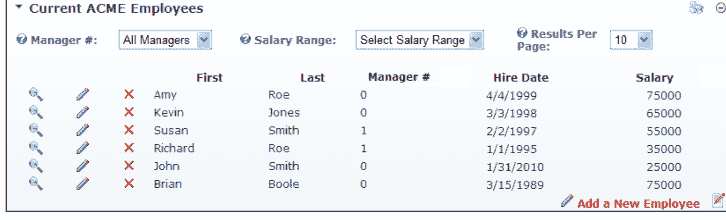

8. 点击员工旁边的视图图标后，你将导航到辅助视图控件并查看显示的员工信息。在本示例中，我们加入了标准 DNN 图片中的示例图片，以展示员工详情控件的外观：

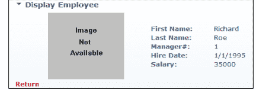

## 显示模块消息和事件日志

在开发 DNN 模块时，很多时候需要在页面上显示消息或将消息记录到事件日志中，以便后续分析。在本操作指南中，我们将了解如何使用 AddModuleMessage 和 AddLog 方法。

AddModuleMessage 是 DotNetNuke.UI.Skins.Skin 命名空间中的一个方法，适用于你想在页面上显示的简单消息。你可以使用四种消息类型来突出显示消息：

- `BlueInfo`：当你需要告知用户某事已发生，但该操作不是成功或失败类型时，使用此类型比较合适。
- `GreenSuccess`：当用户执行了某个操作，而你想让其注意操作成功时，使用此类型比较合适。如果在成功时使用消息，那么最好在失败时也使用消息。
- `YellowWarning`：当操作未完全成功但也不确定是否失败时，此类型很有用。
- `RedError`：适度使用效果最佳。此类型适合严重错误，或用户在错误修复前无法继续进行操作的情况。

AddLog 位于 DotNetNuke.Services.Log.EventLog 命名空间中，用于将消息写入站点事件日志。当你需要记录某个事件已发生但不想向用户显示消息时，它非常有用。这对于调试线上站点非常有用。请注意，门户管理员可以关闭日志记录，因此要遵循本操作指南，你需要确保日志记录已开启。

### 准备工作

要按本操作指南操作，你必须先完成*第 6 章，数据输入技巧：*中的以下操作指南：

- *显示带筛选控件的 Datagrid*

### 操作步骤...

1. 首先启动开发工具并加载 Employee 项目。
2. 双击打开 EditEmployee.ascx.vb 文件。
3. 向下滚动到 Page_Load 例程。我们将紧接在加载所选员工记录的代码之后添加一些日志消息：

```vb
If Not objEmployee Is Nothing Then
    txtEmpFirstName.Text = objEmployee.EmpFirstName
    txtEmpLastName.Text = objEmployee.EmpLastName
    txtManagerNo.Text = objEmployee.ManagerNo
    txtHireDate.Text = objEmployee.HireDate
    txtSalary.Text = objEmployee.Salary

    ' log the employee information
    Dim objEventLog As New Services.Log.EventLog.EventLogController
    objEventLog.AddLog(objEmployee, PortalSettings, UserId, UserInfo.Username, _
        Services.Log.EventLog.EventLogController.EventLogType.ADMIN_ALERT)

    ' print a success message on the page
    UI.Skins.Skin.AddModuleMessage(Me, "Employee record successfully loaded.", UI.Skins.Controls.ModuleMessage.ModuleMessageType.GreenSuccess)
```

4. 重新生成并重新部署模块。

5. 转到包含 Employee 模块的页面，选择要编辑的员工。当员工记录显示时，你会看到页面顶部出现一条新的成功消息。因为我们选择了 GreenSuccess 作为消息类型，所以显示了绿色大图标：

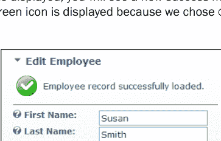

6. 若要查看我们创建的另一条日志消息，请从 **管理** 菜单中选择 **事件查看器**：

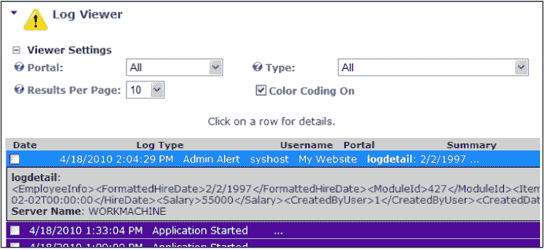

### 工作原理...

AddLog 例程经过重载，可以接受不同的参数。在本例中，我们将员工对象作为日志消息的一部分传入。当我们想查看整个对象的状态时，这对调试非常有用。AddLog 会自动将给定对象中的值转换为 XML 字符串，并显示在事件日志中。

### 更多内容...

使用 `EventLogController` 时，可以记录的事件类型有很多。在日志查看器中，这些事件以颜色编码区分，并且你可以按类型筛选消息。在本操作指南中，我们使用 `ADMIN_ALERT` 作为事件类型记录了消息，但还有很多其他事件类型可以使用。以下是一些示例：

- `ADMIN_ALERT`
- `HOST_ALERT`
- `APPLICATION_START`
- `APPLICATION_END`
- `USER_CREATED`
- `PORTAL_CREATED`
- `MODULE_CREATED`
- `TAB_CREATED`
- `LOGIN_SUCCESS`
- `LOGIN_FAILURE`

## 创建你自己的 CBO Hydrator

DNN 包含一个有用的核心服务，称为 CBO Hydrator。CBO Hydrator 是一系列方法的集合，用于从数据库填充一个或多个自定义业务对象（CBO）。在前面的操作指南中，我们已经看到了 CBO EmployeeInfo 如何从数据库提取记录，并使用 CBO Hydrator 填充 Datagrid。

作为 DNN 开发人员，你可以通过实现 IHydratable 接口来编写自己的 Hydrator。实现 IHydratable 更高效，而且你还可以选择根据模块中的任何特殊情况进行自定义，包括在将数据传递到表示层之前对数据进行“整理”，或者根据用户的安全权限过滤结果。

在本操作指南中，我们将使用示例 Employee 项目来演示实现 IHydratable 接口所需的两个部分：一个名为 KeyID 的属性和一个名为 Fill 的方法。

### 准备工作

要按本操作指南操作，你必须先完成第 6 章，数据输入技巧中的以下操作指南：

- *显示带筛选控件的 Datagrid*

### 操作步骤...

1. 首先启动开发工具并加载 Employee 项目。
2. 双击打开 EmployeeInfo.vb 文件。
3. 查看文件顶部，并添加以下 Implements 语句：

```vb
Public Class EmployeeInfo
    Implements Entities.Modules.IHydratable

    ' local property declarations
```

4. 接下来，向下滚动到文件底部，紧接最后一个属性之后，添加以下新的 Optional Interfaces 区域和 Fill 例程：

```vb
#Region "Optional Interfaces"

Public Sub Fill(ByVal dr As IDataReader) Implements DotNetNuke.Entities.Modules.IHydratable.Fill

    ItemId = Convert.ToInt32(Null.SetNull(dr.Item("ItemID"), ItemId))
    ModuleId = Convert.ToInt32(Null.SetNull(dr.Item("ModuleID"), ModuleId))
    EmpFirstName = Convert.ToString(Null.SetNull(dr.Item("EmpFirstName"), EmpFirstName) + " (first)")
    EmpLastName = Convert.ToString(Null.SetNull(dr.Item("EmpLastName"), EmpLastName) + " (last)")
    ManagerNo = Convert.ToInt32(Null.SetNull(dr.Item("ManagerNo"), ManagerNo))
    HireDate = Convert.ToDateTime(Null.SetNull(dr.Item("HireDate"), HireDate))
    Salary = Convert.ToInt32(Null.SetNull(dr.Item("Salary"), Salary))

End Sub
```

5. 注意，我们如何通过对名字和姓氏字段添加简短的文本后缀 (first) 和 (last) 来对数据进行一些自定义。

6. 最后，我们需要在 Fill 例程之后提供一个 KeyID 属性：

```vb
Public Property KeyID() As Integer Implements DotNetNuke.Entities.Modules.IHydratable.KeyID
    Get
        Return ItemId
    End Get
    Set(ByVal value As Integer)
        ItemId = value
    End Set
End Property

#End Region
```

7. 这就是我们需要做的全部工作。无需其他代码更改，切换到新的 Fill 例程是自动的。

8. 为了证明它可以正常工作，请重新生成并重新部署模块。


9. 转到带有 Employee 模块的页面，看看网格中现在如何显示 (first) 和 (last) 后缀。这样我们就知道 DNN 已自动切换到我们自定义的 IHydrator 代码：

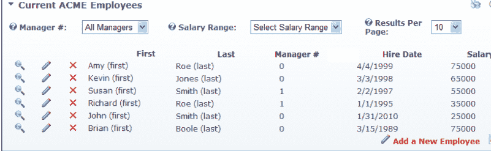

## 将 Active Directory 与 DNN 结合使用

正如我们在第 2 章“管理用户和网站设置”中所看到的，DNN 带有内置的用户安全机制，包含角色和授权。这在许多情况下都没问题，但有时你的 DNN 站点位于一个已经拥有 Active Directory（AD）安全的网络中。你如何配置 DNN 门户以使用现有的安全机制，而不必重新创建所有 AD 用户？

答案是添加 Active Directory 身份验证提供程序，使其与 DNN 安全提供程序一起工作。这样，您就可以使用在 DNN 或 Active Directory 中定义的用户名登录。

在本节中，我们将了解如何配置 DNN 门户，使其在使用默认 DNN 身份验证的同时，也使用 Active Directory 身份验证。

## 准备工作

要按照本节操作，你需要能够访问使用 Active Directory 的网络，并拥有有效的用户名和密码。请注意，在某些网络上，对 Active Directory 的访问可能会受到限制。如果你在使用本节时遇到问题，请咨询网络管理员。

## 操作步骤...

- 1. 首先以 **超级用户** 身份登录。
- 2. 从“主机”菜单中选择 **扩展**。
- 3. 向下滚动到 **身份验证系统** 部分。

| 身份验证系统 | | |
|---|---|---|
| 默认身份验证 | DotNetNuke 的默认用户名/密码身份验证系统。 | 1.0.0 |
| DNN_ActiveDirectoryAuthentication | DotNetNuke Active Directory 身份验证项目是 DotNetNuke 的一个身份验证提供程序，它使用 Windows Active Directory 身份验证协议来验证用户身份。 | 5.0.2 |
| DNN_LiveIDAuthentication | DotNetNuke LiveID 身份验证项目是 DotNetNuke 的一个身份验证提供程序，它使用 LiveID 身份验证协议来验证用户身份。 | 1.0.1 |
| DNN_OpenIDAuthentication | DotNetNuke OpenID 身份验证项目是 DotNetNuke 的一个身份验证提供程序，它使用 OpenID 身份验证协议来验证用户身份。 | 2.0.0 |

- 4. 你应该会看到 Active Directory 已列出。如果没有，请从操作菜单中选择 **安装可用扩展** 并安装它。
- 5. 确认 Active Directory 身份验证已安装后，从 **管理** 菜单中选择 **扩展**。
- 6. 向下滚动到身份验证系统列表，点击 **DNN_ActiveDirectoryAuthentication** 旁边的编辑图标。这将显示 **身份验证设置** 页面。

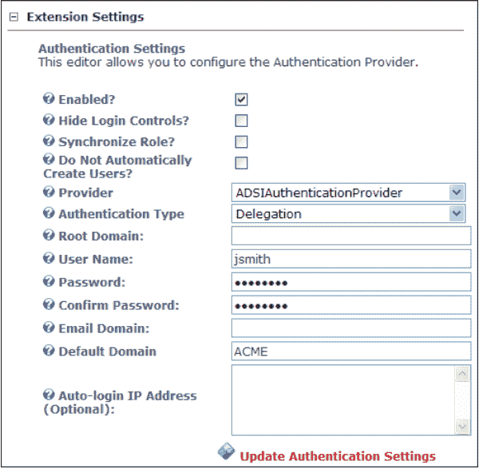

- 7. 提供以下信息：

  - **启用？**：选中（表示门户将使用 AD）
  - **隐藏登录控件？**：未选中（不隐藏 Windows 登录按钮）
  - **同步角色？**：未选中（不将 DNN 角色与 AD 角色同步）
  - **不自动创建用户？**：未选中（允许现有的 AD 用户使用门户）
  - **提供程序**：保留默认的 **ADSAuthenticationProvider**
  - **身份验证类型**：保留默认的 **委托**
  - **根域**：如果你知道网络中的根域，请使用它，否则留空
  - **用户名**：为你的 Windows 网络提供一个可以访问 Active Directory 的有效用户名
  - **密码**：为该用户提供有效密码

## 高级模块与安全性

- **电子邮件域：**留空（如果 AD 不可用，则指定 **电子邮件域**）
- **默认域：**提供用户的默认域（如果留空，用户需要在登录时指定，例如 `MYDOMAIN\\jsmith`）
- **自动登录 IP 地址：**留空（可选：根据 IP 地址启用自动登录）

- 8. 点击 **更新身份验证设置** 以保存更改。稍等片刻后，你应该会看到一条成功消息。

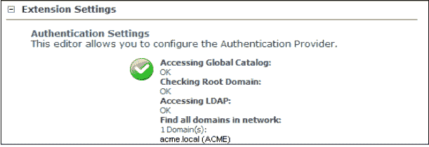

- 9. 如果你没有看到成功消息，请确认你提供了有效的域、有效的用户名和密码，并且你的网络上 Active Directory 可用。
- 10. 点击 **取消** 以关闭配置页面。
- 11. 要测试结果，请以超级用户身份注销。
- 12. Windows 现在将尝试让你重新登录门户。如果一切顺利，系统将提示你输入 Active Directory 用户名和密码，然后显示 DNN 主页。

## 工作原理...

一旦登录，你的用户就可以自由进出而无需再次登录，直到安全 cookie 超时（或他们使用注销链接），之后他们将需要通过登录页面再次提供用户名和密码。

## 更多内容...

如果 DNN 安装在较旧版本的 Windows（Vista/Windows 7 之前）上，你可能会遇到错误：“处理 Windows 身份验证时出错。请检查你的 IIS 设置。DesktopModules/AuthenticationServices/ActiveDirectory/WindowsSignin.aspx 不应允许匿名访问。”在这种情况下，请参阅下一节以了解修复此问题或回滚并禁用 Active Directory 安全的说明。

## 另请参阅

在本节中，我们启用了 Active Directory 身份验证，使 AD 用户无需在 DNN 中预先存在即可访问你的 DNN 门户。在下一节中，我们将了解如何同步 Active Directory 和 DNN 之间的安全角色，以便你可以向 Active Directory 角色授予对页面和模块的访问权限。

## 使用 DNN 同步安全角色

一旦你将 Active Directory 用于 DNN 安全性，下一步就是将你的 AD 安全角色（或组）与 DNN 同步，以便你可以基于角色而不仅仅是用户名来控制对页面和模块的访问。

这不会自动创建安全角色（你必须手动创建）；相反，它会同步用户拥有的角色。因此，如果你在 AD 中撤销一个角色，用户也会自动在 DNN 中失去该角色。

在本节中，我们假设你的 Active Directory 中有一个名为 Users 的安全角色。在 DNN 中重新创建角色时，确保其拼写与 Active Directory 中显示的完全相同，这一点很重要。

## 准备工作

要按照本节操作，你必须先完成以下小节：

- *创建和分配安全角色。*
- *授予模块访问权限*
- *将 Active Directory 与 DNN 结合使用*

## 高级模块与安全性

## 操作步骤...

- 1. 首先以门户管理员身份登录。
- 2. 在“管理”菜单下查看，选择 **安全角色**。
- 3. 此页面将显示你当前拥有的所有安全角色。使用 **添加新角色** 链接创建一个名为 **Users** 的新角色。

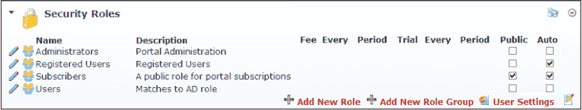

- 4. 既然我们已经在 Active Directory 和 DNN 中都定义了角色，我们需要开启角色同步。从 **管理** 菜单中选择 **扩展**。
- 5. 向下滚动到身份验证系统列表，点击 **DNN_ActiveDirectoryAuthentication** 旁边的编辑图标。这将显示配置页面。

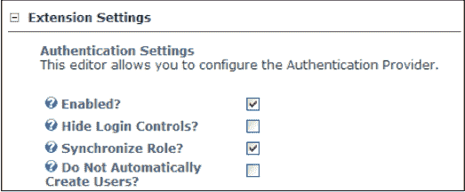

- 6. 找到名为 **同步角色** 的复选框，确保其已 **选中**。
- 7. 点击 **更新身份验证设置** 以保存更改。稍等片刻后，你应该会看到一条成功消息。
- 8. 最后，在门户中选择一个匿名用户（未登录的用户）无法看到的模块。使用“*授予模块访问权限*”一节中的说明，将对该模块的读取访问权限授予你上面创建的 Users 角色。由于你没有将 Users 角色授予任何人，用户能看到此模块的唯一方式就是同步生效。
- 9. 授予角色访问权限后，使用“注销”链接，以管理员身份注销。
- 10. 刷新浏览器，你现在将使用你的 Active Directory 凭据登录。你应该能够成功登录 DNN 门户，并看到授予 Users 角色的模块。


## 工作原理...

通过将 Active Directory 身份验证配置为保持角色同步，在 Active Directory 中执行的授予和撤销操作将自动应用于匹配的 DNN 角色。

## 纠正 Active Directory 问题

在 DNN 中更改安全提供程序有一定风险，因为如果出现问题，您可能会被锁定在站点之外。在本节中，我们将了解如何修复常见的访问问题，以及如何在需要重新开始时回滚 Active Directory 提供程序。

## 准备工作

要遵循本节内容，您必须已完成以下教程：

- *将 Active Directory 与 DNN 结合使用*

## 操作步骤...

1. 如果在 DNN 中设置 Active Directory 安全性时遇到错误 `WindowsSignin.aspx` 不应允许匿名访问，您需要按如下方式手动调整 `WindowsSignin.aspx` 文件的安全性：
2. 在 Web 服务器上，打开 IIS 管理器并展开 `DesktopModules/AuthenticationServices/ActiveDirectory` 文件夹，直到看到列出的 `WindowsSignin.aspx`。
3. 右键单击 `WindowsSignin.aspx` 并选择**属性**。
4. 在**文件安全**选项卡上，应有一个名为**匿名访问和身份验证控制**的部分。

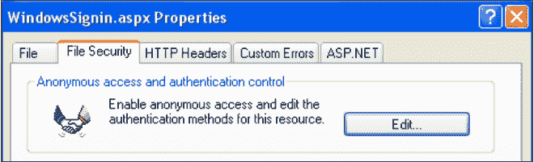

5. 单击**编辑**按钮，然后取消选中“匿名访问”。
6. 单击**确定**关闭对话框，然后再次单击**确定**关闭属性。

## 高级模块与安全

7. 重新启动浏览器，错误应该会消失。

8. 如果无法让 Active Directory 安全与您的 DNN 门户配合工作，并且发现无法以超级用户身份重新登录门户，则可以按照以下步骤禁用 Active Directory 安全性并恢复 DNN 安全性：

9. 使用开发工具连接到数据库。

10. 找到名为 **PortalSettings** 的表。打开该表，查找 `PortalId` 为 0 的 `AD_WindowsAuthentication` 记录。

11. 将该值更改为 False。

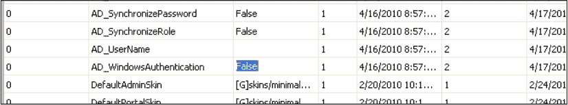

12. 关闭表，然后关闭并重新打开浏览器。门户将恢复为正常的 DNN 安全性，您可以作为管理员登录。
