## 高级皮肤设计

- 使用 Rotator 部件
- 使用 Visibility 部件
- 使用 Stylesheet 部件
- 创建并部署自定义部件
- 在皮肤中使用自定义部件
- 使用圆角超级样式表
- 在皮肤中显示门户设置
- 为菜单添加动画

### 简介

在本章中，我们将更深入地探讨在*第 8 章，基础皮肤设计*中探讨过的皮肤设计主题。我们将看到几个皮肤部件的示例、如何为菜单添加动画、超级样式表，以及在皮肤中使用变量。

到目前为止，我们所见的大多数教程都是由 DNN 服务器上运行的代码（模块等）驱动的。皮肤部件是一种创建驻留在皮肤中的客户端代码的方式，以提供本地功能，而无需反复与服务器通信。

部件包含可以放置在皮肤中并在客户端运行的 JavaScript 片段。它们与我们在*第 8 章，基础皮肤设计*中演示的皮肤对象非常相似，但具有更多功能，并且可以自定义以包含我们自己的 JavaScript。要使用部件，您需要在皮肤中通过 HTML 对象元素引用该项，并使用 PARAMS 指定配置选项。

DNN 包含几个有用的部件，位于 DNN 服务器上的 `\Resources\Widgets` 文件夹中，在本章中我们将探讨其中一些，并了解如何制作我们自己的部件。

### 使用 Rotator 部件

在本节中，我们将了解如何使用 Rotator 皮肤部件，它会自动在一张接一张的不同图形图像之间轮换。这对于动态横幅广告或照片幻灯片等内容非常有用。

Rotator 部件带有不同选项，用于控制图像如何切换以及显示多长时间。要使用 Rotator 部件，我们需要一组要轮换的图像。对于此示例，我们将使用普通 DNN 安装附带的一些标准供应商图像。

Rotator 使用索引变量来跟踪轮换，因此图像文件名中必须包含数字，例如 `image1.gif`、`image2.gif`、`image3.gif`。

### 准备工作

要遵循本节内容，您必须已完成*第 8 章，基础皮肤设计*中的以下教程：

- 创建简单的 ASCX 皮肤

Rotator 部件可用的参数如下：

| 参数 | 描述 | 示例 |
|---|---|---|
| `Direction` | 过渡期间图像移动的方向。 | 左侧、右侧、向上、向下或混合 |
| `Height` | 图像的高度。 | 120 |
| `Width` | 图像的宽度。 | 60 |
| `ImageCount` | 轮换中图像的数量。 | 6 |
| `ImageTemplate` | 指定要使用的所有图像文件的名称。 | `vendor{INDEX}.gif` |
| `ImageURL` | 图像文件夹的位置。 | `<%=SkinPath %>images/` |
| `Interval` | 显示每张图像后到显示下一张图像前的毫秒数。每秒有 1000 毫秒，因此 2500 表示每张图像显示两秒半后切换到下一张。 | 2500 |
| `Transition` | 过渡样式。像照片幻灯片一样，您可以让每张图像轻轻滑入或突然切入。 | 滑动或切入 |

## 操作步骤...

1. 找到在*创建简单的 ASCX 皮肤*教程中创建的 `SampleASCXSkin` 文件夹。
2. 在其中创建一个名为 `/images` 的新文件夹。
3. 从 DNN 安装中，从 `\dotnetnuke\Portals\0` 文件夹中取任意六张示例供应商图像，并将它们复制到 `/images` 文件夹中。
4. 将图像文件重命名为 `vendor1.gif`、`vendor2.gif`，一直到 `vendor6.gif`。此时，`/images` 文件夹应包含以下图像：

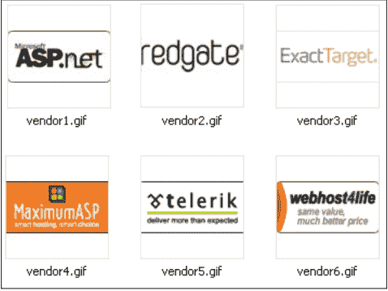

5. 现在启动开发工具。
6. 从**文件**菜单中选择**打开文件...**。
7. 浏览到 `SampleASCXSkin` 文件夹，打开 `SampleASCXSkin.ascx` 文件。
8. 向下滚动到包含不同窗格的 HTML 表格，并将以下代码添加到“左侧窗格”：

```
```html
<div class="content">
    <table width="100%" border="0" cellspacing="0" cellpadding="0">
        <tr>
            <td valign="top" id="LeftPane" class="LeftPane"
                runat="server" visible="false">

                <object id="ContentRotator" codeptype="dotnetnuke/client"
                        codebase="RotatorWidget" declare="declare">
                    <param name="imageCount" value="6" />
                    <param name="imageURL" value="<%=SkinPath %>images/" />
                    <param name="imageTemplate" value="vendor{INDEX}.gif" />
```
```

```
<param name="width" value="120" />
<param name="height" value="60" />
<param name="transition" value="slide" />
<param name="direction" value="left" />
<param name="interval" value="3000" />
</object>

</td>
<td valign="top" id="ContentPane" class="ContentPane" runat="server" visible="false">
</td>
<td valign="top" id="RightPane" class="RightPane" runat="server" visible="false">
</td>
</tr>
</table>
</div>
```

9. 由于我们希望将供应商图像包含在皮肤包中，我们需要更新清单，以便在重新部署皮肤时，图像将上传到服务器。

> Rotator 部件同样适用于位于门户特定文件夹中且不属于皮肤的图像。如果您使用的图像不属于您的皮肤，则无需将它们添加到清单中，可以跳过本教程的最后一部分。

10. 打开 SampleASCXSkin.dnn 文件。

11. 向下滚动到 skinFiles 元素，并添加以下内容：

```
<skinFile>
<name>skin.css</name>
</skinFile>
<skinFile>
<path>images</path>
<name>vendor1.gif</name>
</skinFile>
<skinFile>
<path>images</path>
<name>vendor2.gif</name>
</skinFile>
<skinFile>
<path>images</path>
```


<name>vendor3.gif</name>
</skinFile>
<skinFile>
    <path>images</path>
    <name>vendor4.gif</name>
</skinFile>
<skinFile>
    <path>images</path>
    <name>vendor5.gif</name>
</skinFile>
<skinFile>
    <path>images</path>
    <name>vendor6.gif</name>
</skinFile>
</skinFiles>

+   12. 从**文件**菜单中选择**全部保存**以保存更改。
+   13. 要查看新皮肤在网站上的效果，请以超级用户身份登录。
+   14. 按照*部署你的皮肤和容器*食谱中的说明，将皮肤从皮肤文件夹部署到 DNN 门户。确保在 ZIP 文件中包含新的 `/images` 文件夹。
+   15. 皮肤部署完成后，查看**管理**菜单并选择**皮肤**。
+   16. 从**皮肤：**下拉列表中选择**SampleASCXSkin**，并点击**预览**链接。

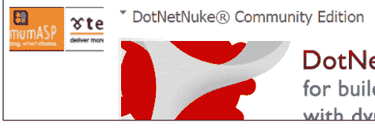

17. 由于我们将 Rotator 控件放置在左侧窗格中，因此你会在页面左侧看到第一张图片。片刻之后，图片将随着旋转的开始而改变。我们选择了 `interval` 值为 `3000`，因此图片应每 3 秒更换一次。我们选择了 `slide` 作为过渡效果，`left` 作为方向，因此下一张图片应从右侧滑入到左侧。

## 更多内容...

你可以尝试不同的参数值并查看结果。例如，将过渡效果改为 `snap`，图片会立即相互替换，而没有滑动动画；当图片较大时，使用更长的间隔会很有帮助。

## 另请参阅

如果你仔细观察，会发现 ImageURL 中包含对 `<%=SkinPath %>` 变量的引用。要了解皮肤中可用的其他门户变量，请参阅本章末尾的*在皮肤中显示门户设置*食谱。

## 使用 Visibility 控件

在本食谱中，我们将介绍 Visibility 皮肤控件。Visibility 控件会在你的皮肤上创建一个按钮，无需调用服务器即可动态切换 HTML 元素的可见性。

> 由于我们在后台使用 JavaScript，目标元素必须可在文档对象模型（DOM）中访问。DOM 是一种在 HTML 表单中引用元素（如 DIV 元素）的简单方法。你可以在 http://www.w3.org/DOM/ 了解更多信息。

为了演示该控件，我们将修改*创建一个简单的 ASCX 皮肤*食谱中的示例 ASCX 皮肤，在 `DIV` 元素内添加 `BREADCRUMB` 和 `TEXT` 控件，然后重新部署皮肤以查看更改。

## 准备工作

要继续本食谱，你必须已完成*第 8 章*《*基本皮肤制作*》中的以下食谱：

-   ▸ *创建一个简单的 ASCX 皮肤*

## 操作步骤...

-   1. 找到在*创建一个简单的 ASCX 皮肤*食谱中创建的名为 `SampleASCXSkin` 的文件夹。
-   2. 启动开发工具。
-   3. 从**文件**菜单中选择**打开文件...**。
-   4. 浏览到 `SampleASCXSkin` 文件夹并打开 `SampleASCXSkin.ascx` 文件。

5. 我们将在皮肤中添加 BREADCRUMB 和 TEXT 控件，因此首先在文件顶部添加以下注册：

```
<%@ Register TagPrefix="dnn" TagName="USER"
    Src="~/Admin/Skins/User.ascx" %>
<%@ Register TagPrefix="dnn" TagName="LOGIN"
    Src="~/Admin/Skins/Login.ascx" %>
<%@ Register TagPrefix="dnn" TagName="TEXT"
    Src="~/Admin/Skins/Text.ascx" %>
<%@ Register TagPrefix="dnn" TagName="BREADCRUMB"
    Src="~/Admin/Skins/BreadCrumb.ascx" %>
```

6. 接下来，向下滚动到包含不同窗格的 HTML 表格，并将以下代码添加到 ContentPane 中：

```
<div class="content">
<table width="100%" border="0" cellspacing="0" cellpadding="0">
    <tr>
        <td valign="top" id="LeftPane" class="LeftPane"
            runat="server" visible="false">
        </td>
        <td valign="top" id="ContentPane" class="ContentPane"
            runat="server" visible="false">

<object id="VisibiltyButton" codetype="dotnetnuke/client"
            codebase="VisibilityWidget" declare="declare">
            <param name="title" value="Hide/Show Breadcrumbs" />
            <param name="collapseClassName" value="collapse_icon" />
            <param name="expandClassName" value="expand_icon" />
            <param name="targetElementID" value="testElement" />
        </object>

        <div id="testElement">
            <dnn:TEXT runat="server" id="dnnTEXT"
                CssClass="breadcrumb_text" Text="You are here >"
                ResourceKey="Breadcrumb" />&nbsp;<span>
            <dnn:BREADCRUMB runat="server" id="dnnBREADCRUMB"
                CssClass="Breadcrumb" RootLevel="0"
                Separator="&nbsp;&nbsp;" />
        </div>

        </td>
        <td valign="top" id="RightPane" class="RightPane"
            runat="server" visible="false">
        </td>
    </tr>
</table>
</div>
```

-   7. 这就为我们提供了一个文本提示、一个面包屑导航和 Visibility 控件。我们现在需要一个点击按钮。为了在按钮上显示隐藏/显示的图片，我们必须在 `skin.css` 文件中定义这些图片。打开 `skin.css` 文件。

-   8. 向下滚动，在**控件样式**之后添加以下样式元素：

```
/* Control Styles */
#login_style                 {float: right; padding: 10px 17px 0px 10px;}

/* Visibility widget */

.collapse_icon,
.expand_icon
{
    width: 14px;
    height: 14px;
    float: right;
    margin-top: 5px;
    background-repeat: no-repeat;
    cursor: pointer;
    border: 0;
    background-color: Transparent;
}

.collapse_icon
{
    background-image: url("/dotnetnuke/images/minus2.gif");
}

.expand_icon
{
    background-image: url("/dotnetnuke/images/plus2.gif");
}
```

-   9. 这将创建一个小的图标按钮，它会显示一个加号或减号，并随可见性切换而变化。为简单起见，我们将使用 DNN 自带的一些图标。

-   10. 最后，从**文件**菜单中选择**全部保存**以保存更改。

-   11. 要查看新皮肤在网站上的效果，请以超级用户身份登录。

-   12. 按照*部署你的皮肤和容器*食谱中的说明，将皮肤从皮肤文件夹部署到 DNN 门户。

-   13. 皮肤部署完成后，查看**管理**菜单并选择**皮肤**。

14. 从**皮肤：**下拉列表中选择**SampleASCXSkin**，并点击预览链接。

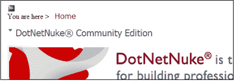

15. 我们添加的面包屑导航旁边会出现一个小的减号图标。如果点击减号，面包屑导航将消失，并保留一个加号图标：

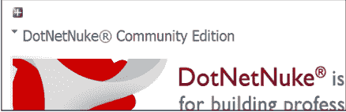

16. 点击加号图标将恢复面包屑导航。

## 工作原理...

这是一个方便的技巧，通过隐藏不需要始终可见的大元素来节省页面上的“空间”。由于该控件在客户端运行，因此它是一种非常快速高效的显示和隐藏 DOM 元素的方法。

## 更多内容...

在本例中，我们使用了一些常见的 DNN 加号和减号图标图片，但你可以自由创建自己的图片并将它们添加到皮肤中。只需更改 CSS 文件中的路径以指向你的图片，并将图片添加到皮肤清单中即可。

## 使用 Stylesheet 控件

正如 Rotator 控件可以在客户端动态循环显示一组图片一样，Stylesheet 皮肤控件允许你动态切换皮肤的不同样式表。这是一个非常强大的工具，只需很少的编码即可在客户端更改 DNN 页面的整体外观。

在本食谱中，我们将创建三个指定字体大小（小、中、大）的简单样式表，然后添加 Stylesheet 控件以在它们之间切换。

## 准备工作

要继续本食谱，你必须已完成*第 8 章，基本皮肤制作*中的以下食谱：

-   - 创建一个简单的 ASCX 皮肤

## 操作步骤...

-   1. 找到在*创建一个简单的 ASCX 皮肤*食谱中创建的名为 `SampleASCXSkin` 的文件夹。
-   2. 在其中创建一个名为 `/css` 的新文件夹。
-   3. 为了展示不同样式表之间的切换，我们需要创建三个新的 CSS 文件并将它们放入该文件夹。首先启动开发工具。
-   4. 然后从**文件**菜单中选择**新建文件...**。
-   5. 在**新建文件**对话框中，选择**文本文件**并点击**打开**。
-   6. 将以下代码放入文件中：

```
```css
*
{
    font-size: 8pt;
}
```
```

-   7. 将文件保存为 `/css` 文件夹中的 `small_font.css`。
-   8. 创建另一个文本文件并添加以下代码：

```
```css
*
{
    font-size: 14pt;
}
```
```

-   9. 将文件保存为 `/css` 文件夹中的 `med_font.css`。
-   10. 再创建一个文本文件并添加以下代码：

```
```css
*
{
    font-size: 28pt;
}
```
```

-   11. 将文件保存为 `/css` 文件夹中的 `large_font.css`。
-   12. `/css` 文件夹现在应如下所示：

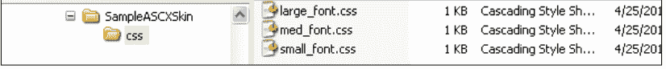


+   13. 接下来，从**文件**菜单中选择**打开文件...**，然后打开`SampleASCXSkin.ascx`文件。

+   14. 向下滚动到包含不同窗格的HTML表格，并将以下代码添加到左侧窗格：

```html
<div class="content">
    <table width="100%" border="0" cellspacing="0" cellpadding="0">
        <tr>
            <td valign="top" id="LeftPane" class="LeftPane"
                runat="server" visible="false">

                <object id="TextSizeSelector" codetype="dotnetnuke/client"
                    codebase="StyleSheetWidget" declare="declare">
                    <param name="baseUrl" value="<%= SkinPath %>css/" />
                    <param name="template" value="&lt; input type='button'
                        title='{TEXT}' value='{TEXT}' {ID} {CLASS} /&gt;" />
                    <param name="default" value="small_font" />

                    <param name="Small Font" value="small_font" />
                    <param name="Med Font" value="med_font" />
                    <param name="Large Font" value="large_font" />
                </object>

            </td>
            <td valign="top" id="ContentPane" class="ContentPane"
                runat="server" visible="false">
            </td>
            <td valign="top" id="RightPane" class="RightPane"
                runat="server" visible="false">
            </td>
        </tr>
    </table>
</div>
```

+   15. 由于我们希望将新的样式表作为皮肤包的一部分，因此需要更新清单，以便在重新部署皮肤时，CSS文件能够上传到服务器。

+   16. 打开`SampleASCXSkin.dnn`文件。

+   17. 向下滚动到`skinFiles`元素，并添加以下内容：

```xml
<skinFile>
    <name>skin.css</name>
</skinFile>
<skinFile>
    <path>css</path>
    <name>small_font.css</name>
</skinFile>
```

## 高级皮肤设计

```xml
<skinFile>
    <path>css</path>
    <name>med_font.css</name>
</skinFile>
<skinFile>
    <path>css</path>
    <name>large_font.css</name>
</skinFile>
</skinFiles>
```

+   18. 从**文件**菜单中选择**全部保存**以保存更改。
+   19. 要查看新皮肤在网站上的显示效果，请以超级用户（SuperUser）身份登录。
+   20. 按照 _部署皮肤和容器_ 中的说明，将皮肤从皮肤文件夹部署到DNN门户。务必在ZIP文件中包含新的 `/css` 文件夹。
+   21. 皮肤部署完成后，在**管理**菜单下选择**皮肤**。
+   22. 从**皮肤：**下拉列表中选择**SampleASCXSkin**，然后点击“预览”链接。
+   23. 由于我们将样式表部件放在了左侧窗格中，您会看到出现了三个按钮。点击这些按钮将在我们创建的小、中、大字体样式表之间切换。这将使页面上的字体动态改变大小。

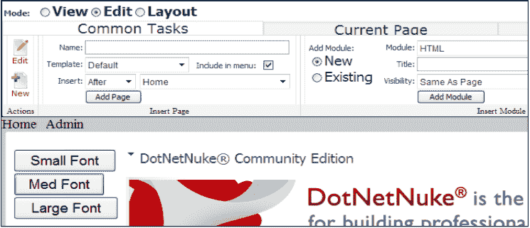

## 更多...

在此示例中，我们使用了极其简单的样式表，除了更改字体大小之外没有做任何其他事情。但此部件的功能仅受限于您在样式表代码中的创造力。您可以尝试其他CSS元素和更多CSS文件，真正了解此部件的所有可能性。

## 另请参阅

我们再次在皮肤中使用了`<%=SkinPath %>`变量。要了解皮肤中可用的其他门户变量，请参阅本章末尾的“在皮肤中显示门户设置”操作指南。

## 创建并部署自定义部件

在之前的操作指南中，我们了解了如何使用DNN内置的各种皮肤部件来提供有趣且富有创意的客户端功能。在本操作指南中，我们将学习如何使用DNN自带的示例模板并添加我们自己的JavaScript来制作自定义皮肤部件。

自定义部件可以做很多事情。在本操作指南中，我们将演示一个简单的“淡出”部件，当您点击它时，它会淡出并消失。其工作原理是调整元素的透明度。

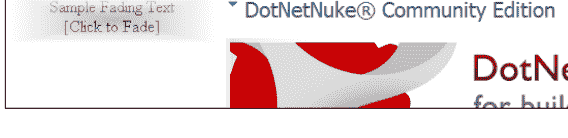

要使它工作，我们需要做三件事：

+   1. 复制一个我们可以编辑的DNN部件模板。
+   2. 编辑模板JavaScript文件并添加我们自己的点击处理程序。
+   3. 更新清单并部署皮肤。

为了帮助我们初步了解自定义皮肤部件，DNN贴心地提供了一个完整的示例部件和JavaScript模板。我们只需修改按钮点击处理程序以触发功能即可。我们首先将示例部件模板从DNN安装目录复制到一个临时文件夹中。然后，我们将重命名这些文件并对其进行编辑以创建自定义部件。

## 准备工作

要跟随本操作指南进行操作，您必须先完成第8章“基本皮肤设计”中的以下操作指南：

+   ▸ 创建一个简单的ASCX皮肤

## 操作步骤...

+   1. 首先创建一个新文件夹，并将其命名为`ACME.SampleWidget`。
+   2. 在DNN服务器上找到`\Resources\Widgets\User\YourCompany`文件夹。
+   3. 将此文件夹中的文件复制到新的`ACME.SampleWidget`文件夹中。
+   4. 将JavaScript文件`YourCompany.Widgets.SampleWidget.js`重命名为`ACME.Widgets.SampleWidget.js`。
+   5. 删除名为`/EmbedWidgetResources`的子文件夹，因为我们不会在本操作指南中使用它。
+   6. 该文件夹现在应包含以下文件：

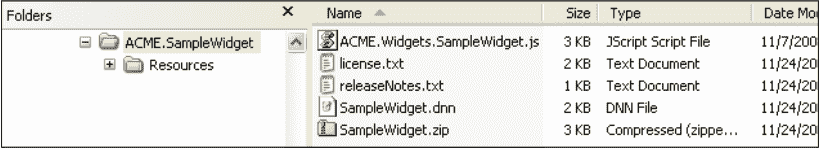

+   7. 启动开发工具。
+   8. 从**文件**菜单中选择**打开文件...**。
+   9. 浏览到`ACME.SampleWidget`文件夹并打开`ACME.Widgets.SampleWidget.js`文件。
+   10. 我们需要做的第一件事是更改脚本中的文本“YourCompany”。您可以放置您实际的公司名称或缩写，而不是YourCompany。我们通过简单的查找和替换来完成此操作：在**编辑**菜单下，查看**查找和替换**，然后选择**快速替换**（或直接按`Ctrl+H`）。
+   11. 出现提示时：

+   - **查找内容：** `YourCompany`
+   - **替换为：** `ACME`
+   - **查找范围：** `当前文档`

+   12. 点击**全部替换**。
+   13. 要添加我们自己的自定义JavaScript，请向下滚动到模板脚本的底部，找到`ClickHandler`函数。我们需要添加一些代码，使得在点击链接时文本淡出：

```
ACME.Widgets.SampleWidget.ClickHandler = function(sender)
{
    var clickedObject = sender.target;
```

```
// perform a simple loop to increase the Opacity

var i=0;
for (i=0;i<=100;i++)
{
    divFade.style.filter = "Alpha(Opacity=" + i + ",style=3)";
}
}
```

14. 代码不多，但足以展示JavaScript在部件中通过鼠标点击触发。

15. 最后，由于我们将皮肤作为扩展进行部署，还需要更新部件的清单。打开`SampleWidget.dnn`文件。

16. 和之前一样，我们必须将文本“YourCompany”改为示例公司“ACME”。更改以下突出显示的行：

```
<dotnetnuke type="Package" version="5.0">
  <packages>
    <package name="ACME.SampleWidget" type="Widget" version="1.0.0">
      <friendlyName>Sample Widget</friendlyName>
      <description>The Sample Widget is a demonstration widget for DotNetNuke.</description>
      <owner>
        <name>DotNetNuke</name>
        <organization>DotNetNuke Corporation</organization>
        <url>www.dotnetnuke.com</url>
        <email>support@dotnetnuke.com</email>
      </owner>
      <license src="license.txt" />
      <releaseNotes src="releasenotes.txt" />
      <components>
        <component type="Widget">
          <widgetFiles>
            <basePath>ACME</basePath>
            <widgetFile>
              <name>ACME.Widgets.SampleWidget.js</name>
            </widgetFile>
            <widgetFile>
              <name>license.txt</name>
            </widgetFile>
```

```xml
<widgetFile>
    <name>releasenotes.txt</name>
</widgetFile>
</widgetFiles>
</component>
</components>
</package>
</packages>
</dotnetnuke>
```

+   17. 从**文件**菜单中选择**全部保存**以保存更改。
+   
+   18. 要部署该部件，请创建一个压缩ZIP文件，其中包含以下文件：
+      - `ACME.Widgets.SampleWidget.js`
+      - `license.txt`
+      - `releaseNotes.txt`
+      - `SampleWidget.dnn`
+   
+   19. 将ZIP文件保存为`SampleWidget.zip`。
+   
+   20. 要部署该部件，请以超级用户身份登录。
+   
+   21. 从**宿主**菜单中，选择**扩展**，然后从操作菜单中选择**安装扩展向导**。
+   
+   22. 出现提示时，浏览到`ACME.SampleWidget`文件夹并选择新的ZIP文件`SampleWidget.zip`。
+   
+   23. 完成向导以安装扩展。它现在应该出现在您网站上已安装的部件列表中。
+   
+   24. 要查看新部件的实际效果，我们必须将其包含在皮肤中。下一个操作指南将描述在皮肤中使用该部件的步骤。

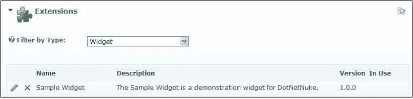

## 工作原理...

部件功能是在JavaScript文件中编码实现的。在本示例中，我们将其保持得非常简单，但您可以根据自己的JavaScript技能，自由添加尽可能多的功能。


## 更多内容……

> 要查看更多的皮肤控件示例及其工作原理，请下载并查看Extropy皮肤，可从www.codeplex.com获取（只需搜索“Extropy”）。

在本节中，我们创建了一个简单的自定义控件，并将其部署到DNN站点上，以便皮肤可以使用该控件。在下一节中，我们将看到如何在皮肤中使用自定义控件。

## 在皮肤中使用自定义控件

一旦自定义皮肤控件被创建并安装到服务器上，它就会像DNN自带的控件一样可以使用。在本节中，我们将看到如何将上一节中创建的自定义皮肤控件与第8章“基本皮肤”中的SampleASCXSkin结合起来使用。

我们需要做三件事：

1. 确保你已经完成了上一节，并更新了模板JavaScript。
2. 将自定义控件添加到ASCX文件中。
3. 部署皮肤并进行测试。

### 准备工作

要跟随本节操作，你必须完成以下章节：

- 创建一个简单的ASCX皮肤
- 创建并部署自定义控件

### 操作步骤……

1. 要在皮肤中使用ACME.SampleWidget控件，我们需要编辑“创建一个简单的ASCX皮肤”一节中的示例ASCX皮肤文件。首先找到名为SampleASCXSkin的文件夹。
2. 启动开发工具。
3. 从“文件”菜单中选择“打开文件...”。
4. 浏览到SampleASCXSkin文件夹，打开SampleASCXSkin.ascx文件。

11. 在左侧你会看到一个带有文本的小块。点击控件文本将导致DIV中的文本淡出：

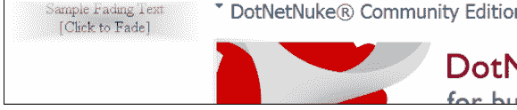

### 工作原理……

这个自定义的ACME.SampleWidget通过一个简单的JavaScript点击处理程序使元素淡出，当点击包含示例文本的DIV元素时，它会动态修改该DIV的透明度。这足以演示自定义控件的工作方式，但更复杂的示例需要更多的JavaScript代码以及对JavaScript编程更深入的讨论。

> 创建自定义DNN控件本身就是一门艺术。你可以从Nik Kalyani的这篇优秀博客中了解更多关于制作自定义控件的内容：http://www.kalyani.com/2009/12/dotnetnuke-widgets-guide-part-1-of-4。

## 使用圆角超级样式表

超级样式表是DNN 5版本中的一项新功能，通过最大化利用CSS来提供重用HTML布局的方法。在撰写本文时，有三个可用的超级样式表：Yahoo YUI库、DNN布局样式表和圆角样式表。

在本节中，我们将演示如何导入并使用圆角样式表，在皮肤内容周围创建一个图形框。

为了实现盒子效果，我们首先使用一组自定义的边框图像，然后在皮肤中创建一组嵌套的DIV，最后使用DNN提供的`dnn-roundedcorners.css`文件将图像链接到DIV元素。这与第8章“基本皮肤”中的“使用图像设置容器样式”一节非常相似，但这次圆角样式表将使用CSS定位图像，而不是使用HTML表格。

### 准备工作

要跟随本节操作，你必须完成第8章“基本皮肤”中的以下章节：

- 创建一个简单的ASCX皮肤

所有部分就位后，图形框将如下所示：

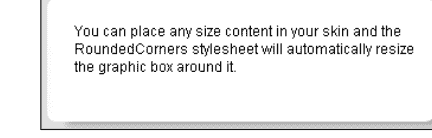

### 操作步骤……

1. 找到“创建一个简单的ASCX皮肤”一节中创建的`SampleASCXSkin`文件夹。
2. 在其中创建一个新文件夹`\images`，用于存放图像。
3. 我们将使用一些图像来制作盒子的边框。在本示例中，我们将使用以下图像：

- `box_e.png`：图形框的右侧
- `box_n.png`：图形框的顶部第一段
- `box_ne.png`：图形框的右上角
- `box_nw.png`：图形框的左上角
- `box_s.png`：图形框的底部
- `box_se.png`：图形框的右下角
- `box_sw.png`：图形框的左下角
- `box_w.png`：图形框的左侧

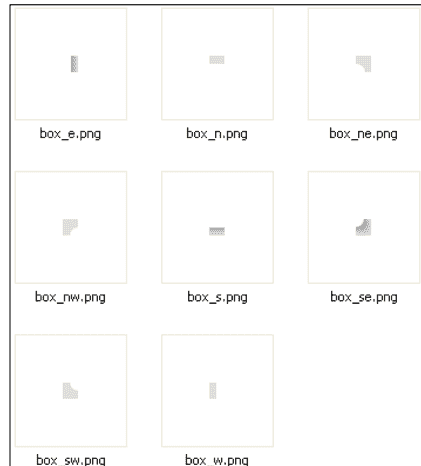

4. 将图像放入正确的文件夹后，启动开发工具。
5. 从“文件”菜单中选择“打开文件...”，打开skin.css文件。
6. 在文件顶部添加一条导入语句，引入DNN的roundedcorners.css文件。如果DNN运行在本地主机上，则代码为：

```
@import url("http://localhost/dotnetnuke/resources/shared/stylesheets/dnn-roundedcorners.css");
```

7. 在导入语句下方，添加以下代码，将图像链接到DNN的样式元素：

```
.RoundedCorners .N{background-image: url("images/box_n.png"); }
.RoundedCorners .NE{background-image: url("images/box_ne.png"); }
.RoundedCorners .E{background-image: url("images/box_e.png"); }
.RoundedCorners .SE{background-image: url("images/box_se.png"); }
.RoundedCorners .S{background-image: url("images/box_s.png"); }
.RoundedCorners .SW{background-image: url("images/box_sw.png"); }
.RoundedCorners .W{background-image: url("images/box_w.png"); }
.RoundedCorners .NW{background-image: url("images/box_nw.png"); }
/* 通用样式 */
```

8. 现在样式表已经设置好，下一步是修改控件。从“文件”菜单中选择“打开文件...”，打开SampleASCXSkin.ascx文件。

9. 向下滚动到包含各窗格的HTML表格，并将以下代码添加到左侧窗格中：

```html
<div class="content">
    <table width="100%" border="0" cellspacing="0" cellpadding="0">
        <tr>
            <td valign="top" id="LeftPane" class="LeftPane"
                runat="server" visible="false">
            </td>
            <td valign="top" id="ContentPane" class="ContentPane"
                runat="server" visible="false">

                <div class="RoundedCorners">
                    <div class="W">
                        <div class="E">
                            <div class="N">
                                <div class="NW">
                                    <div class="NE" align="center"
                                         style="padding: 10px; vertical-align: middle">
                                        你可以在皮肤中放置任意数量的内容，
                                        RoundedCorners样式表会自动调整
                                        图形框的大小以适配内容。即使你的内容需要换行，
                                        图形框也会相应地调整大小。
                                    </div>
                                </div>
                            </div>
                            <div class="S">
                                <div class="SW">
                                    <div class="SE" align="center">
                                        [ 你可以在这里放置页脚内容 ]
                                    </div>
                                </div>
                            </div>
                        </div>
                    </div>
                </div>

            </td>
            <td valign="top" id="RightPane" class="RightPane"
                runat="server" visible="false">
            </td>
        </tr>
    </table>
</div>
```

10. 最后一步是修改清单文件，在部署皮肤之前加入我们的图像。打开`SampleASCXSkin.dnn`文件。

11. 向下滚动到`SkinFiles`元素，并添加以下内容：

```xml
<SkinFile>
    <name>skin.css</name>
</SkinFile>
<SkinFile>
    <path>images</path>
    <name>box_n.png</name>
</SkinFile>
<SkinFile>
    <path>images</path>
    <name>box_ne.png</name>
</SkinFile>
<SkinFile>
    <path>images</path>
    <name>box_e.png</name>
</SkinFile>
<SkinFile>
    <path>images</path>
    <name>box_se.png</name>
</SkinFile>
<SkinFile>
    <path>images</path>
    <name>box_s.png</name>
</SkinFile>
<SkinFile>
    <path>images</path>
    <name>box_sw.png</name>
</SkinFile>
<SkinFile>
    <path>images</path>
    <name>box_w.png</name>
</SkinFile>
<SkinFile>
    <path>images</path>
    <name>box_nw.png</name>
</SkinFile>
</SkinFiles>
```

12. 从**文件**菜单中选择**保存全部**以保存更改。

13. 要查看新皮肤在站点上的效果，请以超级用户身份登录。

14. 按照“部署你的皮肤和容器”一节中的描述，将皮肤从皮肤文件夹部署到DNN门户。请务必在ZIP文件中包含新的`/images`文件夹。


## 高级换肤

- 15. 皮肤部署完成后，在 **Admin** 菜单下查看并选择 **Skins**。
- 16. 从 **Skins:** 下拉列表中选择 **SampleACSXskin** 并点击 Preview 链接。
- 17. 由于我们在 Content Pane 中放置了 DIV 元素，包含内容的图形框将显示在页面的顶部：

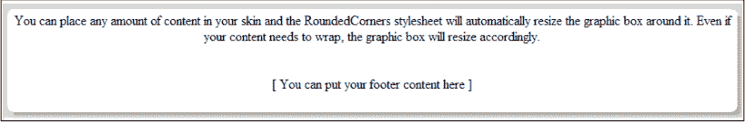

## 其工作原理...

要使用圆角超样式表，我们做了三件事：首先将 DNN 圆角样式表导入皮肤 CSS 文件中。然后添加一些额外的规则来定义我们的自定义边框图像，然后添加一组嵌套的 DIV 元素来将我们的图像包裹在内容周围。

## 在皮肤中显示门户设置

正如我们在之前的一些食谱中所看到的，可以在我们的皮肤中引用一些 DNN 变量。我们曾看到一个使用变量 SkinPath（<%= SkinPath %>）来检索当前皮肤路径的示例。但还有其他值可以在皮肤中访问，在本食谱中我们将看到如何在皮肤中访问门户设置变量。

下表显示了一些我们可以使用门户设置变量：

| Variable | Description |
|---|---|
| `<%=PortalSettings.ActiveTab.TabName %>` | 当前页面的名称。 |
| `<%=PortalSettings.ActiveTab.TabID %>` | 当前页面的 ID。 |
| `<%= iif(Request.IsAuthenticated,"Logged In","Logged Out") %>` | 显示登录状态。 |
| `<%=PortalSettings.ActiveTab.Title %>` | 当前页面的标题。 |
| `<%= PortalSettings.PortalName %>` | 当前门户的名称。 |
| `<%= PortalSettings.PortalId %>` | 当前门户 ID（0、1、2 等）。 |
| `<%= PortalSettings.AdministratorRoleName %>` | 管理员角色的名称。 |
| `<%= PortalSettings.Email %>` | 门户管理员的电子邮件地址。 |
| `<%= PortalSettings.FooterText %>` | 页脚中显示的文本。 |
| `<%= PortalSettings.HomeDirectory %>` | 当前门户的主目录。 |
| `<%= PortalSettings.Version %>` | 你的站点的 DNN 版本。 |
| `<%= PortalSettings.UserInfo.DisplayName %>` | 当前用户的显示名称。 |
| `<%= PortalSettings.UserInfo.IsSuperUser %>` | 当前用户是否为 SuperUser（true/false）。 |

为了演示门户设置变量，我们将在示例皮肤中添加一个状态框来显示一些当前门户设置。

> 注：其中许多设置变量更易于（也更安全地）使用 Tokens（例如 [User:DisplayName]）在 Text 皮肤对象内部访问。请参阅 *第 8 章，基础换肤* 中的食谱 *Creating a simple HTML skin* 以获取示例。

## 准备工作

要跟随本食谱，你必须已完成 *第 8 章，基础换肤* 中的以下食谱：

- *Creating a simple ASCX skin*

## 如何操作...

- 1. 找到在食谱 *Creating a simple ASCX skin* 中创建的名为 `SampleASCXSkin` 的文件夹。
- 2. 启动 Development Tool。
- 3. 从 **File** 菜单中选择 **Open File...** 并打开 `SampleASCXSkin.ascx` 文件。
- 4. 我们将添加一个小型 HTML 表格作为状态面板。将它放在 `LeftPane` 中，使用以下代码：

```html
<div class="content">
    <table width="100%" border="0" cellspacing="0" cellpadding="0">
        <tr>
            <td valign="top" id="LeftPane" class="LeftPane"
                runat="server" visible="false">
```

```
<%= iif(Request.IsAuthenticated,"Logged In","Logged Out") %>
</td>
</tr>
<tr>
<td>
Current Page:
</td>
<td>
<%=PortalSettings.ActiveTab.TabName %>
</td>
</tr>
<tr>
<td>
User:
</td>
<td>
<%= PortalSettings.UserInfo.DisplayName %>
</td>
</tr>
<tr>
<td>
User Email:
</td>
<td>
<%= PortalSettings.UserInfo.Email %>
</td>
</tr>
<tr>
<td>
SuperUser?:
</td>
<td>
<%= PortalSettings.UserInfo.IsSuperUser %>
</td>
</tr>
<tr>
<td>
Footer:
</td>
<td>
```

```
<%= PortalSettings.FooterText %>
</td>
</tr>
</table>

</td>
<td valign="top" id="ContentPane" class="ContentPane" runat="server" visible="false">
</td>
<td valign="top" id="RightPane" class="RightPane" runat="server" visible="false">
</td>
</tr>
</table>
</div>
```

- 5. 从 **File** 菜单中选择 **Save All** 以保存你的更改。
- 6. 要查看新皮肤在我们站点上的外观，请以 SuperUser 身份登录。
- 7. 从皮肤文件夹部署皮肤到 DNN 门户，如食谱 *Deploying your skins and containers* 中所述。
- 8. 皮肤部署完成后，在 **Admin** 菜单下查看并选择 **Skins**。
- 9. 从 **Skins:** 下拉列表中选择 **SampleASCXSkin** 并点击 Preview 链接。
- 10. 由于我们将 HTML 表格放在了 `LeftPane` 中，状态面板将出现在页面的左侧：

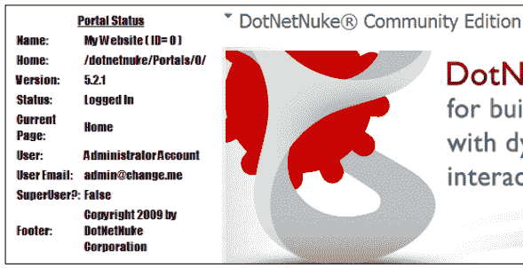

## 其工作原理...

此技术只能获取当前门户的信息。此外，`PortalSettings` 是一个共享类，只能直接从皮肤访问，而不能从容器访问。

## 如何操作...

- 1. 找到在食谱 *Styling a menu with images* 中创建的名为 ASCXMenuSkin 的文件夹。
- 2. 启动 Development Tool。
- 3. 从 **File** 菜单中选择 **Open File...**。
- 4. 浏览到 ASCXMenuSkin 文件夹并打开 ASCXMenuSkin.ascx 文件。
- 5. 首先在文件顶部添加一个 register 指令：
```
<%@ Register TagPrefix="dnn" Namespace="DotNetNuke.UI.Skins" Assembly="DotNetNuke" %>
```
- 6. 然后，向下滚动一点直到看到 NAV 控件。要添加新的自定义属性，将 NAV 控件从此：
```
<div class="menu_style">
    <dnn:NAV runat="server" id="dnnNAV"
            ProviderName="DNNMenuNavigationProvider"
            IndicateChildren="false"
            ControlOrientation="Horizontal"
            CSSControl="mainMenu" />
</div>
```
改为此：
```
<div class="menu_style">
    <dnn:NAV runat="server" id="dnnNAV"
            ProviderName="DNNMenuNavigationProvider"
            IndicateChildren="false"
            ControlOrientation="Horizontal"
            CSSControl="mainMenu" mouseouthidedelay="100">
        <customattributes>
            <dnn:customattribute value="Expand" name="AnimationType" />
            <dnn:customattribute value="Sine" name="EasingType" />
            <dnn:customattribute value="In" name="EasingDirection" />
            <dnn:customattribute value="1" name="AnimationLength" />
            <dnn:customattribute value="10" name="AnimationInterval" />
        </customattributes>
    </dnn:NAV>
</div>
```
- 7. 这就是我们需要做的全部工作。通过添加菜单动画所需的自定义属性，皮肤就可以使用了。
- 8. 要预览皮肤，首先以 SuperUser 身份登录。
- 9. 从皮肤文件夹部署皮肤到 DNN 门户，如 Deploying your skins and containers 食谱中所述。
- 10. 皮肤部署完成后，在 Admin 菜单下查看并选择 Skins。
- 11. 从 Skins: 下拉列表中选择 ASCXMenuSkin 并点击 Preview 链接。
- 12. 菜单看起来与之前相同，但现在它们采用动画来轻轻滑开和关闭。你可以通过更改上述代码示例中 AnimationLength 的值来调整速度。值为 1 时以正常速度移动，而值为 10 时会创建非常缓慢的菜单打开效果。

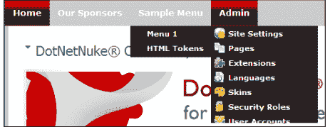

## 还有更多...

你可以尝试可用的选项并观察菜单动画如何变化。例如，EasingType 可能是最有趣的选项。Sine 会创建流畅的菜单打开效果，Bounce 会创建一种犹豫的扩展效果。Circ 提供更干净的“清脆”打开效果，而 Quad 则使动画更“柔和”。


