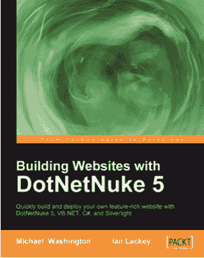
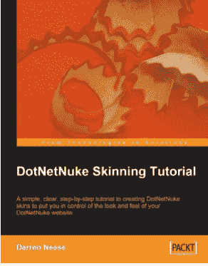
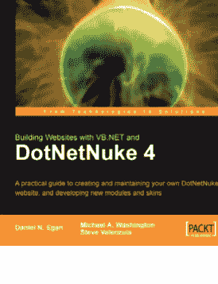
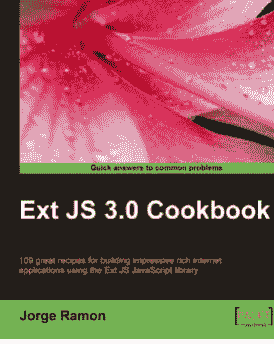

# 索引

# 符号

<description> 元素 136
<friendlyname> 元素 136
<module><friendlyname> 元素 136
<name> 元素 136
<src> 元素 136

# A

抽象方法 113
ACME_GetEmployees 108
Active Directory
  关于 371
  与 DNN 一起使用 371-374
Active Directory 问题
  更正 377
AddLog 方法
  关于 366
  使用 366
AddModuleMessage 方法
  关于 366
  使用 366
AD 安全角色
  与 DNN 同步 375, 376
动画，添加到菜单
  在皮肤中显示 407-409
公告模块
  创建 67, 69
  工作原理 69
ASCX 皮肤
  创建 238-242
程序集 122

# B

基本 ASCX 容器
  创建 253-257
双语站点
  使用单一门户创建 273, 274
断点
  设置 152-154

# C

日历事件
  作为 RSS 源发布 317, 319
日历 75
CAPTCHA 221
CAPTCHA 控件
  关于 221
  添加到数据输入 221-224
  工作原理 224
CBO Hydrator 369
复选框
  在 Datagrid 控件中显示 199, 201
ClickHandler 函数 392
CodePlex 皮肤
  下载 230
可折叠面板
  创建 163, 164
  工作原理 165
容器，DNN 站点
  使用图像设置样式 260-265
  选择 24, 25
内容
使用 TabStrip 控件分隔 217-220
控件属性，CAPTCHA 控件
CaptchaChars 224
CaptchaHeight 224
CaptchaLength 224
CaptchaWidth 224
CssClass 224
Text 224
控件属性，多状态复选框
ImagePath 228
ImageUrl 228
Text 228
ToolTip 228
控件，DNN
关于 122
程序集 122
数据库脚本 122
模块清单 122
用户控件 122
需要翻译的控件
确定 279, 280
CSV 文件 336
自定义 CBO Hydrator
创建 369, 370
自定义容器图像
创建 257-260
自定义表单
设计 319-323
设置样式 324, 325
自定义模块操作
创建 338-342
自定义模块翻译
创建 277-279
自定义小部件
创建 391-394
部署 391-394
在皮肤中使用 395-397
工作原理 394

# D

数据库
从 Visual Web Developer 查看 95-97
数据库脚本 122
数据库表，DNN
使用键创建 102-104
数据库类型
MS Access 354
MySQL 354
使用 TNSNames.ora 文件的 Oracle 数据库 354
SQL Server Express 354
Datagrid 控件
关于 197
复选框，显示 199, 201
电子邮件超链接，工作原理 199
电子邮件链接，显示 197-199
本地化 295, 297, 298
缩略图，显示 202-205
Datagrid，带筛选控件
显示 176-185
datalist 控件 124
数据类型
关于 320
货币 320
日期 320
下载 320
电子邮件 320
图像 320
整数 320
分隔符 320
文本 320
真/假 320
URL 320
用户配置文件链接 320
调试环境
设置 145-148
开发工具 122
DNN
关于 5
控件 122
开发工具 122
与 Active Directory 一起使用 371-374
同步 AD 安全角色 375, 376
使用单一门户创建双语站点 273, 274
确定需要翻译的控件 279, 280
创建自定义模块翻译 277-279
本地化 Datagrid 控件 295-298
使用 DNN 列表本地化下拉列表 288-292
使用存储过程本地化下拉列表 284, 286, 287
编辑语言资源文件 275-277
属性 328
创建皮肤 229
本地化存储过程 292-295
DNN 5 源代码
下载 144
工作原理 145
DNN 5 初学者工具包
安装 98, 99
工作原理 99
DNN 安装
关于 6
下载 Microsoft Web Platform Installer 6
运行 14-18
DNNLabelEdit 控件
创建可编辑标签 205-207
工作原理 208
DNN 本地化 271
DNN 模块
公告模块 67
使可搜索 328-331
文档模块 70
事件模块 75
HTML 模块 64
链接模块 81
新闻源模块 84
报告模块 89
调查模块 90
Wiki 模块 78
DNN 包
下载 10
安装 10-14
DNN 站点
授予用户访问权限 39-42
选择容器 24, 25
使用 Google Analytics 跟踪 314-317
下载扩展 28-30
将模块添加到页面 25, 26
安装新扩展 31, 32
创建页面 54-58
组织页面 54-58
管理配置文件属性 50-54
分配安全角色 43-45
创建安全角色 43-45
设置站点名称 19-22
选择皮肤 22, 23
在模块级别控制用户访问 46, 47
启用用户注册 36-38
禁止用户 48, 49
创建用户 39-42
删除用户 48, 49
DNN 皮肤设计 229
DNNTextSuggest 控件
关于 208
创建 208-211
工作原理 211
文档分发
关于 70-72
步骤 70
文档模块
关于 70
工作原理 73
DotNetNuke。参见 DNN
下拉列表
使用 DNN 列表本地化 288-292
使用存储过程本地化 284-287
下拉列表控件，来自 DNN 列表
填充 165-170
下拉列表控件，来自存储过程
填充 171-175

# E

可编辑标签
使用 DNNLabelEdit 控件创建 205-207
Edit 控件
构建 128-134
EditEmployee 控件 128, 160
电子邮件链接
在 Datagrid 控件中显示 197-199
EmployeeInfo 类 331
Eval 函数 200
事件日历
创建 75-77
事件模块
关于 75
事件模块关于 317
ExportModule 函数 332
扩展，DNN 站点
下载 28-30
下载站点 28

# F

Flash
与 HTML 模块一起使用 306-308
表单和列表模块
关于 324
工作原理 319, 324
友好 URL 重写
控制 312-314
Future Technologies 调查 90

# G

GetEmployees 函数 125
GetSearchItems 函数 329
Google Analytics
关于 314
用于站点跟踪 314-317
在 DNN 中使用 314

# H

HTML 模块
关于 64
与 Flash 一起使用 306-308
与 jQuery 一起使用 300-303
使用替换标记 304, 306
使用 CSS 代码 64-67
HTML 皮肤
创建 233-237
工作原理 237

# I

iActionable 接口 338
ImportModule 函数 335
iPortable 接口 332
iSearchable 接口 331

# J

jQuery
关于 300-303
与 HTML 模块一起使用 300-303

# L

标签
从资源文件显示 160-162
标签本地化 280-283
语言包
关于 272
下载 272, 273
安装 273
语言资源文件
编辑 275-277
LblContent 标签控件 124
链接
本地化 280-283
链接模块 81
本地化 271
LstContent_ItemDataBound 过程 126

# M

清单文件
使用 HTML 格式增强 342-345
清单文件
关于 136
从已安装模块创建 155-157
编辑 136-138
菜单
使用图像设置样式 265-269
消息类型
BlueInfo 366
GreenSuccess 366
RedError 366
YellowWarning 366
Microsoft 多层体系结构 111
Microsoft Web Platform Installer
关于 6
下载 6
安装 6
模块
关于 25
添加到站点页面 25, 26
作为独立包部署 140-143
准备调试 149-151
模块数据
导出 332, 333
导入 335, 336
模块清单 122
模块消息和事件日志记录 366
模块，DNN。参见 DNN 模块
多个数据库连接
使用 351-354
多状态复选框
关于 225
添加 225-227
控件属性 228
工作原理 228

# N

NavigateURL 模块 364
导航
使用 NavigateURL 控制 364, 365
NewHire 函数 199
新模块，DNN
连接到数据库 112-117
使用初学者工具包创建 100, 101
新模块版本
部署 346-350
新闻源模块 84
新闻通讯
关于 73
发布 73, 74

# P

Page_Load 过程 125, 159
页面，DNN 站点
创建 54-58
组织 54-58
分页控件
添加到 Datagrid 186-193
面板
本地化 280-283
参数，Rotator 小部件
方向 380
高度 380
ImageCount 380
ImageTemplate 380
ImageURL 380
Interval 380
Transition 380
宽度 380
热门链接集
发布 81-84
门户设置
在皮肤中显示 402-406
配置文件属性，DNN 站点
管理 50-54
项目，用于发布或调试
构建 138, 139
属性，DNN
作者 329
内容 328
描述 328
GUID 329
PubDate 329
SearchKey 329
标题 328

# R

真正简易聚合 (RSS) 84
回收站
还原页面 58
使用 58
工作原理 59
区域 160
报告模块 89
资源文件 272
Rotator 小部件
关于 380
参数 380
使用 380-383
圆角超级样式表
使用 397-402
RSS 新闻源
配置 86-88
显示 84, 85
工作原理 86

# S

示例 Northwind 数据库
使用 352
辅助 View 控件
创建 356-363
SectionHead 控件 164
安全角色，DNN 站点

assigning 43-45
creating 43-45
**简单 HTML 容器**
creating 248-253
**简单报表**
publishing 88-90
**皮肤，DNN 网站**
selecting 22, 23
**skinFiles 元素 382**
**换肤 229**
**皮肤对象**
about 230
ContentPane DIV 233
exploring 244-248
[LOGIN] 233
[MENU] 233
RightPane DIV 233
[USER] 233
**皮肤**
ASCX 皮肤，创建 238-242
creating 229
deploying 242-244
downloading 230
HTML 皮肤，创建 233-237
installing 231, 232
**SMTP 服务器**
setting up, with Gmail 59, 61
**SQLServer Express**
installing 8, 9
**标准 DNN 模块**
installing 27, 28
**入门套件 124**
**静态翻译**
vs. content translation 272
**存储过程**
localizing 292-295
creating 105-111
**结构化查询语言 (SQL) 88**
**样式表小部件**
using 387-390
**SuggestText Web 控件**
working 212
**超级样式表 397**
**调查模块 90**
**调查问卷**
publishing 90, 92

**T**
**TabStrip 控件**
about 217
content, separating 217-220
working 221
**缩略图**
displaying, in Datagrid control 202-205
**标题**
localizing 280-283
**令牌替换**
HTML module, using with 304, 305
working 306
**令牌**
[DateTime:Now] 304
[Portal:Email] 304
[Portal:FooterText] 304
[Portal:HomeDirectory] 304
[Portal:PortalName] 304
[Tab:Description] 304
[Tab:TabName] 304
[User:DisplayName] 304
[User:Email] 304
**Treeview 控件**
about 212
database records, organizing 212-216
working 216

**U**
**卸载脚本**
creating 118, 119
working 120
**Uninstall.SqlDataProvider 118**
**用户控件 122**
**用户定义表**
exporting 336-338
importing 336-338
**用户注册，DNN 网站**
enabling 36-39
**用户，DNN 网站**
banning 48, 49
creating 39-42
deleting 48, 49

# V

**View 控件**
building 123-127
working 127

**ViewEmployee 控件**
items, localizing 280

**可见性小部件**
using 384, 386
working 387

**Visual Web Developer**
database, viewing from 95-97

**Visual Web Developer 2010 Express**
installing 94, 95

# W

**WAP** 122

**Web Application Project.** *See WAP*

**Web 控件**
about 195
adding, to Toolbox 196, 197
CAPTCHA controls 195
editable labels 195
Tab controls 195
tree views 195
using 195, 196

**Web PI.** *See* **Microsoft Web Platform Installer**

**Web Site Project.** *See* **WSP**

**Wiki**
about 77
creating 77-80
working 81

**WSP** 122

# X

**XML feed**
displaying 309-312

**XML/XSL 模块**
about 309
using 309-312

# 感谢您购买
DotNetNuke 5.4 Cookbook

# 关于 Packt Publishing

Packt，读作 'packed'，于 2004 年 4 月出版了首本图书 “Mastering phpMyAdmin for Effective MySQL Management”，随后继续专注于出版针对特定技术和解决方案的高度聚焦的图书。

我们的图书和出版物分享了您同行的 IT 专业人士在适应和定制当今系统、应用程序和框架方面的经验。我们的解决方案型图书为您提供定制您正在使用的软件和技术以完成工作的知识和能力。Packt 的图书比您过去看到的 IT 图书更具体、更少泛泛而谈。我们的独特商业模式使我们能够为您提供更聚焦的信息，让您获得更多所需知识，减少不必要的内容。

Packt 是一家现代而独特的出版公司，专注于为开发者、管理员和新手社区生产高质量的前沿图书。有关更多信息，请访问我们的网站：www.packtpub.com。

# 关于 Packt Open Source

2010 年，Packt 推出了两个新品牌 Packt Open Source 和 Packt Enterprise，以继续其专注于专业化的方向。本书是 Packt Open Source 品牌的一部分，该品牌收录了以开源许可构建的软件的图书，并为从高级开发者到初级网页设计师的任何人提供信息。Open Source 品牌还运营着 Packt 的开源版税计划，通过该计划，Packt 为每本售出图书所介绍的开源项目支付版税。

# 为 Packt 撰写

我们欢迎所有有兴趣撰稿的人的咨询。图书提案请发送至 author@packtpub.com。如果您的图书创意仍处于早期阶段，想在撰写正式提案前先讨论，请联系我们；我们的其中一位约稿编辑会与您联系。

我们不仅寻找已出版的作者；如果您具备强大的技术技能但没有写作经验，我们经验丰富的编辑可以帮助您发展写作事业，或为您提供专业知识的额外回报。

# 使用 DotNetNuke 5 构建网站

ISBN: 978-1-847199-92-8　　　　　　　　 Paperback: 336 pages

使用 DotNetNuke 5、VB.NET 和 C# 快速构建并部署功能丰富的网站

+   1. 使用 DotNetNuke 5 创建和管理您自己的网站
+   2. 使用自定义模块定制和增强您的网站
+   3. 代码以 VB.NET 和 C# 提供，使用 Visual Studio 2010
+   4. 涵盖使用 Silverlight 和 Linq to SQL 的模块开发

# DotNetNuke 换肤教程

ISBN: 978-1-847192-78-3　　　　　　　　 Paperback: 156 pages

一个简单、清晰、分步的教程，指导您创建 DotNetNuke 皮肤，让您掌控 DotNetNuke 网站的外观和感觉

+   1. 掌控您 DotNetNuke 网站的外观和感觉
+   2. 创建 DotNetNuke 皮肤的简单、清晰教程
+   3. 实用分步指导
+   4. 无需 DotNetNuke 换肤知识

请查看 **www.PacktPub.com** 获取有关我们图书的信息

# 使用 VB.NET 和 DotNetNuke 4 构建网站

ISBN: 978-1-904811-99-2      Paperback: 336 pages

创建和维护您自己的 DotNetNuke 网站并开发新模块和皮肤的实用指南

+   1. 本书是这本备受好评的 DotNetNuke 图书的特别修订和更新版本
+   2. 使用 DotNetNuke 创建和管理您自己的网站
+   3. 使用皮肤和自定义模块定制和增强您的网站
+   4. 对自定义模块开发的 DAL 和 DAL+ 进行广泛覆盖

# Ext JS 3.0 Cookbook

ISBN: 978-1-847198-70-9      Paperback: 376 pages

使用 Ext JS JavaScript 库构建令人印象深刻的富互联网应用程序的清晰分步配方

+   1. 精通 Ext JS 小部件并学习创建满足您需求的自定义组件
+   2. 为您的真实用户界面构建引人注目的原生和自定义布局、表单、网格、列表视图、树视图、图表、选项卡面板、菜单、工具栏等
+   3. 包含大量易于遵循的示例，以练习 Ext JS 库的所有功能

请查看 www.packtpub.com 获取有关我们图书的信息

