## 第 1 章：UAV 和无人机工程入门

**无人驾驶飞行器**（**UAV**）系统已成为全球热门词汇，因为这项新技术正在彻底改变生活的各个领域，从民用到国防，从小型摄影公司到大型工业和安全领域。在本章中，我们将了解各种可用的无人系统，重点关注 UAV 系统、其结构及其在不同领域的用途。通过阅读本章，我们将了解无人机的主要系统、子系统和组件及其功能，这将帮助我们理解整个系统及其各个部分。读完本章后，您将精通可用的无人机类型及其主要组件和应用，这将推动您理解本书后续的内容。

在本章中，我们将涵盖以下主要主题，这将帮助我们分割章节并更好地理解它：

*   无人系统介绍——无人地面、空中和水面载具
*   无人机类型及其与应用的相关性
*   无人机的主要机械和结构组件
*   无人机的航空电子系统和子系统

### 无人系统介绍——无人地面、空中和水面载具

# 无人系统概述：演变、需求与应用

随着世界经历创新与新发展，科技不断进步，事物规模大幅缩减。任何新兴技术最初源于安全与国防需求，随后融入民用领域，无人技术也不例外。

有人驾驶系统体积庞大，不适合情报收集，且用于敌方情报侦察风险极高。一旦陷入战斗或伏击，人员与装备将付出巨大代价。为规避此类风险，无人技术应运而生，分别服务于陆地、空中和海洋，即**无人地面车辆**（UGV）、**无人飞行器**（UAV）和**无人水面/水下载具**（UWV）。

## 各类无人载具

UAV 经过长期演变逐渐成型，正如我们日常见到的各类载具：陆地有汽车和卡车，海洋有潜艇和舰船，空中有飞机；同理，无人系统覆盖陆、海、空三大领域，具体如下：

### UWV（无人水下载具）

UWV 是无人潜艇，可深入水下远航，由远端地面人员操控。此类自主航行器按预设路径与深度巡航，任务完成后自动返航。

主要用途包括：利用 RGB 相机进行水下监视，或利用**光探测和测距**（LiDAR）开展水深测量；国防领域用于侦察与海域监控。

### UGV（无人地面车辆）

UGV 与 UWV 类似，区别在于其在陆地表面行驶而非空中或水中。操作人员远离基站，支持手动与自主模式，按预设路径、速度与路线运行，任务结束自动归位。

### UAV（无人飞行器）

UAV 无机上人员，依靠机载精密传感器系统飞行。由地面控制站通过远程天线操控。广泛应用于民用与军用场景，如人群监控、航测、农业作业等。后续章节将深入解析。

## 无人机的历史与演变

UAV（无人机）的发展历程颇具趣味。无人驾驶飞行器的构想可追溯至 1900 年代初。早期无人机主要用于军事侦察与监视，在派遣人类飞行员风险过大的任务中证明了价值。

随着技术进阶，无人机体积缩小、性能精进，衍生出多元应用。2000 年代消费级无人机问世，用途突破军事限制，迅速在爱好者、摄影师、电影制片人中普及，提供全新空中视角。

近年应用进一步拓展：农业作物监测、搜救行动、环境监测、物流配送等。UAV 从军事专用走向多功能民用工具，展现了无人航空技术的显著演进。

## 无人系统的必要性

随着时代发展，对多源数据与情报的需求持续增长。过往受限于技术，依赖人力与大型装备；如今无人机以更低成本、更少投入抵达地面载具难以到达的区域。

以下是 UAV 取代有人驾驶飞机的关键原因：

*   **极致触达**：以更低成本与投入抵达人力与地面车辆难以企及的偏远地区。
*   **便捷部署**：高度可扩展，形态规格多样，适配多种任务。体积极小，易于小型化运输，做到更小、更简、更智。
*   **低功耗易维护**：小型化与强健设计降低能耗，经济性更优。
*   **高性价比**：在航测、监视等航空应用中，相比传统方案极具成本优势。

## 何为无人航空系统？

**无人航空系统**（UAS）是由航空电子系统通过无线网络远程操控的无人航空平台。涵盖各类重量、尺寸与性能等级，搭载不同载荷适配多元应用。UAV 亦称**远程驾驶航空器系统**（RPAS）。下节将详述 UAS 应用场景。

当前 UAV 主要民用应用包括：

### 无人机民用应用

#### 航空摄影
无人机助力影视从业者从多角度、多高度拍摄高质量画面，过往此类拍摄难度大、成本高。因体积小、易操控、性价比高，婚庆活动航拍已普及。

#### 资产巡检
风机、管线、输电塔、桥梁等大型设施巡检过去受限于人力触达，成本高、耗时长。无人机搭载 LiDAR 与相机等载荷，凭借小体积与极强触达能力，实现高效低成本近距离巡检，助力及时决策。

#### 野生动物保护
无人机可在数分钟内监控广域野生动物分布，向操作员实时回传视频流，大幅节省人力巡护时间。亦可预警、近距离观察特定区域，上报突发事件。

#### 农业遥感
搭载多光谱/高光谱相机的无人机获取农田地理标注影像，经软件分析提取叶片化学成分，诊断作物缺素情况，按地理位置预测长势并采取保护措施。

#### 航空测绘
搭载高分相机的无人机获取地表地理标注影像，后处理生成高精度地图，解析地表形态。小型化优势使测绘更高效、省力。

#### 蚊虫防控
大载重无人机喷洒驱蚊剂，解决人力难以均匀覆盖无法到达区域的难题，显著提升防蚊效率与性价比。

# 无人机用例

## 货运无人机

如今，无人机也被用于货物配送，这被称为空中配送。大型公司将其视为未来配送的趋势。用于跨越偏远地区运送重型货物的用例也在开发中。

## 无人机的国防用例

### 人群监控

配备扬声器和摄像头的无人机在人群监控中发挥了关键作用。无人机提供现场实时画面，人员可借助扬声器指挥人群，并借助摄像头调查情况，而无需亲自前往现场。

### 监视

配备昼夜两用摄像头的无人机帮助国防部队昼夜监控关键资产。这些摄像头具备跟踪能力和激光器，可精准获取目标的地理位置。这有助于部队在无人干预的情况下对大面积区域进行监视。

### 空中作战

正如我们在世界上所见，无人机已成为战争中的关键装备。这有助于在不冒险人员生命的情况下实现更强的杀伤力。

### 无线电中继

无人机还被用作偏远地区的无线电信号增强器和中继器，这些地区通信是关键工具。此类无人机用于视线 (`line of sight`, `LOS`) 不可能实现的山区，系留无人机被用作信号放大和建立通信的塔台。

上述是无人机技术被用于帮助降低人力成本和风险、并缩短项目完成时间的部分用例。我们看到，不同类型的无人机正在被制造和使用，以满足不同的应用需求。正如战斗机不能作为客机使用，反之亦然，一种类型的无人机不适用于所有应用；因此，任何系统都完全根据需求/应用/目的等从头设计。

# 无人机类型及其与应用的相关性

在了解了由无人机技术服务的用例后，这里我们将研究为满足不同应用需求（如高续航、远程、高空等）而制造的不同类型无人机。通过这样做，我们将了解不同种类的无人机，并进一步建立对其开发的理解。下一节将简要介绍各类无人机。

## 无人机类型及其规格

在本节中，我们将研究各种类型的无人机、其关键功能以及它们之间的区别。

### 多旋翼

多旋翼是一种基于电机-螺旋桨的无人机。在空中产生力和升力的主要元件是电机及其连接的螺旋桨。这为无人机产生推力，并帮助提升系统的负载。

根据电机数量，这些无人机分类如下：

#### 双旋翼（两个电机）

双旋翼是一种多旋翼，具有两个位于中心两侧的旋翼。这些系统是单向系统，仅能承载较轻负载，且续航和控制性能较低。因此，这些系统不太常用：

图 1.1 – 双旋翼

#### 三旋翼（三个电机）

三旋翼有三个臂，每个臂末端有产生升力的元件，彼此间夹角 120 度。这类无人机体积小、不具备载重能力，但可用于短距离的检查和监视：

图 1.2 – 三旋翼

#### 四旋翼（四个电机）

四旋翼是全球最著名的无人机构型。它们被认为是最稳定、最易控制的无人机。无人机的动力学特性使其易于在三维空间机动，并赋予其在远程和高空飞行中的稳定性和速度。这些构型也用于携带多达几千克的载荷：

图 1.3 – 四旋翼

#### 六旋翼（六个电机）

六旋翼是四旋翼之后最著名的构型之一。顾名思义，它们有 6 个臂，彼此间夹角 60 度。这些构型用于更稳定的飞行，并能承载更重的负载。最终，在相同功率下，其续航时间比四旋翼短：

图 1.4 – 六旋翼

#### 八旋翼（八个电机）

八旋翼顾名思义，有 8 个臂，彼此间夹角 45 度。它是六旋翼的扩展版本，能举起更重重量，体积较大。这些在空气动力学上更稳定，但也是更重、更耗电的飞行器：

图 1.5 – 八旋翼

#### 八旋翼四轴（四轴八电机）

八旋翼四轴模型在商业市场上不太常见。它是一种在小型构型中承载更多重量的良好构型。它是一种四旋翼，有四个臂，每个臂顶部和底部各放置两个电机，以在更小的尺寸因素下产生更大推力。这类无人机主要用于保持良好的尺寸重量比：

图 1.6 – 八旋翼四轴

#### 十六旋翼（六轴十二电机）

十六旋翼顾名思义，在 6 个臂上装有 12 个电机，呈上下对置布局。这些构型用于大型无人机，如载人无人机或重型货运无人机。这些拥有更大尺寸的电机、更大的载荷能力和尺寸因素：

图 1.7 – 十六旋翼

上述构型根据确定的载荷、载重能力和应用进行选择。

### 固定翼无人机

固定翼无人机顾名思义，是一种基于标准翼型机翼的设计，机翼作为系统的关键升力发生器，单个电机（推式/拉式）帮助其在空中巡航。巡航速度帮助通过机翼产生足够的升力在空中飞行，控制面在空中提供方向控制：

图 1.8 – 固定翼无人机

### 固定翼垂直起降（混合无人机）

`垂直起降` (`VTOL`) 飞行器，也称为混合飞行器，由四个电机辅助起飞，随后过渡为固定翼飞行器。这种类型的无人机不像固定翼无人机那样需要长跑道。它像多旋翼一样从单一地点起降，并像固定翼飞行器一样巡航：

图 1.9 – 固定翼垂直起降

### 倾转旋翼无人机

倾转旋翼无人机属于固定翼垂直起降混合无人机类别，它们像多旋翼一样起降，像固定翼无人机一样巡航。这些无人机与固定翼垂直起降无人机的唯一区别在于，这些无人机基于差推原理工作，巡航和起飞使用共同的电机。相同的电机用作起飞升力电机，在过渡期间将角度从 90 度变为 180 度，并用作巡航电机。

这些无人机比固定翼垂直起降无人机效率高得多，因为电机数量减少，功耗也随之降低：

图 1.10 – 倾转旋翼混合无人机

因此，我们已经了解了不同类型的无人机。这些无人机可以按不同的重量和尺寸类别制造，但为了根据其重量概况进行区分，印度 `民航总局` (`DGCA`) 将无人机分为五类。

# 无人机按重量分类

*   **纳米级**：重量小于或等于 250 克的无人机归属于纳米级无人机类别
*   **微型**：重量在 250 克至 2 千克之间的无人机归属于微型无人机类别
*   **小型**：重量在 2 千克至 25 千克之间的无人机归属于小型无人机类别
*   **中型**：重量大于 25 千克且小于或等于 150 千克的无人机
*   **大型**：重量大于 150 千克的无人机

我们现在已经根据结构和应用研究了不同类型的无人机，但尚未研究无人机内部实际包含什么以及它所包含的系统。在接下来的章节中，我们将了解无人机的构成，并将其划分为不同的类别。

# 无人机系统构成

无人机拥有许多系统和子系统，使其能够在空中飞行并自动执行任务，同时保证安全性和精确性。这些系统是硬件和软件的组合，它们执行各自的任务，以保持系统受控并在空中保持稳定：

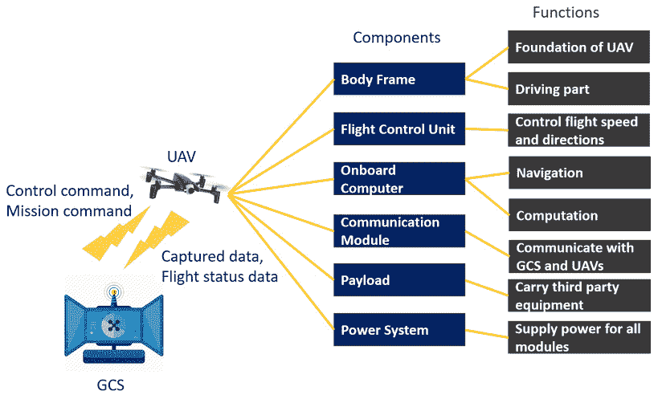

图 1.11 – 无人机系统概览

既然我们已经了解了无人机的系统构成，现在让我们来看看无人机的主要机械和结构组件。

# 无人机主要机械和结构组件

无人机系统是一个机器人系统，由用于其所有功能的机电系统组成。机械系统被称为骨架，无人机的所有航空电子系统都在其下工作。机械系统以适当的强度牢固地固定航空电子系统，以便它能承受机动力直到极限。

我们将在此研究无人机的主要机械和结构组件，这些组件用于固定不同部件并具有各自独立的功能。

## 机身

机身是无人机的主骨架，它将所有航空电子组件固定在适当位置，并帮助它们牢固地安装和贴合，在飞行过程中无振动和松动。它作为无人机的主体，赋予系统适当的形状和尺寸，容纳所有模块，并保护它们免受外部环境的直接暴露：

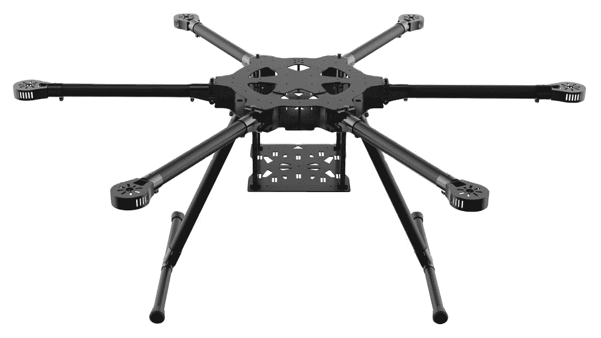

图 1.12 – 六旋翼碳纤维机身

一个完整的机身由以下子组件组成：

### 电机座

用于使用螺丝或其他材料固定电机的位置：

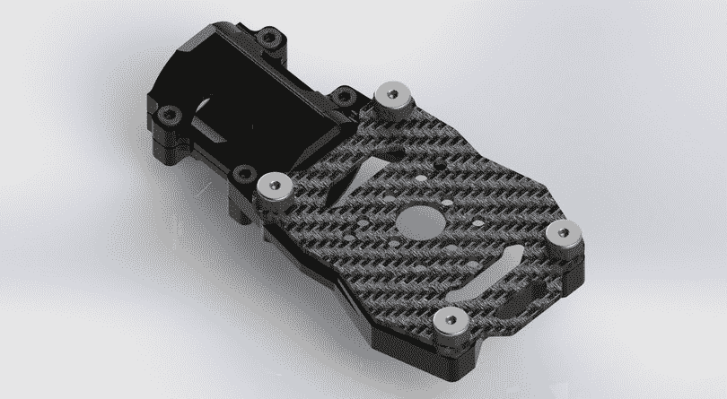

图 1.13 – 电机座

### 机臂

主体与电机座之间的管子/管道称为机臂。这些被用作刚性机械结构，以提升主体以及电机与主体之间的布线：

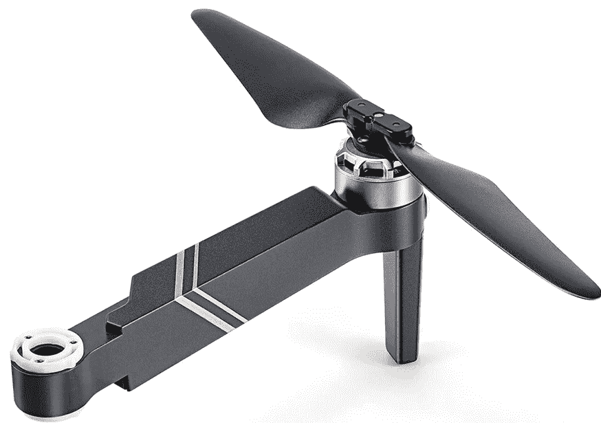

图 1.14 – 一组机臂

### 中心体

中心体是放置主要航空电子设备（如飞行控制器、**全球定位系统**（**GPS**）和其他组件）的地方，它们通过适当的接口和连接放置，帮助系统获取处理所需的必要数据。机臂连接在中心体上并向外延伸：

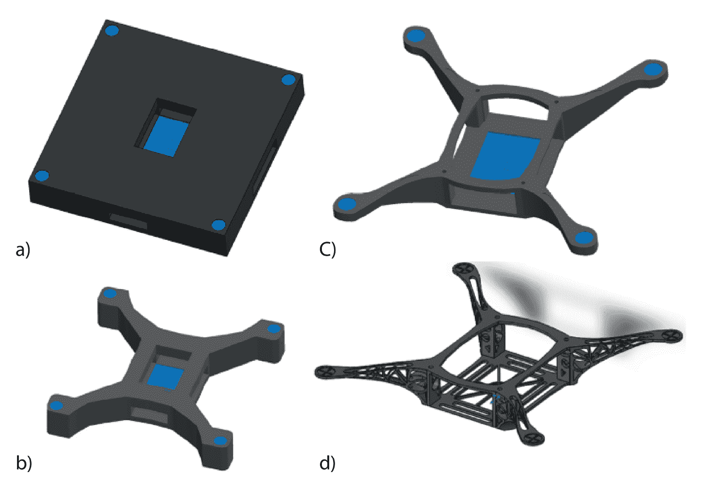

图 1.15 – 无人机中心体

### 起落架

这也连接在中心体上并向下延伸。这有助于无人机在不同地形上着陆，并为载荷安全保持足够的离地间隙：

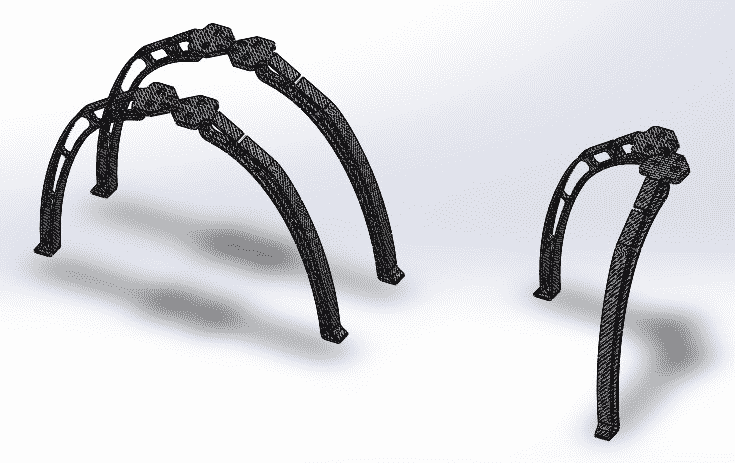

图 1.16 – 起落架

就机械机身的特性而言，建议如下：

*   机身在 `x`、`y` 和 `z` 轴上应从各方面对称
*   机身制造应采用碳纤维、玻璃纤维等轻质材料
*   免螺丝设计对稳定性和性能将更有帮助

# 无人机航空电子系统和子系统

在机械系统之后是航空电子系统，它被安装在机械系统的适当位置，以施加推力和其他力，同时保持重心平衡。这些航空电子系统包括由电源系统供电的传感器和执行器，用于在需要的地方施加必要的力，并让无人机完成必要的任务：

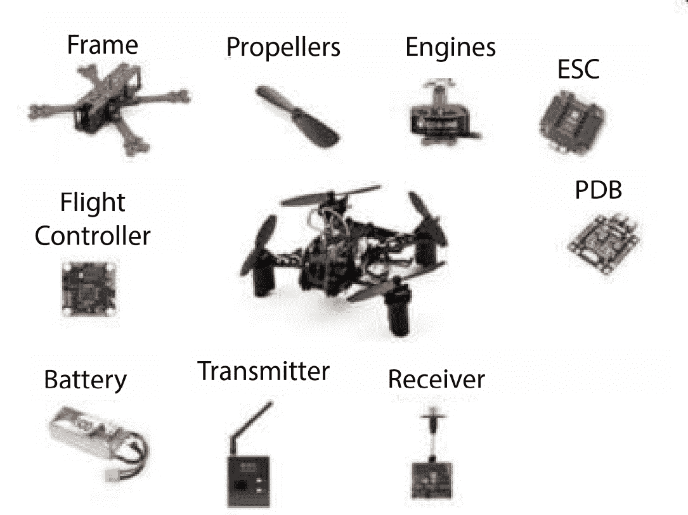

图 1.17 – 航空电子组件

在以下章节中，我们将简要了解无人机主要的航空电子系统和子系统，它们是相互关联的。

## 动力系统（传动系统）

动力系统负责产生将系统升入空中所需的力，维持升重比。这也是在空中保持稳定、高空飞行和为系统提供速度的原因。这是无人机系统最重要的部分和最初的构建模块。它也有助于维持系统的电气稳定性：

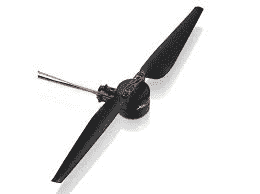

图 1.18 – 动力总成

它由以下主要部件组成：

### 电机

这些是动力系统的主要组件。这些是**无刷直流**（**BLDC**）电机，效率更高、功耗更低且寿命更长。这些电机与螺旋桨一起高速旋转，产生将系统升入空中所需的推力。电池的大部分电量由这些电机消耗。这些电机是创建三维空间运动、从一个位置移动到另一个位置以及提升负载的主要执行器：

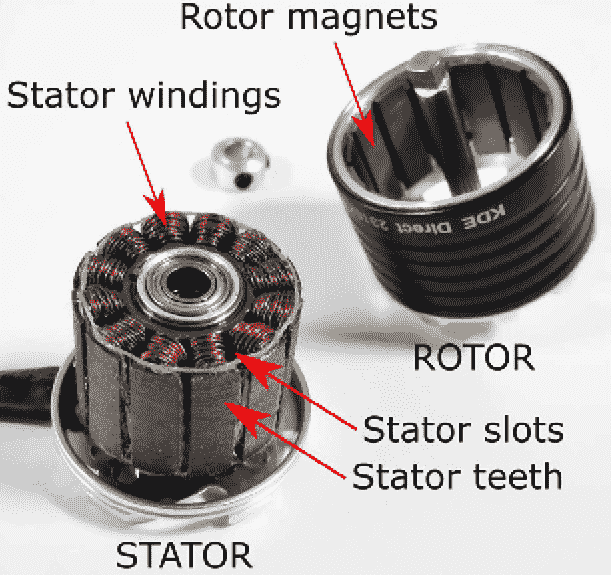

图 1.19 – 无刷直流电机

### 螺旋桨

螺旋桨是多旋翼中的关键推力发生器。这些通过螺丝或其他机制安装在电机上。螺旋桨采用轻质材料制造，当高速旋转时，它们向下推动空气，产生推力，将系统向上提升。每个螺旋桨在所需转速下旋转时会产生设定量的推力，我们将在后续章节中看到：

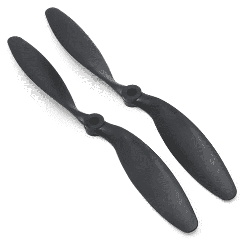

图 1.20 – 螺旋桨

## 电源系统

电源系统是负责为整个无人机及其载荷和其他外围设备供电的系统。这是保持无人机供电的关键系统，有助于获得所需的续航时间，并抵消大风或剧烈机动的影响。当需要升降压电压且电流消耗较大时，会添加某些升降压变换器和滤波器。

这些是无人机电源系统的主要组件：

### 电池

电池是系统最重要的部分。它作为向系统供电的关键电源。所有系统和子系统均由电池供电。电池必须能够在无故障的情况下按系统要求提供电力，并满足电流输送需求。它还负责决定无人机的续航时间：

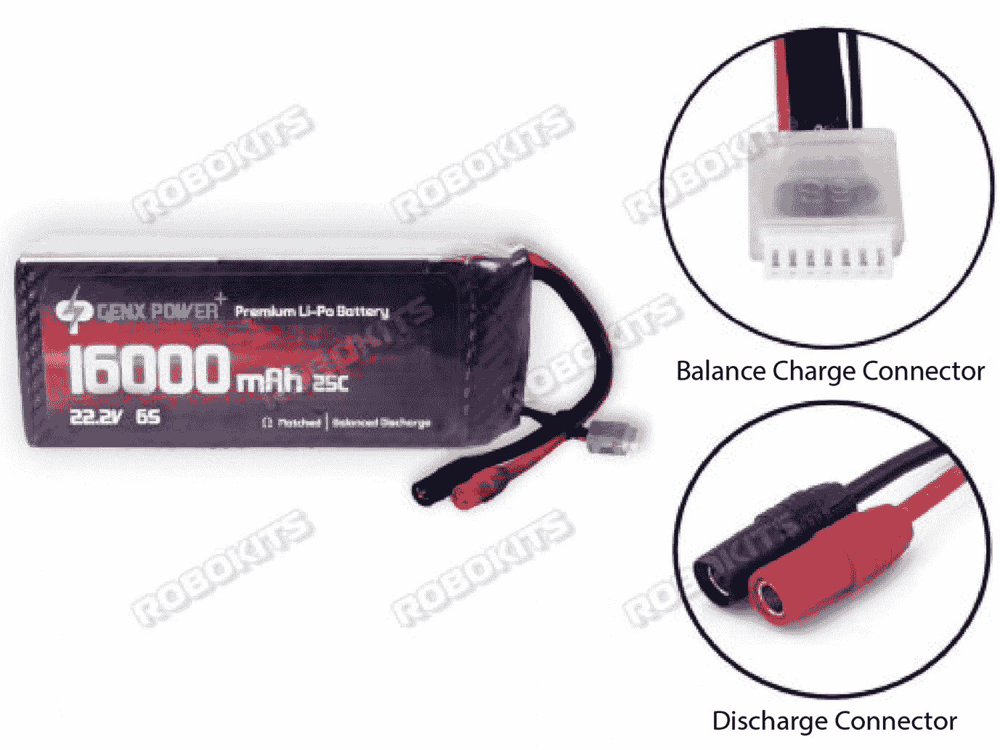

图 1.21 – 电池

### 电源分配板

顾名思义，电源分配板有助于将电力分配给不同的系统。电机等大功率消耗元件通过该板获取电力，并均匀分配给它们。还添加了一些滤波元件，如电容，以防止任何部件因浪涌和过载电流而烧毁：

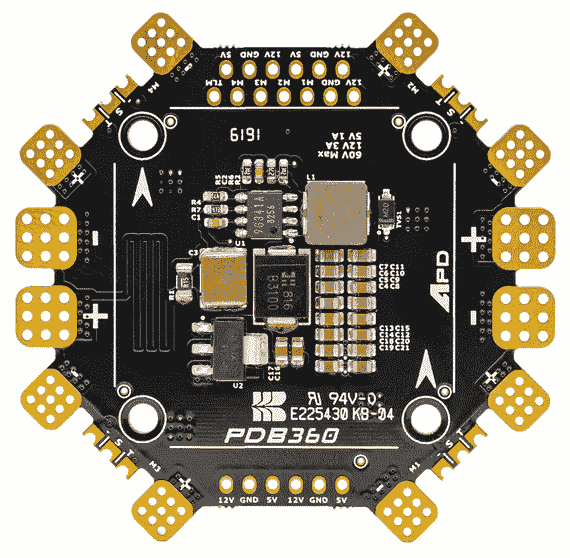

图 1.22 – 电源分配板

* `Buck-and-boost converters`：`Buck-and-boost converters` 用于电路中，根据外围设备的需求升高或降低电压，并满足电流需求。这些是根据负载的电源规格使用的：

**图 1.23 – 降压变换器**

## 指挥与控制系统

这是一个有助于连接无人机以进行指挥和控制的系统，并帮助保持无人机处于受控状态。正是由于该系统，无人机才能保持受控状态，并能按照飞行员的意愿进行控制和操作。该系统还有助于监控无人机健康状况，并实现传感器数据的实时监控。

共同构成通信系统的主要部分如下：

### `遥控器 (RC)`

`RC` 设备，即遥控器，用于在目视视距内 (`VLOS`) 驾驶无人机。它有助于手动驾驶系统到达任何地点和任何姿态。它有助于更改飞行模式，并在自主任务期间接管系统控制权。

然而，它无法对系统的传感器数据进行实时监控，也无法查看系统的实时健康状况：

**图 1.24 – 遥控器**

### `地面控制站 (GCS)`

`GCS` 是一个集成控制站，用于系统配置和系统地面测试，以及监控系统健康状况和传感器数据，并对无人机进行 `LOS` 和 `beyond VLOS` (`BVLOS`) 应用的指挥与控制。`GCS` 负责在完全自主模式下进行任务规划和执行。它还负责系统的自动调参，以实现更平稳的飞行：

**图 1.25 – 手持式 GCS**

### `无线电调制解调器`

`无线电调制解调器` 是用于 `GCS` 和无人机之间通信的主要设备。系统的通信距离取决于无线电调制解调器的通信距离。它作为从 `GCS` 控制和指挥无人机的关键通信链路。无线电调制解调器有助于为链路提供安全性，并传输 `GCS` 和无人机通信所依赖的信号：

**图 1.26 – 无线电调制解调器**

### `天线`

`天线` 在信号传输和传播中起关键作用。天线增益和方向决定了系统的范围及其在空中机动的程度。天线类型是决定无人机或飞行器航程的重要参数，我们将在后续章节中看到：

**图 1.27 – 天线**

### `导航系统`

在动力、推进和通信之后，便是 `导航系统`。该导航系统仅在以自主模式驾驶系统时才有帮助。导航系统帮助无人机确定方向和坐标，并自主或按任务引导的方向移动。

在内置传感器的支持下，导航系统帮助无人机沿选定的路径和方向移动。构成导航系统的主要组件如下：

#### `GPS`

`GPS` 是导航系统的关键组件。无人机使用的 `GPS` 内嵌 `GNSS`，如伽利略、北斗及其他类似导航系统，有助于获取无人机的实时坐标以在 `GCS` 中显示，并帮助飞行员获取实时地图和位置。任务规划软件使用相同的 `GPS` 坐标来决定无人机的自主路径，无人机也用其导航至提供的 `GPS` 坐标。起飞坐标也保存在无人机中，这有助于无人机在失效保护条件下执行 `Return to Launch` (`RTL`)：

**图 1.28 – GPS**

#### `罗盘或磁力计`

`罗盘` 或 `磁力计` 是无人机导航系统的关键组件。`GPS` 给出系统的坐标和期望的目标位置，但 `罗盘` 给出无人机行进的方向。无人机在 `罗盘` 的指引下飞往特定坐标。`罗盘` 指示无人机的航向，即机头指向的方向。`罗盘` 需要相对于空间磁场进行校准，以实现正确的导航：

**图 1.29 – 磁力计**

#### `处理单元或飞控`

`飞控` 是无人机的 `central processing unit` (`CPU`)。这被称为无人机的大脑。`飞控` 接收来自内置传感器和外围传感器的传感器数据，并将其传递给执行器和电机，从而使无人机能够在手动和自动模式下飞行。

`飞控` 被编程为在各种飞行模式、任务和特定条件下表现出特定行为，我们将在后续章节中看到：

**图 1.30 – 飞控**

### `负载`

飞行器旨在用于其设计和开发目的的特定应用和工作。安装在无人机上执行该特定工作的设备称为 `负载`。例如，日/夜摄像机是日/夜监视的 `负载`（见 **图 1.31**），喷药箱是农业植保无人机的 `负载`（见 **图 1.32**），`RGB` 传感器是测绘无人机的 `负载`。

`负载` 是执行无人机预期任务的唯一对象。我们将在本书后面看到针对不同应用使用类似负载的工作：

**图 1.31 – 摄像机负载**

**图 1.32 – 作为负载的喷药箱**

这些是无人机系统中使用的一些主要组件。在后续章节中，我们将了解每个组件使用的规格，以及如何对它们进行最佳优化以构建满足特定规格的无人机。

## 总结

读完本章，我们了解了无人系统、其发展历程及其需求。我们转向无人机，研究了其类型、重要系统和子系统及其功能。

在本书的下一章中，我们将介绍无人机动力学、作用在空中系统上的各种力，以及如何使其安全平衡。我们还将介绍各种空气动力学术语，这将帮助我们更好地理解相关内容，并探讨如何利用工程手段结合上述组件来实现这些力，并构建一个完整的可飞行系统。
