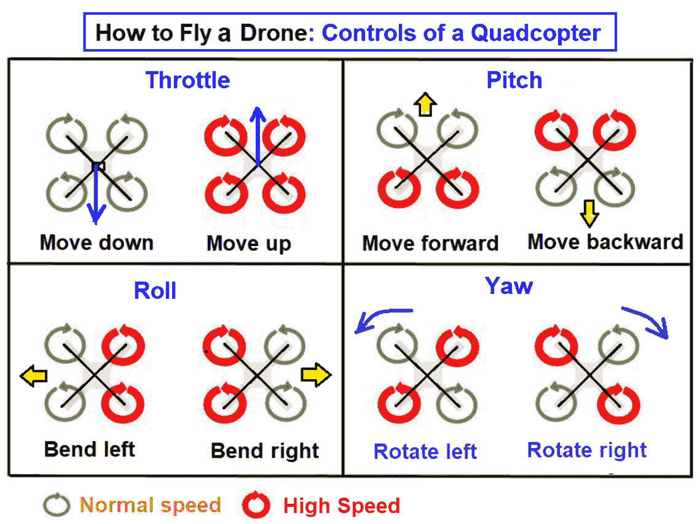
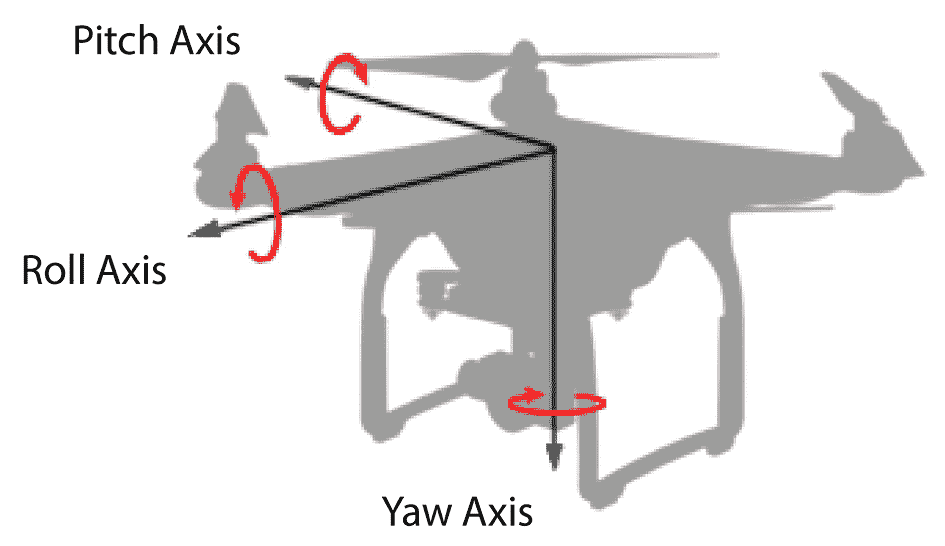
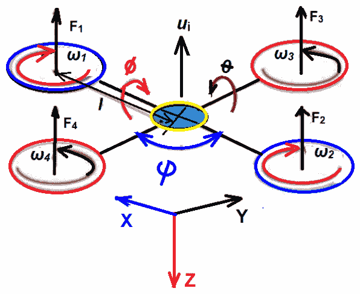
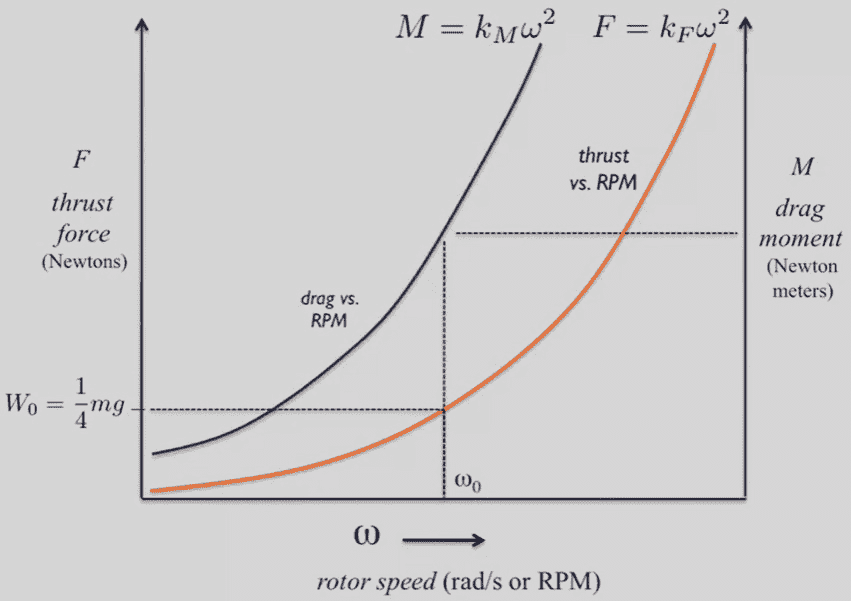

## 理解飞行术语与运动物理学

在本章中，我们将学习无人机在空中的行为和稳定性。什么力必须作用在系统上以维持无人机在空中的位置，我们如何利用工程手段实现这些力？我们还将了解无人机控制机制在空中如何工作，包括其在自由空间中的力矩以及与这些机动相关的主要术语。


在这里，我们将了解作用在机体和质心上的主要力，涉及 `X` 轴、`Y` 轴和 `Z` 轴，以及作用在无人机上的主要物理原理。这些主题有助于理解无人机的基本物理原理，这对设计师设计机身、计算无人机在悬停和巡航动作中铰链上的载荷很有帮助，也有助于航空电子开发工程师在设计师提供的载荷条件下工作。力学和航空电子是相互关联的概念，应针对富有成效的系统开发进行优化。

在本章中，我们将涵盖以下主题：

*   推力、重量、升力、阻力和巡航简介
*   飞行轴及其术语简介
*   四轴飞行器飞行物理简介
*   实现绕三个旋转轴运动的工程技术

# 推力、重量、升力、阻力和巡航简介

任何计划在空中飞行的系统，都由作用于其在三维空间（即 `X` 轴、`Y` 轴和 `Z` 轴）上的物理力来表征。在地球上，将物体向下拉的力是重力，寻求飞行时必须首先克服它。重力对地球上的所有物体作用方式相同，以 9.8 m/sec² 的加速度将它们向下拉。考虑到这一点，所有物体都有与该过程相关的重量，该重量受重力作用。

考虑到牛顿第三定律，作用力与反作用力大小相等、方向相反。无人机受到的力与作用在机体上的重力大小相等、方向相反。让我们看看与此相关的各种术语以及如何应对它们。

## 推力

推力是由无人机电机和螺旋桨的旋转产生的反作用力。在多旋翼无人机中，该力与重力方向相反，以克服无人机的重量。这是作用在无人机上使其产生升力并升空的重要力量。

其单位为千克或牛顿。无人机产生的推力取决于螺旋桨的尺寸和旋转速度，以及无人机所用电池的总电压。作用在无人机上的总力必须是重力作用在无人机上的力的两倍，以便无缝应对无人机的巡航和升力。

从技术上讲，每个螺旋桨产生的推力与电机转速（RPM 或 rad/sec）之间的关系是二次方关系。换句话说，推力与旋转角速度的平方成正比。

## 重量

系统的重量是系统设计中最重要、最基本的参数，它帮助我们计算其他参数，如推力、功率等。无人机的总重量包括机身、电池、电机、螺旋桨和任务载荷的重量。提到无人机时有不同类型的重量，如下所示：

*   **全装重或总重**：这是指系统起飞入空那一刻的重量。此重量因任务载荷和飞行条件而异。此重量始终小于系统的**最大起飞重量**（**MTOW**），以在安全限度内操作。
*   **最大起飞重量**：这是无人机在不影响系统适航性的前提下能安全升空的最大重量。MTOW 取决于许多因素，如设计、结构和航空电子限制。MTOW 是在考虑所有类型任务载荷重量的基础上定义的，超过此重量系统将不再安全飞行。

## 升力

升力是推力作用在多旋翼无人机上产生的垂直力，帮助系统向上升空。为了产生无人机所需的升力，必须设计合适的动力系统，我们将在后续章节中探讨。对于多旋翼无人机，升力是由所有旋转螺旋桨的综合效应产生的。

## 阻力

阻力是一种空气动力摩擦力，由风撞击机体产生。该力始终与运动方向相反。无人机的每个部件都会产生该力。无人机的巡航速度必须足以克服阻力。

在为特定应用计算和设计无人机时，会考虑所有这些力。

## 巡航

顾名思义，**巡航**是指以特定速度向特定方向移动。它被称为系统起飞后在空中向特定方向飞行的阶段，包括在开始降落前获得所需高度。系统飞行的速度称为**巡航速度**。

# 飞行轴及其术语简介

到目前为止，我们已经介绍了飞行术语。我们可以这样说：当升力等于无人机重量且在空中具有巡航速度时，多旋翼飞行器处于悬停状态，这可以称为在三维（3D）空间中巡航。为了简化计算，我们考虑无人机在三个主要通用轴（即 `X` 轴、`Y` 轴和 `Z` 轴）下的三维空间中工作。这些有助于我们设计和编程无人机。质量和力在这三个轴上的平衡和均匀分布有助于我们实现稳定飞行。让我们更多地了解无人机在这些轴上的运动及其术语。



图 2.1 – 显示无人机在不同轴上运动的示意图

如上所述，无人机在三维平面的 `X` 轴、`Y` 轴和 `Z` 轴上的运动分别称为**滚转**、**俯仰**和**偏航**运动。以下各节简要描述这些运动。

## 滚转运动

在三维空间中，`X` 轴上的运动称为**滚转运动**。简单来说，系统在空间中的左右侧向运动称为滚转运动。滚转运动帮助系统在 `X` 轴上向左或向右侧向飞行。

在多旋翼中，滚转运动通过增加右侧电机转速并同等降低左侧电机转速来实现左转，右转则反之。在固定翼或其他飞机上，滚转运动通过称为副翼的控制面实现。

## 俯仰运动

在三维空间中，`Y` 轴上的运动称为**俯仰运动**。简单来说，俯仰运动是无人机在三维空间中的前进和后退运动。

在多旋翼无人机中，俯仰运动通过增加后两个电机的 RPM 并降低前电机的 RPM 来实现前飞，后飞则反之。所有这些设置和配置都预定义在无人机固件中，帮助飞行员遵循预定义的控制。

## 偏航运动

**偏航运动**是无人机在三维平面上绕 `Z` 轴的运动。偏航运动帮助我们在空中改变无人机机头指向的任何方向。简单来说，偏航运动帮助我们在整个 360 度圆周内以任何角度改变无人机机头的指向。这种运动帮助我们改变三维平面上的运动方向。

无人机的偏航力矩是电机扭矩的函数，通过电机旋转施加到机身上。为了在 `Z` 方向上顺时针运动，逆时针电机以更高的 RPM 旋转；为了逆时针运动，它们以较低的 RPM 旋转。这有助于无人机绕其轴线顺时针旋转，反之亦然。我们稍后将了解这些方向和力。

## 油门


油门的概念类似于我们在日常生活中关于自行车或汽车所听到的油门。油门是物体移动的速度程度。在无人机中，油门指的是电机旋转的速度，这会导致螺旋桨运动加快，从而产生更大的推力和升力。随着推力增加，无人机的重量开始沿 `Z` 轴被抬升到空中，一旦无人机达到期望高度，这就会稳定下来。

对于稳定悬停，总推力应等于无人机的总重量，这意味着无人机将在空中稳定悬停。无人机的高度可以通过增加或减少油门来相应地升高或降低，以增加或减少推力的产生。对于稳定悬停，在 50% 油门时总推力应等于无人机的重量，为了安全的空气动力学性能，所有电机的总推力容量应是无人机重量的两倍。

下图进一步阐释了无人机在三个轴上的运动，以机身为参考：



图 2.2 – 显示无人机横滚、俯仰和偏航轴运动的示意图

承接前述术语，还有其他一些有助于无人机设计的技术术语。

# 推重比 (TWR)

推重比是一个无量纲量，也是无人机的性能指标。它是系统在 100% 油门下能产生的总推力与无人机重量的比值。其表示如下：

`TWR` = Total thrust produced at 100% throttle / Weight of the drone

在 50% 油门时，产生的总推力应等于系统的总重量，以实现稳定悬停。

为了安全飞行，有效 `TWR` 为 2，这意味着产生的总推力应是系统总重量的两倍。

对于 **第一人称视角** (**FPV**) 无人机或竞速无人机，该比率有时会达到 3 或更高，因为这些设计需要更高的机动性和更急的转弯。

我们将在本书后面从零开始设计无人机时了解更多关于这些技术方面的内容。

# 四轴飞行器飞行物理学简介

在本主题中，我们将从零开始彻底理解基本飞行物理学概念，涉及四轴飞行器的悬停、横滚、俯仰和偏航力矩。在这里，我们将了解飞行中实时作用的力，以及不同力如何以不同方式起作用；然而，所有力的合力决定了无人机在空中的运动。

下图显示了四轴飞行器的运动学及作用于其上的不同力。这有助于我们研究作用于飞行的不同力：



图 2.3 – 显示作用于无人机的不同力的示意图

在上图中，我们可以看到一个四轴飞行器的受力图，其中不同的力和运动作用于无人机。让我们逐一查看并理解这些力和参数，以便我们能进一步研究它们。

无人机的重量产生一个向下的力：`M x g`（`g` = 重力加速度）。

`ω x` = 电机以 RPM 为单位的旋转速度；因此，`ω 1` 是电机 1 的 RPM，同理，`ω 2`、`ω 3` 和 `ω 4` 分别是电机 2、3 和 4 的旋转速度。

正如我们在图中所见，电机 1 和 2 顺时针旋转，电机 3 和 4 逆时针旋转。

当两个对角线电机（1 和 2）顺时针旋转，另外两个对角线电机（3 和 4）逆时针旋转时，就会发生这种情况；当电机这样旋转时，会产生相反方向的扭矩；因此，在相同 RPM 下，两个顺时针和两个逆时针方向会相互抵消扭矩，使系统在空中保持稳定。此外，相同的反扭矩被用来给无人机在空中提供偏航运动（绕 `Z` 轴旋转）。

`Fx` 是电机旋转产生的每个螺旋桨向上对抗重力产生的力。因此 `F1`、`F2`、`F3` 和 `F4` 分别是电机 1、2、3 和 4 产生的力。

`Ui` 是力 `F1`、`F2`、`F3` 和 `F4` 作用于无人机质心和重心产生的系统总力。因此，`Ui` = `F1` + `F2` + `F3` + `F4`。

`L` 是每个电机与质心之间的距离。`L` 定义用于计算每一端作用于质心的力，这称为 **力矩**。

这意味着电机 1 在质心上产生的力矩 `M1` 将是 `M1` = `F1` X `L1`。

同理，`Mx` = `Fx` X `Lx`。

因此，对于无异常的稳定飞行，所有四个电机的力矩应相等且相反，相互抵消，使重心处的合力矩为零。

`Theta` (`∅`) = 无人机在 `X` 轴移动的角度，即横滚；因此这称为横滚角。

`Phi` (`ϕ`) = 无人机在 `Y` 轴移动的角度，即俯仰；因此这称为俯仰角。

`Sai` (`ψ`) = 无人机在 `Z` 轴移动的角度，即偏航；因此这称为偏航角。

现在，每个旋翼产生的总力 `F` = `Kf` X `Wx`，其中 `kf` 是比例常数，`W2` 是电机的旋转速度。

同样，螺旋桨旋转中的阻力矩 `M` = `Km` X `Wx`。

这两种力都可以在下面绘制的推力、阻力和 RPM 之间的图表中看到。

下图描绘了产生的力与旋翼速度之间的关系。它还反映了旋翼在系统上产生的总速度和力矩。



图 2.4 – 显示力与旋翼速度关系的图表

我们可以认为，旋翼产生的总力的四分之一消耗在克服电机产生的阻力上；因此，旋翼产生的总有效力将是 `F_effective` = ¼（总 `产生的推力`）。

现在，推力产生的总合力如下：

*   悬停条件是
    `F Total` = `F1` + `F2` + `F3` + `F4` − `mg`，这是合力，其中 `Fi` = `Kf` X `ωi` 2。
*   质心处的合力矩是
    `M` = `L1` X `F1` + `L2` X `F2` + `L3` X `F3` + `L4` X `F4` + `M1` + `M2` + `M3` + `M4`
    `Mx` = (`F3` − `F4`) X `L`；即 x 轴上的力矩为 0，因为力会相互抵消，使合力为零。
    `My` = (`F1` − `F2`) X `L`；即 y 轴上的力矩为 0，因为力会相互抵消，使合力为零。
    因此，作用在无人机上的所有力矩也为零。

所以，最终，从这些方程来看，无人机上的所有净合力为零，从而实现稳定悬停飞行。

现在，牛顿第二定律指出，对于直线运动，`F` = `Ma`，即力 = 物体质量乘以加速度。

对于旋转运动扭矩，`T` = `L` X `a`，即扭矩 = 转动惯量乘以角加速度。

# 实现绕三个旋转轴运动的工程技术

在前面的章节中，我们学习了无人机不同运动背后的物理学原理，即悬停以及横滚、俯仰和偏航运动。是什么力驱动这些运动并帮助我们实现全方位的运动？在本主题中，我们将学习应用于无人机以实现这些方向力的工程技术，以及我们如何利用这些工程技术来操控无人机的机械结构。

## 悬停运动


## 垂直运动条件

此运动需满足以下条件：

*   **重量**：电机转速增加至旋翼产生的总力等于无人机重量；因此，合力变为零，无人机在特定位置悬停。

*   **力矩**：由于所有机臂长度相同，且旋翼产生的力也相等且方向相反，相互抵消，这使得合力为零。

    此外，两个对角线电机顺时针旋转，另外两个对角线电机逆时针旋转，这又抵消了各自的反扭矩，使得 `Z` 轴上的合力为零，系统在 `X`、 `Y` 和 `Z` 轴上保持稳定。

*   **上升运动**：当增加油门时，旋翼开始以相同的转速更快地旋转，产生相等的推力，从而增加无人机的升力。对于向上升高的运动，旋翼产生的总力应大于无人机的重量；即力越大，无人机上升越快。当向上的力略大于无人机重量时，无人机开始增高。现在，根据直线运动方程，平衡状态下稳定悬停飞行的条件是 `F = Mg`。如果 `F` 增加到大于 `Mg`，则会产生向上的加速度。因此，对于上升运动，`F > Mg`，即 `F1 + F2 + F3 + F4 > 无人机重量`。力增加得越快，加速度增加得越快，无人机将持续增高，直到减小油门为止。

*   **下降运动**：当降低油门时，旋翼转速降低，总推力也随之减小，变得小于无人机的总重量。因此，无人机向下移动。用技术术语表示即：无人机重量应大于旋翼产生的总力。即 `F1 + F2 + F3 + F4 < Mg`。

    当推力略小于重量时，无人机开始降低高度并向下移动。

## 水平运动

无人机的水平运动需要一些特殊的工程设计来调节力，以提供前进和侧向移动。此运动需满足以下条件：

*   **横滚运动**：对于横滚运动，无人机绕 `X` 轴倾斜一个西塔角；因此，产生运动水平和垂直矢量分量的力 `F`（即 `F_cos(∅)` 和 `F_sin(∅)`）可以看作是悬停状态下指向上方的力 `F`。在横滚中，`F` 的方向绕 `X` 轴倾斜西塔角，意味着以下关系：

```
水平分量 = F_cos(∅)
垂直分量 = F_sin(∅)
```

    因此，导致 x 轴运动的力表示为 `F_X_axis = F_cos_theta`，因为 `F = Ma` 且 `a = F/m`，加速度将等于无人机上的总力除以无人机的质量。无人机的重量由称为 `F_sin(∅)` 的垂直分量来抵消。因此，由于这些力我们得到了横滚运动。

*   **左侧移动**：左侧的两个电机减速，右侧的两个电机以相同幅度加速。这使得总推力和总升力保持不变而不受影响，但绕重心的力矩向左侧增加，从而将系统推向左侧。侧向运动的速度将等于向左的 `F_Cos_theta`：

    `左侧电机产生的力矩 < 右侧电机产生的力矩。`

    `F_left X L < F_right X L.`

*   **右侧移动**：右侧的两个电机减速，左侧的两个电机以相同幅度加速。这使得总推力和总升力保持不变而不受影响，但绕重心的力矩向右侧增加，从而将系统推向右侧。侧向运动的速度将等于向右的 `F_Cos_theta`。

    `右侧电机产生的力矩 < 左侧电机产生的力矩。`

    `F_right X L < F_left X L.`

    因此，左侧的力大于右侧的力，从而将系统推向右侧。

## 俯仰运动或前后移动

这些运动需满足以下条件：

*   **前进运动**：前侧的两个电机减速，后侧的两个电机以相同幅度加速。这使得总推力和总升力保持不变而不受影响，但绕重心的力矩向前侧增加，从而将系统推向前方。前进运动的速度等于前进方向上的 `F_Cos_theta`。

    `前侧电机产生的力矩 < 后侧电机产生的力矩。`

    `F_front X L < F_back X L.`

    因此，后侧旋翼的力大于前侧旋翼的力，从而将系统向前推。

*   **后退运动**：后侧的两个电机减速，前侧的两个电机以相同幅度加速。这使得总推力和总升力保持不变而不受影响，但绕重心的力矩向后侧增加，从而将系统推向后方。前进运动的速度等于后退方向上的 `F_Cos_theta`：

    `后侧电机产生的力矩 < 前侧电机产生的力矩。`

    `F_back X L < F_front X L.`

    因此，后侧旋翼的力大于前侧旋翼的力，从而将系统向前推。（注：原文此处结论与“后退运动”标题矛盾，译文保持原文逻辑）

*   **偏航运动**：偏航运动是由电机旋转产生的扭矩导致的绕 `Z` 轴的力矩引起的。它包括顺时针和逆时针两种。根据旋转运动方程，绕 `CG`（重心）的力矩为 `M = L1 X F1 + L2 X F2 + L3 X F3 + L4 X F4 + M1 + M2 + M3 + M4 = 0`。在稳定悬停时，所有力为零。

    在偏航条件下，由于 `F1`、`F2`、`F3` 和 `F4` 都指向上方，它们对绕 `Z` 轴的力矩没有任何影响。

    所以，`M = M1 + (-M2) + (-M3) + M4`，负号（-）表示反方向旋转，因为两个对角线电机顺时针旋转，另外两个对角线电机逆时针旋转。

    对于 **顺时针偏航运动**，我们减速两个对角相对的顺时针电机，并按相同比例加速另外两个对角相对的逆时针电机。这样做总推力保持不变，但两个逆时针电机的反作用力（顺时针方向）大于顺时针电机的反作用力（逆时针方向）。因此，合力方向为顺时针，机身绕 `Z` 轴顺时针旋转。

    其向任一方向旋转的速率即为电机转速变化的速率。

    对于 **逆时针偏航运动**，我们减速两个对角相对的逆时针电机，并按相同比例加速另外两个对角相对的顺时针电机。这样做总推力保持不变，但两个顺时针电机的反作用力（逆时针方向）大于逆时针电机的反作用力（逆时针方向，原文此处疑为笔误，应为顺时针方向）。因此，合力方向为逆时针，机身绕 `Z` 轴逆时针旋转。

# 总结


