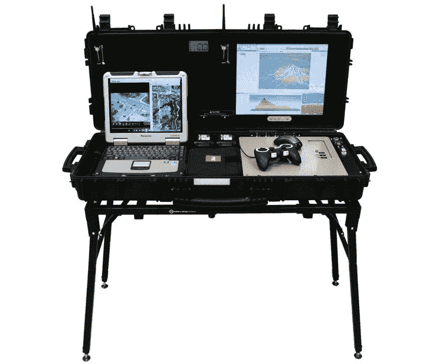
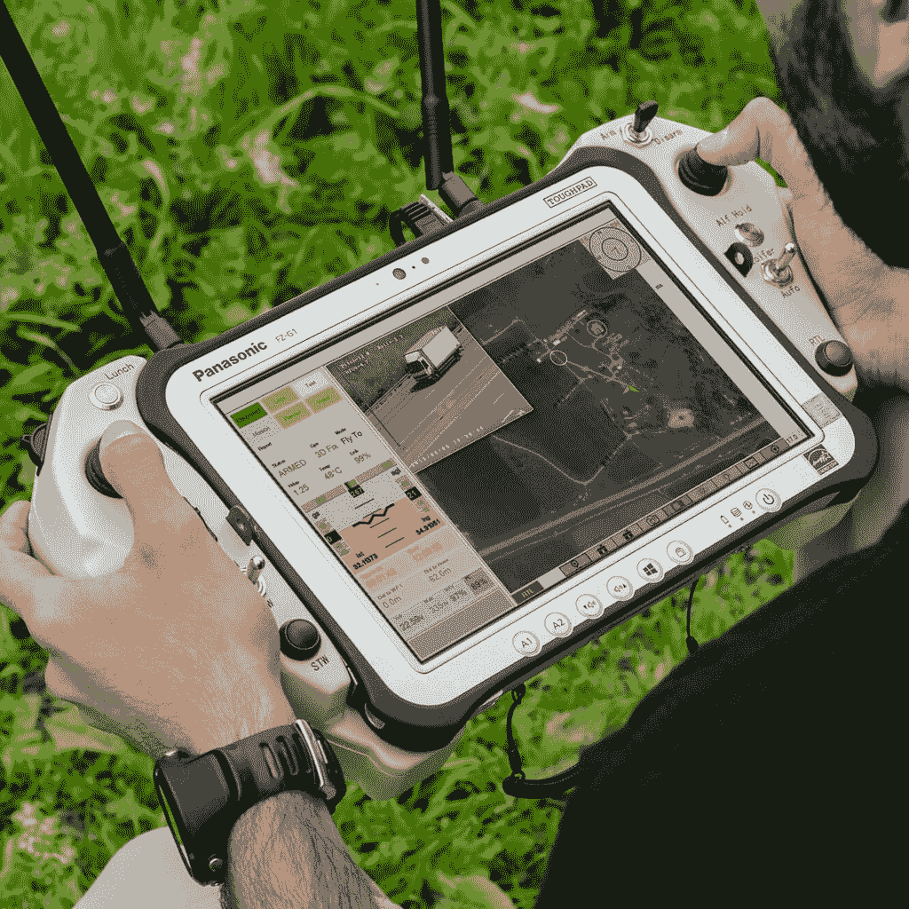
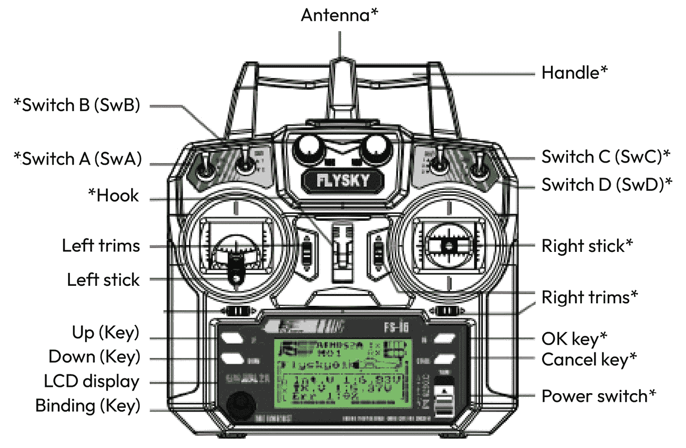
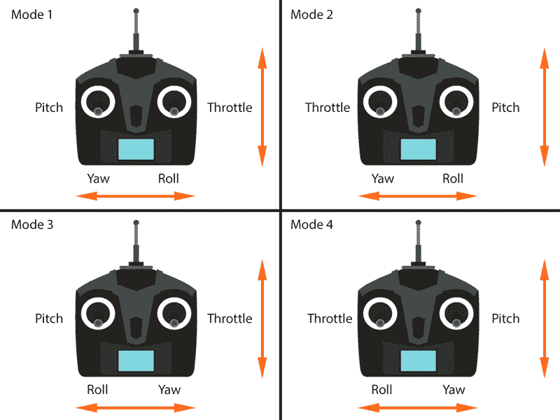
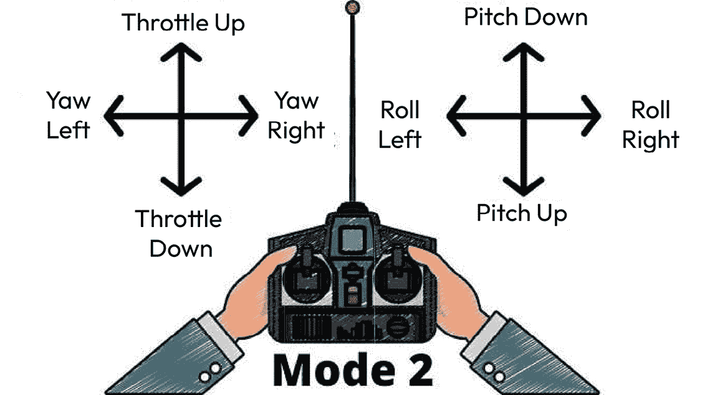
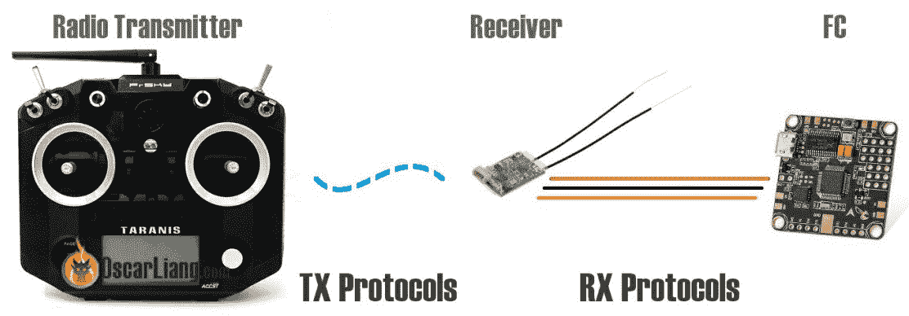
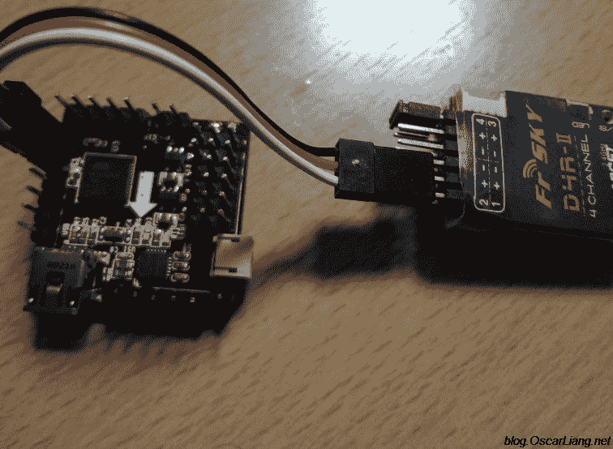
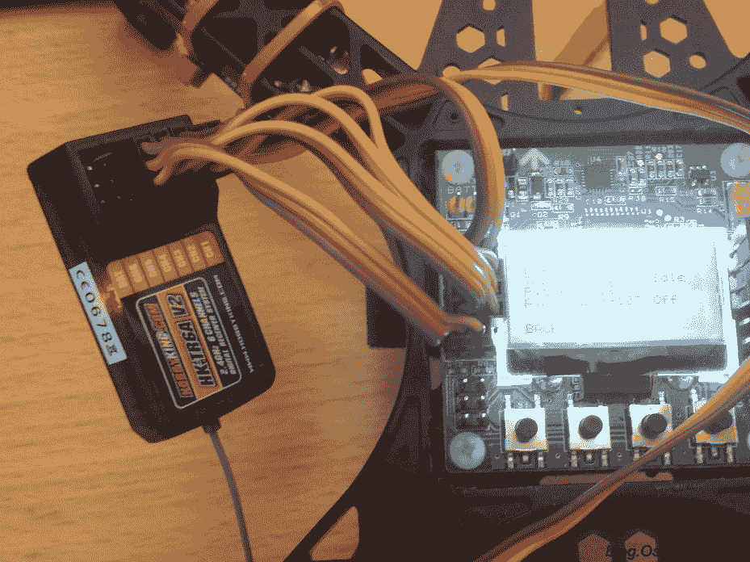

## 第 3 章：学习并应用基本指挥与控制接口

在前几章中，我们了解了各种无人系统及其应用。我们还学习了无人机背后的基本物理学原理，以及电机和执行器如何对无人机施加不同的力。我们还介绍了各种术语，例如 `roll`（横滚）、`pitch`（俯仰）和 `yaw`（偏航），以及如何利用执行器产生的力来实现这些动作。

在本章中，我们将学习如何指挥和控制无人机以执行特定任务或任务，以及如何在不同应用中使用它。此外，我们还将了解用于此目的的指挥与控制软件和硬件及其各种类型。我们还将学习行业中用作无人机与 `Ground Control Station (GCS)`（地面控制站）之间通信接口的基本通信协议。

通过学习本章，您将了解用于控制无人机的 `GCS` 和 `remote control (RC)`（遥控器）及其工作原理。我们将在本章中涵盖以下主题：

*   `GCS` 硬件和软件简介
*   不同种类 `GCS` 简介
*   `MAVLink` 和串行协议简介
*   `RC` 及不同可用选项简介
*   `RC` 协议简介

通过学习这些主题，您将深入了解各种通信协议及其在无人机方面的用法。这也将帮助您理解通过通信设备建立的空中单元（无人机）与地面单元（`GCS`）之间的连接。

## GCS 硬件和软件简介

`GCS` 是一套基于地面的集成硬件和软件，无人机操作员使用它来配置无人机，并监控系统健康状态、航向和其他参数。同一个 `GCS` 还用于为无人机编程自主任务，并监控高度、速度和方向等实时参数。它还会在飞行前进行检查，以校准飞行前的传感器。

以下是 `GCS` 的组成部分：

*   `GCS` 硬件
*   `GCS` 软件

让我们仔细看看每一部分。

### GCS 硬件

`GCS` 硬件是运行 `GCS` 软件并与无人机通信（即地面数据终端）所需的所有硬件的集合。这种 `GCS` 硬件是带有人机界面、遥测天线、接口和视频采集卡的笔记本电脑/平板电脑的组合。`GCS` 硬件是一个兼容平台，在该平台下，所有用于运行无人机系统的必需软件均可工作。这包括 `GCS` 软件、遥测数据和视频。视频数据终端或通信模块可能是 `GCS` 硬件的一部分，也可能不是。一些制造商将它们作为集成模块一起提供，而另一些则给予用户选择自己的视频遥测和通信模块的自由。

以下是 `GCS` 硬件的组成部分：

*   `GCS` 计算机
*   多块屏幕（可选），用于地图、视频、任务规划和监控
*   地面数据终端
*   界面按钮、开关和电位器
*   电池供电

### GCS 软件

`GCS` 软件是一种基于 GUI 的虚拟驾驶舱，供无人机飞行员使用，它运行在兼容硬件上，并使用 `ground data terminal (GDT)`（地面数据终端）与无人机通信。这有助于规划/编辑无人机执行的任务。它配置模块，如电池传感器，校准 `Electronic Speed Controllers (ESCs)`（电子调速器）和 `RC`，并调整无人机的性能参数。

以下是 `GCS` 软件的主要组件/窗口：

*   **Vehicle setup window（机型设置窗口）**  
    这包括与无人机机型相关的设置。它包括机架设置、传感器校准、`ESC` 校准、电源设置、`RC` 设置等。简而言之，该窗口管辖所有与系统性能和飞行相关的参数。

*   **Mission planning window（任务规划窗口）**  
    该窗口包含无人机当前所在区域的地图。这是从互联网获取的，并反映无人机的当前位置。飞行员打算执行的任务类型在此窗口中规划。

*   **Control and command window（控制与指令窗口）**  
    该窗口提供各种选项/按钮以向无人机发送指令，例如起飞、降落、模式切换和返航。这有助于控制无人机的行为。

*   **Compass and level horizon windows（指南针和水平仪窗口）**  
    这些窗口协助无人机在空中拦截航向和水平。指南针窗口帮助飞行员观察无人机的航向和移动方向，而水平仪窗口有助于确认相对于地面的水平度及其在 `roll`（横滚）、`pitch`（俯仰）和 `yaw`（偏航）方面的运动。

*   **Video panel（视频面板）**  
    视频面板直接在 `GCS` 中显示来自无人机的相机画面。这有助于飞行员观察并从视频中提取必要信息。

*   **Pre-flight checks window（飞行前检查窗口）**  
    该窗口帮助飞行员在飞行前检查无人机的基础项目，例如螺旋桨和电机方向、电池、模式、`RTL` 和电子围栏（如果已设置）。

*   **Log downloads and analysis（日志下载与分析）**  
    大多数 `GCS` 软件都有一个窗口，可在其中下载飞行日志并用于分析。

## GCS 的类型

根据应用和无人机，`GCS` 硬件可根据其尺寸、外形规格和可用功能分为多个类别。其中一些如下所示：

### 大型车载 GCS

大型车载 `GCS` 是一种供无人机飞行员使用的虚拟驾驶舱。它包含所有 `GCS` 系统，例如用于地图和视频的多块屏幕。它安装在可移动车辆下方，具有类似飞机的视野，并配备卫星和微波天线，用于与远程无人机通信。这些类型的 `GCS` 用于作业半径高达 300 公里的大型无人机。这些 `GCS` 是高等级专业系统：

Figure 3.1 – 车载 GCS 系统

### 非车载便携式 GCS

这些类型的 `GCS` 介于手持 `GCS` 和车载 `GCS` 之间。这些 `GCS` 也有多块屏幕，并与航空级操纵杆连接，但它们是人力便携的，不需要车辆即可移动。它们也由电池供电，并可同时与多架 `UAV` 连接。这些 `GCS` 没有固定的设置，但可根据应用需求进行管理：

Figure 3.2 – 非车载 GCS 系统

### 手持 GCS

顾名思义，手持 `GCS` 是一个简单的单一实体，集成了内置无线电调制解调器和天线、单块屏幕和手持操纵杆。这些 `GCS` 提供单手便携性，用于中小型无人机：

Figure 3.3 – 手持 GCS 系统

# GCS 软件类型与分类

大多数公司开发 GCS 软件时，仅使其兼容其专有系统。此类 GCS 软件不对其他用户开放，且基于订阅制。某些公司开发的 GCS 软件兼容多种无人机。这些公司并非无人机制造商，但会为其 GCS 丰富所需功能。

第三类是开源 GCS 软件。此类软件由开源社区开发，用户可免费下载使用。该 GCS 软件的源代码公开可用。用户可下载相关源代码并用于开发功能。

部分 GCS 基于 Windows，部分基于 Linux 系统；也有两者兼容的。它们还可分为基于笔记本电脑和基于移动设备的 GCS 软件。让我们看看一些被归类为桌面端或移动端的 GCS 软件类型。它们可从各自的网站下载。

## 基于桌面的 GCS 软件

* Universal GCS
* SmartAP GCS
* UrbanMatrix LaunchPad
* Orbit GCS

## 基于移动设备/平板的 GCS 软件

* Tower
* Mav Pilot
* Side Pilot

# MAVLink 及其他开源遥测协议简介

遥测协议是一种无线串行协议，可实现无人机与 GCS 之间的无线通信。这些协议轻量级且运行所需能量低。它们通过发射器和接收器在无线介质上启用。

各种遥测协议广泛应用于无人系统，以实现遥测通信。以下是一些示例：

* MAVLink
* ZigBee
* LoRaWAN
* 消息队列遥测传输协议
* Open-LTE

让我们深入研究这些协议，以了解其用法和操作：

* **MAVLink**：MAVLink，即微型飞行器链路，是一种通信协议，无人机用它在各个组件之间通信，如飞手、GCS 和其他机载设备。这是无人机各部分相互通信并共享无人机状态、传感器数据和操作指令信息的一种简单高效的方式。MAVLink 确保无人机系统不同组件之间的集成与通信。

* **ZigBee**：Zigbee 是一种基于蓝牙的先进串行无线协议，能耗低，在 2.4 GHz 下以 250 Kbps 运行，通信范围为 10 至 100 米。Zigbee 具有抗干扰和高可靠性特性。Zigbee 协议采用 128 位加密标准算法和消息完整性代码。

* **LoRaWan**：LoRaWan 是一种远程遥测协议，数据传输速率低，范围从 0.3 Kbps 到 50 Kbps，可在最基础的基础设施上工作，运营成本低。它使用 AES 算法进行加密和认证。

* **MQTT**：MQTT 是一种短距离协议，采用发布/订阅模型，具有高可靠性，这使其轻量且高效。该协议工作在网状拓扑上。

* **Open-LTE**：LTE 代表**长期演进**。它基于蜂窝网络技术，因此具有高可靠性和卫星覆盖。它还支持硬 QoS，具备端到端 QoS 和无线承载的保证比特率。其数据传输速率范围为 20 Mbps 至 100 Mbps。

# 遥控器及可用选项简介

无人机系统可通过多个通道同时控制，如射频、LTE 和卫星无线电，基于不同协议。在此，每个通道对无人机拥有同等控制权，并遵循各自系统的指挥与控制。

同样，遥控器在 **串行总线** (**SBUS**) 协议上工作，同时配合运行在串行协议上的 MAVLink 协议。通过遥控器操作，可为无人机控制提供第二通道。

遥控器是一种手持设备，基于射频信号工作，用于控制无人机行为。它协助无人机起飞、降落、手动飞行，并从安全距离控制载荷。

这意味着即使 GCS 控制失效，飞手仍可通过此备用通道手动控制无人机，并发送基本指令，如返航和降落。在远程操作中，遥控器连接会断开，但远程 GCS (MAVLink) 连接保持畅通，可用于指挥与控制。手持 GCS 系统通过 MAVLink 传输遥控器数据，有助于实现远程遥控控制。

使用遥控发射器的首要需求是对无人机进行手动控制，即飞手驾驶无人机而非使用自动驾驶模式。飞手拥有完全自由来操控和驾驶无人机，而非遵循预定义的任务模式，以便在需要时执行紧急恢复。因此，娱乐飞行不需要 GCS。娱乐飞行可使用简单的遥控器手动驾驶无人机。可配置某些模式，使遥控器发送重要指令，如返航、降落等。

## 遥控发射器系统的组成部分

遥控发射器系统有两个主要组成部分：

* 遥控发射器
* 遥控接收器

让我们详细了解一下。

遥控发射器（地面单元）通常简称为 RC。无人机发射器是一种手持设备，帮助将飞手的实时指令传输给无人机。它协助起飞、降落、手动飞行无人机，以及移动和控制载荷。下图展示了一款 FlySky 遥控器，用作无人机的发射器；它配有摇杆、电位器和开关，可配置到各个通道，以控制无人机和载荷的各种功能。它还有一个显示屏，显示有价值的信息：

Figure 3.4 – A FlySky RC

遥控接收器（空中单元）是天线；它接收发射器发出的信号，解码后发送给相应通道以进行控制和操作。

飞控接收到来自遥控器的信号后，将其引导至连接的外围设备，从而使一切正常工作。遥控器的典型范围为 1 公里至 1.5 公里。

## 遥控器的工作模式

无人机的油门、横滚、俯仰和偏航由遥控发射器上的摇杆控制。控制模式由横滚、俯仰、偏航和油门的分配决定。各种工作模式如下图所示：

Figure 3.5 – The different modes of working of a transmitter

如你所见，不同模式下使用不同的摇杆操作。在大多数情况下，我们会在发射器端使用模式 2。

下图简要描述了使用遥控模式 2 时，每个摇杆关联的通道：

Figure 3.6 – The different channels of each stick when using RC mode 2

具体如下：

* **横滚**：无人机的左右移动由发射器右侧摇杆控制。

* **俯仰**：无人机的前后移动由发射器右侧摇杆的上下移动控制。这被称为俯仰运动。

* **油门**：无人机的上升和下降由发射器左侧摇杆的上下移动控制。这称为油门，用于高度调整。

* **偏航**：无人机的顺时针和逆时针旋转由发射器左侧摇杆的左右移动控制。

## 主要遥控协议

遥控协议可分为两组：

*   **RX 协议**：无线电**接收机**（**RX**）与**飞控**（**FC**）之间的通信
*   **TX 协议**：无线电**发射机**（**TX**）与无线电接收机之间的通信

在下图中，我们可以看到发射机与接收机的同步，以及它们与飞控的绑定关系：

图 3.7 – 发射机和接收机如何与飞控配合工作

## 发射机协议

无线通信是无线电发射机与接收机之间使用的一种通信方式。许多制造商提供自己的 TX 协议。某些品牌甚至根据所用硬件提供多种协议。以下是常用 TX 协议的列表：

*   ACCST (Frsky)
*   ACCESS (Frsky)
*   DSM (Spektrum)
*   DSM2 (Spektrum)
*   DSMX (Spektrum)
*   AFHDS (Flysky)
*   AFHDS 2A (Flysky)
*   A-FHSS (Hitec)
*   FASST (Futaba)
*   Hi-Sky (Deviation / Devo)

此处未对这些协议进行解释，因为它们在今天已不广泛使用，且与本书无关。如果您想快速了解，可以在网上轻松找到这些协议的资料。

## 接收机协议

无线电接收机通过有线接口与飞控通信。一些 RX 协议是标准的，可在同一制造商的所有接收机中找到，而另一些则是特定制造商的专有协议。以下是一些标准 RX 协议：

*   PPM 或 CPPM
*   PWMSBUS (Futaba, Frsky)
*   IBUS (Flysky)
*   XBUS (JR)
*   MSP (Multiwii)
*   CRSF (TBS Crossfire)
*   SPEKTRUM1024 (Spektrum DSM2)
*   SPEKTRUM2048 (Spektrum DSMX)
*   FPort (Frsky)

### 脉冲位置调制 (PPM)

PPM 也称为 CPPM 或 PPMSUM。PPM 帧是一组在单根平衡线上随机发送的 PWM 信号。

PPM 优于 PWM 的优势在于它用一根线缆即可传输多个通道。因此，通常情况下，地线、电源线和信号线应连接到八个通道。

它不如串行通信准确或平滑（即使是小流量串行通信），因为通道数值不会同时到达：

图 3.8 – 显示 PPM 三针线缆连接的图片

### 脉宽调制 (PWM)

PWM 兼具数字信号和模拟信号的特性，脉冲的长度指示舵机输出或油门位置。信号通常在 1000 μs 到 2000 μs（微秒）之间。

这是最常见且最原始的遥控协议。由于没有飞控，接收机用于通过标准 PWM 信号直接控制舵机和电调。

其缺点是布线麻烦，因为每个通道只有一根舵机线。因此，在使用飞控时，PPM 和 SBUS 通常比 PWM 更好。如果能在一根线上获取所有通道，飞控的工作效果一样好——甚至更好：

图 3.9 – 遥控接收机与 PWM 连接

### 串行协议

串行协议是一种无损数字协议，仅使用三根线（信号、电源和地）即可传输多个通道。与在时域发信号的 PPM 不同，串行协议是完全数字化的——即使用 1 和 0。顾名思义，串行协议要求飞控上有串口。

### SBUS 协议

SBUS 是无人机和遥控器用来相互通信的共同语言。这是遥控器告诉无人机做什么的一种数字方式。通信简单高效，因为信息通过单根导线发送，而不是多根导线。这有助于无人机理解并遵循遥控指令，从而平稳飞行。

# 总结

在本章中，我们了解了各种指挥与控制接口及其对无人机的意义。我们了解了地面站的多种类型、其工作原理及其含义。我们还了解了遥控发射机和接收机涉及的协议和程序，以及如何使用它们。我们现在清楚地知道什么是 GCS 以及为什么需要它。

在下一章中，您将学习如何从零开始设计无人机、如何选择无人机的每个部件，以及如何打造一架成功的无人机。
