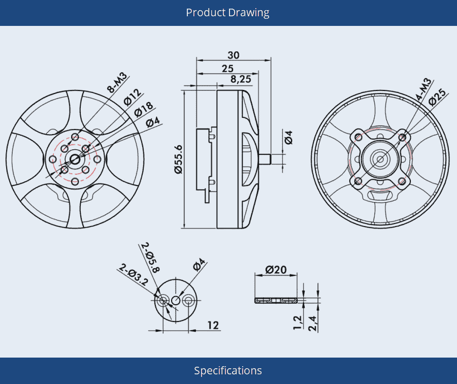
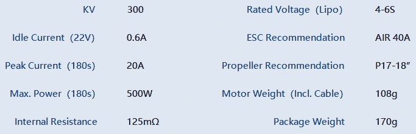
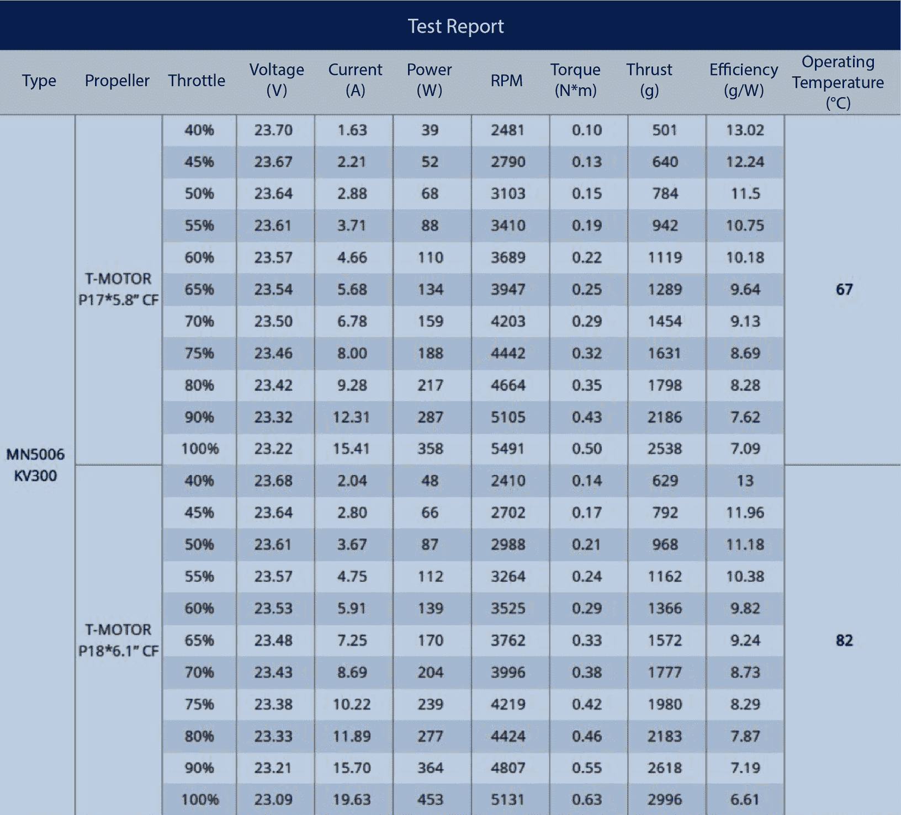
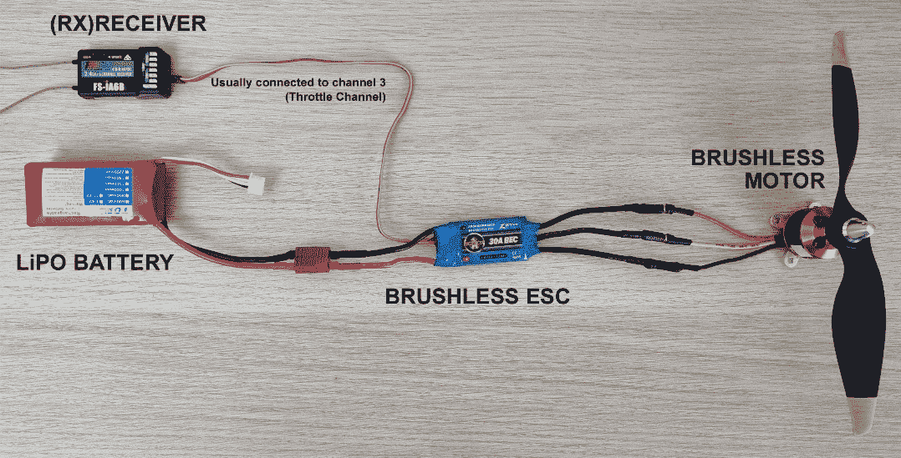

## 第 4 章：了解无人机系统、子系统和组件

早前，我们阅读了作用在无人机上的力、其主要硬件、系统和子系统，以及适用于无人机的系统。现在，我们将继续学习这些硬件系统的开发。在本章中，我们将学习对无人机整体开发有帮助的主要概念、术语和法规。这将使用户能够根据给定的规格设计自己的系统。

在本章中，我们将学习如何根据规格要求为无人机选择最佳组件，以及如何将它们集成以开发无人机。我们将通过以下主题帮助您详细理解该概念：

*   理解和构想系统
*   设计动力系统
*   设计和开发机身
*   开发控制系统
*   选择导航和通信系统

## 技术要求

在本章中，主要技术要求是基础高中物理、作用在物体上的合力知识，以及基础电气工程和计算。了解电路电压、电流、功率、电池等将大有裨益。有操作电气仪器的经验更佳。

## 理解和构想系统

理解和构想有助于我们为专用应用和目的构建各类无人机。正如我们在 *第 1 章* 中看到的无人机可用的主要应用，我们现在将看到无人机如何被构想和开发。

无人机基本上是一个能够携带特定载荷能力飞入空中的平台，我们已经结合**最大起飞重量**（**MTOW**）对此进行了研究。因此，无人机平台可通过施加允许载荷并优化其重量、续航、尺寸和功率，帮助将无人机转变为不同的应用。

在构想系统时，我们需要考虑并决定以下事项：

*   **应用**：目的是了解无人机构建所针对的应用和目的，例如，激光雷达载荷进行城市测绘、RGB 相机进行土地测绘、农业中的作物喷洒/播种、昼夜监视或高续航系留无人机。了解应用将有助于您在机身设计和组件选择及布局方面更好地构想系统。您将更清楚无人机必须经历的情况和工作类型；因此，无人机可以为此进行定制。
*   **续航（飞行时间）**：续航是在构想无人机时必须考虑的关键因素。长续航可帮助您飞行更久，执行更多高效任务，而无需频繁降落更换电池。然而，应用的需求仍然是首要考量。


# 无人机设计参数

## 航程
无人机的航程是指其在与地面控制站保持通信链路连接的情况下能飞多远。该参数取决于我们要服务的应用场景。对于不需要飞往远距离的摄影无人机，1 到 1.5 公里的航程就足够了；但对于需要长距离飞行的测绘和监视无人机，15-20 公里的航程也仅属一般水平。属于**高空长航时 (HALE)** 或**中空长航时 (MALE)** 类别的大型无人机，其航程可达 200-300 公里。因此，航程也是决定设计方案的重要因素之一。

## 最大载荷重量
该参数给出了无人机安全起飞时所能承载的最大允许载荷重量。由于无人机有其自身重量，现在作为变量的是载荷重量，应将其确定为最大值。这将帮助我们仅选择重量合适的载荷安装到无人机上。

## 功能与特性
这一点决定了除了传统飞行平台外，我们还想为系统增加哪些额外功能。这些功能包括导航灯和 ADS-B 进/出功能。这些并非强制性功能，而是取决于当地法规或客户需求。遵守国家法律法规在设定系统运行特性方面起着至关重要的作用。一些国家要求飞越视距外 (BVLOS) 需要许可，而另一些则不需要。在某些国家（如美国），强制要求远程 ID，而一些国家正在制定针对无人机运营的合规标准。我们可以认为，功能和规格应根据当地法规和合规要求进行修改。

通过确定上述因素，我们可以逐步决定无人机的基本组件，这些将在后续主题中介绍。

# 设计动力系统

动力系统或动力总成是无人机中最重要的系统。它是无人机的骨干，使无人机能安全起飞、执行任务、提供所需续航时间，并能在行动过程中进行急剧机动和抵抗大风。正如我们在前一章所学，无人机的重量是选择其动力系统的关键，我们可以展望不同组件的大致重量分布，以估算无人机的大致总重。

无人机的动力系统主要由电机、螺旋桨、`ESC`、电源分配板和电池组成。这些是关键组件，其重量在决定无人机的 `MTOW`（最大起飞重量）中起关键作用。让我们看看这些组件，以及基于多旋翼开发经验选择最佳组件的方法。

假设一架无人机的估计总重（含载荷）为 4 公斤，要求最低续航时间为 60 分钟。我们可以按如下方式划分组件的大致重量分布：

| **序号** | **组件** | **重量百分比** |
| --- | --- | --- |
| 1. | 机身 | 15% |
| 2. | `ESC` + 电机 + 螺旋桨 | 13% |
| 3. | 电池 | 40% |
| 4. | 载荷 | 15% |
| 5. | 航电设备 | 10% |
| 6. | 杂项及预留 | 7% |

表 4.1 – 组件大致重量分配

上表描述了无人机所用组件的大致重量分布。这纯粹基于开发多旋翼的个人经验，并非必须遵循的铁律。根据开发经验，重量比往往遵循这一趋势。因此，可根据用户需求和应用进行调整。

## 电机与螺旋桨组合的选择标准

我们在前几章已经学习过，电机用于提供旋转，根据旋转情况，螺旋桨产生所需的推力将无人机拉入空中。这里我们将了解如何为电机螺旋桨选择最佳动力总成，以在重量更轻、功耗更低、体积更小的前提下获得所需推力。

选择过程中的权衡如下：

*   **重量与功率**：选择重量较轻且功耗较低、同时能提供所需推力的电机。
*   **尺寸与功率**：搭配上述选定电机的较小尺寸螺旋桨功耗较低，但能提供相当的推力。
*   **推重比**：值得注意的是，在任何电机和螺旋桨的组合中，不应通过选择尺寸更小、重量更低的组件来妥协推力需求。请务必确保该组合能产生所需推力，因此在选择这些组合时需要适当关注。

### 推重比

**推重比 (`TWR`)** 是多旋翼设计和运行中的基本比率。`TWR` 影响无人机的飞行动力学及其在应用中的能力。顾名思义，`TWR` 是动力系统产生的总推力与多旋翼总重量的比值。

#### TWR 的重要性

`TWR` 对于预测多旋翼上升、机动和有效载荷的能力（具有响应性和稳定性）非常重要。这对于开发用于航拍、监视和娱乐飞行等应用的无人机至关重要。较低的 `TWR` 会导致无人机性能迟钝，难以执行急剧机动；而过高的 `TWR` 会损害无人机的稳定性。

#### 通用多旋翼的理想 TWR

对于普通多旋翼，典型的 `TWR` 通常为 2:1 到 3:1。这有助于在灵活性和稳定性之间寻求平衡，使多旋翼能高效完成各种任务。它为快速上升和动态机动提供了足够的推力，而不牺牲整体控制和稳定性。

#### 计算 TWR

`TWR` 使用以下公式计算：

```
TWR = 总推力 / 总重量
```

此处，总推力是多旋翼中所有动力单元（电机）的综合输出，重量是飞行器的总质量（含任意载荷）。

高 `TWR` 和低 `TWR` 的区别如下：

*   **高 TWR**：具有高 `TWR`（即 `TWR` >3:1）的多旋翼，其推力相对于重量较强。这种 `TWR` 适用于需要快速加速、急剧机动和快速上升的应用，如竞速无人机。
*   **低 TWR**：反之，具有低 `TWR`（即 `TWR` <2:1）的多旋翼可能更稳定，但缺乏动态飞行所需的灵活性。低 `TWR` 的多旋翼通常部署在以稳定性为首要要求的应用中，如航拍或监视。

实现最佳 `TWR` 的要求如下：

*   **电机和螺旋桨选择**：选择适合预期应用的电机和螺旋桨。高质量、大功率的电机搭配兼容的螺旋桨，能实现高效的推力产生。
*   **电池选择**：选择具有所需容量和放电率的电池，以提供最佳推力所需的功率。
*   **重量管理**：通过为机身和组件使用轻量化材料，优化多旋翼的整体重量，在结构强度和减重之间建立平衡。
*   **高效电子元件**：使用高效的电子元件，包括 `ESC` 和飞控，以增强电源管理和整体性能。

## 所用电机的特性


既然我们正在开发一款无人机，就不能使用市面上任意可买到的电机。无人机推荐使用**无刷直流 (BLDC)** 电机，这种电机效率高、重量轻、体积小且耗电流少。电机还应产生足够的扭矩来旋转螺旋桨以产生所需的推力。作为无人机工程师，以下是我们应了解的电机几项关键规格：

*   **KV 值**：BLDC 电机的 KV 值规定了在空载条件下，每施加 1 伏特电压电机转动的 RPM（每分钟转数）。简单来说，KV 值表示 BLDC 电机每伏特的 RPM。如果电机是 100 KV，意味着施加 1 伏特电压时，BLDC 电机将转动 100 次。在实际工况下，由于螺旋桨和旋转时的空气阻力，电机上会有一定负载，因此电机无法达到空载 RPM，但会接近该值。由于负载的存在，扭矩的概念随之而来，我们稍后将看到。

    因此，在选定电机时，也应考虑电池配置，具体指这些电机将在哪种电池上运行，即 6S、8S 或 12S。对于 100 KV 电机和 25 伏特电池，最大电压下的 RPM 将是 `25 x 100 = 2500 RPM`。

*   **电机扭矩**：扭矩基本上是电机克服风阻旋转螺旋桨的力量。换句话说，它是电机克服施加负载所需的力。因此，大螺旋桨和重载应用使用扭矩较大的电机，而轻载应用使用扭矩较小、RPM 较高的电机。

    电机的扭矩和 KV 值成反比。KV 越高，扭矩越低，反之亦然。较高 KV 的电机在特定电压下 RPM 更高、扭矩更小，因此它们搭配较小的螺旋桨在较高 RPM 下产生推力。

    KV 较低的电机 RPM 较低、扭矩大，因此转速较慢但使用较大的螺旋桨，产生的推力大小相同。

*   **工作电压**：这是电机选型中最重要的参数。我们需要确定所用电池是 6S、8S、12S（以此类推），并选择在该电压下工作的电机。选择工作电压低于电池电压的电机会烧毁电机，因此应根据我们选择的电池的合适电压来选择电机。

## 电机规格与推力图表

电机规格包括电机的机械图纸及其参数，而推力数据图表尤为重要，它提供了电机搭配不同兼容螺旋桨时的性能详情。这些图表由电机制造商提供，包含关于推力、功率扭矩和其他参数的精确细节，有助于观察电机性能并选择合适的电机。同样的数据也可在本地使用推力测试台对任意电机推导得出。

为给我们的应用选择电机，我们可以浏览不同制造商的电机规格和推力测试台数据，并对这些电机推力数据进行对比分析。我们可以重点关注以下参数：

*   **电压**：既然我们构建的是 6S 配置的系统，我们会选择至少支持 6S（标称电压 22.2V）的电机。因为下文提到的电机适用于 6S 配置，所以我们可以继续使用它。
*   **推力**：我们会观察这些电机产生的推力，其应接近无人机重量（保持推重比 TWR 为 2:1），并选择能产生该推力的螺旋桨组合。
*   **重量与尺寸**：考虑上述因素，我们会寻找以最轻电机重量和最小螺旋桨尺寸产生所需推力的组合。这有助于减小无人机的尺寸和重量。
*   **电流消耗**：既然我们需要高续航，我们需要寻找能提供相同推力、更轻重量、更小尺寸且更低电流消耗的组合。

上述四点是为无人机选择动力系统时需观察的四个主要要点。由于实际场景包含热损耗和其他环境因素，推力测试台数据可能不完全准确。

考虑上述因素后，我们将研究一款 `T-Motor Antigravity 5006 300 KV Motor` 的推力图表，该图表包含不同尺寸螺旋桨在不同油门百分比下的数据，反映了其性能。

电机的产品图纸帮助设计师提取以下机械信息：

*   安装孔直径
*   孔距
*   电机直径和厚度

这些信息帮助设计师在机身设计中提供安装结构，并对其进行更好的优化。

以下是所选电机的规格和机械图纸：



图 4.1 – MN5006 300 KV 电机外形图（来源：T-Motor）

以下是制造商 T-Motor 提供的电机规格图片，清晰列出了物理属性和配合该电机使用的推荐电子元件。这有助于航电工程师计算无人机重量和推进系统的总功耗：



图 4.2 – MN5006 300 KV 电机规格（来源：T-Motor）

以下是制造商的推力测试台数据图片，将帮助我们为之前确定的 4 公斤无人机选择螺旋桨。数据表展示了电机搭配螺旋桨在不同油门百分比下的电流、功率、RPM 和扭矩。还给出了电机在运行过程中达到的最高温度：



图 4.3 – MN5006 300 KV 电机测试报告（来源：T-Motor）

## 电机与螺旋桨选择

在上图中，我们可以看到对于 `18*6.1” CF 螺旋桨`，在 50% 油门下，单个电机推力等于 968 克。既然我们开发的是四旋翼无人机，四个旋翼产生的总推力为 `968 x 4 = 3872 克`，这接近 4 公斤（无人机重量），保持了通用应用 2:1 的推重比 (TWR)。

`17*5.8” CF 螺旋桨` 效率低于 `18*6.1 CF 螺旋桨`。因此我们可以继续选择 `18*6.1 CF 螺旋桨`。

单个电机在 50% 油门下的电流消耗为 3.67 安培，而四个电机在 50% 油门下的总电流消耗为：`3.67 x 4 = 14.68 安培`。因此，电机产生的总推力足以在 14.68 安培下悬停，该数据来自规格图表。这些数据足以让我们继续采用该组合，因为在此场景下工作温度不会过高。

因此，我们可以认为该电机符合我们的要求，并根据数据表证明是高效的。然而，这并非理想情况；在实际场景中，风、速度、飞行方式等许多其他因素都会发挥作用，上述数据可能会受到轻微影响。

下一步是计算该组合的飞行时间以获得良好的续航。让我们为该应用考虑一款合适的电池。

## 电池选择

电池是无人机的动力源。正如我们在前一章讨论的不同电池类型，在为我们的应用选择合适的电池前，有几个关键额定值需要牢记。


我们现在已经从上图中得到了无人机的电流消耗。由于其他航空电子设备和环境影响（如风），总电流消耗将始终高出 5%，因此让我们将电流消耗保持在 `14.68 + 5% = 15.414` 安培，这意味着无人机的总电流消耗可视为 `15.414` 安培。我们将以此作为所有计算的基础。

选择电池时需要注意以下事项：

- **重量**：由于我们拥有一个飞行系统，始终建议将重量降至最低。我们应始终寻找具有高能量密度和低重量的电池，这将为我们带来更好的效率和更高的续航时间。

- **C 率**：根据电池大学的说法，电池的充放电速率由 C 率决定。C 率决定了电池的安全放电，即电池在不损坏的情况下能安全向系统提供的安培数。它标注为 `5C`、`15C`、`22C`。计算方法如下：假设电池容量为 `16Ah`，即 `16000mAh`，C 率为 `5`，安全放电电流等于 `Ah x C`，所以 `16 x 5 = 80 安培`。因此，该电池可持续提供 `80 安培` 而不损坏，尽管我们的应用消耗电流应小于该值。

如果满足上述考虑重量和能量密度的额定值，我们可以从聚合物锂电池、锂离子电池和固态聚合物锂电池中选择任意一种电池化学体系。

# 计算飞行时间（续航时间）

飞行时间使用一个简单的基本公式计算：储存能量除以消耗能量。

对于我们的应用，总电流消耗为 `15.5 安培`（四舍五入）。如果我们选择 `16 AH` 的电池，将以最小重量满足我们的续航要求。

## 计算飞行时间的公式

多旋翼飞行时间 (T) 可使用以下简化公式估算：

```
Flight Time = ( Capacity(Ah) × 60) / Ampere Draw
```

其中飞行时间待计算，容量 (Ah) = `16Ah` 或 `16000mAh`，电流消耗为 `15.5`。

将数值代入公式得出 `61.93 分钟`。

因此，我们计算出 `4 千克` 无人机的飞行时间为 `61.93 分钟`。

这就是我们如何选择合适的动力系统并计算系统飞行时间。请注意，飞行时间是一个近似的理想飞行时间。实际上，飞行时间受温度、湿度、飞行高度、风力等诸多因素影响，因此续航时间会有所变化。

# 设计与开发机身

机身是无人机的骨架，它将航空电子设备和其他组件紧密且刚性地固定在一起。它是真正进入空中并承受环境影响的结构；因此，机身应刚性强、结实且轻量化。我们可以使用各种可用软件设计自己的机身并遵循复合材料制造工艺，也可以使用市场上现成的机身。

无论我们是设计机身还是购买机身，都需要考虑以下要点，这些要点有助于我们了解无人机能承载多少负载以及机动性如何：

- **专业工程设计**：当机身在实验室开发时，会选择特定材料，如碳纤维、玻璃纤维等，并必须经过切割、钻孔等制造工艺。材料（即碳纤维）按特定层序铺设在模具中，使用树脂固化。这使纤维硬化并形成模具形状。从而得到所需形状，再通过机加工进行工程化处理。

    如果您内部设计了机身并有一些独特概念，这就是制造机身的过程。然而，对于初学者构建，市场上有四轴/六轴飞行器机身可供起步构建。

    机身内外应光滑平整，无粗糙表面，且在所有轴向上尺寸等效。

- **构型与尺寸**：机身的通用测量术语称为轮距。轮距指两个电机座之间的对角线中心距。螺旋桨应完美适配机身，在空中不与机身任何部件或自身碰撞。机身不应有任何松动末端。机身在所有构型下也应保持平衡，具有合适的重心和质心。

- **安装座与固定件**：安装座与固定件是安装航空电子设备（如电机、`ESC` 和其他部件）的硬件，按期望方式安装在无人机上。电机的这些安装座和固定件设计开发有孔位和固定装置，用于放置 `PDB`、`ESC` 和飞控。载荷安装座和空间必须预留，以保证载荷自由移动。安装硬件（如螺丝、胶水、螺母和螺栓）的细节应恰当。

- **材料**：制造机身的材料应轻量且坚固，在所有轴向上具有良好强度。复合材料如碳纤维、玻璃纤维或凯夫拉因其轻量和优异的强度特性，被广泛用于制造机身。这些材料对环境条件也应惰性，长期使用不应磨损。

- **强度**：机身应具有足够强度以承受电机产生的力和重力。易损区域如臂关节和电机安装关节必须坚固，能在剧烈机动中承受空中载荷。

# 开发控制系统

本节将介绍控制系统开发。

## 电子调速器与飞行控制器

`电子调速器` (`ESC`) 是位于 `飞行控制器` (`FC`) 和 `BLDC` 电机之间的小型设备。顾名思义，`ESC` 根据从 `飞行控制器` 接收到的信号控制 `BLDC` 电机的转速。每个电机需要一个 `ESC` 来控制其转速，并连接到 `飞行控制器`。`FC` 同时拥有连接 `ESC` 的 `脉宽调制` (`PWM`) 引脚。`FC` 根据 `GCS` `RC` 给出的指令向 `ESC` 发送 `PWM`/`DShot` 信号以运行电机。`ESC` 从电池获取电力，从 `飞行控制器` 获取信号。下图说明了此设置：



Figure 4.4 – The workings of an ESC

`ESC` 连接电池并向电机提供电池电压。`ESC` 是一种振荡器或脉冲发生器，传递可变占空比，常用作电机调速器。这由 `FC` 通过 `PWM` 信号控制。`FC` 产生的用于驱动 `BLDC` 电机的 `PWM` 信号被送入 `ESC`。`PWM` 信号值在 `1000` 到 `2000` 微秒之间变化，其中 `1000` 代表最低电压电平，`2000` 代表需供给电机的最高电压电平。该电压值取决于供给 `ESC` 的 `PWM` 值。`飞行控制器` 拥有特殊的电机驱动算法，根据电机转速控制滚转、俯仰和偏航。

选择无人机 `ESC` 时需考虑的因素如下：


## ESC 选择标准

### 电流额定值

**电流额定值**：电流额定值是必须首先检查且最重要的指标。ESC 的电流额定值是指在不烧毁的情况下，可以安全通过的电流大小。电机工作时会拉取电流，电流经过 ESC。为此，必须了解电机-桨叶组合的正确电流额定值。在我们之前的电机参数表示例中，可以看到每个电机可拉取 19.6 安培的电流，因此 ESC 的额定值应至少比该值高 10%。

ESC 有两种电流额定值类型：

*   **持续电流**：持续电流是指 ESC 能够稳定通过的最大电流，包含尖峰和波动。
*   **爆发电流**：爆发电流是指在不损坏 ESC 的情况下，短时间内（即 10 秒）通过的最大电流。ESC 的爆发额定值有助于应对大风和剧烈机动等情况，此时电机必须加速旋转并需要额外电流。

### 工作电压额定值

**工作电压额定值**：工作输入电压是指 ESC 能够承受且电机在此电压下工作的电池最大输入电压。许多 ESC 支持 `4S` 到 `6S`（S 表示电芯数）电池，而其他 ESC 支持 `12S` 到 `14S` 电池。具体需要哪种 ESC 取决于应用场景。对于我们之前确定的 4 千克配置，40 安培的 ESC 就足够了。

### 重量和尺寸

**重量和尺寸**：ESC 的尺寸和重量是关键因素，因为它们影响无人机的重量及其在机架上的安装位置。电流额定值越大，ESC 的尺寸越大。一些大电流 ESC 还配有散热片，这会使尺寸和重量进一步增加。

### ESC 协议

**ESC 协议**：协议是飞控与 ESC 之间的通信工具。它们定义了飞控与 ESC 之间通信速度和时间同步的方式。更好的 ESC 是指支持所有主流协议的 ESC。常用的通用协议包括脉宽调制（`PWM`），这是一种用于向 ESC 传输信号的模拟协议。然而，更新、更高效的数字协议已经出现——`Dhot` 和 `proshot`——它们更精准、更快速。

因此，ESC 是无人机的重要组成部分，应根据电机的电流消耗和最新协议进行选择。

## 飞行控制器

飞行控制器是无人机最重要、最关键的部件；它有助于控制无人机的运动和稳定性。根据功能、协议以及 IMU 和传感器选择合适的飞控时，必须牢记许多因素。

飞行控制器是无人机的大脑。它主要根据从传感器接收到的输入来控制 ESC 和电机的运行。飞控拥有板载传感器、处理器、通信协议和外部通信接口。飞控的目的是利用其板载传感器（包括我们之前讨论过的 IMU）在飞行过程中稳定无人机。

### 如何选择飞行控制器

市面上有各种飞控可供选择，我们如何挑选最适合我们应用的最佳飞控？基于各种因素，可以选择最佳飞控：

#### 微控制器

**微控制器**：每个飞控都有一个微控制器，它主导所有决策和操作速度。在关键决策场景下，我们需要能够快速决策和快速处理数据的飞控。有许多飞控配备不同的微控制器板，例如 `Atmel Mega 644PA 8 Bit`、`ATMega 328P`、`STM 32 F4 32 bit` 等。这类似于我们在选择笔记本电脑时查看处理器，即 `i5`、`i7`、`Ryzen`。

因此，如果需要快速处理数据，必须选择具有最佳微控制器板的飞控。

#### 固件

**固件**：固件是飞控的灵魂，也是无人机的灵魂，因此必须选择支持且兼容可靠固件的飞控。目前广泛使用的一些关键开源固件包括 `ArduPilot` 和 `PX4`。除此之外，还有 `Betaflight` 和 `INAV`，它们引领着行业。固件代码也应易于获取，并且在需要时应能根据用户需求进行修改。

让我们看看业界知名的飞控固件：

##### ArduPilot 固件

**ArduPilot 固件**：`ArduPilot` 是一个知名的开源飞行栈，支持多种飞行器配置，包括多旋翼。它包含一套简要功能，对业余爱好者和专业用户都很有帮助：

*   **通用性**：`ArduPilot` 飞行栈用途广泛，因为它支持多种飞行器类型，如多旋翼、固定翼、地面车和船只。
*   **功能丰富**：`ArduPilot` 包含许多功能，包括航点导航、一键返航、定高，以及对各种传感器和执行器的支持。
*   **庞大且活跃的社区**：`ArduPilot` 的用户社区庞大且活跃，确保了持续的开发和支持。

##### PX4 固件

**PX4 固件**：`PX4` 是一个类似的知名开源飞行栈，专为无人飞行器设计，包括多旋翼。它以模块化和实时能力著称。其主要特点如下：

*   **模块化和适应性**：`PX4` 的基本设计是模块化的，使用户能够修改并将其适配到不同的飞行器和配置中。
*   **实时操作系统** (`RTOS`)：`PX4` 包含一个 `RTOS`，提供精确且低延迟的控制。这对于要求多旋翼具有响应性能的应用特别有用。
*   **硬件集成**：`PX4` 支持与其栈兼容的广泛硬件组件，为用户选择兼容的传感器、控制器和其他组件提供了灵活性。

#### 传感器

**传感器**：传感器是收集无人机物理信息的主要来源；它们充当无人机的感官器官。现代飞控配备内置传感器，如加速度计、陀螺仪、温度传感器和磁力计，它们向微控制器提供数据，以便根据编写的固件做出所需决策。传感器主要用于获取无人机的姿态，并在滚转、俯仰和偏航时进行稳定。

以下是不同类型板卡所用传感器的列表：

*   `KK 2.1.5 飞控板`：`MPU6050` 陀螺仪和加速度计
*   `ArduPilot APM 2.8`：三轴陀螺仪加速度计、气压计
*   `OpenPilot CC3D`：三轴陀螺仪加速度计
*   `ArduPilot APM 2.6`：三轴陀螺仪加速度计、气压计

#### 通信协议

**通信协议**：要与任何外围设备（如 GPS、测距仪或喷洒器）配合工作，我们需要一种与该外围设备兼容的通信协议。为此，我们需要一款支持多种通信协议的飞控，如 `UART`、`I2C`、`CAN`、`PWM` 等。我们在前面的章节中讨论过这些协议。这些协议用于在传感器和飞控之间双向传输数据，飞控以此快速准确地做出所需决策。以下是几个具有通信协议的飞控示例：

*   `KK` 飞控：内置 LCD 显示屏和四个配置按钮
*   `ArduPilot APM` 飞控板：`PWM`、`I2C`、`UART`、`PWM`、`PMU` 和 `SBUS`
*   `OpenPilot CC3D` 飞控：`UART`、`I2C` 和 `SBUS`
*   `ArduPilot APM 2.6` 飞控板：`UART`、`I2C`、`SBUS`、`CAN` 等。


上述飞行控制器是根据应用、所需通信协议和固件选择最佳飞行控制器的关键参数。其他一些次要因素包括控制器的尺寸和重量以及功耗，功耗应极低。

### 一些知名的飞行控制器板

前面我们学习了根据应用需求，飞行控制器所需的不同特性。以下是一些行业内知名、运行在不同无人机上的飞行控制器板列表：

*   **KK 飞行控制器板**：KK 飞行控制器是一款入门级飞行控制器，内置 LCS 和四个按钮，用于配置板卡以进行飞行。该飞行控制器专为多旋翼、三旋翼、四旋翼或六旋翼设计，并在飞行过程中保持其稳定。该飞行控制器基于 `Atmega644 PA IC`，搭配 `InvenSense MPU-6050` IMU 传感器。

*   **Pixhawk 2.8 飞行控制器**：随着无人行业的发展，我们开始将相同的自动驾驶板或硬件用于多种无人应用。Pixhawk 飞行控制器是一款开源飞行控制器，通过更换固件，可使用相同的硬件构建固定翼无人机、多旋翼和无人车。这使我们有机会利用相同的硬件和传感器构建更多无人飞行器。Pixhawk 可使用 `GCS 软件` 执行预编程的自主任务，并利用机载指南针执行多航点任务，这使其成为一款先进的飞行控制器。集成的三轴 IMU 和基于 `ATMega` 芯片的机载日志记录功能，使这款飞行控制器更加先进，并更易于用于具有专用失效保护模式的自动化任务。

*   **DJI Naza**：DJI Naza 是一款功能全面增强的先进飞行控制器，最多可支持九种类型的多旋翼。它配备有配置好的 GPS、智能手机助手软件和免费地面控制站。该飞行控制器具有电源输出故障保护、智能操作控制、飞行模式和多种外设通信协议，可帮助其连接输出传感器以获取数据和进行决策，从而使其更加独特。对于寻求稳定且长航时飞行的高级用户来说，DJI Naza 是一块很棒的板卡。

*   **Pixhawk Cube Orange**：Pixhawk Cube Orange 是无人行业中应用最广泛的开源飞行控制器。使用这款 Pixhawk 飞行控制器最大的优势之一是其开源设计，甚至提供了硬件的微小细节，进而允许访问硬件和设计的详细信息。这结合了开源无人机固件，如 `ArduPilot` 或 `PX4`，它们是与 Pixhawk Cube Orange 搭配运行任何无人系统的两款最先进且应用最广泛的固件。Pixhawk Cube 支持多旋翼、固定翼和 VTOL 无人机、无人车和潜艇。通过更换固件，可将其装备在任何载具上。Cube Orange 之所以先进，是因为它配备了 `STM32H7` 微控制器和一个失效保护协处理器。它为外部硬件和外设接口提供了高连接选项，如 `SPI`、`I2C`、`PWM` 和 `CAN`。它拥有冗余电源和用于数据记录的 microSD 卡。

因此，我们可以得出结论，上述列出的飞行控制器都是现代自动驾驶系统，可用于构建特定应用的无人机。在前面的主题中，我们还了解了如何为我们的无人机选择外围设备和自动驾驶系统。

# 选择导航和通信系统

导航和通信系统是无人机中最重要的系统。通信系统有助于在更长距离上对无人机进行指挥和控制，而导航系统帮助无人机确定其北向，并在自主任务中引导系统前往航点。

## 通信系统

通信系统基本由一个无线电调制解调器和一个天线组成，它们连接到地面控制站和无人机，两者相互连接。该系统有助于为无人机编程自主任务，并在飞行中指挥无人机执行特定任务。让我们看看通信系统存在的参数（无线电调制解调器的例子是 `RFD900 433Mhz`）：

*   **无人机航程**：航程是帮助工程师决定和集成通信系统的关键因素。随着航程要求的增加，无线电调制解调器和天线的要求也随之增加。

*   **功能性**：功能性是在选择通信系统时起重要作用的另一个关键因素。我们需要查看应用是否需要视频传输系统以及指挥控制功能，然后选择相应的无线电调制解调器。

*   **工作协议**：为了使通信与系统兼容，应匹配无人机飞行控制器的工作协议，并应具有足够的端口。通信系统的一些工作协议如下：

    *   **串行 UART**：`Serial UART` 是一种通用的传统 UART 协议，用于与无人机建立串行连接。它直接连接到飞行控制器的串行接口。

    *   **基于网络的通信系统（智能电台）**：存在一种带有智能电台和 `IP-based network`（基于 IP 的网络）的通信无线电设备，这是一种先进的通信设备。在这些设备中，网络在两个或更多设备之间形成，并在这些设备之间共享数据。这些设备是新时代的设备，基于互联网协议的网络通信工作，有助于共享音频、视频以及指挥和控制。这些设备在多种模式下工作，例如 `master-slave mode`（主从模式）和 `mesh mode`（组网模式）。这些是不同的网络拓扑，有助于管理它们之间的网络类型。此类设备的一些例子包括 `Doodle reduce microhard` 和 `silvus radios`，它们在无人机领域被广泛使用。

*   **功耗**：在选择无线电调制解调器之前，必须记住无线电调制解调器应从无人机消耗较少的电力，因为它可能直接影响系统的飞行时间，因此即使在距离地面控制站最远的距离，无线电调制解调器也应尽可能少地消耗电力。因此，最好在购买无线电调制解调器前确保并检查数据手册。

*   **尺寸和重量**：正如我们所知，无人机用于偏远地区，由有限的人员操作，并且有重量限制，正如我们在前面的主题中所见，在选择无线电之前，我们应该注意它应尽可能轻巧且体积小，以免给无人机增加额外重量。系统也必须不那么复杂，以便于在 GCS 侧进行运输和组装，并节省时间。

*   **频率和功率的合法性**：据观察，不同国家对可发射的最大功率有不同规定。某些频段也被允许在无需许可证的情况下使用。要使用受管制频段以外的任何其他频谱频段，必须获得州政府的许可证。例如，`2.4 GHz` 和 `5.8 GHz` 是大多数国家（如印度）用于 Wi-Fi 通信的无证频率，无需政府许可。在选择任何无线电之前，必须根据当地法规检查输出功率和频率。

### 集成通信设备的 GCS 系统


# 集成 GCS 系统

集成 `GCS` 系统是手持设备，包含摇杆、屏幕以及集成在一个外壳中的无线电调制解调器，并由一块小电池供电。这些是小型手持系统，用作无人机控制器，具备通过软件操作和通过摇杆手动操作的功能。它们还拥有多个按钮，用于配置不同功能或配置控制器本身。它们集成了无线电调制解调器，帮助无人机实现长距离飞行，同时具备指挥控制和实时视频传输功能，这使得它们重量轻、易于携带。

## 集成 GCS 设备示例

### Herelink

`Herelink` 由 `CubePilot` 制造，面向无人系统生态。它是一款小巧紧凑的手持设备，配备 5.5 英寸屏幕、集成的 `Android` 版 `QGroundControl` `GCS`，以及一个工作在 2.4 `GHz` 频段、带有摇杆和按钮的内置无线电调制解调器。它支持 `RC` 数据、遥测数据和实时视频传输，制造商声称范围可达 15 `km`，还允许通过网络进行视频流传输。对于需要小型轻量级集成 `GCS` 进行实时视频流传输和长距离应用的新手无人机飞行员来说，这是最佳选择。它可作为任何类型手动和自主任务的完整 `GCS` 系统运行。更多详情请访问 `Herelink` 官方网站，该网站会指导您在无人机上配置该系统。

### Siyi AK28

`Siyi AK28` 是一款类似于我们之前看到的 `Herelink` 的手持 `GCS`。这款遥控器由 `SIYI` 专门为农业无人机制造。该遥控器配备了一个射程 5 `km` 的无线电调制解调器，以及一块运行其自有 `GCS` 软件的 7 英寸显示屏。单次充电可运行 10 小时。它是一款简单高效的集成 `GCS`，附带 `RC` 数据、遥测数据和实时视频传输。该设备也易于通过 `4G` 网络配置，为农业植保无人机提供有效的任务规划和控制。

## 通信系统

一些著名通信系统的示例如下：

### RFD 900 无线电调制解调器

`RFD 900 radio modem` 是一种基于串行通信协议的无线电调制解调器，有助于实现 `GCS` 与无人机之间的长距离通信。该无线电属于 `ISM` 频段无线电，工作频率范围为 900 至 928 `MHz`。由于这是基于串行协议的遥测，它通过 `GCS` 直接向无人机提供指挥控制接口，无需遥控器控制。由于较低的数据速率和串行协议，它不具备视频流传输能力。它是一款小型轻量级无线电，在澳大利亚、加拿大、美国和新西兰免执照使用。

### Doodle Labs 无线电

`Doodle Labs radio` 是一系列专为工业应用设计的组网无线电。它们是以长距离、高吞吐量和低 `SWaP`（`尺寸、重量和功耗`）需求著称的智能无线电。`Doodle Labs radios` 并非像 `RFD 900` 那样的通用串行通信无线电。它们是基于 `IP` 的无线电，能组建网络，并在此网络下通过射频信号传输 `MAVLink` 数据。

#### Doodle Labs 无线电的应用

`Doodle Labs radios` 用于多种应用：

##### 无人机和航空器

`Doodle Labs radios` 用于为无人机和其他航空器提供长距离通信。这使它们能够飞越长距离并保持与地面站的连接。

##### Microhard 和 UAV 无线电

这些公司与 `Doodle Labs` 类似，开发智能无线电或无人机及其他通信应用。两款无线电都有各自的操作系统和软件，在性能和功耗方面各不相同。两者都属于智能无线电范畴，能够将控制信号、通信信号和视频传输至长距离。

# GPS 和导航系统的选择

正如我们在*第 1 章*中看到的关于无人机中 `GPS` 和指南针的用法，这里我们将了解如何为我们的无人机选择 `GPS` 和指南针。由于无人机行业是朝阳产业，市面上有许多提供 `GPS` 和指南针一体化解决方案的制造商。`全球导航卫星系统`（`GNSS`）设备可用于汽车和国防领域以获得更好的效果，但其可用的实际数据可分为以下几类：

*   **定位**：确定您在世界中的位置
*   **导航**：规划从一处位置到另一处位置的最佳路线
*   **跟踪**：监控物体在世界中的移动
*   **测绘**：为特定区域创建地图
*   **授时**：计算精确时间

由于 `GNSS` 设备的这些优势可融入无人机用于各种应用，因此使用 `GPS` 可提高效率。以下是在选择合适的导航模块前必须满足的标准列表。

## GNSS 卫星星座数量

我们都知道，不同国家发射了不同的 `GNSS` 卫星星座，用于提供 `GNSS` 服务。例如，我们有以下系统：

*   美国的 `GPS`，其频段为 `L1` (1575.42 `MHz`)、`L2` (1227.60 `MHz`) 和 `L5` (1176.45 `MHz`)
*   俄罗斯的 `Glonass`，其频段为 `L1` (1598.0625-1605.375 `MHz`)、`L2` (1242.9375-1248.625 `MHz`) 和 `L3` (1202.025 `MHz`)
*   欧盟的 `Galileo`，其频段为 `E1` (1575.42 `MHz`)、`E5` (1191.795 `MHz`)、`E5a` (1176.45 `MHz`)、`E5b` (1207.14 `MHz`) 和 `E6` (1278.75 `MHz`)
*   中国的 `Beidou`，其频段为 `B1I` (1561.098 `MHz`)、`B1C` (1575.42 `MHz`)、`B2a` (1175.42 `MHz`)、`B2I` 和 `B2b` (1207.14 `MHz`) 以及 `B3I` (1268.52 `MHz`)
*   日本的 `QZSS`，其频段为 `L1` (1575.42 `MHz`)、`L2` (1227.60 `MHz`)、`L5` (1176.45 `MHz`) 以及 `L6` (1278.75 `MHz`)
*   印度的 `IRNSS/NavIc`，其频段为 `L5` (1176.45 `MHz`) 以及 `S-Band` (2492.028 `MHz`)
*   `GPS`、`Glonass`、`Galileo` 和 `Beidou` 构成全球导航系统，而 `QZSS` 和 `IRNSS/Navic` 构成特定国家的区域导航系统。

下表展示了不同 `GNSS` 星座及其名称、运营商和其他有用详情：


图 4.5 – GNSS 星座对比表

一个优秀的 `GPS` 模块支持大多数这些卫星星座，有助于获得良好的精度。例如，大多数 `GPS` 使用所有四大全球导航系统，如 `Ublox` 和 `Here3`。

## 通信协议

与其他外设一样，`GPS` 设备需要通信协议与飞控通信，因此我们需要查看 `GPS` 支持哪些通信协议，以及它们是否与飞控兼容。

## 重量、尺寸和功耗

外设单元必须轻量化、体积小、低功耗，同时具备更高的精度。

## GNSS GPS 设备示例

一些在全球制造并广泛应用于无人机的 `GNSS` `GPS` 设备示例如下：

### Here3

`Here3` 是开源栈 `ArduPilot` 和 `PX4` 中最著名、应用最广泛的 `GNSS` 设备。`Here3` 可靠耐用，能以厘米级精度为您提供无人机的纬度和经度位置。这证明它在获取无人机精确位置方面更准确。该设备支持 `CAN`（`控制器局域网`）协议，具有高数据速率和可升级性，因此信号质量更好，抗外部干扰能力更强。该设备运行在一个带有内置 `IMU`（`惯性测量单元`）的微控制器板上，以满足高级导航需求。


## GNSS 设备示例

- **Drotek DP0601**：Drotek DP0601 是一款基于**实时动态**（**RTK**）的 GNSS 设备，支持 GPS、GLONASS、北斗、伽利略和 QZSS 信号接收，提供厘米级精度，并内置对标准 RTCM 差分修正的支持。它拥有内置通信协议，同时支持 `UART` 串行协议和 `SPI`，使其适用于多种设备。

- **Synerex MDU-2000**：MDU-2000 是一款基于 RTK 的 GNSS 接收机，配备双天线以实现厘米级精度。得益于其双天线技术，即使在强磁场干扰下也能提供真实航向，因此该设备不受外部电磁场影响。

因此，我们了解了如何根据上述标准为无人机选择 GNSS 导航设备，并看到了几个无人机行业广泛使用的 GNSS 设备示例，它们用于辅助无人机的 GNSS 定位。

# 总结

在本章中，我们学习了无人机关键部件的理论与选择，以及从动力系统到 GNSS 设备的选型标准。这是基于所有可用部件绘制无人机蓝图的关键概念。

在下一章中，我们将更多地关注这些部件的组装与集成，以及用于飞行的配置软件。
