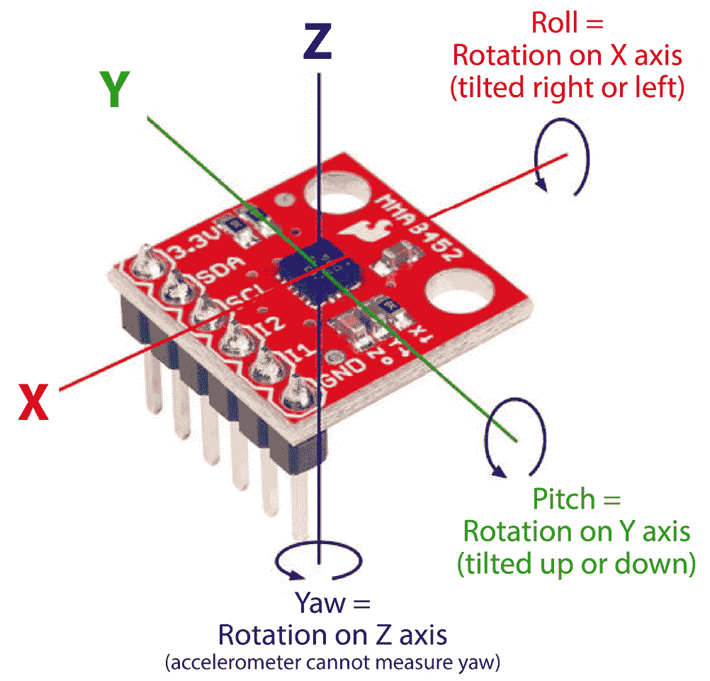
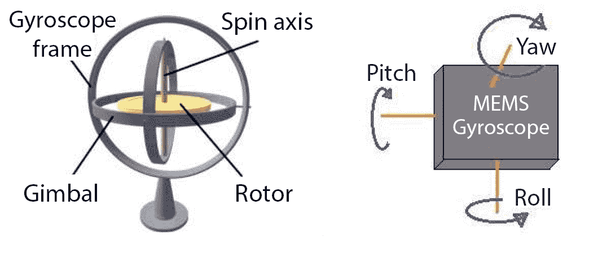
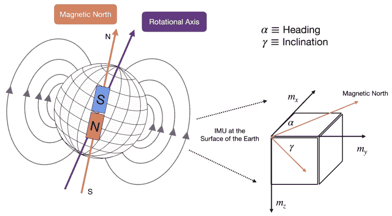
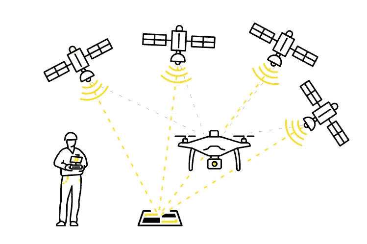
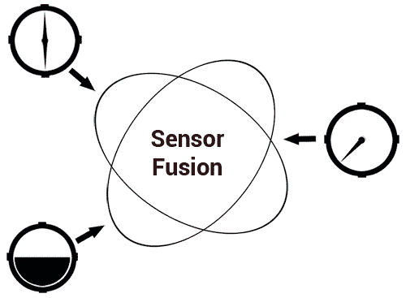

## 第 5 章：传感器与 IMU 在无人机中的应用

在本章中，我们将学习并理解无人机起飞、辅助系统飞行并导航至航点所使用的主要传感器。借助这些传感器，无人机可以在手动和自主模式下以各种模式和模式飞行。我们将在本章中学习这些传感器的工作原理、接口方式及其输出。我们还将了解它们对无人机系统的影响。在本章末尾，我们将深入探讨无人机的构造，帮助我们理解其工作原理。

我们将在以下主题下涵盖无人机系统所需的主要传感器：

- 惯性测量单元及其作用
- 气压计及其作用
- GPS 与磁力计及其作用
- 电压与电流传感器及其作用
- 传感器融合与状态估计

通过学习上述主题，我们将简要了解每个传感器的作用，这些知识将有助于推导无人机在该方面所需的方程和编程。

### 惯性测量单元及其作用

**惯性测量单元**（**IMU**）是无人机最重要的部件，因为它帮助无人机计算线性加速度和角加速度；它还有助于测量 `roll`（横滚）、`pitch`（俯仰）和 `yaw`（偏航）机动中的姿态角，帮助自动驾驶仪做出决策并引导其电机和执行器产生所需的输出以实现水平飞行。

#### IMU 的组成

IMU 是多旋翼飞控系统中的关键组件。它集成多个传感器，以提供关于飞行器运动和姿态的综合信息。IMU 通常包括加速度计、陀螺仪，有时还包括磁力计。这些传感器的集成对于精确的飞行控制、稳定性和导航至关重要。

IMU 的组件：

- **加速度计**：测量不同轴（`X`、`Y` 和 `Z`）上的线性加速度
- **陀螺仪**：测量不同轴周围的角速度或旋转速率
- **磁力计**（可选）：测量磁场的强度和方向

IMU 由以下列表中提到的传感器组成，这些传感器主要存在于飞控中，意味着它们有助于确定飞行器的位置和姿态。然而，一些 IMU 内置磁力计，而某些设备则需要外部添加。以下是 IMU 中使用的主要传感器：

- **加速度计**：测量其轴向的加速度。
- **陀螺仪**：测量角速度和角加速度。
- **磁力计**：这是 IMU 中的可选传感器；一些 IMU 自带磁力计，一些则没有。飞控通常包含加速度计和陀螺仪；不过，气压计和磁力计是可选的。

为了正常飞行，无人机需要 IMU。无人机的内部平衡感，即 IMU，使其保持水平并促进平稳飞行。IMU 向无人机的计算机提供数据，后者利用这些数据确定其运动。它的功能类似于无人机确保保持控制并遵循用户指令的手段。IMU 的数据处理使无人机能够精确飞行并按预期执行任务。

##### 加速度计

加速度计测量加速度，即速度变化的率，以了解速度和方向的变化。它有助于稳定性，帮助飞控保持飞行水平并响应飞行员指令。加速度计三个轴的数据由飞控处理，以计算无人机速度的变化率。

通过测量每个轴向的加速度，飞控可以对这些数据随时间积分来计算速度变化。本质上，加速度计提供关于无人机在不同方向上加速或减速率的信息，允许飞控进行实时调整以保持稳定。

飞控中使用的 MEMS 加速度计设备示例：

- STMicroelectronics LSM6DS3
- InvenSense MPU-6050
- Bosch Sensortec BMI160
- ADXL345

下图展示了一个 MEMS 加速度计：

Figure 5.1 – MEMS 加速度计

标准加速度计测量其各轴承受的重力。静止时，地球上的标准加速度计会测量到 `9.8 m/s²` 的加速度。当系统运动时，它给出加速度数据，有助于推导无人机的速度、运动和位置。

##### 陀螺仪

陀螺仪传感器测量绕不同轴的旋转速率或角速度。在无人机中，陀螺仪有助于确定无人机的姿态并在飞行中提供稳定性。陀螺仪的数据帮助飞控了解无人机如何以及向哪个方向转弯，并允许其通过调整电机转速进行实时调整以保持水平飞行。例如，当无人机向一侧倾斜或旋转时，陀螺仪数据通知飞控，飞控随即调整该侧的电机转速以抵消运动，保持无人机稳定水平：

Figure 5.2 – 机械三轴陀螺仪

现代飞控中使用的 MEMS 陀螺仪示例是 InvenSense MPU-6050。它将三轴陀螺仪与三轴加速度计结合在一起。陀螺仪数据的积分，连同加速度计以及有时的磁力计数据，提供了关于无人机运动的一整套综合信息。这些集成数据对于飞控准确确定无人机在三维空间中的姿态至关重要，从而实现稳定且可控的飞行。

## 磁力计

磁力计传感器提供地球磁场强度和方向的测量值。在无人机中，它用于确定无人机相对于地球磁场或磁北的航向或姿态。航向信息有助于导航，且对无人机自主移动至预定航路点至关重要。现代 MEMS 磁力计通常与加速度计和陀螺仪一起集成在 IMU 中。然而，某些飞控倾向于将其分离放置。

广泛使用的磁力计示例是 Bosch Sensortec BMM150，这是一种通常用于无人机飞控的 MEMS 磁力计。磁力计数据通过传感器融合算法与其他传感器输入融合；这有助于计算无人机的确切位置和姿态，从而在自主任务飞行时对其导航实现精细控制。

下图展示了地球磁场及其磁航向和倾角：

Figure 5.3 – Earth’s magnetic field

## IMU 在无人系统中的应用

现代 IMU 的数量因无人机的复杂程度及其应用而异。许多无人机只有一个 IMU，而许多为专业应用设计的无人机则拥有冗余 IMU 以提高可靠性和精度。

### 冗余 IMU 设置

这见于飞控中，旨在用于高端专业无人机，如工业无人机，以及为任务关键型应用设计的无人机。冗余 IMU 的主要原因是它们在一个单元故障时作为备份，故障切换可切换到备用 IMU，从而提高整体可靠性。让我们看看三重冗余 IMU 设置由以下内容组成：

*   **配置**：有三个独立的 IMU 集成在无人机飞控的三个轴上
*   **冗余**：每个 IMU 由加速度计、陀螺仪组成，有时也包括磁力计，提供关于无人机运动和姿态的冗余数据
*   **算法**：现代飞控部署传感器融合算法，可处理来自所有三个 IMU 的数据，以确定最准确和可靠的信息

冗余 IMU 系统的主要特点如下：

*   **故障切换机制**：这提供了一种故障安全机制。如果一个 IMU 发生故障，系统将无缝切换到备用单元
*   **精度**：冗余 IMU 可用于交叉验证，提高确定无人机姿态和运动的整体精度
*   **任务关键型应用**：适用于可靠性和精度至关重要的任务，如测绘、制图或巡检

IMU 在高级飞控中的应用：

*   **定位与导航**：单个或冗余 IMU 在确定无人机位置及其姿态方面发挥重要作用，辅助精确导航
*   **自主飞行**：IMU 数据辅助自主飞行模式，允许无人机在无需持续飞手输入的情况下导航并执行任务
*   **安全功能**：结合其他传感器，IMU 有助于实现紧急降落、避障和电子围栏等安全功能

## 气压计及其作用

气压计提供高度信息，有助于无人机的精确控制和导航。基本上，气压计测量大气压力，因为随着高度增加气压会降低，这告知飞控其上升了多高。

关于高度控制，无人机飞控使用气压计数据来估算当前海拔高度。这使得飞控能够精确计算无人机的垂直位置。

气压计数据与其他传感器（如加速度计和陀螺仪）融合。因此，可以在飞控的 IMU 部分观察到传感器数值。以下两款气压计——Bosch Sensortec BMP280 和 BMP388——主要用于无人机飞控；它们以与 IMU 建立协作而闻名，从而能够更彻底地测量涉及高度控制、导航和稳定性的数据。

具有 I2C 或 SPI 接口的气压计将高度信号数据发送给飞控。飞控随后识别所需高度并推动电机产生更大推力，从而获得期望高度。期望高度将由气压计传感器显示。

### 它是如何工作的？

在飞控中，气压计通过测量无人机上升或下降时大气压力的变化来估算高度。其背后的基本原理是气压随高度增加而降低。气压计向飞控提供无人机当前位置的当前大气压力数据。气压计首先需要校准到一个参考压力点，以向飞控提供参考数据。在海平面，飞控计算高于该校准参考点的高度。不同的高度基准包括以下内容：

*   **地面高度 (AGL)**：AGL 代表相对于地面或地形的高度，提供相对于地球表面的度量
*   **平均海平面高度 (AMSL)**：AMSL 代表相对于标准参考点（通常为海平面）的高度，提供无论局部地形变化如何都一致的高程度量。

飞控将此气压高度信息用于不同目的，如稳定飞行、执行精确机动以及在三维空间中导航。

## GPS 和磁力计及其作用

GPS 和磁力计是无人机的两个主要且相互关联的组件。这两个组件都充当无人机的“眼睛和耳朵”，帮助无人机相对于地球在 3D 环境中定位自身，并在 3D 空间中导航。GPS 和指南针的存在帮助无人机完全自主地穿越空间中的不同航路点，并在返航时发挥作用：

Figure 5.4 – An image depicting how a GPS works

### GPS 是如何工作的？

GPS 模块通过某种硬件协议（即 SPI、I2C 或 CAN，取决于制造商和型号，请参阅产品用户手册）与飞控连接。GPS 模块包含不同的定位系统，如 GPS、Glonass、北斗等，它们通过无线电接收器接收来自卫星网络的信号。这些信号包含速度、时间和位置坐标数据，馈送给飞控。飞控利用这些坐标相对于地球定位自身，并在估算速度、位置和时间时使用这些坐标。这些数据再次被发送到飞控中的传感器融合算法，并与 IMU 数据融合以给出正确的估算。

### GPS 在无人机中的应用

尽管无人机可以在没有 GPS 的情况下手动飞行，但 GPS 是无人机在自动模式下运行和执行航路点任务所必需的。GPS 的优势如下：

## GPS 角色

### 稳定性
通过安装 GPS，飞行稳定性得以提高。GPS 拥有关于无人机位置的固定坐标。因此，它利用坐标帮助无人机不因任何来源（如风）而偏离其原始位置，并稳定其位置；不过，这取决于 GPS 的质量及其精度。GPS 质量越好，其保持位置的能力就越强。

### 返航
在紧急恢复程序期间，这是防止无人机飞失和坠毁的最佳功能。原始 GPS 坐标保存在无人机中，一旦发生任何意外或信号丢失，它会自动返回并降落在原始坐标处。这有助于无人机的安全回收。

### 导航
导航是自主任务的一个重要方面。每当规划自主任务时，会给出几个 GPS 坐标供无人机自动跟随。在 GPS 的帮助下，实现了平稳的自动飞行，这主要用于测绘、监视和农业等商业应用。

GPS 的作用非常广泛——我们这里只涵盖了其中的几个方面。在接下来的章节中，我们将看到不同的 GPS 应用。

## 电压和电流传感器及其作用

无人机中的电流和电压测量对于监控电气系统的健康状况和无人机的电源管理至关重要，特别是消耗和电池状态。让我们看看如何使用不同的机载传感器来测量电压和电流：

### 电流测量

#### 传感器
通常使用霍尔效应电流传感器（例如 `ACS712`）来测量电压和电流流向。

#### 工作原理
霍尔效应传感器检测电流通过导体时产生的磁场大小。传感器输出与电流强度成正比的模拟电压，随后由飞控读取以做出相应决策。

#### 接口
模拟电压通常馈入飞控上的 `ADC`（模数转换器），提供电流的数字化表示。

### 电压测量

#### 传感器
分压器或电压测量 IC（例如 `INA219`、`INA226` 等）

#### 工作原理
分压器 IC 利用电阻将电池电压降低到适合测量的电平。电压测量 IC 直接测量电压并提供数字输出。这些数字输出是测量电流和电压的现代方式。

#### 接口
来自分压器或 IC 的输出连接到飞控上的 `ADC`，将模拟信号转换为数字值以供处理。

### 电压和电流测量的用途

#### 低电压保护
飞控利用电压测量在电池电压严重偏低时触发安全警告或启动安全程序。通常，这些值由飞手在飞行前设定，并触发诸如 `RTL` 或着陆等安全行为。

#### 过流保护
电流测量有助于检测过流情况，使飞控能够实施保护措施。

## 传感器融合与状态估计

传感器融合与状态估计代表了飞控算法的重要组成部分，因为这是帮助无人机融合通过 `IMU`、指南针和 GPS 传入的所有数据的功能；系统随后对速度、速率、高度、方向和角加速度的确切值做出决策。这些数据很重要，因为它帮助飞控在机动性方面做出计算决策：

图 5.5 – 传感器融合的概念

状态估计算法获取加速度计和 GPS 坐标的数据，将它们融合在一起，进行合理性检查，并将它们传递给飞控，飞控观察无人机当前的加速度和速度。传感器融合还负责处理某些传感器读数中的错误，并在决策过程中忽略它们。

## 总结

在本章中，我们介绍了无人机中存在的不同传感器，以及每个传感器如何为稳定和安全的飞行提供帮助。对这些传感器的了解有助于系统工程师设计新应用，也有助于固件工程师设计新算法来驾驭它们。

在下一章中，我们将进一步了解这些传感器如何在不同飞行模式下提供帮助，以及飞控如何解读这些数据。
