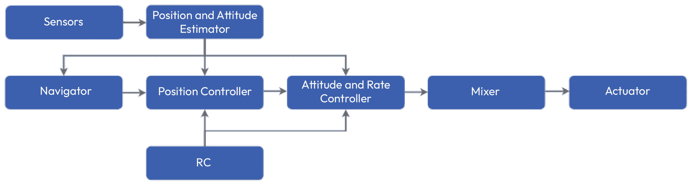

## 第 6 章：无人机固件与飞行栈简介

在前几章中，我们了解了主要硬件和外围设备，以及有助于无人机控制、指令、制导和导航的各种传感器。这些是组装成我们称为无人机的系统硬件的机械和电子部件。但您知道，没有灵魂的硬件毫无用处，而无人机的灵魂就是无人机固件。为了整体控制或指挥无人机，我们需要称为 `GCS`（地面站）的软件，我们将在下一章简要研究它。

在本章中，我们将介绍固件的高层架构、它的需求、包含的内容，以及与其交互以构成无人机的软件。我们将涵盖以下主题，这将有助于我们更好地理解固件由什么组成以及我们将使用的其他有用库。

本章涵盖的主要主题如下：

*   固件简介
*   无人机固件简介
*   无人机飞行栈简介
*   PX4 飞行栈
*   ArduPilot 飞行栈

本章将更多地关注代码库的通用方面和结构，而不是完整的代码库。我们不会涵盖整个代码库及其开发过程，因为那将需要单独的一整章。相反，我们将着眼于哪些是基本部分以及完整的栈整体。

## 技术要求

在本章中，我们将关注架构和软件模块。了解 `C++` 或 `Python` 等编程语言、`VS` Code 或 Eclipse 等开发环境，以及 `Git` 和 `GitHub` 等版本控制系统将会有所帮助。

## 固件简介

固件是一种专门设计用于安装在嵌入式硬件上的特殊软件。固件的主要职责是控制和管理设备特定硬件组件的功能。固件存储在 `NVM`（非易失性存储器）中且具有持久性，这意味着即使关闭电源，它也能保留其编程。它充当硬件和高层软件之间的桥梁，促进通信并确保设备正常运行。

固件有多种类型，每种都针对其控制的设备或系统的特定需求量身定制。以下是不同类型的固件及其示例：

### BIOS/UEFI 固件

**描述**：`BIOS`（基本输入/输出系统）或 `UEFI`（统一可扩展固件接口）固件在计算机启动过程中初始化硬件组件。

**示例**：现代 PC 中的 `UEFI` 固件。

### 嵌入式固件

**描述**：用于嵌入式系统，如物联网设备、消费电子产品和工业机器，以控制特定硬件功能。

**示例**：管理温度控制和用户界面的智能恒温器中的固件。

### 引导加载程序固件


# 固件类型

## 引导加载程序固件

**描述**：负责在启动过程中将**操作系统 (OS)** 加载到内存中，执行系统检查，并提供基本配置。

**示例**：Linux 系统中的**统一引导加载程序 (GRUB)**。

## 外设固件

**描述**：控制打印机、摄像头、网络设备和其他外部设备等硬件外设的操作。

**示例**：管理打印任务、纸张处理和与计算机通信的打印机固件。

## 微控制器固件

**描述**：用于微控制器以管理输入/输出操作、与传感器和执行器交互，并执行特定任务。

**示例**：控制连接的传感器、LED 或电机的 `Arduino` 微控制器固件。

## 网络设备固件

**描述**：管理路由器、调制解调器和网络交换机中的网络协议、安全功能和与其他设备的通信。

**示例**：控制网络配置和安全设置的 Wi-Fi 路由器固件。

## 存储设备固件

**描述**：存在于硬盘驱动器和**固态硬盘 (SSD)** 等存储设备中，管理数据存储、检索和纠错。

**示例**：优化数据放置和磨损均衡算法的 SSD 固件。

## 汽车固件

**描述**：控制车辆中的各种系统，包括**发动机控制单元 (ECU)**、信息娱乐系统和安全功能。

**示例**：管理燃油喷射、点火时机和排放控制的汽车 ECU 固件。

## GPU 固件

**描述**：存在于**图形处理单元 (GPU)** 中，管理图形渲染、着色器执行和其他 GPU 特有功能。

**示例**：优化图形处理的 NVIDIA 或 AMD GPU 固件。

## 相机固件

**描述**：控制数码相机的操作，管理图像处理、对焦、曝光和其他相机特有功能。

**示例**：优化图像捕捉设置的单反相机固件。

# 固件组件及其作用

固件组件在控制和管理设备特定硬件功能方面发挥着关键作用。这些组件协同工作以确保设备正常运行。以下是关键固件组件及其作用：

## 引导加载程序

`Bootloader` 是设备上电时运行的初始固件。它执行硬件初始化和系统检查，并将操作系统或主固件加载到内存中。

## 内核或操作系统

在某些情况下，固件包含简化的操作系统或内核。该组件管理系统资源并为上层应用程序提供平台。

## 设备驱动程序

`设备驱动程序` 促进操作系统或应用软件与特定硬件组件之间的通信。它们实现对传感器、外设或通信接口等功能的控制和利用。

## 应用代码

这是定义设备主要功能的主程序或程序集。它处理数据处理、用户界面控制和与外部设备交互等特定任务。

## 配置设置

固件通常包含可自定义的设置和配置，以使设备适应不同的环境或用户偏好。这些设置可能影响性能、功耗或通信参数等方面。

## 安全功能

许多固件实现包含安全功能，以防止未经授权的访问、数据泄露或其他潜在威胁。安全措施可能包括加密、访问控制和安全启动机制。

## 启动配置

固件管理启动配置，指定可启动设备的顺序和来源。这包括启动顺序、启动设备优先级和启动超时值等设置。

## 更新机制

固件包含用于更新其代码以修复错误、提高性能和添加新功能的机制。这些更新过程可能涉及 `FOTA`（空中下载固件）更新或通过物理连接刷写新固件。

## 错误处理和日志记录

固件包含检测和处理运行期间可能发生错误的机制。它可能记录错误信息用于调试，或向用户提供关于系统状态的反馈。

## 中断服务程序 (ISR)

在实时系统中，固件包含处理硬件事件产生的中断的 `ISR`（中断服务程序）。这些程序确保及时响应关键事件并有助于维持系统稳定性。

## 电源管理

对于有功耗限制的设备，固件包含电源管理功能以优化能源使用。这可能涉及控制睡眠模式、调整时钟频率或选择性地激活/停用组件。

## 内存管理

固件高效管理内存以最小化资源使用并防止内存泄漏或碎片化等问题。它根据不同任务的需要分配和释放内存。

# 固件示例

让我们考虑一个用 C 语言编写的简单固件代码示例，用于控制 LED 的假设嵌入式系统。此示例使用流行的微控制器 `Arduino` 及其开发环境：

```cpp
// LED Blinking Firmware for Arduino
// Define the pin connected to the LED
#define LED_PIN 13

void setup() {
  // Initialize the LED pin as an output
  pinMode(LED_PIN, OUTPUT);
}

void loop() {
  // Turn the LED on
  digitalWrite(LED_PIN, HIGH);
  delay(1000); // Wait for 1 second
  // Turn the LED off
  digitalWrite(LED_PIN, LOW);
  delay(1000); // Wait for 1 second
}
```

在此示例中，固件代码使用 `Arduino` 框架控制 LED 的状态。`setup()` 函数将连接到 LED 的引脚初始化为输出，`loop()` 函数使用 `digitalWrite()`、`HIGH`、`LOW` 和 `delay()` 重复以一秒间隔开关 LED。

# 用于开发固件的工具

以下是用于开发固件的工具：

## 集成开发环境 (IDE)

**作用**：IDE 提供了一个用于编写、编译和将固件代码上传到目标微控制器的平台。

**示例**：`Arduino IDE`、`MPLAB X`、`Keil µVision` 和 `PlatformIO`。

## 编译器

**作用**：编译器将开发人员编写的高级固件代码转换为特定微控制器的机器可读指令。

**示例**：`GCC`、`Keil` 和 `MPLAB XC`。

## 调试器

**作用**：调试器通过允许开发人员检查变量、设置断点和单步执行代码，促进固件的调试和测试。

**示例**：在线调试器和 `JTAG` 调试器。

## 编程器/调试器硬件

**作用**：编程器/调试器硬件将开发环境连接到目标微控制器，允许代码上传、调试和在线编程。

**示例**：`JTAG` 编程器、`USBasp` 和 `ST-LINK`。

## 微控制器开发板

**作用**：微控制器开发板提供了一个包含必要硬件组件（微控制器、输入/输出引脚和电源）的平台，用于测试和运行固件。

**示例**：`Arduino` 开发板、`STM32 Nucleo` 开发板和 `PIC` 开发板。

## 示波器/逻辑分析仪

**作用**：用于硬件级调试、信号完整性分析和数字通信协议（如 SPI、I2C、UART）的时序验证。


**角色**：示波器/逻辑分析仪有助于分析和调试电路中各点的电信号，这对于优化时序和诊断问题非常有用。

**示例**：Saleae Logic 和 Rigol 示波器。

*   **文本编辑器/IDE 扩展**：

    **角色**：开发人员通常使用文本编辑器或 IDE 扩展来增强编码体验，例如语法高亮和代码补全等功能。

    **示例**：VS Code 和 Sublime Text。

*   **版本控制系统**：

    **角色**：版本控制系统管理版本控制和协作开发，允许多个开发人员同时处理固件代码。

    **示例**：Git 和 SVN。

*   **仿真与模拟工具**：

    **角色**：仿真与模拟工具在虚拟平台上模拟固件的行为，有助于在部署到物理硬件之前进行测试和调试。

    **示例**：Proteus 和 QEMU。

*   **文档工具**：

    **角色**：文档工具为固件代码生成文档，使开发人员更容易理解和维护代码库。

    **示例**：Doxygen 和 Javadoc。

我们现在已经看到了固件和开发工具的示例。对于您想要开发和安装的任何类型的软件和固件，这些工具都是相同的。

# 软件与固件的区别

固件和软件代表计算机程序的两个不同类别，它们在范围和功能上有关键区别。固件是一种与嵌入式设备硬件紧密相关的专用软件类型。它驻留在 NVM（非易失性存储器）中，对特定硬件组件提供底层控制。值得注意的是，即使设备断电，固件依然存在，并负责设备的初始化和管理。相比之下，软件涵盖在计算机系统中运行的更广泛程序范围，通过操作系统与硬件交互。与固件不同，软件通常加载到易失性存储器中，并且不在断电周期中持久化。软件提供广泛的定制选项，通常更容易更新，并且在开发时侧重于高级编程语言。总之，固件与硬件紧密相连，提供基础控制；而软件在更高层级运行，在计算环境中提供多样化的应用和功能。

以下是代码和架构层面软件与固件对比的表格展示：

| **方面** | **软件** | **固件** |
| --- | --- | --- |
| **执行环境** | 通常运行在通用处理器上 | 运行在专用处理器或微控制器上 |
| **编程语言** | 高级语言（C++、Java、Python 等） | 低级语言（C 和汇编） |
| **内存使用** | 大量利用 RAM 和其他易失性内存 | 设计上尽量减少 RAM 使用；通常使用 Flash 存储器 |
| **实时约束** | 可能没有严格的实时约束 | 通常需要遵守实时约束 |
| **错误处理** | 倾向于依赖异常和错误检查机制 | 由于资源限制，可能使用更简单的错误处理机制 |
| **硬件交互** | 主要依赖操作系统 API 进行硬件访问 | 直接与特定硬件组件和外设交互 |
| **抽象层级** | 在较高抽象层级运行 | 在较低层级运行，更接近硬件 |
| **资源优化** | 强调性能和资源效率的优化 | 鉴于硬件限制，优先考虑资源效率 |
| **开发环境** | 使用通用开发工具和环境进行开发 | 通常需要专用开发工具和针对硬件的特定考量 |
| **可移植性** | 可在不同硬件平台间更好地移植 | 特定于硬件架构，移植时可能需要修改 |
| **代码示例** | ```python\nprint("Hello, World!")\n``` | ```c\nint main() {\n    printf("Hello, World!");\n    return 0;\n}\n``` |

表 6.1 – 软件与固件的对比

我们现在已经了解了软件和固件的区别、它们的角色以及开发所需的工具。在下一节中，我们将继续探讨无人机中使用的固件。

# 无人机固件简介

无人机固件是专门设计用于控制**无人驾驶飞行器（UAV）**，即常说的无人机的飞行、导航和整体操作的专用软件。它在管理无人机的硬件组件、处理传感器数据、执行控制算法以及确保稳定灵敏的飞行方面发挥着重要作用。无人机固件的独特之处在于它解决了航空飞行器特有的挑战和需求，提供对电机输出、姿态、高度和位置等各个方面的控制。

## 它与通用固件有何不同

虽然通用固件是指控制电子设备操作的软件，但无人机固件是针对无人飞行系统的特定需求量身定制的。

主要区别包括以下几点：

*   **控制复杂性**：无人机固件包含复杂的控制算法，用于管理飞行动力学、稳定性和导航，这些在通用固件中通常不存在。

*   **传感器融合**：无人机依赖各种传感器（加速度计、陀螺仪、气压计和 GPS）来维持稳定飞行。无人机固件旨在集成和处理来自这些传感器的数据，以实现精确控制。

*   **导航与自主性**：与许多通用固件不同，无人机固件通常包含自主飞行、航点导航和避障等功能。

*   **实时操作**：无人机需要实时响应以在飞行中保持稳定。无人机固件针对低延迟操作进行了优化，确保快速而精确的调整。

## 无人机固件的结构

无人机固件的结构旨在处理飞行控制、传感器集成、通信和用户定制的不同方面。

多旋翼飞行器中的固件架构是一个复杂的系统，旨在控制和管理飞行器飞行的各个方面。以下是固件架构中各组件及其角色的详细说明：

*   **主控制循环**：

    *   **角色**：控制多旋翼整体飞行行为的核心控制循环

    *   **组件**：

        *   **传感器**：采集加速度、角速度和高度等数据

        *   **飞行控制器**：处理传感器数据，执行控制算法，生成电机指令

        *   **执行器（电机）**：响应电机指令，影响多旋翼的运动

*   **传感器集成与融合**：

    *   **角色**：采集并融合来自多个传感器的数据，以建立对多旋翼状态的全面理解

    *   **组件**：

        *   **惯性测量单元 (IMU)**：融合加速度计和陀螺仪数据以确定姿态

        *   **气压计**：测量大气压力以估算高度

        *   **GPS 接收机**：提供全球定位数据，用于导航和定点悬停

*   **姿态控制器**：

    *   **角色**：维持多旋翼的期望姿态（横滚、俯仰和偏航）

    *   **组件**：

        *   **比例-积分-微分 (PID) 控制器**：根据期望姿态与实际姿态的差异调整电机输出

*   **高度控制器**：

    *   **角色**：管理多旋翼飞行过程中的高度


# 固件架构

## 组件

### PID 控制器
调节电机输出以控制多旋翼的垂直位置。

### 位置控制器
**角色**：控制多旋翼在空间中的位置，特别是在水平方向上。

**组件**：
- **PID 控制器**：根据期望位置与实际位置的差异调整电机输出。

### 导航与航点处理
**角色**：通过处理 GPS 数据并遵循预定义航点，实现自主飞行。

**组件**：
- **导航算法**：根据 GPS 坐标确定最优路径。
- **航点管理器**：协调多旋翼的运动以遵循预定义路线。

### 通信接口
**角色**：促进多旋翼与外部设备（如地面站或遥控器）之间的通信。

**组件**：
- **遥测系统**：将实时飞行数据发送至地面控制。
- **无线电接收机**：接收来自遥控器的用户输入。

### 电源管理
**角色**：监控和管理电源系统，包括电池电压和电流。

**组件**：
- **电池监控器**：确保电池安全使用并提供低电量警告。

### 电机与 ESC 接口
**角色**：将飞行控制器生成的电机指令转换为 **电子调速器 (ESC)** 和电机的特定信号。

**组件**：
- **脉宽调制 (PWM) 发生器**：根据控制输入生成 ESC 信号。

### 配置与设置
**角色**：允许用户自定义多旋翼行为的参数和设置。

**组件**：
- **配置存储**：保存用户定义的设置以供未来飞行使用。

### 飞行日志
**角色**：记录飞行数据以供分析和故障排除。

**组件**：
- **数据记录器**：在飞行过程中捕获传感器读数、控制输入和其他参数。

## 主控制循环
该固件架构在一个连续循环中运行，主控制循环协调各个组件之间的交互。传感器、控制器和通信接口的集成确保多旋翼能够实现稳定飞行、响应用户输入，并在需要时执行自主任务。先进的固件架构可能包含用于避障、计算机视觉或其他专用功能的额外组件。

# 无人机飞行栈简介

飞行栈是控制无人机飞行的软件组件集合。因此，我们可以说开源飞行栈是指其软件组件的源代码公开可用，供公众使用、查看、修改和分发，以增强公共协作和联合开发。另一方面，专有无人机飞行栈是由特定公司或实体开发并拥有的，其源代码不公开供查看、修改和分发。

接下来，我们将探讨开源与闭源飞行栈的主要区别，以便更好地理解。

## 开源无人机飞行栈

### 源代码
开源无人机飞行栈的源代码免费向公众开放，允许任何人查看、修改和分发代码。

### 协作
广泛的社区开发者为开源项目做出贡献，鼓励社区协作，从而实现快速开发、错误修复和新功能开发。

### 概念理解
访问开源项目的源代码有助于用户理解软件栈如何协同工作。用户可以审查代码，从而增加信任度和安全性。

### 修改
用户可以舒适地修改源代码以满足其特定需求或开发新功能。这种灵活性对研究人员、爱好者以及有独特实验和测试的组织大有裨益。

### 价格
开源软件免费使用。用户可以下载、使用和修改软件，无需支付许可费。

### 示例
- **PX4 Autopilot**：PX4 是由 Dronecode 项目维护的开源项目，拥有来自全球开发者社区的贡献。
- **ArduPilot**：ArduPilot 是一个开源项目，拥有来自全球多元化开发者社区的贡献。
- **Paparazzi UAV**：Paparazzi UAV 是由研究人员、学生和爱好者组成的社区开发的开源项目。
- **DroneKit**：DroneKit 是由 **3D Robotics (3DR)** 和社区开发的开源项目。

## 闭源（专有）无人机飞行栈

### 源代码可用性
闭源无人机飞行栈的源代码不公开可用。它由特定公司或实体拥有，属于专有，提供知识产权保护。

### 控制
拥有闭源栈的公司对开发、更新和功能发布拥有完全控制权。用户依赖公司提供支持和更新。

### 有限协作
社区协作有限，主要开发由拥有专有栈的公司内部开发团队执行。通常不接受来自更广泛社区的外部贡献。

### 支持
闭源解决方案的用户对公司的依赖性增加。更新和新功能根据公司的时间表提供。

### 价格
闭源解决方案需要支付许可费；用户可能需要为软件和任何额外功能付费，持续的支持服务可能产生额外费用。

### 示例
- **DJI 飞行栈 (DJI SDK)**：作为领先的无人机制造商，DJI 为其无人机开发专有飞行栈。DJI **软件开发工具包 (SDK)** 可供开发者在 DJI 的飞行控制系统之上构建应用程序。
- **Yuneec 飞行栈**：Yuneec International 是一家无人机制造商，为其无人机开发专有飞行栈。
- **Autel Robotics 飞行栈**：Autel Robotics 是另一家无人机制造商，为其无人机开发专有飞行栈。

## 飞行栈对比

| 功能/方面 | ArduPilot | PX4 | INAV | DroneKit | Paparazzi |
| --- | --- | --- | --- | --- | --- |
| 架构 | C++ 和脚本语言 (APL) 的混合 | 带 NuttX 实时操作系统的 C/C++ | 主要为 C 语言，专为固定翼设计 | Python SDK，通过 MAVLink 通信 | C 和 Python 脚本的混合 |
| 中间件 | 机器人操作系统 (ROS) | 微对象请求代理 (uORB) | 无特定中间件，依赖标准库 | 用于通信的 MAVLink | 自定义中间件 |
| 通信协议 | MAVLink | MAVLink | MAVLink | MAVLink | 自定义 (UDP、串口或以太网) |
| 主要语言 | C++ | C/C++ | C | Python | C 或 Python |
| 许可证 | GPLv3 | BSD 3-clause license | GPLv3 | Apache 2.0 | GPLv2 |
| 实时支持 | 有限 | 是 | 否 | 否 | 有限 |
| 任务规划工具 | Mission Planner, APM Planner | QGroundControl, MAVSDK | INAV Configurator | 自定义脚本, QGroundControl 支持 | Paparazzi 地面站 |


## 飞行栈对比

| 功能 | 栈 1 (ArduPilot) | 栈 2 (PX4) | 栈 3 (INAV) | 栈 4 (DroneKit/MAVLink) | 栈 5 (Paparazzi) |
| :--- | :--- | :--- | :--- | :--- | :--- |
| **API 可用性** | 丰富的 API，用于定制和集成 | 广泛的 API，用于定制和集成 | 有限的 API，用于自定义脚本和模块 | 用于 `Python` 脚本的 `DroneKit` API | 有限的定制 API |
| **飞行模式** | 多功能，支持多种飞行模式 | 丰富的飞行模式列表 | 专注于 GPS 辅助导航和稳定 | 取决于用于飞行控制的 API | 模式有限，可通过脚本定制 |
| **社区与支持** | 庞大、活跃的社区 | 活跃的社区 | 活跃的社区 | 中等规模社区 | 活跃的社区 |
| **文档质量** | 详尽的文档，用户友好 | 全面的文档，开发者友好 | 良好的文档，用户友好 | 一般的文档 | 文档有限，学习曲线陡峭 |
| **自主功能** | 丰富的自主功能和任务 | 功能丰富，注重通用性和模块化 | 主要为导航设计，较少关注自主任务 | 提供用于无人机控制和遥测的 API | 基础自主功能，侧重固定翼无人机 |
| **易用性** | 用户友好界面，功能强大的 `Mission Planner` | 用户友好界面，`QGroundControl` | 用户友好界面，配置相对简单 | 需要编程技能和 `Python` 知识 | 设置复杂，学习曲线陡峭 |
| **硬件兼容性** | 广泛的硬件支持，适用于各种自驾仪板卡 | 广泛的硬件支持，适用于各种自驾仪板卡 | 仅限于特定板卡 | 兼容各种无人机和硬件 | 硬件兼容性有限 |
| **定制选项** | 高度可定制，参数丰富 | 高度可定制，模块化是关键特性 | 定制选项有限 | 通过 `Python` 脚本定制 | 通过 `C` 和 `XML` 配置文件定制 |
| **地面站软件** | `Mission Planner`，`APM Planner` | `QGroundControl`，`MAVSDK` | `INAV Configurator` | 支持 `MAVLink` 的各种地面站软件 | `Paparazzi ground segment` |

表 6.2 – 不同飞行栈的对比

在接下来的几个小节中，我们将了解无人机固件以及当今无人机中广泛使用的固件栈。一些固件栈是开源的，这意味着它们免费使用且任何人都可以修改，而另一些则是闭源的——即它们是公司创建者的专有财产，不能由公众自由使用。让我们继续来看看这些。

### 基本 PX4 控制器环路图

下图是一个使用 PX4 自驾仪栈的无人机环路图，它展示了无人机不同软硬件组件之间的相互关联，无人机正是基于这些组件工作的。



图 6.1 – PX4 环路图

我们将详细了解各个阶段，如下所示：

*   **传感器**：正如我们之前讨论的，传感器嵌入在飞行控制器和外围设备中，例如 GPS 指南针，它帮助无人机获取其 GPS 位置以及速度、线速度和角速度，这些由位置和姿态估计器引导。

*   **位置和姿态估计器**：PX4 中的位置和姿态估计器，特别是 `Extended Kalman Filter 2` (`EKF2`)，在飞行过程中确定无人机的位置和方向方面起着关键作用。`EKF2` 位置估计器利用来自各种传感器的数据，包括 `GPS`、加速度计、陀螺仪、磁力计和气压计，来估计无人机的 3D 位置（纬度、经度和高度）和速度。同时，姿态估计器利用陀螺仪和加速度计的数据，并结合磁力计数据以改进偏航估计，来确定无人机的姿态，即横滚、俯仰和偏航角。这些估计器利用传感器融合技术来减轻噪声和不准确性，提供自适应能力以适应无人机动力学或传感器特性的变化。用户可以配置参数，根据特定的无人机和传感器设置优化这些估计器的性能，确保在 PX4 软件栈中实现精确可靠的飞行控制。

*   **位置控制器**：位置控制器是多旋翼的重要组件，负责在飞行过程中保持期望位置并在航点间导航。在定点悬停中，位置控制器确保多旋翼保持在指定位置，主动调整电机输出以抵消外部干扰并保持稳定位置。对于航点导航，位置控制器引导多旋翼沿预定义路径飞行，解析 GPS 坐标并调整电机指令以通过一系列航点。通过结合传感器数据、GPS 信息和控制算法，位置控制器实现精确的定点悬停和准确的航点导航，有助于多旋翼在任务期间的整体稳定性和自主性。

*   **导航器**：PX4 无人机固件中的导航器作为一个关键模块，负责任务规划、路径跟踪和航点导航。它解析高层指令，如航点或电子围栏，并将其转化为位置控制器的可执行指令。通过结合 GPS 数据和传感器测量值，导航器协助位置控制器精确引导无人机沿其指定轨迹飞行。它向位置控制器提供关键信息，使无人机能够自主通过预定义的航点序列或保持固定位置，确保任务计划的准确可靠执行。导航器充当任务指令与底层控制之间的桥梁，增强了无人机在 PX4 固件中的整体自主性和导航能力。

*   **姿态和速率控制器**：在 PX4 中，姿态控制器是负责维持无人机期望方向的关键组件，涵盖横滚、俯仰和偏航角。这些控制器通常使用 `PID` 算法实现，持续调整电机输出以最小化无人机当前姿态与期望设定点之间的差异。另一方面，速率控制器专注于控制无人机绕其三个轴的旋转速率。通过使用陀螺仪的数据，它们生成指令以稳定和控制旋转运动。例如，如果无人机经历意外的横滚，姿态控制器将采取行动进行修正，而速率控制器将管理旋转速度以确保平滑调整。这些控制器协同工作，有助于无人机在各种飞行条件下的稳定性和响应性。

*   **混控器**：混控器是一种控制算法，它接收来自姿态和位置控制器的指令，并驱动执行器达到所需的速度和位置。

*   **执行器**：PX4 中的执行器在将飞行控制器的控制指令转化为无人机电机的物理运动方面起着关键作用。这些组件将飞行控制器产生的电子信号转换为机械动作，直接影响电机的转速或调整固定翼飞机的控制面。例如，在四旋翼中，执行器响应来自姿态和速率控制器的指令，修改每个电机的推力输出以实现期望的俯仰、横滚和偏航运动。执行器的有效性对于执行精确和响应迅速的机动至关重要，有助于无人机在 PX4 固件生态系统中的整体稳定性和控制。


# PX4 飞行栈

RC 用于飞行员对无人机的手动控制。RC 的使用会启动辅助驾驶模式来飞行无人机，例如高度模式和位置模式。这是飞行员向无人机发出飞行指令的地方，位置控制器将根据 RC 给出的指令进行相应行为。

我们已经看过一个高层环路图，展示了在手动或自动任务的给定场景中，控制器如何使用传感器数据来驱动执行器。它演示了固件中不同控制器（如位置、姿态和速率控制器）如何在环路中协同工作，以向执行器提供准确且实时的信息。它以反馈机制运行，其中输出也作为输入，且输入依赖于输出。

PX4 飞行栈是一个通用且强大的自动驾驶栈，可用于控制多种不同类型的无人驾驶载具，包括固定翼和多旋翼，以及地面载具（如探测车）和水下载具（如潜艇）。由于其飞行控制器传感器和其他外围设备，该开源固件兼容众多飞行控制器硬件，其中包含高级飞行模式和安全功能。完整的用户和开发者文档可在网站上找到：`https://px4.io/`。

如果我们谈论 PX4 的架构，它本质上相当冗长且相互关联，这可以在图 6.2 中看到。PX4 飞行控制器的主要部分是其控制器模块，由其机器的当前状态管理。架构分为四大部分，即 **存储**、**驱动**、**外部连接** 和 **飞行控制**，它们进一步细分为接下来列出的模块和子模块。


图 6.2 – PX4 飞行栈高层架构图

让我们浏览飞行栈架构的不同部分，以了解每个组件的作用：

## 存储

存储是飞行栈的关键元素，用于在配置和任务期间存储完整飞行栈的关键参数。这些存储机制共同确保关键数据可用于飞行操作、固件更新和飞行后分析。我们还可以看到飞行栈不同方面之间的互联及其相互依赖性。飞行控制器中可用的各种存储类型如下：

### NVM

这种存储类型在断电后仍能保留数据。它通常存储固件、配置参数和关键飞行日志。

### MicroSD 卡

无人机通常使用 MicroSD 卡作为额外存储。这可以包括高分辨率传感器数据、详细飞行日志和其他特定任务信息。

### 板载内存

飞行控制器拥有板载内存，用于存储固件、配置设置以及飞行操作期间的临时数据。

## 飞行日志

飞行日志包含无人机飞行的详细记录，包括传感器数据、GPS 信息、控制输入和系统状态。这些日志对于无人机操作中的飞行后分析、故障排查和性能优化至关重要。

## 外部连接

外部连接是指飞行控制器通过其与外部接口（如 GCS）交互的双向消息。外部连接是指无人机通过连接通道进行的连接，例如通过名为 MAVLink 的协议进行无线电遥测。这有助于 GCS 配置无人机并对其进行命令和控制，例如规划和执行任务。外部连接通过两种基本协议建立：

### MAVLink

**MAVLink** 是用于无人系统的 **微型飞行器** 协议，充当无人机和 GCS 之间的通信桥梁。其接口的特点是轻量级的二进制数据包结构，允许高效的数据传输。MAVLink 采用发布-订阅模型，允许你订阅相关消息或发布信息，从而实现无缝且模块化的通信。该协议支持串口链路、使用 TCP/UDP 的网络连接，以及使用 UART 协议的无线电链路，以建立无人机和 GCS 之间的连接。当无人机连接到 GCS 时，我们将在 GCS 部分介绍此方法。

### Fast RTPS

**Fast RTPS**，即 **快速实时发布-订阅**，就像无人机的高速通信超级英雄。它帮助无人机及其外设快速可靠地相互通信。Fast RTPS 确保通信瞬间完成，这对于无人机快速导航和响应命令至关重要。它使用多种连接类型（如有线或无线链路）连接无人机的各个部分，例如大脑（飞行控制器）和眼睛（传感器）。

下表展示了 MAVLink 和 Fast RTPS 在技术差异和用法方面的对比：

| 特性/方面 | MAVLink | Fast RTPS |
| --- | --- | --- |
| 通信协议 | 面向 UAV 的轻量级消息协议 | 面向实时系统的通用中间件 |
| 使用领域 | 主要设计用于 UAV 组件与 GCS 之间的通信 | 适用于机器人、物联网和工业自动化等各种实时系统的通用中间件 |
| 数据序列化 | 高效二进制序列化 | XML 或二进制序列化，可定制 |
| 传输层 | 支持多种传输层，包括串口、UDP 和 TCP | 支持通过 UDP、TCP、共享内存和串口链路传输 |
| 发布-订阅模型 | 利用发布-订阅进行消息分发 | 遵循发布-订阅通信范式，允许单个主题有多个订阅者 |
| 服务质量 (QoS) | 有限的 QoS 功能，基本消息可靠性 | 高级 QoS 功能，包括可靠性、持久性和历史管理 |
| 中间件目的 | 专为 UAV 生态系统设计，特别是在开源无人机社区 | 通用中间件，适用于除 UAV 之外的广泛实时应用 |
| 社区支持 | 在无人机和机器人社区拥有广泛的社区支持 | 在各行业广泛使用，获得 Eclipse 基金会的强力支持 |
| 协议开销 | 轻量级，协议开销极小 | 功能更全面的协议，具有额外功能，导致开销略高 |
| 实现语言 | 主要用 C 实现，带有一些语言绑定 | 用 C++ 实现，提供 C、Java 等语言绑定 |
| 示例实现 | ArduPilot, PX4 | 机器人操作系统 2 (ROS 2), eProsima Fast RTPS |

表 6.3 – MAVLink 与 Fast RTPS 的对比

虽然 MAVLink 和 Fast RTPS 都可用于机器人和 UAV 应用，但 MAVLink 专门针对 UAV 组件之间的轻量级通信进行了定制，而 Fast RTPS 是一种具有更高级功能的通用中间件，适用于更广泛的实时系统。

## 驱动

在 PX4 中，驱动是与飞行控制器和各种硬件外设及传感器之间通信进行接口和管理的软件组件。这些驱动对于将不同的传感器和执行器集成到 PX4 生态系统中至关重要。它们提供了一个抽象层，使飞行控制器能够与硬件组件通信，而无需直接处理其具体细节。


# PX4 飞行栈

## PX4 驱动程序

PX4 驱动程序通常由 PX4 社区编写，该社区包括正在从事开源项目工作的开发者、贡献者和爱好者。他们为各种传感器的驱动程序开发做出贡献，例如加速度计、陀螺仪、磁力计、气压计、GPS 模块、相机和激光雷达。

这些驱动程序用于各种 PX4 支持的飞行器，包括多旋翼、固定翼飞机和其他无人系统。它们的主要目的是使飞行控制器能够访问和利用来自不同传感器的数据并控制执行器，以确保稳定可控的飞行。

### PX4 驱动程序示例

*   **`I2C` 和 `SPI` 驱动程序**：这些驱动程序促进了与使用 `I2C` 和 `SPI` 协议的传感器和外设的通信。
*   **`IMU` 驱动程序**：负责与加速度计、陀螺仪和磁力计接口以获取姿态和运动数据。
*   **`GPS` 驱动程序**：支持与 GPS 模块通信以收集精确的位置和速度信息。
*   **`PWM` 驱动程序**：用于控制舵机、电调 (ESC) 和其他执行器。
*   **模数转换器 (`ADC`) 驱动程序**：与模拟传感器接口，将模拟信号转换为数字数据。

## 飞行控制

在 PX4 飞行控制架构中，模块代表协同管理无人机 (UAV) 操作各个方面的不同软件组件。这些模块协同工作，以确保采用全面且模块化的方法进行飞行控制。关键模块包括指挥官，负责解释高层命令和用户输入；导航器，管理任务规划、航点导航和飞行中的决策；以及估计器模块 (`EKF2`)，利用 `EKF` 基于传感器数据估计无人机的位置、速度和姿态。此外，姿态和速率控制器在稳定无人机方面发挥着关键作用，而执行器将控制命令转化为物理运动。传感器、混控器和 GPS 模块有助于数据采集、控制信号生成和精确导航。这些模块之间的相互作用定义了 PX4 飞行控制系统，确保了一个稳健且灵活的平台，适用于各种无人机应用。

## 结论

总之，PX4 飞行栈代表了一个用于无人机控制的稳健且模块化的框架。凭借多样化的模块阵列，PX4 确保了精确的飞行控制、自主导航和对各种硬件设置的适应性。作为一个开源平台，它依靠社区贡献蓬勃发展，使其成为无人机爱好者和开发者的动态且持续演进的解决方案。探索 PX4 飞行栈可全面了解现代无人机控制系统背后的复杂性。

# ArduPilot 飞行栈

ArduPilot 飞行栈是一个开源自动驾驶软件套件，旨在控制无人机。由全球社区开发，ArduPilot 支持多种飞行器，包括多旋翼、固定翼飞机、直升机、地面无人车和船只。ArduPilot 包含硬件和软件组件，为无人机爱好者、研究人员和商业应用提供完整的解决方案。

虽然 ArduPilot 与 PX4 飞行栈有相似之处，但它们在设计理念和架构上存在关键差异。ArduPilot 的特点是单体架构，提供了一体化解决方案，其模块化组件比 PX4 少。它依赖于一个可适应各种飞行器类型的单一固件代码库。相比之下，PX4 遵循更模块化的面向微服务架构，允许更大的灵活性和对不同硬件及用例的适应性。在 ArduPilot 和 PX4 之间的选择通常取决于特定的项目需求、硬件兼容性和用户偏好。可在 [www.ardupilot.org](https://www.ardupilot.org) 进一步学习 ArduPilot。

## ArduPilot 飞行栈架构

高层架构的框图如下图所示。


图 6.3 – ArduPilot 高层架构图

ArduPilot 飞行控制架构的特点是单体设计，将各种组件集成到单一固件代码库中。该架构旨在支持多种无人机，包括多旋翼、固定翼飞机、直升机、地面无人车和船只。以下是 ArduPilot 架构中的关键组件及其角色：

*   **`ArduCopter`**：该模块负责多旋翼飞行器的控制和稳定，支持四轴、六轴和八轴等不同配置。
*   **`ArduPlane`**：专为固定翼飞机设计，`ArduPlane` 处理各类飞机的飞行控制、导航和任务规划。
*   **`ArduRover`**：面向地面载具，`ArduRover` 为陆地无人机（包括无人车和船只）提供控制和导航能力。
*   **通用代码库**：ArduPilot 维护一个支持各种飞行器类型的通用代码库。这种集成方法简化了开发和固件更新。
*   **硬件抽象层 (`HAL`)**：ArduPilot 中的 `HAL` 抽象了底层硬件，使固件能轻松移植到不同的自动驾驶板上。
*   **`AP_Motors` 模块**：该模块管理电机输出和控制信号，确保不同飞行器类型的正确驱动。
*   **`AP_Notify` 模块**：负责系统通知，`AP_Notify` 有助于向用户或地面站 (GCS) 提供状态更新和警告。
*   **`AP_Mission` 模块**：任务规划和执行由 `AP_Mission` 模块处理，支持自主航点导航和任务脚本编写。

虽然我们简要地看过了 ArduPilot 的结构，但让我们浏览一下前面的架构图，以简要了解各层级的主题。

### UI/API

UI/API 是指 ArduPilot 飞行栈接收命令的外部来源。UI/API 来源的一些示例如下：

*   **地面站**：此处提到的地面站是 `GCS` 软件，安装在笔记本电脑或平板电脑上，作为配置和指挥无人机的 UI。
*   **`DroneKit`**：`DroneKit` 是一个 Python API，帮助开发者开发应用程序通过通信层与无人机通信。`DroneKit` 帮助开发者开发轻量级应用程序向无人机传递特定命令，而非完整的 `GCS`。如果我们想通过开发板（如 `Raspberry Pi`）与固件通信，这些应用程序很有用。

### 通信层

通信层是飞行栈的一部分，有助于在 UI/API 和飞行控制器之间建立通信链路。`GCS` 正是通过这个通信层与无人机飞行代码进行通信的。

通信层的一个示例如下：

*   **`MAVLink`**：正如我们之前介绍的，`MAVLink` 是一种轻量级通信协议，有助于在 `GCS` 和无人机之间传输和接收命令。

### 飞行代码

ArduPilot 飞行代码是指运行在自动驾驶硬件上并控制无人机操作的固件。该代码用 `C++` 编写，包含适用于不同类型飞行器的广泛功能，包括多旋翼 (`ArduCopter`)、固定翼飞机 (`ArduPlane`)、地面无人车 (`ArduRover`) 和船只。以下是 ArduPilot 飞行代码的更多细节：


# 特定机型代码

ArduPilot 中的特定机型代码是指固件中针对不同类型无人飞行器的独特特性和需求量身定制的部分。ArduPilot 支持多种机型，包括多旋翼（ArduCopter）、固定翼飞机（ArduPlane）、地面无人车（ArduRover）和无人艇。每种机型都有其自身的动力学特性、控制机制和操作考量，因此需要特定的代码以确保最佳性能。

以下是 ArduPilot 中特定机型代码结构的概述：

## ArduCopter（多旋翼）

ArduCopter 代码包含特定于多旋翼飞行器的算法和控制逻辑。这涵盖了稳定、高度控制、GPS 导航，以及自动起飞和降落等功能。特定机型参数，如电机混控和控制增益，均在此部分定义。

## ArduPlane（固定翼飞机）

ArduPlane 代码专注于固定翼飞机的独特特性。它包含用于维持稳定飞行、航点导航和自动降落的算法。与空速控制、导航模式和舵机输出相关的参数均为固定翼飞行器量身定制。

## ArduRover（地面无人车）

ArduRover 代码专为地面载具（如无人车和汽车）设计。它包含转向、油门和制动的控制逻辑。导航功能（如航点跟随和避障）专门针对地面动力学特性。

## 艇艇和水面载具

对于艇艇和水面载具，代码解决了水上导航的挑战。这包括推进、转向和水面稳定性的控制。

# 共享库

ArduPilot 主要使用 C++ 编写，并采用模块化架构以增强代码的可复用性和可维护性。然而，传统软件开发中常见的共享库概念可能无法直接适用于 ArduPilot。相反，ArduPilot 使用带有库和模块的模块化方法。

在 ArduPilot 中，共享库或模块是指封装特定功能的可复用代码组件。这些模块被设计为独立且可互换的，允许开发者在现有代码基础上构建并添加新功能，而不影响整个系统。

# 硬件抽象层

ArduPilot 中的 HAL，称为 `AP_HAL`，是一个关键组件，它抽象并封装了硬件特定细节，使自驾仪软件能在不同的飞控硬件上无缝运行。`AP_HAL` 为访问外设、传感器、通信端口和其他硬件组件提供了标准化接口。通过采用 HAL，ArduPilot 实现了可移植性，使同一代码库能兼容各种自驾仪板卡。该抽象层简化了开发流程，因为开发者可以针对一致的 API 编写代码，而无需担心底层硬件的复杂性，从而促进了无人机系统设计的模块化和可扩展性方法。

# 操作系统

**Chibi 操作系统**（**ChibiOS**）是 ArduPilot 项目中使用的**实时操作系统**（**RTOS**）之一。ChibiOS 作为某些自驾仪板卡的底层操作系统发挥着关键作用，为任务管理、调度和底层硬件交互处理提供了框架。以下是 ChibiOS 在 ArduPilot 中作用的简要说明：

*   **RTOS 功能**：ChibiOS 是一个专为嵌入式系统设计的开源 RTOS，它提供了无人机应用所必需的实时能力。
*   它便于任务调度、中断处理和高效的资源管理，确保关键飞行控制过程的及时且确定性执行。
*   **硬件抽象**：ChibiOS 在 ArduPilot 中充当 HAL，使飞控代码能以一致的方式与各种传感器、外设和通信接口交互。
*   这种抽象简化了开发流程，并增强了跨不同自驾仪硬件的可移植性。
*   **并发与多线程**：ChibiOS 支持多任务并发执行，使自驾仪能同时处理多种操作。
*   这对于并发管理传感器读数、控制计算、通信和导航等任务至关重要。
*   **底层硬件交互**：ChibiOS 提供了用于与特定硬件组件（包括定时器、串口和 I2C 总线）交互的底层驱动和抽象。
*   这使 ArduPilot 开发者能在更高层级编写代码，而无需直接处理硬件寄存器和配置的复杂性。
*   **可移植性**：使用 ChibiOS 的主要优势之一是其跨不同微控制器架构的可移植性。
*   ArduPilot 可在各种自驾仪板卡上利用 ChibiOS，确保与多样化硬件平台的灵活性和兼容性。

# 外部传感器

在 ArduPilot 中，外部传感器是指可连接到自驾仪系统以增强其感知和数据收集能力的额外传感器。这些传感器可提供主飞控集成传感器之外的补充信息，从而实现更精确的导航、控制和决策。ArduPilot 中外部传感器的示例包括以下内容：

*   **激光雷达或激光测距仪**：激光雷达传感器常用于通过发射激光束并测量其返回时间来测量距离。
*   它们提供高精度高度信息，并协助地形跟随和避障。
*   例如 LightWare SF20 激光雷达。
*   **雷达高度计**：雷达高度计测量飞行器到地面的距离，对于精确的高度控制特别有用，尤其是在低空飞行期间。
*   它们有助于更安全的起降。
*   例如 TeraRanger Tower。
*   **光流传感器**：光流传感器利用视觉信息估算飞行器位置的变化。
*   它们在 GPS 信号可能不可靠的场景中很有用，例如室内环境或低空飞行期间。
*   例如 PX4Flow 光流传感器。
*   **GPS/指南针模块**：虽然 GPS 集成在许多飞控中，但带有集成指南针的外部 GPS 模块提供了冗余并提高了姿态估计的准确性。
*   例如 u-blox M8N GPS 模块。
*   **空速数据传感器**：这些传感器测量空速、气压和温度，为精确的高度控制和空速估计提供关键数据。
*   例如 MS5611 气压计。
*   **磁力计模块**：外部磁力计可用于获取更精确的指南针读数，减少机载其他电子设备磁干扰的影响。
*   例如 HMC5883L 磁力计。

# 总结

在本章中，我们浏览了不同的固件，涵盖了 PX4 和 ArduPilot 的结构与架构，这些固件将帮助您了解无人机飞行栈的构建模块。我们还参考了开源固件栈 PX4 和 ArduPilot，它们是无人机领域的领导者。

在下一章中，我们将了解地面站（GCS）及其操作，这将有助于配置无人机和执行自主任务。
