## 第 7 章：地面站软件简介

在本书的前几章中，我们学习了主要的无人系统、其子系统以及硬件侧的传感器。我们还学习了固件，它作为硬件和软件之间的纽带使系统运行，以及命令与控制软件的基础知识，称为地面控制软件，包括其不同的类型和用法。在本章中，我们将学习用于指挥、控制和设置无人机飞行的地面控制软件的深度用法。**地面控制站**（**GCS**）还用于在飞行期间传输和接收实时遥测数据，并在无人机以手动和自主模式飞行时监控其导航和传感器健康状况。我们将介绍不同种类的 GCS 系统，以及如何在 GCS 的帮助下控制和配置无人机。

在本章中，我们将涵盖以下主题，这些主题将帮助我们了解 GCS 及其在无人机中的用法。通过学习这些内容，你将能够在桌面端或移动端下载并安装 GCS，将其连接到你构建的无人机，对其进行配置，并以你想要的模式飞行。

以下是本章将涵盖的主要主题：

*   GCS 简介
*   市场上可用的主要 GCS 软件
*   AeroGCS 软件概览
*   连接无人机的方法
*   自主任务规划

# 技术要求

为了安装和运行所讨论的 GCS 软件，建议使用配备基于 x64 的 i5 1.9 GHz CPU 或更高配置、至少 30 GB 可用空间和 8 GB 内存的计算机/台式机。建议配备 1 GB 显卡和 `USB 2.0` 接口。我们将使用具有相同配置的笔记本电脑/台式机来下载和安装 GCS 软件。

计算机/笔记本电脑至少需要 `Windows 10` 或 `Ubuntu 20.xx LST` 版本。系统应具备 `LAN` 或 `Wi-Fi` 连接功能，以及 1,366 x 768 的横向分辨率。

如果你计划使用基于移动端的 `Android` 版本，则应具备 USB 网络共享功能或 Wi-Fi。

# GCS 简介

GCS 软件通过为用户提供统一的界面来与无人机交互和控制，在无人机运行中发挥着关键作用。作为操作员与飞行器之间的桥梁，GCS 软件实现了实时监控、任务规划和数据分析。这些应用程序是爱好者和专业人士的必备工具，提供了一个用户友好的平台来指挥和监督无人机的飞行。GCS 软件通常提供实时遥测、航点导航、相机控制以及可视化和分析飞行数据的能力。无论是对于娱乐无人机爱好者、研究人员还是商业无人机操作员，设计良好的 GCS 软件都能提升用户体验，确保无人机任务的安全、高效和可控。

市场上有各种类型的 GCS 软件可供选择，满足从爱好者到专业操作员等不同用户的需求。以下是一些常见类型：

*   **开源 GCS**：开源 GCS 软件免费提供，通常由无人机社区协作开发。它提供任务规划、遥测数据可视化和参数调整等功能。Mission Planner 常用于基于 `ArduPilot` 的无人机，而 QGroundControl 则流行于基于 PX4 的飞行器。

    **示例**：Mission Planner 和 QGroundControl。

*   **专有 GCS**：专有 GCS 解决方案由无人机制造商为其特定硬件开发。大疆的 GCS 软件，如 DJI GO 和 GS Pro，专为其无人机平台量身定制。这些应用程序通常与制造商的硬件无缝集成，并提供智能飞行模式和专业航拍工具等高级功能。

    **示例**：DJI GO 和 DJI GS Pro。

*   **基于云的 GCS**：基于云的 GCS 解决方案允许用户通过在线平台规划、监控和分析无人机任务。这些服务通常提供飞行日志记录、任务规划和数据分析等功能。例如，DroneDeploy 使用户能够规划飞行、获取航拍图像，并处理用于测绘和勘测应用的数据。

    **示例**：Airdata UAV 和 DroneDeploy。

*   **移动端 GCS 应用**：移动端 GCS 应用运行在智能手机或平板电脑上，为无人机操作员提供便携式解决方案。Litchi 为大疆无人机提供高级任务规划工具，而 PIX4Dcapture 专为测绘和摄影测量任务设计。这些应用通常具有直观的界面和实时遥测功能。

    **示例**：Litchi 和 PIX4Dcapture。

*   **企业级 GCS**：企业级 GCS 解决方案面向专业和工业无人机应用。它们通常包括高级任务规划工具、机队管理以及与其他企业系统的集成。例如，UgCS 支持多种无人机平台，并提供电子围栏和多飞行器协同等功能。

    **示例**：UgCS 和 PrecisionFlight。

*   **仿真 GCS**：仿真 GCS 工具允许用户在虚拟环境中练习和测试无人机任务。这些应用对于培训目的以及在实际飞行操作前优化任务计划非常有价值。

    **示例**：Mission Simulator。

因此，我们已经了解了不同类型的 GCS。在接下来的章节中，我们将研究市场上可用的各种 GCS。

# 市场上可用的主要 GCS 软件

在快速发展的无人机领域，复杂 GCS 软件的可用性已成为塑造无人机操作成功的关键因素。众多 GCS 解决方案面向从爱好者、发烧友到专业操作员和企业等多样化的用户群体。本概览将探讨市场上一些主要的 GCS 选项，每种选项都提供独特的功能和能力，以增强无人机任务的规划、控制和监控。

## Mission Planner 或 APM Planner

Mission Planner 或 APM Planner 是一款由开源无人机社区支持、Michael Oborne 开发的开源软件，专门用于搭载 `ArduPilot` 固件（`www.ardupilot.org`）的无人机。这款 GCS 功能强大，可配置用于固定翼、多旋翼和地面车。目前，该软件仅兼容 Windows，但通过安装名为 `mono` 的模块，也可配置到 Linux 机器上。

Mission Planner 可从 `https://firmware.ardupilot.org/Tools/MissionPlanner/MissionPlanner-latest.msi` 下载。

以下屏幕截图显示了 Mission Planner 的标准仪表板（主屏幕）：

图 7.1 – Mission Planner GCS 的仪表板（主屏幕）

### 主要功能

Mission Planner 是一款多功能的 GCS 软件，让你能完全控制你的系统，从配置和调参到飞行和调试。它提供了一系列额外的外设供你根据应用需求连接到无人机上，以便进行配置和测试。它主要专注于提供任务规划、飞行器监控和配置管理工具。以下是 Mission Planner 的一些常见功能：

*   **飞行规划**：它提供了通过指定航点、高度和其他参数来规划自主飞行任务的优势。可以在此基础上设计复杂的任务。

*   **实时遥测**：屏幕上可以看到实时遥测数据，包括飞行器的位置、高度、速度和传感器健康信息。这有助于用户在操作过程中监控其飞行器的状态。

# 地面控制站软件概览

## Mission Planner

Mission Planner 的主要功能包括：

*   **配置与校准**：用于配置和校准飞行器的各种参数，如无线电设置、电机和传感器校准以及其他硬件配置。
*   **数据记录**：支持飞行数据记录，用户可在任务结束后回顾和分析飞行器性能。这些数据对故障排查和提升飞行器能力至关重要。
*   **固件更新**：用户可通过 Mission Planner 更新飞行器固件，更新通常包含改进、错误修复和新功能。
*   **相机控制**：允许用户控制和配置搭载相机或云台的飞行器的相机设置，特别适用于航拍和测绘任务。
*   **电子围栏**：支持创建电子围栏，即限制飞行器移动的虚拟边界，确保飞行器停留在指定区域内。
*   **仿真**：用户可在虚拟环境中模拟任务，再在现实中执行。这有助于在不损坏飞行器的风险下测试和优化任务计划。仿真提供飞行器和环境的 2D 视图，并显示来自传感器的实时数据。
*   **手柄支持**：通常兼容手柄和其他输入设备，必要时可手动控制飞行器。
*   **任务分析**：任务结束后，用户可分析记录的数据，包括飞行路径、高度和其他相关信息，以评估任务成功程度并找出改进空间。

除上述关键功能外，Mission Planner 还提供无人机编队和 MAVLink 数据包签名等高级工具以增强安全性。该 GCS 软件在一处提供飞行日志和分析，无需第三方软件进行日志分析。

要了解 Mission Planner 的配置、设置和飞行规划，可查阅 ArduPilot 页面。

## QGroundControl

QGroundControl 是另一款知名 GCS，由开源无人机社区管理和开发，用于 PX4 和 ArduPilot 飞行器的全程飞行控制和设置。与其他 GCS 软件一样，QGroundControl 提供从固件安装到飞行记录和分析的完整车辆设置流程。QGC 兼容 Windows、Linux 和 Android，可从 <http://qgroundcontrol.com/> 下载。

QGroundControl 的基本原理与其他无人机系统相同：MAVLink 为通信协议，飞行栈为 ArduPilot 或 PX4。

QGroundControl 的主要功能包括：

*   支持任何支持 MAVLink 协议的飞行栈
*   提供系统的完整设置和配置
*   协助手动和自主飞行
*   支持 Bing 和 Google Maps 等多种地图用于任务规划
*   支持内置视频传输
*   兼容几乎所有操作系统
*   可用于测绘、监视和农业等多种应用

下图显示了 QGroundControl 站的仪表盘或主屏幕：

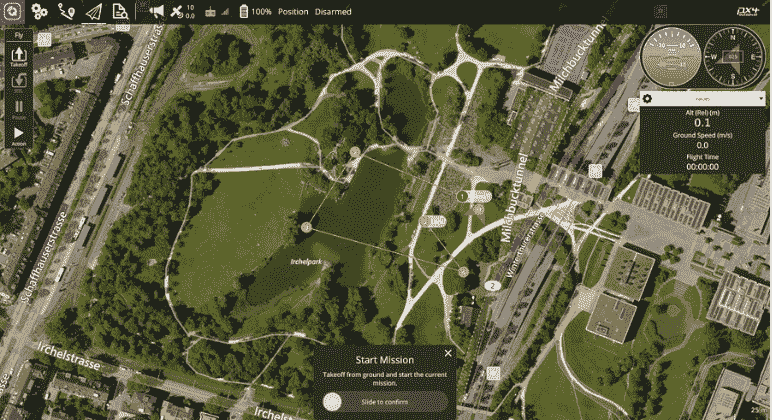

图 7.2 – QGroundControl 任务规划模式下的主屏幕

图中显示了飞行窗口和一个准备开始的计划任务。

## UgCS

UgCS 是一款用于不同类型无人机任务规划和执行的高级 GCS 软件。UgCS 非开源软件，而是需要许可证并按年收费的专有软件；但也提供功能受限的免费版本。该软件兼容 ArduPilot、PX4、DJI、Parrot 和 Autel 等多种飞行栈，因此支持多种类型的无人机。UgCS 兼容 Windows 和 macOS。

UgCS 可从 <https://www.sphengineering.com/support> 下载。

下图显示了 UgCS 任务规划软件，指示无人机系统健康状态、遥测数据和任务计划：

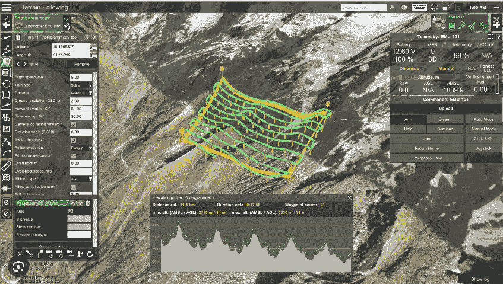

图 7.3 – UgCS 任务规划软件的屏幕截图

UgCS 具有独特功能、用户界面且操作简单，使其与其他控制站区别开来。其主要功能如下：

*   可创建线性或圆形航点，支持区域和周长扫描
*   支持 2D 和 3D 地图，便于任务视图和地形跟随
*   支持特定的 LiDAR 工具用于 LiDAR 传感器
*   支持多 SDK 连接以进行自定义开发
*   优秀的 3D 任务规划环境

以下是 Mission Planner、QGroundControl 和 UgCS 的简要对比表：

| 功能特性 | Mission Planner | QGroundControl | UgCS |
| --- | --- | --- | --- |
| 平台兼容性 | Windows（主要），可适配其他平台 | 跨平台（Windows、macOS、Linux 和 Android） | Windows、macOS 和各种 Linux 发行版 |
| 开发状态 | 社区驱动，在 GitHub 上积极维护 | 开源，由 PX4 社区积极开发 | 商业软件，提供更新和支持 |
| 集成 | 与 ArduPilot 固件相关联 | 基于 PX4 飞行栈开发，支持其他 | 兼容各种自动驾驶仪，包括 DJI |
| 自动驾驶仪支持 | 主要面向基于 ArduPilot 的飞行器 | 专为基于 PX4 的飞行器设计，支持其他 | 兼容广泛的自动驾驶仪 |
| 用户界面 | 具有各种工具的综合界面 | 用户友好，强调简洁性 | 直观的界面，平衡简洁性与深度 |
| 社区支持 | GitHub 上活跃的社区贡献 | 由 PX4 社区支持 | 商业软件，提供用户支持 |
| 高级功能 | 侧重任务规划、遥测、配置 | 平衡简洁性与高级功能 | 测绘和农业等高级功能 |
| 硬件支持 | 广泛支持，特别是基于 ArduPilot 的无人机 | 兼容多种自动驾驶仪 | 支持各种自动驾驶仪，包括 DJI 和 ArduPilot |
| 许可证 | 开源 (GPLv3) | 开源 (Apache 2.0) | 商业许可，提供免费版本 |
| 使用场景侧重 | 任务规划、遥测、配置 | 任务规划、遥测、仿真 | 专业应用、高级功能 |

表 7.1 – Mission Planner、QGroundControl 和 UgCS 的对比表

除上述 GCS 软件外，还有许多可用于指挥和控制无人机的软件，但我们仅选取这些软件进行基本概览，不作深入探讨。不过，这些软件的基本功能是相似的。在后续章节中，我们将深入了解另一款名为 AeroGCS 的专有 GCS，学习如何使用该软件设置和配置无人机。我们将把 AeroGCS 作为 GCS 进行研究，并学习如何配置无人机和规划成功的任务。

# AeroGCS 软件概览

# AeroGCS

AeroGCS 是由总部位于印度的 AeroGCS 公司开发的专有 GCS，用于无人机配置、驾驶、机群管理和无人机项目管理。该软件提供多个版本，可在笔记本电脑或手机上运行。AeroGCS 软件的优势在于它极大地帮助飞行员规划任务，并在基于云的环境中工作，随时随地提供数据访问。通过使用它，您可以将任务数据存储在云端，并监控不同无人机在不同项目上的协同工作。

与其他 GCS 软件一样，AeroGCS 有助于规划任务、设置参数，并对无人机拥有完整的指挥和控制权。AeroGCS 软件基于 MAVLink 协议；因此，它兼容 PX4、ArduPilot 或任何基于 MAVLink 的飞控栈。然而，由于 PX4 和 ArduPilot 飞控栈具有简洁性和丰富的用户界面，因此最受青睐。

要下载软件，请访问 `https://aeromegh.com/aerogcs-kea/`。

## AeroGCS 主仪表盘

仪表盘是主要的 AeroGCS 窗口，包含操作远程驾驶航空器所需的不同参数设置及其指定值和条件。图 7.4 显示了登录软件后看到的界面。现在，我们将浏览仪表盘上用于处理无人机操作的不同快捷方式以及各种信息。

图 7.4 – AeroGCS 仪表盘

右上角的顶栏如下所示：

图 7.5 – AeroGCS 仪表盘中的顶栏选项

各项如下：

1.  **云同步**：此功能可供现场飞行员直接将任务计划、拍摄的图像等管理并上传至云端，以便通过 **AeroMegh** 云服务平台中包含的 **团队访问管理** 功能直接与团队成员共享信息。这有助于确保管理者和团队成员查看到的是正在进行的项目的最新信息。

2.  **直接飞行视图**：**直接飞行视图** 按钮可直接带您进入导航栏，飞行员可在其中查看与无人机相关的数据，如纬度、经度、速度和方向。

3.  **连接设备**：此按钮有助于连接 GCS 和无人机。这是关键步骤；无人机在飞行前应完全连接到软件。我们需要选择可用的最佳协议（例如串口、TCP 或 UDP）进行无人机连接。可根据应用选择不同的波特率。

4.  **RPA 配置**：可通过此按钮访问进一步的无人机设置。RPA 此处指远程驾驶航空器。

5.  **通知**：通知按钮可帮助我们查看飞行期间发生的一切实时消息，如警告、飞行日志、发送和接收命令。此通知还包括发送飞行计划、解锁电机、起飞和降落等关键消息。

6.  **互联网连接**：互联网连接选项显示 AeroGCS 是否连接到互联网；如果未连接，则图标会显示划线状态。

## AeroGCS 主菜单

AeroGCS 主窗口是用于配置无人机不同功能的关键导航窗口。以下是主菜单，显示了可供用户使用的不同选项：

图 7.6 – AeroGCS 的主菜单

我们将简要了解一下 **常规设置** 选项。

常规设置是指 AeroGCS 软件的基本操作设置；您可以使用它来创建个人资料、选择喜欢的主题、查看天气设置，并根据需要更改度量单位。以下是 **常规设置** 中可用的选项：

*   **AeroMegh 登录**：由于 AeroGCS 是专有软件，需要年度许可证才能登录以访问用户资料并管理该资料和项目。以下是登录页面：

图 7.7 – AeroGCS 的登录窗口

*   **主题**：用户可以从此设置更改主题。默认主题为 **AeroGCS 浅色**，可更改为 **AeroGCS 深色**。应用程序必须重新启动更改才能生效。以下是主题更改选项的屏幕截图：

图 7.8 – AeroGCS 中的主题选择

*   **天气设置**：通过在选项卡中准确选择城市来应用天气设置。这会考虑当前天气：

图 7.9 – 用于选择城市以获取天气预报的选项

*   **单位设置**：根据飞行员和系统的便利性，飞行前需要进行单位设置，以反映所需的单位制。单位设置涵盖飞行员所需的主要参数，如距离、面积、速度和温度。全球各地遵循不同的单位惯例；因此，这对全球飞行员很有用：

图 7.10 – 不同物理量的单位选择

用户可以为以下项目设置单位：

*   **距离**：用户可将距离单位设置为 **米** 或 **英尺**
*   **面积**：面积单位可从下拉列表中设置为所需单位，如下截图所示：

图 7.11 – 单位选择

*   **速度**：根据要求设置飞行器的速度单位
*   **温度**：温度单位可设置为 **华氏度** 或 **摄氏度**

因此，从前面的介绍中，我们已经了解了如何配置 AeroGCS 的常规设置。现在，我们可以继续了解如何配置 **远程驾驶航空器** (**RPA**) 或无人机。我们不会涵盖通过 AeroGCS 进行的完整设置；我们将只涵盖基本和入门部分。要完全了解此软件，您可以访问他们的网站 (`https://www.aeromegh.com`) 并查阅他们的教程。

## 连接无人机的方法

将无人机连接到 GCS 是在进行任何进一步步骤之前应遵循的主要步骤。根据通用理解，我们只有在通过 USB 线缆或射频模块连接到无人机后，才能访问内部参数并对无人机进行编程。无人机、GCS 和遥控器之间应有适当的通信。飞行员提供正确的设置和方法来连接无人机至关重要，我们可以在以下屏幕截图中看到这一点。此外，强烈建议您阅读并查阅您正在使用的无人机的制造商手册或数据手册。我们将采用 RFD900 型号和串口连接：

1.  点击仪表盘顶栏（或主菜单）上的 **连接** 图标以连接无人机。

2.  我们需要在开始项目前连接无人机。对于任何要求您连接的提示，请选择“是”。在以下屏幕截图中，我们可以看到将无人机连接到 GCS（笔记本电脑/平板电脑/计算机）的第三个选项。我们在前几章中已经学习了连接无人机的不同方式，例如使用 RFD/USB：

图 7.12 – 连接选项

# 将无人机连接到 GCS

在下面的屏幕截图中，我们可以看到一个弹出窗口；软件请求将设备连接到它。单击 `Yes` 后，通过无线电模块将无人机连接到 GCS 的后续步骤将会出现。这将要求您选择我们要用来连接无人机的协议以及各种其他参数配置选项：

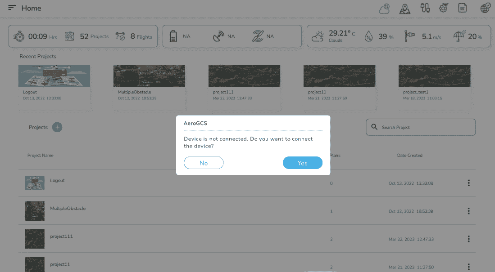

图 7.13 – 连接无人机的提示

以下是建立上述任意方法连接的步骤：

1.  选择通信链路。可以是 `Serial`、`TCP` 或 `UDP`。根据您选择的通信设备选择合适的链路，如下面的屏幕截图所示。既然我们提到了使用 RFD 900，我们将继续选择 `Serial` 连接：

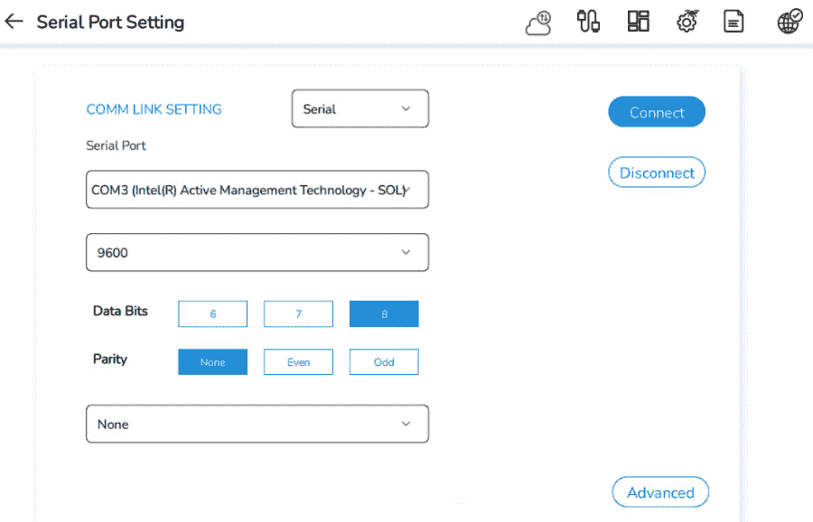

图 7.14 – 连接设置

既然我们选择了串行连接，我们将继续查看与此选项相关的设置。

1.  当我们使用串行协议（如 UART）和串行射频模块（如 RFD 900 433Mhz）通过 USB 连接无人机时，需要设置 `Serial Port`。由于这些设备基于串行协议工作，必须在顶部选择 `Serial`：

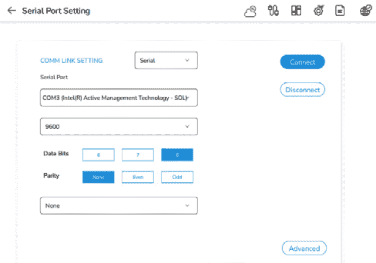

图 7.15 – 串口设置

继续之前需要设置一些参数，如下所示：

*   **`Serial Port`**：当我们通过 USB 连接 RFD 900 或任何其他模块时，它会建立自己的通信端口，通过该端口可以访问模块。此通信端口将出现在 `Serial Port` 的下拉菜单中。
*   **`Baud rate`**：我们知道在串行通信中，数据通过在传输介质中将比特（数字数据）从一个设备传输到另一个设备来进行通信。波特率是指信号元素的数量或信号每秒发生变化的次数（当其通过传输介质时）。波特率越高，数据发送/接收的速度越快。对于通过 USB 线缆的有线通信，波特率通常为 115,200；对于无线连接，如果连接到飞控，则为 57,600。
*   **`Data bits`**：通过串口传输的任何消息都是通过数据位发送的。这些可以是命令、传感器读数、错误消息等。大多数串口使用 5 到 8 个数据位进行传输，文本数据使用 7 或 8 位传输。这些位用于以 ASCII 格式表示数据中的字符。
*   **`Parity`**：奇偶校验是一种错误检查程序，它使用传输位中包含的 1 的个数。对于无错误传输的每组位，1 的个数必须始终相同，要么为奇数，要么为偶数。

单击窗口右上角的 `Connect`，无人机应连接到 GCS。

1.  **通过 TCP 和 UDP 连接**：如果我们使用智能电台，如 Doodle Labs 或 Microhard（我们在前几章中已了解），我们可以使用 TCP/UDP 连接来连接到网络。在 TCP 连接中，用户可以设置主机模块的主机地址、监听端口、目标地址和目标端口，无人机将通过 TCP 连接。因此，对于下面屏幕截图中显示的 `COMM LINK SETTING`，现在必须选择 `TCP`：

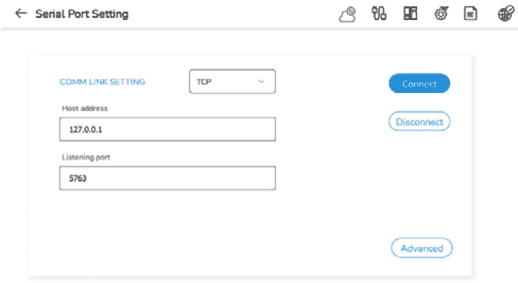

图 7.16 – AeroGCS 中的 TCP 连接

`UDP` 代表 `User Datagram Protocol`（用户数据报协议），它是 OSI 模型中的传输层协议。它不太适合可靠的数据通信，因为在 UDP 中，每个数据包都是独立发送的，不保证送达或顺序；然而，TCP 为系统提供了可靠的连接，因为它保证从一端发送的数据能被另一端正确接收。在 AeroGCS 中，首选 TCP 连接而非 UDP 连接。

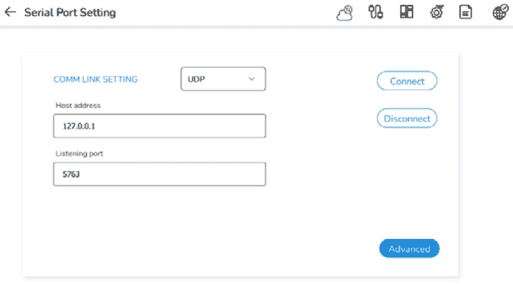

图 7.17 – AeroGCS 中的 UDP 连接

因此，在前面的示例中，我们看到了通过不同协议连接到无人机（飞控）的不同方法，必须根据情况相应选择。这将帮助我们在 GCS 和无人机之间建立连接。我们现在可以对无人机进行指挥和配置。

# RPA 或无人机配置

当我们将无人机连接到 GCS 时，必须在任何飞行前设置无人机的必要配置并进行所需的校准。无人机配置是必需的，以便飞控知道传感器的确切数值、机型、电池状态、通信强度等，这些在飞行期间都是必需的。飞控根据这些数据做出必要的决策。

飞行前检查传感器校准、电机、电调和指南针很重要；这应在任何飞行前完成。

应设置相机参数，以捕获无人机飞越区域的最大数量的最高质量图像和视频。

必须采取必要的失效保护措施，以便在电池故障或通信丢失的情况下应急恢复无人机。

通过 RPA 配置，可以非常轻松地调整和设置与电池、电源等相关的参数。

需要设置的一些重要参数如下：

*   **机型选择**：机型选择是必要的，因为它让飞控知道无人机的类型（我们制造了四旋翼、六旋翼和八旋翼，它们定义在机架类别下）。

    接下来，四旋翼/六旋翼/八旋翼及其他类似无人机的配置需要指定使用 `X shape`、`+ shape` 还是 `V shape`。这些选项在下拉菜单中提供。

    选择机型后，必须重启飞控以使更改生效。由于此选择，`ESC` 被激活，飞控会计算无人机的基本物理特性以实现稳定飞行。

*   **安全参数**：安全参数设置对于在紧急情况下恢复无人机很重要。这些是预加载到无人机中的一些失效保护措施，以防失效保护情况发生。

*   **失效保护**：失效保护是指如果无人机的任何关键部件停止工作或发生故障，无人机本身必须采取什么行动以安全恢复？这些失效保护动作可以在飞行前通过此菜单选择。

我们将在此学习飞行前需要设置的基本和重要的失效保护：

*   **电池失效保护**：当无人机电池电量降至已设定的百分比（例如 20%）时触发。我们可以选择无人机在这种情况下需要执行的动作。

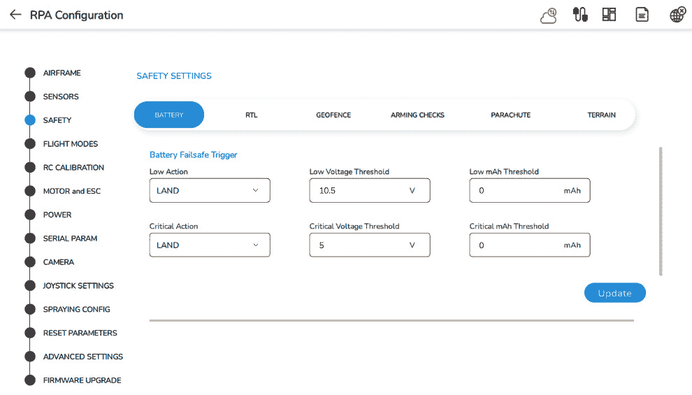

图 7.18 – 不同的电池失效保护

以下是一些电池失效保护及其动作：

*   **`Low Action`**：`None`、`LAND`、`RTL`、`SmartRTL`、`SmartRTL or Land`、`Terminate`
*   **`Critical Action`**：`None`、`LAND`、`RTL`、`SmartRTL`、`SmartRTL or Land`、`Terminate`
*   **`Low Voltage Threshold`**：触发低电量动作的电池电压
*   **`Critical Voltage Threshold`**：触发严重动作的电池电压
*   **`Low mAh Threshold`**：触发 `Low Action` 的电池容量
*   **`Critical mAh Threshold`**：触发 `Critical Action` 的电池容量

我们甚至可以根据应用需求选择激活或禁用失效保护动作。

*   **地面站故障保护触发**：当 GCS 软件与无人机之间的连接因任何原因中断时，将触发此故障保护。原因可能是软件死机、连接松动或断电。您可以选择发生这种情况时所需的动作，例如着陆或返航。

*   **油门故障保护**：当遥控器与无人机之间的连接因任何原因中断时，将触发此故障保护。原因可能是连接松动，或无人机飞离遥控器控制范围太远：

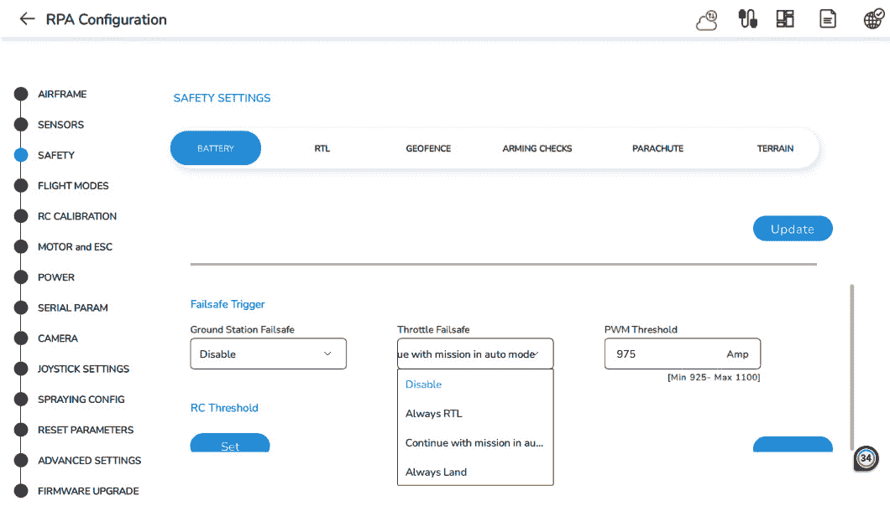

图 7.19 – 油门故障保护配置

您可以选择发生这种情况时所需的动作，例如着陆或返航。

这些是可以配置的主要故障保护。为了无人机的安全，这些故障保护必须在飞行前设置。还有一些更高级的故障保护，例如电子围栏和 GPS 故障保护。

# 自主任务规划

任务规划是每个地面站（GCS）提供的关键功能。此功能帮助无人机飞行员根据环境和应用，将他们决定的飞行路径编程到无人机中，使无人机在完全自主模式下无需飞行员干预即可遵循该路径。任务规划需要地图和 GPS 的支持，以准确绘制无人机将经过的航点，从而形成飞行路径。

飞行路径是一组经度、纬度和高度（航点），无人机利用它们进行自动导航。AeroGCS 提供 10 种预加载的飞行路径，飞行员可根据需要选择；因此，这使得飞行员的工作变得轻松且准确。在下面的屏幕截图中，我们可以看到 AeroGCS 提供的不同种类的飞行路径：

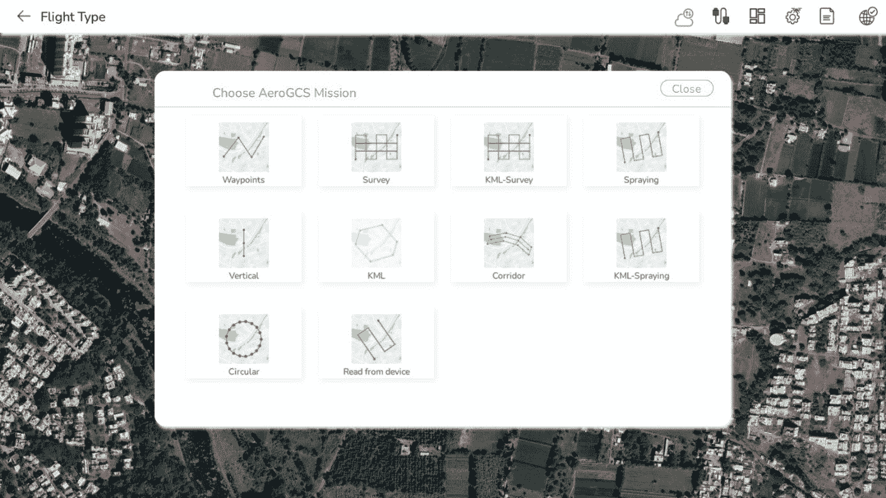

图 7.20 – 不同的飞行路径

在 AeroGCS 提供的 10 种不同任务规划类型中，我们将只学习其中几种，因为这些是初学者所需的，并构成了适用于不同应用的其他航点规划类型的基础。

## 航点规划

航点是地球表面上的一个虚拟点，它显示在地图上，包含一些典型信息，如纬度和经度。这些点有助于构建一条完整的飞行路径，无人机可沿此路径飞行。基本上，无人机通过使用其内置 GPS 来遵循航点中的信息。

以下屏幕截图是来自 AeroGCS 的飞行规划窗口，它提供不同的航点并决定上传到无人机的高度。左上角的指南针显示无人机的方向（例如，无人机朝向何处），右侧的窗口显示航点的特征，如纬度、经度、高度和速度。这还给出了无人机遵循所有航点后飞行的总距离：

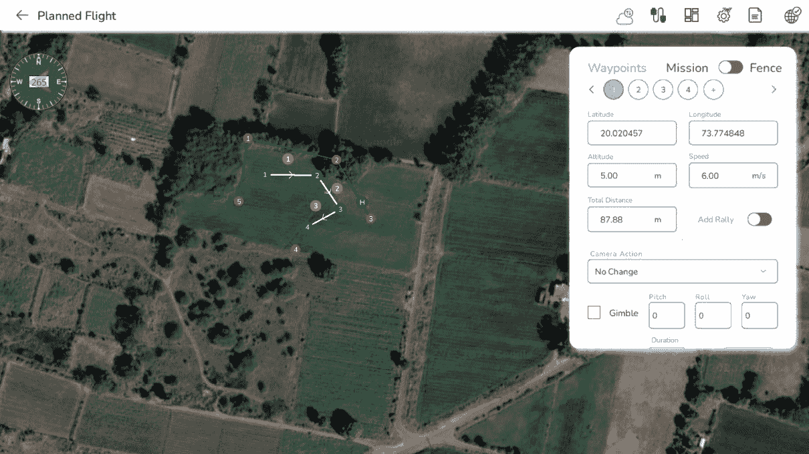

图 7.21 – 电子围栏的航点任务规划

### 如何规划任务

使用以下步骤，航点任务规划非常简单：

1.  点击地图上您希望无人机前往的点以创建飞行路径。确保飞行路径在实时情况下不与地面上的任何障碍物相撞。

2.  根据屏幕显示决定每个航点的高度以及无人机应以何种速度飞行。

3.  云台用于使用相机拍摄照片和视频，可由软件控制。

4.  将您开发的任务保存到无人机上。

## 测绘规划

顾名思义，测绘规划是指一种用于对大面积土地进行航测的任务规划类型，无人机遵循特定的网格状模式飞行，飞行高度为地面上方 100-120 米。飞行的无人机搭载相机作为载荷，并按特定间隔拍摄区域图像。这些图像带有地理标签，稍后用于创建整个区域的地图。由于测绘是一项重要的工业应用，这些任务预先加载好，并可通过调整一些参数进行配置，以获得富有成果的结果。以下屏幕截图显示了测绘规划任务的典型视图：

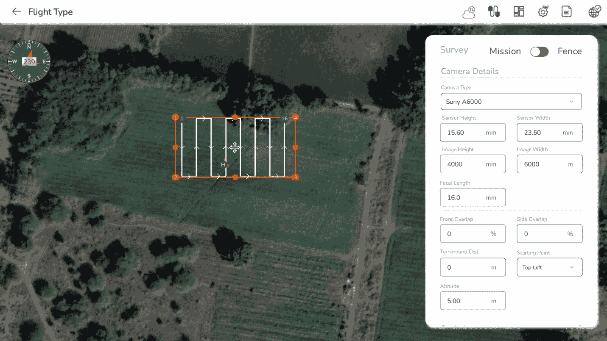

图 7.22 – 具有飞行参数的测绘任务

我们已到达本章末尾。我们学习了可用 GCS 软件的基础知识。我们深入介绍了如何使用 AeroGCS 配置无人机。这让我们简要了解并熟悉了此类软件的工作原理。关于 GCS 软件还有更多内容需要了解，这可以通过实践来加深。

# 总结

在本章中，我们提供了 GCS 软件的概览，包括其外观及其功能。我们还看到了它在任务规划方面提供的各种选项，以及我们可以规划的各种飞行路径。

我们还了解了可用于将无人机连接到 GCS 软件的方法。然而，我们不会止步于此。

在下一章中，我们将使用此 GCS 软件执行其他操作，例如校准传感器和实际驾驶无人机。
