## 第 8 章：理解飞行模式与任务规划

### 理解飞行模式与任务规划

在本书前面的章节中，我们探讨了各种**地面站**（**GCS**）操作和功能，以及它们如何帮助实时指挥和控制无人机。我们还了解了 GCS 如何通过其众多界面来配置无人机及其各种外围设备。在前几章中，我们学习了如何配置无人机，以便它可以使用由 ArduPilot 和 PX4 的相关开发者预先配置好的不同飞行模式。在本章中，我们将了解这些飞行模式是什么，它们如何帮助飞行员驾驶无人机，以及它们使用哪些传感器。本章将帮助您了解无人机飞行时所处的不同飞行模式，以及如何使用遥控器或 GCS 激活这些飞行模式。这反过来将帮助您更多地了解如何使用遥控器或 GCS 驾驶无人机。

在本章中，我们将涵盖以下主题，因为它们将帮助我们理解每种飞行模式及其设置方法：

*   飞行模式与类型
*   通过遥控器分配飞行模式
*   在 GCS 中分配和更改飞行模式
*   规划和执行自主航点任务

# 技术要求

对于本章，您需要了解 IMU 传感器的工作原理及其运作方式。您还需要具备基本的物理知识和设备操作技能。除此之外，您还需要阅读预先存在的飞行栈（如 ArduPilot 和 PX4）的文档，因为我们将讨论在这两个飞行栈中开发的基础知识。

# 飞行模式与类型

飞行模式是预定义的设置，它们控制自动驾驶系统在飞行期间如何指挥无人机的行为。它们还定义了要使用哪些传感器以及允许飞行员进行多少手动干预。总之，飞行模式是一组指令，帮助自动驾驶系统在飞行时按预定方式运行。

我们可以使用 GCS 或直接通过遥控器设置飞行模式；因此，飞行员可以根据情况轻松在两种飞行模式之间切换。

# 飞行模式

一般来说，我们可以认为飞行模式可帮助飞行员更轻松地驾驶无人机。它们允许控制某些参数，如高度和位置，这有助于飞行员平稳地驾驶无人机，因为自动驾驶仪会根据其传感器读数以及飞行员提供的输入响应来接管无人机的控制权。“飞行模式”一词在各种无人驾驶载具中很常见，例如多旋翼、固定翼飞机和地面车辆。所有载具根据其物理结构和预期任务的不同，在不同种类的飞行模式下会有不同的响应。

在接下来的几节中，我们将讨论什么是飞行模式，以及如何使用遥控器或 GCS（地面站）来设置它们。设置飞行模式是为飞行配置载具时最重要的部分，因为它告诉载具飞行员是如何驾驶无人机的，以及载具应如何响应。

## 飞行模式的类型

正如我们之前讨论的，可以在多旋翼上实现多种类型的飞行模式开关，以实现平稳且轻松的飞行。这些飞行模式取决于无人系统的类型及其配置。本节将仅研究多旋翼中使用的模式，同时考虑到广泛使用的 ArduPilot 和 PX4 飞控软件栈。

根据飞控使用的输入，飞行模式可分为三类：**手动**、**半自主**和**自主**。每种模式都需要飞控使用某些机载传感器，如 GPS 和气压计。对于每种飞行模式，必须有输入传给飞控，来源可以是机载传感器，也可以是外部源（如遥控器）。有时，它们会同时使用机载传感器和遥控器来保持水平并完成所需飞行模式下的指令。飞行模式的例子包括手动、定位、定高和稳定模式。

这些飞行模式还根据其等级（从初级到专家）进行分类。正在学习遥控器摇杆控制的初级飞行员会使用半自主模式，在这种模式下无人机可在空中自行水平，初级飞行员只能控制其前进、后退和侧向移动——即滚转、俯仰和偏航——这有助于飞行员了解无人机飞行的基础知识。然后飞行员可以进阶使用一些专家模式，如自主和手动模式。某些飞行模式用于高速飞行，如手动和特技模式，以让无人机完成特技动作和翻滚。让我们看看有哪些可用的飞行模式可以帮助飞行员。对于初级飞行员，起飞和降落等手动操作也可以在 GCS 提供的自动指令帮助下自主完成。

由此，我们看到了飞行模式的重要性。它们是设置无人机飞行的主要方式。现在，让我们了解不同种类的飞行模式以及如何设置它们。

### 手动模式/稳定模式

手动模式是一种飞行模式，飞行员对无人机拥有完全控制权，飞控不参与控制。无人机的移动掌握在飞行员的摇杆手中，无人机根据飞行员给出的输入移动，因此得名**手动模式**或**稳定模式**。在此模式飞行时，自动驾驶系统不接收来自传感器的任何输入。飞行员必须能看见无人机并驾驶它。这是一种高级飞行模式，需要良好的经验和对遥控器的肌肉记忆，才能在空中稳定无人机并正确飞行。

当居中的滚转和俯仰摇杆使载具水平，但载具位置必须通过滚转俯仰摇杆手动管理，高度（上升和下降）通过油门摇杆管理时，我们称此模式为完全遥控器模式。偏航由油门摇杆的左右旋转控制。

滚转和俯仰摇杆还控制载具的角度——即**姿态**。一旦我们释放控制摇杆，它们就会回到中心点，载具将保持在原地悬停。它将在机械上保持平衡并维持其高度，除非施加外力。

下图展示了遥控器中的手动飞行模式和稳定实现，以及无人机的行为。遥控器通常由许多开关和电位器组成，它们帮助我们控制和配置连接到无人机的外设：

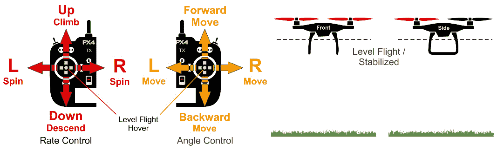

图 8.1 – 手动模式飞行

### 半自主模式

正如之前讨论的，半自主模式是指飞行模式，其中飞控利用其主要传感器提供部分输入以使无人机水平，但主要输入（如高度和滚转俯仰力矩）由飞行员提供。这些也称为辅助模式，因为飞行员在飞控和传感器的辅助下，可确保位置和高度方面的平稳性。让我们看看一些可用的辅助模式。

#### 定位模式

定位模式是一种简单的飞行模式，对驾驶多旋翼的初学者很有帮助。在此模式下，滚转和俯仰摇杆控制相对于地面的加速度，使载具前进、后退、左移和右移，而油门摇杆控制无人机的上下移动。当你释放遥控器摇杆时，无人机会停止——即载具停止加速并保持在原位。因为是辅助模式，飞控利用 GPS 锁定无人机当前飞行的位置，并持续保持该位置，不受风等不同外力的影响。这是对初学者最安全的飞行模式：

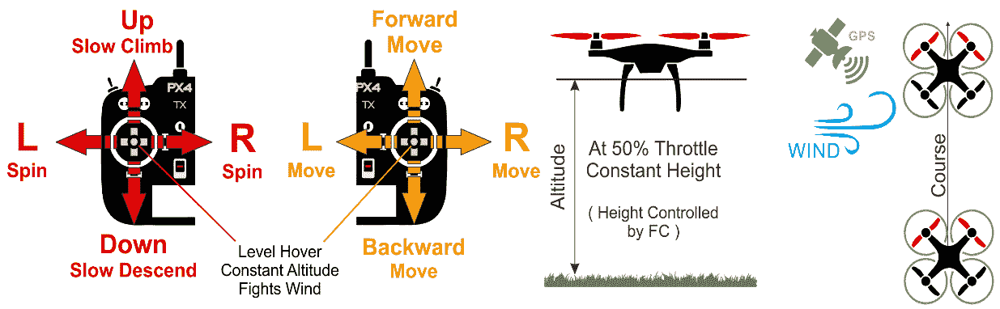

图 8.2 – 处于定位模式的无人机

#### 姿态保持模式

姿态保持模式也是一种相对简单的遥控飞行模式，其中滚转和俯仰摇杆控制左右和前后方向的运动，偏航摇杆控制无人机的顺时针和逆时针移动，油门摇杆控制无人机如何上升和下降。

当这些摇杆被释放时，它们会回到遥控器上的中心位置，因此无人机也会水平并保持当前高度。这里的重要一点是，与定位模式不同，无人机不会保持其位置，而是保持其高度。飞控将利用其气压传感器或高度计传感器（如果已安装）来维持飞行员设定的当前高度。

因此，我们可以认为，在此模式下，无人机不会像在定位模式那样保持其相对于地面的位置。飞行员必须使用滚转和俯仰摇杆手动控制无人机以控制其位置。然而，飞控会控制其高度，该高度由飞行员固定：

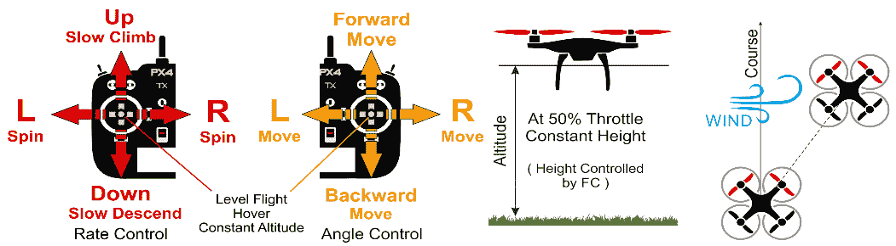

图 8.3 – 处于姿态保持模式的无人机

### 自主模式

自主模式是不需要飞行员通过遥控器输入的飞行模式；相反，这些模式完全自主，可通过 GCS 进行规划。让我们考虑一下可以通过 GCS 或遥控器（通过分配模式开关）切换的不同模式。

#### 悬停模式

# 飞行模式

## 定点模式

顾名思义，`hold mode` 有助于在无需飞行员输入的情况下，将无人机保持在其当前的 `GPS` 位置和相应高度。这有助于使无人机保持水平。在此模式下，`flight controller` 会接收来自 `GPS sensor` 和 `barometer sensor` 的帮助，将无人机锁定在特定的 `GPS` 坐标和姿态上。因此，无人机可以抵抗风力或任何其他外力而保持位置。此模式可用于暂停任务，并在紧急情况下重新获得对无人机的控制权。此模式也可通过 `GCS` 配置，或分配给 `remote control` 上的任意开关以激活它。

## 返航模式

`Return mode` 是无人机中最重要的恢复模式，因为它帮助飞行员将无人机带回其原始起飞位置。这有助于无人机飞行一条清晰的路径到达安全位置，并且可以手动、通过 `remote control` 或通过故障保护来激活。此模式可配置为在任何故障保护条件下激活，例如电量低、数据链路丢失或电子围栏闯入。此模式下的行为可在飞行前由 `GCS` 根据环境条件进行配置和决定。此模式利用 `GPS` 位置，因此会引导无人机自动飞往该特定位置，然后再返回其原始起飞位置，因此得名。

## 任务模式

顾名思义，在 `mission mode` 下，无人机执行由 `GCS` 编程的预定义任务。在编程任务时，飞行员可以为无人机设置不同高度、不同期望速度的航点。切换到 `mission mode` 后，无人机会穿越不同高度的各个航点。在此模式下，无人机在返回前会使用其所有 `IMU sensors` 和额外的外围设备。

## 起飞模式

`Take-off mode` 可帮助我们在不使用 `remote controller` 的情况下进行自动起飞，方法是通过 `GCS` 给无人机设定一个合适的高度。无人机自动达到该高度后，会进入悬停位置。此时，它会保持其高度和 `GPS` 位置，并继续悬停。

## 降落模式

此模式会使多旋翼无人机在无需飞行员任何输入的情况下自动降落。此模式可配置在任务结束时触发，或在触发任何故障保护条件时触发。

# 通过遥控器分配飞行模式

到目前为止，我们已经了解到 `remote controller` 是飞行员手动控制无人机飞行的关键要素。正如我们所见，`remote controller` 通常包含许多开关和电位器，所有这些都帮助我们控制和配置连接到无人机上的外设。借助这些开关和电位器，飞行员可以完全控制无人机，并通过开关在不同模式之间切换。在本节中，在使用 `remote controller` 时，我们将在不同通道上使用相同的 `MAVLink` 协议来配置各种飞行模式。

在 `remote controller` 中，`channel` 是 `transmitter` 和无人机上的 `receiver` 之间独立的通信路径。每个 `channel` 分配给特定的功能或控制，例如 `throttle`、`pitch`、`roll` 或 `yaw`，允许飞行员操控无人机运动和功能的不同方面。

如今，市场上有许多 `remote controllers`，例如 `FrSky`、`Flysky` 和 `SIYI`，其中一些集成了 `GCS`。在所有类型的 `remote controllers` 中，设置开关和飞行模式是通用的。我们建议您阅读您正在使用的 `remote controller` 的用户手册，这将帮助您完成以下步骤并执行它们。在这里，我们将使用一种通用方法来启用开关并将其分配给 `channel`。这可能因控制器而异。

1.  **在遥控器上启用开关**：每个 `remote controller` 都有某些默认未启用的开关和电位器，这意味着它们需要设置。建议始终在 `remote controller` 上选择三档开关，因为这将帮助您在单个开关上设置三种不同的飞行模式。开关的启用方式因 `remote controllers` 而异，但一旦开关激活，我们就需要分配一个合适的 `channel` 让开关在其上工作。

2.  **分配飞行模式通道**：为了让开关向无人机发送信号并让无人机理解给出的指令，两者必须在一个共同的 `channel` 上。因此，开关上设置的 `channel` 应通过 `GCS` 和飞行模式进行配置，稍后我们将看到。我们将 `channel 5` 分配给开关作为飞行模式通道。请确保在配置飞行模式时，将相同的 `channel` 分配给 `GCS`。

3.  **在 GCS 中配置飞行模式并设置开关**：在本章后面，我们将学习如何根据 `remote controller` 中的设置在 `GCS` 中配置飞行模式。然而，在此步骤中，我们将为开关设置不同的飞行模式。当您拨动此开关时，您会看到指示器切换到不同的飞行模式；这可以在飞行屏幕上配置。您还可以选择要分配给开关的飞行模式类型。这意味着可以将三种飞行模式分配给一个开关。

至此，我们已经学会了如何在 `remote controller` 上配置飞行模式，这有助于我们在无人机飞行时使用不同的飞行模式。我们也可以通过 `GCS` 切换到未在 `remote controller` 上配置的其他飞行模式。同样，`remote controller` 可以切换到不同的 `channels`；通过这些不同的 `channels`，我们可以连接不同的外设，例如 `gimbal`、`sprayer` 或 `camera`，并借助 `remote controller` 控制它们。

## 工作原理

我们将 `pulse width modulation` (`PWM`) 分解为不同的片段，其中每个片段可用于同一 `channel` 中的特定功能。我们现在知道 `PWM channel` 的工作范围在 1,000 到 2,000 微秒之间，其中 1,000 是信号强度最低，2,000 是最高。当我们在 `three-way switch` 上启用此 `PWM` 时，限制被分成三等份，这意味着 `PWM` 被分成三个片段，每个片段在我们设置的同一 `channel` 上发送不同的命令。幸运的是，借助开关将其分解为片段，我们可以通过同一 `channel` 发送不同的消息。这也帮助我们用更少的资源控制各种外设。

# 在 GCS 中分配和更改飞行模式

在本节中，我们将深入探讨上一节中的 `step 3`。在这里，我们将把三种不同的飞行模式分配给我们之前配置的开关。正如我们所知，`GCS` 是无人机配置的主要来源，因此我们将利用这一知识来配置我们想要放在该开关上的飞行模式，以便我们在飞行时更改它。

飞行模式配置也是飞行前的一项关键要求，至关重要，没有它，无人机就无法在 `remote controller` 的帮助下飞行。在这里，我们将了解如何在 `GCS` 中配置飞行模式，以及如何通过 `GCS` 更改飞行模式。

## 配置遥控器开关的飞行模式

当我们打开 `AeroGCS` 时，会看到各种飞行模式通过无线电（通过 `transmitter switch`）或使用 `AeroGCS` 的命令进行控制。选择您习惯飞行并希望分配给开关的飞行模式。

1.  **连接无人机**：通过 `USB` 线缆或数传电台将 `GCS` 连接到无人机，并让参数下载完成。

# 飞行模式配置

## 导航至 RPA 配置 | 飞行模式

在这里，您将看到一个类似于下面屏幕截图所示的窗口。它将告诉您关于飞行模式通道以及您可以从提供的下拉菜单中选择的不同飞行模式：

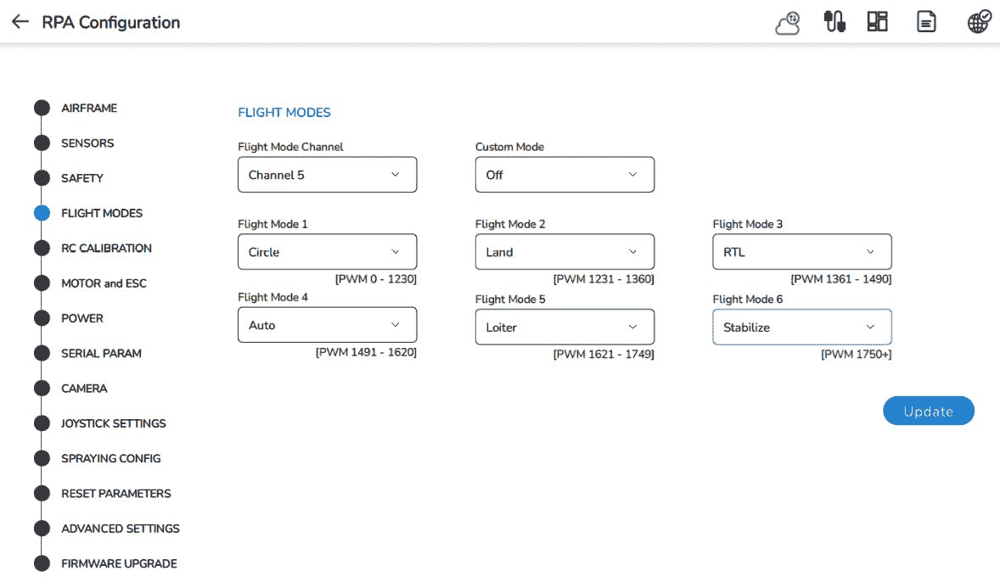

图 8.4 – AeroGCS 中的飞行模式窗口

在 **飞行模式通道** 字段中，选择您在遥控器中分配开关时所选的同一通道。在我们的例子中，我们将继续使用 **通道 5**，因为我们之前已将其分配给开关。

如前面的屏幕截图所示，您可以从各种飞行模式中进行选择，从飞行模式 1 到飞行模式 6。在这些选项下方，您可以看到每个模式的 PWM 值。我们在前面的章节中了解了这些 PWM 值范围。在这里，不同的飞行模式被分配了特定的 PWM 范围，这阐明了当前选择了哪种飞行模式。在遥控器端也进行了类似的范围划分和分段，我们在其中将一个通道分配给三档开关。PWM 被分成三个不同的范围，指示选择了哪个 PWM；同样的情况也反映在 GCS 的这个窗口中：

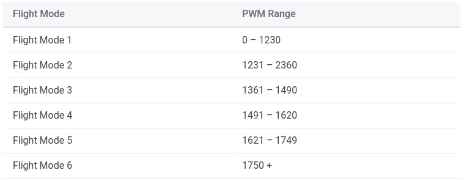

图 8.5 – PWM 分段

### 移动开关并在 GCS 上选择飞行模式

选择 **通道 5** 后，各种飞行模式选项将出现。这表明该�行模式是由开关的位置选择的。如果您将开关移动到不同位置，将突出显示不同的飞行模式；同样，如果您将开关移动到第三个位置，将突出显示一种新的飞行模式。

开关位置处突出显示的任何模式都表示开关选择的 PWM 范围。这也将帮助您为开关的所有三个位置选择所需的飞行模式。此过程在以下屏幕截图中显示。正如您所见，还有一个下拉菜单，您可以在其中选择所需的飞行模式和开关位置：

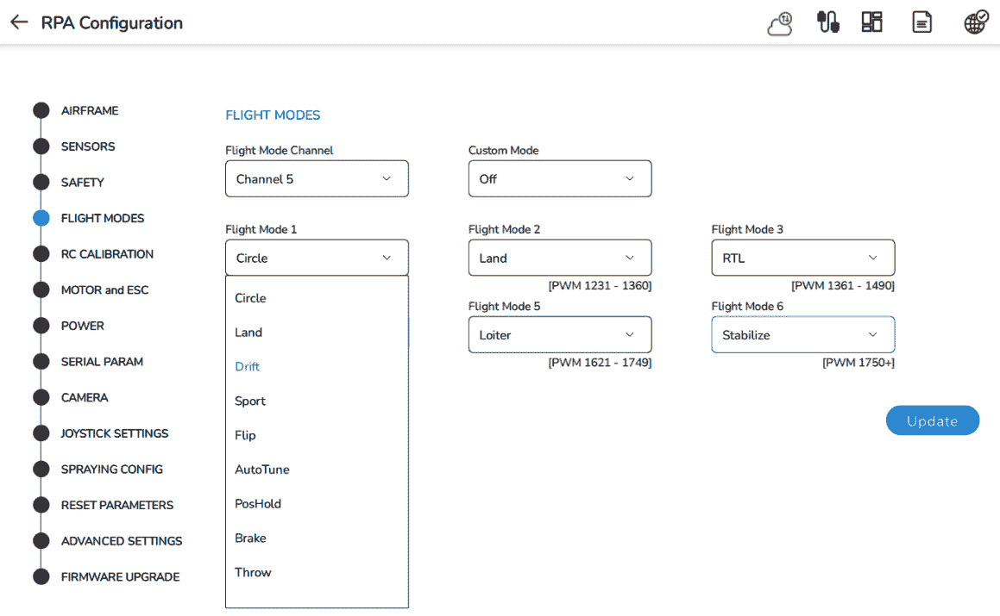

图 8.6 – 选择不同的飞行模式

正如您所见，**飞行模式 6** 被突出显示，所选的飞行模式是 **稳定模式**。您可以使用该飞行模式的下拉菜单随时更改此飞行模式。

### 保存配置

点击 **更新** 并保存飞行模式，以便使用。您可以选择不同的位置，并检查飞行模式是否在仪表盘中发生变化，如下面的屏幕截图所示：

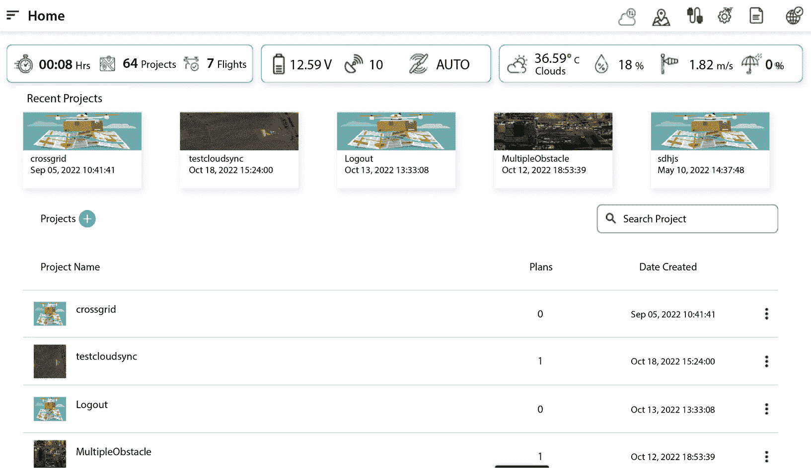

图 8.7 – AeroGCS 主屏幕

在本节中，我们了解了不同的飞行模式以及如何使用 GCS 和遥控器进行设置。接下来，我们将学习如何在不使用遥控器的情况下，借助 GCS 创建并执行自主任务。然而，在执行任务时，始终存在遥控器命令可以覆盖 GCS 命令，以便飞行员在紧急情况下接管系统控制权。

# 规划并执行自主航点任务

之前，我们查看了不同类型的飞行模式，其中最重要的一种是自主模式。在自主模式下飞行需要创建任务计划，这在 GCS 软件中完成，然后通过数据链路上传到飞行控制器。让我们看看如何规划任务、将其上传到无人机并执行它。

## 登录您的个人资料

使用您的电子邮件和密码登录您的 AeroGCS 账户。请注意，并非每个 GCS 都需要此步骤；有些会直接带您进入仪表盘。然而，在这种情况下，GCS 已被定制，以便每个用户都可以处理自己的项目：

图 8.8 – AeroGCS 登录窗口

## 将 GCS 连接到无人机

在做任何其他事情之前，我们必须连接设备。点击 **是** 并使用第二个窗口中给出的选项连接设备：

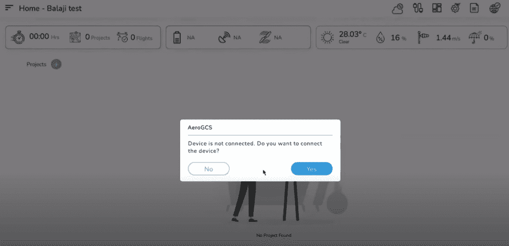

图 8.9 – 连接协议

如下面的屏幕截图所示，我们有不同的方式连接到无人机 – 即 **串口**、**TCP**、**UDP** 和 **蓝牙**。在这里，我们将采用串口遥测连接连接到无人机，将波特率设置为 115,200，然后继续：

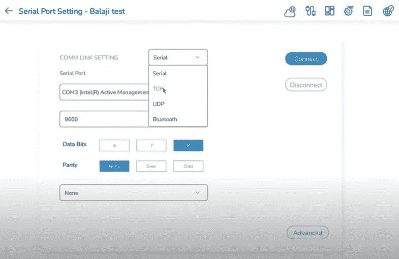

图 8.10 – 选择连接协议

## 设置项目名称

设置项目名称将帮助我们为客户创建定制项目，并保存我们过去完成的项目，以便在需要时重复执行：

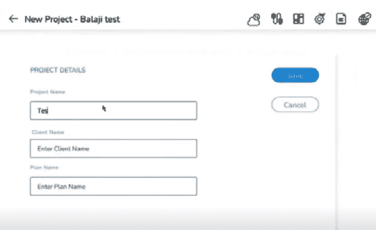

图 8.11 – 设置项目名称

## 选择飞行位置

借助无人机的 GPS，您将能够自动检测其当前位置，并查看必须规划任务位置的地图。如果根据您当前所处的环境，所选位置正确，请点击 **下一步**：

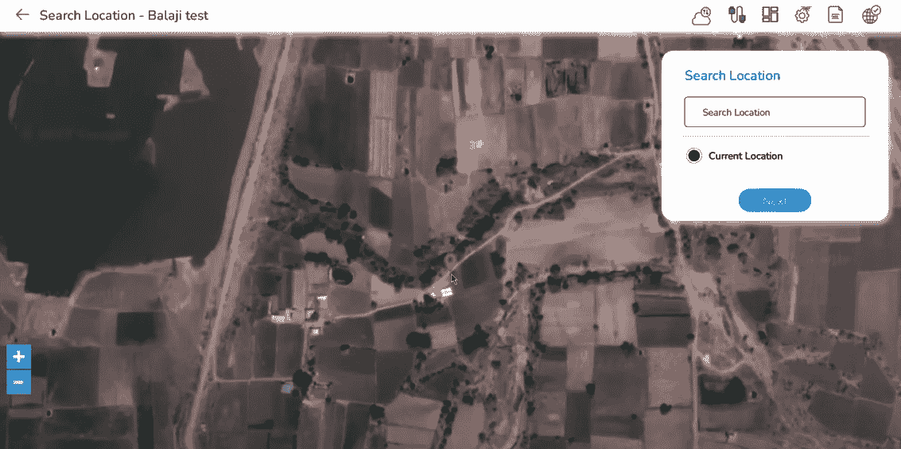

图 8.12 – AeroGCS 中的位置选择

## 选择飞行计划

根据应用程序的要求，AeroGCS 提供可根据您的要求修改的定制计划。用户可以使用任何他们想要的飞行计划来执行特定任务，例如测绘、喷洒或检查。虽然此功能存在于 AeroGCS 中，但在其他一些 GCS 中，计划必须手动创建。我们将在这里选择航点任务，因为我们将进行自主航点任务：

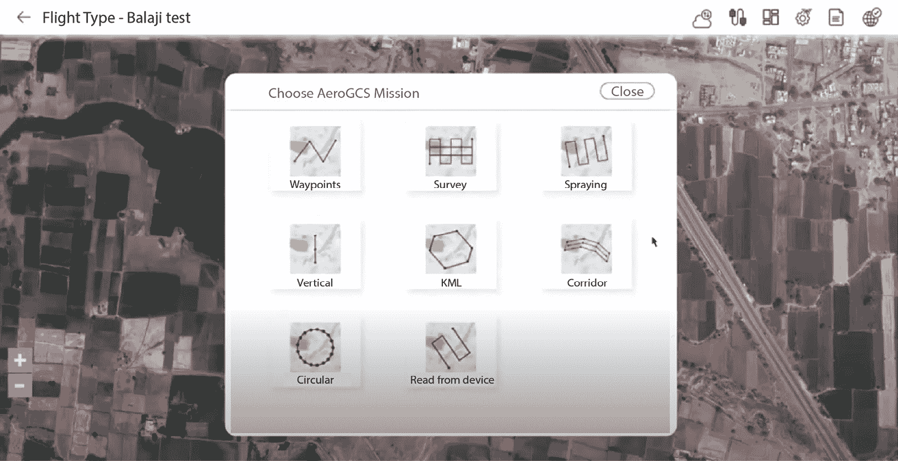

图 8.13 – 可用的飞行计划

## 指定飞行参数

现在，您需要为无人机指定飞行参数。我们需要指定我们希望无人机飞行的高度以及其速度。这些参数将帮助我们决定无人机的行为，并可根据应用程序的要求进行更改。完成后，点击 **下一步**：

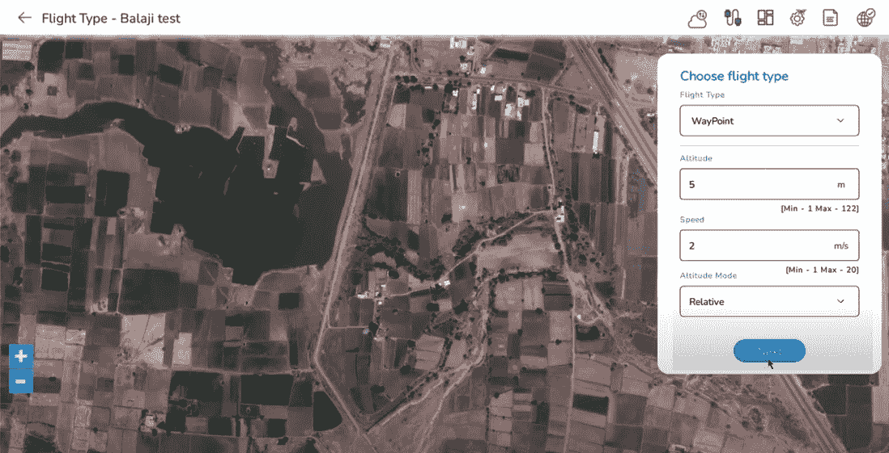

图 8.14 – 选择飞行类型

## 创建电子围栏

如下面的屏幕截图所示，已创建各种航点，并自动生成了无人机将飞行的飞行路径。现在，我们需要在这些航点周围创建一个电子围栏，以便无人机在电子围栏的四个点内飞行。

电子围栏就像无人机周围的围栏，由定义无人机应飞行区域的某些点创建。越过这些点将触发失效保护动作，无人机将按失效保护动作中配置的那样降落或返航。电子围栏选项可防止无人机在紧急情况下飞走，并将其限制在有限区域内：

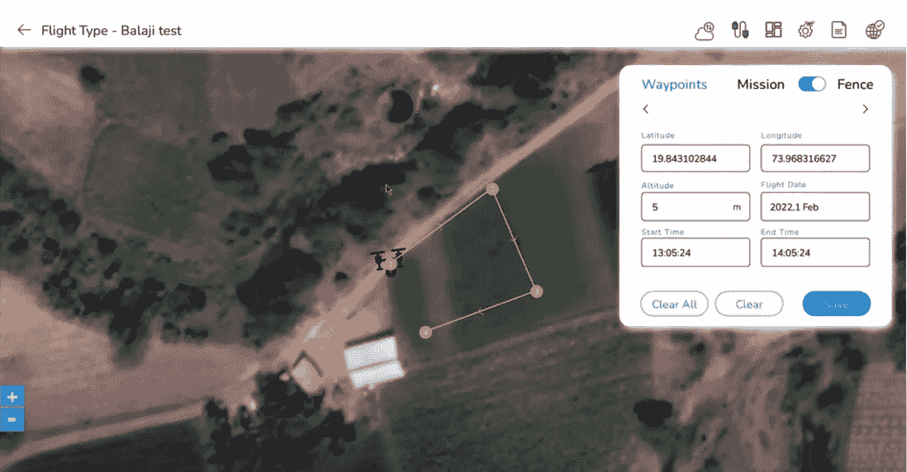

图 8.15 – 已创建航点任务

如下面的屏幕截图所示，电子围栏已在任务周围创建，并以红色指示。

点击 **保存** 将任务编程到无人机中：

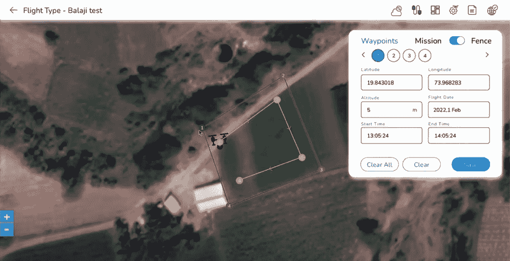

图 8.16 – 已创建电子围栏

## 起飞和飞行前检查

点击左侧的 **起飞** 按钮开始任务；一个飞行前检查窗口将弹出。此窗口将在最终起飞前重新检查所有内容。这还有助于飞行员在无人机起飞并开始任务之前重新配置每项设置并查看系统的健康状况：

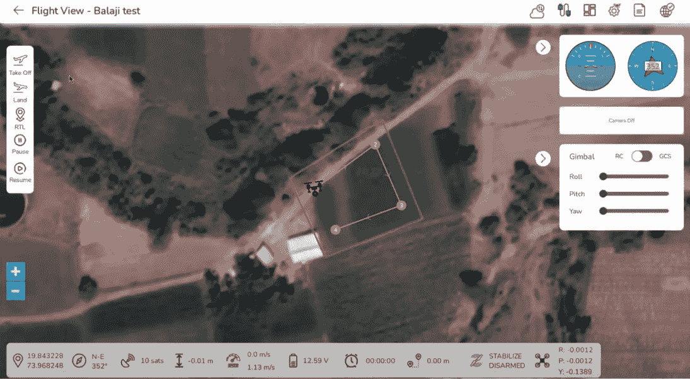

图 8.17 – 任务开始窗口

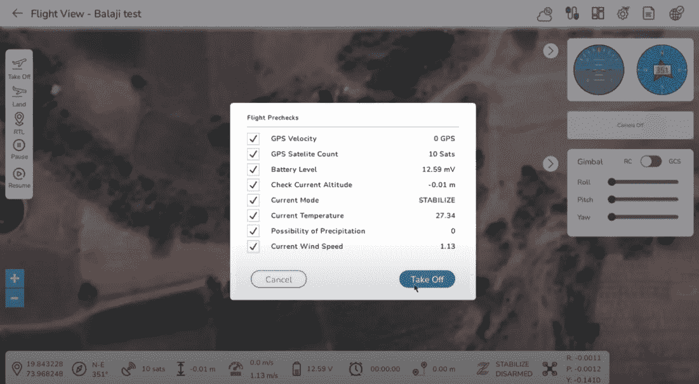

图 8.18 – 飞行前检查清单

**1. 执行任务并降落：** 一旦你发出指令，无人机将起飞并开始执行任务。完成任务后，它将降落在指定地点。所有重要参数，如电池坐标和 GPS 高度，都反映在屏幕底部，这提供了任务期间系统健康状况的实时信息：

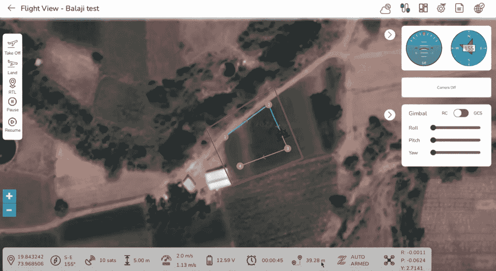

*图 8.19 – 任务执行进行中*

至此，我们已成功通过 GCS 创建并执行了一项任务。无人机可以编程并执行不同类型的任务。建议你下载本章使用的软件，并定期练习此类任务规划，使其成为一种习惯。

# 摘要

在本章中，我们了解了飞行中最重要的部分——飞行模式。本章帮助你理解了简单的无人机如何以不同方式飞行，以及飞行模式如何帮助我们执行许多使用无人机的商业应用。我们还学习了如何使用不同的平台执行不同的项目。最后，我们了解了手动模式和自主模式在飞行中的工作原理，以及如何对无人机进行编程，使其能够在自主模式下飞行。

在下一章中，我们将学习如何调整无人机的不同参数，以便我们知道飞行前必须进行哪些最终检查。
