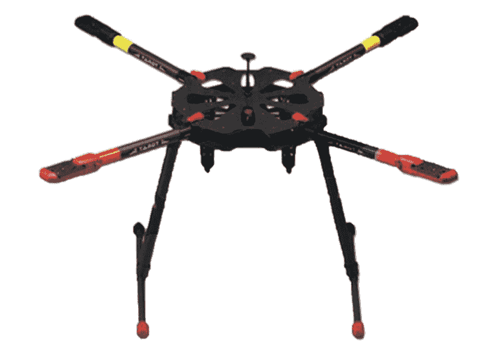
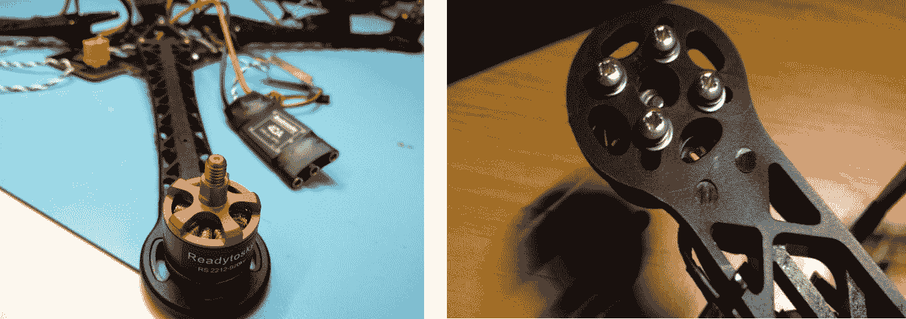
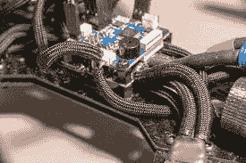
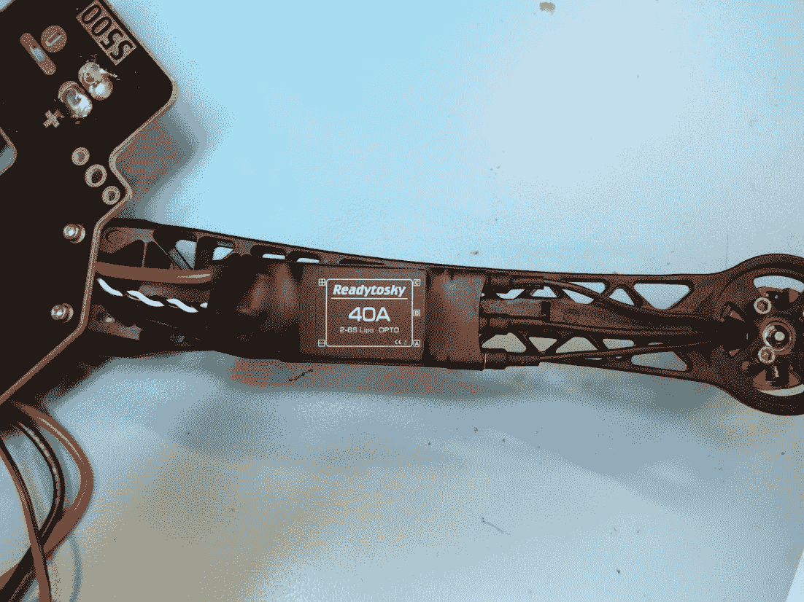
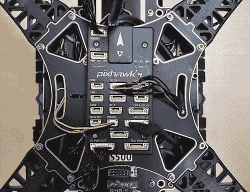

## 第 9 章：无人机组装、配置与调试

在本章中，我们将从硬件角度涵盖无人机的多个方面。之前，我们学习了无人机如何在空中悬停和移动的理论。我们还学习了组装无人机所需的不同组件，以及飞行和配置无人机所需的软件。在本章中，我们将深入探讨无人机组装和配置的基本方面，深入了解构成无人机的复杂组件、构建无人机所需的工具，以及优化其性能所需的软件和固件调整。从选择合适的机架、电机和飞控，到校准传感器和设置遥控器，本指南将为你提供所需的知识和指导，让你在首飞前踏上无人机构建之旅。

本章将帮助我们了解组装无人机的端到端过程，并使其在所有 `X`、`Y`、`Z` 方向上保持机械稳定，以便无人机的总力直接向下，垂直于地面。

为了深入理解并将其应用于现实生活，我们将涵盖以下主题，因为它们将帮助我们了解从零开始构建无人机所需的技能、工具和预防措施：

*   构建无人机所需的组件和工具
*   组装无人机组件
*   设置和配置航空电子设备
*   了解校准和故障保护
*   设置首飞

### 技术要求

构建和飞行无人机需要技术技能和软件知识的结合。我们在前几章中学习了这些技能和组件，它们将在这里帮助你。让我们仔细看看：

**组件技术理解**：

*   **无人机组件知识**：你需要了解无人机的各种组件，包括其机架、电机、**电子调速器 (ESC)**、飞控、电池和传感器
*   **电源系统理解**：你需要熟悉 **锂聚合物 (LiPo)** 电池，包括其电压和容量，以及如何计算无人机的功率需求
*   **螺旋桨理解**：你需要知道如何根据电机规格和预期用途选择合适的螺旋桨

**电子和布线技能**：

*   **焊接**：你必须精通焊接，以安全地连接电线、组件和连接器
*   **电路理解**：你必须了解基本的电子学和电路知识，以便排查和修复电气问题

**编程和软件技能**：

*   **飞控配置**：你必须知道如何使用 Betaflight 或 Cleanflight 等软件，甚至制造商提供的软件来配置和编程飞控
*   **遥控器设置**：你必须能够配置和校准你的遥控器（远程控制），以便与飞控有效通信
*   **PID 调参理解**：你必须了解如何调整 **比例-积分-微分 (PID)** 控制器，以优化无人机的飞行稳定性和性能

**飞行技能**：

*   **基本飞行技能**：你必须熟练掌握基本的无人机飞行动作，包括起飞、降落、悬停和基本导航

这些技术技能是必要的，因为你需要物理和分析方法来构建无人机，并具备扎实的布线和组件技能。

### 构建无人机所需的组件和工具

要开始组装无人机的过程，我们必须专注于收集所需的基本组件。这些包括无人机的机架、电机、电调、螺旋桨、飞控、电池和发射器/接收器。在深入复杂的组装步骤之前，准备好这些组件是关键的第一步。那么，让我们看看组装无人机所需的完整材料清单。

在本节中，我们将学习组装无人机所需的不同工具和组件。我们将只关注如何组装不同的组件，因为我们已经学习了无人机的各种传感器、物理学和动力学。

以下表格提供了完整的构建材料和工具清单，以及无人机的 **物料清单 (BOM)**：

**工具**：

| 工具 | 数量 | 用途 |
|------|----------|---------|
| 螺丝刀套装 | 1 | 组装和固定组件 |
| 电烙铁 | 1 | 焊接电子连接 |
| 焊锡丝 | 1 卷 | 焊接时提供导电路径 |
| 剥线钳 | 1 | 去除电线绝缘层 |
| 热缩管 | 多规格 | 绝缘和保护焊接连接 |
| 钳子 | 1 | 夹持和弯曲电线 |
| 六角扳手套装 | 1 | 拧紧机架和电机上的六角螺丝 |
| 万用表 | 1 | 测量电压、电流和电阻 |
| 镊子 | 1 | 精确处理小型组件 |
| 套筒扳手套装 | 1 | 拧紧螺栓和螺丝上的螺母 |
| 剪线钳 | 1 | 干净地剪切电线 |
| 护目镜 | 1 | 焊接时保护眼睛 |
| 防静电垫 | 1 | 保护电子元件免受静电影响 |
| 防静电腕带 | 1 | 将组装人员的静电导地 |

表 9.1：所需工具清单

**BOM**：

| 组件 | 数量 | 规格 |
|-----------|----------|----------------|
| 机架 | 1 | 碳纤维，具有足够的载荷能力 |

| 项目 | 数量 | 规格 |
| --- | --- | --- |
| 飞行控制器 | 1 | 具备 GPS 功能，兼容测绘应用 |
| 电机 | 4 | 大扭矩，无刷电机 |
| 电子调速器 | 4 | 与电机匹配，具有足够的额定电流 |
| 螺旋桨 | 4 对 | 高效率，与电机兼容 |
| 电池 | 1 | 大容量锂聚合物电池，适合长时间飞行 |
| 遥控发射机和接收机 | 1 套 | 长距离，可靠通信 |
| 电源分配板 | 1 | 将电池电力分配给各个组件 |
| GPS 模块 | 1 | 为测绘提供精确定位数据 |
| 云台（可选） | 1 | 稳定相机以获取清晰的测绘图像 |
| 相机（可选） | 1 | 具有测绘专用功能的高分辨率相机 |
| 遥测系统 | 1 | 实现无人机与用户之间的实时数据传输 |
| 水平仪 | 1 套 | 检查电机、螺旋桨和机身的水平度 |
| 螺旋桨平衡器 | 1 | 平衡螺旋桨以实现更平稳的运行 |
| 电源模块 | 1 | 6S 数字 |

表 9.2：四轴飞行器物料清单

**导线和连接器**：

| 项目 | 数量 | 规格 |
| --- | --- | --- |
| 硅胶线 (12-22 AWG) 红色和黑色 | 多规格 | 用于各种连接的高质量、柔性导线 |
| XT60 和 XT90 连接器 | 多规格 | 用于电池和电源分配板的连接器 |
| JST 连接器 | 多规格 | 用于小型电子设备和传感器的连接器 |
| 舵机延长线 | 多规格 | 用于远距离连接组件的延长线 |
| 热缩管 | 多规格 | 各种规格，用于绝缘和保护焊接导线 |

表 9.3：导线和连接器

# 组装无人机组件

在本节中，我们将学习如何组装无人机的各个组件。为此，我们将使用紧固件将它们全部安装到位。

制造商总是会提供一份组装手册来组装无人机机身。让我们来看看著名的四轴飞行器 Tarot X4 的机身组装：

图 9.1：Tarot 机身

## 机身组装

组装无人机机身是构建**无人驾驶飞行器**（**UAV**）的关键步骤。正确的组装可确保飞行过程中的结构完整性和稳定性。考虑到上述的 Tarot X4 机身，本节将提供一份预防性指南，您可以在组装机身时遵循该指南以验证其正确性。

### 组装无人机机身

考虑到著名的 Tarot X4 入门级 DIY 组装，我们将按照制造商的组装指南开始组装关键组件。不同机身的指南会有所不同，但此处提到的潜在步骤保持不变。

首先，我们必须识别机身的组件。我们在*第 1 章*中已经熟悉了无人机机身的不同部件，包括中心机身、机臂和连接板。

查看您购买的机身的制造商组装说明或图纸及紧固件详情。现在，请遵循以下步骤：

1. **机臂安装**：

   如果您的无人机机身具有可拆卸机臂，请将它们安装到中心机身上。

   将机臂上的螺丝孔与中心机身上的对齐。

   使用提供的螺丝或螺栓将机臂固定到位。

   均匀拧紧螺丝以确保安装牢固，但避免过度拧紧以防损坏机身。

2. **确保机身方正水平**：

   使用水平仪或直角尺确保机身方正且水平。

   正确的对齐对稳定飞行至关重要，因此请花时间完成此步骤。

3. **检查干涉**：

   验证没有组件或导线干涉机臂运动或飞控安装点。

   确保有足够的空间容纳电子组件，例如飞控和**电源分配板**（**PDB**）。

4. **固定任何额外组件**：

   如果您的无人机机身上有额外组件的安装点，例如 GPS 模块或相机，请按照制造商的说明安装它们。

   确保这些组件固定牢固。

5. **目视检查**：

   对组装好的机身进行目视检查，确保所有组件均正确安装。

   检查是否有松动的螺丝、错位的机臂或损坏的部件。

   确认所有机身组件均已固定，且没有缺失部件。

6. **强度测试**：

   轻轻按压机身的不同部位，检查是否有薄弱或弯曲的迹象。

   机身应坚固且不易变形。

## 电机组装

安装、配置和连接电机到无人机是构建和设置多旋翼飞行器的基本步骤。

图 9.2：电机安装过程，正面和背面

以下是针对四轴飞行器的详细操作说明：

1. **安装电机**：安装电机前，您必须确认无人机机身上的电机位置。在四轴飞行器中，这些通常标记为电机 1、电机 2、电机 3 和电机 4，并分别放置在飞控上的相应引脚上（请参阅您使用的飞控文档）。我们有以下设置：

   * 电机 1：前右（逆时针方向）
   * 电机 2：后左（逆时针方向）
   * 电机 3：前左（顺时针方向）
   * 电机 4：后右（顺时针方向）

2. **将电机固定到电机座上**：使用螺丝将每个电机连接到其相应的电机座或机臂上。确保它们固定牢固，但不要过度拧紧以免损坏电机。

3. **定位电机线**：调整电机线方向，使其能到达飞控和 PDB 所在的机身中心部分。保持线材整齐，避免过度扭曲或弯曲：

图 9.3：整洁的布线和绝缘

1. **拧紧电机座**：再次检查所有电机座是否牢固固定在无人机机身上。

   接下来的几步将是电机连接和布线。

2. **识别电机线**：每个电机有三根线：两根用于供电（正极和负极），一根用于信号。识别每个电机上的这些线。

3. **将电机线连接到电调**：将电机线连接到各自的电调上。连接顺序可能不同，请查阅电调手册或标签。常见的顺序为黄-蓝-红或蓝-黄-红。

4. **固定连接**：焊接或使用插头将电机线固定到电调上。确保连接牢固可靠。

5. **将电调连接到 PDB**：将电调连接到 PDB，通常使用插头或焊接。将正极（红）和负极（黑）线连接到 PDB 相应的端子上。

6. **将电调信号线连接到飞控**：将每个电调的信号线连接到飞控的电机输出引脚上。确保连接到正确的引脚，通常标记为 M1、M2、M3 和 M4。

   从这里开始进行配置。

7. **电机方向**：根据您的飞控和固件，您可能需要配置电机方向。大多数现代飞控允许您在软件中反转电机方向。确保电机朝正确方向旋转以产生推力。

## ESC 校准

校准 ESC，以确保它们在正确的油门范围内启动和停止。请遵循 ESC 手册或飞控文档中提供的校准程序。

## 四轴飞行器的电机编号

既然我们正在组装一架四轴飞行器，我们将按以下方式将电机连接到飞控。请确保电机既能顺时针也能逆时针旋转：

*   **电机 1：** 右前（逆时针方向）
*   **电机 2：** 左后（逆时针方向）
*   **电机 3：** 左前（顺时针方向）
*   **电机 4：** 右后（顺时针方向）

飞控根据电机的编号来指令电机。这在飞行的电机配置中是预先定义好的。因此，电机的 ESC 必须按正确的顺序连接。

遵循这些步骤并确保正确的安装、接线和配置，您就可以成功连接并设置无人机上的电机。请始终参考您特定无人机组件附带的文档，以获取详细说明和安全预防措施。

## 组装和配置 ESC

在无人机上组装、连接和测试 ESC 是构建功能性无人机的关键步骤。本节将提供关于如何将 ESC 组装、连接到无人机机架并对其进行测试的分步指南。下图提供了一个示例：

图 9.4：ESC 安装

请遵循以下步骤：

1.  **安装 ESC**：将 ESC 固定在无人机机架上，通常位于机臂或指定的 ESC 安装区域。确保无人机机架符合规格设计；如果是 DIY 机架，您需要根据方便程度钻孔或制作安装座。

    使用扎带、胶水或 ESC 安装支架固定 ESC。确保它们牢固就位并远离旋转的螺旋桨。

2.  **电机连接**：将每个电机的电机线连接到其对应的 ESC。每个电机应有三根线（通常标记为 A、B 和 C）。

    确保电机的线色与 ESC 线色匹配，或所有电机遵循一致的接线方案。

3.  **电源连接**：将来自 ESC 的电源线（通常为红色和黑色）连接到 PDB，或如果机架允许则直接连接到电池端子。

    确保极性正确并固定好连接。

4.  **信号连接**：将来自 ESC 的信号线（通常为白色或黄色）连接到飞控。请参考飞控文档以确定合适的连接点。

    使用连接器或焊接固定这些连接，并用热缩管进行绝缘。

以下是您应牢记的一些预防措施：

*   仔细检查所有连接，确保它们牢固且绝缘良好
*   确保 ESC 的电压和电流额定值与您的无人机规格相匹配
*   妥善布线并固定电线，以防飞行过程中缠绕或损坏
*   注意机架上的锋利边缘，因为它们可能会损坏电线和 ESC
*   根据您选择的电机旋转布局，验证电机是否按正确方向旋转
*   测试期间使用红外测温仪监控 ESC 和电机的温度，确保其低于制造商的建议温度

遵循这些步骤和预防措施并进行彻底测试，您可以确保 ESC 正确组装、连接，并准备好进行安全可靠的无人机操作。

## 安装飞控

在无人机上安装和配置飞控是构建无人机的关键步骤。本节将提供关于如何安装、配置、测试和验证飞控的分步指南，以及确保无人机安全成功运行的预防措施。下图演示了此过程：

图 9.5：安装飞控

请遵循以下步骤：

1.  **安装飞控**：找到无人机机架上指定的安装点，飞控将安装在那里。这些点通常位于机架中心板的顶部。

2.  **固定飞控**：使用提供的螺丝或支柱将飞控固定在安装点上。确保飞控安装牢固且与机架保持水平。水平的飞控对于稳定飞行至关重要。

3.  **连接线路**：为此，您必须将各个组件连接到飞控：

    *   将 ESC 信号线连接到飞控上指定的电机输出引脚
    *   将接收机连接到飞控的接收机引脚
    *   将任何额外的传感器或外设（例如 GPS 模块）连接到飞控上各自对应的端口

4.  **电源连接**：将飞控连接到 PDB 或无人机上的合适电源。确保极性正确并固定好连接。

5.  **接收机对频**：对于遥控发射机和接收机，请根据制造商的说明将它们对频。然后，配置飞控以使其识别接收机。

以下是您需要牢记的一些预防措施：

*   仔细检查所有接线连接，确保它们牢固且极性正确
*   安装过程中保持飞控水平，以获得准确的传感器读数
*   确保飞控与震动源良好隔离，因为震动会影响传感器精度
*   每次飞行前始终进行飞行前检查，以验证飞控和所有其他组件的正常运行

遵循这些步骤、预防措施和测试程序，您将能够安装、配置和验证您的飞控，以确保其已设置为安全稳定的无人机操作。

## 在无人机上安装 PDB

在无人机上安装 PDB 并进行接线是构建无人机的关键步骤。请遵循以下步骤、预防措施和验证方法，以确保组装成功：

1.  **确定安装点**：找到无人机机架上用于安装 PDB 的指定安装点。这些点通常位于中心板上。有些机架将 PDB 集成在机身中。您可能需要在 PDB 上打一些孔。

2.  **定位 PDB**：小心地将 PDB 放置在安装点上。确保其与无人机机架保持水平，以利于稳定飞行。

3.  **固定 PDB**：使用提供的安装硬件（螺丝和支柱）将 PDB 牢固地固定在无人机机架上。避免过度拧紧螺丝。

4.  **连接线路（电池）**：将无人机电池的正极（+）和负极（-）线连接到 PDB 的输入端子上。同时，确保极性正确以防止短路，并使用万用表测试这一点。

5.  **ESC 连接**：将 PDB 的输出端子连接到 ESC。这些连接将电力从 PDB 分配到控制电机的 ESC。

    通常，PDB 上会有针对每个 ESC 的标记输出（例如电机 1、电机 2 等）。将 ESC 连接到 PDB 上对应的输出端，并确保极性正确。

6.  **焊接（如有必要）**：如果您的 PDB 需要焊接来连接，请小心地将电线焊接到 PDB 上指定的焊盘上。使用热缩管对焊接连接进行绝缘和保护，以防短路。

7.  **线材管理**：使用扎带或粘性固定座整理和固定电线，以防缠绕并确保外观整洁。

## 安装 PDB

### 8. 飞控连接
使用电源模块将飞控连接到 PDB。通常这包括连接电源（正极和负极）、ESC 的信号线以及其他外设。

### 9. 电机连接
将每个电机的电机线连接到其对应的 ESC，确保顺序和极性正确。

### 10. 额外外设连接
如果您有额外的组件，例如相机、GPS 模块或其他传感器，将它们连接到飞控或 PDB 上各自的端口。

以下是您需要考虑的一些预防措施：

*   避免过度拧紧螺丝和使用电动工具，因为它们可能会损坏 PDB 或机架。
*   整理并固定电线，以防止干扰或缠绕。
*   确保所有焊接连接都用热缩管妥善绝缘。
*   仔细检查所有连接的极性，以避免损坏组件。
*   核实 PDB 的电压和电流额定值是否与无人机的规格相符。
*   确保裸露的电线和连接点经过绝缘处理，以防止短路。

完成上述所有步骤后，我们需要进行一些验证。

### 11. 目视检查
检查所有连接是否有松动的电线、裸露的导体或损坏的绝缘层。然后，修正松动的电线和接头，并用热缩管覆盖它们。

### 12. 电压验证（使用万用表）
使用万用表测量 PDB 的电压输出，以确保其在测试时与电池电压匹配。

### 13. 连续性检查（使用万用表）
验证 PDB 输入和输出端子之间的连续性（低电阻），以确保没有开路。

通过遵循这些步骤、预防措施和验证方法，您将能够成功地在无人机上安装 PDB、正确布线，并确保无人机安全可靠地运行。

## 安装电池

在无人机上组装和测试电池是构建无人机并确保其安全运行的关键步骤。本节提供了关于如何在无人机上安装和测试电池的分步指南，以及预防措施和验证程序。

### 组装前的预防措施

*   **电池兼容性**：确保您计划使用的电池在电压、容量和物理尺寸方面与您的无人机兼容。
*   **电池额定值**：检查电池的电压（例如 3S、4S、6S 等）和容量（mAh）。确保其与您的无人机及其组件的规格相匹配。
*   **充电状态**：如果电池未预充电，请使用平衡充电器为其充电。遵循制造商关于充电速率和存储电压的建议。

### 安装并固定电池

1.  **检查电池**：组装前，目视检查电池是否有任何物理损坏、穿孔或鼓包。请勿使用损坏的电池；相反，将其放入处理袋并送至回收点。
2.  **安装连接器**：如果您的电池没有预装与无人机电源输入连接器匹配的连接器，请将合适的连接器（例如 XT60、XT90 等）焊接或连接到电池引线上。确保极性正确。
3.  **固定电池**：使用电池绑带或支架将电池牢固地固定在无人机机架上。确保电池居中且平衡，以实现均匀的重量分布。
4.  **确定电池位置**：以保持无人机平衡和重心的方式将电池放置在无人机机架上。电池的位置会影响飞行性能。
5.  **固定布线**：整理并固定电池电线，防止它们与运动部件或螺旋桨缠绕。使用扎带并确保适当的应力释放。

完成上述步骤后，我们需要进行测试和验证。

### 测试和验证

6.  **执行电压检查（使用万用表）**：使用万用表检查满电电池的电压。确保其与指定电压匹配（例如，3S 锂聚合物电池为 11.1V，6S 电池标称电压为 22.2V）。
7.  **连接电池**：佩戴护目镜，将电池连接到无人机的电源输入连接器。确保以正确的极性连接电池（正极对正极，负极对负极）。
8.  **执行飞行前电压检查（使用万用表）**：每次飞行前，使用万用表检查电池电压，确保其在安全工作范围内。锂聚合物电池不应放电低于其指定的最低电压。

### 飞行期间和飞行后的预防措施

9.  **电池温度**：飞行期间监控电池温度。如果温度过高，立即降落并检查电池。
10. **放电限制**：避免将电池放电至低于制造商建议的电压限制，以防止损坏。通常为每节 3.2V。一个关键点是注意制造商规定的电池允许充电循环次数。
11. **冷却期**：飞行后，在充电或操作电池前，让电池冷却下来。

通过遵循这些组装步骤、预防措施和验证程序，您可以确保无人机电池组装正确、使用安全，并能为无人机的运行提供可靠电力。

## 配置遥控发射机和接收机

使用无人机配置遥控发射机和接收机涉及安装、选择适当的协议、建立物理连接以及配置系统。请务必阅读制造商手册，以将发射机和接收机与飞控进行对频。

### 安装遥控发射机

1.  **挂绳或背带**：如果包含挂绳或背带，将其连接到发射机上。这使您能舒适地佩戴发射机，并腾出双手进行控制。
2.  **握持**：舒适地握住发射机，保持稳固的握姿。确保您的手指能轻松触及控制摇杆和开关。
3.  **天线位置**：保持发射机天线朝上，避免被身体或衣物遮挡，以维持通往无人机的清晰信号路径。

### 安装遥控接收机

1.  **安全位置**：将遥控接收机牢固地安装在无人机机架内部或指定的接收机仓内。确保其免受振动、潮湿和物理损坏。
2.  **天线布局**：将接收机天线延伸至无人机机架外部。将它们尽可能分开以实现分集，并避免靠近金属部件或碳纤维，因为这些可能会造成信号干扰。
3.  **天线朝向**：将接收机天线相互垂直放置（通常呈 90 度角），以获得最佳信号接收。
4.  **牢固固定**：使用扎带、魔术贴绑带或泡沫垫将接收机固定到位。确保其在飞行过程中不会松动。
5.  **天线走线**：以整洁有序的方式布放接收机天线，远离运动部件、螺旋桨或任何可能损坏它们的物体。

通过遵循安装、协议选择、连接和配置的这些步骤，您可以在遥控发射机/接收机与无人机之间建立可靠且响应灵敏的控制链路。请始终查阅发射机和接收机制造商提供的用户手册和文档，以获取具体的设置和配置详情。

## 遥测连接

远程遥测系统对于在远距离下保持与无人机的通信至关重要。本节解释了在使用远程遥测系统时的安装、协议选择、连接和配置。

# 安装长距离遥测组件

您将需要两个遥测模块——一个用于您的无人机，一个用于您的地面站。这些模块通常设计得紧凑且轻便，以便于安装。

每个遥测模块都需要一个天线。将天线安装在能够彼此提供清晰视线的位置。更高的安装位置和更少的遮挡能提供更好的信号质量。

您必须使用合适的安装硬件（如支架、夹具或粘贴式支架）将遥测模块和天线牢固地安装在您的无人机和地面站上。

## 选择协议

长距离遥测系统通常使用诸如 `Long Range Systems` (`LRS`)、MAVLink 或制造商特有的专有协议等协议。确保您的模块之间兼容，并选择适合您需求的协议。一般来说，在本章的范围内，我们考虑的是我们之前学习的 RFD900 遥测模块的串行协议。

## 连接与配置

以下是如何将长距离遥测系统与您的无人机连接和配置，特别以 LRS 系统为例：

1. **硬件连接**：将一个遥测模块连接到您的无人机的飞控上。这通常涉及将遥测模块的 TX 和 RX 线连接到飞控上空闲的 UART 端口。确保电压电平兼容（通常为 3.3V 或 5V）。

   然后，通过 USB 或兼容的串口将另一个遥测模块连接到您的地面站电脑或遥测设备。

2. **配置地面站**：在您的电脑上安装制造商提供的地面站软件或遥测配置软件。对于 RFD 工具，有一个名为 `RFD tools` 的软件，您可以用它来配置和绑定遥测电台。

   然后，将地面站遥测模块连接到您的电脑。一旦完成此操作，您必须使用制造商的软件配置遥测模块的设置。这可能包括选择适当的协议、配置空中和地面单元 ID 以及调整发射功率设置。

   现在我们将配置无人机（飞控）。

3. 给您的无人机上电，并通过 USB 或遥测将其连接到地面站。

4. 打开您的无人机飞控的配置软件（例如 Betaflight、ArduPilot 等）。

5. 配置遥测协议和端口，使其与您的遥测模块设置相匹配。确保飞控和遥测模块之间的波特率和其他设置相匹配。

6. 在飞控上启用遥测或 MAVLink 数据传输。此步骤不一定需要，因为某些飞控已预先配置好。这通常涉及启用一个遥测端口并设置其参数。

7. 将配置更改写入飞控。

   然后我们将进行测试和验证。

8. 给您的无人机和地面站上电。

9. 检查遥测数据是否正在从无人机传输到地面站，反之亦然。

10. 在您的地面站软件上监控遥测数据，例如 GPS 位置、高度、电池电压和其他相关信息。

通过遵循这些步骤并使用适当的长距离遥测组件和协议，您可以成功配置一个与您的无人机可靠的长距离遥测通信链路。请务必查阅遥测系统制造商提供的用户手册和文档，以获取具体的设置和配置详情。

# 设置与配置航空电子设备

无人机的航空电子设备配置是指负责其导航、控制和通信的一套电子系统和组件。无人机设计的这一关键方面通常包括用于精确定位的 GPS 接收机、用于稳定和控制的飞控、用于数据传输的遥测系统、用于飞行数据采集的加速度计和陀螺仪等传感器，以及通常用于自主导航和数据采集的避障传感器和相机等先进功能。航空电子设备在确保安全精确的飞行操作中发挥着至关重要的作用，使其成为现代无人机技术不可或缺的一部分。

## 固件刷写

使用 `Aero Ground Control Station` (`AeroGCS`) 为四轴飞行器刷写飞控固件是一个至关重要的过程，可确保您的飞控拥有最新的软件和功能。以下是使用 AeroGCS 刷写固件的一般指南：

1. **准备设备**：确保您的四轴飞行器已断电，并与运行 AeroGCS 的设备（例如您的笔记本电脑或平板电脑）断开连接。

2. **启动 AeroGCS**：在您的设备上打开 AeroGCS。

3. **连接飞控**：使用适当的通信方式（USB、遥测电台等）将您的飞控连接到您的设备。确保连接稳定。

4. **访问固件更新菜单**：在 AeroGCS 中，导航到固件更新或刷写固件菜单。该菜单的位置可能因您使用的 AeroGCS 版本而异。

5. **选择固件**：选择您的飞控对应的固件文件。选择文件以上传到 AeroGCS。

6. **刷写固件**：按照屏幕上的说明启动固件刷写过程。这通常涉及点击 `Flash` 或 `Update` 按钮。

7. **验证固件版本**：固件更新成功后，验证飞控现在是否具有更新后的固件版本。此信息通常显示在 AeroGCS 中。

8. **测试和验证**：固件更新后，进行地面测试以确保飞控运行正常。验证所有传感器和功能是否按预期工作。

## 配置飞控

使用 AeroGCS 为四轴飞行器配置飞控通常涉及几个关键参数和设置，以确保安全精确的飞行操作。以下是通常所需的常见配置列表以及使用 AeroGCS 进行配置的一般指南：

### `Motor layout and propeller configuration`

**目的**：指定电机布局和螺旋桨类型，使其与您的四轴飞行器的物理配置相匹配。

**操作方法**：

1. 将您的四轴飞行器连接到 AeroGCS。
2. 访问电机布局和螺旋桨配置设置。
3. 选择合适的电机布局（例如 X 型、H 型等）并输入您的四轴飞行器螺旋桨的详细信息，包括直径和螺距。

### `Flight mode configuration`

**目的**：定义不同的飞行模式（例如定高、定点、GPS 定点悬停和 `返航` (`RTH`)），并将它们分配给遥控器开关或控制通道。

**操作方法**：

1. 访问飞行模式配置菜单。
2. 将飞行模式分配给特定的遥控器开关或控制通道。
3. 如有必要，配置每个飞行模式的参数。

### `RC transmitter calibration`

**目的**：确保您的四轴飞行器能准确响应遥控器输入。

**操作方法**：

1. 将您的无人机连接到 AeroGCS。
2. 访问遥控器校准菜单。
3. 校准遥控器行程并验证所有控制通道是否正常工作。

### `Safety and failsafe configuration`

**目的**：建立失控保护机制，以确保在信号丢失或发生严重错误时安全运行。

**操作方法**：

1. 访问安全与失控保护配置菜单。
2. 定义在信号丢失、电量低或其他紧急情况下采取的动作（例如 RTH 或自动降落）。

### `Sensor calibration`

# 理解校准与故障保护

## 初始配置概览

### 传感器校准

**目的**：校准机载传感器，如加速度计、陀螺仪和指南针，以确保飞行数据准确。

**操作方法**：

1. 进入传感器校准菜单。
2. 按照屏幕上的说明校准每个传感器，通常通过将四轴飞行器放置在特定方向来完成。

### 电池配置

**目的**：配置电池设置以准确监测电压和电流。

**操作方法**：

1. 进入电池配置菜单。
2. 设置电池电压和电流传感器参数。
3. 指定低电压警告和严重低电压等级。

### 电调校准

**目的**：确保在给定相同油门输入时，所有电机以相同速度旋转。

**操作方法**：

1. 进入电调校准菜单。
2. 按照提供的说明操作，这可能涉及解锁电机并执行油门行程校准。

这些是使用 AeroGCS 的四轴飞行器飞控通常所需的基本配置。请注意，具体选项和程序可能因您的飞控固件、AeroGCS 版本和四轴飞行器硬件而异。请始终查阅设备附带的用户手册和文档，以获取针对您特定设置的详细准确配置程序。

## 校准传感器

传感器校准是必需的，也是飞行前准备的关键步骤。这使得各种传感器（如 IMU、气压计和磁力计）能够获取航向、高度和其他对飞行至关重要的数据点的初始值。

校准无人机中的各种传感器和组件对于确保准确稳定的飞行性能至关重要。具体所需的校准可能因您的无人机硬件和飞控而异，但以下是一些常见的校准及如何使用 AeroGCS 执行它们：

### 加速度计校准

**目的**：确保准确测量加速度，这对于稳定和姿态控制至关重要。

**操作方法**：

1. 将无人机连接到 AeroGCS。
2. 在 AeroGCS 中导航至加速度计校准菜单。
3. 按照屏幕上的说明操作，通常涉及将无人机放置在各种方向并使其静止，同时 AeroGCS 记录传感器数据。

### 陀螺仪校准

**目的**：确保准确测量角速度，这对于控制无人机姿态至关重要。

**操作方法**：

1. 将无人机连接到 AeroGCS。
2. 在 AeroGCS 中进入陀螺仪校准菜单。
3. 按照提供的说明操作，通常涉及保持无人机静止，同时 AeroGCS 收集数据。

### 指南针校准

**目的**：校准磁力计或指南针传感器以提供准确的航向信息。

**操作方法**：

1. 在 AeroGCS 中选择指南针校准选项。
2. 通常会提示您在遵循屏幕说明的同时，沿多个轴旋转无人机。
3. 校准期间避免磁场干扰，如金属物体或电子设备。

### 遥控器校准

**目的**：确保无人机准确响应遥控器输入。

**操作方法**：

1. 将遥控器连接到 AeroGCS。
2. 在 AeroGCS 中进入遥控器校准菜单。
3. 按照说明校准遥控器端点，并确保所有控制通道正常工作。

### GPS 配置

**目的**：配置和校准 GPS 以获取准确的位置和高度信息（如适用）。

**操作方法**：

1. 在 AeroGCS 中启用并配置 GPS。
2. 设置家庭位置并配置 GPS 相关飞行模式，如定点悬停和返航。

### 电调校准

**目的**：确保在给定相同油门输入时，所有电机以相同速度旋转。

**操作方法**：

1. 在 AeroGCS 中进入电调校准菜单。
2. 按照说明操作，通常涉及解锁电机，然后执行油门行程校准。

### 电池校准

**目的**：校准飞控的电池电压监测，以获得准确的电量读数。

**操作方法**：

1. 在 AeroGCS 中进入电池校准菜单。
2. 按照提供的说明操作，这可能涉及在 AeroGCS 记录电压值的同时，将电池充满电并放电。

### 水平校准

**目的**：确保无人机在稳定模式飞行时保持水平。

**操作方法**：

1. 在 AeroGCS 中进入水平校准菜单。
2. 将无人机放置在平坦水平的表面上，并按照屏幕上的说明校准水平基准。

务必遵循 AeroGCS 为每个校准程序提供的具体说明，因为它们可能因您的飞控固件和 AeroGCS 版本而异。此外，请在受控且无干扰的环境中执行这些校准，以获得最准确的结果。始终参考您的无人机用户手册和 AeroGCS 文档，以获取针对您设备的详细校准程序。

## 故障保护设置与配置

故障保护是四轴飞行器中的关键安全机制，可在发生意外事件或系统故障时自动触发预定义动作，以确保飞行安全。在使用 AeroGCS 的四轴飞行器中设置故障保护对于防止事故和最大限度减少损坏至关重要。以下是一些常见的故障保护、如何在 AeroGCS 中设置它们，以及触发时无人机的行为：

### 返航故障保护

**目的**：在信号丢失或发生其他严重问题时，四轴飞行器将自动返回其家庭位置（通常是起飞点）。

**触发时的行为**：无人机将上升至指定的返航高度。然后利用 GPS 飞回家庭点。到达家庭点后，根据您的配置，它可能会悬停或下降着陆。

**如何在 AeroGCS 中设置**：

1. 在 AeroGCS 中进入故障保护配置菜单。
2. 启用返航故障保护选项。
3. 指定返航高度和上升/下降速率。
4. 将返航模式设置为**智能返航**（使用 GPS）或**简单返航**（使用原始起飞方向）。

### 着陆故障保护

**目的**：如果四轴飞行器遇到故障保护条件，它将在当前位置着陆。

**触发时的行为**：无人机将发起受控下降并在当前位置着陆。

**如何在 AeroGCS 中设置**：

1. 在故障保护配置菜单中，启用**着陆故障保护**选项。
2. 设置着陆的高度和下降速率。

### 电机停止故障保护

**目的**：发生严重问题时，四轴飞行器将切断电机电源，导致立即关闭。

**触发时的行为**：无人机将立即切断电机电源，导致其从天空坠落。

**如何在 AeroGCS 中设置**：

1. 进入故障保护配置菜单。
2. 启用**电机停止故障保护**选项。
3. 设置电机停止动作的时间延迟（如适用）。

### 低电压故障保护

**目的**：当电池电压低于指定阈值时，四轴飞行器将触发故障保护动作以防止坠机。

**触发时的行为**：无人机将执行指定的动作，可能是返航、着陆或原地悬停。

**如何在 AeroGCS 中设置**：

1. 在故障保护配置菜单中，启用**低电压故障保护**选项。
2. 指定触发故障保护的电压电平。
3. 设置要采取的动作，如返航、着陆或悬停。

### GPS 故障保护

# 故障保护配置

## GPS 故障保护

### 目的
如果发生 `GPS` 信号异常或故障，四旋翼可被编程为采取特定动作以保持稳定。

### 触发时的行为
无人机将遵循配置的行为，这可能包括保持当前高度和位置，或切换到备选飞行模式。

### 如何在 AeroGCS 中设置
1. 访问故障保护配置菜单。
2. 启用 `GPS 故障保护` 选项。
3. 配置期望行为，例如保持高度和位置或切换到备选模式。

## 遥控信号丢失故障保护

### 目的
如果遥控发射机信号丢失或微弱，四旋翼将启动故障保护动作以重获控制权。

### 触发时的行为
无人机将执行配置的故障保护动作，这可能涉及 `RTH`、降落或原地悬停，具体取决于您的设置。

### 如何在 AeroGCS 中设置
1. 在故障保护配置菜单中，启用 `遥控信号丢失故障保护` 选项。
2. 指定信号丢失的超时时长。

无人机在故障保护触发时的具体行为可能因您的配置而异。仔细配置故障保护至关重要，以确保它们符合您的安全和操作要求。请始终在受控环境中测试故障保护，以确保其按预期运行，并了解您的四旋翼在各种场景下的响应方式。

# 设置首飞

完成所有设置后，我们可以开始设置无人机的首飞。请注意，您必须在首飞时格外小心并观察无人机的行为。请确保您遵循安全准则，以保障您自己和周围人员的安全。建议始终在开阔区域进行首飞，以减少周围人员。请确保无人机远离潜在的建筑物、结构物和人群。公众安全至关重要，我们应做负责任的飞手。

在遥控器上设置飞行模式、`返航降落` (`RTL`) 开关和摇杆控制以飞行无人机，需要正确的遥控器配置。以下是设置这些功能的分步指南：

1. **识别遥控器控制项**：熟悉遥控器上的控制开关和通道。通常，您将拥有开关、按钮和控制摇杆（操纵杆）。

2. **访问遥控器的配置菜单**：根据您的遥控器型号，访问遥控器的配置或设置菜单。请查阅遥控器手册以获取访问此菜单的具体说明。

3. **为不同飞行模式分配通道**：飞行模式决定无人机在飞行中的行为。将遥控器上的特定开关或按钮分配给不同的飞行模式以进行切换（例如，`稳定模式`、`定高模式`、`GPS 定点模式` 和 `RTL`）。

4. **在 AeroGCS 中配置飞行模式**：在您的设备上打开 AeroGCS。访问 AeroGCS 中的飞行模式配置菜单。
    定义您想要使用的各种飞行模式，并将它们分配给特定的遥控器开关或通道。以下是一些示例：
    * `稳定模式`：分配一个开关/按钮用于手动飞行
    * `定高模式`：分配另一个开关/按钮以保持恒定高度
    * `GPS 定点模式`：分配一个开关/按钮用于 `GPS` 辅助定点
    * `RTL 模式`：分配一个专用开关/按钮用于 `RTL`

5. **设置 RTL 开关**：指定遥控器上的一个开关作为 `RTL` 开关。该开关将触发 `RTL` 功能。然后，在 AeroGCS 中配置 `RTL` 开关，以便在拨动或按下指定开关时激活 `RTL 模式`。

6. **配置摇杆控制**：如果您想使用遥控器上的控制摇杆（操纵杆）手动控制无人机，可以分配相应的控制通道。将以下功能分配给相应的控制摇杆：
    * `油门（高度控制）`：将 `油门` 控制分配给左摇杆的上/下移动
    * `偏航（旋转控制）`：将 `偏航` 控制分配给左摇杆的左/右移动
    * `俯仰（前/后倾斜）`：将 `俯仰` 控制分配给右摇杆的上/下移动
    * `横滚（侧向倾斜）`：将 `横滚` 控制分配给右摇杆的左/右移动

7. **保存遥控器配置**：分配完飞行模式、`RTL` 开关和摇杆控制后，在遥控器本身和 AeroGCS 中均保存遥控器配置。这可确保设置保留供未来飞行使用。

8. **进行飞行前检查**：每次飞行前，执行飞行前检查，确保所有控制响应符合预期，且无人机对遥控器输入的反应正确。

设置这些功能的具体步骤和选项可能因您的特定遥控器和 AeroGCS 设置而异。请始终参考您的遥控器和 AeroGCS 用户手册，以获取针对您设备的详细准确说明。此外，飞行无人机时请遵守安全准则和当地法规。

## 执行首飞

使用 AeroGCS 和遥控器执行无人机的首次手动飞行涉及多个步骤，以确保安全可控的飞行体验。以下是手动进行首飞的一般指南：

1. **飞行前准备**：
    * **检查当地法规**：确保您了解并遵守当地关于无人机飞行的法规。如有需要，获取必要的许可或授权。
    * **选择合适的地点**：选择一个宽阔、开放的空旷场地，远离障碍物、人员和其他潜在危险。避免在机场附近或限制空域飞行。
    * **检查无人机**：对无人机进行彻底的飞行前检查，包括检查是否有松动的螺丝、损坏的螺旋桨、电池连接是否牢固以及整体适航性。
    * **检查电池状态**：确保飞行电池已充满电并正确连接。确认所有电池指示器均在安全工作范围内。
    * **校准传感器**：根据制造商说明和您特定无人机的需要，校准机载传感器，如加速度计和指南针。

2. **给无人机上电**：给无人机上电并等待其初始化完成。如果您计划使用 `GPS` 辅助飞行模式，请确保其建立 `GPS` 锁定。

3. **将遥控器连接到 AeroGCS**：打开遥控器并确保其与无人机接收机正确对频。然后，将运行 AeroGCS 的电脑或设备连接到无人机。如果您计划监控飞行数据和遥测，请在 AeroGCS 和无人机之间建立稳定的遥测链路。

4. **执行遥控器控制检查**：通过移动控制摇杆（`油门`、`偏航`、`俯仰` 和 `横滚`）和拨动遥控器上的开关来测试控制。确保所有控制响应正确且平滑。

5. **解锁无人机**：根据您的无人机和 AeroGCS 配置，您可能需要在起飞前解锁无人机。按照提供的说明安全解锁您的无人机。

6. **手动起飞**：小心推进油门使无人机离地。确保在起飞过程中保持控制和稳定。

7. **练习基本飞行动作**：从简单的动作开始以熟悉控制。先在保持高度的同时进行轻微的 `俯仰` 和 `横滚` 动作。然后，随着您对控制越来越熟悉，逐渐增加飞行动作的复杂性。练习 `偏航`（旋转）和协调转弯。

8. 监控飞行数据：持续监控 AeroGCS 中显示的遥测数据，以确保所有系统均正常运行，且您处于安全操作参数范围内。

9. 在安全高度飞行：在首次飞行期间保持安全且可控的高度。避免飞得过高或过于贴近地面，以将事故风险降至最低。

10. 降落无人机：当您准备降落时，在减小油门的同时启动平缓下降。平稳、安全地降落无人机。

11. 飞行后检查：降落后，对无人机进行飞行后检查，以确保没有损坏或需要关注的问题。

手动驾驶无人机需要练习，尤其是如果您是无人机驾驶新手。从基本机动动作开始，随着信心和经验的积累，逐步进阶到更高级的技术。驾驶无人机时，始终将安全放在首位并遵守当地法规。

## 总结

在本章中，您了解了无人机组装，并获得了一些实践经验，从而对无人机技术有了更深入的理解。您深入洞察了使无人机有效运行的复杂组件和系统。这些知识对无人机爱好者、业余玩家和专业人士同样具有不可估量的价值。除了教育层面，掌握无人机组装还使用户能够根据特定需求和偏好开发其无人机，从而可能提升性能和通用性。
