## 第 10 章：飞行日志分析与 PID

### 飞行日志分析与 PID

在上一章中，我们学习了从头到尾搭建无人机、对其进行配置并飞行。这一过程最初可能相当棘手，需要进一步的研究和实践，但一旦我们习惯了，它就可以成为一项有趣的日常活动。在本章中，我们将研究飞行过程中无人机传感器和执行器的性能分析，以及比例-积分-微分（PID）增益，并做出必要的更改以实现更好、更平稳的飞行。分析飞行日志和理解 PID 控制器是无人机飞行领域初学者的关键技能。在您的首次无人机飞行之后，日志分析和 PID 调整成为提高驾驶技能和增强无人机性能的重要工具。PID 控制器是飞行控制系统（FCS）的核心，负责维持无人机的稳定性和响应性。理解 PID 原理以及如何微调这些控制器，使初学者能够优化飞行性能，减少振荡，并确保对无人机的精确控制。

继续本章内容，我们将逐一按顺序涵盖以下主要主题，以了解它们在飞行性能中的关联性：

* 飞行日志及其应用简介
* 在日志及其图表上使用地面站（GCS）软件
* 理解 PID 控制器及其用途

## 技术要求

使用开源固件的飞行控制器的日志分析工具各不相同。它通常涉及通用的软件和硬件工具，而与特定固件无关。各种开源飞行控制平台所需的日志分析技能也相似。以下是需求概览：

* **日志分析软件**：许多开源固件解决方案将日志分析工具作为其生态系统的一部分提供，例如以下工具：

    * **PX4**：Flight Review (`https://review.px4.io/`)、`pyulog` (`https://github.com/PX4/pyulog`)。
    * **ArduPilot**：Mission Planner、APM Planner 2.0、MAVProxy、MAVExplorer 等。
    * **GCS**：GCS 软件，如 Mission Planner、QGroundControl (QGC)、APM Planner 或 AeroGCS，对于下载、查看和分析飞行日志是必需的。

* **绘图与数据分析软件**：用于深度数据分析、可视化和绘图的额外工具会很有帮助。Microsoft Excel、MATLAB 或带有 Matplotlib 或 pandas 等库的 Python 等工具很有用。

* **数据解读**：解读图表、图形和数值数据的能力至关重要。理解如何关联来自各种传感器和飞行参数的数据是必不可少的。

* **飞行动力学知识**：需要对无人机飞行动力学有基本的了解，包括传感器、电机和控制面如何影响飞行行为。

* **PID 控制器理解**：需要具备 PID 控制器知识及其如何影响无人机响应，特别是如果您想分析和微调 PID 设置的话。

## 飞行日志及其应用简介

无人机飞行日志是捕获无人机飞行最大量信息的数字记录。它们包含每一个细节，如飞行时长、GPS 坐标、高度、电池状态和传感器读数。这些日志很重要，因为它们提供了无人机活动的详细历史，并帮助工程师诊断问题、优化飞行参数并确保安全操作。作为无人机工程师，我们可以将这些日志用于数据分析、性能评估和预测性维护，所有这些都有助于提高无人机的可靠性和效率。从本质上讲，无人机飞行日志是理解、改进和维护无人机系统不可或缺的工具。

无人机日志在解决和分析影响无人机性能以及协助无人机飞行的系统航空电子设备性能的多种因素方面至关重要。通过分析无人机日志可以识别出的一些常见问题包括以下内容：

* **飞行错误**：日志可以揭示飞行错误，如不稳定的运动、高度突然下降或偏离计划飞行路径，这可能表明无人机的飞行控制器或传感器存在问题。
* **电池问题**：日志跟踪电池电压、电流和容量，使操作员能够识别电池问题，如性能不佳、过度放电或可能需要更换的老化电池。
* **GPS 问题**：日志记录 GPS 坐标，以便识别 GPS 信号的差异或中断。这对于飞行期间保持准确的位置数据至关重要。
* **温度与环境**：日志可以显示无人机是否暴露在极端温度或环境条件下，这些条件可能影响其性能或传感器。
* **电机或螺旋桨故障**：电机转速异常或推力异常变化可能表明电机或螺旋桨存在问题，可能需要关注。
* **传感器故障**：无人机日志可以揭示传感器问题，如陀螺仪或加速度计异常，这对稳定飞行至关重要。
* **通信问题**：如果无人机与遥控器之间的通信出现中断，日志可以帮助定位问题源头，无论是干扰还是无线电信号问题。
* **风和天气影响**：通过分析无人机日志，操作员可以评估风和天气条件如何影响飞行性能和稳定性，从而辅助更安全的操作。
* **维护数据**：定期检查无人机日志可以通过在电机、电池和螺旋桨等部件发生故障前识别其磨损情况，从而协助预测性维护。
* **飞行路径分析**：无人机日志可用于回顾飞行路径，以确保无人机遵循了计划路线并遵守了空域限制，防止违规和未经授权的飞行。

# 无人机飞行日志：存储、类型与分析

## 飞行日志存储与格式

飞行日志存储在无人机的机载内存或存储介质（如 `SD card`）中。这些日志以数字格式保存，最常见的是纯文本或 `CSV`（`comma-separated values`，逗号分隔值）文件。顾名思义，`CSV` 文件是包含纯文本的文件，用逗号分隔存储数据。这些文件有助于组织数据，从而实现平滑的数据读取。要访问和读取这些日志，我们通过 `USB cable` 将无人机连接到计算机，或取出存储介质插入读卡器。一旦日志在物理上可访问，就可以使用兼容的软件或工具进行分析。这些软件可能是针对特定无人机的，也可能是专为日志分析设计的第三方应用程序，正如我们之前所见。正如我们所学，日志提供了丰富的信息，包括飞行时长、GPS 坐标、高度、电池状态和传感器读数，这些信息可被解读以了解无人机在飞行中的性能和行为。妥善管理和分析飞行日志对于提高飞行效率、确保法规合规性、诊断问题以及维护无人机的整体健康状况非常重要。

## 存储的日志类型

记录了各种类型的日志，涵盖其操作的不同方面。以下是主要无人机日志类型、其用途及访问方法的简要说明：

### 飞行日志

**用途**：飞行日志是每次飞行的综合记录，包括高度、GPS 坐标、速度、电池状态、电机性能和传感器读数等详细信息。它们提供了无人机在特定飞行期间行为的详细概览。

**访问**：飞行日志通常通过飞行控制器访问，我们可以在其中查看并导出它们以进行分析。

### 遥测日志

**用途**：遥测日志侧重于实时数据，提供电池电压、电流消耗、GPS 信号强度和传感器读数等信息。它们有助于监控无人机飞行中的性能。这些数据反映在 `GCS` 上供飞行员查看。

**访问**：遥测数据通常可通过无人机的遥控器或地面站软件实时访问，也可稍后访问。

### 错误日志

**用途**：当无人机在飞行中遇到问题或错误时，会生成错误日志。它们详细记录了电机故障、传感器故障或通信问题等问题，协助进行问题诊断。

**访问**：错误日志通常可通过无人机的配套应用程序或飞行控制器软件访问，具体位于与错误报告和诊断相关的板块。

### 任务日志

**用途**：任务日志专用于编程任务或任务。它们捕获与航点、动作和任务特定参数相关的数据，允许回顾预定义任务的执行情况。

**访问**：任务日志通常可通过与无人机配合使用的任务规划和执行软件获取。

### 控制日志

**用途**：控制日志记录无人机的控制输入，包括来自遥控器或地面站的指令。它们有助于了解无人机在飞行中是如何被操控的。

**访问**：控制日志可通过遥控器或特定的控制软件访问，您可以在其中查看飞行员的输入和指令。

我们已经了解了不同类型的日志及其存储的数据。在以下章节中，我们将介绍一种读取这些日志并从中提取有意义数据的方法。

## 在日志及其图表上使用 GCS 软件

飞行日志在飞行过程中生成，并存储在无人机的内部存储和存储卡中。在下一节中，我们将探讨如何将日志上传到特定工具，并使用 `QGC` 软件和 `Flight Review` 进行访问。

### 使用 QGC 作为 GCS 从飞行控制器下载日志的步骤

最新版本的 `QGC` 可从其官方网站下载并安装。它是一款开源 `GCS` 软件，可用于无人机的设置和配置，以进行手动飞行和任务飞行。`QGC` 软件兼容 PC 端的 `Linux`、`Windows` 和 `Mac`，也兼容 `iOS` 和 `Android` 设备。它支持 `ArduPilot`、`PX4` 等飞行栈，或任何通过 `MAVLink` 通信的栈。下载和读取日志的详细步骤如下：

1.  **连接您的无人机**：使用 `USB cable` 或遥测模块将无人机连接到计算机，确保其已通电并连接到 `QGC` 软件。

2.  **启动 QGC**：在计算机上打开 `QGC` 软件。如果您尚未安装，可以从官方 `QGC` 网站下载。

3.  **建立连接**：在 `QGC` 中，建立与无人机的连接。这通常可以通过 `Connect`（连接）或 `Vehicle`（飞行器）菜单完成，具体取决于您的 `QGC` 版本。

4.  **访问日志部分**：在 `QGC` 中导航至 `Log`（日志）或 `Data Analysis`（数据分析）部分。根据您的 `QGC` 版本，此部分也可能标记为 `Telemetry Logs`（遥测日志）、`Download Logs`（下载日志）或类似名称。下图显示了 `QGC` 日志下载窗口中存储日志的数据：

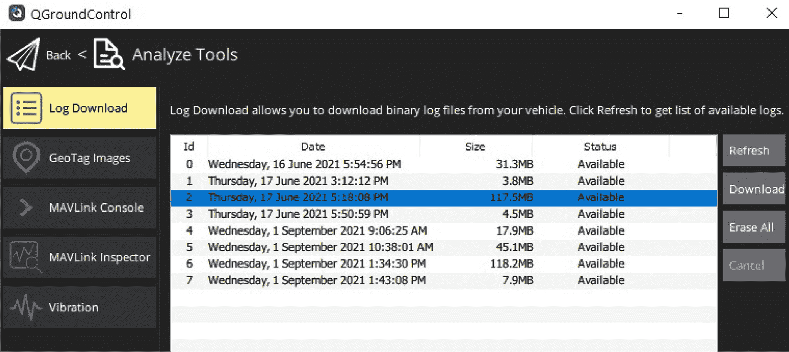

Figure 10.1 – QGC 的日志下载部分

5.  **选择要下载的日志**：在 `Log` 部分，您将看到可用日志的列表。选择您要下载的日志。这些日志通常按日期和时间组织。

6.  **开始下载**：选择所需日志后，寻找允许您下载或检索所选日志的选项。此选项可能标记为 `Download Logs`、`Save Logs` 或类似名称。

7.  **选择下载位置**：`QGC` 将提示您指定计算机上保存下载日志的位置。选择合适的文件夹或目录。

8.  **访问已下载的日志**：下载完成后，您可以从 *step 7* 中指定的位置访问已下载的日志。日志通常保存为 `.ulg` 文件（`UAV log format`，无人机日志格式），可使用日志分析工具打开和分析。

9.  **回顾与分析**：要回顾和分析日志，您可以使用日志分析软件，包括专用日志分析工具或基于 Web 的平台（如 `Flight Review`），正如之前在 `QGC` 背景下提到的那样。

### 分析已下载的日志

由于我们使用 `QGC` 下载日志，日志以 `.ulg` 文件格式保存，最适合使用 `Flight Review` 工具读取和分析。还有许多其他可用工具，例如 `PlotJuggler`，可用于深度估计。使用 `Flight Review` 分析日志（一种通常与 `PX4` 飞行栈相关的基于 Web 的日志分析工具）涉及回顾各种数据和图表，以评估无人机在飞行中的性能。以下是使用 `Flight Review` 分析日志及其提供的不同图表的简要概述：

1.  **访问 Flight Review**：打开网络浏览器并访问 `Flight Review` 网站（`https://logs.px4.io/`）。

2.  **上传并分析日志文件**：点击 `Flight Review` 网站上的 `Upload`（上传）或 `Analyze`（分析）按钮：

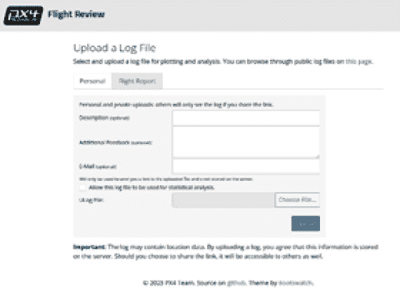

Figure 10.2 – Flight Review 主页

从您的计算机中选择要分析的日志文件并上传它们。

上传日志文件后，工具会对其进行分析，并以值-时间图的形式呈现每个数据点，以便读取和解读。

### 解读图表

不同的飞行模式（例如稳定、定高、定点盘旋和返航）可能在图表中用不同的颜色表示。这有助于您直观地识别无人机在任何给定时间处于哪种飞行模式。

### 高度估计

高度估计图显示了无人机垂直位置随时间的变化。它提供了关于高度变化的见解，有助于分析高度控制性能、识别异常并确保任务安全，特别是在需要精确高度管理的应用中，例如航测和测绘：

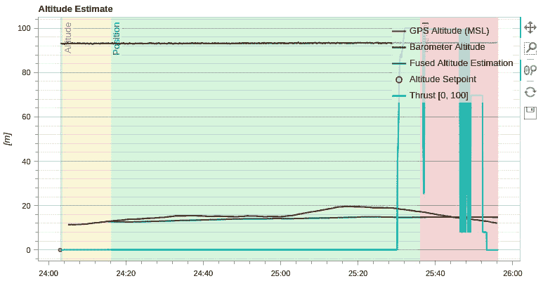

Figure 10.3 – 高度估计图

### 姿态（滚转、俯仰、偏航和角速率）估计

`Roll`、`pitch`、`yaw` 和 `angular rate` 图表显示了无人机的姿态和角运动。它们有助于评估无人机的朝向以及其在 `roll`、`pitch` 和 `yaw` 角度方面的机动情况。`angular rate` 图表显示这些角度的变化率。这些图表提供了关于无人机稳定性、响应性和对控制输入遵循情况的关键信息，从而实现性能分析和故障排查。以下是飞行姿态估计图的一个示例：

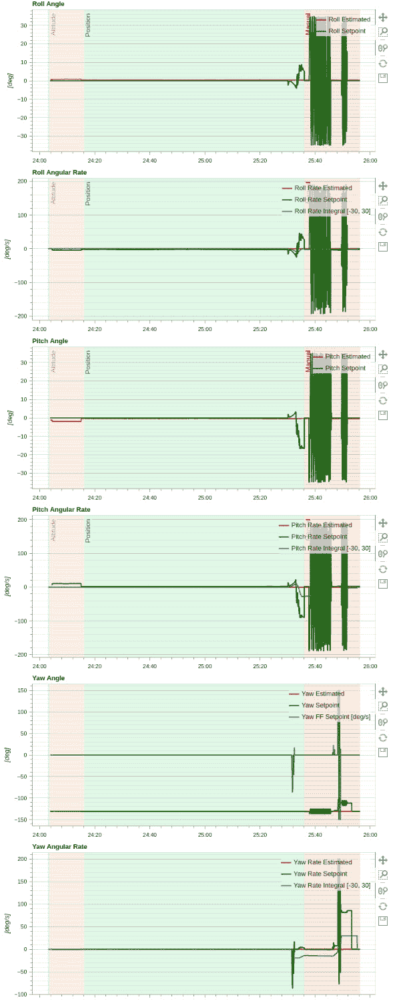

Figure 10.4 – 飞行姿态估计图

### 本地位置估计（X、Y、Z）估计图

`Local Position X`、`Local Position Y` 和 `Local Position Z` 图表显示了无人机在其本地坐标系中的位置。这些图表对于检测无人机横向和垂直运动中的异常至关重要，有助于识别位置控制问题、导航错误或干扰。分析这些图表对于诊断异常和确保无人机安全精确地运行可能至关重要：

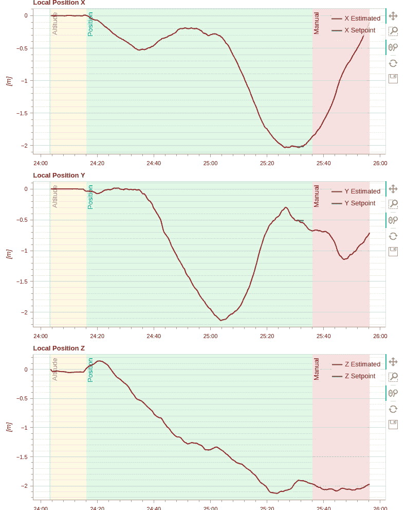

Figure 10.5 – 本地位置估计图

### 执行器输出图

`actuator output` 图提供了关于无人机控制面和电机如何响应指令的见解。该数据对于检测异常（如意外的电机行为）至关重要，这可能表明飞行稳定性、控制算法或机械结构存在问题。分析此图有助于诊断异常并确保无人机安全稳定地运行：

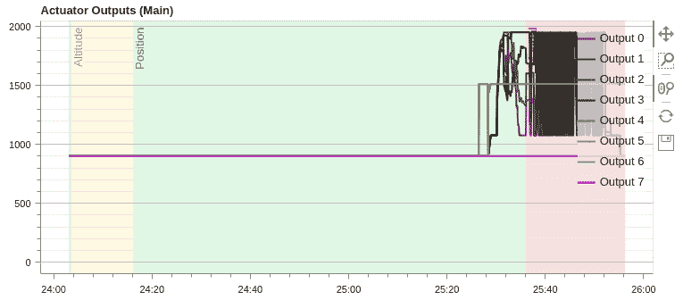

Figure 10.6 – 执行器输出图

### 角加速度 FFT 图

`Fast Fourier Transform` (`FFT`) 图用于可视化信号。在日志分析中，它用于将振动转换为振幅并以频率的形式显示在频域中。它常用于时间序列图中，以确定哪些频率分量属于哪个数据时间序列。`angular acceleration FFT` 图显示无人机角加速度的频率分量。它有助于识别无人机运动中的异常振动或振荡，这对于检测与结构问题、传感器噪声或干扰相关的异常很有用。分析此图有助于发现异常并确保更平稳、更安全的无人机飞行：

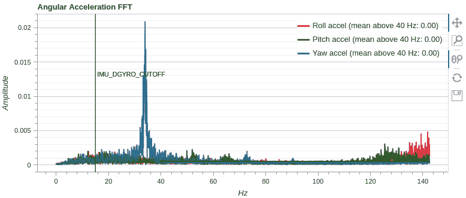

Figure 10.7 – 角加速度 FFT 图

### 执行器控制 FFT 图

`actuator controls FFT` 图显示无人机执行器控制输入的频率分量。它对于识别不规则的控制输入或振荡很有价值，这可能表明 `FCS` 或控制指令存在问题。分析此图有助于发现异常并改善无人机飞行稳定性和性能：

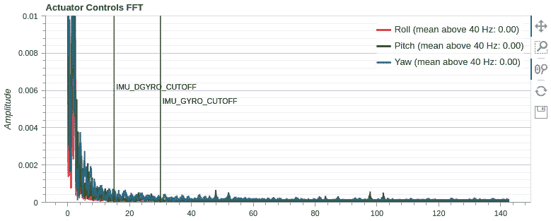

Figure 10.8 – 执行器控制 FFT 图

让我们看一些良好振动图和不良振动图的示例。

下图是一个优秀的振动图，不同 Hz 频率的振幅均极小。它表明振动在可接受范围内，确保了稳定且平衡的飞行。偏离此范围表明存在机械问题、部件不平衡或飞行不稳定等问题，这些都可能影响性能和安全：

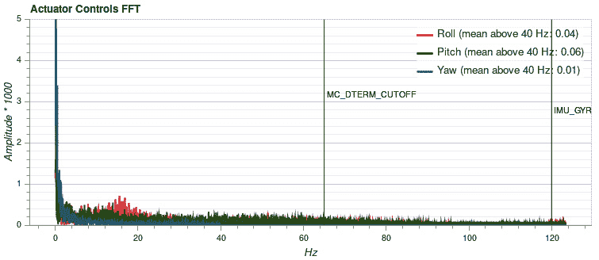

Figure 10.9 – 执行器控制 FFT 图

下图表现为频繁的高振幅尖峰和持续的高数值，表明飞行过程中存在过度且不规则的振动。这些不规则模式和偏离可接受范围的情况会影响无人机的稳定性和传感器数据质量，并存在损坏部件的风险。这是影响无人机性能问题的明确指标，因此该无人机振动非常差：

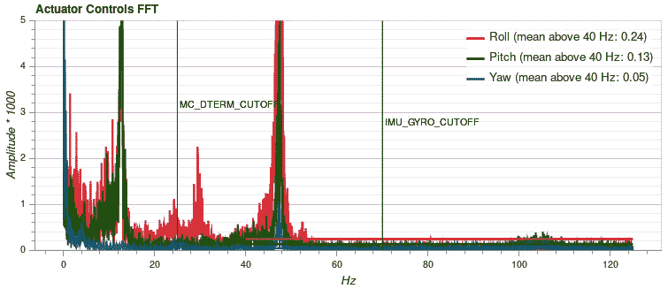

Figure 10.10 – 执行器控制 FFT 图

### 加速度功率谱密度图

加速度 `power spectral density` (`PSD`) 图是一种二维图形表示，显示无人机飞行过程中原始加速度计数据随时间的频率响应。它提供了关于无人机在不同频率和振幅下经历加速度情况的见解。通过分析此图，我们可以更好地了解无人机的运动模式和振动，有助于诊断与机械问题、飞行稳定性和传感器异常相关的问题。区域越黄，响应频率越高。

该图有助于识别无人机的加速度行为是否在可接受范围内，任何偏差或异常都可能预示着稍后可以纠正的问题：

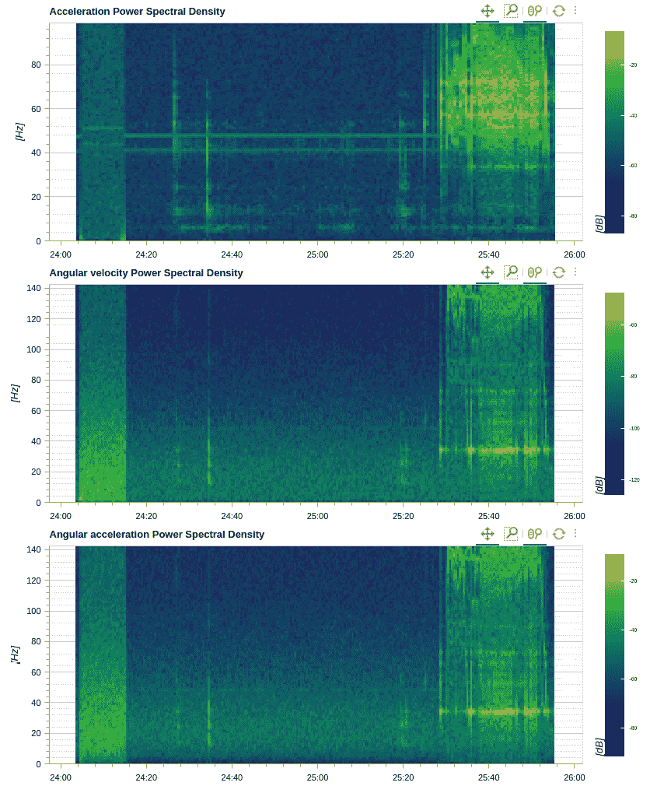

Figure 10.11 – 加速度 PSD 图

### 功率图

功率图显示无人机飞行过程中的功耗趋势。它有助于观察 `current` 和 `voltage` 数值，这对于理解电池性能和系统效率至关重要。通过分析此图，我们可以监控无人机是否保持在安全功率限制内，确保其最佳运行并达到预期续航时间。`current` 和 `voltage` 数值的显著波动或异常可能表明存在需要关注的潜在问题，以维持安全高效的无人机操作：

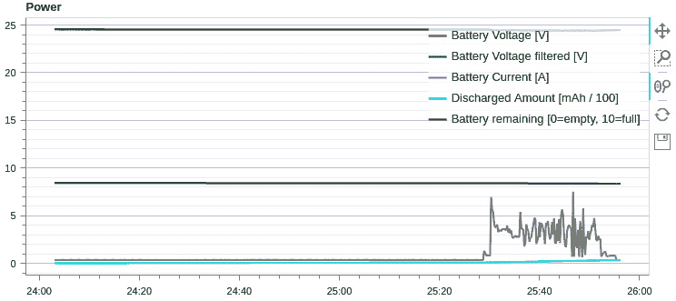

Figure 10.12 – 功率图

## 理解 PID 控制器及其用途

`PID` 控制是无人机世界中一种基础且广泛使用的方法，是飞行稳定和控制系统的中坚力量。无人机依靠 `PID` 控制器来维持稳定飞行、精确遵循飞行路径并响应飞行员指令。该控制算法通过不断测量期望状态与实际状态之间的误差，动态调整无人机的姿态和位置。简而言之，`PID` 在无人机中发挥着关键作用，确保平稳可控的飞行，使其成为无人机爱好者和该领域专业人士的必备概念。

`PID` 对无人机之所以必要，是因为它们提供了一种实时调整机制，以维持稳定性、控制姿态和位置、响应环境因素，并确保平稳安全的飞行。以下是 `PID` 对无人机必要的详细解释及其主要用途：

*   **稳定**：

    **用途**：`PID` 对于稳定无人机飞行至关重要。它们持续监控无人机的姿态并进行实时调整以保持水平和维持稳定位置。

    **重要性**：如果没有有效的稳定，无人机将出现不可控的运动，使其难以驾驶并构成安全风险。

*   **姿态控制**：

    **用途**：`PID` 通过调整电机转速和控制面来帮助控制无人机的姿态（朝向）。它们确保无人机响应飞行员指令并维持期望的 `roll`、`pitch` 和 `yaw` 角度。

# 无人机中的 PID 控制器

## 姿态控制的重要性

姿态控制对于机动、保持直线飞行路径以及准确响应飞行员输入至关重要。

## 定点悬停与航点导航

**用途**：PID 使无人机能够保持固定的 GPS 坐标位置（定点悬停）并遵循预定义的飞行路径（航点导航）。它们通过调整电机转速和控制面来抵消风等外部因素。

**重要性**：定点悬停和航点导航对于航拍、测绘以及搜索和救援等应用至关重要，这些场景需要精确的定位。

## 对环境干扰的响应

**用途**：PID 通过立即进行修正以保持稳定，帮助无人机响应风或湍流等环境干扰。

**重要性**：环境干扰会影响无人机的飞行。PID 有助于抵消这些影响，确保平稳可控的飞行。

## 平稳飞行

**用途**：PID 通过减少振荡和超调，有助于实现更平稳的飞行。它们提供渐进式的修正以维持稳定的飞行路径。

**重要性**：平稳飞行对于捕捉高质量图像和视频至关重要，尤其是在航拍和航摄中。

## 安全性

**用途**：PID 在确保无人机安全操作方面发挥着关键作用。它们防止异常移动，帮助避免危险情况，降低坠机风险。

**重要性**：安全是无人机操作中的重中之重，既关乎无人机本身，也关乎其交互的人员和财产。

## 误差修正

**用途**：PID 持续监测期望状态与实际无人机状态之间的误差。它们调整控制面和电机转速以最小化该误差。

**重要性**：误差修正对于保持飞行精度和满足操作员意图至关重要。

## PID 组成部分

### 比例项 (`P`)

`PID` 控制器的比例项测量无人机期望状态与实际状态之间的当前误差。在无人机语境下，这可能涉及姿态（横滚、俯仰、偏航）或位置（纬度、经度、高度）的差异。`P` 项计算无人机应如何调整（幅度和方向）以最小化误差。如果误差大，比例项施加的修正就显著；如果误差小，修正就微小。

**用途**：比例项计算与误差成比例的修正动作。如果无人机偏离期望状态，`P` 项会施加一个与误差幅度成正比的修正。

**重要性**：`P` 项的主要作用是对误差提供即时响应，帮助无人机维持期望的姿态、位置或飞行路径。

### 积分项 (`I`)

积分项考虑随时间累积的过去误差。它负责解决单靠比例项无法修复的长期误差。对于无人机，这有助于修正缓慢、持续的干扰，例如风或无人机结构的轻微不平衡。

**用途**：`I` 项处理长期或持续存在的误差。它有助于修正 `P` 项单独无法解决的缓慢、连续的干扰或误差。例如，它补偿无人机系统中的轻微不平衡或偏差。

**重要性**：`I` 项对于微调和消除 `P` 项可能无法立即解决的稳态误差至关重要。

### 微分项 (`D`)

微分项考虑误差的变化率。它有助于防止在期望状态附近发生超调或振荡。在无人机控制中，微分项可以减轻姿态或位置快速变化（如突发机动）的影响。

**用途**：`D` 项有助于阻尼无人机对误差快速变化的响应。它减轻了在快速机动或修正过程中可能发生的超调或振荡。

**重要性**：`D` 项对于稳定无人机至关重要，确保其不表现出不稳定行为或过度振荡，尤其是在激烈飞行或响应突发干扰时。

## 无人机中检测不良 PID 的方法及修复方式

我们需要通过持续飞行来判断是否需要调整无人机。以下是我们可以从飞行行为中观察到的现象列表，以及可利用的解决方案：

### 过度振动与振荡

**症状**：如果您的四轴飞行器表现出明显的振动和振荡，尤其是在悬停或稳定飞行期间，可能表明 `PID` 值存在问题。您可能会看到快速的来回移动或抖动行为。

**解决方案**：检查并调整 `P`、`I` 和 `D` 值以减少振动，实现更平稳的飞行。

### 对指令响应迟缓

**症状**：四轴飞行器对飞行员输入响应缓慢，特别是在机动或改变方向期间，可能预示着 `PID` 设置不当。

**解决方案**：增加 `P` 值以提高响应速度。调整 `P` 项可使四轴飞行器对指令反应更快。

### 超调与反弹

**症状**：如果四轴飞行器超出期望位置然后反弹回来，可能表明 `P` 项设置过高。

**解决方案**：降低 `P` 值直到超调停止，同时保持稳定性。微调以达到平衡。

### 定高不准确

**症状**：悬停时的高度波动或高度的可见偏差可能表明 `I` 项需要调整。

**解决方案**：增加 `I` 值以解决高度漂移，或在无人机倾向于波动时减小它。找到四轴飞行器保持恒定高度的平衡点。

### 偏航漂移

**症状**：偏航漂移是指四轴飞行器的航向在无飞行员输入的情况下缓慢变化，通常是由于 `D` 项调整不当导致的。

**解决方案**：修改 `D` 值以减少偏航漂移。增加 `D` 有助于减少振荡并保持航向稳定。

## 无人机中的速率控制器与 PID 调整

无人机使用复杂的控制系统来维持稳定飞行并响应飞行员指令或自主指令。该控制系统包括各种控制器、回路和速率控制器。调整这些控制器（特别是 `PID` 控制器）中的各个增益和参数，对于优化无人机性能至关重要。以下是这些组件及调整增益和参数过程的详细解释：

### 姿态控制器

**角色**：姿态控制器负责维持无人机的姿态，包括横滚、俯仰和偏航角度。它确保无人机保持水平并响应用户输入或自动驾驶指令。

**架构**：姿态控制器通常实现为 `PID` 控制器。该控制器的输入包括期望姿态（来自用户或自主指令）和由机载传感器（如加速度计和陀螺仪）测量的当前姿态。

**增益**：姿态控制的主要增益包括横滚、俯仰和偏航控制的 `P`（比例）、`I`（积分）和 `D`（微分）增益。它们通常表示为 `Roll_P`、`Roll_I`、`Roll_D`、`Pitch_P`、`Pitch_I`、`Pitch_D`、`Yaw_P`、`Yaw_I` 和 `Yaw_D`。

**调整增益**：调整 `Roll_P`、`Pitch_P` 和 `Yaw_P` 以控制无人机对姿态变化的灵敏度。较高的值会使无人机对水平偏差的反应更激进。

## 姿态与速率控制器的 PID 调参

调节 `Roll_I`、`Pitch_I` 和 `Yaw_I` 以消除稳态误差。增加这些值有助于保持精确的姿态。

修改 `Roll_D`、`Pitch_D` 和 `Yaw_D` 以减少姿态变化过程中的振荡和超调。增加 `D` 可抑制对姿态快速变化的响应。

### 速率控制器

#### 作用
速率控制器专注于通过调整电机转速来稳定无人机，以保持绕每个轴（横滚、俯仰和偏航）的特定角速度（旋转速度）。

#### 架构
与姿态控制器类似，速率控制器通常采用 PID 结构。它接收期望角速度（来自姿态控制器）和机载陀螺仪测得的实际角速度作为输入。

#### 增益
速率控制器包含用于横滚、俯仰和偏航速率控制的 `P`、`I` 和 `D` 增益，通常分别表示为 `RollRate_P`、`RollRate_I`、`RollRate_D`、`PitchRate_P`、`PitchRate_I`、`PitchRate_D`、`YawRate_P`、`YawRate_I` 和 `YawRate_D`。

#### 调整增益
调整 `RollRate_P`、`PitchRate_P` 和 `YawRate_P` 以控制无人机对角速度变化的灵敏度。较高的值会使无人机对旋转变化的反应更激进。

调节 `RollRate_I`、`PitchRate_I` 和 `YawRate_I` 以消除角速度控制中的稳态误差。增加这些值有助于保持精确控制。

修改 `RollRate_D`、`PitchRate_D` 和 `YawRate_D` 以减少速率变化过程中的振荡和超调。增加 `D` 有助于抑制对速率快速变化的响应。

### 调参流程
如果增益未调整，则需要进行调整。调参流程涉及的步骤如下：

1.  从飞控或制造商提供的基准值开始。
2.  对增益和参数进行微小的、增量式的调整，每次仅更改一个值。
3.  在受控环境中进行试飞，以评估调整的效果。
4.  观察无人机对操纵输入和环境条件的响应行为。
5.  持续迭代地审查和微调增益及参数，考虑无人机的具体需求和操作条件。
6.  分析飞行日志和数据，更详细地评估无人机性能。
7.  与无人机社区和论坛交流以获取建议，分享你的 PID 设置，并向经验丰富的飞手学习。
8.  在调参过程中优先考虑安全，并做好准备在出现意外行为时接管控制或让无人机降落。

在姿态和速率控制器中调整增益和参数是实现稳定且响应灵敏飞行的关键过程。它允许你针对特定需求优化无人机性能，无论是用于平滑的航拍摄影还是精确的特技飞行动作。

# 总结

因此，在本章中，我们学习了大量关于无人机日志分析的内容，包括日志存储位置、如何访问以及如何解读。这并非一日之功；它需要随着时间积累的经验和技能，才能理解这些日志文件的图表并从中得出结论。我们还学习了 PID 及其在四旋翼平稳飞行中的重要性和作用。我们还了解了不同的速率控制器、如何调整各个 PID 增益以及它们如何影响飞行性能。我们还浏览了不同种类的图表和日志，并学习了如何分析它们。通过学习所有这些内容，我们掌握了基础并开始调参，这将有助于我们在未来进行进一步的调参和分析，实现平稳飞行。

在下一章中，我们将学习如何在无人机上安装不同的任务载荷以及如何对其进行配置。
