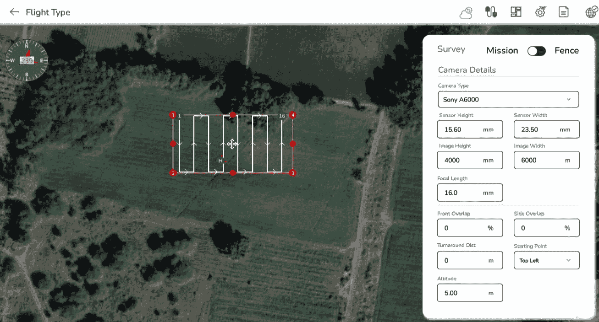
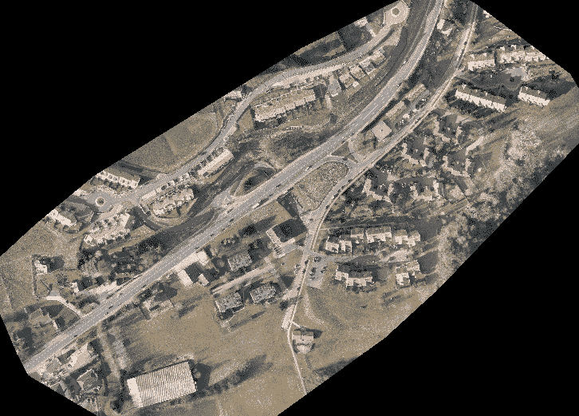
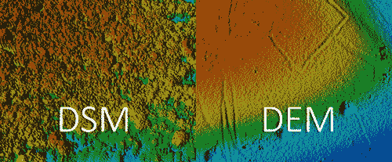
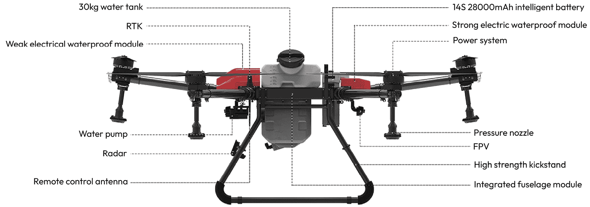

## 第 11 章：基于应用的无人机开发

### 基于应用的无人机开发

在本书前面的章节中，我们了解了不同类型的无人机以及构建一架无人机所需的基本组件。我们还学习了无人机的基本物理原理，以及如何借助工程学和物理学实现稳定飞行。无人机技术持续演进，为各个行业创造了无限机遇。无人机的进步带来了增强的能力，从提高飞行效率到更好的数据收集与分析。升级与功能开发推动创新，促进了更安全、更精确、更通用的无人机诞生。学习无人机技术为众多职业道路敞开了大门，从航拍摄影、电影摄影到农业、基础设施检查和环境监测。理解无人机进步赋予个人有效利用这些工具的能力，有助于在各个领域提高效率、数据准确性和解决问题的能力，最终塑造技术和工业的未来。这将帮助你理解可以在系统中实现的各种功能及其实现方式。

在本章中，我们将通过以下主题来了解无人机及其功能所针对的不同应用场景：

*   测绘无人机
*   农业植保无人机
*   空中物流无人机
*   系统冗余

## 技术要求

本章的基本技术要求是对无人机解剖结构有完整的理解，以及物理学和飞行时间要求。你还应清楚地了解航程、海拔和飞行作业环境。

此外，你必须对飞控引脚和输出有扎实的理解，以及各种外设的同步用法。最后，你必须了解所需的端口和协议，以及配置参数，因为这些同样重要。

## 测绘无人机

测绘无人机是以高分辨率相机为基本任务载荷的轻型无人机。它们兼容多种任务载荷选项。这些无人机用于拍摄地球表面图像并获取其地理坐标，以便进行精确的测绘和处理。这些图像随后被用于生成地图，供不同利益相关者使用。下图提供了一个测绘无人机的示例：

图 11.1 – 测绘无人机示例

航测涉及使用飞机、直升机或更常见的无人机等航空平台，从地球表面上方收集地理空间数据。这种方法被广泛应用于各个行业，用于测绘、监视、研究和分析。

### 为什么需要航测

航测帮助测绘人员高效地记录准确的地理空间数据。这节省了时间和精力，最终减少了所发生的费用。以下是航测相对于传统测量方法的一些优势：

*   **准确性与细节**：航测提供高精度和详细的数据，支持对大面积区域进行精确测绘和分析，而这些区域若从地面覆盖可能具有挑战性或耗时。
*   **效率**：与传统地面测量相比，航测方法在更短时间内覆盖更大区域。这种效率对于基础设施规划、环境监测、农业和灾害管理至关重要。
*   **成本效益**：对于大规模测绘项目，航测可能更具成本效益，因为它减少了地面测量所需的大量人力和资源。
*   **可达性**：某些区域（如偏远或危险地形）可能难以进行地面测量或风险过高。航测提供了一种安全高效的方式来从这些地点收集数据。

### 无人机在航测中的作用

# 无人机在航空测绘中的应用

由于无人机具有多功能性、灵活性和成本效益，它们彻底改变了航空测绘。以下是它们有用的原因：

*   **灵活性和机动性**：无人机能够穿越各种地形和环境，在不同高度和角度飞行，以捕获详细的图像和数据。
*   **高分辨率成像**：无人机配备高质量相机和传感器，能够捕获高分辨率图像并收集各种数据类型，包括摄影测量、**光探测和测距** 以及热成像。
*   **成本效益**：与传统飞行器相比，无人机的运营成本更低，使得航空测绘对中小企业和项目也变得触手可及。
*   **实时数据**：无人机可在飞行过程中提供实时数据，从而允许立即进行分析并调整测绘计划。
*   **安全性**：使用无人机进行航空测绘将人员卷入潜在危险或难以到达区域的风险降至最低。

总体而言，无人机通过提供一种具有成本效益、高效且精准的地理空间数据收集手段，在现代航空测绘中发挥着重要作用，使其成为农业、建筑、环境保护和基础设施建设等行业不可或缺的工具。

## 测绘任务中使用的载荷

在航空测绘任务中，无人机利用各种类型的载荷，以满足特定的数据收集需求。这些载荷涵盖了一系列传感器和设备，旨在捕获多样化的信息类型。以下是一些常见类型：

*   **RGB 相机**：这些相机捕获标准可见光，是基础航空影像的根本。它们用于摄影测量、制作正射镶嵌影像和生成高分辨率地图。
*   **多光谱和高光谱相机**：这些专用传感器捕获电磁波谱多个波段的数据，超出了人眼视觉范围。它们对于农业调查、植被分析和环境监测至关重要，因为它们能检测植物健康、土壤成分和作物胁迫。它们主要用于作物调查和土壤健康分析。
*   **热成像相机**：这些传感器捕获热特征以识别温度变化。它们用于各种应用，包括搜索和救援、建筑检查和环境研究。
*   **激光雷达**：激光雷达系统发射激光脉冲并测量光线返回所需的时间，从而创建高精度的 3D 地图。由于其在捕获高程和结构细节方面的精确性，它们被用于地形建模、基础设施评估和城市规划。
*   **气体和化学传感器**：这些传感器检测并测量大气中的特定气体或化学物质。它们用于环境研究，以及监测空气质量或检测工业环境中的泄漏。
*   **磁力仪和重力仪**：这些载荷测量磁场或重力的变化。它们对于地球物理调查至关重要，因为它们可以识别地下特征，如矿产沉积或地质结构。
*   **机载激光雷达和水深传感器**：用于航空或水下调查的专用传感器，常用于海岸测绘、海岸线评估或水下地形测绘。
*   **摄影测量附件**：相机或传感器的附件或插件可改进摄影测量应用的能力，提高精度和图像质量。

每种类型的载荷都有特定用途，使无人机能够收集对不同行业和应用至关重要的多样化数据类型。载荷的选择取决于测绘任务的目标以及分析和决策所需的信息类型。

## 载荷与无人机的集成

将相机载荷与无人机的飞控集成，涉及确保相机与无人机机载系统之间的无缝通信和同步。以下是集成过程和相关设置的概述：

### 物理集成

*   **安装**：使用兼容的安装机制将相机载荷牢固地固定在无人机上，确保稳定性和正确的对齐。确保相机直接朝下。
*   **连接**：在相机与无人机的飞控、电源和通信端口之间建立物理连接。确保设备之间的线缆连接正确且兼容。请务必研究载荷手册以及将飞控与相机集成的步骤。

### 飞控配置

*   **相机触发**：设置飞控，使其在飞行任务期间的特定间隔或航点触发相机。此配置确保根据测绘计划同步捕获图像。
*   **通信协议**：配置飞控与相机载荷之间的通信协议。这包括触发信号、数据传输和控制命令的设置。
*   **电源管理**：确保飞控管理对相机载荷的电源分配，在任务期间提供持续且充足的电力。
*   **云台控制（如适用）**：对于带云台的相机，配置飞控以控制云台的移动和稳定，使相机能保持稳定位置以捕获图像。

### 相机设置

*   **地理标记**：在相机上启用地理标记，将 GPS 坐标嵌入每张捕获的图像中，从而在后处理过程中实现精确的地理配准。
*   **触发接口**：确保相机与飞控的触发接口兼容。设置相机，使其响应飞控在指定航点或间隔发送的触发信号。
*   **曝光和捕获设置**：调整相机设置，如曝光、快门速度、ISO 和图像格式，以匹配测绘要求和环境条件。

### 测试与校准

*   **飞行前测试**：进行彻底的飞行前测试，确保相机与飞控之间的集成和同步功能正常。检查触发、图像捕获和数据传输。
*   **校准**：如有需要，校准相机载荷和飞控，确保在飞行任务期间准确捕获图像、地理标记和同步。

通过有效地将相机载荷与飞控集成并配置相关设置，无人机可以严格按照测绘计划精准捕获图像，确保为航空测绘任务收集准确且有价值的数据。

## 实时动态定位 (RTK) 和后处理动态定位 (PPK) 定位系统

RTK 和 PPK 是用于航空测绘无人机的两种先进定位技术，旨在提高地理空间数据收集的精度：

*   **RTK**：RTK 是一种卫星导航技术，可为定位数据提供实时、厘米级的精度。它依赖于与地面参考站或基站的持续连接，后者向飞行中的无人机传输差分修正信号。无人机机载 RTK 接收机将这些修正信号与其 GPS 信号进行比较，从而实现实时精确定位。RTK 技术无需后处理即可实现高精度测绘和制图，使其成为需要即时精确结果的应用的理想选择，例如精准农业或建筑工地监测。

### PPK

PPK 技术同样能提供高精度定位，但运作方式略有不同。使用 PPK 时，无人机在飞行过程中记录原始 GPS 数据。任务结束后，利用地面基准站或精确卫星定位数据对这些数据进行后处理。通过将记录的数据与高精度参考数据进行比对，PPK 会追溯性地计算修正后的定位信息。PPK 提供与 RTK 类似的厘米级精度，但在数据处理方面更具灵活性，且无需在飞行过程中持续保持与地面站的实时连接。这种方法常用于测绘任务，在这类任务中实时数据传输可能具有挑战性，例如在偏远或难以到达的地区。

## Mission planning for a survey mission

有效的航测飞行计划对于确保全面覆盖、准确数据采集和无人机安全运行至关重要。以下是有效飞行计划关键组成部分的大纲：

图 11.2 – 在 AeroGCS 中规划测绘任务

以下是飞行员在使用测绘无人机对某区域进行测绘前需要遵循的关键步骤：

1.  **定义测绘区域**：
    使用测绘软件或 GCS（地面站）清晰地定义待测区域的边界。
    考虑测绘区域内的任何障碍物、禁飞区或特定地物。

2.  **确定高度和分辨率**：
    根据测绘所需的**地面采样距离 (GSD)** 计算最佳飞行高度。GSD 决定了捕获的细节层级。
    在测绘中，GSD 指的是无人机相机拍摄的图像中单个像素在物理上的大小。它反映了每个像素对应的地面物理距离。较小的 GSD 表示更高的空间分辨率，从而在测绘应用中实现更详细、更精确的制图和分析。
    考虑相机规格、测绘目标和地形变化以设置合适的高度。

3.  **航点规划**：
    使用 GCS 通过航点规划无人机的飞行路径。确保图像之间有足够的重叠（通常两个方向均为 60% 至 80%），以实现精确制图。
    规划航点以覆盖整个测绘区域，同时保持恒定的高度和速度。
    根据无人机速度、相机规格和期望的图像重叠度调整航点间距。

4.  **朝向和重叠**：
    规划无人机飞行路径，使其拍摄具有前向和侧向重叠的图像，以便于精确的图像拼接和三维重建。
    考虑改变无人机朝向进行十字网格飞行，以最大化覆盖范围并最小化畸变。

5.  **安全考量**：
    将安全措施纳入飞行计划，包括应急着陆点、返航点和避障。
    检查测绘区域是否存在空域限制、环境条件或潜在危险。

6.  **测试和验证**：
    在 GCS 软件中模拟计划的飞行路径，以确保完全覆盖、足够重叠并遵守安全规程。
    验证飞行计划是否符合测绘目标和期望的图像质量。

7.  **任务执行**：
    执行计划的飞行任务，确保无人机遵循预定义的航点并根据设定参数拍摄图像。
    监控飞行过程以应对任何不可预见的问题，并确保数据采集按计划进行。

有效的飞行计划对于实现测绘目标、收集高质量数据和确保航测任务成功至关重要。根据实时条件和数据评估对计划进行调整和优化，有助于提高测绘的整体有效性。

## Image stitching and post-processing

图像拼接是一个将多张单独图像合成为单张无缝大图或全景图的过程。在航测背景下，图像拼接对于创建正射影像至关重要，正射影像是经过几何校正的高分辨率地球表面影像。该过程对齐并融合重叠图像，以生成测绘区域的综合准确表达。

我们还需要了解，准确性与图像美观度之间存在权衡，因为后处理技术可能会引入畸变，从而影响拼接图像的准确性。关键在于在不损害可靠航测数据所需精度的前提下，生成视觉效果良好的结果。

有几种软件选项常用于航测图像拼接：

*   **Pix4D** (`www.pix4d.com`)：
    Pix4D 是一款广泛使用的摄影测量软件，提供先进的图像处理功能，用于创建正射影像、三维模型和点云。它使用**运动恢复结构**算法来拼接图像并生成精确的地理参考地图。

*   **Agisoft Metashape**（原 **PhotoScan**）(`www.agisoft.com`)：
    Agisoft Metashape 是另一款用于处理航空影像的流行摄影测量软件。它通过对齐和融合图像生成高质量的正射影像和**数字表面模型 (DSM)**。

*   **DroneDeploy** (`www.dronedeploy.com`)：
    DroneDeploy 是一个基于云的平台，为无人机数据提供图像拼接和制图功能。它自动化图像处理工作流，并为各行业创建正射影像和三维模型。

这些软件应用利用先进算法分析和对齐重叠图像、校正畸变、调整颜色和曝光，并无缝融合它们。它们通常还允许进行额外的处理步骤，如地理配准、地形建模和提取各种数据图层。

## Final deliverables

航测会生成各种对不同行业和应用有价值的输出成果。这些成果源自测绘任务中配备专用传感器的无人机收集的数据。以下是一些关键输出成果：

*   **正射影像图**：
    由测绘过程中拍摄的多张图像拼接而成的高分辨率、带地理参考的地图。正射影像图提供了测绘区域详细准确的表达，这使其在土地规划、农业、基础设施建设和环境监测中非常有用：

图 11.3 – 正射影像示例

*   **数字高程模型 (DEM) 和数字表面模型 (DSM)**：
    DEM 表示裸露的地球表面，而 DSM 包含建筑物和植被等地表要素。这些模型提供高程数据，这对于地形分析、洪水建模、城市规划和基础设施设计至关重要：

图 11.4 – DSM 和 DEM

*   **三维模型**：
    由航空影像生成的三维模型提供了测绘区域的详细三维表达。它们用于城市规划、建筑、考古以及可视化目的。

*   **植被指数**：
    植被指数源自多光谱或热成像，指示植物健康状况、胁迫水平或生物量。它们在精准农业、林业和环境研究中很有价值。

*   **点云**：
    由激光雷达或摄影测量采集的单个点的三维表达。点云用于详细地形建模、体积分析和基础设施巡检。

*   **变化检测分析**：对比不同时间拍摄的图像，可检测土地利用、基础设施或环境状况的变化。这有利于监控施工进度、环境变化和灾害评估。
*   **环境评估数据**：通过航测获得的土壤成分、水质、污染水平和栖息地分析数据，有助于环境影响评估和保护工作。

由此，我们已对测绘无人机进行了深入分析。这将帮助新飞手了解测绘的基础知识。接下来，我们将探讨无人机的另一个应用——农业喷洒。

# 农业喷洒无人机

农业喷洒无人机是专门的**无人驾驶飞行器 (UAV)**，旨在以精准、定向的方式向作物施用化肥、农药、除草剂和其他农业投入品。这些无人机拥有针对高效、受控施用而优化的特定载荷和喷洒系统：

Figure 11.5 – Example of an agriculture drone

让我们简要了解一下载荷和喷洒系统：

*   **喷洒机构**：农业喷洒无人机配备喷洒系统，包括水泵、喷嘴和可携带液体载荷的药箱。这些系统确保农业投入品在作物上受控、均匀地分布。
*   **变量率技术 (VRT)**：先进的喷洒无人机采用 VRT，可根据作物状况调整喷洒速率，实现定向施用，最大限度地减少投入浪费。
*   **载荷容量**：不同农业喷洒无人机的载荷容量各异，允许每次飞行携带和施用不同体积的农业投入品。部分无人机提供 5 L、10 L 和 15 L 容量的载荷。
*   **导航与精度**：这些无人机利用 GPS 和精准飞行控制系统准确导航田间，确保喷洒在正确区域进行，最大限度地减少重叠或遗漏。这需要有效的 GPS 精度。

## 无人机喷洒药箱集成

如今，主流喷洒云台随手可得，可与无人机集成。将 10 L 喷洒药箱与无人机集成并控制喷洒速率，涉及多个步骤，以确保高效、准确地施用农业投入品。以下是指南：

**药箱集成**

1.  **选择合适的药箱**：选择轻便且耐用、能安全盛装 10 L 液体的药箱。考虑与农用化学品兼容且不过重的材料。
2.  **安装系统**：在无人机机架上设计安装系统以固定药箱。确保安装系统平衡稳定，以维持无人机的飞行特性。

**喷洒机构**

3.  **喷洒系统选型**：选择与药箱和无人机动力系统兼容的喷洒组件。这包括适合处理液体并实现所需喷洒模式的水泵、喷嘴、阀门和软管。
4.  **喷洒速率控制**：实施调节喷洒速率的控制机制。这可能涉及调整水泵压力和喷嘴尺寸，甚至采用电子流量控制系统来调节液体流量。速率控制可通过飞控 PWM 引脚配置，并由遥控器设定。

**与飞控集成**

5.  **飞控配置**：对飞控进行编程，使其能管理喷洒机构。确保飞控能在飞行中激活、关闭和调节喷洒过程。
6.  **接口设置**：喷洒水泵电机附带电调，用于控制水泵转速。建立飞控与喷洒系统之间的通信，并通过任意遥控通道进行控制。这可能涉及配置**脉宽调制 (PWM)** 或其他控制接口，以将飞控的指令传递给喷洒组件。

## 农业喷洒飞行规划

农业喷洒无人机的飞行规划对于确保在田间精准、高效地施用农业投入品至关重要。以下是规划此类任务的有效流程：

**定义任务参数**

1.  **作物类型与面积**：了解作物类型和待喷洒区域的大小。
2.  **投入需求**：根据特定作物和田间条件，确定所需农业投入品（化肥、农药、除草剂）的类型和数量。

**评估环境因素**

3.  **天气状况**：查看风速、风向、温度和湿度的天气预报。避免在不利条件下飞行，因为这可能影响喷洒效果或无人机稳定性。
4.  **地形与障碍物**：分析地形、高程变化以及可能影响无人机飞行路径的任何障碍物（树木或电力线）。

**选择飞行路径与参数**

5.  **航点规划**：使用 AeroGCS 和 Mission Planner 等地面站规划无人机飞行路径，设置覆盖整个田块的航点。确保相邻航带之间有足够的重叠，以实现均匀喷洒。
6.  **高度与速度**：在考虑喷洒设备和所需喷洒覆盖范围的前提下，确定最佳飞行高度和速度。保持恒定高度以实现均匀喷洒。

**喷洒策略**

7.  **喷洒速率与模式**：配置喷洒系统以实现有效覆盖所需的喷洒速率和模式。根据作物类型和投入需求调整喷嘴设置和流量。
8.  **VRA**：如有需要，实施 VRA，根据作物健康状况或田块内特定区域调整喷洒速率。

## 预防措施与安全

除常规无人机外，还必须采取特定措施，因为无人机使用的化学品可能对生物和环境构成危险。此外，无人机体型较大，必须小心操作。请考虑以下方面：

*   **失控**：若失去控制，激活*返航*设置。跟踪无人机飞行路径并提醒附近人员。若发生坠机，启用应急程序。
*   **使用安全装备**：携带农药的无人机或农药使用后，佩戴适当的**个人防护装备 (PPE)**。
*   **处理容器**：喷洒后彻底冲洗药箱。刺破并安全处置农药容器。
*   **机械检查**：无人机干燥后检查是否有损坏，并记录任何问题。
*   **处理农药废弃物**：三次冲洗药箱并妥善处置废弃物，防止人员和动物进入施药区域。

# 空中配送无人机

无人机配送代表了一种创新的运输方式，涉及使用 UAV 或无人机将货物、包裹或物品从一地运送至另一地。这种配送方式具有多种优势，包括速度快、可达性强，以及能够到达偏远或难以到达的地区。配送无人机的基本特征如下：

*   **专用于配送**：空中配送无人机专门用于将货物、包裹或货物从一点运输到另一点。其设计更专注于物品投递任务。
*   **增强的载荷能力**：它们被设计为可携带更大载荷，通常配备安全的载荷舱或连接机制，以在飞行过程中安全运输包裹。

*   **载荷释放机制**：这些无人机采用机制在飞行过程中安全固定包裹，并在指定地点释放。这涉及用于受控包裹投放的载荷释放机制或系统。
*   **导航与投递精度**：重点在于精确导航、精准着陆以及在指定投放点的投递能力。

## 载荷释放机制

在无人机中，载荷释放机制是一种设备或系统，旨在飞行过程中安全地部署或释放载荷，例如包裹、设备或其他物品。它能实现载荷在指定地点或时间的受控精准部署。该机制因无人机的用途和所释放载荷的具体要求而异。

让我们看看不同类型的载荷释放机制：

*   **伺服电机机制**：利用伺服电机驱动和控制释放机制。伺服电机连接到固定载荷的锁扣或机构上。激活时，伺服电机动作，释放锁扣，使载荷脱落。
*   **电磁释放**：利用电磁机制固定载荷。当电流通入或中断时，释放磁力固定，使载荷分离。
*   **气动/液压释放**：利用压缩空气或液压压力触发释放。当加压或泄压时，机制启动，实现载荷部署。
*   **手动机制**：涉及较简单的手动释放系统，操作员可手动触发锁扣或挂钩。这常用于基础 DIY 或自制无人机。

### 工作原理

载荷释放机制的功能会因其设计和激活方式而异：

*   **激活机制**：释放可由无人机操作员通过飞控，使用指定开关或通道远程触发。此激活向机制发送信号以启动释放过程。
*   **安全固定**：机制在飞行中安全固定载荷，确保其在发出释放指令前保持连接。
*   **受控部署**：接收到释放信号后，机制启动，允许载荷从无人机投放或部署。释放可设计为精准模式，实现载荷在特定位置的精准投放。
*   **安全措施**：可靠的释放机制包含故障保护，防止意外或过早部署。这些安全功能确保载荷仅在预期时释放，提高作业的整体安全性和可靠性。

### 配置参数

通过飞控设置参数以控制载荷释放机制，涉及配置特定设置来管理释放机制的激活和行为。这些参数在飞控软件或 `GCS` 中自定义，以确保精准可控的操作。以下是一些需考虑的关键参数：

*   `Channel assignment`（通道分配）：为遥控器（无线电控制器）和飞控分配一个专用通道以控制载荷释放机制。确保该通道不用于其他关键功能，以避免冲突。
*   `Output configuration`（输出配置）：在飞控软件/`GCS` 中将指定通道配置为输出通道。指定此输出以控制载荷释放机制。
*   `Channel mapping`（通道映射）：将遥控器的开关或控制映射到飞控上分配的输出通道。此映射允许操作员使用遥控器上的指定控制来触发释放机制。
*   `Control activation setup`（控制激活设置）：设置释放机制的激活模式。这可能包括根据机制类型和期望的控制方法，在拨动开关、点动开关或比例控制之间进行选择。
*   `Timing and delays`（时序与延迟）：实施时序参数以控制释放信号的持续时间。这可能涉及设置特定的激活时间间隔，并确保载荷在期望的持续时间内释放。
*   `Control response`（控制响应）：微调释放机制的控制响应。调整与伺服行程限制、脉冲宽度或控制信号范围相关的参数，以确保机制准确响应控制输入。

因此，无人机在其开发及连接各类释放机制的方式上将发生一些变化。目前投递处于试点阶段，整个基础设施需为此建设。但很快，这将形成一个成熟的生态系统，能够投递重要的医疗器官和药品，以及日用品。

## 无人机生态系统中的安全法规

随着不同种类、不同尺寸、不同续航能力的无人机进入市场，以满足载荷投递在重量和航程方面的需求，政府必须制定法规来规范这些无人机的运行。大多数国家，如美国、印度和欧洲国家，正在出台无人机政策和法规，确保在 `LOS`（目视范围内）和 `BVLOS`（目视范围外）模式下这些飞行的安全与顺利测试。`UTM`（无人机交通管理）和 `remote ID`（远程识别）的概念也被引入以管理无人机交通。

## 系统冗余

无人机中的冗余涉及引入备份系统或重复组件，以确保持续运行并减轻关键系统故障的影响。这种冗余对于提高安全性、可靠性和容错能力至关重要，特别是在系统故障可能导致灾难性后果的场景中。以下是无人机中各种冗余组件的概述，特别是 `Pixhawk` 飞控中的组件：

*   **冗余传感器**：
    *   **GPS 冗余**：`Pixhawk` 飞控通常支持冗余 `GPS` 模块。使用来自不同制造商的两个 `GPS` 模块可在一个模块发生 `GPS` 信号丢失或故障时提供备用定位信息。
    *   **IMU 冗余**：在 `Pixhawk` 中，可通过多个 `IMU` 实现冗余。双重或三重 `IMU` 提供备用姿态和方向数据，确保稳定性和精准飞行控制，即使一个传感器故障也能正常工作。
    *   **气压计冗余**：一些兼容 `Pixhawk` 的无人机采用冗余气压传感器以确保高度测量准确。冗余气压计有助于维持精准高度数据，保障安全运行。
*   **冗余电源系统**：
    *   **双电池配置**：基于 `Pixhawk` 的无人机可配置双电池设置。此设置允许无人机在另一块电池故障或意外耗尽时，继续依靠一块电池运行，确保持续供电并延长飞行时间。
    *   **双电源输入**：一些 `Pixhawk` 飞控支持冗余电源输入。这些系统使无人机能在不同电源（如不同的 `Battery Eliminator Circuits`（`BEC`，电池消除电路）或电源模块）间无缝切换，确保关键组件不间断供电。
*   **`Pixhawk` 内的实现**：
    *   **配置与设置**：您可使用 `Pixhawk` 飞控软件（如 `ArduPilot` 或 `PX4`）配置冗余传感器和电源系统。您也可在飞控配置中访问与冗余设置相关的参数。
    *   **硬件选择**：选择支持冗余设置的 `Pixhawk` 兼容硬件。选择设计为双重或三重配置工作的冗余传感器、`GPS` 模块、电源模块和飞控。

*   **校准与测试**：在 Pixhawk 软件中校准冗余传感器和电源系统。确保功能正常及切换程序有效。在受控环境中进行全面测试，以验证冗余设置。
*   **故障安全实现**：在飞控设置中实施故障安全协议，以检测传感器或电源故障。配置系统在主系统故障时自动切换到冗余组件。

冗余技术在无人机中（特别是在 Pixhawk 生态系统内）可提高系统可靠性，降低灾难性故障的风险，并确保持续运行，即使在发生组件故障或信号丢失的情况下也是如此，这使其在关键任务或场景中极具价值。

## 总结

在本章中，我们探讨了用于农业、航测和空中配送的无人机开发。这展示了它们彻底改变各行各业的巨大潜力。配备专用载荷的无人机增强了农业中的作物监测、测绘和数据采集，优化了产量和资源管理。在航测领域，这些无人机实现了高效、详细的测绘，用于城市规划、环境监测和基础设施评估。此外，空中配送为物流和应急响应引入了新的可能性，提供了快速高效的运输解决方案。

展望未来，下一步涉及完善无人机技术和应用。这包括在传感器技术、载荷能力和自主导航系统方面取得进一步进展。加强安全措施，如防撞系统和安全通信，将对无人机的广泛采用至关重要。此外，整合 AI 和机器学习以分析无人机采集的数据，将为各领域的决策提供更深入的见解。监管机构、开发者和行业之间的合作对于建立标准化实践和法规至关重要，这将促进无人机在各个领域负责任且广泛地应用。最终，持续的创新与合作将推动无人机的演变，释放其在社会和工业变革方面的全部潜力。
