# 开发定制测绘无人机

我们即将读完本书。我们已经学习了与无人机相关的各种概念。在前几章中，我们研究了不同的组件及其组装方式。在本章中，我们将学习如何开发一款用于航测的定制无人机。我们将构思该无人机，并为其配置最适合测绘用途的特定载荷。

之前我们了解到，无人机是一个为特定目的搭载载荷的平台。在本章中，我们将分析测绘无人机的需求，根据这些需求构思无人机，然后制造一架。我们还将介绍使用无人机进行测绘的基本要求。航测是许多不同类型无人机的常见应用，因为使用无人机进行航测耗时更少，只需付出最小的努力即可生成对利益相关者有帮助的准确结果。

在本章中，我们将涵盖以下主要主题：

*   地理空间测绘
*   设定测绘无人机的要求
*   选择无人机组件
*   无人机配置

## 技术要求

本章没有特别的技术要求。前几章的内容足以帮助你理解此处涵盖的概念。不过，最好有焊接和电路操作的经验。如果你想设计自己的机架，则需要具备 SolidWorks 或 Catia 的设计经验。

具备组装和放置组件的实操知识将是一个加分项。

## 地理空间测绘

地理空间测绘是一种系统且有组织的方式，用于收集、分析和解释与地球表面相关的地理空间数据。这种测绘方法采用各种技术来捕获、处理和呈现地球表面自然和人造特征的信息，形式为地理坐标。地理空间测绘采用广泛的技术，包括卫星影像、航拍、使用 GPS 和 LiDAR 的地面测绘，以及使用**地理信息系统 (GIS)** 进行的高级空间数据分析。地理空间测绘的主要目标是收集关于地球表面准确且最新的信息，以做出明智的决策。

### 地理空间测绘在工业中的应用

地理空间测绘的用途是多方面的，跨越各个行业和应用。一个重要的应用是城市规划，地理空间测绘有助于土地利用分析、基础设施规划和分区评估。环境监测是另一个关键领域，它利用地理空间数据观察生态系统变化、监测森林砍伐、评估水质并有效应对自然灾害。在农业中，地理空间测绘通过提供作物健康见解、监测植被和预测产量，助力精准农业。此外，地理空间测绘在灾害管理、交通规划、自然资源管理和科学研究中发挥着关键作用。通过提供地球表面详细准确的表达，地理空间测绘赋予决策者所需的空间智能，以应对复杂挑战并在各领域做出明智选择。

## 设定测绘无人机的要求

我们已经研究了航测、其优势以及所用传感器的类型，因此此处不再深入细节。相反，我们将直接进入测绘无人机应具备的主要功能。

### 高质量成像传感器

高分辨率相机或专用传感器（如多光谱或 LiDAR）用于采集详细准确的测绘数据，这是首要要求。我们应考虑不同测绘类型所需的传感器类型，如 RGB 相机和 LiDAR，并考虑其重量，因为这将影响无人机的总*总重*和性能。

### GPS

我们需要精确的 GPS 功能来为测绘数据赋予地理坐标，并确保精准测绘，因为带地理标签的图像是测绘的首要要求。此外，精确的 GPS 对于无人机自主飞行也是必需的。从长远来看，具备 RTK 功能的 GPS 将是更好的选择。

### 自主飞行规划

我们需要自主无人机飞行规划，因为这允许用户定义测绘区域、设置航点并执行预定义的飞行路径。这是获取均匀分布、高质量且无模糊图像的关键要求。

### 长航时

我们需要延长的电池续航，以便在单次飞行中覆盖大面积测绘区域，减少频繁降落和更换电池的需求。我们还需要一个优秀的动力系统来降低电池消耗并提供更长的飞行时间。对于我们的测绘无人机，我们将考虑至少 60 分钟的飞行时间，以便覆盖大面积区域。

### 实时监控与遥测

拥有实时视频流或遥测数据以实时监控正在进行的测绘任务总是很棒的，这使得在需要时能调整飞行参数。这也有助于在长距离飞行中监控无人机系统的健康状况。

### 耐用性与抗天气能力

我们需要坚固的结构和抗天气设计，以承受包括风、雨和温度变化在内的环境条件。

### 载荷能力

如前所述，我们需要足够的载荷能力来搭载特定测绘任务所需的传感器或相机。这可以是一个即插即用系统。拥有更大的载荷能力使我们有特权能够部署多个具有不同重量能力的载荷。

## 全重或总重

最好让全重尽可能低，这样会消耗更少的电池电量并提供更长的飞行时间，同时也会减少空气动力学阻力，使操作更平稳。

# 选择无人机组件

制造无人机涉及选择和组装各种机械和电子组件，以创建一个功能齐全且可靠的空中平台。在本节中，我们将了解无人机的关键组件及其选择考量。从机身到最新的飞控，所有组件都必须经过选择，以制造出一架能满足我们测绘需求的完美无人机。确保无人机耐用且符合当地法规。

## 机身

正如我们已知，机身是由刚性材料构成的骨架，它将电子设备固定在各自指定的区域，使它们能作为一个完整的系统协同工作。

以下是机身的选择考量：

- 材料（碳纤维、铝材等）：由于碳纤维机身在重量与强度方面表现良好，我们将使用碳纤维机架。
- 尺寸和承重能力：机身尺寸取决于我们选择的螺旋桨，以确保飞行过程中任意两个螺旋桨不会相互接触。对于 6 千克全重的无人机，机身重量应为 400 至 500 克（约 1.1 磅）。相机支架、起落架和任何外壳会增加额外重量。
- 机架类型：我们始终可以在四旋翼、六旋翼或固定翼无人机之间选择。既然我们在研究多旋翼，我们将使用四旋翼。选择六旋翼会增加该应用的重量并消耗更多功率。如果载荷重量较高，例如激光雷达，且我们需要无人机具有更大的推力和稳定性，我们可以选择六旋翼。为了以最小重量和功耗优化系统，我们将使用四旋翼机架。
- 可折叠或刚性设计以便携带：首选刚性设计，但这取决于用户想要采用哪种方案。可折叠臂设计可减小尺寸，便于运输。

牢记上述要求，我们可以自行设计和制造机身；不过，那是一个单独的过程。作为无人机工程师，我们的角色是利用给定应用可用的组件开发出一款成功的最优无人机，并能够对其进行飞行和调试（如果出现任何问题）。

让我们看几个市面上可买到的机身示例，例如 Tarot RC Peeper（图 12.1）和 Tarot TL4X001（图 12.2），它们非常适合测绘应用。不过，如果您愿意，也可以选择自己的机架：

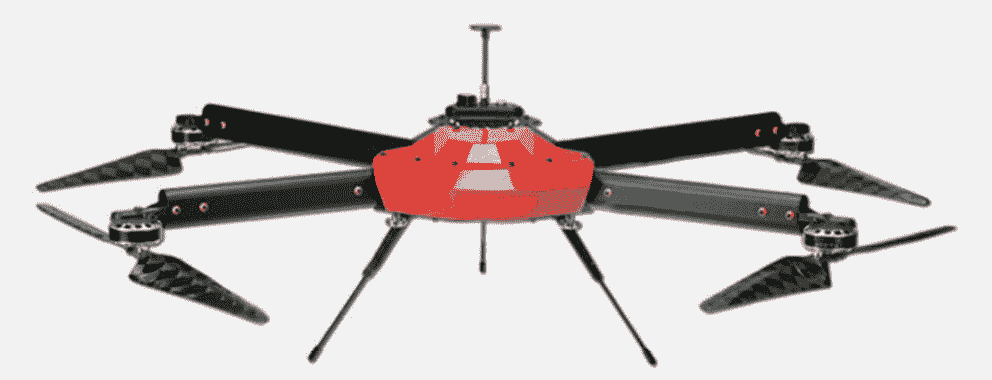

图 12.1 – Tarot RC Peeper

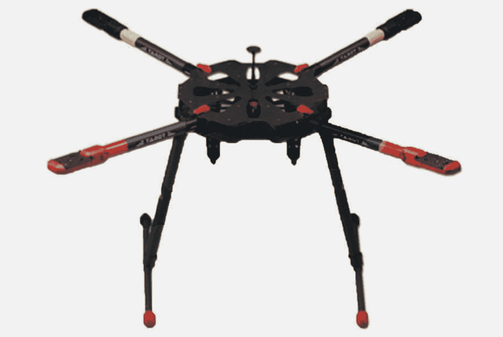

图 12.2 – Tarot TL4X001 规格

## 动力系统或动力链

动力系统是无人机最重要的部分。它由以下部件组成：

- 电机
- 螺旋桨
- 电池
- 电子调速器 (ESC)
- 电源分配板 (PDB)
- 电源模块

我们必须选择一个满足无人机性能标准的动力系统。

### 电机选择

以下是电机的选择考量：

- 类型（有刷或无刷）：
  - 无人机技术使用 BLDC 电机运行，因为它们寿命长、功耗较低且效率更高
  - 许多制造商生产优质的 BLDC 电机，包括 T-Motor 和 KDE Direct 等

#### 技术规格

电机数据手册是了解所需技术规格并选择最佳电机的最佳途径。

它反映了电机产生的总推力。对于四旋翼，总推力等于四个电机共同产生的推力。

数据手册让我们了解将用于产生所需推力的螺旋桨尺寸。

它还提供了电机的功耗，这有助于我们估算所需的电池容量及其尺寸和重量。

我们在上一章学习了如何阅读和比较电机规格和数据手册。因此，根据要求，我们将采用 MN501-S 300 KV 电机。

下图显示了 MN501-S 300 KV 电机的数据手册。它包含所需的参数，如重量、功率和电阻。我们选择这款电机是基于这些方面：

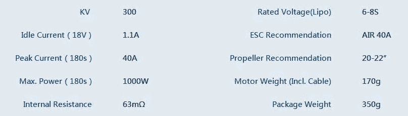

图 12.3 – 电机规格

### 螺旋桨选择

制造商提供不同螺旋桨的推力测试台数据，以便用户为其用例选择最佳螺旋桨——即以最小电流消耗获得最大推力的螺旋桨：

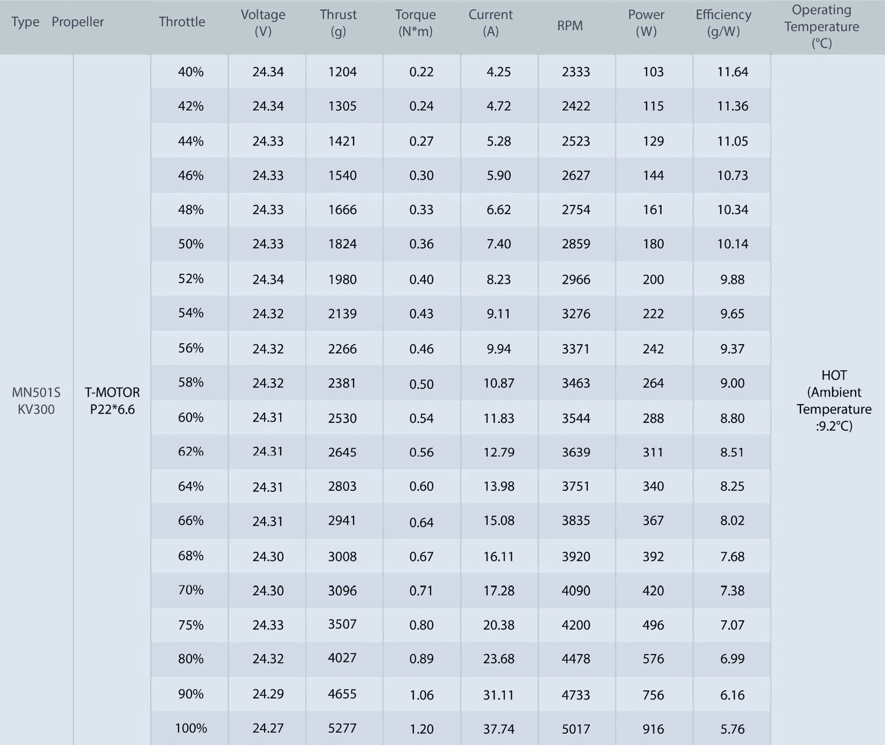

图 12.4 – 电机推力数据

以下是选择考量：

- 由于无人机全重为 6 千克，每个螺旋桨在 50% 油门下产生的推力应至少为 1,500 克（约 3.31 磅）。
- 从该数据手册中可以看出，50% 油门下的推力为 1,824 克，比要求高出 324 克（约 11.43 盎司）。这可以补偿风力或其他大推力需求。
- 当前推力要求在 46% 时也能满足，此时产生 1,540 克推力。这等于我们的需求，很好。因此，我们可以认为 22 英寸螺旋桨是该电机的高效组合。

#### 螺旋桨材质

螺旋桨的材质对其性能、效率和耐用性至关重要。螺旋桨常用的材料有塑料、碳纤维和木材。

塑料螺旋桨轻便且价格实惠，适合初学者和休闲无人机爱好者，但它们容易损坏，且可能无法提供最佳性能。

碳纤维螺旋桨比塑料更坚固、更刚性，提供更好的性能和效率。它们也耐用且抗损坏，非常适合专业和高性能无人机。

木质螺旋桨较少见，但具有柔韧性和耐用性。它们比塑料和碳纤维螺旋桨更安静，适合对噪音敏感的应用。

无人机螺旋桨的最佳材质取决于无人机的具体需求及其预期用途。对于高性能无人机，通常首选碳纤维螺旋桨，而对于休闲用途，塑料螺旋桨可能更合适。

让我们根据各种因素比较塑料、碳纤维和木质无人机螺旋桨：

| 特性 | 塑料螺旋桨 | 碳纤维螺旋桨 | 木质螺旋桨 |
| --- | --- | --- | --- |
| 重量 | 轻 | 轻 | 轻至中等 |
| 强度 | 低 | 高 | 中等 |
| 刚性 | 低 | 高 | 低至中等 |
| 耐用性 | 低 | 高 | 中等 |
| 成本 | 低 | 高 | 中等 |
| 噪音水平 | 中等 | 低 | 低 |
| 性能 | 基础 | 高 | 中等 |
| 兼容性 | 标准 | 高端 | 有限（主要用于小型无人机） |
| 抗冲击性 | 差 | 高 | 中等 |

表 12.1 – 螺旋桨材质对比

### 机身尺寸

当螺旋桨长度已知时，要计算四轴飞行器的机架尺寸，可以使用以下公式：

机架对角线长度 = 螺旋桨长度 × √2

## 功率与效率

我们可以看到，在 46% 油门下所需推力对应的电流消耗为 5.90A。为便于计算，我们将其视为 6A。四个电机的消耗电流为 24A。我们将其他外设的消耗电流设定为 2A。因此，总电流消耗为 26A。

## 电池选择

以下是选择考量因素：

*   **锂聚合物** (**LiPo**) 电池用于无人机应用，因为它们在需要时能提供更大的电流。
*   固态锂聚合物电池更新、重量更轻，且具有更高的能量密度。
*   对于 60 分钟的续航，由于电流消耗为 26A，我们可以选择 6s 26 AH 容量的固态锂离子电池。然而，我们受限于制造商生产的电池容量。我们必须选择最接近我们需求的电池容量。

让我们从功率、C 倍率和其他电气参数方面，比较固态锂离子电池与锂聚合物电池在无人机中的应用，以及固态锂离子电池的适用场景：

| 特性 | 固态锂离子电池 | 锂聚合物电池 |
| --- | --- | --- |
| 能量密度 | 中等到高 | 高 |
| 功率输出 | 中等到高 | 高 |
| C 倍率 | 中等到高 | 高 |
| 循环寿命 | 高 | 中等 |
| 工作温度 | 范围更宽 | 有限 |
| 充电时间 | 中等 | 短 |
| 成本 | 较高 | 较低 |
| 性能 | 良好 | 非常好 |
| 适用性 | 高端无人机、工业应用 | 消费级无人机、爱好者应用 |

表 12.2 – 固态锂离子电池与锂聚合物电池对比

固态锂离子电池适用于安全性、循环寿命以及中高功率输出至关重要的应用场景。它们非常适合用于工业应用中的高端无人机，在这些场景中性能和可靠性至关重要。

全球有不同的制造商生产固态锂离子电池：

*   Foxtech Diamond (`www.foxtechfpv.com`)
*   Genx (`www.foxtechfpv.com`)

根据可用的 Foxtech 电池，最符合我们需求的电池容量是 6s 27,000 mAh，重量为 2,349 克，5C 倍率。这比标准锂聚合物电池更轻。我们可以选择任何规格相同的供应商，但务必选择信誉良好的电池供应商。

## 电调选择

以下是选择考量因素：

*   电调选择的标准相当简单。我们知道每个电调连接一个电机，四个电机需要四个电调。
*   根据电机数据手册，我们计算出在 46% 油门下单个电机的电流消耗为 6A。然而，在 100% 油门下，它是 37.74A。
*   为了安全起见，防止电调烧毁，我们将选择额定电流 40A、适配 6s 电池的电调。有时，制造商会根据所选电机推荐电调，并为您提供合适的动力系统。

从*图 12.1*中可以看出，对于该电机和螺旋桨组合，制造商推荐的电调为 40A，因此我们可以采用这款电调。

有多家电调制造商，用户可自行选择。以下是部分电调制造商名称：

*   T-Motor (`www.store.tmotor.com`)
*   **Advanced Power Drives** (**APD**) (`www.store.tmotor.com`)
*   Hobbywing (`www.store.tmotor.com`)

建议务必仔细阅读电调的完整文档和数据手册，以了解如何操作。

根据此处提到的选择考量点，我们可以选择 T-Motor Air 40 或 APD 40F3 电调：

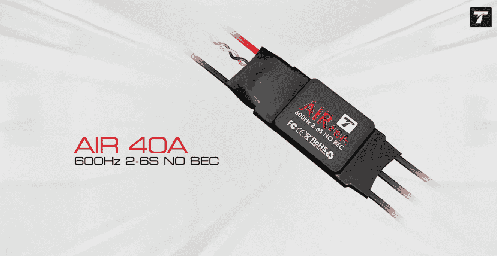

图 12.5 – T-Motor Air 40A 电调

## 电源分配板选择

以下是选择考量因素：

*   我们看到，在 100% 油门下电机的最大电流消耗为 37.5A。因此，四个电机总共将消耗 149.6A 电流。
*   外围设备（如相机和遥测设备）将根据其功率需求消耗电流。为它们额外增加 5A 余量。
    综合考虑这些方面并以最大电流作为缓冲，我们必须使用一款能承受 200A 最大通过电流的电源分配板。
*   额外提供 5V 和 12V 接口将有利于为外围设备供电。

以下是一些可供参考的电源分配板制造商：

*   Holybro (`https://www.holybro.com`)
*   APD (`https://powerdrives.net/`)
*   CUAV (`www.cuav.net`)

请仔细阅读电源分配板的数据手册，并在连接前检查其极性。建议在给电路通电前，始终使用万用表检查电压/通断性。

根据选择标准，我们可以采用 APD PDB360(X)，它具有 360A 的电流承载能力，并为外围设备提供了降压后的 5V 和 12V 电源：

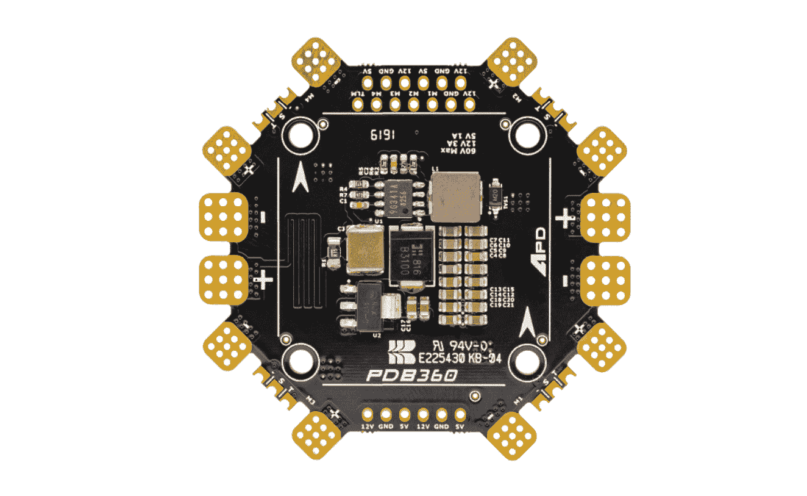

图 12.6 – APD PDB360 C

## 飞控选择

以下是选择考量因素：

*   与机架和电调的兼容性
*   传感器类型（陀螺仪、加速度计和磁力计）
*   传感器冗余和飞控固件支持
*   与 GPS 和其他导航系统的集成
*   编程能力和社区支持

我们在前几章中学习了各种飞控。以下是其他可用的飞控示例：

*   Cube Orange
*   Pixhawk 6x
*   CUAV X7/X7+

让我们对比 Pixhawk Cube Orange、Holybro Pixhawk 6X 和 CUAV X7 无人机飞控：

| 功能 | Pixhawk Cube Orange | Holybro Pixhawk 6X | CUAV X7 |
| --- | --- | --- | --- |
| 处理器 | STM32H7 | STM32H7 | STM32H7 |
| 传感器 | IMU、气压计、磁力计 | IMU、气压计、磁力计 | IMU、气压计、磁力计 |
| GPS | 内置 | 内置 | 内置 |
| PWM 输出 | 12 | 8 | 8 |
| 串口 | 8 | 5 | 6 |
| CAN 总线 | 是 | 是 | 是 |
| USB 接口 | 1 个 micro USB | 1 个 USB-C | 1 个 USB-C |
| 电源模块 | 外置 | 外置 | 外置 |
| 尺寸 | 54 x 54 x 19 mm | 44 x 84 x 12 mm | 44 x 84 x 12 mm |
| 重量 | 45 g | 31 g | 33 g |
| 价格 | 高 | 中等 | 中等 |
| 支持软件 | ArduPilot, PX4 | ArduPilot, PX4 | ArduPilot, PX4 |
| 附加功能 | ADS-B 接收器 | RGB LED、蜂鸣器 | 双 IMU、双气压计 |

表 12.3 – 不同飞控对比

基于其社区支持和功能性，我们将使用 Pixhawk Cube Orange 飞控。如果您愿意，也可以选择其他飞控。

## 飞控固件选择

Pixhawk Cube Orange 飞控支持 ArduPilot 和 PX4 飞控固件。对于此构建，并考虑到其他组件，我们将采用 PX4 飞控固件。PX4 飞控固件的完整详情请访问 `www.px4.io`。

## GPS 模块选择

以下是选择考量因素：

*   GPS 精度

# 无人机组件选择与配置

## GPS 模块选择考量

*   与飞控的兼容性
*   支持的连接协议
*   支持的各类 GNSS 星座

以下是一些其他无人机 GPS 模块的制造商和型号：

*   Here 3
*   CUAV NEO V2/V2 Pro
*   Holybro Pixhawk 4
*   Holybro H-RTK

让我们对比一下这些模块：

| **特性** | **Here 3** | **CUAV NEO V2** | **Holybro Pixhawk 4** | **Holybro H-RTK** |
| --- | --- | --- | --- | --- |
| **GPS 芯片组** | u-blox M8P | u-blox M8N | u-blox M8N | u-blox M8P |
| **GPS 通道数** | 72 | 72 | 72 | 72 |
| **GNSS 支持** | GPS, GLONASS, Galileo, BeiDou | GPS, GLONASS, Galileo, BeiDou | GPS, GLONASS, Galileo, BeiDou | GPS, GLONASS, Galileo, BeiDou |
| **定位精度** | 2.5 cm (RTK), 30 cm (GPS) | 2.5 m (GPS), 0.8 m (RTK) | 2.5 m (GPS) | 2.5 cm (RTK), 30 cm (GPS) |
| **更新率** | 5 Hz | 5 Hz | 5 Hz | 5 Hz |
| **兼容性** | `ArduPilot`, `PX4` | `ArduPilot`, `PX4` | `ArduPilot`, `PX4` | `ArduPilot`, `PX4` |
| **重量** | 99 g | 53 g | 39 g | 34 g |
| **尺寸** | 80 x 80 x 25 mm | 50 x 50 x 15 mm | 40 x 40 x 10 mm | 45 x 45 x 10 mm |
| **价格** | 高 | 中等 | 中等 | 高 |

表 12.4 – 各类 GPS 模块对比

基于这些详情，我们将选择 `Here 3` GPS 模块。

## 相机或任务载荷选择

以下是选择考量因素：

*   相机分辨率和画质
*   云台兼容性以获取稳定画面
*   任务载荷能力及与飞控的集成
*   用途（例如航拍、测绘、监控等）
*   模块重量
*   来自飞控的触发机制

下表从航拍测绘角度对比了 `Sony Alpha 6000`、`Sony RX100`、`Sony RX0` 和 `GoPro` 无人机测绘相机：

| **特性** | **Sony Alpha 6000** | **Sony RX100** | **Sony RX0** | **GoPro** |
| --- | --- | --- | --- | --- |
| **传感器尺寸** | APS-C | 1 英寸 | 1 英寸 | 1/2.3 英寸 |
| **像素** | 24.3 | 20.1 | 15.3 | 12 |
| **镜头** | 可换镜头 | 固定 | 固定 | 固定 |
| **ISO 范围** | 100-25,600 | 125-12,800 | 125-12,800 | 100-6,400 |
| **快门速度范围** | 1/4,000 至 30 秒 | 1/2,000 至 30 秒 | 1/32,000 至 1/4 秒 | 1/8,000 至 1 秒 |
| **视频分辨率** | 1080p, 4K | 1080p, 4K | 1080p, 4K | 1080p, 4K |
| **图像稳定** | 是 (机身内) | 是 (机身内) | 是 (机身内) | 是 (机身内) |
| **重量** | 344 g (不含镜头) | 299 g | 110 g | 116 g |
| **价格** | 中等 | 高 | 高 | 中等 |
| **应用** | 摄影, 摄像 | 摄影, 摄像 | 摄影, 摄像 | 摄影, 摄像 |
| **附加功能** | 快速自动对焦, Wi-Fi | 蔡司镜头, Wi-Fi | 防震, 防水 | 防水, 语音控制 |

表 12.5 – 测绘相机对比

基于这些详情，我们选择了 `Sony Alpha 6000` 以获得更好的成果和照片。目前，由于这一选择，我们的无人机重量为 468 克。还有其他可选方案，例如 `Sony RX100`。

## 遥测系统选择

以下是选择考量因素：

*   与 `GCS` 的双向通信
*   范围和可靠性
*   数据传输速率
*   与飞控的集成
*   轻量化、易操作、机动性强

基于选择标准，我们决定采用 `Herelink` 通信系统，它通过微型 `HDMI` 提供实时视频传输，提供超过 10 公里的范围，并集成了 `RC`、遥测功能和预装的 `QGroundControl` 地面站软件。请查阅模块数据手册以了解其集成和用法：

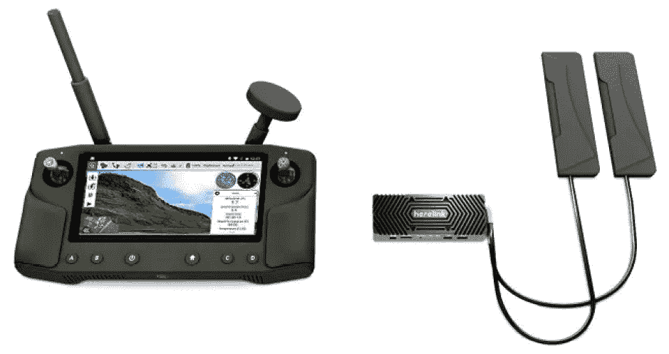

图 12.7 – Herelink 发射端与接收端

您可以使用下表根据所选组件估算无人机总重量。此处指定的重量并非精确值，会根据您选择的组件而变化：

| **序号** | **组件** | **重量** | **数量** | **总重量** |
| --- | --- | --- | --- | --- |
| **1.** | 机身 (含相机安装座) | 1,100 g | 1 | 1,100 g |
| **2.** | 电机 | 170 g | 4 | 680 g |
| **3.** | 螺旋桨 | 56 g | 4 | 224 g |
| **4.** | `ESCs` | 26 g | 4 | 104 g |
| **5.** | `PDB` | 100 g | 1 | 100 g |
| **6.** | 电池 | 2,350 g | 1 | 2,350 g |
| **7.** | 电源模块 | 25 g | 1 | 25 g |
| **8.** | 飞控 | 75 g | 1 | 75 g |
| **9.** | 相机 | 468 g | 1 | 468 g |
| **10.** | Herelink 接收端 | 100 g | 1 | 100 g |
| **11.** | 杂项 (导线、焊接等) | 100 g | 1 | 100 g |
| | **总重量** | | | **5,326 g** |

表 12.6 – 无人机重量分布表

因此，我们可以计算出无人机总重量为 5.3 千克。这些计算是在牢记 6 千克全装重限制的前提下进行的。如果我们想添加额外的任务载荷或传感器，仍有 674 克的余量。

## 接线与组装

快速接线图可在官方 `ArduPilot` 网站找到：[`https://ardupilot.org/copter/_images/Cubepilot_ecosystem.jpg`](https://ardupilot.org/copter/_images/Cubepilot_ecosystem.jpg)。

我们不会过多关注组装和配置，因为我们在前几章已经涵盖了这些内容：

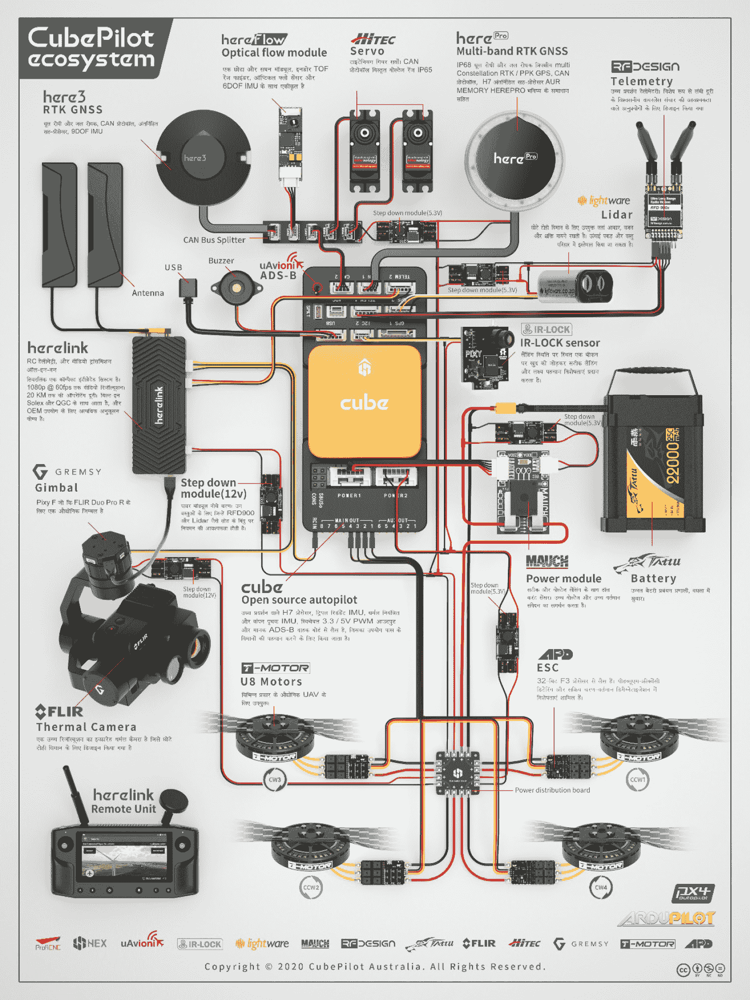

图 12.8 – ArduPilot 组装示意图

## 无人机配置

组装完无人机后，我们需要对其进行配置以便飞行。我们需要根据 `AeroGCS` 执行一系列步骤来配置无人机。我们之前学习了 `AeroGCS` 中可用的各种选项，因此这里我们将快速浏览流程并为我们的用例选择正确的选项（不过，使用我们上面选择的 `Herelink` `GCS`，也可以通过 `QGroundControl` 进行相同的配置过程）：

1.  通过 `USB` 线缆连接无人机。
2.  选择机型：

    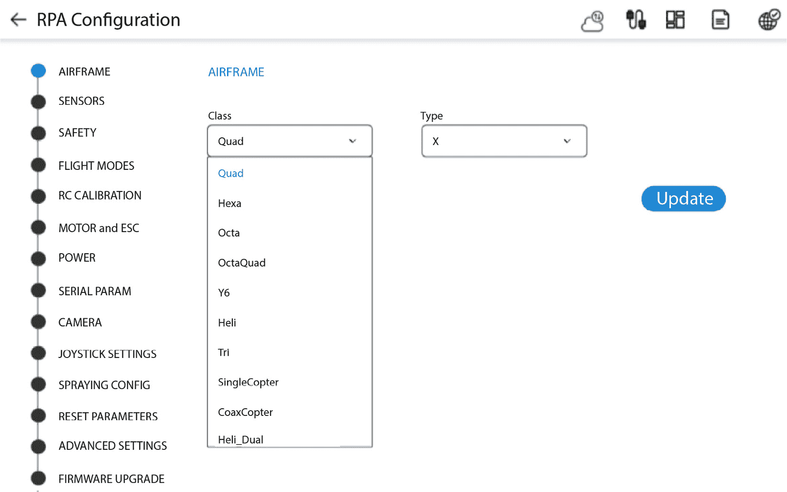

    图 12.9 – 在 AeroGCS 中选择机型

    选择以下选项：

    *   **类别**：`Quad` (四旋翼)
    *   **类型**：`X` (考虑到机身为 X 型)

    点击 `Update` 后，您将看到 `ESCs` 接收到 `PWM` 信号。

3.  校准传感器。

    a.  **校准加速度计**。我们之前学过这个。`SENSORS` (传感器) 标签页将帮助我们完成此操作：

        *   点击 `Calibrate` (校准)
        *   点击 `Calibrate` 后，`GCS` 会要求您在几秒内将无人机保持在特定方向
        *   自动驾驶仪将记录不同方向的加速度计读数并保存
        *   按照屏幕上的说明校准加速度计：

        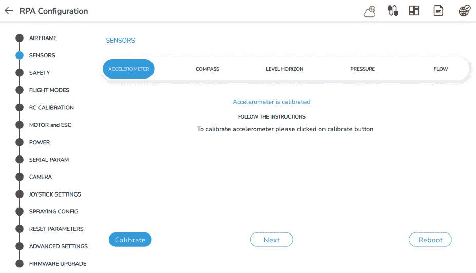

        图 12.10 – ACCELEROMETER (加速度计) 窗口

    b.  **罗盘校准**。这对于自动驾驶仪读取该区域的磁偏角是必需的。点击 `Calibrate`，然后绕多个轴旋转无人机。进度条将随着无人机旋转而增加。

        完成后，必须重启无人机：

        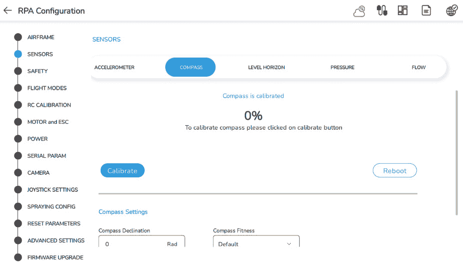

        图 12.11 – COMPASS (罗盘) 窗口

    c.  **水平校准**。这用于校准飞控的水平度。它有助于调整飞控放置在水平面上时的任何微小错位，以在地面站飞行视图中实现适当的水平。强烈建议进行此类校准以获得最佳飞行性能。

        将无人机放置在水平面上并点击 `LEVEL HORIZON` (水平校准)。水平校准过程将自动完成。

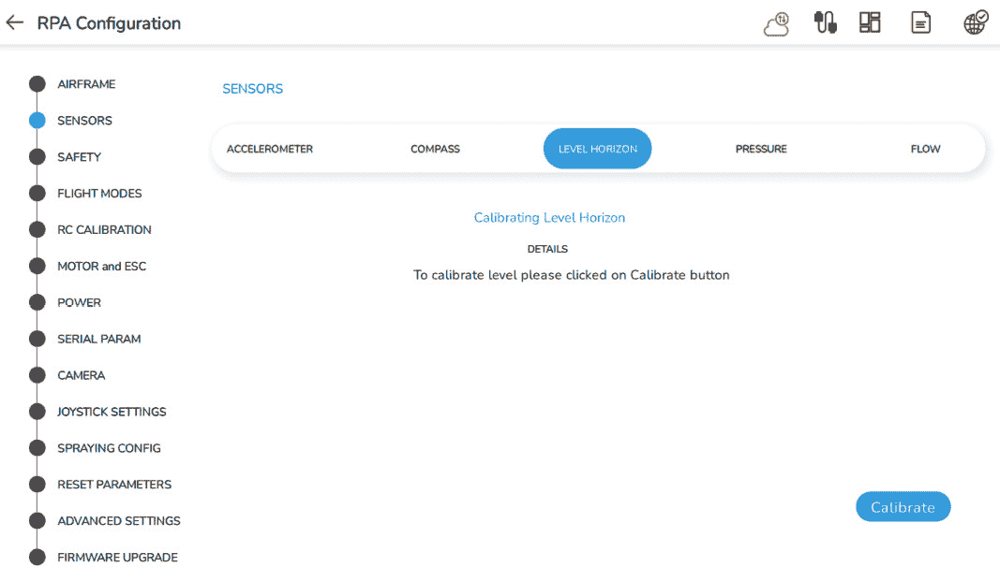

图 12.12 – LEVEL HORIZON 窗口

## 气压/气压计校准

接下来是气压/气压计校准。校准气压传感器会将无人机当前高度在当前气压下设为 0：

*   点击 **`Calibrate`** 按钮；校准将开始。
*   校准过程完成后，屏幕上将显示一条提示 **`Barometer calibration complete`** 的消息。

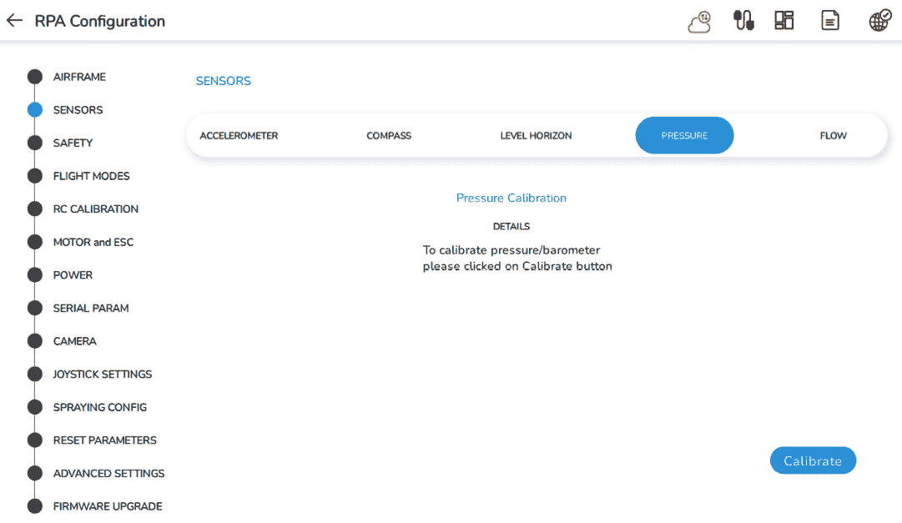

图 12.13 – PRESSURE 窗口

## 安全参数

接下来，我们必须设置安全参数：

### 电池失效保护触发

*   **`Low Action`**: `RTL (Return to Launch)`
*   **`Critical Action`**: `RTL (Return to Launch)`
*   **`Low Voltage Threshold`**: `21 V`
*   **`Critical voltage threshold`**: `20 V`

### 失效保护触发

*   **`Ground Station Failsafe`**: `Always enable RTL`
*   **`Throttle Failsafe`**: `Always RTL`

### PWM 阈值

*   将 **`PWM Threshold`** 设置为 `1000`

### RTL（返航）

根据您的需求调整这些设置。不过，对于测绘任务，高度应保持在 80 至 150 米 AGL（地面高度）之间。因此，建议选择 **`Return At Current Altitude`**。其余设置可保持不变：

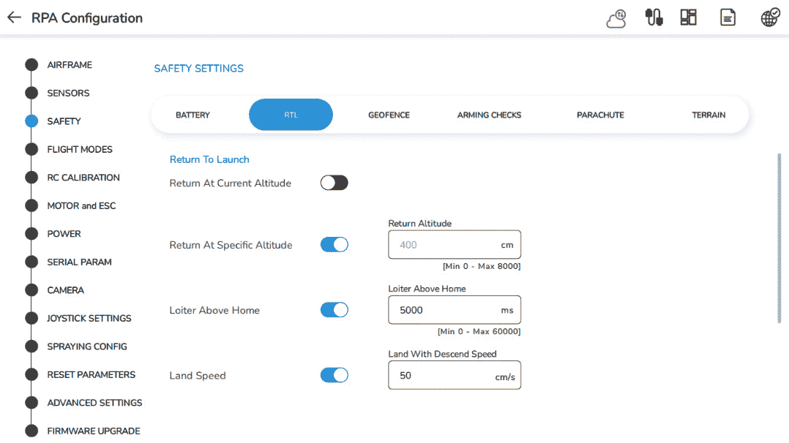

图 12.14 – RTL 窗口

保持其他设置不变，或参阅 AeroGCS 手册并根据您的需求调整设置。

## 飞行模式

接下来，我们将分配飞行模式。请保持 **`Flight Mode Channel`** 设置为 **`Channel 5`**，因为这是飞控栈的标准。请注意这并非强制要求。用户可根据需求选择其他通道。

为该通道分配不同的飞行模式，以便也能在 RC/Herelink 上进行配置：

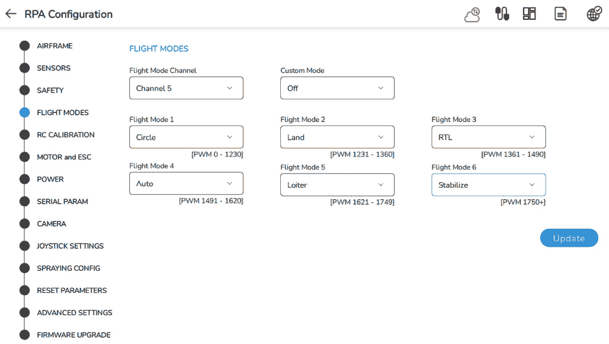

图 12.15 – FLIGHT MODES 窗口

## RC 校准

最后是 RC 校准。对于 RC 配置（**`RPA Configuration`** | **`RC Config`**），RC 遥控器允许飞行员设置飞行模式、控制飞行器的移动和姿态，还能开启/关闭辅助功能（即升降起落架等）。

RC 校准涉及采集每个 RC 输入通道的最小值、最大值和“微调”值，以便 ArduPilot 能正确解析输入。

将两根摇杆以最大可能的圆周移动，使其达到完整的运动范围。拨动 **`Channel 5`** 和 **`Channel 6`** 的拨轮开关遍历其所有档位。

您的遥控器应产生以下控制变化：

*   **`Channel 1`**：低 = 左滚，高 = 右滚
*   **`Channel 2`**：低 = 俯仰前，高 = 俯仰后
*   **`Channel 3`**：低 = 油门关（关闭），高 = 油门开
*   **`Channel 4`**：低 = 偏航左，高 = 偏航右

Herelink 还内置了一个 RC 校准工具，可用于 RC 校准：

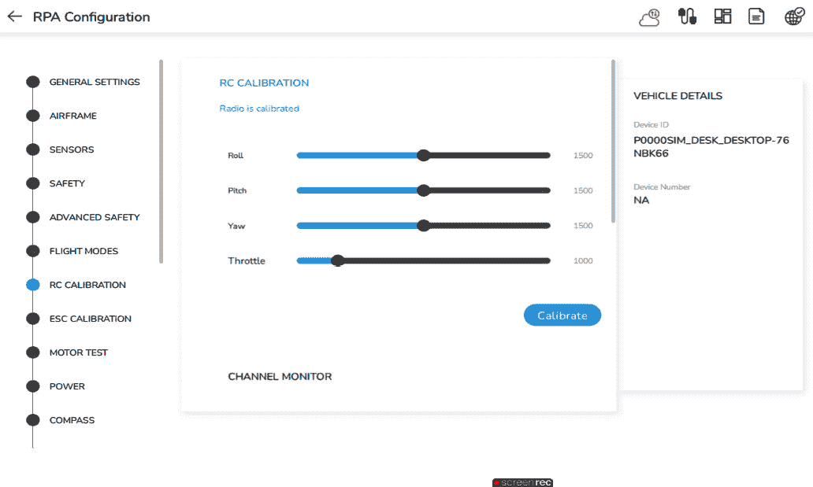

图 12.16 – RC CALIBRATION 窗口

# 电机和 ESC 校准

**`MOTOR and ESC`** 选项卡用于测试不同方向的电机和 ESC。请遵循软件中的说明校准 ESC 并测试电机：

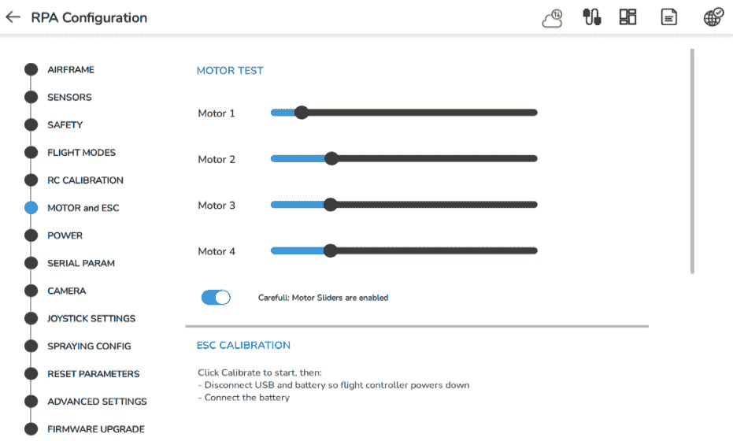

图 12.17 – MOTOR TEST 窗口

## ESC 校准

ESC 根据飞控的 PWM 输入值调节电机转速（和方向）。ESC 响应的输入范围是可配置的，即使是同型号的 ESC，默认范围也可能不同。

此校准过程会将飞控将提供的最大和最小 PWM 输入值更新到所有 ESC 中。随后，所有 ESC/电机将以相同方式响应飞控的输入（覆盖整个输入范围）：

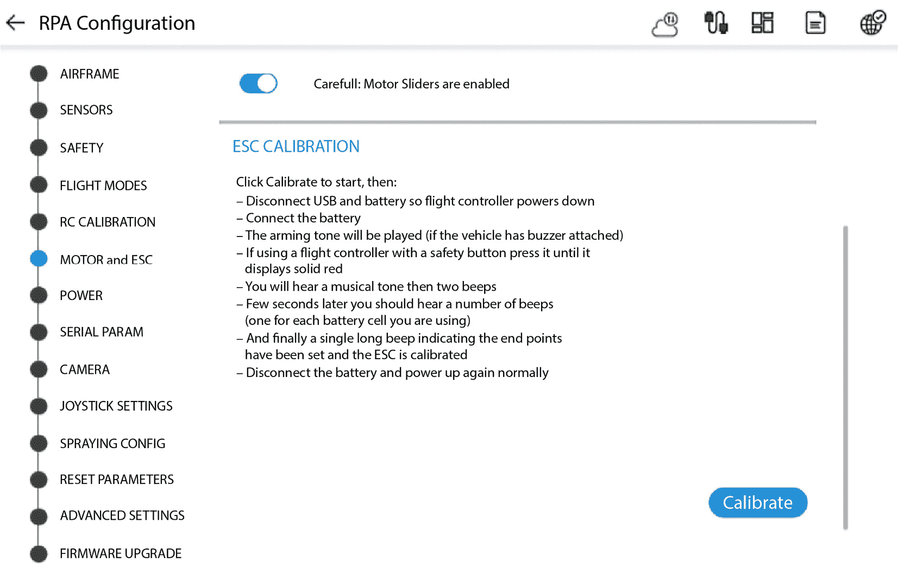

图 12.18 – ESC CALIBRATION 窗口

ESC 校准步骤如下：

1.  点击 **`Calibrate`** 按钮，并按照屏幕上出现的说明操作。完成所有步骤以校准所有 ESC。
2.  断开 USB 和电池，使飞控断电。
3.  连接电池。如果飞行器连接了蜂鸣器，将播放解锁音。
4.  按住安全按钮（如果飞控有的话），直到其变为常亮红色。
5.  听取两声播放乐调的蜂鸣声。
6.  几秒后，听取数声蜂鸣声（每个电池芯一声）。
7.  听取最后一声长鸣。这表示端点已确认，ESC 校准完成。
8.  断开电池并正常重新上电。

遵循这些说明，我们可以成功配置一架无人机。本指南只是对各项设置的简要介绍。您掌握的技能取决于实践和阅读。练习得越多，理解得越深。初次尝试时您会遇到许多障碍。

上述配置也可通过 Herelink 及其内置的 QGC 应用完成。请参阅 Herelink 指南，了解如何使用它配置无人机。

# 总结

在本章中，我们完成了测绘无人机的开发。该过程的关键在于选择正确的组件。

我们了解到可以选择基本机架；不过，我们可以随心所欲地设计和改进无人机的外观。我们还学习了通过 AeroGCS 进行无人机配置。我们使用 Herelink 系统进行遥测和 RC 控制，其配置可通过其数据手册学习。然后，我们简要了解了组装无人机后必须执行的操作。如前所述，熟能生巧；学习和实践得越多，我们就越接近完美。养成研读数据手册和集成手册的习惯将大有裨益。

# 参考资料

本书在其他书籍作者的资源帮助和协助下编写而成。我还要感谢所有帮助完成本书并使我能将其呈现给您的资源和图片。以下是各章节使用的参考资料和资源。

## 第 1 章：UAV 与无人机工程入门

*   *Introduction to Unmanned Aircraft **Systems**: [`ftp.idu.ac.id/wp-content/uploads/ebook/tdg/MILITARY%20PLATFORM%20DESIGN/Unmanned%20Aircraft%20Systems.pdf`](https://ftp.idu.ac.id/wp-content/uploads/ebook/tdg/MILITARY%20PLATFORM%20DESIGN/Unmanned%20Aircraft%20Systems.pdf)
*   *Applications of Unmanned Aerial Vehicles: A **Review**: [`3ciencias.com/wp-content/uploads/2019/11/art-5_special-issue_3C-TECNO_november_2019-1.pdf`](https://3ciencias.com/wp-content/uploads/2019/11/art-5_special-issue_3C-TECNO_november_2019-1.pdf)
*   *Different Types of Drones and Uses (2024 Full **Guide)**: [`www.jouav.com/blog/drone-types.html`](https://www.jouav.com/blog/drone-types.html)
*   *Drone Types: Multi-Rotor Vs Fixed-Wing Vs Single Rotor Vs Hybrid **VTOL**: [`www.auav.com.au/articles/drone-types/`](https://www.auav.com.au/articles/drone-types/)
*   *What are the parts of a Drone? Full **list**: [`umilesgroup.com/en/what-are-the-parts-of-a-drone-full-list/`](https://umilesgroup.com/en/what-are-the-parts-of-a-drone-full-list/)
*   *Anatomy of A Drone - What’s inside a DJI Phantom **Drone**: [`www.dronefly.com/the-anatomy-of-a-drone`](https://www.dronefly.com/the-anatomy-of-a-drone)
*   *Bicopter - The journey so **far**: [`discuss.ardupilot.org/t/bicopter-the-journey-so-far/59328`](https://discuss.ardupilot.org/t/bicopter-the-journey-so-far/59328)

# 参考资料

- [从无人机到地理空间分析](https://www.researchgate.net/figure/Tricopter-unmanned-aerial-vehicle_fig4_330555127)
- [DJI F450 四旋翼评测](https://www.best-quadcopter.com/reviews/2020/10/dji-f450-quadcopter-review/)
- [六旋翼](https://udayton.edu/engineering/research/centers/vision_lab/research/robotics_and_vision_guided_navigation/hexacopter.php)
- [用于 ArduCopter 的 OCTA-QUAD X8 同轴四旋翼设计说明](https://www.rcgroups.com/forums/showthread.php?2952951-OCTA-QUAD-X8-Coaxial-Quad-Design-Notes-for-Arducopter)
- [Hanseatic-S360 固定翼无人机](https://www.routescene.com/resources/recommended-uav-drones-lidar/attachment/hanseatic-s360-fixed-wing-drone/)
- [混合垂直起降 (VTOL) 无人机 (UAV) 的开发与实验验证](https://www.researchgate.net/figure/Hybrid-VTOL-UAV-explanation_fig2_317933218)
- [VTOL 固定翼无人机的应用是未来](https://www.dronefromchina.com/new/The-application-of-the-Vtol-fixed-wing-drone-is-the-future.html)
- [低速机动期间倾转翼无人机的控制概念](https://www.semanticscholar.org/paper/Control-Concept-of-a-Tiltwing-UAV-During-Low-Speed-Ostermann-Holsten/de6f95fa77be85083ca1fe02a94ffc44f7de58e4)
- [机身](https://www.alibaba.com/pla/JMRRC-6-rotor-Multi-rotor-Hexacopter-Frame-960mm_60280242487.html?mark=google_shopping&biz=pla&searchText=aircraft&product_id=60280242487&language=en)
- [锂聚合物电池](https://robokits.co.in/batteries-chargers/genx-power-premium-lipo-battery/genxpower-29.6v-lipo-batteries/genx-29.6v-8s-16000mah-25c-50c-premium-lipo-battery-with-as150-connector)
- [PDB (电源分配板)](https://gadgetsdeal.in/shop/pdb/apd-pdb500-x-12s-52v-500a-board-in-india/)
- [降压和升压转换器](https://electronicshub.pk/product/xl6009-dc-to-dc-boost-converter-module-in-pakistan/)
- [遥控器/发射机](https://robu.in/product/radiolink-at10-2-4ghz-12ch-rc-drone-transmitter/)
- [手持地面站](https://www.aero-sentinel.com/military-drones/drone-gcs/)
- [数传电台/无线电调制解调器](https://www.dronefromchina.com/product/RFD900X-900MHz-Ultra-Long-Range-up-to-40KM-Radio-Data-Modem.html)
- [GPS](https://baskaerospace.com.au/shop/gps/here3/)
- [指南针/磁力计](https://drotek.gitbook.io/additional-devices/sensors/geomagnetic-sensor/rm3100)
- [飞控/飞行控制器](https://robu.in/product-category/drone-parts/flight-controller-accessories/)
- [任务载荷](https://forum.iktva.sa/drone-camera-gimbal-30x-uav-gimbal-zoom-hd-starlight-ww-18979184)
- [农业起落架](https://www.jmrdrone.com/agricultural-landing-gear/)
- [无人驾驶飞行器基础 (Google Books)](https://books.google.ae/books?id=2M0hEAAAQBAJ&printsec=copyright&redir_esc=y#v=onepage&q&f=false)

# 第 2 章：理解三维空间动力学

- [无人机的工作原理与组件](https://cfdflowengineering.com/working-principle-and-components-of-drone/)
- [无人机飞行中的作用力](https://www.dronesindevelopment.com/post/forces-active-in-drone-flight)
- [运动基础：如何为直线系统定义滚转、俯仰和偏航](https://www.linearmotiontips.com/motion-basics-how-to-define-roll-pitch-and-yaw-for-linear-systems/)
- [初学者指南：滚转、俯仰与偏航详解](https://www.dronesvilla.com/roll-pitch-yaw/)
- [无人机词典——每位飞手都应了解的基本术语](https://ageagle.com/blog/drone-dictionary-essential-terms-every-pilot-should-know/#:~:text=Roll%3A%20an%20aircraft%E2%80%99s%20rotation%20about,travel%20determined%20by%20the%20FAA)
- [无人机术语 A-Z 词汇表](https://www.hovrtek.com/drone-operations/drone-terminology/)
- [无人机术语参考指南](https://www.heliguy.com/blogs/posts/drone-terminology-reference-guide)
- [揭秘无人机动力学！](https://towardsdatascience.com/demystifying-drone-dynamics-ee98b1ba882f)
- [四旋翼动力学](https://catsr.vse.gmu.edu/SYST460/QuadcopterDynamics.pdf)
- [无人驾驶飞行器基础：是时候开始钻研无人机技术了](https://books.google.ae/books?id=2M0hEAAAQBAJ&printsec=copyright&redir_esc=y#v=onepage&q&f=false)
- [飞行控制](https://developer.dji.com/mobilesdk/documentation/introduction/flightController_concepts.html)

21 基础力学 宾夕法尼亚大学 Coursera：[`www.youtube.com/watch?v=ZEN4X185Z8M&list=PLblGgzWkqSqM7IWsgjDetdzZDS1NbkTnd&index=4&pp=iAQB`](https://www.youtube.com/watch?v=ZEN4X185Z8M&list=PLblGgzWkqSqM7IWsgjDetdzZDS1NbkTnd&index=4&pp=iAQB)

# 第 3 章：学习并应用基础指挥与控制接口

- 地面控制软件：[`www.unmannedsystemstechnology.com/expo/ground-control-software/`](https://www.unmannedsystemstechnology.com/expo/ground-control-software/)
- 无人机地面控制站：无人机操作的神经中枢：[`defensebridge.com/article/uav-ground-control-station-the-nerve-center-of-drone-operations.html`](https://defensebridge.com/article/uav-ground-control-station-the-nerve-center-of-drone-operations.html)
- 选择地面站：[`ardupilot.org/plane/docs/common-choosing-a-ground-station.html`](https://ardupilot.org/plane/docs/common-choosing-a-ground-station.html)
- LaunchPad GCS：[`www.urbanmatrix.co.in/umt-launchpad`](https://www.urbanmatrix.co.in/umt-launchpad)
- QGroundControl：面向 MAVLink 协议的直观且强大的地面控制站：[`qgroundcontrol.com/`](http://qgroundcontrol.com/)
- AeroGCS：[`aeromegh.com/aerogcs-kea/`](https://aeromegh.com/aerogcs-kea/)
- 承接报酬更高、更复杂的无人机测绘项目：[`www.sphengineering.com/flight-planning/ugcs`](https://www.sphengineering.com/flight-planning/ugcs)
- MAVLink 开发者指南：[`mavlink.io/en/`](https://mavlink.io/en/)
- MAVLink 基础：[`ardupilot.org/dev/docs/mavlink-basics.html`](https://ardupilot.org/dev/docs/mavlink-basics.html)
- 什么是通信协议及其工作原理：[`www.elprocus.com/communication-protocols/`](https://www.elprocus.com/communication-protocols/)
- 物联网通信协议 Top 6：[`wisilica.com/company/top-6-iot-communication-protocols/`](https://wisilica.com/company/top-6-iot-communication-protocols/)
- 物联网中的通信协议：简介与指南：[`www.cdebyte.com/news/476`](https://www.cdebyte.com/news/476)
- 最常用的 12 种物联网协议和标准：[`www.techtarget.com/iotagenda/tip/Top-12-most-commonly-used-IoT-protocols-and-standards`](https://www.techtarget.com/iotagenda/tip/Top-12-most-commonly-used-IoT-protocols-and-standards)
- 遥控器：[`www.frsky-rc.com/`](https://www.frsky-rc.com/)
- 无人机组件：[`www.flysky-cn.com/`](https://www.flysky-cn.com/)
- 无人机控制器：其工作原理、重要术语及其在遥控飞机领域的独特性解析：[`uavcoach.com/drone-controller/`](https://uavcoach.com/drone-controller/)
- 无人机发射器与接收器指南：[`robocraze.com/blogs/post/drone-transmitter-and-receiver-guide`](https://robocraze.com/blogs/post/drone-transmitter-and-receiver-guide)
- 无线电控制系统：[`docs.px4.io/v1.9.0/en/getting_started/rc_transmitter_receiver.html`](https://docs.px4.io/v1.9.0/en/getting_started/rc_transmitter_receiver.html)
- FPV 协议详解（CRSF、SBUS、DSHOT、ACCST、PPM、PWM 等）：[`oscarliang.com/rc-protocols/#:~:text=Latency-,What%20are%20RC%20Protocols%3F,in%20another%20language%20(output)`](https://oscarliang.com/rc-protocols/#:~:text=Latency-,What%20are%20RC%20Protocols%3F,in%20another%20language%20(output))
- [`blog.banggood.com/top-7-rc-protocols-that-you-should-know-about-to-sound-quad-smart-33056.html`](https://blog.banggood.com/top-7-rc-protocols-that-you-should-know-about-to-sound-quad-smart-33056.html)

# 第 4 章：了解无人机系统、子系统与组件

- MN5006 反重力 4-6S 无人机电机 KV300：[`store.tmotor.com/product/mn5006-kv300-motor-antigravity-type.html`](https://store.tmotor.com/product/mn5006-kv300-motor-antigravity-type.html)
- 电子调速器 ESC：[`www.electroniclinic.com/electronic-speed-controller-esc/`](https://www.electroniclinic.com/electronic-speed-controller-esc/)
- 无人机设计 - 计算与假设：[`www.tytorobotics.com/blogs/articles/the-drone-design-loop-for-brushless-motors-and-propellers`](https://www.tytorobotics.com/blogs/articles/the-drone-design-loop-for-brushless-motors-and-propellers)
- 面向救援行动的实时无线四旋翼无人机设计与实现：[`www.researchgate.net/publication/324391001_Design_and_Implementation_of_a_Real_Time_Wireless_Quadcopter_for_Rescue_Operations`](https://www.researchgate.net/publication/324391001_Design_and_Implementation_of_a_Real_Time_Wireless_Quadcopter_for_Rescue_Operations)
- 常见无人机类型的平均重量：[`www.droneblog.com/average-weights-of-common-types-of-drones/`](https://www.droneblog.com/average-weights-of-common-types-of-drones/)
- 无人机重量是多少？正确重量的重要性：[`www.propelrc.com/how-much-does-drone-weight/`](https://www.propelrc.com/how-much-does-drone-weight/)
- 无人机电机计算器：[`www.omnicalculator.com/other/drone-motor`](https://www.omnicalculator.com/other/drone-motor)
- 如何选择无人机电机：[`www.engineersgarage.com/how-to-select-drone-motors/`](https://www.engineersgarage.com/how-to-select-drone-motors/)
- 理解锂聚合物电池指南：[`www.rogershobbycenter.com/lipoguide`](https://www.rogershobbycenter.com/lipoguide)
- 锂聚合物电池的术语、公式与物理组装 - 或者 - “C” 到底是什么意思？：[`electric-skateboard.builders/t/the-terminology-formulae-and-physical-assembly-of-lipo-batteries-or-wtf-does-c-mean/33162`](https://electric-skateboard.builders/t/the-terminology-formulae-and-physical-assembly-of-lipo-batteries-or-wtf-does-c-mean/33162)
- 无人机材料选择、降解与热应力计算：[`www.studocu.com/row/document/jamaa%D8%A9-alemarat-alaarby%D8%A9-almthd%D8%A9/engineering-material/material-selection-for-drones-uav-degradation-and-thermal-stress-calculations/10510339`](https://www.studocu.com/row/document/jamaa%D8%A9-alemarat-alaarby%D8%A9-almthd%D8%A9/engineering-material/material-selection-for-drones-uav-degradation-and-thermal-stress-calculations/10510339)
- 如何选择最佳无人机机架 - 无人机机架指南：[`www.jinjiuyi.net/news/how-to-choose-the-best-drone-frame.html`](https://www.jinjiuyi.net/news/how-to-choose-the-best-drone-frame.html)
- 如何为四旋翼选择 ESC：[`robocraze.com/blogs/post/how-to-choose-esc-for-quadcopter`](https://robocraze.com/blogs/post/how-to-choose-esc-for-quadcopter)
- 如何选择你的无人机飞控 - 对比选择指南：[`circuitdigest.com/article/how-to-select-your-drone-flight-controller-a-comparative-selection-guide`](https://circuitdigest.com/article/how-to-select-your-drone-flight-controller-a-comparative-selection-guide)
- 如何为你的竞速无人机 FPV 选择飞控的权威指南：[`www.drone24hours.com/blog/come-scegliere-flight-controller-per-quadcopter/?lang=en`](https://www.drone24hours.com/blog/come-scegliere-flight-controller-per-quadcopter/?lang=en)
- 无人机地面控制站：[`www.unmannedsystemstechnology.com/expo/ground-control-stations-gcs/`](https://www.unmannedsystemstechnology.com/expo/ground-control-stations-gcs/)
- 面向无人机测绘员的 GNSS 基础：[`microaerialprojects.com/wp-content/uploads/2018/10/GNSS-FOR-THE-DRONE-MAPPER-9-30-2018-1.pdf`](https://microaerialprojects.com/wp-content/uploads/2018/10/GNSS-FOR-THE-DRONE-MAPPER-9-30-2018-1.pdf)

# 第 5 章：传感器和 IMU 及其在无人机中的应用

## 参考文献

*   MEMS 陀螺仪用在何处？：[`www.etransaxle.com/where-are-mems-gyroscopes-used`](https://www.etransaxle.com/where-are-mems-gyroscopes-used)
*   加速度计图片参考：[`www.google.com/url?sa=i&url=https%3A%2F%2Fwww.domainesia.com%2Fberita%2Fapa-itu-accelerometer-fungsi%2F&psig=AOvVaw3hqfvXEc79K4LRTOQy00SL&ust=1697825104753000&source=images&cd=vfe&opi=89978449&ved=0CBEQjRxqFwoTCJjr4sPZgoIDFQAAAAAdAAAAABAE`](https://www.google.com/url?sa=i&url=https%3A%2F%2Fwww.domainesia.com%2Fberita%2Fapa-itu-accelerometer-fungsi%2F&psig=AOvVaw3hqfvXEc79K4LRTOQy00SL&ust=1697825104753000&source=images&cd=vfe&opi=89978449&ved=0CBEQjRxqFwoTCJjr4sPZgoIDFQAAAAAdAAAAABAE)
*   陀螺仪：[`en.wikipedia.org/wiki/Gyroscope`](https://en.wikipedia.org/wiki/Gyroscope)
*   使用树莓派校准磁力计：[`makersportal.com/blog/calibration-of-a-magnetometer-with-raspberry-pi`](https://makersportal.com/blog/calibration-of-a-magnetometer-with-raspberry-pi)
*   什么是气压计？：[`instrumentationtools.com/what-is-a-barometer/`](https://instrumentationtools.com/what-is-a-barometer/)
*   工作原理：PPK 与 RTK 无人机测绘对比：[`www.propelleraero.com/blog/how-it-works-ppk-vs-rtk-drone-surveying/`](https://www.propelleraero.com/blog/how-it-works-ppk-vs-rtk-drone-surveying/)
*   惯性测量单元 (IMU) 简介：[`www.advancednavigation.com/tech-articles/inertial-measurement-unit-imu-an-introduction/`](https://www.advancednavigation.com/tech-articles/inertial-measurement-unit-imu-an-introduction/)
*   MEMS 加速度计：[`www.electricity-magnetism.org/mems-accelerometer/`](https://www.electricity-magnetism.org/mems-accelerometer/)
*   气压计：[`docs.px4.io/main/en/sensor/barometers.html`](https://docs.px4.io/main/en/sensor/barometers.html)
*   磁力计与导航：[`www.geographyrealm.com/magnetometers-and-navigation/`](https://www.geographyrealm.com/magnetometers-and-navigation/)
*   UAV 导航深度解析：磁力计，为何它对 UAV 导航至关重要？：[`www.uavnavigation.com/company/blog/uav-navigation-depth-magnetometer`](https://www.uavnavigation.com/company/blog/uav-navigation-depth-magnetometer)

# 第 6 章：无人机固件与飞行栈简介

## 参考文献

*   Smith, John (2020)。《*理解固件：电子设备的基石*》。纽约：TechPress
*   Patel, Rajesh (2019)。《*探索固件：嵌入式软件开发概述*》。《嵌入式系统工程期刊》，5(2)，78-92
*   Anderson, Mark (2017)。《*固件编程入门*》。旧金山：O’Reilly Media
*   Thompson, Paul (2018)。《*固件类型：全面概述*》。《电子工程期刊》，12(1)，23-36
*   Gupta, Ankit (2016)。《*固件工程：概念与实践*》。伦敦：Springer
*   Li, Xiaowei (2015)。《*固件的演进：从基本输入/输出系统到现代嵌入式软件*》。《IEEE 计算机学会杂志》，29(4)，32-45
*   Johnson, Michael (2020)。《*嵌入式系统编程：实用指南*》。剑桥：剑桥大学出版社
*   Brown, David, and Chen, Wei (2019)。《*固件安全：挑战与最佳实践*》。塞巴斯托波尔：O’Reilly Media
*   Williams, Emily (2018)。《*嵌入式系统设计：原理与应用*》。波士顿：Academic Press
*   Patel, Rajesh (2020)。《*无人机飞行栈的进展*》。《IEEE 机器人与自动化快报》，5(3)，567-580
*   ArduPilot (无日期)。《*关于 ArduPilot*》。获取自 [`ardupilot.org/about`](https://ardupilot.org/about)
*   ArduPilot 开发团队 (2021)。《*ArduPilot：一个开源 UAV 平台*》。《无人机系统期刊》，8(2)，45-58
*   ArduPilot 文档 (无日期)。《*ArduPilot 架构概览*》。获取自 [`ardupilot.org/dev/docs/learn-about-the-architecture-of-ardupilot.html`](https://ardupilot.org/dev/docs/learn-about-the-architecture-of-ardupilot.html)
*   Anderson, Mark (2019)。《*理解 ArduPilot 架构：综合指南*》。《机器人与自动化期刊》，10(1)，89-102
*   PX4 自动驾驶仪 (无日期)。《*PX4 简介*》。获取自 [`docs.px4.io/master/en/`](https://docs.px4.io/master/en/)
*   Anderson, Mark (2022)。《*PX4 自动驾驶仪：面向无人机的开源飞行控制软件*》。塞巴斯托波尔：O’Reilly Media
*   PX4 开发者指南 (无日期)。《*PX4 架构概览*》。获取自 [`dev.px4.io/master/en/`](https://dev.px4.io/master/en/)
*   Brown, David, and Chen, Wei (2020)。《*深入剖析 PX4 架构*》。《无人机期刊》，6(4)，210-225
*   PX4 自动驾驶仪开发团队 (无日期)。《*PX4 开发者指南：控制架构*》。获取自 [`dev.px4.io/v1.11/en/concept/architecture.html#control-architecture`](https://dev.px4.io/v1.11/en/concept/architecture.html#control-architecture)
*   Anderson, Mark (2019)。《*无人机飞行控制系统：算法与实现*》。旧金山：O’Reilly Media

# 第 7 章：地面站软件简介

## 参考文献

*   Smith, John (2020)。《*地面站简介：原理与应用*》。纽约：TechBooks
*   Johnson, Michael (2018)。《*理解用于 UAV 操作的地面站*》。《无人机系统期刊》，6(3)，45-60
*   无人机、无人驾驶飞行器和远程驾驶航空系统的地面站：[`www.unmannedsystemstechnology.com/expo/ground-control-stations-gcs/#:~:text=What%20are%20Ground%20Control%20Stations,direct%20control%20of%20the%20UAV`](https://www.unmannedsystemstechnology.com/expo/ground-control-stations-gcs/#:~:text=What%20are%20Ground%20Control%20Stations,direct%20control%20of%20the%20UAV)
*   Anderson, Mark (2019)。《*无人机控制软硬件：综合指南*》。旧金山：O’Reilly Media。
*   Williams, Emily (2021)。《*GCS 软硬件选项的比较分析*》。《国际航空机器人期刊》，18(2)，167-182
*   选择地面站：[`ardupilot.org/plane/docs/common-choosing-a-ground-station.html`](https://ardupilot.org/plane/docs/common-choosing-a-ground-station.html)
*   地面站：[`www.uxvtechnologies.com/ground-control-stations/`](https://www.uxvtechnologies.com/ground-control-stations/)
*   地面站背景：[`uavrt.nau.edu/index.php/docs/control/gcsbackground/`](https://uavrt.nau.edu/index.php/docs/control/gcsbackground/)
*   Mission Planner 开发团队 (无日期)。《*Mission Planner 用户指南*》。获取自 [`ardupilot.org/planner/docs/mission-planner-overview.html`](https://ardupilot.org/planner/docs/mission-planner-overview.html)
*   Brown, David (2018)。《*Mission Planner：综合概述*》。《UAV 应用期刊》，10(2)，112-128
*   APM Planner 开发团队 (无日期)。《*APM Planner 用户手册*》。获取自 [`ardupilot.org/planner2/docs/intro.html`](https://ardupilot.org/planner2/docs/intro.html)
*   Simpson, John (2016)。《*APM Planner：特性与功能*》。《无人系统期刊》，8(3)，210-225
*   QGroundControl 开发团队 (无日期)。《*QGroundControl 用户指南*》。获取自 [`docs.qgroundcontrol.com/en/`](https://docs.qgroundcontrol.com/en/)

# 参考文献

## 通用参考文献

- Gupta, Ankit (2020). *QGroundControl：一个开源 GCS 平台*. 无人飞行器系统期刊, 15(4), 145-160
- UGCS 开发团队 (n.d.). *UGCS 用户手册*. 来源：`https://www.ugcs.com/`
- 陈伟 (2017). *UGCS：功能与能力*. 遥感与 GIS 期刊, 20(1), 89-104
- AeroGCS: `https://aeromegh.com/aerogcs-kea/`
- AeroGCS GREEN: `https://aeromegh.com/aerogcs-green/`
- Aero GCS GREEN 安装链接: `https://play.google.com/store/apps/detailsid=com.aerogcs.aerogcsenterprise.hellodrone&hl=en_US&pli=1`
- *AeroGCS KEA 2.3*: `https://aerogcs-docs.aeromegh.com/`

## 第 8 章：理解飞行模式与任务规划

- *掌握无人机飞行模式：新手指南*: `https://www.womenwhodrone.co/single-post/mastering-your-drone-s-flight-modes-a-beginner-s-guide`
- *无人机飞行模式*: `https://www.dummies.com/article/technology/electronics/drones/drone-flight-modes-142437/`
- *飞行模式（多旋翼）*: `https://docs.px4.io/main/en/flight_modes_mc/`
- *飞行模式（开发者）*: `https://docs.px4.io/main/en/concept/flight_modes.html`
- *飞行模式*: `https://ardupilot.org/copter/docs/flight-modes.html`
- *无人机飞行手册*: `https://escholarship.org/content/qt2zv0z6zm/qt2zv0z6zm_noSplash_51fd3dcbdb109ea18d5efccd5aa94a90.pdf?t=qv9ey7`
- *无人机驾驶员手册*: `https://cdn11.bigcommerce.com/s-m5qljysoqy/content/look-inside/UAS-DRONE.pdf`
- *定点模式（多旋翼）*: `https://docs.px4.io/main/en/flight_modes_mc/position.html`
- *高度模式（多旋翼）*: `https://docs.px4.io/main/en/flight_modes_mc/altitude.html`
- *手动/稳定模式（多旋翼）*: `https://docs.px4.io/main/en/flight_modes_mc/manual_stabilized.html`
- *起飞模式（多旋翼）*: `https://docs.px4.io/main/en/flight_modes_mc/takeoff.html`
- *降落模式（多旋翼）*: `https://docs.px4.io/main/en/flight_modes_mc/land.html`
- *悬停模式（多旋翼）*: `https://docs.px4.io/main/en/flight_modes_mc/hold.html`
- *任务模式（多旋翼）*: `https://docs.px4.io/main/en/flight_modes_mc/mission.html`
- *返航模式（多旋翼）*: `https://docs.px4.io/main/en/flight_modes_mc/return.html`
- *遥控器飞行模式配置*: `https://ardupilot.org/copter/docs/common-rc-transmitter-flight-mode-configuration.html`
- *飞行模式配置*: `https://docs.px4.io/main/en/config/flight_mode.html`
- *分配飞行模式*: `https://aerogcs-docs.aeromegh.com/5-rpa-configuration/6.4-assigning-flight-modes`
- *任务成功：无人机作业中的任务规划与执行软件*: `https://www.linkedin.com/pulse/mission-success-planning-execution-software-drone-operations`
- *规划并执行成功无人机任务的步骤有哪些？*: `https://www.linkedin.com/advice/0/what-steps-plan-execute-successful-drone-mission-skills-drones`
- *使用航点和事件规划任务*: `https://ardupilot.org/copter/docs/common-planning-a-mission-with-waypoints-and-events.html`
- *航点规划*: `https://aerogcs-docs.aeromegh.com/6-project-and-flights/7.1-waypoint-planning`

## 第 9 章：无人机组装、配置与调试

- *无人机零件清单*: `https://robocraze.com/blogs/post/drone-part-list`
- *无人机有哪些部件？完整清单*: `https://umilesgroup.com/en/what-are-the-parts-of-a-drone-full-list/`
- *如何制作四轴无人机及组件清单*: `https://www.instructables.com/How-to-Make-a-Quadcopter-Drone-and-Components-List/`
- *构建无人机和固定翼的 FPV 工具与材料*: `https://oscarliang.com/fpv-tools/`
- *制作无人机需要哪些工具？*: `https://www.heamar.co.uk/blog/68_what-tools-are-needed-to-build-a-drone`
- Tarot 机架: `https://www.3dxr.co.uk/multirotor-c3/multirotor-frames-c97/tarot-m36`
- *打造高性能 FPV 摄像四轴无人机*: `https://www.instructables.com/Build-a-High-Performance-FPV-Camera-Quadcopter/`
- *四轴无人机的组装、校准与调试*: `https://nesac.gov.in/assets/resources/2020/12/Assembling-Calibration-and-Tuning-of-Quadcopter.pdf`
- *安装电调与机臂*: `https://nxp.gitbook.io/hovergames/archive/s500-drone-frame/mounting-escs-and-arms`
- *电子调速器 (ESC)：你需要知道的一切*: `https://www.jouav.com/blog/electronic-speed-controller-esc.html`
- *碳纤维操作安全预防措施*: `http://www.3gcarbon.com/news/shownews.php?id=42`
- *打造你自己的 FPV 无人机：新手指南*: `https://blogs.cuit.columbia.edu/mep14/fpv-drone/build-your-own-fpv-drone-a-beginners-guide/`
- *向无现有 ArduPilot 固件的板子加载固件*: `https://ardupilot.org/copter/docs/common-loading-firmware-onto-chibios-only-boards.html`
- *加载固件*: `https://ardupilot.org/copter/docs/common-loading-firmware-onto-pixhawk.html`

# 参考资料

- [加载固件](https://docs.px4.io/main/en/config/firmware.html)
- [连接无人机](https://aerogcs-docs.aeromegh.com/5-connecting-a-drone)
- [强制硬件配置](https://ardupilot.org/copter/docs/configuring-hardware.html)
- [安全配置 (故障保护)](https://docs.px4.io/main/en/config/safety.html)
- [手动固件升级](https://aerogcs-docs.aeromegh.com/5-rpa-configuration/6.14-firmware-upgrade/6.14.2-manual-firmware-upgrade)
- [传感器校准](https://aerogcs-docs.aeromegh.com/5-rpa-configuration/6.2-calibration-of-sensors)
- [安全参数](https://aerogcs-docs.aeromegh.com/5-rpa-configuration/6.3-safety-parameters)
- [首飞指南](https://docs.px4.io/main/en/flying/first_flight_guidelines.html)
- [基于 VOXL 2 的 PX4 自主开发套件首飞教程](https://px4.io/first-flight-tutorial-for-the-voxl-2-based-px4-autonomy-developer-kit/)

# 第 10 章：飞行日志分析与 PID

- [用于无人机诊断的开源飞行日志分析](https://www.unmannedsystemstechnology.com/2023/11/open-source-flight-log-analysis-for-drone-diagnostics/#:~:text=Tilak.io%2C%20a%20specialist%20developer,3D%20to%20provide%20actionable%20insights)
- [Airdata UAV, 入门指南](https://app.airdata.com/main?a=upload)
- [无人机飞行日志](https://dronedeck.eu/drone-flight-log/)
- [飞行日志分析](https://docs.px4.io/main/en/log/flight_log_analysis.html)
- [飞行日志分析 – 遥测日志的导入、分析与绘图](https://www.mathworks.com/help/uav/flight-log-analysis.html)
- [DroneePlotter - 基于 Web 浏览器的无人机飞行日志分析工具](https://diydrones.com/profiles/blogs/droneeplotter-drone-flight-log-analysis-tool-works-on-web-browser)
- [轻松实现无人机作业合规与机队管理](https://www.dronelogbook.com/hp/1/index.html)
- [Flight Review](https://review.px4.io/)
- [使用 Flight Review 进行日志分析](https://docs.px4.io/main/en/log/flight_review.html)
- [在 Mission Planner 中下载和分析数据日志](https://ardupilot.org/copter/docs/common-downloading-and-analyzing-data-logs-in-mission-planner.html)
- [分析视图](https://docs.qgroundcontrol.com/Stable_V4.3/en/qgc-user-guide/analyze_view/index.html#:~:text=The%20Analyze%20View%20is%20accessed,clear%20logs%20on%20the%20vehicle)
- [UAV LogViewer](https://ardupilot.org/dev/docs/common-uavlogviewer.html)
- [载荷四旋翼飞行器的振动分析](https://www.researchgate.net/publication/356682905_Vibration_Analysis_of_a_Quadcopter_Carrying_a_Payload)
- [什么是 PID 控制器？](https://www.omega.com/en-us/resources/pid-controllers#:~:text=A%20PID%20(Proportional%20%E2%80%93%20Integral%20%E2%80%93,variables%20in%20industrial%20control%20systems)
- [简介：PID 控制器设计](https://ctms.engin.umich.edu/CTMS/index.php?example=Introduction&section=ControlPID)
- [多旋翼 PID 调参指南 (手动/进阶)](https://docs.px4.io/main/en/config_mc/pid_tuning_guide_multicopter.html)
- [四旋翼飞行器 PID 飞控及其仿真](https://ijirt.org/master/publishedpaper/IJIRT160429_PAPER.pdf)

# 第 11 章：基于应用的无人机开发

- [无人机测绘：最佳测绘无人机、如何进行无人机测绘等 [2024 年更新]](https://uavcoach.com/drone-surveying/)
- [测绘与 GIS](https://wingtra.com/drone-mapping-applications/surveying-gis/)
- [无人机测绘：为何重要及其工作原理](https://www.propelleraero.com/blog/drone-surveying-why-its-important-and-how-it-works/)
- [使用无人机测绘的五大优势](https://www.landform-surveys.co.uk/news/five-benefits-of-using-drone-surveys/)
- [小型无人机的传感器载荷](https://www.osti.gov/servlets/purl/1498522)
- [传感器与灵敏度：矿区使用的无人机传感器载荷](https://www.measureaustralia.com.au/news/c-mines/sensors-and-sensitivity-drone-sensor-payloads-used-at-mine-sites)
- [PPK 还是 RTK – 哪个更好？](https://coptrz.com/blog/ppk-or-rtk-which-is-best/#:~:text=Real%20Time%20Kinematic%20(RTK)%20is,it%20is%20collected%20and%20uploaded)
- [AeroGCS KEA 2.3](https://aerogcs-docs.aeromegh.com/)
- [图像拼接](https://en.wikipedia.org/wiki/Image_stitching)
- [无人机摄影测量：无人机照片如何转化为 3D 测绘](https://www.propelleraero.com/blog/drone-photogrammetry-how-drone-photos-turn-into-3d-surveys/)

# 参考资料

- 使用无人机进行测绘可以实现哪些交付成果？：[`www.heliguy.com/blogs/knowledge-base/what-deliverables-can-be-achieved-from-using-a-drone-for-mapping#:~:text=There%20are%20several%20deliverables%20that,areas%2C%20and%20create%20accurate%20maps`](https://www.heliguy.com/blogs/knowledge-base/what-deliverables-can-be-achieved-from-using-a-drone-for-mapping#:~:text=There%20are%20several%20deliverables%20that,areas%2C%20and%20create%20accurate%20maps)
- 无人机在农业企业中的优势：[`www.travelers.com/resources/business-industries/agribusiness/benefits-of-drones-in-agribusiness`](https://www.travelers.com/resources/business-industries/agribusiness/benefits-of-drones-in-agribusiness)
- 无人机在农业中的优势：[`www.xagaustralia.com.au/agriculture-drone-benefits`](https://www.xagaustralia.com.au/agriculture-drone-benefits)
- 使用无人机进行最后一公里配送的利与弊：[`www.linkedin.com/pulse/benefits-drawbacks-using-drones-last-mile`](https://www.linkedin.com/pulse/benefits-drawbacks-using-drones-last-mile)
- 无人机配送：它是什么，对零售商意味着什么：[`www.insiderintelligence.com/insights/drone-delivery-services/`](https://www.insiderintelligence.com/insights/drone-delivery-services/)
- 无人驾驶飞行器（UAV）无人机的 10 大优缺点：[`www.equinoxsdrones.com/10-major-pros-cons-of-unmanned-aerial-vehicleuav-drones/`](https://www.equinoxsdrones.com/10-major-pros-cons-of-unmanned-aerial-vehicleuav-drones/)

## 第 12 章：定制测绘无人机的开发

- 使用无人机进行测绘和制图的优势：[`www.linkedin.com/pulse/benefits-using-drones-surveying-mapping-karim-cosslett`](https://www.linkedin.com/pulse/benefits-using-drones-surveying-mapping-karim-cosslett)
- 测绘与制图：[`www.jouav.com/industry/aerial-mapping-surveying`](https://www.jouav.com/industry/aerial-mapping-surveying)
- 如何为专用无人机开发定制任务载荷？：[`www.linkedin.com/advice/0/how-can-you-develop-custom-payloads-specialized-drones-3cewc`](https://www.linkedin.com/advice/0/how-can-you-develop-custom-payloads-specialized-drones-3cewc)
- 无人机使用什么电机以及如何选择？：[`www.t-drones.com/blog/what-motors-are-used-in-drones.html`](https://www.t-drones.com/blog/what-motors-are-used-in-drones.html)
- 如何选择无人机电机：[`www.engineersgarage.com/how-to-select-drone-motors/`](https://www.engineersgarage.com/how-to-select-drone-motors/)
- 选择四旋翼电机：2021 年详细指南：[`robu.in/selecting-quadcopter-motor-a-detailed-guide-2021/`](https://robu.in/selecting-quadcopter-motor-a-detailed-guide-2021/)
- 电子调速器（ESC）：你需要知道的一切：[`www.jouav.com/blog/electronic-speed-controller-esc.html#:~:text=In%20general%2C%20the%20ESC%20should,are%20equipped%20with%20temperature%20sensors`](https://www.jouav.com/blog/electronic-speed-controller-esc.html#:~:text=In%20general%2C%20the%20ESC%20should,are%20equipped%20with%20temperature%20sensors)
- 如何为四旋翼选择 ESC：[`robocraze.com/blogs/post/how-to-choose-esc-for-quadcopter`](https://robocraze.com/blogs/post/how-to-choose-esc-for-quadcopter)
- 如何为你的四旋翼选择电子调速器：[`robu.in/how-to-choose-esc-for-your-quadcopter/`](https://robu.in/how-to-choose-esc-for-your-quadcopter/)
- 如何选择无人机电池：[`www.unmannedsystemstechnology.com/feature/how-to-choose-a-drone-battery/`](https://www.unmannedsystemstechnology.com/feature/how-to-choose-a-drone-battery/)
- 如何为你的遥控无人机选择聚合物锂电池：[`robu.in/how-choose-lithium-polymer-battery-for-drone/`](https://robu.in/how-choose-lithium-polymer-battery-for-drone/)
- 如何选择无人机电池？：[`www.linkedin.com/pulse/how-choose-drone-battery-t-drones`](https://www.linkedin.com/pulse/how-choose-drone-battery-t-drones)
- Tarot 多旋翼机架：[`www.3dxr.co.uk/multirotor-c3/multirotor-frames-c97/tarot-m36`](https://www.3dxr.co.uk/multirotor-c3/multirotor-frames-c97/tarot-m36)
- T-MOTOR：[`uav-en.tmotor.com/`](https://uav-en.tmotor.com/)
- 为你的无人机选择合适的螺旋桨：[`robocraze.com/blogs/post/choosing-the-right-propellers-for-your-drone`](https://robocraze.com/blogs/post/choosing-the-right-propellers-for-your-drone)
- 如何选择电源分配板的权威指南：[`www.drone24hours.com/blog/guida-allacquisto-di-pdb/?lang=en#:~:text=The%20main%20aspect%20of%20safety,the%20maximum%20total%20current%20draw`](https://www.drone24hours.com/blog/guida-allacquisto-di-pdb/?lang=en#:~:text=The%20main%20aspect%20of%20safety,the%20maximum%20total%20current%20draw)
- 5 个飞控技巧：[`www.linkedin.com/advice/1/what-most-effective-way-select-program-flight-controller#:~:text=Make%20sure%20the%20flight%20controller,performance%2C%20and%20customization%20you%20need`](https://www.linkedin.com/advice/1/what-most-effective-way-select-program-flight-controller#:~:text=Make%20sure%20the%20flight%20controller,performance%2C%20and%20customization%20you%20need)
- 如何为无人机选择飞控：[`www.flyrobo.in/blog/flight-controller`](https://www.flyrobo.in/blog/flight-controller)
- 如何选择你的无人机飞控——对比选择指南：[`circuitdigest.com/article/how-to-select-your-drone-flight-controller-a-comparative-selection-guide`](https://circuitdigest.com/article/how-to-select-your-drone-flight-controller-a-comparative-selection-guide)
- 什么样的相机适合无人机测绘和检查：[`www.propelleraero.com/blog/what-makes-a-good-camera-for-drone-surveys-and-inspections/`](https://www.propelleraero.com/blog/what-makes-a-good-camera-for-drone-surveys-and-inspections/)
- 如何为无人机测绘摄影挑选最佳相机：[`www.heliguy.com/blogs/posts/how-to-pick-the-best-camera-for-drone-photogrammetry`](https://www.heliguy.com/blogs/posts/how-to-pick-the-best-camera-for-drone-photogrammetry)
- Herelink 概述：[`docs.cubepilot.org/user-guides/herelink/herelink-overview`](https://docs.cubepilot.org/user-guides/herelink/herelink-overview)
- Skydroid H16 Pro 高清图传系统：[`www.worldronemarket.com/product/skydroid-h16-pro-remote-control/`](https://www.worldronemarket.com/product/skydroid-h16-pro-remote-control/)
- CubePilot 生态系统自动驾驶仪接线图：[`docs.cubepilot.org/user-guides/cubepilot-ecosystem/cubepilot-ecosystem-autopilot-wiring-diagram`](https://docs.cubepilot.org/user-guides/cubepilot-ecosystem/cubepilot-ecosystem-autopilot-wiring-diagram)
- 遥控器校准：[`aerogcs-docs.aeromegh.com/5-rpa-configuration/6.5-rc-calibration`](https://aerogcs-docs.aeromegh.com/5-rpa-configuration/6.5-rc-calibration)
- 相机与相机配置：[`aerogcs-docs.aeromegh.com/5-rpa-configuration/6.9-camera-and-camera-config`](https://aerogcs-docs.aeromegh.com/5-rpa-configuration/6.9-camera-and-camera-config)

# 索引

由于此电子书版本没有固定的页码，下方的页码已超链接仅供参考，基于本书的印刷版。

### 符号

- 3D 模型 227
- 3D Robotics (3DR) 102
- 12 个电机（六旋翼）/十六旋翼飞行器 11

### A

- 地面以上高度 (AGL) 87
- 平均海平面以上高度 (AMSL) 87

# 索引

## A

加速度功率谱密度 (PSD) 210

加速度计 82, 83

执行器控制 FFT 图表 208, 209

执行器估计图表 207

高级动力驱动器 (APD) 245

空中投递无人机 230

特性 230

航空测绘任务

使用的载荷 219, 220

规划 222\-224

航空测绘 218

优势 218

最终交付成果 225\-227

作用，无人机的 219

Aero 地面控制站 (AeroGCS) 185

下载链接 127

主菜单 129\-133

主仪表盘 127, 128

概览 127

AeroMegh 128

Agisoft Metashape 225

URL 225

农业植保无人机 227

农业喷洒飞行规划 229

导航与精度 228

载荷能力 228

预防措施与安全 229, 230

喷洒机构 228

药箱与无人机的集成 228, 229

变量率技术 (VRT) 228

副翼 32

机身 14, 238

设计与开发 67, 68

选择考量 238

子组件 15\-17

全装重/总重 30

高度估计图表 204

模数转换器 (ADC) 驱动程序 111

角加速度 FFT 图表 207

逆时针偏航运动 40

ArduPilot

组装 251, 252

接线 251, 252

ArduPilot 固件 71

URL 121

ArduPilot 飞行栈 112

ArduPilot 飞行栈，架构 113, 114

通信层 114

外部传感器 117

飞行代码 115, 116

操作系统 116

UI/API 114

机臂 16

辅助模式 149

姿态估计图表 204

姿态保持模式 150

自主任务规划 142

自主模式 151

悬停模式 151

降落模式 152

任务模式 151

返航模式 151

起飞模式 152

自主航点任务

规划与执行 157\-165

航电

配置 185

固件，刷写 185

飞行控制器，配置 186\-188

设置 185

## B

气压计 86

工作原理 86

基本输入/输出系统 (BIOS) 92

电池消除电路 (BEC) 233

视距外 (BVLOS) 22

物料清单 (BOM) 171

无人机的大脑 26

无刷直流 (BLDC) 电机 19, 61

KV 值 61, 62

工作电压 62

扭矩 62

## C

相机/载荷

选择考量 249

CAN (控制器局域网) 78

变化检测分析 227

Chibi 操作系统 (ChibiOS) 116

ChibiOS，在 ArduPilot 中

作用 116

顺时针偏航运动 39

基于云的 GCS 120

示例 120

指挥与控制系统 22

组件 22\-25

逗号分隔值 (CSV) 199

通信设备

用于集成 GCS 系统 75, 76

通信协议 72

通信系统 73

参数 73, 74

控制日志 200

控制系统开发

电子调速器 (ESC) 68, 69

飞行控制器 (FC) 70

CPPM 53

巡航 31

巡航速度 31

在三维 (3D) 空间巡航 31

电流测量 88

用途 89

ESC 的电流额定值

爆发电流 69

持续电流 69

## D

基于桌面的 GCS 软件 47

数字高程模型 (DEM) 226

数字表面模型 (DSM) 225, 226

民航总局 (DGCA) 13

DJI Naza 73

## 索引

### D

**Doodle Labs 无线电** 75

**应用** 76

**阻力** 31

**无人机**

- 机身 14–17
- 机身，组装 173, 174
- 航电系统 17
- 电池，安装 181, 182
- 指挥与控制系统 22–27
- 组件，组装 173
- 连接，方法 134–139
- 国防用例 6
- 传动系统 18
- ESCs，组装 177, 178
- ESCs，配置 177, 178
- 演变 4
- 历史 4
- 机械和结构组件 14
- 电机，组装 175–177
- 负载，集成 220, 221
- PDB，安装 180, 181
- 动力系统 20, 21
- 推进系统 18
- 遥控发射机和接收机，配置 183
- 子系统 17
- 遥测连接 183
- 工具和组件 171

**无人机配置** 253–260

**ESC 校准** 261, 262

**电机测试窗口** 260

**DroneDeploy** 225

- URL 225

**无人机生态系统**

- 安全法规 232

**无人机固件** 98

- 结构 99–101
- 与通用固件对比 98

**无人机飞行日志** 198, 199

- 应用 198
- 问题，分析 198, 199
- 类型 200

**无人机飞行栈** 101

- ArduPilot 飞行栈 112
- 基本 PX4 控制器环路图 105–107
- 闭源 102–105
- 闭源，示例 103
- 开源 101
- 开源，示例 102
- PX4 飞行栈 107–112

**无人机组件**

- 机身 238
- 相机/负载选择考量 249
- 飞行栈选择 247
- GPS 模块选择 248
- 推进系统/动力传递 239
- 选择 237
- 遥测系统选择标准 250, 251

**无人机，类型和规格**

- 固定翼无人机 11
- 固定翼 VTOL/混合动力无人机 12
- 多旋翼 7–11
- 倾转旋翼无人机 12, 13

**无人机系统，概念化** 58

- 应用 58
- 续航 58
- 特性和功能 58
- 最大负载重量 58
- 航程 58

**Drotek DP0601** 78

### E

**八电机（四轴布局）/八轴四桨** 10

**八电机/八旋翼** 9

**电子调速器 (ESCs)** 42, 61, 68, 100, 170

- 选择，考量因素 69, 70
- 工作原理 68

**发动机控制单元 (ECUs)** 93

**企业级 GCS** 121

- 示例 121

**环境评估数据** 227

**错误日志** 200

**ESC 校准窗口** 261, 262

**ESC 选择** 244, 245

**扩展卡尔曼滤波 2 (EKF2)** 105

### F

**失效保护**

- 配置 190–192
- 设置 190–192

**快速傅里叶变换 (FFT) 图表** 207

**快速实时发布-订阅** 109

**固件** 71, 92

- 组件 93, 94
- 示例 95
- 角色 93, 94
- 工具，用于开发 95–97
- 类型 92, 93
- 与软件对比 97, 98

**空中固件升级 (FOTA)** 94

**第一人称视角 (FPV) 无人机** 34

**固定翼无人机** 11

**固定翼 VTOL/混合动力无人机** 12

**飞行轴** 31

**飞行控制器 (FC)** 51, 68–70

- 选择 70–72

**飞行控制系统 (FCSs)** 197

**飞行模式** 148

- 分配，在 GCS 中 153

# G

## GCS 硬件

- 组件 42

## GCS 软件

- 组件/Windows 43
- 下载日志，分析 202, 203
- 图表，解读 203
- 日志，使用 QGC 从飞控下载 201, 202
- 处理，日志和图表 201
- 类型 43
  - 手持 GCS 45
  - 大型车载 GCS 43
  - 非车载便携式 GCS 44

## 地理信息系统 (GIS)

236

## 地理空间测绘

236
- 用途，行业应用 236

## 全球导航卫星系统 (GNSS)

76

## 全球定位系统 (GPS)

16, 25, 87
- 优势 88
- 通信协议 77
- 选择 76
- 使用，在无人机中 88
- 工作原理 87, 88

## GNSS 导航设备

- 功耗 77
- 尺寸 77
- 重量 77

## GNSS 卫星星座

76
- 对比 77

## GPS 模块

- 选择考量 248

## 统一引导加载程序 (GRUB)

92

## 图形处理单元 (GPU)

93

## 图表

- 执行器控制 FFT 图 208, 209
- 执行器估计图 207
- 高度估计图 204
- 角加速度 FFT 图 207
- 姿态估计图 204
- 本地位置估计图 206
- 功率图 211
- 功率谱密度 (PSD) 210

## 地面控制软件

119

## 地面站 (GCS)

22, 41, 42, 91, 119, 120, 147, 197
- 组件 42
- 飞行模式，分配 153
- 飞行模式，修改 153

## 地面数据终端 (GDT)

42

## 地面采样距离 (GSD)

223

## 陀螺仪

82\-84

# H

## 手持 GCS

45

## 硬件抽象层 (HAL)

114

## Here3

78

## Herelink

75

## 高空长航时 (HALE)

58

## 高推重比

61

## 悬停模式

151

## 水平运动

38

## 悬停运动

37, 38

## 混合翼飞行器

12

# I

## 图像拼接

224
- Agisoft Metashape 225
- DroneDeploy 225
- Pix4D 225

## IMU 组件

- 加速度计 82
- 陀螺仪 82, 83
- 磁力计 82, 84

## IMU，在无人系统中的应用

- 在高级飞控中 86
- 冗余 IMU 设置 85
  - 冗余 IMU 设置，特性 86

## 行业

- 地理空间测绘，用途 236

## 业界知名飞控板

- DJI Naza 73
- KK 飞控 72
- Pixhawk 2.8 飞控 72, 73
- Pixhawk Cube Orange 73

## 惯性测量单元 (IMU)

78, 81, 99
- 组成 82

## 集成开发环境 (IDE)

95

## 集成 GCS 系统

- 含通信设备 75, 76

## 中断服务程序 (ISR)

94

# K

## KK 飞控

72

# L

## 着陆模式

152

## 大型无人机

13

## 大型车载 GCS

43

## 升力

31

## 光探测和测距 (LiDAR)

4, 219

## 视距 (LOS)

7

## 聚合物锂电池 (LiPo)

170, 243

## 本地位置估计图

206

## 长距离系统 (LRS)

184

## 长距离遥测组件

- 安装 184

## 长期演进 (LTE)

48

## LoRaWan

48

## 低推重比

61

# M

# M

## 磁力计
82, 84, 87

## 首飞

### 执行
194, 195

### 设置
192, 193

## 有人系统
4

## 手动模式/稳定模式
149

## 最大起飞重量 (MTOW)
30, 58

## 机械机身

### 特性
17

## 中高空长航时 (MALE)
58

## 中型无人机
13

## MEMS 加速度计设备

### 示例
83

## 消息队列遥测传输协议 (MQTT)
48

## 微型飞行器
109

## 微型飞行器链路 (MAVLink)
47

## 微控制器
70

## 微型无人机
13

## 任务日志
200

## 任务模式
151

## Mission Planner/APM Planner
121

### 下载链接
121

### 功能特性
122, 123

## 移动端 GCS 应用
121

### 示例
121

## 基于移动设备/平板电脑的 GCS 软件
47

## 力矩
35

## Mono
121

## 电机数据手册

### 技术资质
240

## 电机

### 特性
61, 62

### 选择
65

### 选择考量
240

### 规格参数
62\-64

### 推力图表
62

## 电机测试 选项卡
260

## 多旋翼
7

### 12 电机 (六旋翼布局)/十六旋翼
11

### 8 电机 (四旋翼布局)/八四旋翼
10

### 8 电机/八旋翼
9

### 4 电机/四旋翼
8

### 6 电机/六旋翼
9

### 3 电机/三旋翼
8

### 2 电机/双旋翼
7

# N

## 纳米无人机
13

## 导航系统

### 启用、组件
25, 26

### 选择
76

## 非车载便携式 GCS
44

## 非易失性存储器 (NVM)
92

# O

## 开放 LTE
48

## 开源 GCS
120

### 示例
120

## 工作输入电压
70

## 操作系统 (OS)
92

## 正射镶嵌地图
225

# P

## 挂载释放机构
230

### 考量因素、参数
231, 232

### 类型
230, 231

### 工作原理
231

## 挂载设备
26

### 与无人机集成
220, 221

### 用于航测任务
219, 220

## 电源分配板 (PDB) 选择
245, 246

## 个人防护装备 (PPE)
230

## PID 控制器
211

### 方法
214

### 作用
213

### 调参
214\-216

### 用途
211, 212

## 俯仰角
35

## 俯仰运动/前后运动
32, 39, 40, 51

## Pix4D

### 网址
225

## Pixhawk

### 内部实现
233

## Pixhawk 2.8 飞控
72

## Pixhawk Cube Orange
73

## 点云
227

## 定点模式
150

## 后处理动态差分 (PPK)
222

## 后处理
224

## 电源分配板 (PDB)
174

## 功率图
211

## 功率谱密度 (PSD)
210

## 动力系统
20

### 组件
20, 21

## PPMSUM
53

## 螺旋桨

### 材质
242

### 选择
65, 241

### 选择考量
241

## 比例-积分-微分 (PID)
99, 170, 197

## 专有 GCS
120

### 示例
120

## 推进系统
18, 239

### 机身尺寸
243

### 飞控选择
246, 247

### 电池选择
66, 243, 244

### 组件
19

### 设计
59

### 电调选择
244, 245

### 飞行时间计算
67

### 电机特性
61, 62

### 电机选择
240

### 电源分配板 (PDB) 选择
245, 246

### 功率与效率
243

### 电机与螺旋桨组合的选择标准
60

### 推重比 (TWR)
60

## 脉冲位置调制模块 (PPM)
53

## 脉冲宽度调制 (PWM)
54, 68, 70, 101, 153, 229

# 索引

## P

- **PX4 控制器循环图** 105
- **阶段** 105–107
- **PX4 固件** 71
- **PX4 飞行栈** 107–112
  - **示例** 111

## Q

- **QGroundControl (QGC)** 123, 198
  - **下载链接** 123
  - **功能** 123

## R

- **四旋翼**
  - **飞行物理** 34–37
- **竞速无人机** 34
- **遥控器**
  - **工作原理，模式** 50, 51
- **遥控协议** 51, 52
- **遥控接收机** 49
  - **安装** 183
- **遥控发射机** 49
  - **安装** 183
- **遥控发射机系统**
  - **组件** 49
- **实时动态 (RTK)** 78, 222
- **实时操作系统 (RTOS)** 116
- **接收机 (RX) 协议** 51–53
  - **脉冲位置调制 (PPM)** 53
  - **脉冲宽度调制 (PWM)** 54
  - **串行协议** 55
- **冗余电源系统** 233
- **冗余传感器** 232
- **遥控 (RC)** 22, 41, 48
  - **飞行模式，通过...分配** 152, 153
- **远程驾驶航空器系统 (RPAS)** 5, 129, 133
- **返航模式** 151
- **一键返航 (RTH)** 186
- **返航起飞点 (RTL)** 25
- **RFD 900 无线电调制解调器** 75
- **横滚角** 35
- **横滚运动** 32, 51
- **RPA/无人机配置** 139
  - **失效保护** 140–142
  - **参数** 140

## S

- **SBUS 协议** 55
- **半自主模式** 149
  - **姿态保持模式** 150
  - **位置模式** 150
- **传感器校准** 188–190
- **传感器融合** 89
- **传感器** 71
- **串行总线 (SBUS)** 48
- **串行协议** 55
- **仿真地面站** 121
  - **示例** 121
- **六电机/六旋翼** 9
- **SIYI AK28** 75
- **骨架/机架** 14
- **小型无人机** 13
- **软件**
  - **对比固件** 97, 98
- **软件开发工具包 (SDK)** 103
- **固态硬盘 (SSD)** 93
- **源代码可用性** 102
- **状态估计** 89
- **运动恢复结构 (SfM)** 225
- **测绘无人机** 218
  - **航测** 218
- **测绘无人机要求**
  - **全装重/总重** 237
  - **无人机自主飞行规划** 237
  - **耐用性和抗天气能力** 237
  - **GPS** 236
  - **高质量成像传感器** 236
  - **长航时** 237
  - **载荷能力** 237
  - **实时监控和遥测** 237
  - **设置** 236
- **测绘规划** 144
- **SWaP (尺寸、重量和功耗)** 75
- **Synerex MDU-2000** 78
- **系统冗余** 232
  - **内部实现** 233

## T

- **起飞模式** 152
- **团队访问管理** 128
- **遥测连接** 183
  - **长距离遥测组件，安装** 184
  - **长距离遥测系统，配置** 184, 185
  - **长距离遥测系统，连接** 184, 185
  - **协议，选择** 184
- **遥测日志** 200
- **遥测协议** 47
  - **示例** 47
- **遥测系统**
  - **选择考量** 250, 251
- **三电机/三旋翼** 8
- **油门** 33, 51
- **推力** 30
- **推力图表** 62–64
- **推重比 (TWR)** 34, 60
  - **计算** 60
  - **通用目的** 60
  - **重要性** 60
  - **要求** 61
- **倾转旋翼无人机** 12
- **发射机 (TX) 协议** 51, 52
- **三重冗余 IMU 设置**
  - **算法** 85
  - **配置** 85
  - **冗余** 85
- **双电机/双旋翼** 7
- **类型，无人机飞行日志**
  - **控制日志** 200
  - **错误日志** 200
  - **飞行日志** 200
  - **任务日志** 200
  - **遥测日志** 200

## U

- **UgCS** 124, 127
  - **下载链接** 124
  - **功能** 125
- **统一可扩展固件接口 (UEFI)** 92
- **无人机系统 (UAS)** 5

# 索引

**无人驾驶飞行器 (UAVs)** 3, 4, 98, 173, 227

**应用** 5, 6

**系统组成** 13, 14

**无人地面车辆 (UGVs)** 4

**无人系统**

- **需求** 5

**无人车辆** 4

**无人水面/水下航行器 (UWVs)** 4

**用户数据报协议 (UDP)** 138

**变量率技术 (VRT)** 228

**植被指数** 227

**目视视距内 (VLOS)** 22

**电压测量** 89

**用途** 89

**航点规划** 143

**任务** 143

**重量** 30

- **全装重量或总重** 30
- **最大起飞总重** 30

**轴距** 68

**偏航角** 35

**偏航运动** 33, 51

**Zigbee** 48

---

# Packt 出版社信息

[www.packtpub.com](http://www.packtpub.com)

订阅我们的在线数字图书馆，即可完全访问超过 7,000 本书籍和视频，以及行业领先的工具，帮助您规划个人发展并提升职业生涯。如需更多信息，请访问我们的网站。

## 为什么要订阅？

- 通过来自 4,000 多位行业专业人士的实用电子书和视频，花更少时间学习，更多时间编码
- 通过专为您定制的技能计划提升学习效果
- 每月获赠一本免费电子书或视频
- 全文可搜索，轻松获取关键信息
- 复制粘贴、打印和书签内容

您知道吗？Packt 提供每一本已出版书籍的电子书版本，提供 PDF 和 ePub 文件。您可以在 [packtpub.com](http://packtpub.com) 升级到电子书版本，作为纸质书客户，您有权享受电子书副本的折扣。如需更多详情，请联系 customercare@packtpub.com。

在 [www.packtpub.com](http://www.packtpub.com)，您还可以阅读免费技术文章合集，注册各类免费时事通讯，并接收 Packt 图书和电子书的独家折扣和优惠。

## 您可能喜欢的其他书籍

如果您喜欢这本书，可能对 Packt 的以下书籍感兴趣：

### 《实用 Arduino 机器人学》

**Lukas Kaul**

ISBN: 978-1-80461-317-7

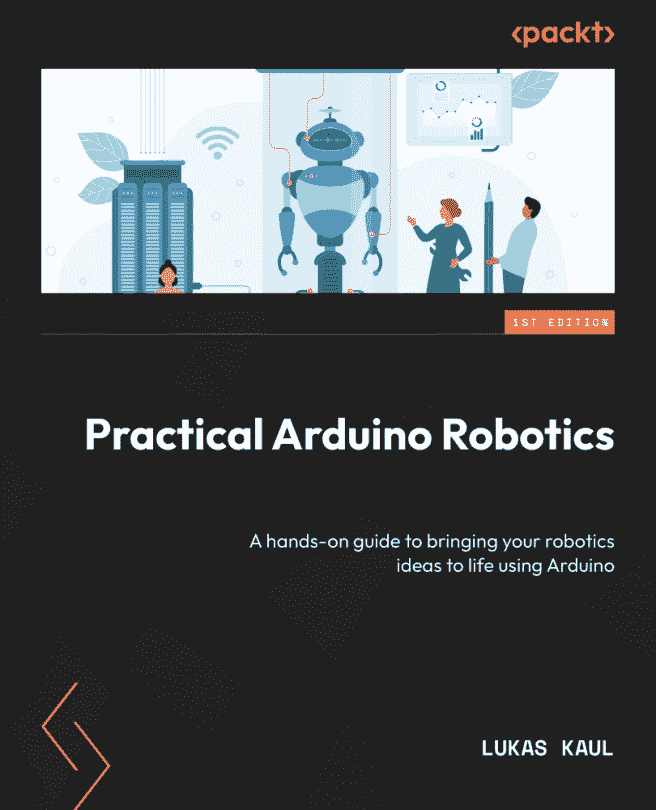

- 理解并使用 Arduino 开发板的各种接口
- 编写代码与您的传感器和电机通信
- 实现并调优传感器信号处理方法
- 理解并实现控制机器人的状态机
- 实现反馈控制以创造令人印象深刻的机器人能力
- 将软硬件组件集成为可靠的机器人系统
- 系统地调优、调试和改进基于 Arduino 的机器人

### 《在家用 Raspberry Pi Pico 做机器人》

**Danny Staple**

ISBN: 978-1-80324-607-9

- 将 Raspberry Pi Pico 与电机连接以驱动部件
- 使用 FreeCAD 进行 3D CAD 设计
- 构建一个简单的机器人并扩展它以应对更复杂的项目
- 将 Raspberry Pi Pico 与传感器和蓝牙 BLE 连接
- 使用 Matplotlib 可视化机器人数据
- 了解 Pico 上的机器人算法以实现智能行为

## Packt 正在寻找像您这样的作者

如果您有兴趣成为 Packt 的作者，请访问 [authors.packtpub.com](http://authors.packtpub.com) 立即申请。我们已与数千名像您一样的开发者和技术专业人士合作，帮助他们与全球技术社区分享见解。您可以提交一般申请，申请我们正在招募作者的特定热门主题，或提交您自己的想法。

## 分享您的想法

现在您已读完 *Drone Development From Concept to Flight*，我们很想听听您的想法！如果您在亚马逊购买了本书，请[点击此处直接前往该书的亚马逊评论页面](https://packt.link/r/1837633002)并分享您的反馈，或在您购买的网站上留下评论。

您的评论对我们和技术社区都很重要，将帮助我们确保提供优质内容。

## 下载本书的免费 PDF 副本

感谢您购买本书！

您喜欢在旅途中阅读，但无法随身携带纸质书吗？

您购买的电子书是否与您选择的设备不兼容？

别担心，现在购买每一本 Packt 图书，您都可以免费获得该书的无 DRM 限制的 PDF 版本。

随时随地，在任何设备上阅读。直接从您喜爱的技术书籍中搜索、复制和粘贴代码到您的应用程序中。

福利不止于此，您还可以每天在收件箱中独家获取折扣、时事通讯和精彩的免费内容。

按照以下简单步骤获取福利：

1. 扫描二维码或访问下方链接

   

   [`packt.link/free-ebook/9781837633005`](https://packt.link/free-ebook/9781837633005)

2. 提交您的购买凭证

3. 就这些！我们会将免费 PDF 和其他福利直接发送到您的邮箱

