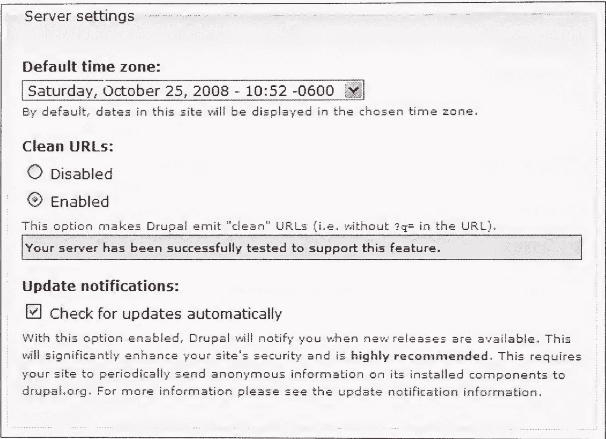

# 1 Introducing Good Eatin'

尽管已有几本关于 Drupal 的书籍出版，但大多数都是为开发人员编写的，帮助他们了解如何使用 Drupal 构建网站、通过使用自定义模块增强网站，以及通过使用主题更改 Drupal 网站的外观。在本书中，我们采取了不同的方法。在整本书中，我们将为一家（虚构的）企业开发一个网站，以满足该企业的需求。

我们包含了 Drupal 中大多数中小型企业希望在其网站上使用的所有关键功能说明。书中包含每个功能如何集成到您网站的详细逐步描述，以及使用该功能所满足的业务需求的解释。

阅读完本书后，您将能够将本书中使用的技术调整为自行为您的公司开发网站，或与开发公司合作创建真正满足您业务需求的网站。

在本章中，我们将介绍我们的客户 Good Eatin' Bistro，并讨论他们建立网站的计划。我们还将介绍 Drupal 并描述它为何非常适合我们客户的网站。

### The Good Eatin' Bistro

Chef Wanyama 是 Good Eatin' Bistro 的老板，这是一家受欢迎的高档餐厅。过去几年非常顺利，他已从一家餐厅扩展到三家。每家餐厅都以野生动物园为主题装饰，Chef Wanyama 对装饰感到非常自豪。Good Eatin' Bistro 提供各种各样的食物，但专门使用异国野味制作餐点。

Chef Wanyama 最近在菜单中增加了外卖和送餐服务，并希望对业务的这一方面进行额外推广，他认为这将带来额外的收入。他还提供烹饪课程，也希望对此进行推广。

### Plans for a Good Eatin' web site

Chef Wanyama 几年前为自己设计了一个网站，但维护起来很困难，因此已经过时好几年了。Chef Wanyama 希望为他的企业建立一个新网站，以突出餐厅的新特价。他希望为客户提供一个目的地，让他们可以在网上访问他的餐厅，了解更多关于餐厅的信息，查询特价信息，并在他们是忠实客户时获得折扣。

Chef Wanyama 对其网站有几个关键目标：

- 1. 网站必须易于更新，以便始终保持最新。
- 2. Chef Wanyama 应该能够在无需支付顾问费用的情况下自行更新网站。
- 3. 他应该能够在不影响网站安全的情况下委派简单任务。
- 4. 整个网站应安全且易于维护。
- 5. 应该可以在不要求完全重新开始的情况下向网站添加新功能。

在 Chef Wanyama 来找我们表达希望建立新网站的愿望后，我们与他坐下来确定应向网站添加哪些页面和部分，以便我们规划开发工作。基于这些讨论，我们决定了网站的以下结构：

- 1. Home Page: 这包括指向网站其他区域的链接、当前活动和示例菜单项。Chef Wanyama 可能希望主页的外观与网站其他部分不同。
- 2. Menu Pages: 这包括食物、葡萄酒和鸡尾酒。创建菜单页面的方法有两种：一种简单的方法是每个页面独立开发，第二种方法是可以让编辑为每个菜单填写模板。每个菜单项将被分类，以便客户更容易搜索菜单。
- 3. Menu Search: 这允许访客根据各种标准搜索菜单上的食物。
- 4. Menu item rating: 这允许访客在 1-5 的范围内对项目进行评分。
- 5. About Us Page: 此页面提供联系信息。
- 6. Guest Book: 这允许访客对餐厅发表评论并提供反馈。Chef Wanyama 可以看到何时添加了新评论，并且他可以选择删除不符合网站标准的评论。
- 7. **Map**: 这有助于访客使用 Google Maps 找到所有 Good Eatin' 餐厅。
- 8. **Polls and Surveys**: 不时地，餐厅会进行民意调查，以了解顾客希望添加到菜单上的项目，以及他们对菜单上新项目的看法。
- 9. **Picture Gallery**: 这显示菜单上的食物图片以及餐厅的图片。
- 10. **Monthly Newsletter**: 这是一份访客可以订阅的新闻通讯。Chef Wanyama 将能够在网站上创建新闻通讯内容。客户还可以查看新闻通讯的往期内容。
- 11. **Event Calendar**: 这展示了在 Good Eatin' 餐厅举行的音乐活动和其他活动。
- 12. A **Member Rewards site**: 这提供了会员在访问餐厅指定次数后可获得免费餐食的详细信息。
- 13. **Online ordering**: 这将允许访客订购外卖和送餐。
- 14. **Forum**: 这是一个论坛，用于征求改进建议和想法，讨论政策等。
- 15. **Blog**: 这将由 Chef Wanyama 及其员工用于讨论对他们重要的主题，包括新菜单食谱、经营餐厅等信息。
- 16. **Administration Area**: 这有助于 Chef Wanyama 优化其网站，以便访客可以充分利用网站。

### Selecting a foundation for the Good Eatin' site

在本节中，我们将探讨可用于构建 Good Eatin' 网站的多种可能技术。将讨论每种方法的优缺点，并选择最终用于构建网站的技术。

### Simple static web pages

大多数网站都是通过简单创建不更改的独立 HTML 页面创建的。这些页面可以使用专用网站设计程序或简单的文本编辑器（如 Microsoft Notepad）创建。然后使用 FTP 客户端或网络主机提供的其他传输客户端将这些页面上传到 Web 服务器。

## 主要优势

使用这种网页开发方法有几个优势：

- 1. 自定义编辑器可以让创建网站像写信一样简单。
- 2. 网站编辑器可能提供预建主题，即使没有图形设计经验也能让网站具有吸引力。
- 3. 这是一种非常容易入门的方式。
- 4. 对于简单的网站，有时简单的技术是合适的。
- 5. 网站可以相对快速地创建。
- 6. 网站可以免费构建，或仅需支付网站设计程序的费用。
- 7. 硬件要求非常低，因此网站几乎可以在任何主机上运行。

## 主要劣势

尽管静态网页可以很容易开发，但在部署网站并稍后尝试对其进行修改后，会出现一些劣势。

- 1. 向网站添加新页面可能需要更改网站上所有现有页面。
- 2. 更改所有页面共有的元素，例如页眉或页脚，可能需要更改网站上的每个页面。
- 3. 当网站需要重大更改时，重新开始可能比重建网站更容易。
- 4. 网站中出现错误很容易，导致无法访问的页面，或访客可能遇到的错误。
- 5. 如果没有自定义编程，就无法添加高级功能。
- 6. 创建的代码可能效率低下或不正确，导致网站在所有浏览器中显示不正常。
- 7. 其他开发人员创建的安全和优化技术不会自动应用于您的网站。

## 使用 PHP 和 MySQL 的完全自定义网站

在简单的静态页面另一端是使用 PHP 等编程语言和 MySQL 等数据库从头完全构建的完全自定义网站。在这种系统中，网站的所有功能都是由一个或多个程序员专门为您的网站构建的。可能会使用一些通用库来加快开发速度，但网站的大部分内容将是自定义创建的。

## 主要优势

为您的公司开发完全自定义网站有几个优势。

- 1. 最终网站将完全定制以满足您公司的确切需求。
- 2. 新功能可以在稍后由另一名程序员添加。
- 3. 从空白开始开发时，复杂功能可能更容易开发。
- 4. 如果没有自定义编程，复杂功能可能无法构建。
- 5. 该网站可能比基于预定义框架或内容管理系统构建的网站更高效。

## 主要劣势

不幸的是，开发完全自定义网站是一个困难、耗时耗力的过程，并且有几个劣势。它们是：

- 1. 相对低技能的程序员可能会创建难以维护和增强的网站。
- 2. 除非网站设计允许自定义，否则更改网站的外观和感觉可能需要大量返工。
- 3. 网站可能需要程序员投入大量工作来创建和维护。
- 4. 可能无意中引入安全漏洞，这可能会损害整个服务器或客户的私人数据。
- 5. 网站可能比简单网站需要更多的硬件资源，并且可能需要大量资源才能以可接受的速度运行。
- 6. 从头创建所有功能可能证明成本非常高。

## Drupal 内容管理系统

Drupal 是一个基于 PHP 和 MySQL 的内容管理系统。要使用 Drupal，您需要将其安装到您的 Web 服务器上。安装后，您使用 Drupal 创建和编辑页面。Drupal 处理构建任何规模网站所需的大多数常见功能，包括：

- 用户管理
- 内容分类
- 构建菜单
- 为所有页面创建一致的外观
- 向页面添加图片
- 创建和维护博客
- 创建和维护论坛
- 联系表单
- 翻译和国际化
- 以及更多

尽管这些功能本身足以处理许多网站，但 Drupal 还提供了一个强大的模块系统，允许开发人员创建可插入 Drupal 核心框架的模块，以无缝提供新功能。许多模块已由 Drupal 社区创建并免费发布供其他用户使用。模块可用于几乎所有可想象的任务，但如果您找不到所需的内容，始终可以创建自定义模块来处理您的确切需求。

Drupal 还提供了一个强大的主题系统，允许您更改网站的外观和感觉，并立即在整个网站的所有页面上进行更改。Drupal 网站上有多个免费主题可用，并且可以根据您的需要进行自定义。或者，您可以为自己的网站开发自定义主题。商业主题也可以从各种网站购买。

## 使用 Drupal 构建的好处

与使用其他方法构建网站相比，Drupal 提供了许多好处。其中许多与维护的便利性和能够专注于业务功能而不是构建常见的重复功能有关。

- 1. 您无需创建 Drupal 已提供的<|message|> 基础功能，而可以自由专注于构建支持您业务的内容和功能。
- 2. 网站的外观和感觉可以轻松更改，而无需重写整个网站或更改所有页面。
- 3. 对网站的所有更改都会立即生效，因此您可以确保更改是正确的。
- 4. 可以在网站更新之前预览更改，以确保其正常工作。
- 5. 可以跟踪对页面的修订，并且可以在页面可见之前要求其经过审批流程。
- 6. 您无需使用 FTP 或其他方法将页面部署到您的网站。
- 7. 开发成本低，因为 Drupal 可免费获得。
- 8. 有一个活跃的社区可以帮助回答您可能有的任何问题。
- 9. Drupal 会积极维护和增强，这有助于确保潜在的安全问题能够迅速发现并修复。
- 10. 即使没有编程经验，广泛的人群也可以有效使用 Drupal。
- 11. 网站管理可以委托给一支团队，他们可以共同承担整个网站的责任，或对网站内的特定区域承担个人责任。
- 12. 由于 Drupal 不断维护和更新，您可以比其他情况下更快地获得新技术。

## Drupal 的劣势

尽管 Drupal 是一个非常强大的工具，但其强大的功能也带来了几个劣势：

- 1. 需要一个短暂的学习曲线才能开始并有效使用该系统。
- 2. 它比基本的静态页面更耗硬件。
- 3. 可能需要额外的编程来定制 Drupal 模块以完全按照您想要的方式运行。或者，您可能必须在所需功能方面做出妥协，基于实际可用的功能。
- 4. 黑客可能会尝试攻击 Drupal 网站，因为使用 Drupal 的网站数量众多。
- 5. 框架可能存在限制，这可能会使构建自定义功能变得更加困难。

## 选择 Drupal

正如您可能从本书标题中猜到的那样，我们为 Good Eatin' 网站选择了 Drupal。Drupal 为我们的网站提供了功能、灵活性、安全性和易用性的最佳组合。事实上，Drupal 是从小型网站到大型网站以及两者之间所有类型网站的合适选择。如果您计划构建一个网站，那么 Drupal 很可能会满足您所有的需求。

## 将 Good Eatin' 网站扩展到其他企业

尽管本书将集中于使用 Drupal 为餐厅构建网站，但所讨论的大多数技术也可以用于构建其他类型企业的网站。

在第 2 章中，我们讨论了适用于几乎所有网站的常见功能。

在第 3 章中，我们使用可用于为其他企业创建产品目录的技术构建餐厅菜单。

在第 4 章中，我们讨论了通过使用投票、调查、评论等与客户互动。所有这些对绝大多数企业都很有用。

在第 5 章中，我们构建公司博客。对于一些公司来说，博客是他们唯一的在线存在。对于其他公司来说，公司博客对于让客户了解最新动态至关重要。

在第 6 章中，我们创建新闻通讯以及活动日历。新闻通讯是提醒客户您产品和服务的绝佳方式，日历可以帮助您宣传与您的业务相关的特殊活动。

在第 7 章中，我们集成来自 YouTube 和 Flickr 等第三方网站的内容。

在第 8 章中，我们为那些光顾的客户提供免费内容，给他们一个再次访问您网站并继续访问的额外理由。

5. 单击 Install Drupal in English 链接以继续安装。

6. Drupal 现在将验证是否满足 Drupal 的所有要求。如果显示任何错误，则必须在继续之前进行更正。在默认安装中，您需要基于 default.settings.php 文件创建一个 settings.php 文件，该文件可以在安装过程中进行修改，如以下屏幕截图所示：

## Requirements problem

在继续安装过程之前，必须解决以下错误：

> Drupal 安装程序要求您在安装过程中创建设置文件。
> 
> 1. 将 ./sites/default/default.settings.php 文件复制到 ./sites/default/settings.php。
> 
> 2. 更改文件权限，使其可由 Web 服务器写入。如果您不确定如何授予文件权限，请参阅在线手册。
> 
> 有关安装 Drupal 的更多详细信息，请参阅 INSTALL.txt。

请检查错误消息并重试。

在修复报告的任何错误后，您可以单击 try again，并重复此步骤，直到不再报告错误。

7. 您现在需要为您的站点创建一个数据库。创建 MySQL 数据库的确切方法将取决于您为站点选择的托管服务提供商。如果您不确定如何在托管服务提供商上创建数据库，请联系您的提供商以获得更多帮助。

8. 在创建数据库后，您需要输入数据库的名称以及数据库的用户名和密码。

## Database configuration

Basic options

要设置您的 Drupal 数据库，请输入以下信息。

Database type: *
○ mysqli
○ pgsql
您的 Drupal 数据将存储在其中的数据库类型。

Database name: *
yoursite_db
您的 Drupal 数据将存储在其中的数据库名称。在安装 Drupal 之前，它必须存在于您的服务器上。

Database username: *
youruser

Database password:
••••••••••••

这些信息要么在您的托管公司创建数据库时为您提供，要么如果您从头开始构建数据库，则您自己指定了它们。

## Administrator account

管理员帐户可以完全访问站点；它将自动获得所有权限并可以执行任何管理活动。这将是唯一可以执行某些活动的帐户，因此请妥善保管其凭据。

Username: *

YourSiteAdmin

允许使用空格；除句点、连字符和下划线外，不允许使用标点符号。

E-mail address: *

admin@yoursite.com

系统发送的所有电子邮件都将发送到此地址。电子邮件地址不会公开，仅在您希望接收新密码或希望通过电子邮件接收某些新闻或通知时使用。

Password: *

********  Password strength: Low

Confirm password: *

********  Passwords match: Yes

密码的变体不足以保证安全。请尝试：

+   - 添加大小写字母。
+   - 添加数字。
+   - 添加标点符号。

如果您输入的密码不够难以猜测，Drupal 将警告您并提供更强大的密码建议。

+   11. 最后，您需要定义一些基本服务器配置选项。在大多数情况下，Drupal 会为您正确设置这些项目，但您可能需要检查时区设置以确保其正确。

+   12. 当您对所有信息感到满意时，单击 **Save** 完成安装过程。

+   13. 安装完成后，您可以返回主页面，在那里您可以登录并开始对网站进行额外配置。我们将从此阶段开始构建 Good Eatin' 网站，从第 2 章开始。

如果您想要更全面的 Drupal 入门介绍，其中包含对 Drupal 一些更理论方面的解释，请查看 David Mercer 所著的 *Building Powerful and Robust Websites with Drupal 6*，同样由 Packt Publishing 出版。
