# 2

## Creating Good Eatin's Online Presence

在本章中，我们将使用 Drupal 内容管理系统设置 Good Eatin' 网站的基础部分。我们将首先构建几个页面，包括关于页面和主页。我们还将讨论如何删除和编辑页面。在熟悉内容管理后，我们将把页面添加到导航系统中，以便客户可以轻松找到所需的所有信息。完成导航后，我们将通过添加图像和幻灯片使您的网站在视觉上更具吸引力。最后，我们将为您的网站添加一个主题，该主题基于 Drupal 网站上提供的众多主题之一。

在本章的每个步骤中，我们都将指出确保您的网站安全的方法，以便黑客和其他恶意访问者无法干扰您的业务。

在开始进行任何更改之前，让我们先看看 Drupal 提供的默认站点。

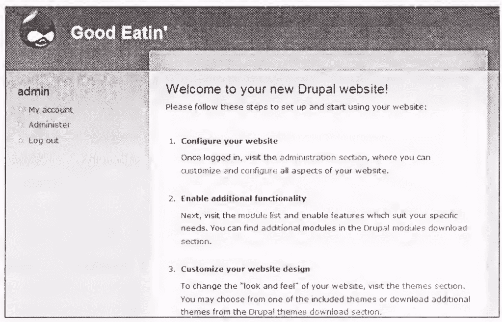

在本章结束时，您将了解互联网上绝大多数网站使用的技术，并且您的网站将如下图所示：

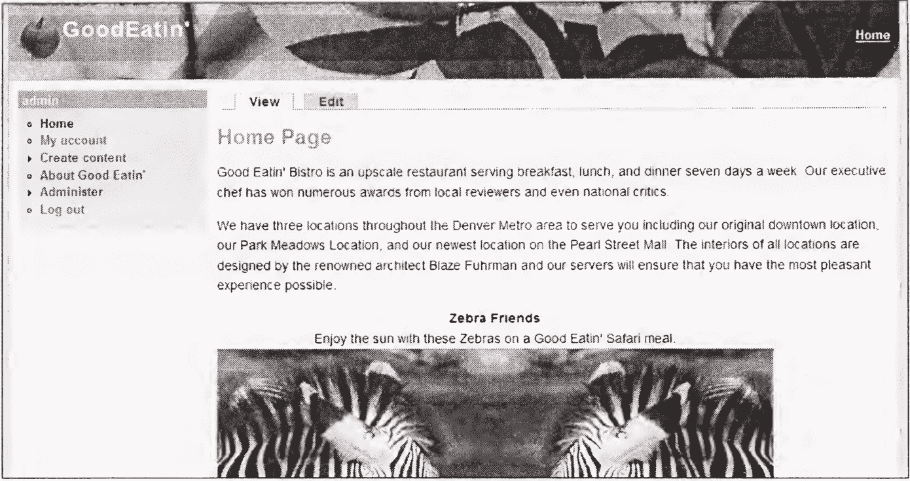

## About Good Eatin': Adding static pages

本节将描述如何设置一个包含静态文本的信息页面。对于我们的客户，这将涵盖添加关于 Good Eatin' 页面。我们还将创建一个基本菜单页面，后续会更改。

## Adding a page

每个站点的核心都是不经常更改或很少更改的页面。Drupal 使在没有任何编程知识的情况下将这些类型的页面添加到网站变得非常容易。我们将在 Good Eatin' 网站上演示这些技术，通过创建一个简单的首页和一个关于页面。

要添加新的静态页面，请从站点最左侧菜单中选择 Create Content 链接。现在您将看到 Drupal 知道如何创建的内容类型列表。默认情况下，Drupal 知道 Page 类型和 Story 类型。大多数静态页面，包括我们的关于 Good Eatin' 页面，将使用 Page 类型。但是，如果您希望访客能够对您的页面发表评论，或者如果您正在创建博客风格的网站，Story 类型可能是更好的选择，因为对此类型的评论默认情况下是打开的。我们将在下一章详细介绍评论。

要创建我们的关于 Good Eatin' 页面，请单击 Page 链接。Drupal 现在将向您展示一个表单，您可以在其中输入有关页面的信息。您可以输入在 Web 浏览器标题中显示并在站点上显示内容时显示在内容上方的标题。我们将 **About Good Eatin'** 用作页面的标题。

典型的关于页面将包含公司名称、公司地址以及公司业务的简要历史。我们将在创建关于 Good Eatin' 页面时使用此作为指导。

您可以像在您选择的文字处理器中一样输入信息，使用回车键分隔段落。Drupal 会自动将您输入的文本转换为在 Web 浏览器中显示的正确 HTML。您无需担心学习 HTML。但是，如果您确实了解 HTML，您可以使用标签来格式化页面。请参阅 HTML primer 侧边栏，了解 Drupal 允许页面包含的基本标签的信息。

我们用于关于 Good Eatin 页面 的文本如下所示：

```
```html
<em>Good Eatin' Bistro</em> is a full service restaurant serving
breakfast, lunch, and dinner daily. Good Eatin' Bistro was founded in
2008 by <cite>Mark Noble</cite> to serve as an example website for the
<strong>Drupal 6 Site Builder Solutions</strong>.

<dl>
<dt>Address:</dt>
<dd>1500 Main Street<br>
Anytown, CO<br>
United States of America</dd>

<dt>Phone:</dt>
<dd>303-555-5555</dd>
</dl>
Hours of operation
<ul>
<li>M-F: 8AM - 10PM</li>
<li>Sat: 7AM - 12PM</li>
<li>Sun: 8AM - 8PM</li>
</ul>
```
```

## Spicing up your site with simple HTML

Drupal 允许您使用几种简单的 HTML 标签来改进页面的格式。虽然 HTML 起初可能令人望而生畏，但它实际上很容易学习和使用。


## 基本格式

这些标签允许你在网页上显示时更改文本的外观。要使用这些标签，只需将起始标签放在你想要更改样式的文本之前，并在想要恢复到之前样式时放置结束标签。例如，要将文本 hello 设置为粗体，你需要输入 <strong>hello</strong>。你可以嵌套标签以对一段文本应用多种样式。例如，要同时加粗和斜体文本 hello，你输入 <em><strong>hello</strong></em>。当你对一段文本应用多个标签时，请确保打开和关闭标签对正确嵌套，并且不重叠。

| 开始标签 | 结束标签 | 用途 |
|---|---|---|
| <em> | </em> | 为一段文本提供强调；这是通过斜体化文本来实现的。你应该在想要引起读者对特定文本的注意时使用此标签。 |
| <strong> | </strong> | 使一段文本从其余文本中脱颖而出；这是通过在浏览器中加粗文本来实现的。将文本设置为粗体可以帮助读者快速扫描你的页面以确定是否要更详细地阅读。你应该在某段文本比其余文本更重要时使用此标签。 |
| <cite> | </cite> | 此标签用于表示来自其他来源的引用；这通常以斜体文本呈现。 |
| <code> | </code> | code 标签使用等宽字符显示文本，这使得字符能够对齐。这极大地提高了在后续行中字符位置很重要的文本的可读性。 |

## 创建列表

你可以使用 HTML 标签创建三种样式的列表：有序列表、无序列表和定义列表。 有序列表在列表中的每个元素前加上一个数字。无序列表在列表中的每个元素前加上一个项目符号。定义列表首先显示定义术语，然后在术语下方缩进定义。要创建列表，将列表开始标签放在列表开头，将列表结束标签放在列表末尾，并用列表项标签包围列表中的每个项目。

| 列表类型 | 开始标签 | 结束标签 | 元素标签 | 示例代码 | 示例列表 |
|---|---|---|---|---|---|
| 无序列表 | <ul> | </ul> | <li>element</li> | <ul>
<li>Item 1</li>
<li>Item 2</li>
<li>Item 3</li>
</ul> | • Item 1
• Item 2
• Item 3 |
| 有序列表 | <ol> | </ol> | <li>element</li> | <ol>
<li>Item 1</li>
<li>Item 2</li>
<li>Item 3</li>
</ol> | 1. Item 1
2. Item 2
3. Item 3 |
| 定义列表 | <dl> | </dl> | <dt>term name</dt>
<dd>description</dd> | <dl>
<dt>Address</dt>
<dd>2500 Main St.
Anytown, CO
USA</dd>
<dt>Phone</dt>
<dd>303-555-5555</dd>
</dl> | Address
2500 Main St.
Anytown, CO
USA
Phone
303-555-5555 |

## 链接到其他页面

你可以使用 <a> 标签创建指向你网站其他部分或另一个网站的链接。此标签比其他标签稍微复杂一些，因为你必须指定当链接被点击时用户将被带到的目的地。

链接标签的格式如下：`<a href="destination">Link Text</a>`。例如，要链接到 Good Eatin' 主页，我们将使用以下标签：

```
```html
<a href="http://goodeatin.drupalbyexample.com">Good Eatin' Bistro</a>
```
```

## 编辑页面

创建页面后，你可以随时通过编辑页面来更改页面上的文本。要编辑页面，首先在浏览器中打开页面，然后选择出现在页面标题旁边的编辑链接。

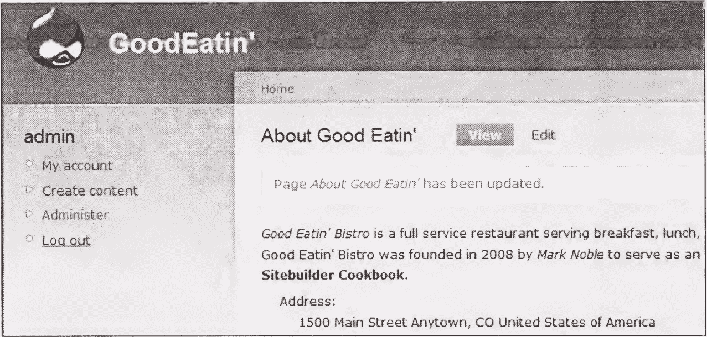

Drupal 显示一个表单，该表单与我们将页面添加到网站时使用的表单相似。

## 安全考虑

你可以使用权限来控制谁被允许向你的网站添加页面。默认情况下，只有管理员被允许创建页面和故事。如果你与团队一起工作在网站上，最好创建新的角色，这些角色只给团队成员提供他们完成工作所需的权限。

让我们创建一个编辑角色，以便我们团队中的其他人可以向我们的网站添加页面。要创建新角色，点击 **User Management** 然后点击 **Roles**，在 **Administer** 菜单中。输入 **editor** 作为角色名称并点击 **Add role** 按钮。现在我们有了新角色，我们可以通过选择 **edit permissions** 链接为其分配权限。 你设置的权限将取决于用户执行其工作所需的内容以及你对用户的信任程度。在大多数情况下，最好一开始给用户更少的权限，然后随着他们对网站越来越熟悉，再给予他们额外的特权。

对于我们的网站，我们将给编辑以下权限，这些权限位于 **node module** 标题下方：

- **Create page content:** 允许用户为网站创建页面
- **Edit own page content:** 允许用户编辑他们创建的页面，但不能编辑其他用户创建的页面

创建和编辑内容的权限完整列表如下所示：

| 权限 | anonymous user | authenticated user |
|---|---|---|
| **node module** |  |  |
| access content | ✓ | ✓ |
| administer content types | ☐ | ☐ |
| administer nodes | ☐ | ☐ |
| create event content | ☐ | ☐ |
| delete any event content | ☐ | ☐ |
| delete own event content | ☐ | ☐ |
| delete revisions | ☐ | ☐ |
| edit any event content | ☐ | ☐ |
| edit own event content | ☐ | ☐ |
| revert revisions | ☐ | ☐ |
| view revisions | ☐ | ☐ |

如果你信任将成为编辑的用户，你也可以赋予他们编辑任何页面内容的特权，这将使他们能够编辑其他用户创建的页面。如果你使用的是 Drupal 5，在决定用户可以编辑哪些页面时要小心，因为允许用户编辑页面也会允许他们删除它。

如果你选择使用其他内容类型，例如 **Story** 类型，你也需要为其分配权限。

我们将在未来的章节中讨论额外的权限，因此如果你现在不知道它们所有含义也不用担心。

## 创建干净的 URL

由于 Drupal 创建和显示页面时的技术问题，页面的默认路径如下所示：

```
http://www.yoursite.com?q=node/1
```

这种格式对访问者来说可能令人困惑，因为它更难输入并且不那么熟悉。一些搜索引擎也不会索引 URL 中问号后面的任何内容。这实际上使你的网站在某些搜索引擎眼中只有一个页面。你可以使用干净的 URL 将其转换为标准 URL。这将使同一页面的路径如下：

```
http://www.yoursite.com/node/1
```

在 Drupal 6 及更高版本中，你可以在安装过程中设置干净的 URL。如果你仍在使用 Drupal 5 或在安装期间未配置干净的 URL，你可以通过点击站点配置然后从 Administer 菜单中选择干净的 URL 来访问此设置。

要启用干净的 URL，你的网站必须首先通过自动测试。在 Drupal 6 及更高版本中，这是在安装期间和加载干净的 URL 配置页面时完成的。在 Drupal 5 中，你必须在干净的 URL 测试页面上点击运行干净的 URL 测试链接。如果你的设置满足要求，你可以点击已启用链接来更正 URL。

如果你的设置不满足要求，Drupal 网站上有大量信息：http://drupal.org/node/15365 将帮助你确定原因并纠正任何问题。如果你继续在设置干净的 URL 时遇到困难，你可能需要联系你的网站托管商。

## 设置主页

在本节中，我们将为 Good Eatin' 网站创建主页。我们将介绍两种可能的主页样式。第一种显示来自网站其他部分的简短文本片段，称为摘要。这种类型的页面通常用于新闻网站和博客网站。另一种主页类型是更静态的页面，其中包含其自身独特的內容。这种类型的页面是大多数网站的典型。

## 博客样式主页

大多数访问你网站的访客首先看到的是主页。Drupal 使控制主页的外观和内容变得非常容易。

默认情况下，Drupal 使用博客样式格式，其中主页上显示了其他几个页面的部分。Drupal 将每个页面显示的部分称为摘要。

摘要由 Drupal 根据帖子设置自动创建，可以通过从 Administer 菜单中先点击内容管理然后点击帖子设置来访问。从此页面，你可以轻松控制主页上将显示多少帖子，以及摘要的长度。


在 Drupal 6 及更高版本中，你可以轻松控制摘要占用页面的多少。首先，在编辑器中打开页面，将光标定位到你希望摘要与内容其余部分分开的位置，然后点击 **Split summary at cursor** 按钮。要在 Drupal 5 中实现相同的功能，你需要在以下位置添加一段包含文本 `<!--break-->` 的注释：

This is a sample page with a teaser break

```
<!--break-->
```

More information after the teaser.

要将内容添加到主页，你必须在保存页面时在 **Publishing options** 部分选中 **Promoted to front page** 复选框。

## Creating a traditional home page

虽然博客风格的主页适用于某些网站，但对于 Good Eatin' 网站，我们希望有一个更传统的页面，以便我们可以引导访客访问我们网站最重要的部分。

创建传统主页的第一步是创建一个将作为主页基础的静态页面。我们将以创建关于页面完全相同的方式创建该页面。

当你创建主页时，你应该向访客介绍你提供的产品或服务，并使他们能够轻松地在网站其余部分中找到方向。典型的访客在决定是否进一步探索网站或转到另一个网站之前，只会在一个页面上花费 20–30 秒。因此，清晰地展示你与竞争对手的不同之处至关重要。

对于初始主页，我们输入的文本如下所示：

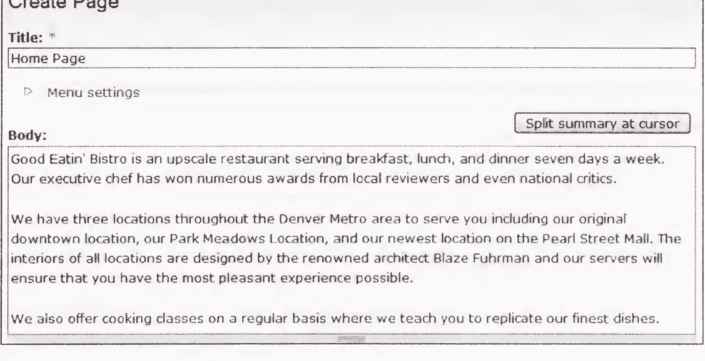

更改默认首页，使其成为你创建的页面的路径，然后点击 Save configuration 以完成更改。你还可以添加网站标语、网站使命，以及将在网站所有页面底部显示的消息。

## Other home page ideas

偶尔使用的一种另一种类型的首页是基于 Flash 的首页，它在访客访问实际网站之前向访客显示一段短视频。虽然这种技术对于某些以视频或音乐使用为网站关键的网站来说可能很棒，但对于信息类网站来说通常不是一个好主意，因为一些访客可能会关闭 Flash，而一些搜索引擎可能很难索引基于 Flash 的页面。

如果你想使用基于 Flash 的首页，Front Page 模块允许你创建自定义首页。Front Page 模块在 Drupal 网站上有详细描述，网址为：http://drupal.org/project/front。

Splash 模块也允许你在显示主要网站之前显示一个不同的页面。有关 Splash 菜单的更多信息可以在 Drupal 网站上找到，网址为：http://drupal.org/project/splash。

## Getting around: Setting up navigation

随着你的网站变得越来越大和复杂，你需要确保访客可以轻松找到他们想要的内容。在传统的网站开发中，管理导航是最困难、最耗时且最容易出错的任务之一。幸运的是，Drupal 为我们处理了维护导航系统的细节，因此我们可以专注于确保导航结构合理且用户易于理解。

## Building menus

在 Drupal 中组织内容的主要方式是通过使用菜单。Drupal 菜单系统以简单的提纲组织内容，其中一个页面可以嵌套在另一个页面之下。Drupal 处理菜单的展开和折叠，以隐藏对用户不立即相关的菜单。这有助于保持菜单简短，并确保访客可以轻松理解你的网站布局。你还可以为网站创建多个菜单。例如，许多网站会在屏幕左侧显示一个主菜单，并在页面顶部显示一个较小的菜单，让访客跳转到网站的特定部分。

## Creating Good Eatin's Online Presence

**Menu settings** 部分允许你控制当访客查看菜单时为此页面显示的文本、此页面将在其下显示的父级，以及控制此页面在列表中位置的权重。

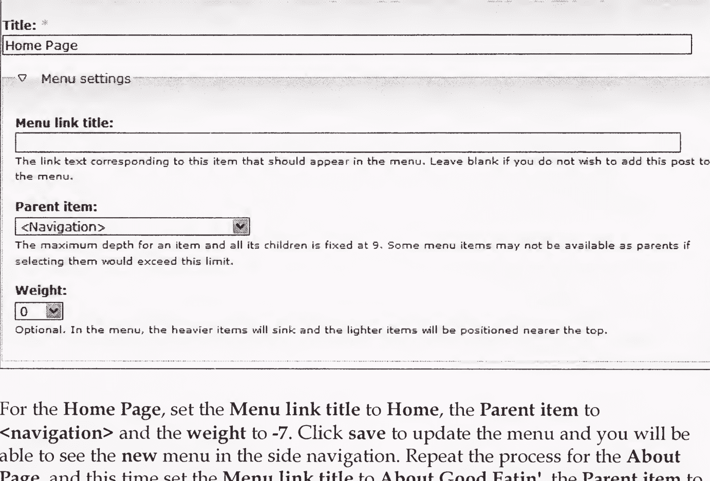

对于 **Home Page**，将 **Menu link title** 设置为 Home，将 **Parent item** 设置为 **`<navigation>`**，并将 **weight** 设置为 -7。点击保存以更新菜单，你将在侧边导航中看到 **new menu**。对 **About Page** 重复此过程，这次将 **Menu link title** 设置为 About Good Eatin'，将 **Parent item** 设置为 **`<navigation>`**，并将 **weight** 设置为 7。

父项控制此页面将在哪个菜单项下方显示。子项在父项下是独立的。如果我们回顾我们想要最终创建的菜单的第一部分，父项和子项如下：

- 1. **Home Page:** Parent is `<Navigation>`, no children.
- 2. **Food:** Parent is `<Navigation>`, children are Breakfast, Lunch, and Dinner.
  - a) Breakfast: Parent is Food, no children
  - b) Lunch: Parent is Food, no children
  - c) Dinner: Parent is Food, no children

你现在应该能在 Navigation 菜单中看到 Home 和 About Good Eatin' 页面。如果你注销然后查看网站，或在不同的浏览器中查看网站，你将只在 Navigation 菜单中看到 Home 和 About Good Eatin' 项目。

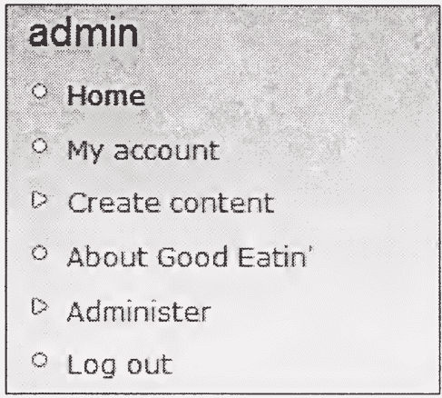

## Creating custom menu items

要创建自定义菜单项，你需要使用 Menu manager。可以通过点击 Administer 链接，然后点击 Site building 链接，最后点击 Menus 链接来访问。你也可以直接通过导航到 admin/build/menu 来访问该页面。Menu manager 在以下截图中显示：

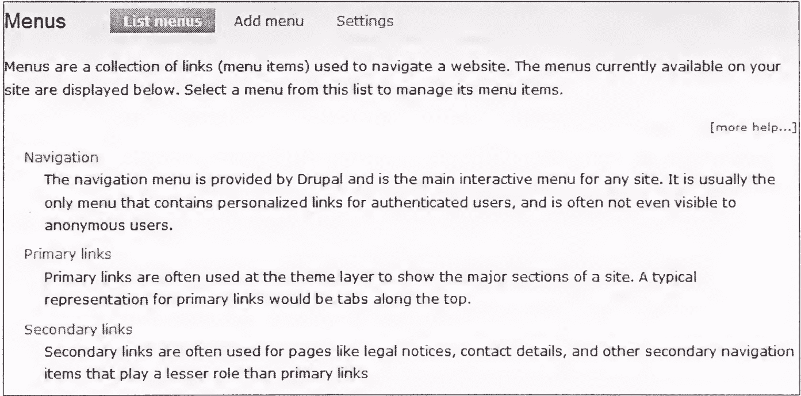

一旦 Menu manager 打开，选择你想要编辑的菜单。因为我们已经完成了 Navigation 菜单，我们将处理 Primary Links 菜单并添加我们的首页和 About Good Eatin' 页面。默认情况下，Primary Links 页面显示如下，因为我们尚未创建任何菜单项：

Primary links List items Add item Edit menu

要重新排列菜单项，抓住 Menu item 列下的拖放手柄并拖动项目（或项目组）到列表中的新位置。（通过在手柄图标上悬停时点击并按住鼠标来抓住手柄。）请记住，你的更改在点击页面底部的 Save configuration 按钮之前不会被保存。

There are no menu items yet.

要添加自定义菜单项，点击 Add item 菜单。Drupal 将为你提供一个表单，你可以在其中输入有关菜单项的信息。此信息包括：

- Path: This indicates the path which will be loaded when the user clicks on the menu item
- Menu link title: This is the text that will be displayed when the visitor views the menu
- Description: This allows you to give the visitor additional information when the visitor hovers over the menu item about what will happen if the visitor clicks on the item
- Enabled: This indicates whether or not the visitor can access the menu item; you can disable the menu item rather than delete it if a page is temporarily removed from the site
- Expanded: The expanded option controls whether or not a visitor can automatically see items that are contained within this one
- Parent item: This works exactly like adding a page to a menu and defines the link that this menu item will be displayed under
- Weight: This is used to control how the menu items are sorted when they are displayed by Drupal

要使用编辑器，点击菜单项名称左侧的 4 点箭头图标，然后在仍按住鼠标按钮的同时将项目移动到列表中所需的位置。菜单的显示会在你上下移动项目时自动更改。通过使用图形编辑器，你无需担心菜单项的相对权重，当你移动一个项目时，其余项目会根据需要自动重新编号。你还可以通过向左或向右拖动项目来更改菜单链接的嵌套。这使你可以轻松直观地更改菜单项的父级。

如果你使用的是 Drupal 5，你需要通过为菜单中的每个项目分配相对权重来手动控制菜单中项目的顺序。虽然权重概念在 Drupal 中经常使用，但你可能并不熟悉。当项目在列表中显示时，Drupal 会在显示它们之前根据指定的权重对它们进行排序。这会导致权重为负的项目更接近列表顶部，而权重较高的项目更接近列表底部。如果两个项目的权重相同，它们可能按字母顺序、时间顺序或随机顺序显示，具体取决于所显示的列表。菜单的每个级别都有单独的权重，因此你无需担心为可能无限数量的菜单项使用有限数量的权重。然而，如果你发现自己用完了权重，请重新审视你的设计，看看是否有更好的内容组织方式。大多数访客很难快速理解各种选项，因此简化你的内容也有助于你的客户。

当你手动为列表中的项目定义权重时，最好在编号之间留出间隔，以便你可以轻松插入新项目而无需重新排序所有现有项目。例如，如果你有四个项目需要排序，你可以使用 -6、-2、2 和 6 作为每个项目的权重。当你想在项目 2 和 3 之间插入新项目时，你可以使用权重 0，而无需重新排序其他任何项目。

## Deleting a page from the menu

从菜单中删除页面非常容易。如果你是在编辑页面时添加的菜单，只需重新编辑页面，选择 Delete this menu item 复选框并保存页面即可。

如果你使用 Menu manager 创建了菜单项，你也需要使用 Menu manager 删除它。只需在 Menu manager 中找到你想要删除的菜单项并点击删除链接即可。你无法删除系统菜单项。但是，你可以通过在 Menu manager 中取消选中菜单的 Enabled 复选框来禁用系统菜单项以防止其显示。


## 安全注意事项

Drupal 处理菜单的安全方面，并确保只有当访问者拥有访问菜单项所指向页面的权限时，该菜单项才会显示给他们。

重要的是，你需要以每种类型的用户访问网站的方式对菜单进行测试。由于我们的网站是新建的，这仅意味着我们需要分别以管理员和未注册用户的身份登录测试一次。一个简便的方法是在两个不同的 Web 浏览器中打开网站，例如 Firefox 和 Internet Explorer。你可以用一个浏览器以管理员身份开发网站，用另一个浏览器以其他类型用户的身份访问网站来进行测试。

## 版本差异

如果你仍在使用 Drupal 5，菜单管理器与 Drupal 6 中的菜单管理器略有不同，尽管核心功能仍然相同。在 Drupal 5 中，菜单管理器在单个页面上显示所有菜单及其菜单项。Drupal 6 及更高版本将每个菜单显示在各自的页面上，这使得菜单管理更加直观。

Drupal 5 的菜单排序权重选择也较少。在 Drupal 6 和 7 中，权重范围为 -50 到 +50，但在 Drupal 5 中，权重范围为 -10 到 +10。

Drupal 6 还引入了菜单的拖放排序功能，这是一个极好的节省时间的功能，尤其适用于大型菜单。

## 启用模块

我们目前使用的功能包含在 Drupal 的默认安装中，你无需做任何特殊操作即可使用它们。然而，当你开始启用 Drupal 自带的可选模块，并安装自定义模块时，Drupal 的真正威力才会被释放出来。

Drupal 安装包含 20 多个模块，其中一些默认未启用。这些模块默认被禁用可能有几个原因。有些被禁用是因为并非每个 Drupal 安装都需要它们，或者它们可能需要额外配置，或者它们可能对性能有影响。还有一些可选模块默认启用，因为大多数网站都会使用它们。但是，如果你的网站不需要它们提供的功能，你可以禁用它它们。

你可以通过选择 **站点构建**，然后从 **管理** 菜单中选择 **模块**，查看你网站上可用模块的完整列表。此页面列出了所有当前已安装的模块，并允许你启用或禁用它们。每个模块的列表都包含模块的简短描述，以及关于需要哪些其他模块的信息。如果你尝试启用一个依赖已禁用模块的模块，Drupal 会提示你是否要同时启用当前已禁用的所需模块。

如果你想了解某个特定模块的更多信息，Drupal 网站包含大量关于每个模块的信息。所有核心模块的信息可在 `http://drupal.org/handbook/modules` 获取。

要启用模块，请选中模块旁边的 **已启用** 复选框，然后点击 **保存配置** 按钮。如果你同时启用多个模块，Drupal 会负责按正确顺序启用这些模块，并为你检查所有依赖关系。

模块启用后，**管理** 菜单将更新，为该模块添加 **新的配置选项**。新模块也可能有新的权限。请查阅该模块的文档，了解有关如何配置模块的更多信息。

## 换个名字的页面：使用别名

当访问者返回你的网站时，为每个页面提供有意义的路径会对他们有所帮助。这将有助于他们输入页面的 URL。清晰的路径也有助于搜索引擎理解你页面的内容。

遗憾的是，为每个页面创建的默认路径格式为 **node/#**，其中 # 是该页面的唯一标识符。这可能让访问者感到困惑，而且肯定不利于搜索引擎优化。然而，Drupal 通过使用 **页面别名** 提供了一个解决方案。页面别名允许你使用不同的 URL 访问页面。你可以为一个页面分配的别名数量没有限制，但在大多数情况下，对于任何给定页面，你只会希望有一个额外的路径。

要创建别名，你必须启用 **路径** 模块。启用路径模块后，当你编辑页面时，Drupal 会在编辑表单中添加一个名为 **URL 路径设置** 的新部分。例如，编辑 **About Good Eatin'** 页面，然后展开 **URL 路径设置** 部分。在 **新路径** 中输入 **about-good-eatin**。

创建路径时，最好不要在路径中使用空格，并使用连字符 (-) 或下划线 (_) 分隔单词。连字符可能更有利于搜索引擎，因为某些搜索引擎可能会将下划线分隔的单词视为一个单词。你不应使用空格，因为技术上 URL 中不允许出现空格。大多数浏览器会将任何空格转换为 %20，但你可能会遇到兼容性问题。

创建别名后，你可以使用该别名来创建菜单和构建其他链接。

### 为一个页面创建多个别名

有时一个页面只有一个路径是不够的。例如，如果你要从旧网站迁移到 Drupal，你可能希望将旧页面的别名指向新路径，以便使用旧路径的访问者和搜索引擎仍然能找到你的信息。

这对于旧网站上通过简单 URL（不带额外查询信息）访问的任何页面都是可能的。例如，URL www.oldsite.com/home_page.html 可以设置别名，而 URL www.oldsite.com/home_page.html?a=Hello 则不能。

如果你想创建多个别名，你需要在 **管理** 菜单中点击 **站点构建**，然后点击 **URL 别名**。你可以通过选择 **添加别名** 链接来创建新别名。Drupal 将打开一个表单，你可以在其中输入“真实”路径和路径的别名。“真实路径”是网站上现有的系统路径。对于我们的主页，这是 node/2。路径别名是你希望用来访问该页面的另一个名称。对于主页，我们可以使用 home。

### 自动创建页面别名

如果你发现自己创建的页面别名遵循某种定义好的格式，可以使用 Pathauto 模块自动为你构建别名。更多信息请访问：http://drupal.org/project/pathauto。

## 删除页面

如果你认为某个页面不再与你的网站相关，可以将其从网站中移除。有两种方法可以做到这一点。你可以取消发布该页面，或者完全删除该页面。

取消发布页面将阻止访问者查看该页面，但页面仍会存储在 Drupal 中，因此如果内容将来再次变得相关，可以重新发布。要取消发布页面，请编辑该页面，然后点击 **发布选项** 链接。这将展开 **发布选项** 部分。只需取消选中 **已发布** 复选框，然后保存页面。Drupal 将确保该页面从所有菜单中移除，以便未授权的访问者无法查看它。

如果你稍后想返回该页面，你需要输入页面的 URL，或者通过内容管理器找到该页面，可通过 yoursite.com/admin/content/node 访问。此页面也可以从 **管理** 菜单通过选择 **内容管理**，然后选择 **内容** 来访问。

另一种从网站移除页面的方法是删除它。如果你删除一个页面，它将完全从网站中移除且无法恢复。要删除页面，请编辑该页面，然后点击页面底部的 **删除** 按钮。系统将要求你确认是否确实要删除该页面。如果你再次点击 **删除** 按钮，该页面将从你的网站中完全移除。如果在两次点击 **删除** 按钮之间改变了主意，可以选择 **取消** 链接。

## 借助他人的力量：安装自定义模块

我们已经讨论了启用核心模块来为网站添加功能。除了可选的核心模块之外，全球许多开发者也向 Drupal 贡献了具有自定义功能的模块。自定义模块支持广泛的功能，包括：

- 与第三方网站集成，如 YouTube、Amazon 和 Flickr
- 管理协助，包括备份网站、维护数据库和跟踪网站使用情况
- 创建和显示自定义内容
- 产品销售和广告

如果你想为网站添加特定功能，很可能已经有一个模块正好满足你的需求。完整的模块列表可在 `http://drupal.org/project/modules` 找到。

可用的模块取决于你使用的 Drupal 版本。Drupal 网站会告诉你每个模块兼容哪些 Drupal 版本，并且还允许你根据你的 Drupal 版本筛选可用模块。

自定义模块的开发通常比 Drupal 本身的开发滞后几个月，许多模块直到最新版本正式发布后才会移植到该版本。因此，你可能需要等待所有你使用的模块都移植到最新版本后，再迁移到最新版本的 Drupal。虽然大多数自定义模块由开发者积极维护，但你可能会发现一些模块并未得到原始开发者的积极维护。如果你要使用的模块属于这种情况，你可以自己接管开发过程，让开发者为你修改自定义模块，或者赞助该模块的进一步开发。Drupal 网站提供了一个专门面向希望进行自定义开发公司的论坛。你可以在以下地址找到该论坛：`http://drupal.org/paid-services`。


要安装自定义模块，您需要执行以下步骤：

1. 在 Drupal 网站上找到您想要安装的模块。以示例说明，我们将下载 Image 模块，其可用的地址为 `http://drupal.org/project/image`。

2. 下载与您使用的 Drupal 版本相对应的模块版本。如以下图片所示，一个模块可能有多个发布版本。官方发布版本应用于生产网站。开发快照可用于测试目的。您应使用推荐用于您 Drupal 版本的版本。我们为 Good Eatin' 网站使用的是 Drupal 6，因此我们将通过点击 **Download** 链接下载该版本。

| Official releases | Date | Size | Links | Status |
|---|---|---|---|---|
| 6.x-1.0-alpha1 | 2008-Apr-13 | 35.77 KB | Download · Release notes | Recommended for 6.x |
| 5.x-2.0-alpha1 | 2008-Apr-13 | 40.2 KB | Download · Release notes | Supported for 5.x |
| 5.x-1.8 | 2008-Apr-13 | 133.95 KB | Download · Release notes | Recommended for 5.x |

| Development snapshots | Date | Size | Links | Status |
|---|---|---|---|---|
| 6.x-1.x-dev | 2008-Apr-18 | 136.5 KB | Download · Release notes | Development snapshot |
| 5.x-2.x-dev | 2008-Apr-22 | 137.82 KB | Download · Release notes | Development snapshot |
| 5.x-1.x-dev | 2008-Apr-22 | 134.01 KB | Download · Release notes | Development snapshot |

3. 下载模块后，您需要对其进行解压。Drupal 模块以 gzipped `.tar` 文件形式存储。如果您使用的是 Windows 操作系统，您可能没有打开这些文件的程序，需要下载一个。7-Zip 是一个免费的程序，可让您打开这些文件。您可以从 `http://www.7-zip.org/` 下载 7-Zip。

4. 如果您使用 7-Zip，您需要先解压 `.tar` 文件，然后再从中解压文件。完成此操作后，您将拥有构成模块的一组文件。对于 image 模块，这些文件将位于名为 `image` 的文件夹中。

5. 现在模块已解压，您需要使用 FTP 将其上传到您的网站。这与上传 Drupal 安装文件类似。上传模块时，您应将整个文件夹上传到 `sites/all/modules`。如果这是您添加的第一个模块，您需要创建 modules 目录。

6. 下一步是启用模块。为此，请在您的网站中打开 **Module manager**。可通过点击 **Administer** 菜单中的 **Site building** 然后 **Modules** 访问。如以下图片所示，单个模块安装可能提供多个模块。

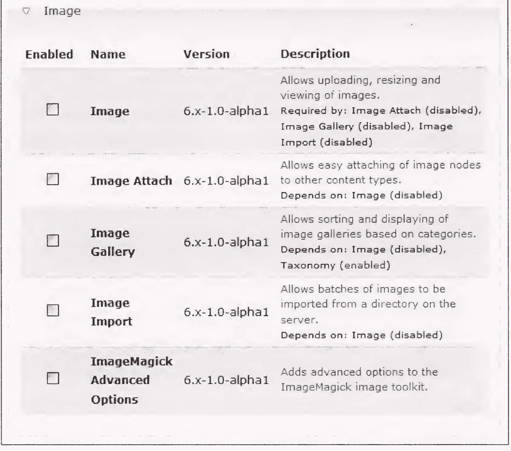

只要满足所有要求，每个模块都可以独立启用。如您所见，**Image** 模块被许多其他模块所依赖，这些模块在 **Image** 模块启用之前无法启用。我们将只启用 **Image** 模块，通过在 **Image** 模块旁边选择 **Enabled** 按钮，然后点击 **Save Configuration** 按钮。

7. 模块启用后，您应检查该模块的权限，以确定是否需要进行更改。这是在 **Permissions** 页面上完成的，可通过点击 **Administer** 菜单中的 **User management** 然后 **Permissions** 访问。如您所见，**Image** 模块有多个可用权限。

| Permission | anonymous user | authenticated user |
|---|---|---|
| image module |  |  |
| create images | ☐ | ☐ |
| edit images | ☐ | ☐ |
| edit own images | ☐ | ☐ |
| view original images | ☐ | ☐ |

我们将允许已认证用户创建图像并编辑自己的图像。只需为这些选项选择复选框，然后点击 Save permissions 按钮即可。

8. 根据您安装的模块，可能存在特定于该模块的设置。您应通过点击 Administer 菜单并查找新设置来检查这些设置。大多数新设置将出现在 Site Configuration 子菜单中。然而，一些设置可能出现在其他区域。模块附带的文档通常会描述如何找到任何必需或可用的设置。在 Image 模块的情况下，有两组新设置：Images 设置和 Image toolkit 设置。这两者都位于 Administer 菜单中的 Site Configuration 菜单内。

现在自定义模块已安装，您可以使用该模块增强您的网站。

## Security considerations

当您向网站添加自定义模块时，您确实会面临潜在的安全风险。然而，Drupal 社区在审查每个模块是否存在可能的安全问题方面做得非常出色，而 Drupal 核心在保护您免受潜在问题方面也做得非常出色。

您可以通过在 Drupal 网站上注册并订阅安全警报新闻通讯来进一步保护自己。

## Creating Good Eatin's Online Presence

### Whetting their appetites: Adding images

图片是任何网站的关键部分，因为正如俗话所说，*一图胜千言*。图片还有助于吸引用户进入网站并给他们进一步探索的理由。研究表明，您只有几秒钟的时间来吸引访客的兴趣，否则他们就会离开您的网站。令人惊艳的图片会鼓励用户更详细地查看网站。

Drupal 提供了多种将图片插入网站的方法，从使用 HTML 的基本方法到使用自定义模块。

### Inserting images with simple HTML

HTML 提供了 `img` 标签，允许网站在其页面上包含图片。您可以使用 img 标签如下：``。例如，指向 Good Eatin' 网站上图片的链接可以是：

```html

```

您可以使用双引号或单引号括住源，但我发现使用单引号通常与 Drupal 的集成更好。如果您愿意，您也可以通过向标签添加 `width` 和 `height` 属性来为图片添加尺寸信息。可以通过包含 `title` 属性为图片添加工具提示。如果您需要在标题中包含双引号，您应使用 `&quot;` 代替双引号。如果您需要在标题中包含单引号，您应使用 `&rsquo;` 代替单引号。

如果您尝试编辑主页或 About Good Eatin' 页面并向页面添加图片，您会注意到保存后它不会显示。这是因为 Drupal 对内容应用过滤器以防止网站遭受安全攻击。这些过滤器组合成 **Input formats**，并应用于内容。使用输入格式还有助于在您有多个具有不同经验水平编辑时简化内容管理。这是因为您可以根据他们的经验为每个编辑提供访问不同输入格式的权限。

要使您的图片标签可见，您需要更改正在使用的输入格式或为页面创建一个允许显示图片标签的新格式。

如果您信任所有编辑不会滥用格式，最简单的解决方案是简单地从 **Filtered HTML** 格式更改为 **Full HTML** 格式。然而，更安全的做法是添加一个允许图片的新格式。

要创建新的 Input format，请选择 Add input format 链接。Drupal 现在将打开一个表单以创建新的输入格式。您需要为格式输入名称，并且还可以决定哪些用户应被允许使用此输入格式。这使您可以为经验更丰富或更值得信赖的用户提供更多功能。我们新的图片过滤器的设置如下：

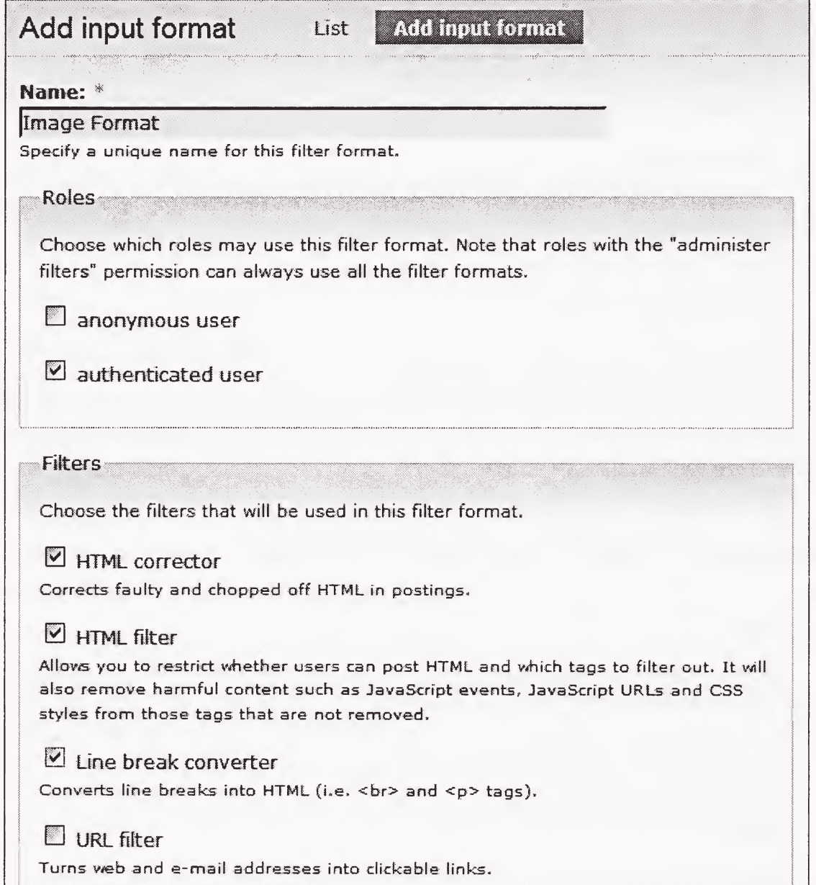

保存输入格式后，您需要配置过滤器以允许图片标签。点击 Configure 链接，Drupal 将显示过滤器的设置。


## 配置图片格式

编辑 配置 重新排列

如果找不到某个过滤器的设置，请先确保在视图选项卡上已启用它。

## HTML 过滤器

### 过滤 HTML 标签：

- 删除不允许的标签
- 转义所有标签

如何处理用户贡献内容中的 HTML 标签。如果设置为“删除不允许的标签”，危险标签将被移除（见下文）。如果设置为“转义标签”，所有 HTML 都会被转义并按原样显示。

### 允许的 HTML 标签：

```
<a> <em> <strong> <cite> <code> <ul> <ol> <li> <dl> <dt> <
```

如果选择“删除不允许的标签”，可以 optionally 指定不应被删除的标签。JavaScript 事件属性始终会被删除。

- 显示 HTML 帮助

如果启用，Drupal 将在长过滤器提示中显示一些基本的 HTML 帮助。

- 垃圾链接遏制

如果启用，Drupal 将为所有链接添加 rel="nofollow"，以降低垃圾链接的有效性。注意：这也会阻止搜索引擎跟踪有效链接，因此在匿名用户启用时可能最有效。

要为我们的输入格式提供更好的图片添加支持，请将允许的 HTML 标签更改为在文本开头添加 。

您现在可以在任何地方使用输入格式来输入图片。要插入图片，您需要：

1. 在您的 Web 服务器上创建一个目录来存储图片。为了简化站点管理和备份，Drupal 在 Drupal 安装的目录下创建了一个名为 sites 的子目录。在此目录中，有两个名为 all 和 default 的子目录。这种结构旨在允许多个站点使用相同的 Drupal 安装。

all 目录中包含的任何文件都可供安装中运行的所有网站访问。与单个站点相关联的文件应放在基于网站域名的文件夹中，例如 example.com 或 goodeatin.drupalbyexample.com。如果找不到站点特定文件夹，Drupal 将在 default 文件夹中查找。

有关 sites 目录的更多信息，请参阅文章：
http://drupal.org/node/53705。

2. 通过 FTP 将图片上传到您的服务器。
3. 验证图片是否可访问，方法是打开 Web 浏览器并输入 http://yoursite.com/sites/yoursite.com/files/images/imagename.jpg 作为地址。
4. 更新您的网页以包含 img 标签，并将 src 设置为您在步骤 3 中使用的地址。
5. 将输入格式更改为允许 img 标签的格式。
6. 保存内容并查看页面以确保更改正确。

如果您想根据图片安装位置以不同尺寸显示图片，您需要手动将每张图片调整为所需尺寸。

如果您的站点有多个编辑器，您需要为将输入图片的每个编辑器提供向服务器发送图片文件的权限。这会给您的站点带来安全风险，因为用户除了图片文件外还可能更新其他文件。

## 使用图片模块插入图片

由于手动插入图片既有安全风险，又耗时且容易出错，Drupal 团队创建了 Image 模块，该模块允许轻松地将图片添加到任何页面。我们已在上一节中安装了 Image 模块，因此现在可以直接进入添加图片。

## 创建图片

要创建新图片，请从创建内容菜单中选择 Image 链接。Drupal 将显示一个表单，您可以在其中选择要添加到站点的图片，为图片命名标题，并为其添加描述。

默认情况下，图片模块以原始尺寸存储图片。它还创建一个最大轴为 100 像素的缩略图，以及最大轴为 640 像素的预览图。当这两个图片创建时，默认情况下图片按比例缩放，因此较小的边将小于最大值。因此，最终图片除非原始图片是正方形，否则不会是正方形。

您可以创建多达三个额外的图片尺寸。要创建新的图片尺寸，请选择站点配置链接，然后从管理菜单中选择图片链接。我们将创建两个新的图片尺寸：菜单项列表和菜单项大图。这些新图片尺寸的设置如下：

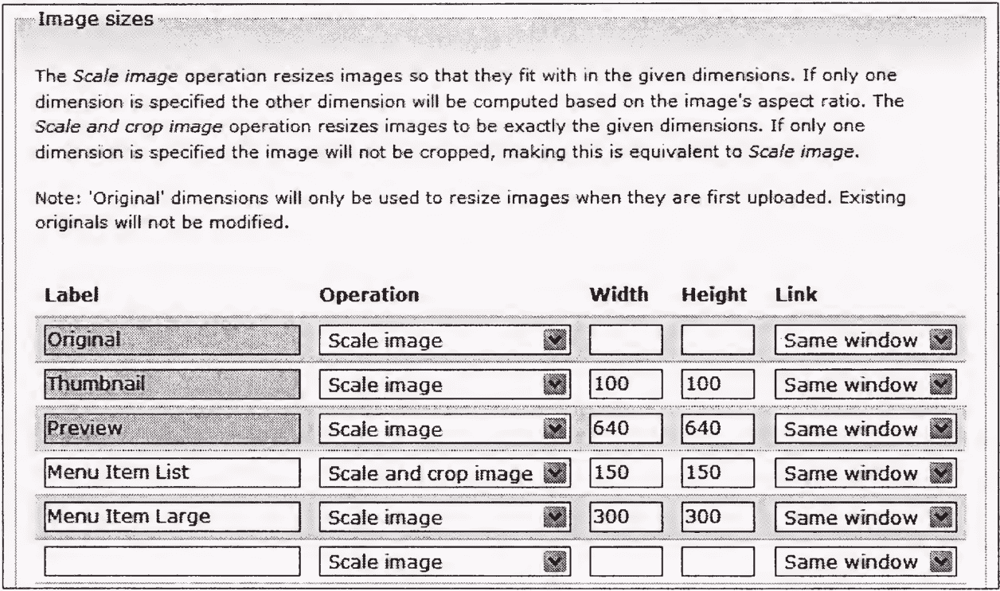

我们将使用第一个图片尺寸在页面上显示多个项目时显示菜单上的食物图片。我们将使用第二个图片尺寸在仅显示一个项目时显示食物图片。菜单项列表还将裁剪图片使其为正方形。

创建新尺寸后，图片将在您查看时自动重新生成。您也可以通过编辑图片、选择重建派生图片复选框然后保存图片来手动重新生成图片。

## 删除图片

删除图片与删除页面完全相同。只需编辑图片，然后单击删除按钮。删除图片将永久从站点中移除图片。如果您想暂时移除，可以取消发布图片。

## 晚餐和表演：向站点添加幻灯片

如果您有大量图片，可以以幻灯片格式显示，图片按特定顺序一个接一个显示。幻灯片中的图片通常使用从一张淡入到另一张的过渡效果。Drupal 至少有两个自定义模块可让您轻松构建幻灯片——Slideshow Creator 模块和 Lightbox 模块。

## 使用 Slideshow Creator 在页面上显示图片

Slideshow Creator 模块可以从 http://drupal.org/project/slideshow_creator 下载。它还要求 JQuery Plugin 模块，可在 http://drupal.org/project/jquery_plugin 获取。下载这两个模块，将它们安装在您的站点上，然后使用模块管理器启用它们。

Slideshow Creator 模块没有需要担心的额外权限。但是，有一些配置设置：

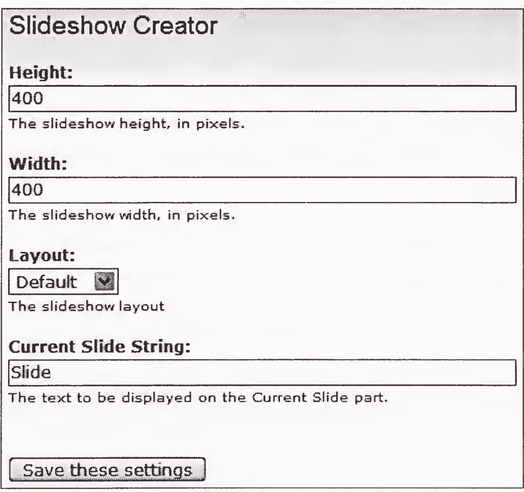

这些选项允许您控制将嵌入页面的幻灯片大小，以及指定与显示相关的一些基本选项。

Slideshow Creator 通过创建新的过滤器来工作，您可以将其添加到任何输入格式，类似于我们启用页面上 img 标签的使用方式。

要启用此过滤器：

1. 单击站点配置链接，然后从管理菜单中单击输入格式链接。
2. 单击您想要添加幻灯片功能的输入格式的配置链接。我们将为我们的图片格式添加幻灯片功能。
3. 选择 Slideshow Creator 过滤器旁边的复选框。
4. 保存输入格式。

您可以使用 Slideshow Creator 显示特定图片或显示存储在 Web 服务器上指定文件夹中的所有图片。显示特定图片可让您拥有更多控制权，并为每张图片提供标题、描述以及图片被点击时要显示的页面（如果有）。显示文件夹中的所有图片管理起来要容易得多，因为您无需将每张图片单独添加到幻灯片中。

## 插入幻灯片的基本步骤

要插入新的幻灯片，请使用以下步骤：

1. 使用 FTP 或图片模块将您想要在幻灯片中显示的图片上传到站点。
2. 编辑您想要添加幻灯片的页面。
3. 使用过滤器标签创建幻灯片（请参阅以下各节了解详情）。
4. 保存页面。

## 设置带单独图片的幻灯片

带单独图片的幻灯片使用以下格式的过滤器标签。

```
[slideshow:VERSION, img=|IMAGE_URL|LINK|TITLE|DESCRIPTION|TARGET|, img=|IMAGE_URL|LINK|TITLE|DESCRIPTION|TARGET|]
```

- VERSION 应设置为 2，对应于当前版本的 Slideshow Creator。
- IMAGE_URL 应设置为您想要显示的图片的完整路径。
- LINK 是您希望访问者在点击图片时被带到的目的地。如果您不希望用户能够点击图片，可以将此项留空。


- TITLE 将显示在图片和描述的上方。如果不想显示标题，可以将其留空。
- DESCRIPTION 显示在标题下方但在图片上方。如果不需要，也可以省略。
- TARGET 与 LINK 结合使用，描述当点击图片时新页面如何打开。有效值有：`_blank`、`_parent`、`_top` 和 `_self`。默认的 `_blank` 选项会根据浏览器情况在新窗口或新标签页中打开链接。`_self` 选项会在幻灯片所在的同一窗口中打开链接（因此会替换幻灯片）。`_parent` 和 `_top` 值仅由使用框架的站点使用。

可以通过用逗号分隔每个 img 部分与前一个部分来插入多张图片。

以下 filter 标签用于 Good Eatin' 首页以显示餐厅的几张图片。

```
[slideshow:2, img=|http://goodeatin.drupalbyexample.com/image/view/3/preview||Elephant Smile|This Elephant is one of the many animals you may see as you take a Safari through the Good Eatin' restaurant.||, img=|http://goodeatin.drupalbyexample.com/image/view/4/preview||Zebra Friends|Enjoy the sun with these Zebras on a Good Eatin' Safari meal. ]
```

## 设置幻灯片以显示文件夹中的所有图片

虽然使用单独的图片创建幻灯片可以让你对幻灯片的显示方式有极大的控制，但创建一个简单显示文件夹中所有图片的幻灯片会非常方便。此类幻灯片使用以下 filter 标签格式：

```
[slideshow:VERSION, dir=|DIR_IMAGE|DIR_RECURSIVE|DIR_LINK|TITLE|DESCRIPTION|TARGET|]
```

VERSION、TITLE、DESCRIPTION、DIR_LINK 和 TARGET 的使用方式与单独的 img 版本相同，只是这些值将应用于文件夹中的每张图片。文件夹特定设置如下：

- DIR_IMAGE 是文件位于你 Web 服务器上的文件夹。此路径将相对于 Drupal 安装所在的文件夹。幻灯片创建器会将此文件夹内找到的所有 PNG、GIF、JPEG、JPG 和 BMP 图片包含到幻灯片中。
- `DIR_RECURSIVE` 可以设置为 yes 以包含指定图片文件夹的子文件夹中的图片，或留空以仅包含指定的文件夹。在大多数情况下你会将其留空，因为将每张幻灯片的图片组织在单个文件夹中更方便。

你可以在单个幻灯片中组合 `img` 组和 `dir` 组，以利用每种方法的功能来满足你的需求。

当你显示文件夹中的所有图片时，图片会以随机顺序显示，并且无法可靠地控制显示顺序。

## 其他配置选项

幻灯片创建器还包含一些未记录的功能，可用于进一步自定义你的幻灯片。其中一些功能允许你覆盖通过管理菜单配置的默认设置，以便你对幻灯片布局有更精确的控制，并且可以在不同页面上拥有不同尺寸和布局的幻灯片。你甚至可以在一个页面上拥有多个幻灯片，每个幻灯片具有不同的选项。以下选项可用：

- `width`: 这允许你控制幻灯片的宽度。如果幻灯片中的图片比指定宽度更宽，则会被裁剪。
- `height`: 这允许你控制幻灯片的高度。如果幻灯片中的图片比指定高度更高，则会被裁剪。
- `layout`: 这允许你控制幻灯片中元素（标题、描述、图片和控件）的顺序。有效值有 Default、Reverse、Top、Bottom 和 None。这些会导致以下配置（元素按从上到下的出现顺序列出）：
- `Default`: Controls, Title, Picture, Description
- `Reverse`: Title, Picture, Description, Controls
- `Top`: Picture, Title, Description, Controls
- `Bottom`: Controls, Title, Description, Picture
- `None`: Picture, Title, Description
- `blend`: 这控制图片之间过渡的速度。它应以毫秒为单位设置，因此要指定 2 秒，你需要输入 2000。
- timeout: 这控制每张图片显示多长时间，然后开始加载下一张图片。这也以毫秒为单位设置。
- fx: 这控制用于在幻灯片之间过渡的效果类型。一些可用的过渡效果有 shuffle、zoom、fade、turnDown、curtainX、scrollRight、blindX、blindY、blindZ、cover 和 uncover。

应在使用任何这些附加选项时在图片列表开始之前添加它们。例如，以下代码为幻灯片添加了缩放过渡效果，并将幻灯片的控件放置在图片下方。

```
[slideshow:2,width=450,height=650, layout=top, fx=zoom, img=!http://goodeatin.drupalbyexample.com/image/view/3/preview||Elephant Smile|This Elephant is one of the many animals you may see as you take a Safari through the Good Eatin' restaurant.|, img=!http://goodeatin.drupalbyexample.com/image/view/4/preview||Zebra Friends|Enjoy the sun with these Zebras on a Good Eatin' Safari meal. ]
```


有关 Slideshow Creator 模块的附加文档可在以下位置获得：http://drupal.org/node/237049。
有关用于构建幻灯片的 JQuery Cycle 模块的附加文档可在以下位置获得：http://www.malsup.com/jquery/cycle/。

## 版本特定问题

Slideshow Creator 的作者目前仅向当前版本的 Drupal 用户提供该模块（撰写本文时为版本 6）。如果你使用的是其他版本，你可能能够找到与你的版本兼容的下载，但可能无法通过原作者获得支持。

## 使用 Lightbox2 在页面上显示图片

Slideshow Creator 模块允许你在页面内查看幻灯片。然而，有时将图片显示在浮于主页面之上的新窗口中看起来更好。这对于摄影或艺术网站尤其如此，因为图片是页面的主要焦点。

在主页面上显示幻灯片也有助于改善幻灯片的外观，尤其是在所有图片大小不相同时。

## 创建 Good Eatin' 的在线形象

一个示例 **lightbox** 如下图所示：


要使用 Lightbox2 模块：

- 1. 从 Drupal 网站下载模块。项目页面位于 `http://drupal.org/project/lightbox2`。
- 2. 将模块复制到你的网站并在模块管理器中启用它。
- 3. 通过从 **Administer** 菜单中选择 **Site Configuration** 然后 **Lightbox 2** 来配置 Lightbox2。Lightbox2 有大量设置，分为四个部分。让我们逐一探索这些设置。

## 通用设置

通用设置页面包含用于控制 Lightbox 显示的各种设置。这些设置有：

- **Use Lightbox2 Lite:** 启用此设置将极大地限制 Lightbox2 的功能。所有控件将被移除，因此访客将无法从一张图片导航到另一张图片。如果你的网站流量很大，或你希望确保一次只显示一张图片，这可能是可取的。
- **Use Alternative Layout:** 在正常的 Lightbox 布局中，下一个和上一个按钮覆盖在图片上，并且仅在鼠标经过链接时显示。当替代布局处于活动状态时，链接始终显示，并且它们放置在图片下方，旁边是标题。我个人更喜欢启用此选项，因为始终向用户显示导航比让他们寻找控件要友好得多。


- **强制显示导航链接：** 启用此设置后，Lightbox 2 将始终显示导航控件。
- **图片计数文本和页码计数文本：** 这些设置允许您自定义在说明中显示的文本。
- **禁用缩放功能：** 此设置将阻止用户在图片大于页面时调整图片大小。禁用缩放可以使 Lightbox 更简洁。
- **视频设置：** 此设置允许您在 Lightbox 中显示视频。
- **页面特定 Lightbox2 设置：** 此设置使您能够防止特定页面显示 Lightbox。如果您使用的是 Lightbox 模块检测到并自动尝试显示 Lightbox 的自定义模块，这很有用。

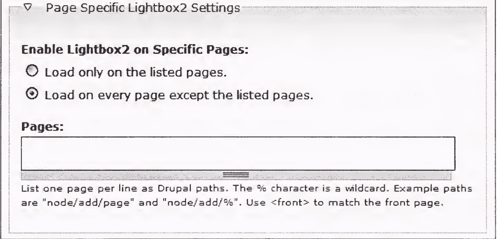

## 高级设置

高级设置部分提供了多种设置，允许您微调 Lightbox 在页面上的显示方式。使用这些选项，您可以控制 Lightbox 的颜色、图片之间每次转换的持续时间，以及用户是否可以在 Lightbox 下方看到您的网站。

## 幻灯片设置

幻灯片设置页面提供了各种控制幻灯片功能的设置。这包括每张图片显示多长时间、幻灯片结束时应发生什么，以及用户点击“下一张”或“上一张”图片按钮时发生什么。这些选项在设置页面本身都有详细的说明。

## 其他主题

Lightbox2 模块提供了强大的功能，显示幻灯片只是它能做的开始。您可以使用 Lightbox2 显示几乎任何类型的内容，包括 HTML 页面、视频、Flickr 照片等等。

Drupal 网站包含有关 Lightbox2 模块的丰富信息。文档始于：http://drupal.org/node/144469。

## 个性化餐厅：向站点添加主题

Drupal 的一大优点是它允许您彻底自定义网站的外观，而不是强迫您从头开始构建设计的每个方面。Drupal 提供了几个可直接使用的自定义主题。您也可以将自定义主题作为起点，并在此基础上构建以创建自己的独特主题。主题用于在所有页面上为您的网站提供一致的外观和感觉。使用主题，您可以轻松更改网站的外观，而无需更改网站的实际内容。这使得重新设计网站变得更加容易（也更便宜），因为您只需要修改主题，而无需编辑每个单独的页面。

您甚至可以在站点上设置多个主题，并允许用户选择使用他们最喜欢的主题查看您的站点。

## 选择和安装现成主题

您可以在 http://drupal.org/project/Themes 上找到大量已贡献给 Drupal 的主题列表。您可以使用这些主题作为自己网站设计的灵感，也可以直接使用主题。

大多数主题都附带预览图片，以便您了解使用该主题后网站的外观。

在找到想要尝试的主题后，您可以通过执行以下步骤将其安装到站点上：

- 1. 通过点击主题的下载链接下载主题。
- 2. 使用您已用于解压模块的相同技术解压 gzipped .tar 文件。
- 3. 通过 FTP 将新主题上传到您的网站。主题应放置在 sites/all/themes 目录中。如果您尚未添加自定义主题，则需要创建 themes 目录。
- 4. 通过从管理菜单中选择站点构建链接然后选择主题链接来打开主题管理器。如果主题已正确添加，您将在主题管理器中显示的主题列表中看到它。
- 5. 要在站点上启用主题，请为该主题选择已启用复选框。启用主题后，您可以将其设置为特定用户的活动主题，也可以将其设为整个站点的默认主题。如以下图片所示，我们将启用自定义 Foliage 和 Marinelli 主题。
- 6. Foliage 主题可以从 http://drupal.org/project/foliage 下载，Marinelli 主题可以从 http://drupal.org/project/Marinelli 下载。Marinelli 主题还包含两个子主题，用于控制每列的放置位置。

| 屏幕截图 | 名称 | 版本 | 已启用 | 默认 | 操作 |
|---|---|---|---|---|---|
|  | Chameleon Minimalist tabled theme with light colors. | 6.2 | ☑ | ○ | configure |
|  | Foliage Table-less, source-ordered and multi-column theme. | 6.x-1.3 | ☑ | ○ |  |
|  | Garland Tableless, recolorable, multi-column, fluid width theme (default). | 6.2 | ☑ | ○ | configure |
|  | Marinelli A fresh 3-column layout for Drupal. Still usable over 4000m! | 6.x-1.7 | ☑ | ◉ |  |

- 7. 启用主题后，您可以通过选择配置链接来配置它。

一旦您启用了主题，您可以轻松地在主题之间切换，以决定您最喜欢哪个主题。如果您决定不喜欢某个主题，您只需从 Web 服务器中删除主题文件即可将其删除。

## 配置主题

主题的配置选项会根据实际主题而有所不同。但是，所有主题都允许您确定是否显示以下元素：logo、站点名称、站点标语、使命声明、帖子中的用户图片、评论中的用户图片、搜索框、快捷图标、主链接和次要链接。

您还可以配置站点上应使用的 logo。您可以使用默认 logo 或添加自己的自定义 logo。如果您选择使用自己的自定义 logo，您可以指定 Web 服务器上现有文件的路径，也可以上传新图片。

您还可以配置在客户访问网站时在地址栏中显示的快捷图标。同样，您可以使用默认图标或使用自定义图标。此图标也称为 **favicon**，如果用户将其设为收藏，它也会显示在站点名称旁边。

如果您在配置主题时选择 **全局设置** 选项，更改将应用于您安装的所有主题。

## 创建主题

创建自定义主题时，您应仔细考虑站点的结构以及您打算在站点上显示的内容。您还应考虑计划添加到站点上的自定义模块。通过在开始时考虑这些项目，您可以提前规划并确保您的设计足够灵活以适应您的所有计划。

在规划完主题后，您需要创建一个图形设计。根据您的预算，您可以自己完成、请图形设计师为您完成，甚至聘请大型设计公司创建多个设计并对其进行市场测试，以了解目标受众最喜欢什么。如果您选择外包主题创建，您可以通过 Drupal 网站上的 `http://drupal.org/paid-services` 找到合格的专业人士。

设计完成后，您需要将设计分解为单独的图片，并确保任何动态内容都可以放置在背景图片之上。如果有任何页面特定图片，也需要创建这些图片。

您现在可以为主题构建 css 文件，它将控制页面的整体外观。

最后，创建您的页面模板，通常称为 page.tpl.php。您还可以通过为该内容类型创建模板文件来更改其他类型内容的外观。例如，名为 comment.tpl.php 的模板文件将控制站点内所有评论的外观。

有关创建自己的主题的更完整讨论，请购买 Ric Shreves 所著的 Drupal 6 Themes 或 Drupal 5 Themes，两者均由 Packt Publishing 出版。您可以在以下位置找到有关这些书籍的更多信息：

```
http://www.packtpub.com/drupal-6-themes/book
```

```
http://www.packtpub.com/drupal-5-themes/book
```

## 版本特定问题

在一个版本的 Drupal 中创建的主题不能保证在 Drupal 的未来版本中有效，因为 Drupal 的开发人员选择不强制向后兼容性成为开发的限制。这允许新开发使用最佳实践，以确保 Drupal 的最新版本在技术上是最好的。虽然这对于 Drupal 整体来说是一个很棒的策略，但这也意味着您可能需要在每次新版本发布后对主题进行一些修改。

## 在厨房里玩耍：自行研究的主题

在本章中，我们涵盖了很多内容，并彻底探讨了本书其他几章中使用的许多主题。随着您继续增强站点，您可能希望自行探索一些领域。

## 使用 Image Assist 轻松插入图片

Image Assist 模块允许您在编辑页面时插入图片。这使得添加图片变得更加容易。Image Assist 模块还与 Lightbox2 自动配合，为页面上的所有图片创建幻灯片。

## 书式页面

Drupal 提供了 Book 模块，专为在协作环境中由多人创建的在线书籍编辑而设计。


## 设置图形编辑器

有几种图形编辑器，也称为 wysiwyg（所见即所得）编辑器，可以在您创建新页面时自动打开。这些编辑器类似于嵌入在您网站中的文字处理器。您可以通过单击按钮来更改文本的字体，而不是插入 HTML 标签。有几个模块可供您探索以提供此功能，包括：

- TinyMCE: http://drupal.org/project/tinymce
- Tiny Tiny MCE: http://drupal.org/project/tinytinymce
- HTMLBox: http://drupal.org/project/htmlbox

## 定时发布内容

如果您有时间敏感的信息，您可以安排内容在特定日期和/或特定时间自动发布。您可以通过使用 Drupal 6 的 Rules 模块来实现，该模块可在 http://drupal.org/project/rules 获取，或 Drupal 5 的 Workflow-ng 模块，该模块可在 http://drupal.org/project/workflow_ng 获取。

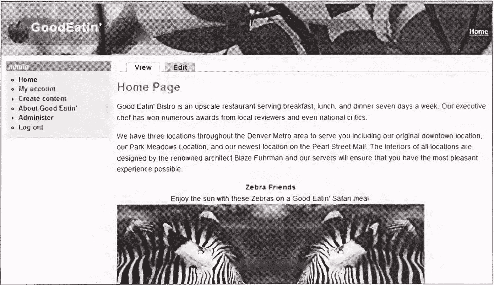
