# 3

## 添加产品和服务

在上一章中，我们为网站奠定了基础，并添加了一些几乎所有网站上都常见的页面。在本章中，我们将使用 Drupal 构建自定义内容类型来存储出现在 Good Eatin' 菜单上的各个项目。我们还将探索不同的显示内容方式，以使菜单看起来最佳。

在本章结束时，您将了解如何使用 CCK 构建新的内容类型，以及如何为 CCK 内容类型设置主题以自定义显示。

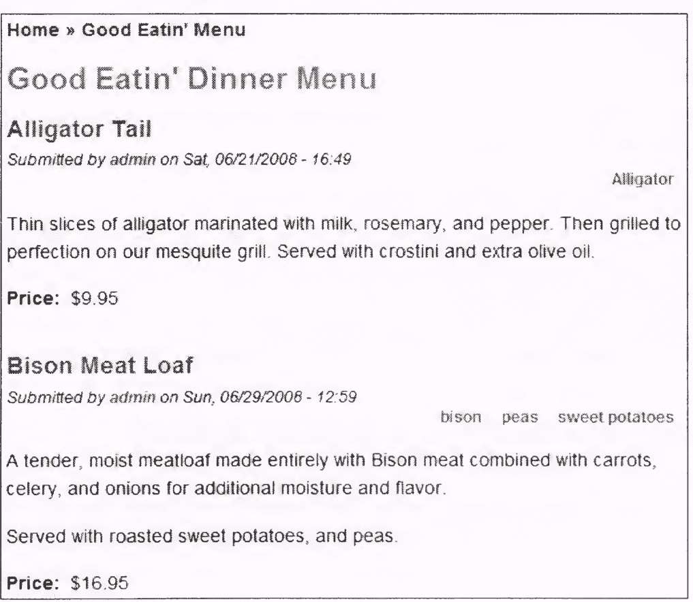

## 使用自定义内容类型构建 good eatin' 菜单

在本节中，我们将为 Good Eatin' 网站设置一个菜单项内容类型。我们的菜单将包含菜品名称、菜品描述、菜品价格以及菜品图片。

## CCK 模块简介

Good Eatin' 目标：了解 CCK 模块提供的功能，并在我们的网站上安装 CCK。

需要的额外模块：CCK (http://drupal.org/project/cck)。

内容创建工具包，通常缩写为 CCK，用于开发可在整个网站中使用的新型内容。这是在模板中构建内容并确保所有内容具有相同格式且所有必填字段都正确填写的绝佳方法。一些适合与 CCK 一起使用的良好内容示例，以及可能的字段示例，包括：

- Movie: Title, Director, Production Company, Year Released, Rating, and so on
- Meeting: Subject, Start Time, End Time, Organizer, Topic, Location, and so on
- Book: Title, Author, Year Published, Age Group, and so on
- Home Listing: Address, Price, Number of Bedrooms, Number of Bathrooms, Garage Type, Lot Size, and so on
- Shirt: Manufacturer, Style, Price, Color, and so on

CCK 模块具有大量可用于构建自定义内容类型的字段类型。其中一些类型包括：Date, Duration, Email, Fivestar ratings, Images, Ratings, and Slideshows。使用特定的字段类型在您构建新类型时有助于确保输入的信息有效。它还将帮助您在内容添加到网站时查看和过滤显示。

## 安装 CCK 和 CCK 字段模块

CCK 模块可在以下位置下载：http://drupal.org/project/cck。您可以像安装任何其他模块一样下载并安装该模块。CCK 的基本安装包括一系列可单独启用的模块，如下图所示：

| Enabled | Name | Version | Description |
|---|---|---|---|
| ☐ | **Content** | 6.x-2.0-beta | Allows administrators to define new content types. Required by: Content Copy (disabled), Content Permissions (disabled), Fieldgroup (disabled), Node Reference (disabled), Number (disabled), Option Widgets (disabled), Text (disabled), User Reference (disabled) |
| ☐ | **Content Copy** | 6.x-2.0-beta | Enables ability to import/export field definitions. Depends on: Content (disabled) |
| ☐ | **Content Permissions** | 6.x-2.0-beta | Set field-level permissions for CCK fields. Depends on: Content (disabled) |
| ☐ | **Fieldgroup** | 6.x-2.0-beta | Create field groups for CCK fields. Depends on: Content (disabled) |
| ☐ | **Node Reference** | 6.x-2.0-beta | Defines a field type for referencing one node from another. Depends on: Content (disabled), Text (disabled), Option Widgets (disabled) |
| ☐ | **Number** | 6.x-2.0-beta | Defines numeric field types. Depends on: Content (disabled) |
| ☐ | **Option Widgets** | 6.x-2.0-beta | Defines selection, check box and radio button widgets for text and numeric fields. Depends on: Content (disabled) Required by: Node Reference (disabled), User Reference (disabled) |
| ☐ | **Text** | 6.x-2.0-beta | Defines simple text field types. Depends on: Content (disabled) Required by: Node Reference (disabled), User Reference (disabled) |
| ☐ | **User Reference** | 6.x-2.0-beta | Defines a field type for referencing a user from a node. Depends on: Content (disabled), Text (disabled), Option Widgets (disabled) |

要使用 CCK，您需要启用 Content 模块，这将允许您创建新的内容类型并向新类型添加自定义字段。您还需要启用提供各种字段类型的模块。在默认安装中，这些是：

- **Text:** This allows free form text to be entered
- **Number:** This allows numeric values to be entered
- **Node Reference:** This allows links to other nodes (pages, content types, and so on) to be inserted in a type
- **User Reference:** This allows links to users who are registered on the web site

还有几个额外的模块，提供更多可安装的内容类型。这些可以在 Drupal 网站上的 `http://drupal.org/project/Modules/category/88` 找到。

以下模块是默认 CCK 模块的一部分，提供不同的查看、编辑和管理字段的方法：

- **Option Widget:** This provides checkboxes and option buttons for various fields. These can be very helpful if your content fields need to be restricted to specific values.
- **Field Group:** This allows you to group fields into logical sections. This is especially useful when your content types have a large number of fields.
- **Content Copy:** This allows you to duplicate content easily. This is useful if you want to add several items that are similar.
- **Content Permissions:** This gives you fine-grained control over which fields can be viewed and edited based on a user's role. This is especially important for sites on which several different types of users work.

我们将启用 **Content**、**Number**、**Text** 和 **Option Widgets** 模块来帮助我们创建菜单项类型。

## 设计菜单项

*Good Eatin' Goal:* Design a content type to represent meals and drinks which are available at the restaurant.

*Additional modules needed:* CCK (http://drupal.org/project/cck).

## 基本步骤

当您开始设计网站时，考虑您将需要哪些类型并在构建之前设计这些类型是个好主意。相对容易向类型添加新字段，但如果这样做，您可能需要修改所有现有内容，这可能非常耗时。

即使看似简单的类型，例如地址，也需要一些思考——取决于地址的用途。例如，如果输入的地址仅来自美国，典型字段为 Street 1、Street 2、City、State 和 Zip Code。如果地址必须包含国际地址，典型字段为 Street 1、Street 2、City、State/Province、Zip/Postal Code 和 Country。如果地址仅用于单个国家、州或城市，您可以消除或自动填写一些字段，以使编辑和用户输入信息更方便。您执行的验证类型也将取决于可以输入的预期值。例如，对于真正的国际网站，在下拉列表中包含每个州或省供用户选择是不切实际的。另一方面，如果您知道地址仅在特定国家/地区内，提供州或省列表就非常容易。

## Step 1: 确定内容类型的用途

创建新内容类型的第一步是决定该类型将如何使用。你需要考虑条目数量是多还是少，信息将由经验用户、非经验用户还是普通公众输入。你还需要考虑信息将在网站的哪个位置显示，以及以何种格式显示。

在开始时收集这些信息，可以用来指导后续步骤。

## Step 2: 确定需要包含哪些字段

思考需要在内容类型中包含哪些字段。你可以通过以下几种方式来做：

- 使用现有纸质表单的字段
- 使用网站将与其交互的现有后端系统的字段
- 根据你添加到网站的业务流程创建字段
- 与一组同事一起头脑风暴可能的取值
- 查看示例数据以寻找共同点，然后为每项共同数据创建一个新字段

如果你尝试了多种方法仍无法确定字段应是什么，你可能需要尝试将该类型拆分为几个独立但相关的类型，或聘请顾问来帮助你。或者，你可能只是发现了一个不适合使用 CCK 创建的类型。

Drupal 中的每个内容类型都自动包含一个标题字段，即单行文本，以及一个描述字段，即文本块。这些字段可以根据你的需求重命名或隐藏。你会发现你创建的大多数内容类型都会使用这两个字段。

对于我们的菜单项，我们将包含以下字段：

- 菜单项的名称（使用默认的标题字段）
- 项目的描述（使用默认的正文字段）
- 项目的价格
- 项目的评分
- 饮食顾虑或过敏信息（无麸质、纯素、素食等）
- 项目可供应的餐次
- 项目的菜品类型（开胃菜、第一道菜、第二道菜、晚餐、甜点、饮品等）
- 菜单项是否仅在季节性供应
- 如果菜单项仅在季节性供应，则其可供应时间

## Step 3: 确定每个字段应使用什么类型以及应进行何种验证

在你列出要在新内容类型中包含的字段后，你需要思考字段将包含什么信息，以便为字段选择合适的类型。你需要考虑字段是否包含基本文本信息、数字信息、其他内容的引用、日期或其他类型的信息。

在决定应使用哪些类型时，你还应考虑每个字段的长度应为多长，以及是否应限制为特定值，或编辑可以在字段中输入任何内容。

对于我们的菜单项，字段将使用以下类型：

| Field | Type | Validation |
|---|---|---|
| Name | Text (single line) | Must be provided, no length requirements |
| Description | Text (multiple lines) | Must be provided, text should be at least 10 words long |
| Price | Numeric (decimal) | Must be a number greater than 0 |
| Ingredients | Text free form list | This will be a free form list of key ingredients that visitors can search or select on. |
| Dietary Concerns | Text (free form list) | This will be a free-form list of possibilities that editors can add to as new allergens are added; it can be left blank if there are no allergens for the food |
| Meals | Text (simple list) | Must be filled out; possible values are Breakfast, Lunch, Dinner, Dessert, and Drinks. Multiple items can be included if it is available at more than one meal |

| Field | Type | Validation |
|---|---|---|
| Course Type | Text (simple list) | Must be filled out; new values can be added by the editor. Default values are: appetizer, first course, second course, soup, salad, dessert, and drink |
| Seasonal | Numeric (true/false) | Must be filled out; default value is false |
| Seasonal Start | Date | Can be left blank if Seasonal is false; can include month, date, and year |
| Seasonal End | Date | Can be left blank if Seasonal is false; can include month, date, and year |

## Step 4: 确定字段在用户编辑时应如何显示

当编辑者创建或编辑你的新内容类型时，你可以通过选择有意义的控件来让他们更轻松地编辑字段。默认情况下，CCK 只提供一个简单的文本字段来输入信息。通过启用 Option Widgets 模块，你可以获得选择列表、选项按钮和复选框。使用这些可选控件可以使选择更快，并更易于验证。

## Step 5: 确定谁将查看和编辑内容类型

在此最后一步中，你需要考虑谁将输入内容以及谁将查看内容。这将帮助你确定为每个字段添加哪些权限。如果你发现需要多种不同的权限，你可能需要探索包含在 Core CCK 安装中的 Content Permissions 模块。该模块允许你为每个单独的字段独立设置权限。

我们的菜单项类型不需要为每个字段设置特定权限。

## 创建菜单项类型

Good Eatin' 目标：构建菜单项内容类型。

所需额外模块：CCK (http://drupal.org/project/cck)。

现在我们的菜单项内容类型已完全设计好，我们可以开始为 Good Eatin' 网站实现菜单项。

## 基本步骤

要创建新的内容类型，我们首先进入 **内容类型管理器**，该管理器可通过 **管理** 菜单选择 **内容管理** 然后 **内容类型** 来访问。**内容类型管理器** 如以下屏幕截图所示：

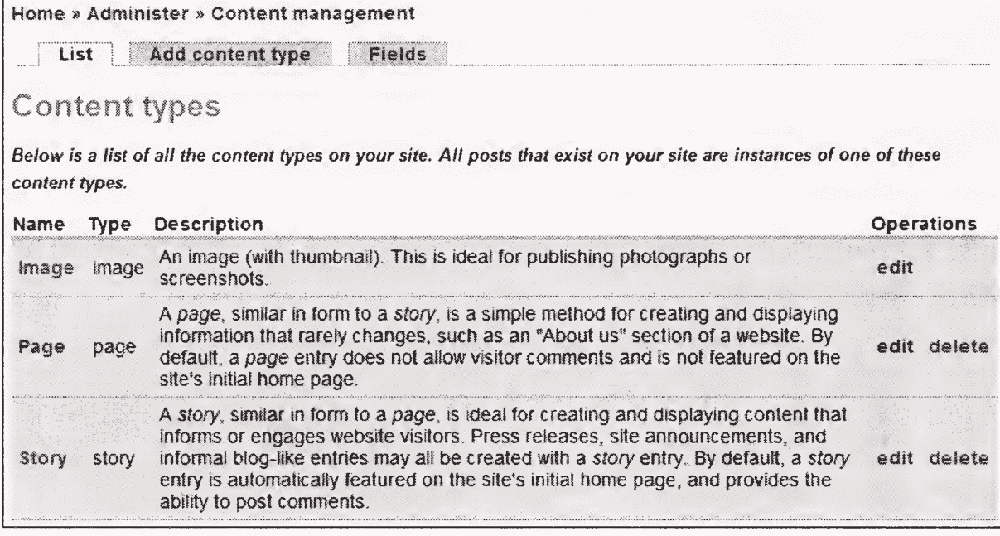

接下来，单击屏幕顶部的 **添加内容类型** 选项卡。Drupal 然后会显示一个表单，要求输入新类型的 **名称**、**类型** 和 **描述**。我们将使用以下值：

- **Name:** Menu Item
- **Type:** Menu_item
- **Description:** A Menu item that is included on the restaurant's menu contains information needed to display the item as well as to categorize it for use throughout the web site.
- **添加内容** 屏幕还包含 **提交** 要求、**工作流** 设置和 **评论** 设置的额外选项。
- **提交表单** 设置部分如以下屏幕截图所示。此部分允许你自定义 **标题** 和 **正文** 字段的标签，我们将分别将其重命名为 **名称** 和 **描述**。你还可以控制描述中可以输入多少个词。如果编辑者输入的词数较少，Drupal 将显示错误，编辑者必须输入更多词后才能保存条目。通过要求至少 10 个词，我们将有助于确保我们的菜单项包含完整的描述，这将有助于我们的搜索引擎排名。

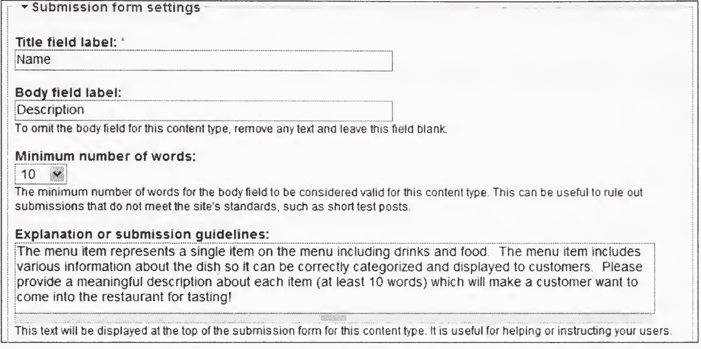

- **评论设置** 部分允许你控制网站访问者是否可以对这种类型的内容发表评论。我们希望对我们的食物获得反馈，因此我们将为 **菜单项** 类型启用评论。大多数默认设置对我们的需求来说都很完美，但我们将进行一些更改以改善当多个访问者对同一菜单项发表评论时的显示效果。将 **默认显示模式** 更改为 **Flat list – expanded**。由于我们不期望用户之间进行讨论，因此没有理由根据回复对评论进行分组。
- **工作流设置** 部分控制新内容提交到网站后会发生什么。由于我们的主页不是从最近的帖子自动创建的，我们将禁用 **提升到首页** 设置并将所有其他设置保持为默认值。如果你想明确批准所有新内容，可以禁用 **已发布** 设置。这将导致新内容在发布到网站之前进入审核队列。

## 为菜单项添加价格

*Good Eatin' 目标：* 添加一个字段来存储菜单项的价格。

*所需额外模块：* CCK (http://drupal.org/project/cck)。

## 基本步骤

现在我们已经创建了 **菜单项** 内容类型，我们可以根据之前的设计为我们的类型设置自定义字段。

1. 要创建新字段，编辑 **菜单项**，方法是单击 **内容类型管理器** 中的 **编辑** 链接。

## 添加产品和服务

- 2. 接下来，点击 **Add** 字段链接。Drupal 将显示一个表单，您可以在其中定义新字段的基础信息。

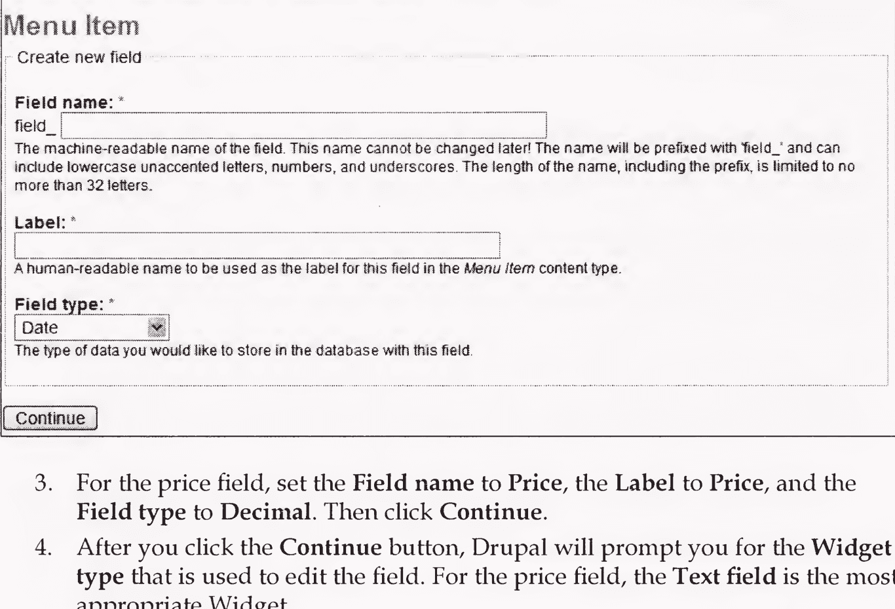

- 3. 对于价格字段，将 **Field name** 设置为 Price，将 **Label** 设置为 Price，并将 **Field type** 设置为 Decimal。然后点击 **Continue**。

- 4. 点击 **Continue** 按钮后，Drupal 会提示您选择用于编辑字段的 **Widget type**。对于价格字段，**Text field** 是最合适的 Widget。

- 5. 再次点击 **Continue**，Drupal 将显示一个包含一些标准设置以及根据您选择的 **Field type** 而变化的设置的新表单。

- 6. 对于价格字段，我们将更新 **Help text** 和 **Default Price**，如以下屏幕截图所示：

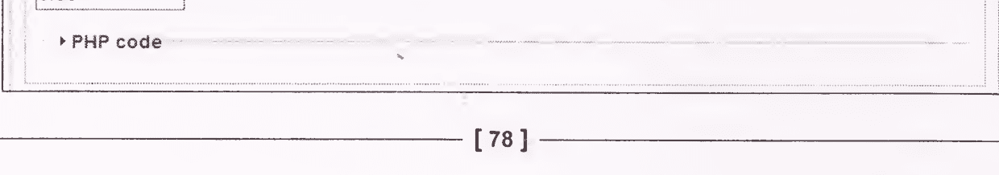

7. 还有一些特定于 Decimal 字段类型的数值。这些设置允许您自定义允许的值和各种格式选项。我们将为价格字段使用以下值：

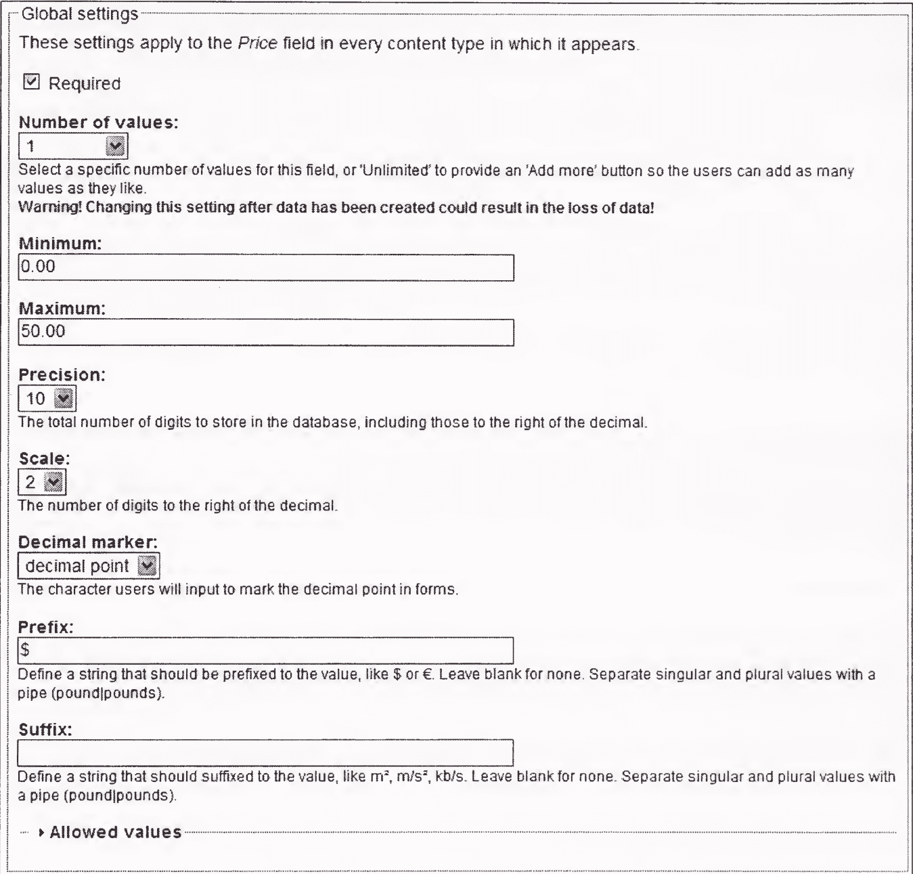

## 为菜单项添加季节信息

*Good Eatin' Goal:* 创建存储菜单项是否季节性的信息字段，如果是季节性的，则存储菜单项可供使用的日期。

*Additional modules needed:* CCK (http://drupal.org/project/cck), Date (http://drupal.org/project/date).

Chef Wanyama 喜欢根据季节轮换菜单，以确保他的菜肴中始终包含最新鲜的食材。为了支持这一点，我们将允许他指定每个项目是否季节性，如果是季节性，则指定菜单应可供使用的日期。菜单的显示将考虑这些日期，仅显示当前可用的菜单项。

### 基本步骤

- 1. 我们将通过添加 Seasonal 字段开始，该字段是使用 Select list widget 的文本字段。此字段的添加方式与 Price 字段类似，只是我们将使用 Select list 作为 Widget type。我们将通过设置 Allowed values list 来确保有效值仅为 Yes 和 No，如以下屏幕截图所示：
- 2. 要添加开始和结束日期，您需要添加第二个字段，使用 Date 字段。
- 3. 为了访问 Date 字段，您必须先从 Drupal 网站下载 Date Module 并将其安装到您的网站上。最低限度，您需要确保激活 Date API、Date、Date Timezone、Date Popup 和 Calendar 模块。

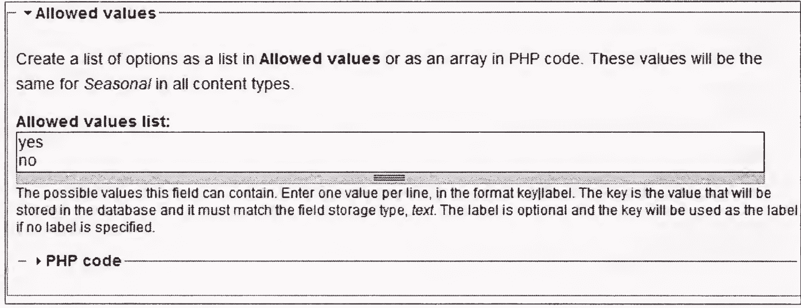

| Enabled | Name | Version | Description |
|---|---|---|---|
| ☑ | **Date** | 6.x-2.0-rc4 | 定义 CCK 日期/时间字段和 widget。依赖于：Content（已禁用）、Date API（已禁用）、Date Timezone（已禁用）。**Required by:** Date Copy（已禁用） |
| ☑ | **Date API** | 6.x-2.0-rc4 | 可供其他模块使用的 Date API。Required by: Date（已禁用）、Date PHP4（已禁用）、Date Popup（已禁用）、Date Repeat API（已禁用）、Date Timezone（已禁用）、Date Copy（已禁用） |
| ☐ | **Date Copy** | 6.x-2.0-rc4 | 导入和导出 CCK 日期数据。依赖于：Content（已禁用）、Date（已禁用）、Date API（已禁用）、Date Timezone（已禁用） |
| ☐ | **Date PHP4** | 6.x-2.0-rc4 | 在 PHP 4.x、PHP 5.0 和 PHP 5.1 中模拟 PHP 5.2 日期函数。使用 Date API 且 PHP 版本低于 PHP 5.2 时需要。依赖于 Date API（已禁用） |
| ☑ | **Date Popup** | 6.x-2.0-rc4 | 启用 jQuery 弹出日历和时间输入 widget 用于选择日期和时间。依赖于：Date API（已禁用）、Date Timezone（已禁用） |
| ☐ | **Date Repeat API** | 6.x-2.0-rc4 | 用于根据 iCal 规则计算重复日期和时间的 Date Repeat API。依赖于 Date API（已禁用） |
| ☑ | **Date Timezone** | 6.x-2.0-rc4 | 使用 Date API 时需要。覆盖站点和用户时区处理以设置时区名称而不是偏移量。依赖于 Date API（已禁用）。Required by: Date（已禁用）、Date Popup（已禁用）、Date Copy（已禁用） |

- 4. 现在适当的 Date 模块已启用，我们可以添加新字段。开始和结束日期被实现为使用 *jQuery pop-up calendar* 的单个 **Date** 字段，如果输入了开始日期，则结束日期为必填。
- 5. 开始添加 Price 字段和季节字段的方式，通过点击 **Add field** 链接。这次，我们将字段命名为 **Seasonal Dates** 并将 **Widget type** 设置为 **Text Field** with *Date Pop-up calendar*。点击 **continue** 以添加字段并输入高级信息。

## 添加产品和服务

6. 我们现在可以输入日期字段的基础信息。您需要选择的基本选项如下：

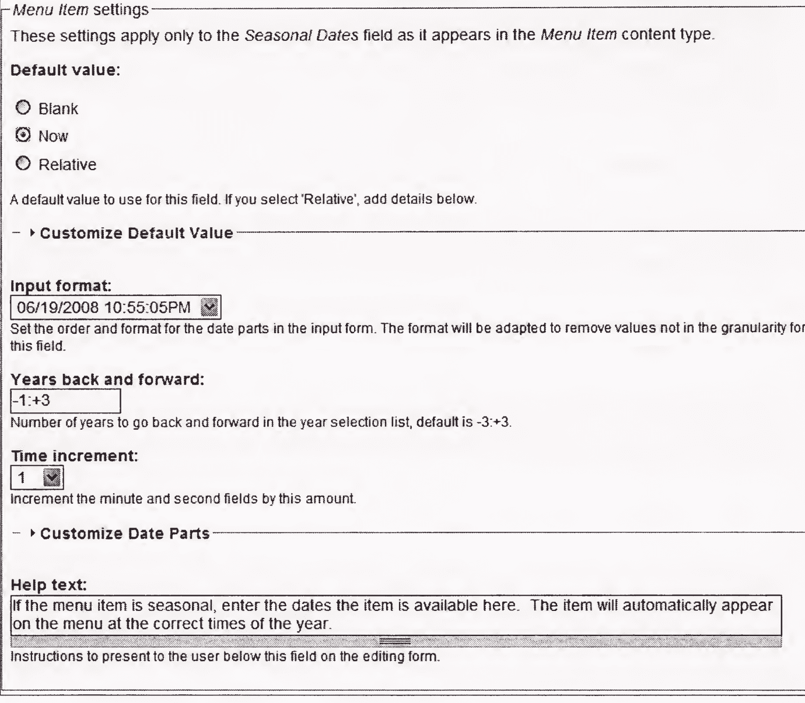

7. 我们现在可以输入季节日期的高级信息。由于本例中小时和分钟不重要，我们将从显示中移除它们。我们还将确保字段不是必填的，因为并非所有菜肴都是季节性的。高级选项设置如下：

## 全局设置

这些设置适用于 *Seasonal dates* 字段在出现的每个内容类型中的设置。

- - ☐ Required

**Number of values:**

`1`

为此字段选择特定数量的值，或选择“Unlimited”以提供“Add more”按钮，以便用户添加任意数量的值。

**Warning:** 在创建数据后更改此设置可能会导致数据丢失！

**To Date:**

○ Never

○ Optional

◉ Required

显示匹配的第二个日期字段作为“To date”。如果标记为“Optional”，字段将显示但不是必填的。如果标记为“Required”，则在“From date”为必填或已填写时，“To date”将为必填。

**Granularity:**

- ☑ Year
- ☑ Month
- ☑ Day
- ☐ Hour
- ☐ Minute
- ☐ Second

设置要存储的日期元素（至少需要一年）。

### 默认显示

**Date display:**

`June 19, 2008`

**Custom display format:**

` `

### 其他显示设置

**Time zone handling:**

`No time zone conversion`

选择用于此日期字段的时区处理方法。

## 添加菜单项可供使用的餐次

Good Eatin' Goal: 添加字段以确定项目可供使用的餐次。这将用于为每餐构建菜单。

Additional modules needed: CCK (http://drupal.org/project/cck).

Meals 字段与 Seasonal 字段类似，因为它是一个具有选择列表 widget 的文本字段。然而，我们将允许编辑者从我们的列表中选择多个选项。

### 基本步骤

- 1. 编辑 Menu Item 内容类型。
- 2. 添加一个名为 meals 的新文本字段，将标签设置为 Available at these meals，widget 为 Select List。
- 3. 将 Allowed values list 设置为：
  - Breakfast
  - Lunch
  - Dinner
  - Dessert
- 4. 选择 Required 复选框并将 Number of values 设置为 Unlimited。
- 5. 保存新字段。

## 为菜单项添加图片

Good Eatin' Goal: 允许 Chef Wanyama 可选地为菜单中显示的项目添加图片。

Additional modules needed: CCK (http://drupal.org/project/cck), IMCE (http://drupal.org/project/imce), IMCE CCK Image (http://drupal.org/project/imceimage).

### 基本步骤

- 1. 首先下载并安装 IMCE 和 IMCE CCK Image 模块。
- 2. 创建一个新字段，点击 Add field 链接。命名该字段为 Picture 并将标签设置为 Picture。类型将为 IMCE image 并使用 IMCE image widget。

3. 点击 continue 创建字段后，您可以输入字段的设置。这些设置允许您控制可以插入的图片类型，以及是否必须输入图片。

# Picture

[more help...]

Menu Item settings

这些设置仅适用于 Menu Item 内容类型中出现的 Picture 字段。

Valid File Types:*

png,gif,jpg,jpeg

Help text:

Enter a picture of the item for sale.

Instructions to present to the user below this field on the editing form.
Allowed HTML tags: <a> <b> <big> <code> <del> <em> <i> <ins> <pre> <q> <small>  <strong>   <tt> <ol> <ul> <li> 
   

Default value

Global settings

这些设置适用于 Picture 字段在出现的每个内容类型中的设置。

Required

Number of values:

1

用户可以为此字段输入的最大值数量。
“Unlimited”将提供“Add more”按钮，以便用户添加任意数量的值。
Warning! 在创建数据后更改此设置可能会导致数据丢失！

Save field settings

4. 如果您希望确保每个项目都有图片，您可能希望展开 Default value 部分并指定要使用的默认图片。默认图片通常是带有图形的通用图片，显示图片未找到或不可用。

5. 我们现在可以通过点击 Save field settings 来保存字段设置。

6. 当编辑点击链接向内容类型添加图片时，他或她会看到类似以下内容的对话框：

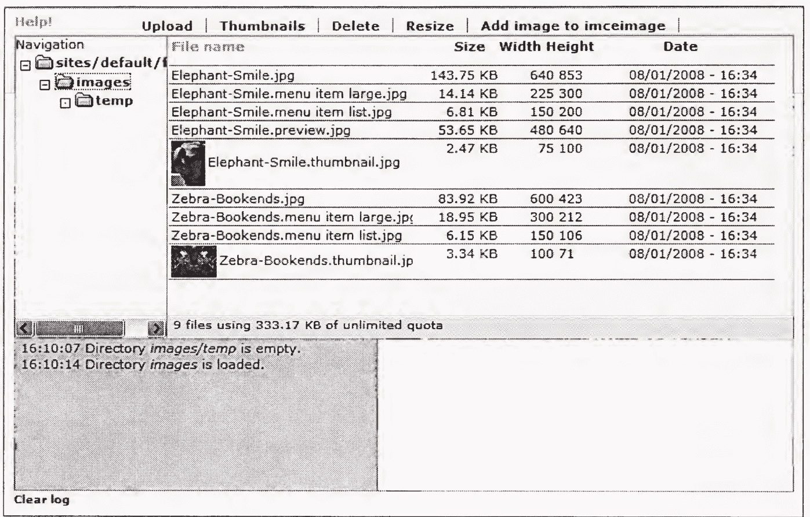

7. 要添加新文件，他或她只需点击 Upload 链接，即可打开下方所示的面板。这让编辑有机会选择要上传的文件并指定网站上应创建的图像尺寸。

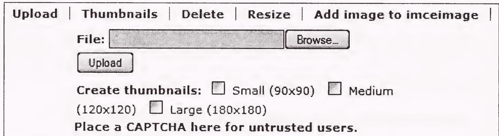

8. 编辑选择要插入的图片后，只需点击 Add image to imceimage 链接，图片将被自动插入。

## Alternative solutions

使用 CCK 创建的内容类型附加图片的另一种可能解决方案是 Image Field Module（http://drupal.org/project/imagefield），它为 Image 模块添加了 CCK 支持。要使用 Image Field 模块，您还必须安装 Filefield（http://drupal.org/project/filefield）和 ImageAPI（http://drupal.org/project/imageapi）模块。Image Field Module 为您提供了控制允许的文件大小的额外选项，还允许编辑配置将用于显示工具提示的标题文本，以及当访客禁用图像显示时使用的替代文本。然而，编辑无法轻松选择已上传到网站的图像。Image Field Module 的输入表单如下所示：

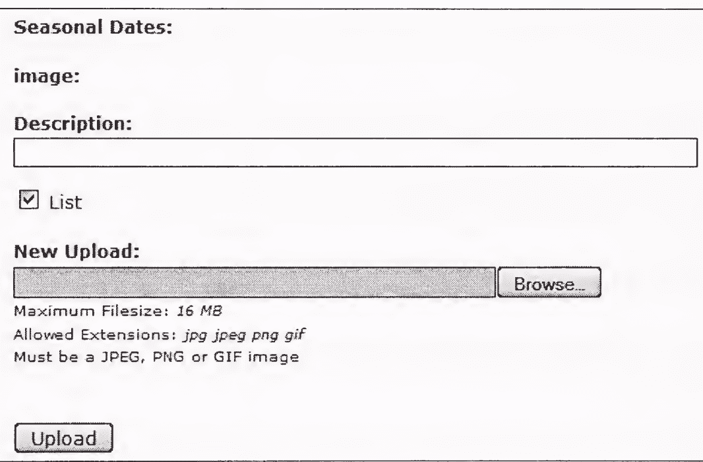

## Controlling access to the content type

Good Eatin' Goal: 修改编辑角色的权限，使编辑可以创建新的菜单项。

Additional modules needed: None.

## Basic steps

+   1. 我们可以通过编辑每个角色的权限轻松控制谁可以创建菜单项。首先通过从 Administer 菜单中选择 User management 然后选择 Permissions 打开权限管理器。

## Adding Products and Services

+   2. **Permissions Manager** 包含您创建的每个内容类型的详细权限。这些节点列在 **node module** 部分。我们将允许用户对菜单项类型执行任何类型的操作，如下所示：

| Permission | anonymous user | authenticated user | editor |
|---|---|---|---|
| **node module** |  |  |  |
| access content | ☑ | ☑ | ☑ |
| administer content types | ☐ | ☐ | ☐ |
| administer nodes | ☐ | ☐ | ☐ |
| create menu_item content | ☐ | ☐ | ☑ |
| create page content | ☐ | ☐ | ☐ |
| delete any menu_item content | ☐ | ☐ | ☑ |
| delete any page content | ☐ | ☐ | ☐ |
| delete own menu_item content | ☐ | ☐ | ☑ |
| delete own page content | ☐ | ☐ | ☐ |
| delete revisions | ☐ | ☐ | ☐ |
| edit any menu_item content | ☐ | ☐ | ☑ |
| edit any page content | ☐ | ☐ | ☐ |
| edit own menu_item content | ☐ | ☐ | ☑ |
| edit own page content | ☐ | ☐ | ☐ |
| revert revisions | ☐ | ☐ | ☐ |
| view revisions | ☐ | ☐ | ☐ |

## Using taxonomy to categorize content

Taxonomy 是对网站内容进行分类的强大方式。内容分类后，您可以根据为内容类型设置类别对内容进行分组或过滤。

如果您只有少量页面内容，或者仅基于一个类别进行分组，taxonomy 模块对于您的需求来说可能过于复杂。但如果您有数百页内容和复杂的分类需求，或者根据多个类别对内容进行分类时，taxonomy 的强大功能就显而易见了。

在定义 taxonomy 时，您可以决定类别中的术语是预定义的，还是编辑在添加新内容时可以添加新类别。最好在术语定义明确且不太可能更改时使用预定义术语。例如，Good Eatin' 网站将为 Meal 类别使用预定义值。如果术语经常更改、可以创建新类别，或者初始术语列表过大而无法预先输入，则允许动态添加术语将非常有用。

您还可以通过相互关联 taxonomy 类别来创建术语层次结构。例如，如果您按科学名称对动物进行分类，可以为界、门、纲、目、科、属和种创建类别。每个类别都与其上方的类别相关联。这使您可以轻松对动物进行分类，而无需反复输入更高级别类别之间的链接。

Drupal 使用以下术语来描述其分类系统：

+   - Taxonomy：分类系统的最高级别。
+   - Vocabulary：用于描述内容某一方面的术语组或类别。一些示例类别有：颜色、尺寸和类型。
+   - Term：词汇表中的特定标识符。Red、blue、green、small、medium、large、action、comedy 和 romance 都是可能的术语。

## Create a vocabulary for course type

Good Eatin' Goal: 构建一个 Taxonomy 来存储有关项目可供使用的餐次的信息。

Additional modules needed: Taxonomy (Core).

## Basic steps

要创建新的 taxonomy，您需要在模块管理器中确保 taxonomy 模块已启用。

启用 taxonomy 模块后，您可以使用 Taxonomy Manager 创建新的 taxonomy，该管理器可通过从 Administer 菜单中选择 Content management 然后选择 Taxonomy 访问。让我们从 Course Type 词汇表开始为我们的菜单项内容创建词汇表。

首先，点击 Taxonomy Manager 屏幕顶部的 Add Vocabulary 链接。Drupal 将显示一个表单，允许您输入有关新词汇表的信息。我们为 Course Type 输入的信息如下图所示：

### Taxonomy

定义词汇表将如何向管理员和用户展示，以及用其分类哪些内容类型。Tags 允许用户在提交帖子时通过输入以逗号分隔的列表来创建术语。否则术语是从选择列表中选择的，只能由具有“administer taxonomy”权限的用户创建。

[more help...]

### Identification

Vocabulary name: *
Course Type
此词汇表的名称，例如“Tags”。

Description:
课程类型标识菜单项建议的课程。如果选择多个课程，您应在菜单项的描述中说明任何差异。
词汇表的描述；可供模块使用。

Help text:
您必须为菜单项选择至少一个课程。
在选择术语时向用户展示的说明，例如“输入以逗号分隔的单词列表”。

### Content types

Content types:
☐ Image
☑ Menu Item
☐ Page
☐ Story
选择使用此词汇表分类的内容类型。

### Settings

☐ Tags
用户在提交帖子时通过输入以逗号分隔的列表创建术语。

☑ Multiple select
允许帖子具有来自此词汇表的多个术语（对标签始终为真）。

☑ Required
提交帖子时必须选择此词汇表中的至少一个术语。

Weight:
0
词汇表按权重升序显示。

保存新词汇表后，您将被返回到 Taxonomy Manager，其中现在将包含您的新类别，如下所示：

### Taxonomy

taxonomy 模块允许您使用标签和管理员定义的术语对内容进行分类。它是用于对内容进行分类的灵活工具，具有许多高级功能。首先，创建一个“Vocabulary”来保存一组术语或标签。您可以为所有内容创建一个自由标记词汇表，或创建单独的受控词汇表来定义内容的各种属性，例如“Countries”或“Colors”。

使用下面的列表配置和查看您网站上定义的词汇表，或列出和管理它们包含的术语（标签）。词汇表可以（可选）与特定内容类型相关联，如 Type 列所示，如果相关联，则在创建或编辑该类型帖子时显示。绑定到同一内容类型的多个词汇表将按下面显示的顺序显示。要更改词汇表的顺序，请抓住 Name 列下的拖放句柄并将其拖到列表中的新位置。（通过将鼠标悬停在句柄图标上并单击并按住鼠标来抓住句柄。）请记住，直到您点击页面底部的 Save 按钮后，您的更改才会被保存。

[more help...]

Created new vocabulary Course Type.

| Name | Type | Operations |
|---|---|---|
| Course Type | Menu Item | edit vocabulary list terms add terms |

## Adding terms to the course type vocabulary

Good Eatin' Goal: 创建将在 Course Type 词汇表中使用的术语。

Additional modules needed: Taxonomy (Core).

## Basic steps

现在我们的词汇表已创建，我们可以通过点击 add terms 链接来定义此词汇表内可使用的术语。单个术语包括术语名称和术语描述。您还可以使用高级选项来定义术语层次结构，或为术语定义同义词。同义词在您希望允许编辑输入自己的术语时特别有用，因为它允许您将具有相同含义的术语相互关联，即使两个编辑使用了不同的词语。

这些术语可以手动排序，也可以按字母顺序显示。如果某些术语比其他术语更常见，或者这些术语可以按时间、大小或相对重要性自然排序，那么手动排序术语可以使条目更高效。

## 添加食材列表词汇表

*美味饮食目标：*添加一个词汇表，用于存储菜单项中的一些关键食材，以便顾客能够轻松找到以特色食品或他们偏爱的食材为特色的餐点。

*所需附加模块：*分类法（核心）。

### 基本步骤

构建食材列表词汇表的过程与构建课程类型词汇表的过程类似。但是，我们将修改设置，使编辑者无需输入值，并且可以在输入新的菜单项时输入新术语。这些设置如下：

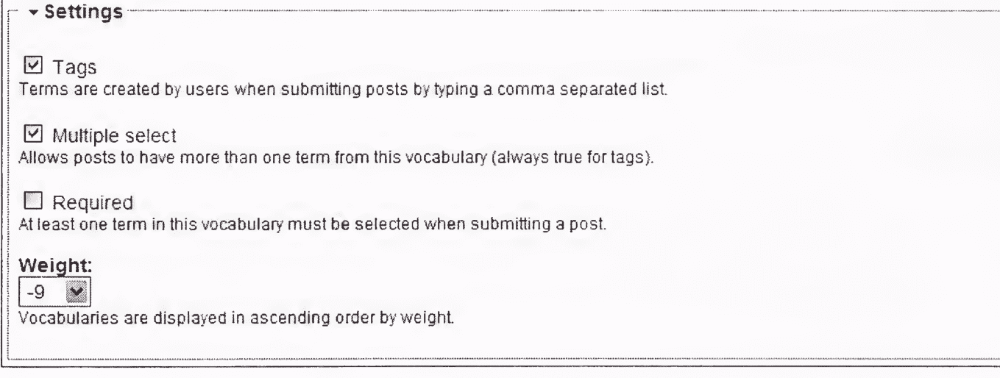

## 将词汇表添加为CCK字段

*美味饮食目标：*修改菜单项类型，使编辑者能够使用标准的CCK小部件输入分类法。这也将使分类法的显示更加容易。

*所需附加模块：*分类法（核心）、内容分类法（`http://drupal.org/project/content_taxonomy`）。

## 添加产品和服务

### 基本步骤

- 1. 安装内容分类法模块并激活它。
- 2. 打开**内容类型管理器**并编辑菜单项类型。
- 3. 单击屏幕顶部的**添加字段**链接。
- 4. 输入有关新字段类型的基本信息，包括**字段名称**和**标签**。将**字段类型**设置为**内容分类法字段**，如下所示：

  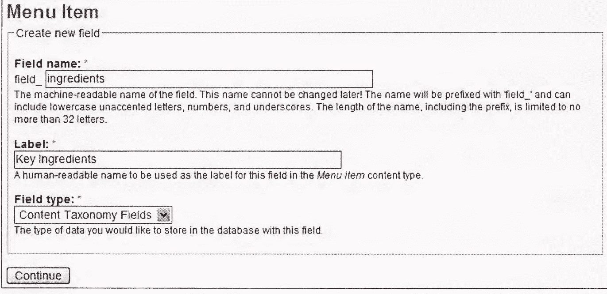

- 5. 单击“继续”保存基本信息，Drupal将提示您输入要显示的窗口部件类型。由于我们将从大量可能的值中进行选择，**自动完成**窗口部件是最合适的。
- 6. **选择“继续”**，Drupal将显示一个包含字段特定信息的表单。我们将使用以下截图中显示的值：

  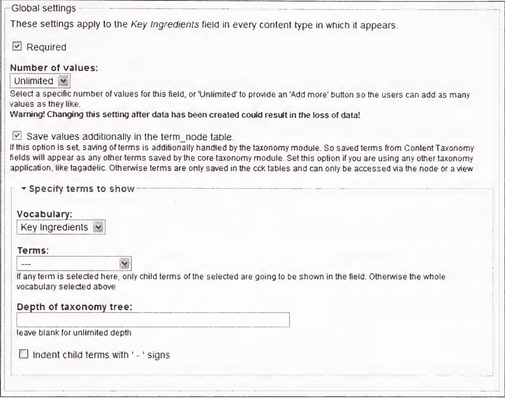

  通过选中“在 term_node 表中额外保存值”复选框，我们将能够在各种其他情况下使用分类法。

- 7. 最后一步是确保“关键食材”词汇表不与“菜单项”内容类型关联。这一点很重要，因为如果两者关联，编辑表单将包含重复的分类法编辑区域。

## 使用菜单项类型添加内容

既然我们已经构建了菜单项内容类型，就可以开始使用该类型来构建将组成“美味饮食”菜单的内容。

### 创建新的菜单项

*美味饮食目标：*使用我们的新内容类型构建菜单项，以便在网站上显示。

*所需附加模块：*无。

### 基本步骤

- 1. 我们首先单击**创建内容菜单**。Drupal现在将打开与我们在第2章中构建静态页面时看到的相同的内容类型列表。但是，现在我们的新菜单项类型也可用了。
- 2. 单击**菜单项**，Drupal将基于我们创建的自定义字段显示一个表单。
- 3. 填写新内容类型的所有字段，然后单击**保存**按钮。
- 4. 一旦菜单项创建完成，默认显示将如下所示：

  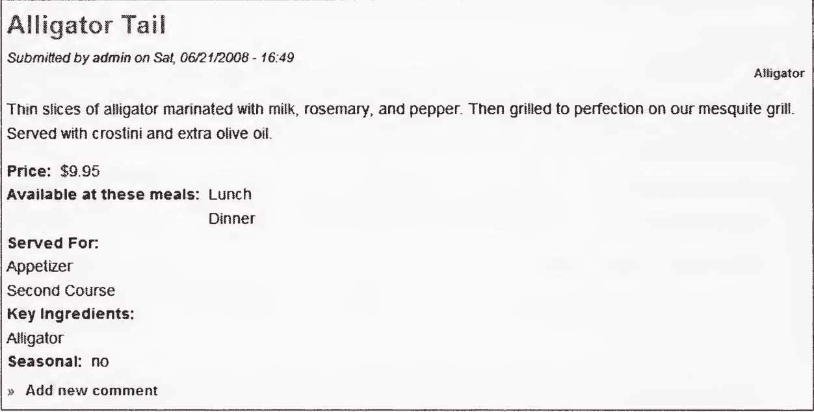

### 自定义菜单项的显示

虽然默认视图适用于某些内容类型，但大多数时候您会希望自定义内容类型的外观，使其清晰且对访客有吸引力。

我们可以改进此菜单项的显示，使其更紧凑，并移除与大多数访客不相关的信息，例如内容的提交者以及创建时间。在本节中，我们将讨论实现此目的的各种方法。

### 修改菜单项的字段顺序和标题

*美味饮食目标：*自定义菜单项内容类型的字段显示方式，以最大限度地提高访客的易用性。

*所需附加模块：*CCK。

### 基本步骤

您可以进行的最基本的自定义由CCK模块提供。该模块允许您控制每个字段的标签方式以及用于显示它的格式。

要使用基本显示自定义，请编辑您的内容类型，然后单击屏幕顶部的“显示字段”链接。Drupal随后将显示类似于下图的屏幕：

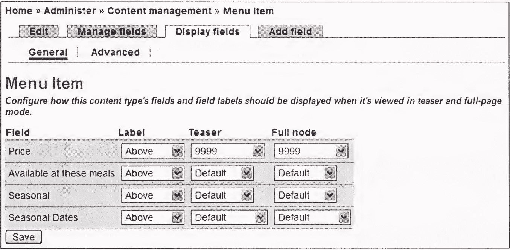

您可以自定义标签是显示在值的上方、与值在同一行，还是完全不显示。您还可以自定义内容在摘要（Teaser）和完整节点（Full node）中的格式。当同一页面上显示多个项目时，会使用摘要显示；当项目单独显示时，会使用完整节点。

如果您需要对内容类型进行额外的自定义，可以对内容进行主题化或使用内容模板。

### 使用内容模板进行高级自定义

*美味饮食目标：*讨论内容模板提供的可能性。

*所需附加模块：*内容模板（http://drupal.org/project/contemplate）。

我们将结合使用视图和分类法来创建每个显示。在深入创建每个显示之前，让我们先了解一下视图模块。

### 介绍视图模块

*美味饮食目标：*介绍视图模块，并在美味饮食网站上激活它，以便我们能够构建视图。

*所需附加模块：*视图（http://drupal.org/project/views）。

### 基本步骤

视图模块用于根据内容中的信息对内容进行分组。视图模块可从以下网址下载：http://drupal.org/project/views。下载该模块并将其安装到您的站点。将视图模块添加到站点后，您还需要其他几个模块才能激活视图模块和视图UI模块，如下面的截图所示：

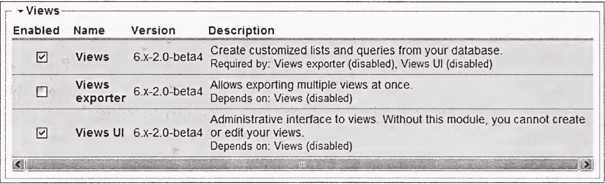

视图模块负责管理和呈现每个视图的核心任务。视图UI模块用于创建和编辑视图。您可能还想下载并安装高级帮助模块，该模块改进了一些模块的帮助系统——包括视图模块。高级帮助模块可在以下网址获取：http://drupal.org/project/advanced_help。

启用这些模块后，您可以通过从“管理”菜单中选择“站点构建”，然后选择“视图”链接，来查看预定义的视图并创建新视图。

如您所见，有许多预定义的视图可供选择，或者您也可以自己创建：

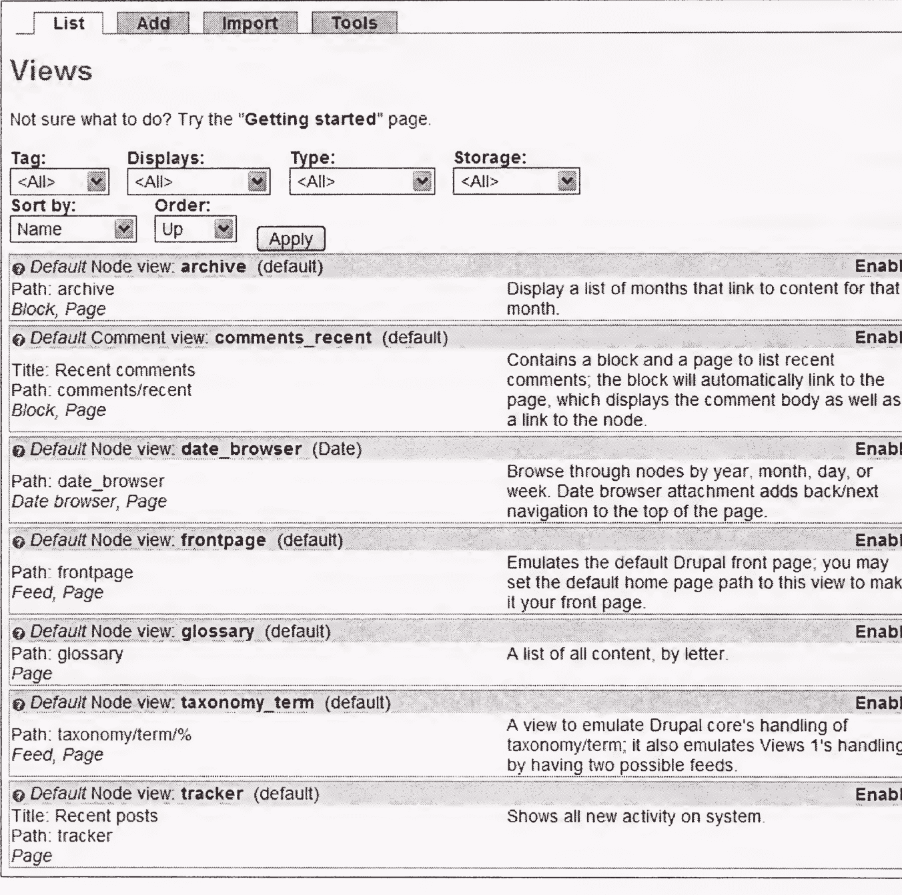

如您所见，这些默认视图为几个常见问题提供了解决方案，您可以测试启用它们，以确定它们是否适合您的站点。

### 按餐点创建菜单项视图

*美味饮食目标：临时。*

*所需附加模块：*视图（http://drupal.org/project/views）。

我们将创建的第一个自定义视图将用于根据餐点（meal）显示菜单项。这个视图最类似于您在餐厅就座时收到的传统菜单。

### 基本步骤

- 1. 要创建此视图，我们首先单击**视图管理器**屏幕顶部的**添加**。Drupal随后将显示一个表单，您可以在其中输入新视图的基本信息，如以下截图所示：

  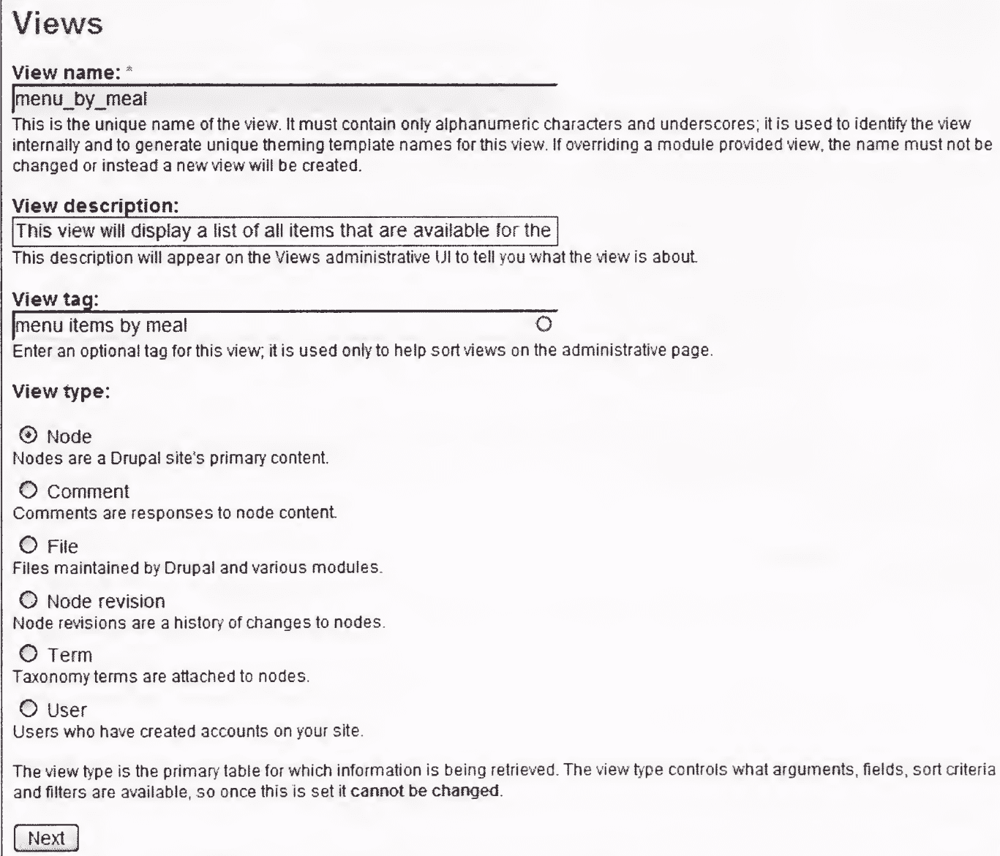

- 2. 单击**下一步**按钮后，Drupal会显示一个表单，其中汇总了视图的当前设置：

  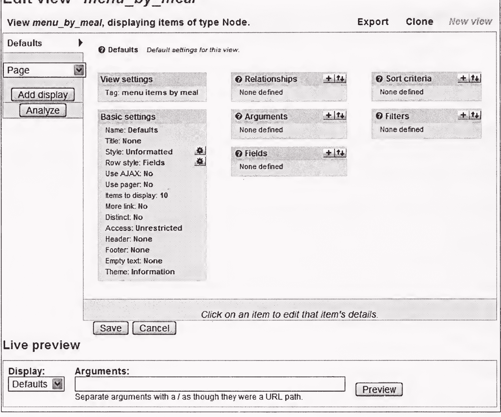

现在视图的基础已创建，我们可以根据需求自定义视图。

### 基于内容类型进行过滤

我们将修改视图，使其仅显示菜单项内容。

- 1. 单击**过滤器**标签旁边的+符号。
- 2. Drupal将在**实时预览**部分上方显示一个表单，其中包含要添加的过滤器的选项，如下面的截图所示：

## 默认值：添加筛选器

组：

- Node
- Node: Sticky — 节点是否为置顶。
- Node: Teaser — 存储的摘要字段。在所有节点类型上此数据可能无效或无用。
- Node: Title — 节点的标题。
- Node: Type — 节点的类型（例如，“博客文章”、“论坛帖子”、“故事”等）。
- Node: Updated date — 节点最后更新的日期。
- Node: Updated/commented date — 最后评论发布或节点更新时间的较晚者。

添加 取消

Groups 列表选项允许您轻松筛选可用组的列表以减少可用选项的数量。

3. 选择 Node: Type 复选框并单击 Add。Drupal 将显示一个包含要筛选的实际值的新表单，如下所示：

### 默认值：配置筛选器“Node: Type”

此项当前未公开。如果您将其公开，用户将能够在查看时更改筛选器。

公开

操作符：
- Is one of
- Is not one of

节点类型：
- Poll
- Image
- Menu Item
- Page
- Story

更新 取消 删除

在您做出选择后，单击 Update 按钮以保存更改。如果您希望用户能够修改此筛选器，可以单击 Expose 按钮。这是在添加高级搜索的绝佳方式。

## 基本设置

现在我们已经定义了将显示哪些内容类型，我们可以在基本设置部分设置各种控制视图显示的项目。

1. 我们将首先通过单击标题标签旁边的链接来修改视图的标题。将标题更改为 Good Eatin' Menu。
2. 接下来，我们将通过单击基本设置中 Row Style 旁边的链接来修改显示方法。
3. Fields 选项将仅以表格样式格式显示所选字段。Node 选项将显示整个节点或节点的摘要。对于我们的视图，Node 选项是更好的选择。选择 Node 并单击 Update 以保存更改。
4. Use pager 和 Items to display 设置控制项目是在单个页面上显示还是拆分为多个页面。因为大多数人期望菜单显示在单个页面上，所以我们将这些设置保持为默认值。
5. 您可能还想为视图设置的一些其他设置是 Header、Footer 和 Empty text 设置，它们分别允许您在主要内容之前和之后添加文本，以及在视图中未显示内容时替换文本。

## 添加参数以控制餐次显示

为了独立显示每个餐次的菜单，我们将向视图添加一个参数。这将允许我们为每个页面指定要显示的特定餐次。

1. 单击 Arguments 链接旁边的 + 符号，Drupal 将显示所有可用参数的列表，如屏幕截图所示：

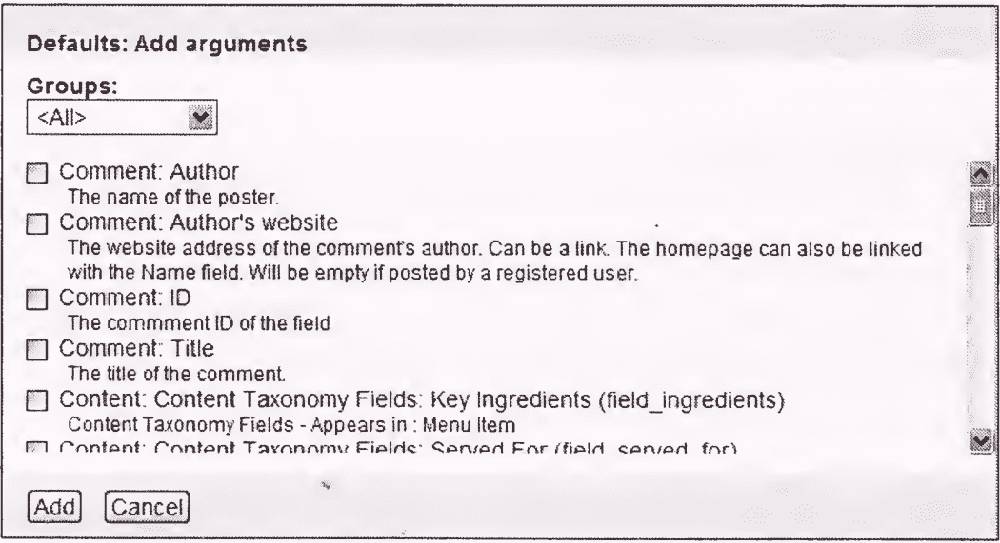

2. 我们将把 **Groups** 字段更改为 **Content**，选择 **Content: Text: Available at these meals (field_meals)**，然后单击 **Add**。Drupal 将然后显示一个允许我们配置 **Argument** 的表单，如以下屏幕截图所示：

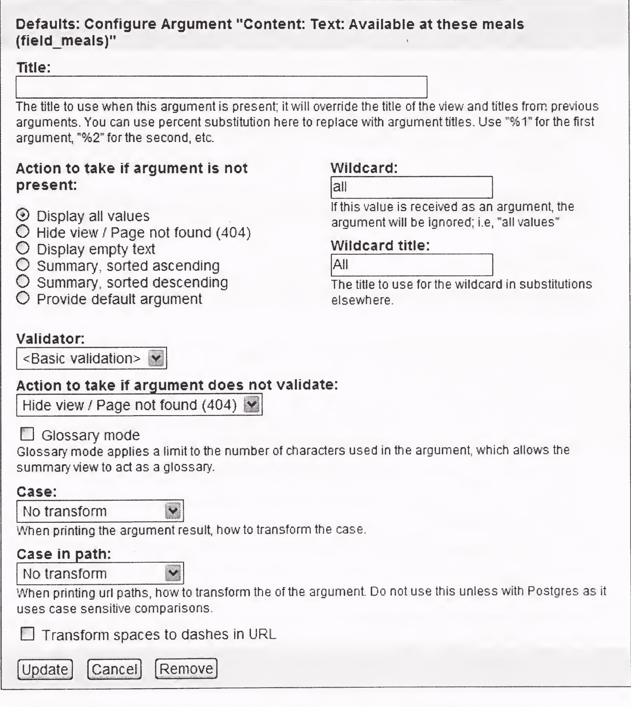

我们将把 Groups 更改为 Content，并选择 Content: Text: **Available at these meals** 复选框。单击 **Add**，Drupal 将提示您输入项目的排序顺序。在我们的例子中，默认的 **Ascending** 排序顺序是可以的，所以我们可以直接单击 **Update**。

## 创建页面和菜单以显示视图

创建视图的最后一步是为我们的客户提供查看视图的位置。我们通过从默认值构建新的显示来实现这一点。

1. 首先在 **Defaults** 标签下的下拉列表中选择 **Page**，如以下屏幕截图所示：

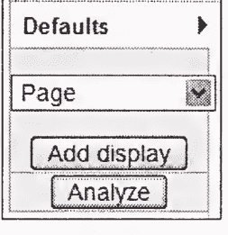

2. 然后，单击 **Add display** 按钮，Drupal 将为我们创建一个第二个显示。因为我们选择了 Page 显示类型，Drupal 已添加了几个可用的附加设置，如屏幕截图所示：

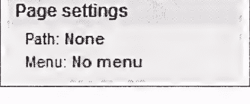

3. 我们将首先通过单击 **Path** 标签旁边的链接来自定义路径。Drupal 将然后显示一个表单，您可以在其中输入访客用于查看此页面的路径。我们将路径设置为 **menu**，如以下屏幕截图所示：

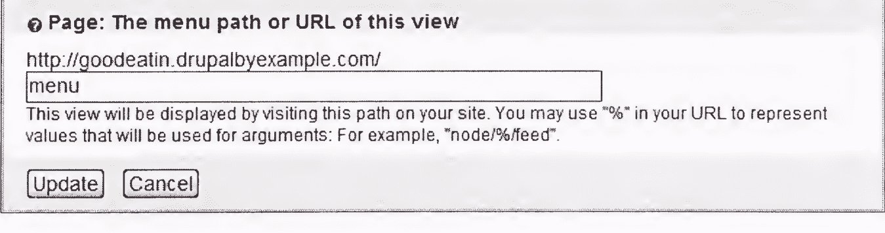

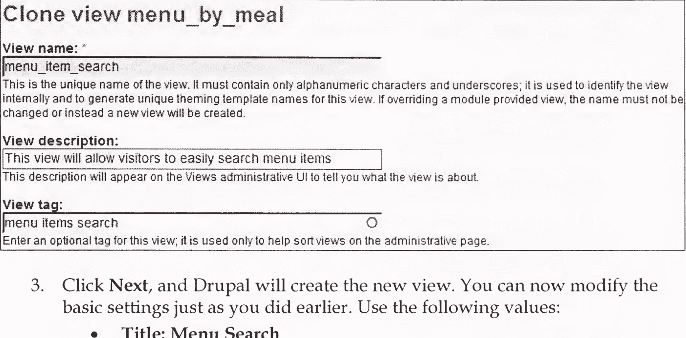

3. 单击 Next，Drupal 将创建新的视图。您现在可以像之前一样修改基本设置。使用以下值：

- **Title:** Menu Search
- **Style:** Table
- **Use Pager:** Full Pager

4. 接下来，我们需要删除我们之前提供的 Argument，因为此视图应显示所有值。要执行此操作，请单击参数的链接，然后单击屏幕底部的 **Remove** 按钮。

## 添加字段

1. 现在我们需要在视图中添加将在表中显示的字段。首先单击 Fields 标签旁边的 + 符号。Drupal 将然后显示一个允许您选择要添加的字段的表单，如以下屏幕截图所示：

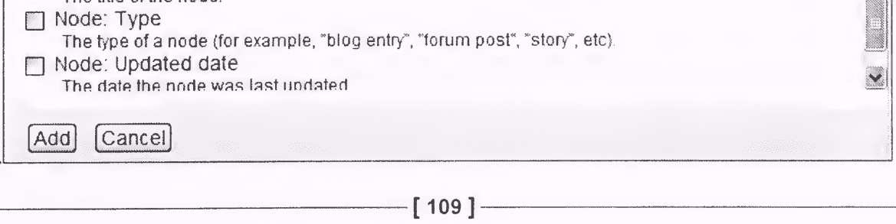

2. 选择您想要显示的字段，然后单击 Add 按钮。Drupal 将然后显示一个新表单，您可以在其中自定义字段的显示方式。

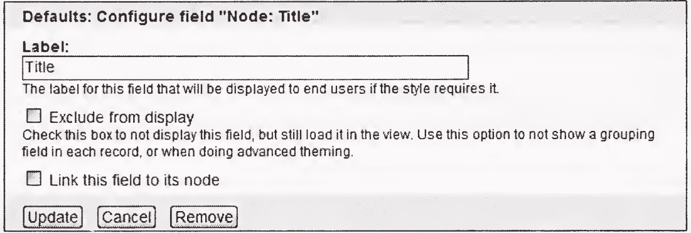

3. 单击 Update 按钮以完成添加新字段。

4. 重复这些步骤以包含 Node Title、Node Body、Meals、Course Type 和 Ingredients list 字段。

## 添加筛选器

接下来，我们将为每个页面创建一个公开筛选器，以便我们的访客可以轻松搜索菜单。此过程与我们添加 Node Type 筛选器时遵循的过程类似。

1. 单击 Filters 标签旁边的 + 符号。
2. Drupal 将然后显示一个可供您选择可筛选字段的选择。选择您想要显示的所有字段，然后单击 Add。对于基于分类法的字段，请确保选择以 Taxonomy 为前缀的字段。
3. Drupal 将然后显示一个表单，您可以在其中设置筛选器的选项。Meals 字段的选项表单如以下屏幕截图所示：

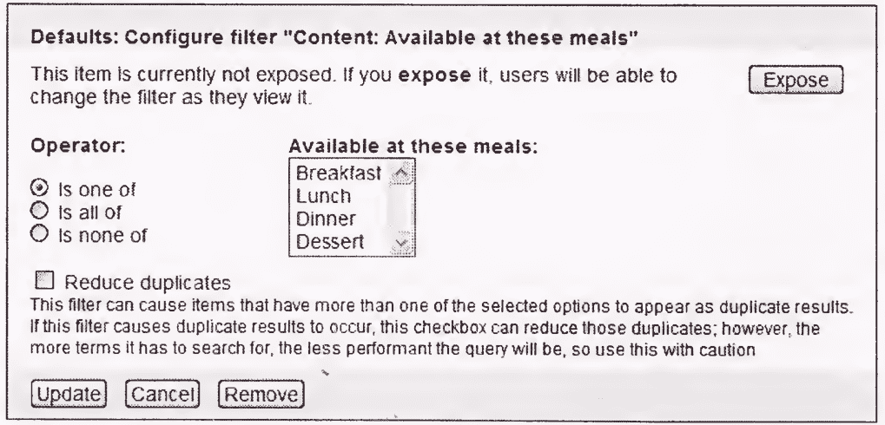

4. 因为我们正在构建一个搜索表单，我们希望公开该字段以便用户可以修改值。当您单击 Expose 按钮时，将添加以下选项：

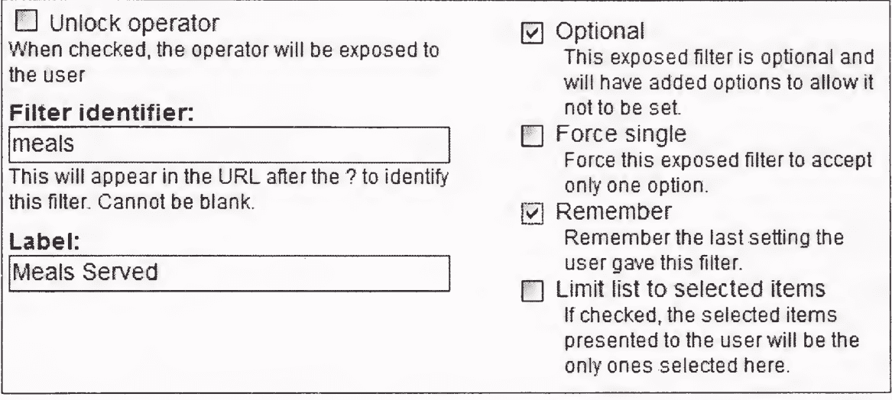

5. 对选项满意后，单击 **Update** 以保存筛选器。

## 创建页面和菜单

现在视图已完全设置好，我们可以为视图创建页面和菜单。因为我们克隆了此内容类型，我们可以简单地修改现有值。

1. 单击视图的 **Page link** 链接。
2. 单击 **Page Settings** 组中 **Path** 标签旁边的链接。将此值更改为 `search_menu`，并更新设置。
3. 单击 **Menu** 标签旁边的链接并将此值更改为 **Search the Menu**。

## 使用搜索表单

现在 Search View 已完成，我们可以通过单击主菜单中的 Search the Menu 链接来使用它。搜索表单的示例视图显示在以下屏幕截图中：

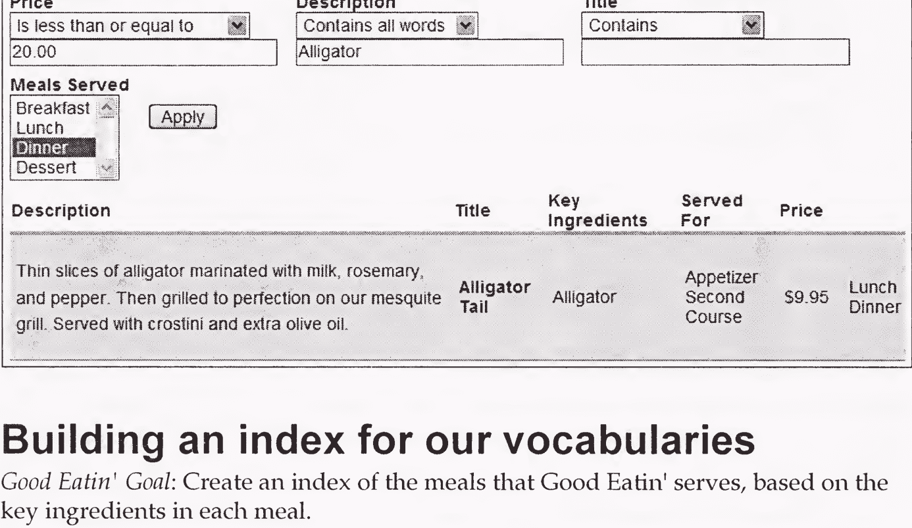

## 为我们的词汇表构建索引

*Good Eatin' Goal:* 创建 Good Eatin' 提供的餐次索引，基于每餐的关键食材。

*所需的附加模块：* Taxonomy VTN (http://drupal.org/project/taxonomy_vtn)。

### 基本步骤

1. 安装并启用 Taxonomy VTN 模块。
2. Taxonomy VTN 模块有多种选项，可通过从 **Administer** 菜单中选择 **Site configuration** 然后选择 **Taxonomy VTN settings** 来访问。对于 Good Eatin' 网站，默认值都是正确的。
3. 一旦您启用 Taxonomy VTN 模块，您将有一个名为 **Vocabularies** 的新菜单项。当您选择此菜单项时，Drupal 将自动显示一个类似以下的页面，其中包含您创建的每个词汇表的一个条目。

# 词汇表

**显示 / 隐藏描述**

### A
- **过敏原 (1)**  
  列出菜品中可能存在的任何过敏原，以便我们的顾客在订购时做出明智的决定，避免生病。

### K
- **关键配料 (4)**  
  列出构成此餐的关键配料，这将帮助顾客选择符合其兴趣和饮食的食物。

### C
- **菜品类型 (8)**  
  菜品类型标识菜单项目的建议菜式。如果选择了多个菜式，您应在菜单项目的描述中说明任何差异。

4. 当您选择一个词汇表时，词汇表中的术语将如以下屏幕截图所示：

# 菜品类型中的术语

菜品类型标识菜单项目的建议菜式。如果选择了多个菜式，您应在菜单项目的描述中说明任何差异。

<< 返回词汇表 | 显示 / 隐藏描述

### A
- **酒精饮料 (0)**  
  不适合儿童，但这些饮料美味可口
- **开胃菜 (0)**  
  令人垂涎的美味小吃，可增进食欲。所有开胃菜均适合两人分享。

### N
- **无酒精饮料 (0)**  
  美味的调配饮品和一些传统主食，可满足您的口渴。

### D
- **甜点 (0)**  
  以甜食完美结束您的餐食的绝佳方式。

### S
- **沙拉 (0)**  
  从生菜到意面，这些沙拉是任何餐食的绝佳搭配。
- **第二道菜 (0)**  
  我们的第二道菜是肉类为主的菜肴，风味浓郁且饱足
- **汤 (0)**  
  美味的汤是开始用餐或自成一餐的绝佳方式

### F
- **第一道菜 (0)**  
  第一道菜是更饱足的意面、土豆和米饭菜肴。

5. 如果您想更改菜单项目的名称或位置，可以通过 **菜单管理器** 进行操作，该管理器可通过选择 **站点构建** 然后 **菜单**，从 **管理** 菜单中访问。
