# 4

# 与客户和访客互动

Chef Wanyama 认为他的食物是城里最好的，为了确保他的食物保持领先，他始终寻求顾客的反馈，无论他们是在餐厅内，还是在访问 Good Eatin' 网站时。

在本章中，我们将创建多种功能，让网站用户能够与网站互动，并让他们感受到自己是社区的一部分，同时为 Chef Wanyama 提供宝贵的反馈。我们将允许用户在网站上注册，对内容发表评论，回应民意调查，并回答调查问卷。

# 使用用户

在此系列任务中，我们将探索 Drupal 的用户功能，该功能允许您向网站添加用户并指定他们可以使用的功能。我们还将讨论角色的概念，角色允许您创建一组权限，可以轻松分配给用户。最后，我们将讨论如何将角色分配给用户。

# 允许用户注册

Good Eatin' 目标：允许用户在网站上注册，以便他们可以访问未注册访客无法使用的额外内容。

所需额外模块：无。

Drupal 包含一套复杂的用户管理和权限系统，让您可以轻松控制谁可以访问您的网站以及他们在网站上可以做什么。

| Field | Data | Quantity | Cost € | Price € | Sales € |
| --- | --- | --- | --- | --- | --- |
| 200.10 | Salaries | | | 1 | 2.340,00 | + 2.340,00 |
| 200.11 | Bonuses | | | 2 | 3.450,00 | + 3.450,00 |
| 200.15 | Performance | | | 3 | 12.250,00 | + 12.250,00 |
| 200.20 | Temporary Staff | | | 4 | 2.250,00 | + 2.250,00 |
| 200.30 | Training | | | 5 | 1.250,00 | + 1.250,00 |

| Field | Explanation | Quantity | Cost € | Price € | Sales € |
| --- | --- | --- | --- | --- | --- |
| 200.35 | Company Events | | | 1 | 650,00 | + 650,00 |
| 200.40 | Travel Expenses | | | 2 | 1.230,00 | + 1.230,00 |
| 200.45 | Advertising | | | 3 | 2.150,00 | + 2.150,00 |
| 200.50 | Customer Acq. | | | 4 | 2.240,00 | + 2.240,00 |
| 200.55 | Legal Advice | | | 5 | 2.626,00 | + 2.626,00 |

| Field | Explanation | Quantity | Cost € | Price € | Sales € |
| --- | --- | --- | --- | --- | --- |
| 200.60 | Auditing | | 1 | 1 | 2.200,00 | + 2.200,00 |
| 200.65 | Other | | 2 | 2 | 750,00 | + 750,00 |
| 200.70 | Insurance | | 3 | 3 | 3.200,00 | + 3.200,00 |
| 200.80 | Office Material | | 4 | 4 | 1.500,00 | + 1.500,00 |
| 200.90 | Software | | 5 | 5 | 2.800,00 | + 2.800,00 |

| Field | Explanation | Quantity | Cost € | Price € | Sales € |
| --- | --- | --- | --- | --- | --- |
| 200.100 | Hardware | | | 1 | 1.200,00 | + 1.200,00 |
| 200.110 | Communication | | | 2 | 800,00 | + 800,00 |
| 200.120 | Rent | | | 3 | 2.500,00 | + 2.500,00 |
| 200.130 | Utilities | | | 4 | 1.100,00 | + 1.100,00 |
| 200.140 | Cleaning | | | 5 | 450,00 | + 450,00 |

| Field | Explanation | Quantity | Cost € | Price € | Sales € |
| --- | --- | --- | --- | --- | --- |
| 200.150 | Depreciation | | | 1 | 1.000,00 | + 1.000,00 |
| 200.160 | Interest | | | 2 | 600,00 | + 600,00 |
| 200.170 | Taxes | | | 3 | 4.500,00 | + 4.500,00 |
| 200.180 | Donations | | | 4 | 300,00 | + 300,00 |
| 200.190 | Fees | | | 5 | 900,00 | + 900,00 |

| Field | Explanation | Quantity | Cost € | Price € | Sales € |
| --- | --- | --- | --- | --- | --- |
| 200.200 | Miscellaneous | | | 1 | 250,00 | + 250,00 |
| Total | | | | | 44.295,00 | 44.295,00 |

**员工详情：Sven Petersen**

- **基本信息**
  - 员工编号：EMP001
  - 姓名：Sven Petersen
  - 出生日期：15.03.1982
  - 国籍：德国
  - 婚姻状况：已婚
  - 电子邮件：sven.petersen@company.com
  - 电话：+49 170 1234567
  - 地址：Musterstrasse 12, 10115 Berlin, Germany

- **工作特定信息**
  - 职位：高级软件工程师
  - 部门：IT / 开发
  - 合同类型：全职，永久
  - 入职日期：01.04.2015
  - 每周工时：40 小时
  - 直接下属：3
  - 经理：Dr. M. Schmidt

# 创建 VIP 角色

**Good Eatin' 目标：** 创建一个 VIP 角色，将用于为特殊客户提供普通客户没有的增强特权。客户必须被授予 VIP 访问权限；他们不能自行注册。

**所需额外模块：** 无。

## 基本步骤

1. Drupal 允许您在 **角色管理器** 页面上管理网站的角色，该页面可通过选择 用户管理 然后 角色，从 **管理** 菜单中访问。
2. 打开 **角色管理器** 后，Drupal 将显示您网站上当前可用的角色列表，并提供添加新角色的能力，如下所示：

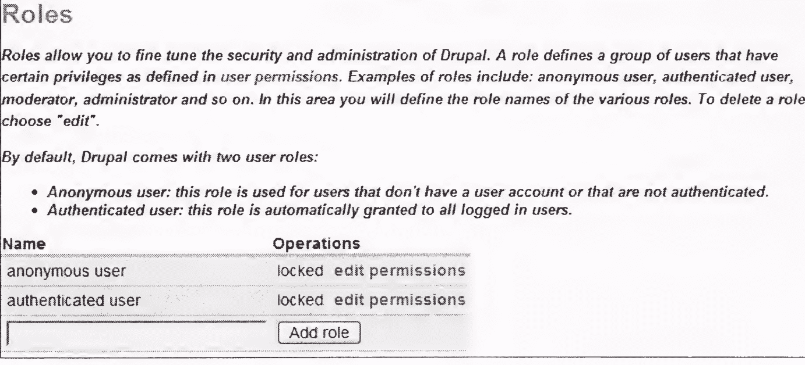

3. 输入 **VIP user** 作为名称，然后按 **添加角色**。Drupal 现在将角色添加到 **角色管理器** 中，如下所示：

4. 从管理器中，您可以编辑角色，这将允许您修改角色的名称或删除角色。
5. 创建角色后，您需要更新角色的权限，以便用户可以执行所需任务。要修改权限，请点击角色的编辑权限链接。
6. Drupal 然后将显示所有可用权限的列表，按类别排列。默认情况下，所有权限均被禁用。这可防止新用户角色获得不需要的访问权限。当用户被分配到多个角色时，他们的实际权限将是每个角色权限的组合。这意味着您应为每个角色授予尽可能少的权限，并将多个角色分配给用户以完全定义每个用户。
7. 对于我们的 VIP 角色，我们将仅添加发布评论无需审批的权限，然后点击保存权限按钮完成更改。

# 将用户分配到 VIP 角色

Good Eatin' 目标：更改已注册客户为 VIP 客户，并让他们知道已获得额外特权。

所需额外模块：无。

## 基本步骤

现在我们已经构建了新的 VIP 角色，我们可以将其分配给用户。Chef Wanyama 希望手动分配他的 VIP，但您也可以允许访客请求不同角色，或在注册时分配角色。

1. 要创建具有 VIP 角色的新用户，我们将从 用户管理器 开始，该管理器可通过选择 用户管理 然后 用户，从 管理 菜单中访问。
2. 接下来，点击 添加用户 链接。Drupal 将显示一个表单，您可以在其中输入有关要添加用户的详细信息，如以下屏幕截图所示：

## 用户

此网页允许管理员注册新用户。用户的电子邮件地址和用户名必须唯一。

[更多帮助...]

用户名：*
允许使用空格；标点符号不允许使用，除句点、连字符和下划线外。

电子邮件地址：*
有效的电子邮件地址。系统发送的所有电子邮件都将发送到此地址。电子邮件地址不公开，仅在您希望接收新密码或希望通过电子邮件接收某些新闻或通知时使用。

密码：*
确认密码：*
在两个字段中为新账户提供密码。

状态：
○ 已阻止
⊙ 活跃

角色：
☑ 已认证用户
☐ VIP 用户
☐ 通知用户新账户

创建新账户

- 3. 输入有关新用户所需的信息，包括密码。要使用户成为 VIP 用户，请在“角色”部分中选择 VIP 用户复选框。
- 4. 如果用户已注册，您可以通过从“用户管理器”页面点击该用户，点击编辑链接，然后只需选择要添加的角色的复选框，为其添加角色。

## 注册通知

Good Eatin' Goal：设置一个通知系统，以便网站管理员在每次有新用户在网站上注册时都能收到通知。这可以帮助您快速审核新成员并跟进他们，以确保他们在网站上获得积极的体验。

需要附加模块：Trigger（核心）。

为了在用户注册时通知管理员，我们需要做两件事。首先，我们需要构建一个创建并发送电子邮件的操作。其次，我们需要创建一个触发器，告诉 Drupal 何时应发送电子邮件。让我们从创建操作开始。

## 创建电子邮件操作

- 1. 操作是通过使用**操作管理器**创建的，可通过从**管理**菜单中选择**站点配置**然后选择**操作**来访问。
- 2. 如以下图像所示，有几个可用的基本操作。或者，您可以创建自己的操作。

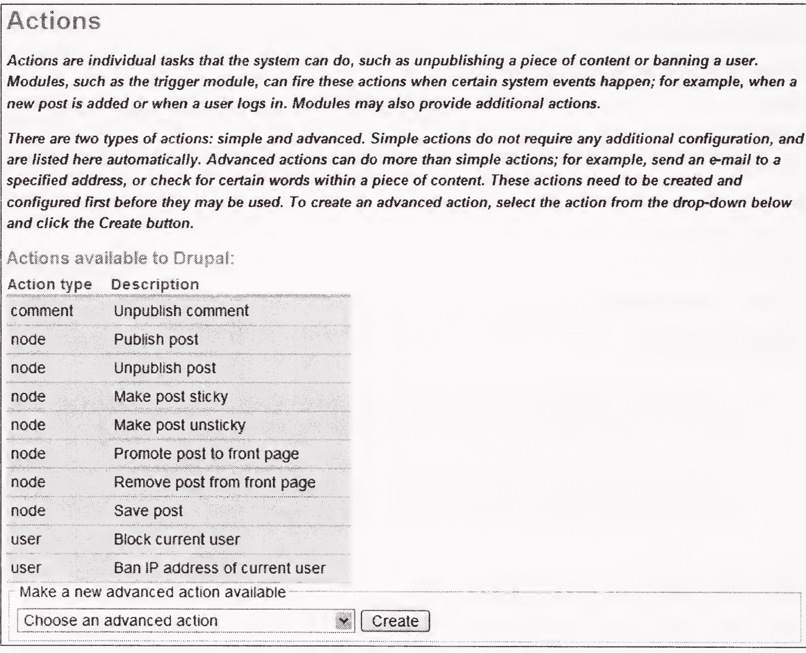

由于没有用于向管理员发送电子邮件的基本操作，因此我们需要创建一个新操作。

- 3. 首先从**高级选项**下拉列表中选择**发送电子邮件**，然后点击**创建**。

4. Drupal 然后会显示一个表单，您可以在其中输入有关要发送的电子邮件的信息，如下所示：

## 配置高级操作

高级操作提供额外的配置选项，可在下方填写。建议更改“描述”字段，以便更好地识别正在进行的精确操作。此描述将在分配操作给系统事件时在诸如触发器模块之类的模块中显示，因此最好尽可能描述性（例如，“向审核团队发送电子邮件”而不是简单地“发送电子邮件”）。

描述：
New User Email
此高级操作的唯一描述。此描述将在与操作集成的模块的界面中显示，例如 Trigger 模块。

收件人：
admin@drupalbyexample.com
应发送消息的电子邮件地址，或输入 %author 如果您希望向原始帖子的作者发送电子邮件。

主题：
A New User Registered registered on %site_name
消息的主题。

消息：
A new user registered on %site_name with the user name %username. To approve this user, please login to %site_name. And visit the User Manager.

The %site_name team.

应发送的消息。您可以包含以下变量：%site_name、%username、%node_url、%node_type、%title、%teaser、%body。并非所有变量在所有上下文中都可用。

保存

5. 点击“保存”，操作将被添加到操作管理器。您可以通过点击配置链接随时修改电子邮件，或通过点击删除来删除操作。

## 创建新用户触发器

我们现在需要创建将确定何时发送新电子邮件的触发器。

- 1. 首先启用 Trigger 模块，该模块作为核心 Drupal 安装的一部分安装。
- 2. 安装 Trigger 模块后，您可以通过从管理菜单中选择站点构建然后选择触发器来访问触发器管理器。触发器管理器根据其用途分为几个部分。

3. 要访问与用户相关的触发器的管理器，请在触发器管理器中点击“用户”选项卡。Drupal 将显示所有可能的触发器列表，您可以为每个触发器分配操作，如以下屏幕截图所示：

## 触发器

触发器是系统事件，例如添加新内容时或用户登录时。触发器模块将这些触发器与操作（功能任务）结合使用，例如取消发布内容或向管理员发送电子邮件。操作设置页面包含现有操作的列表，并提供创建和配置其他操作的能力。

下面您可以分配操作以在发生某些与用户相关的触发器时运行。例如，您可以在用户账户被删除时向管理员发送电子邮件。

[更多帮助...]

触发器：用户账户创建后
New User Email  分配

触发器：用户资料更新后
选择一个操作  分配

触发器：用户被删除后
选择一个操作  分配

触发器：用户登录后
选择一个操作  分配

触发器：用户注销后
此触发器没有可用操作。

触发器：用户资料被查看时
选择一个操作  分配

4. 将“用户账户创建后”触发器的操作更改为 New User Email，然后点击分配。Drupal 将添加操作并保存表单。管理员随后将在每次创建新用户账户时自动收到电子邮件。如果您以后想禁用此操作，只需在触发器管理器中点击取消分配链接即可。

## 处理评论

在此任务组中，我们将探索 Drupal 的内置功能，允许用户对您的内容发表评论。我们将介绍设置权限以确定谁可以评论，并描述评论的审批流程，以帮助防止在您的网站上发布不需要的消息。

## 为节点启用评论

Good Eatin' Goal：允许已注册用户在新的留言簿页面上发表评论。所有评论必须在发布前获得批准，除非客户是 VIP 客户，在这种情况下他们的评论将自动获得批准。

需要附加模块：无。

启用单个页面的内容的第一个步骤是通过点击创建内容然后页面来创建页面。

我们将使用以下信息作为我们的留言簿页面。

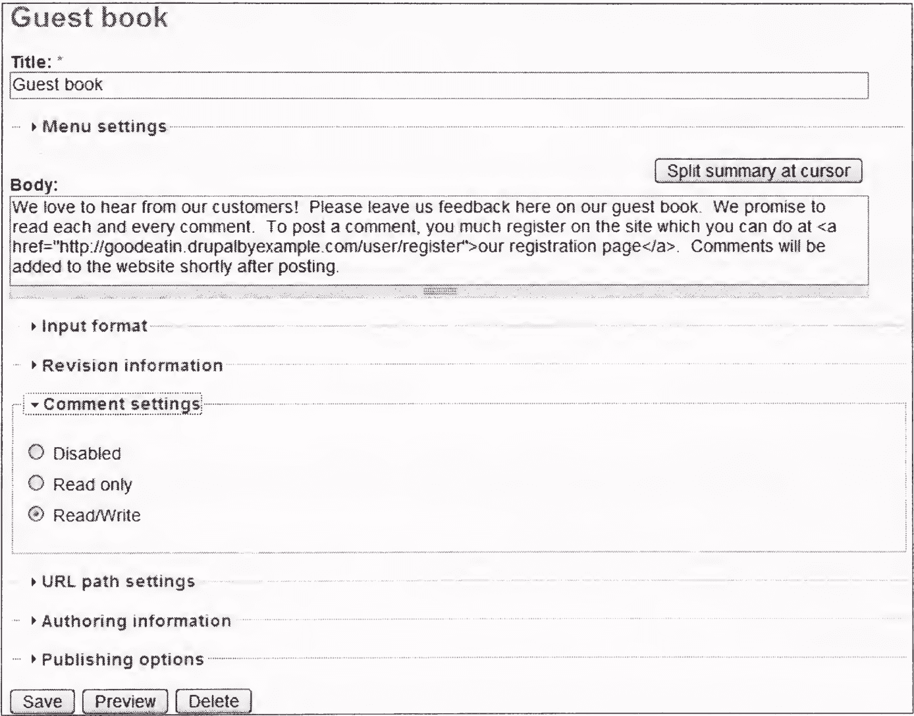

通过将评论设置设为读/写，用户将能够在网站上输入新评论。

如果您使用 CCK 创建自己的自定义内容类型，则有更多设置可供选择。我们在构建菜单项类型时讨论了其中许多选项。

## 添加新评论

Good Eatin' Goal：演示访客如何向留言簿添加评论。

需要附加模块：无。

## 基本步骤

当页面已创建并启用了评论时，您将在页面底部找到一个链接，访客可以点击该链接创建评论，如图所示：

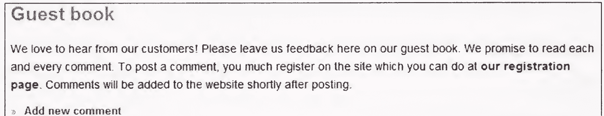

当用户点击“添加新评论”链接时，Drupal 会显示一个表单，允许用户输入评论的主题和文本。

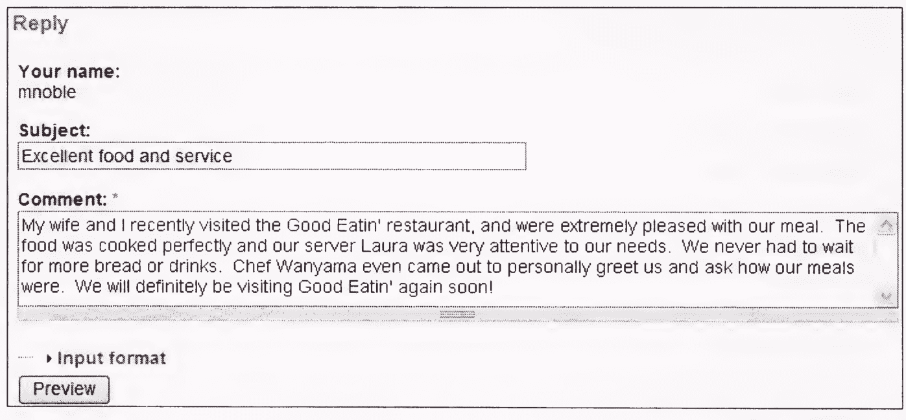

访客输入评论后，他或她可以点击预览来查看评论并进行想要的更改。否则，他或她只需点击保存按钮即可保存更改。

如果用户有权无需审批即可发布评论，则评论将自动发布。如果用户无权无需审批即可发布评论，则评论将被放入审核队列。

## 管理评论

*Good Eatin' Goal:* 演示如何管理评论、查看未发布的评论，并发布评论或将其删除。

*Additional modules needed:* 无。

### 基本步骤

- 1. 评论可以在 **Comment Manager** 中查看，可通过 **Administer** 菜单选择 **Content management** 然后选择 **Comments** 来访问。
- 2. Comment Manager 包含两个标签页——一个用于已发布评论，另一个用于未发布评论。未发布的评论显示在 **Approval queue** 中，如以下截图所示：

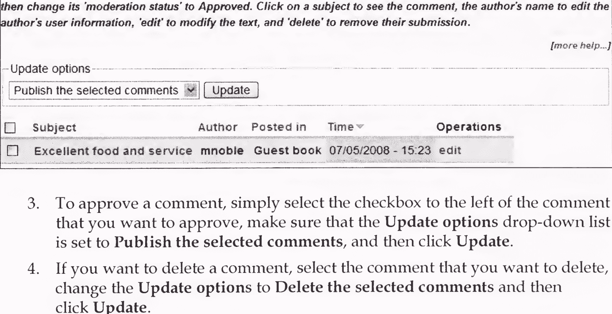

- 3. 要批准一条评论，只需选中要批准的评论左侧的复选框，确保 **Update options** 下拉列表设置为 **Publish the selected comments**，然后点击 **Update**。
- 4. 如果要删除一条评论，选中要删除的评论，将 **Update options** 改为 **Delete the selected comments**，然后点击 **Update**。

## 设置评论发布时发送邮件通知

Good Eatin' Goal: 当有新评论提交到网站时自动通知管理员。

Additional modules needed: Trigger (core)。

### 基本步骤

要为新评论创建自动通知，我们将遵循与添加新用户注册通知时使用的类似流程：

- 1. 首先，我们将构建一个处理给管理员发送邮件的动作。开始时，从 Administer 菜单中选择 Site configuration 然后选择 Actions。
- 2. 从 Advanced actions 下拉菜单中选择 Send e-mail... 并点击 Create 按钮。
- 3. 按如下方式填写操作：

### 配置高级操作

高级操作提供额外的配置选项，可在下方填写。建议更改 Description 字段，以便更好地识别正在进行的精确操作。此描述将在分配操作到系统事件时在 Trigger 等模块中显示，因此最好尽可能描述性强（例如，“Send e-mail to Moderation Team” 而不是简单的 “Send e-mail”）。

Description:
New Comment Email
此高级操作的唯一描述。此描述将显示在与操作集成的模块的界面中，例如 Trigger 模块。

Recipient:
admin@drupalbyexample.com
应发送消息到的电子邮件地址，或输入 %author 如果您希望向原始帖子的作者发送电子邮件。

Subject:
New Comment Added
消息的主题。

Message:
A new comment was added to the %site_name by %username. Check the moderation queue to approve or delete this comment.
应发送的消息。您可以包含以下变量：%site_name、%username、%node_url、%node_type、%title、%teaser、%body。并非所有变量在所有上下文中都可用。

- 4. 点击 **Save** 将新操作添加到您的站点。
- 5. 接下来，我们需要创建触发器来告诉 Drupal 何时发送我们的电子邮件。通过从 **Administer** 菜单中选择 **Site building** 然后选择 **Triggers** 来打开 Trigger Manager。
- 6. 进入 Trigger Manager 中的 comments 部分，然后将 **Trigger: After saving a new comment** 的值更改为 **New Comment Email**，并点击 **Assign** 按钮。Drupal 将在用户输入新评论时自动发送我们的新电子邮件。

## 为内容设置用户评分

Chef Wanyama 希望获得他所创建菜品的反馈，因为他想知道哪些菜品应保留在菜单上，哪些可以轮换。他希望允许访客在评分时添加有关菜品的更多信息，因此我们将在访客发表评论时启用评分。

由于我们只需要一个评分，因此我们将使用内容类型的 Fivestar 评分设置，而不是单独的 CCK 字段。

### 向节点添加 Fivestar 内容评分

此任务将解释如何实现用户评分。对于客户站点，这将演示如何允许用户对菜单项进行评分。

Good Eatin' Goal: 允许顾客对他们最喜欢的菜单项进行评分，以便 Chef Wanyama 了解其食物的反馈，保留受欢迎的餐点并移除不受欢迎的食物。

Additional modules needed: Fivestar (http://drupal.org/project/fivestar)。

### 基本步骤

- 1. 首先，通过打开 Content Type Manager 然后编辑 Content Type，选择您想要添加评分的内容类型。
- 2. 展开 Fivestar ratings 部分，如下所示：

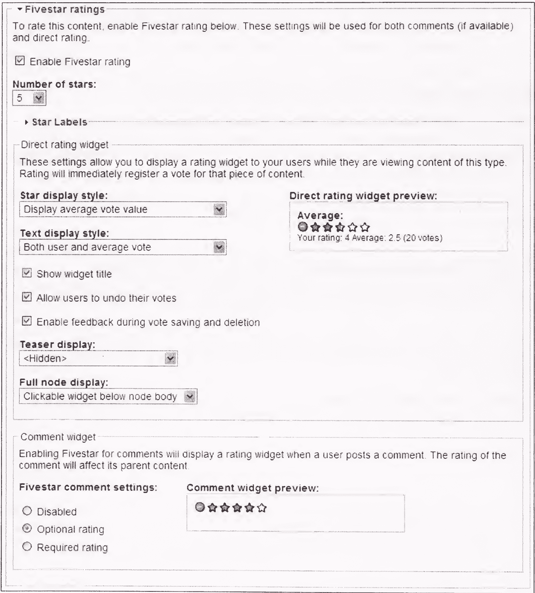

- 3. 对于 Chef Wanyama 的站点，我们已选择 **Enable Fivestar rating** 选项，并自定义了评分的显示。我们还启用了在用户对菜单项发表评论时进行 **ratings**。
- 4. 保存 **Content Type**，您的更改将自动应用。
- 5. 您需要对站点做的最后更改是允许用户在网站上对内容进行评分。这是通过修改用户的权限来完成的，选择 **User Management** 然后从 **Administer** 菜单中选择 **Permissions**。可用权限显示在以下截图中：

| fivestar module |  |  |  |
|---|---|---|---|
| rate content | ☐ | ☐ | ☐ |
| use PHP for fivestar target | ☐ | ☐ | ☐ |

我们可以为匿名用户和已认证用户同时打开评分内容，这将自动为所有用户启用，因为所有用户要么是匿名用户，要么是已认证用户。

## 按评分查看内容

*Good Eatin' Goal:* 允许 Chef Wanyama 和顾客查看最受欢迎的菜单项列表。

*Additional modules needed:* Fivestar (http://drupal.org/project/fivestar)、Views (http://drupal.org/project/views)。

### 基本步骤

要创建按评分排序的菜单项显示，我们需要创建另一个视图来保存此信息。我们将为 Chef Wanyama 包含完整显示，以及可包含在网站主页上的前五名，供访客使用。

- 1. 首先打开 **Views Manager** 并从 **Administer** 菜单中选择 **Site building** 然后选择 **Views**。
- 2. 通过在 **Views Manager** 中选择 **Add** 链接添加新视图。

## 与顾客和访客互动

3. 填写基本视图信息，如以下截图所示：

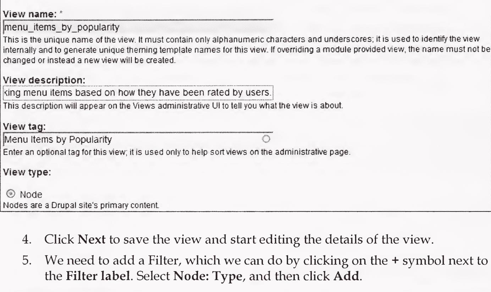

- 4. 点击 Next 保存视图并开始编辑视图的详细信息。
- 5. 我们需要添加一个 Filter，可以通过点击 **Filter** 标签旁边的 **+** 符号来完成。选择 **Node: Type**，然后点击 **Add**。

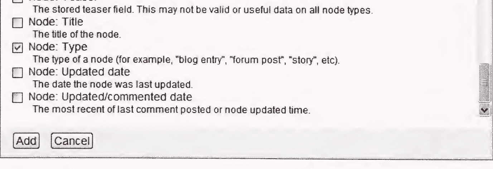

- 6. 将实际类型设置为 **Menu Item** 并点击 **Update**。

7. 通过点击 Relationships 标签旁边的 + 符号添加关系。我们希望关系为 Node: Voting results，如以下截图所示：

Defaults: Add relationships
Groups:
Node
Node: Individual votes
Votes cast by users on node content.
Node: Voting results
The aggregate results of votes cast on node content.

8. 添加关系后，您将被提示输入关系的更多详细信息。我们需要设置此关系，以便任何未被评分的菜单项都不符合条件。其他设置将控制值的返回方式，如下所示：

Defaults: Configure Relationship "Node: Voting results"
Label:
Voting results
此关系的标签，仅在管理上显示。
Require this relationship
如果需要，不包含此关系的项目将不会出现。
Data filters
对于每条内容，可能保存了许多投票数据。使用这些选项指定通过此关系可用的确切类型。警告！如果将这些过滤器留空，可能会导致每个内容在列表中显示多个副本。
Value type:
Points
Vote tag:
Default vote
Aggregation function:
Average
Update Cancel Remove

9. 接下来，通过点击 Fields 标签旁边的 + 符号向视图添加几个新字段。添加以下字段：

- Node: Title 标签为 Title 并链接到节点
- Voting API results: Function 标签为 Average Rating

- 10. 更改行样式选项的设置，并将“Node: Title”和“Voting API results: Function”设置为内联字段，如下所示：

Defaults: Row style options

Inline fields:
☑ Voting API results: Function
☑ Node: Title

Inline fields will be displayed next to each other rather than one after another.

Separator:

The separator may be placed between inline fields to keep them from squishing up next to each other. You can use HTML in this field.

Update Cancel

- 11. 通过点击“Sort criteria”标签旁边的 + 符号添加新的排序条件。
- 12. 新的排序条件应为“Voting API results: Function”。结果应按降序排序，如以下屏幕截图所示：

Defaults: Configure sort criterion "Voting API results: Function"

Relationship:
Voting results

Sort order:
○ Ascending
● Descending

Update Cancel Remove

- 13. 将样式修改为列表。此选项位于左侧屏幕的“Basic settings”部分。
- 14. 我们现在需要添加一个页面视图，以便 Chef Wanyama 可以查看投票结果。从视图类型的下拉列表中选择 Page，然后点击 Add display。
- 15. 将路径更改为 menu-by-rating，并将标题更改为 Menu Items by Rating。
- 16. 通过选择下拉值为 **Block** 并点击 **Add display** 按钮创建第二个显示。
- 17. 将块显示的标题更改为 **Most Popular**，将要显示的 **Items** 数量设置为 **5**，然后将 **Block Admin Settings** 设置为 **Popular menu items**。在更新标题时，请确保点击 **Override** 按钮而不是 **Update default display** 按钮，以避免更改页面的标题。
- 18. 保存视图和我们新的块，页面将可用。
- 19. 要将块添加到主页，请通过选择 **Site building** 然后从 Administer 菜单中选择 **Blocks** 打开 **Blocks Manager**。
- 20. 找到 **Popular menu items** 块并将区域更改为 **Right sidebar**。然后保存块。
- 21. 为确保块仅在主页和菜单页面（如果有）上显示，请点击 **configure** 选项，然后修改 **Page specific visibility settings**，如下图所示：

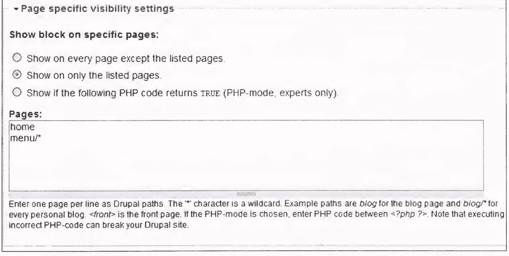

## Change the display of the ratings

Good Eatin' Goal: Customize the rating display to make the ratings more dramatic.

Additional modules needed: Fivestar (http://drupal.org/project/fivestar).

### Basic steps

The Fivestar module provides you with a wide assortment of images that can be used when displaying or selecting a rating. These are accessed by selecting Site Configuration and then Fivestar, from the Administer menu.

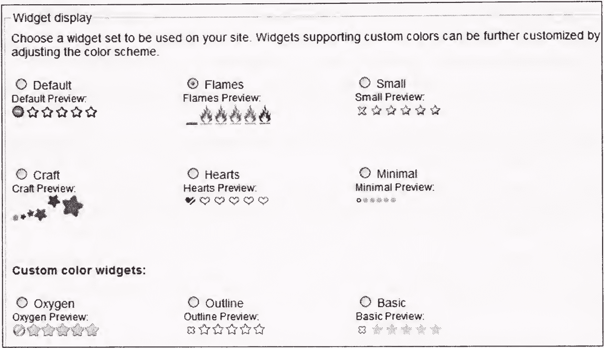

The top section contains a variety of different icons that are used for display. For our Good Eatin' site, we will use the Flames setting, because that works well with our restaurant theme.

If you select one of the widgets in the Custom color widgets section, you can customize the colors used in the display to suit the theme of your site, by using the options as shown in the following screenshot:

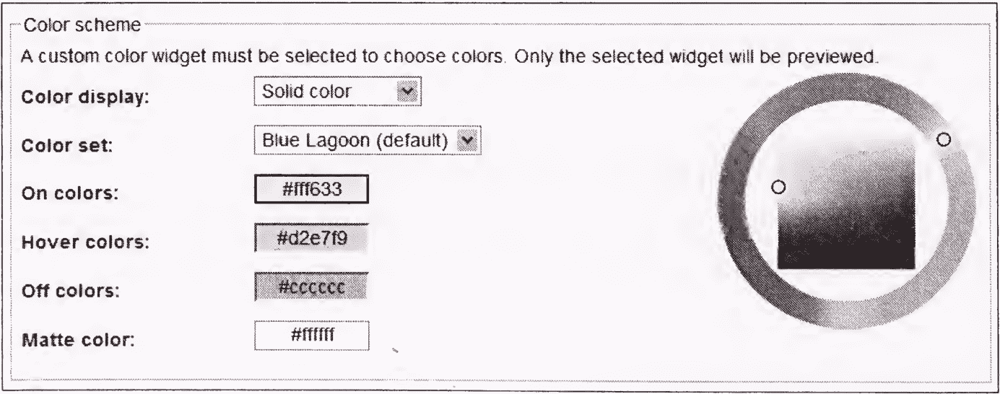

## Working with polls

Polls are a great way to quickly get information from your users. Visitors like to answer short polls, especially if the results are immediately available and the questions are interesting. In Drupal, polls can contain only a single question, along with a set of predefined responses that the user can choose from.

### Create a poll

Good Eatin' Goal: Create a poll to allow Chef Wanyama to get feedback from customers. The first poll will ask customers what their favorite meal is at Good Eatin'.

Additional modules needed: Poll (core).

### Basic steps

- 1. 我们开始构建投票的过程，首先确保 Poll 模块处于活动状态。Poll 模块是作为 Core Drupal 安装的一部分包含的。
- 2. 确认该模块可用后，从主导航菜单中选择 Create content 然后选择 Poll。Drupal 将打开一个新表单，您可以在其中输入有关投票的信息。

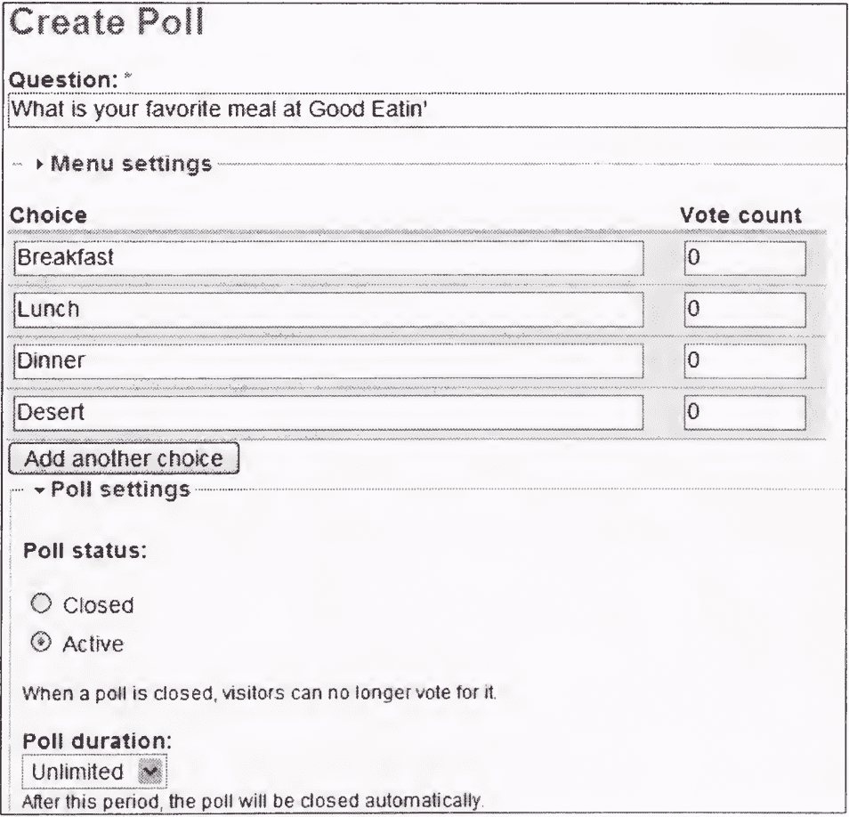

- 3. 默认情况下，您有指定两个选择的空间，但您可以通过点击 **Add another choice** 来包含额外的选择。对于我们的 Good Eatin' 网站，我们允许访客在 Breakfast、Lunch、Dinner 和 Dessert 之间进行选择。
- 4. **Poll status** 控制访客是否可以向系统中输入新的投票。如果您想手动管理投票的持续时间，您只需在投票结束时编辑投票并将 **Poll status** 设置为 Closed 即可关闭投票。
- 5. **Poll duration** 可用于在指定间隔后自动关闭投票。投票可以保持开放的时间从 1 天到 1 年不等。
- 6. 当您点击 **Save** 时，Drupal 将把投票添加到网站，并允许您对其进行投票，如以下屏幕截图所示：

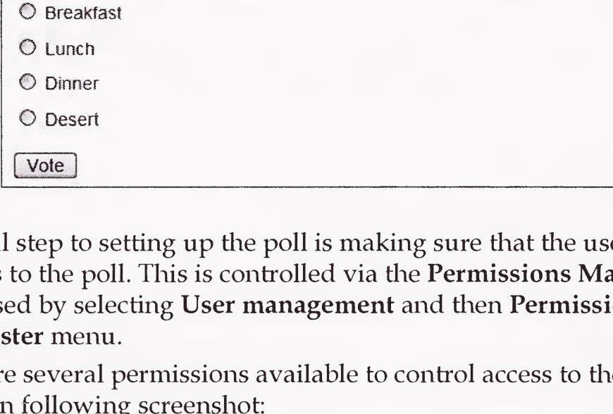

- 7. 设置投票的最后一步是确保用户可以提交投票答案。这是通过 **Permissions Manager** 控制的，可通过从 **Administer** 菜单中选择 **User management** 然后选择 **Permission** 来访问。
- 8. 有多个权限可用于控制对投票的访问，如以下屏幕截图所示：

| Permission | anonymous user | authenticated user | VIP user |
|---|---:|---:|---:|
| **poll module** |  |  |  |
| cancel own vote | ☑ | ☑ | ☑ |
| create poll content | ☐ | ☐ | ☐ |
| delete any poll content | ☐ | ☐ | ☐ |
| delete own poll content | ☐ | ☐ | ☐ |
| edit any poll content | ☐ | ☐ | ☐ |
| edit own poll content | ☐ | ☐ | ☐ |
| inspect all votes | ☐ | ☐ | ☐ |
| vote on polls | ☑ | ☑ | ☑ |

- 9. 我们唯一想要授予的权限是所有用户投票和取消投票的能力。选择这些选项，然后点击 Save permissions。

### Adding the poll to the home page

Good Eatin' Goal: Add our new poll to the home page on the right-hand side, so that customers will see the poll.

Additional modules needed: Poll (core).

### Basic steps

- 1. 我们可以通过创建块将投票添加到主页。我们通过从 Administer 菜单中选择 Site building 然后选择 Blocks 来实现此操作。
- 2. 最新的投票块已经设置好以满足我们的需求，因此我们将位置更改为 Right sidebar，如以下屏幕截图所示：

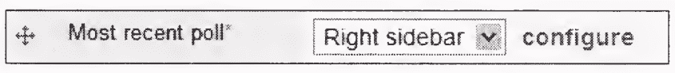

- 3. 我们现在可以通过点击 configure 链接来配置显示。我们将限制投票仅在主页上显示，如以下屏幕截图所示。因为我们为主页创建了一个别名，称为 home，我们只需输入 home。但是，如果您使用的是自动生成的首页，您需要输入 <front>。

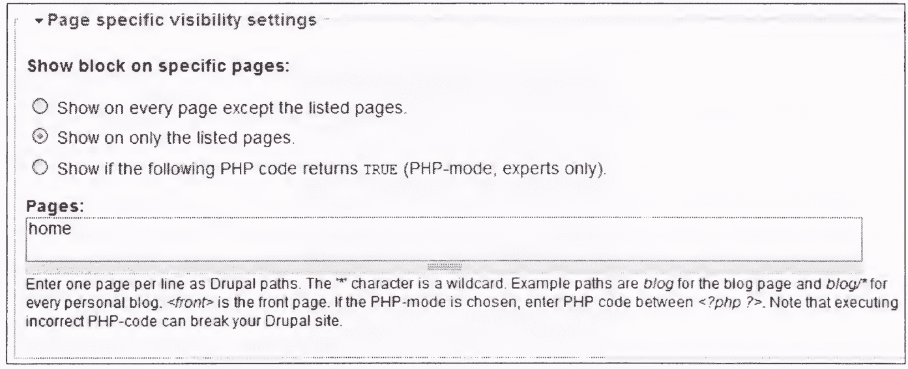

- 4. 主页上的块如下所示，在投票之前：

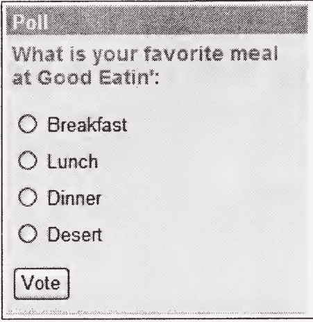

### Submitting a poll

*Good Eatin' Goal:* Demonstrate how a customer will submit his or her answers to our poll.

*Additional modules needed:* Poll (core).

### Basic steps

访客可以通过选择他们喜欢的选项然后点击 **Vote** 来轻松提交投票答案。

投票后，显示将更新以显示投票结果，如下所示：

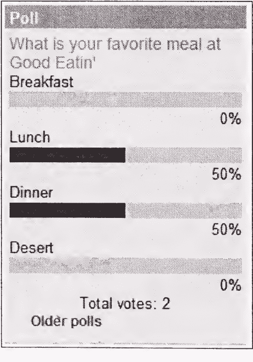

### Viewing poll results

Good Eatin' Goal: Demonstrate how Chef Wanyama can view the poll results, and show the results of the poll to customers who have already answered the poll.

Additional modules needed: Poll (core).

### Basic steps

具有 Inspect all votes 权限的用户可以查看针对投票投出的所有投票的列表。这是通过查看投票并点击 Votes 选项卡来列出所有投票，如以下屏幕截图所示：

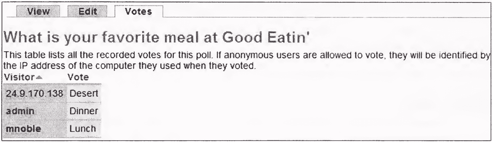

此视图对于确保所有投票都是合法的以及比较注册用户和匿名用户提交的投票非常有用。对于注册用户，将显示他们的用户名；对于未注册用户，将显示他们提交投票的机器的 IP 地址。

### Upgrading to Advanced Poll

Good Eatin' Goal: Explain some of the differences between Poll and Advanced Poll.

Additional modules needed: Advanced Poll (http://drupal.org/project/advpoll).

Advanced Poll 模块提供了核心 Poll 模块中不存在的多个附加功能，包括：除基本投票外另外三种投票系统、增强的投票管理、增强的时间管理、写入投票和改进的显示。

截至撰写本文时，Advanced poll 模块尚未移植到 Drupal 6。

## 添加用户调查

用户调查支持以更复杂的方式向访问者询问信息。调查可以同时提出多个问题，也可以要求给出比在有限的预定义选项中进行简单选择更复杂的答案。Wanyama 厨师将利用用户调查，更全面地了解顾客的用餐体验以及他们对餐厅未来的期待。

## 创建用户调查

*Good Eatin' 目标：* 向 Good Eatin' 网站添加一个调查，询问访问者对餐厅各个方面的意见，包括他们对哪些新菜品感兴趣、最喜欢的用餐时间、访问频率等具体信息。

*所需附加模块：* Webform 模块（http://drupal.org/project/webform）。

### 基本步骤

- 1. 在站点中安装 Webform 模块，并通过模块管理器激活它。
- 2. 有多个设置用于控制 Webform 模块的基本方面。可通过点击**站点配置**，然后点击**Webform**来访问这些设置。对于 Good Eatin' 站点，所有默认值都可以接受。
- 3. 要构建新的 Webform，请从**主**菜单中选择**创建内容**，然后选择**Webform**。Drupal 将显示一个表单，允许你构建调查。
- 4. 表单的第一部分允许你输入标题、描述以及用户完成调查后显示的信息。我们将按照以下截图所示填写此表单：

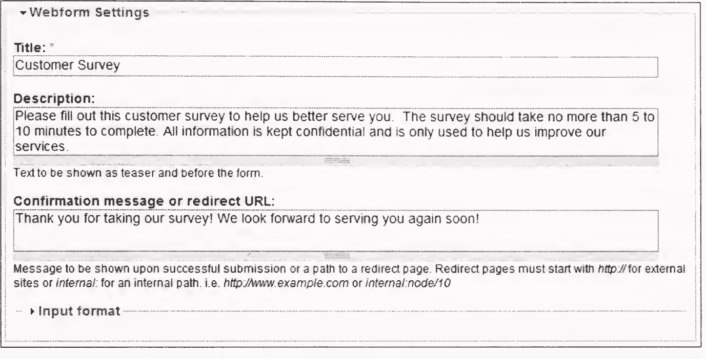

- 5. 表单的下一部分控制哪些用户能够提交表单。默认允许任何人填写调查，这符合我们的需求。
- 6. 下一部分允许你控制是否将调查结果通过邮件发送给用户，以及如果发送，应发送给谁。我们不会自动通过电子邮件发送调查结果，因此此部分可以保持默认。
- 7. 我们还将禁用评论，并设置调查的 URL 路径。
- 8. 最后，我们将为此表单添加一个菜单项，称为**客户调查**，它将出现在我们的主菜单中，使用以下截图所示的设置：

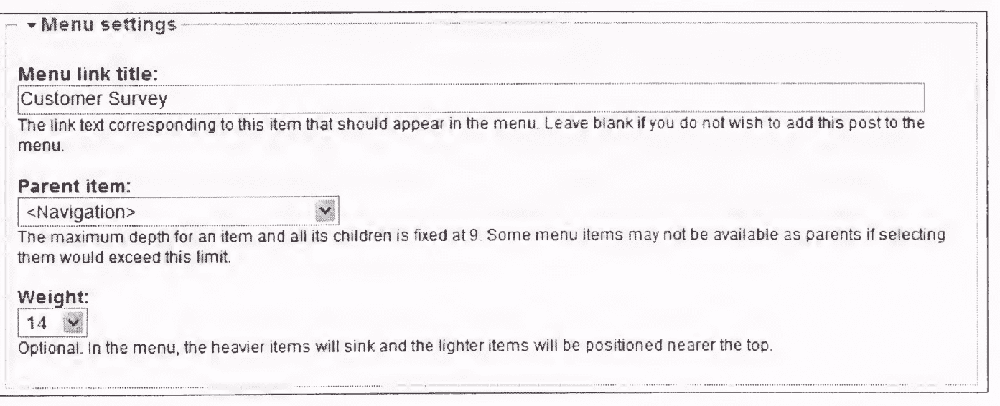

- 9. 通过单击“保存”按钮保存表单。

10. 然后，Drupal 将显示一个表单，允许我们向调查添加新问题，如下面的截图所示：

# 客户调查

此页面显示当前为此 Webform 节点配置的所有组件。你可以向表单添加任意数量的组件，甚至可以是同一类型的多个组件。要添加新组件，请填写名称，并从表格底部的字段中选择类型。提交表单以创建新组件或更新任何更改的表单值。

单击任何现有组件的名称即可编辑其设置。

- - 新的 Webform“客户调查”已创建。请使用下面的表单向你的 Webform 添加新字段。
- - 此 Webform 当前未发布。完成对 Webform 的更改后，请使用下面的“发布”按钮。

| 名称 | 类型 | 值 | 必填 | 电子邮件 | 操作 |
|---|---|---|---|---|---|
|  | 没有组件，请在下方添加一个组件。 |  |  |  | |
| 新组件名称 | textfield |  | ☐ | ☑ | 添加 |
| 提交 | 发布 |  |  |  | |

11. 要添加新问题，请在“名称”字段中输入问题，并从“类型”下拉列表中选择答案类型。

| 名称 | 类型 | 值 | 必填 | 电子邮件 | 操作 |
|---|---|---|---|---|---|
|  | 没有组件，请在下方添加一个组件。 |  |  |  | |
| 您用餐的时段 | select |  | ☐ | ☐ | 添加 |

对于调查，大多数问题将是 textfield（用于开放式回答）或 select（用于是/否或多项选择问题）。对信息满意后，单击“添加”按钮。

12. 现在，你可以自定义问题的可用答案，并选择与问题显示相关的各种其他选项。我们将输入可用答案：早餐、午餐和晚餐，并允许多选。完成选项修改后，单击“提交”按钮添加问题。

13. 其他问题可以类似方式输入。完成所有问题输入后，单击“发布”按钮将调查发布到站点。

## 使用验证码保护调查

Good Eatin' 目标：为调查添加验证码，以帮助防止自动提交调查，防止垃圾信息。

所需附加模块：Webform 模块（http://drupal.org/project/webform），Captcha 模块（http://drupal.org/project/captcha）。

### 基本步骤

- 1. 首先，通过模块管理器安装并激活 Captcha 模块。
- 2. 然后，我们需要修改 Captcha 模块的设置。可通过从“管理”菜单中选择“用户管理”，然后选择“CAPTCHA”来访问这些设置。
- 3. 我们需要启用的关键设置是“向表单添加 CAPTCHA 管理链接”选项，如下面的截图所示：

☑ 向表单添加 CAPTCHA 管理链接
此选项非常有助于在表单上启用/禁用验证挑战。启用后，具有“管理 CAPTCHA 设置”权限的用户将在所有表单上看到 CAPTCHA 管理链接（管理页面除外，这些页面首先就不应让不受信任的用户访问）。这些链接可以启用所需类型的验证挑战，或将其禁用。

这样，我们就可以将验证码添加到调查中。

4. 你还可以为多个预定义表单配置验证码，指定用户提交每个表单时是否必须回答验证码，指定是否记录不正确的答案，以及每种验证码类型的各个选项。

5. 你可以通过单击“示例”链接查看每种类型验证码的示例。下面截图中显示了几个示例：

# CAPTCHA

此页面概述所有可用的验证挑战类型，并根据其当前设置生成。

模块“captcha”提供的挑战“数学”

数学问题：*
11 + 0 = 
解决这个简单的数学问题并输入结果。例如，对于 1+3，输入 4。

此挑战的另外 10 个示例。

模块“image_captcha”提供的挑战“图像”

图片中的代码是什么？：*
从图片中复制字符（注意大小写）。

此挑战的另外 10 个示例。

模块“text_captcha”提供的挑战“文本”

短语“hutobi nohe ayawe iyiloki duki”中的第五个单词是什么？：*

此挑战的另外 10 个示例。

6. 现在，验证码已配置完毕，你可以编辑或直接查看“客户调查”。在页面中，你会找到一个名为 CAPTCHA 的新分区，可以展开它。

CAPTCHA
在此处为不受信任的用户放置验证码。

用户输入所有回答后，如果不是注册用户，则需要回答验证码问题。

您一周中的哪几天来 Good Eatin' 用餐？：
☐ 星期一
☐ 星期二
☐ 星期三
☑ 星期四
☐ 星期五
☑ 星期六
☐ 星期日

您最喜欢的菜品是什么：
鳄鱼尾

您希望我们添加什么菜品到菜单中？：
含鸵鸟肉的菜品

CAPTCHA
此问题用于测试您是否为人类访问者，并防止自动垃圾提交。

数学问题：*
13 + 1 = 14
解决这个简单的数学问题并输入结果。例如，对于 1+3，输入 4。

提交

然后，用户单击“提交”将回答发送到站点。

如果有任何必填信息缺失，或验证码输入错误，用户将被要求更正这些信息，然后可以再次尝试提交回答。

信息成功提交后，用户将进入完成页面，该页面是在你创建调查时设置的。

## 查看调查结果

Good Eatin' 目标：演示 Wanyama 厨师如何查看调查结果。

所需附加模块：Webform 模块（http://drupal.org/project/webform）。

Webform 模块提供了多种查看调查提交结果的方式。这些方式都可以通过打开调查，然后点击“结果”链接来访问。

# 表格视图

表格视图以单一且易于阅读的格式显示调查的所有结果，如下图所示：

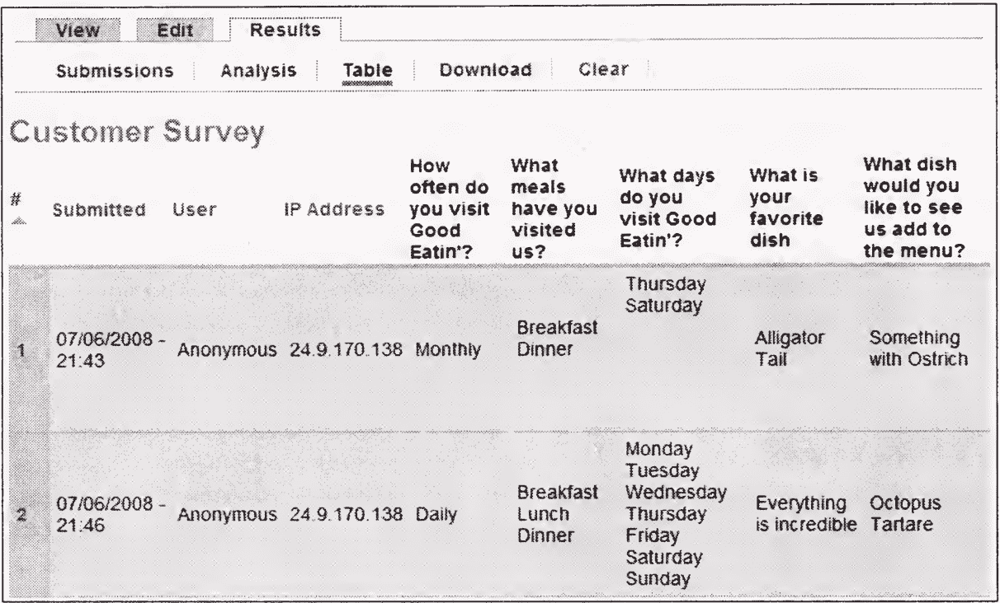

# 下载视图

下载视图允许您将所有调查回复下载到一个逗号分隔的文件中，该文件随后可在 Microsoft Excel 等程序中打开，以便进一步分析。

# 清除

点击“清除”链接将删除网站上的所有调查回复。如果您正在测试调查并希望重新开始，或者您希望在每个月初重新开始调查，此功能会很有用。

# 总结

在本章中，我们探讨了向网站访客征集反馈的各种方法，包括评论、评分、投票和调查。使用这些技术将帮助您改进提供给客户的产品和服务。

在下一章中，我们将创建一个公司博客，让 Wanyama 主厨能够向感兴趣的读者宣传他的餐厅。我们还将从其他网站向 Good Eatin' 站点加载信息流，以利用其他来源的内容。
