# 5

# 创建公司博客

博客是一系列通常较短的帖子，按倒序时间顺序显示。博客通常允许用户对每条帖子进行评论。通过定期更新的博客，您可以确保您的网站始终拥有新鲜内容，从而保证访客和搜索引擎持续回访。

在本章中，我们将创建一个博客，Wanyama 主厨可以在其中讨论 Good Eatin' 餐厅、烹饪、餐饮业务等内容。他计划利用博客使网站更具互动性，并吸引搜索引擎流量。

每位员工也将有机会拥有自己的博客，如果他们愿意，可以创建博客条目。员工博客将受到监控，帖子在面向公众发布之前将先进入审批队列。

最后，我们将演示用户如何通过 RSS 信息流查看博客，以及如何将相关博客帖子添加到他们自己的博客中。

## 创建博客

在本节中，我们将讨论如何设置博客模块，以便用户可以创建博客。我们将演示 Wanyama 主厨如何创建博客帖子，并探讨如何审核博客以及使用替代编辑器来构建博客。

## 设置博客系统

Good Eatin' 目标：设置博客系统，以便 Wanyama 主厨可以开始发布博客。

所需附加模块：博客（核心）。

### 基本步骤

- 1. 在**模块管理器**中激活博客模块。
- 2. Drupal 将允许任何拥有 `create blog entries` 权限的用户创建博客。为了更容易控制谁能创建博客，我们将创建一个名为“博客作者”的新角色。要创建新角色，请点击**用户管理**，然后点击**角色**。
- 3. 输入 **blogger** 作为角色名称，然后点击**添加角色**，如下所示：
- 4. 创建角色后，点击**编辑权限**链接，以便我们定义该角色可以执行的操作。我们将选择以下设置，如下所示：

| 名称 | 操作 |
|---|---|
| 匿名用户 | 锁定 编辑权限 |
| 认证用户 | 锁定 编辑权限 |
| VIP 用户 | 编辑角色 编辑权限 |
| blogger | 添加角色 |

| 权限 | blogger |
|---|---|
| 博客模块 | |
| create blog entries | ☑ |
| delete any blog entry | ☐ |
| delete own blog entries | ☑ |
| edit any blog entry | ☐ |
| edit own blog entries | ☑ |

这些设置将允许用户维护自己的博客，但不能修改他人的博客。

## 添加新的博客帖子

Good Eatin' 目标：演示 Wanyama 主厨如何在他的博客中添加新帖子。

所需附加模块：博客（核心）。

### 基本步骤

创建博客帖子类似于构建内容页面。

- 1. 我们将首先点击**创建内容**链接，然后点击主导航菜单中的**博客条目**链接。
- 2. Drupal 将显示一个表单，您可以输入帖子的正文以及帖子的标题，如下面的截图所示：
- 3. 当您对帖子文本满意后，只需点击**保存**，您的新帖子将被保存。
- 4. 如果您不希望访客对特定帖子发表评论，可以展开表单的**评论设置**部分并选择**已禁用**选项来禁用评论。
- 5. 保存帖子后，最终的博客条目将如下所示：

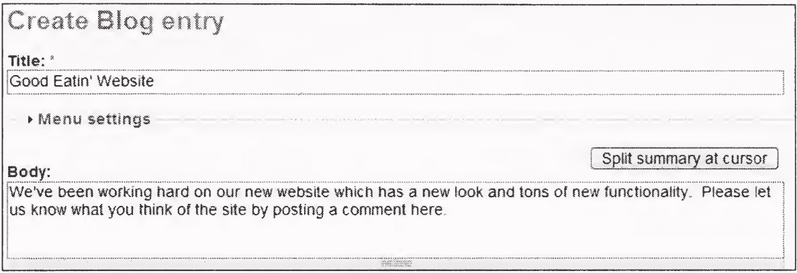

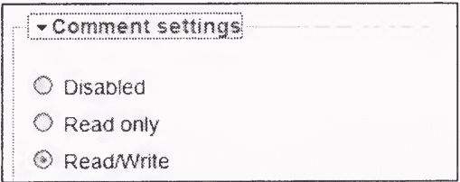

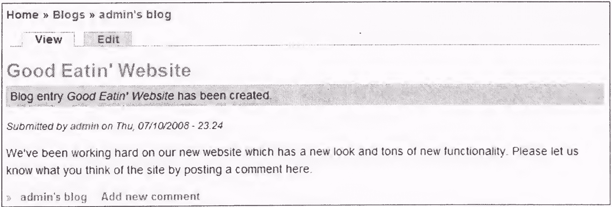

3. 接下来，点击**编辑权限**链接来为我们的审核员角色设置权限。发布博客帖子所需的唯一权限是 `administer nodes`，如下面的截图所示：

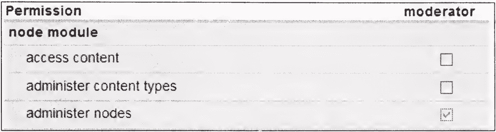

4. `administer nodes` 权限还将允许分配到此角色的用户创建、编辑或删除内容，因此您需要确保谨慎分配此权限。选择所需权限后，点击**保存权限**按钮。

## 为博客帖子设置审核

如果您允许许多用户发布博客条目，则在审核博客帖子时，确保所有帖子符合您设定的标准可能会很有用。为此，我们将使用 Drupal 的发布功能。

- 1. 我们将首先通过从**管理**菜单中选择**内容管理**，然后选择**内容类型**来编辑博客内容类型。
- 2. 然后，选择**博客条目**内容类型。
- 3. 展开**工作流设置**部分，并取消选中**已发布**复选框，如下面的截图所示：
- 4. 点击**保存内容类型**按钮以更新博客条目类型。

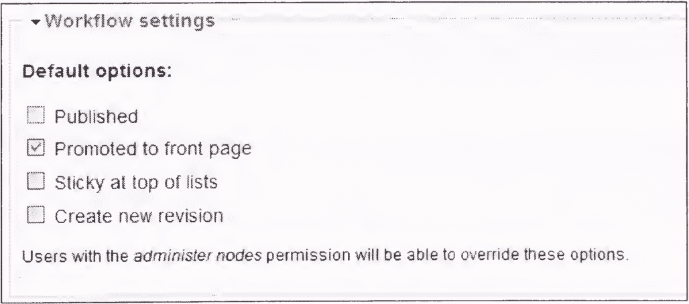

- 5. 关闭此设置后，所有帖子都将需要手动批准。您可以在**内容管理器**中查看所有需要批准的帖子，该管理器可通过从**管理**菜单中选择**内容管理**，然后选择**内容**来访问。
- 6. 要仅查看需要审核的帖子，请将**状态**字段更改为**未发布**，然后点击**筛选**按钮。

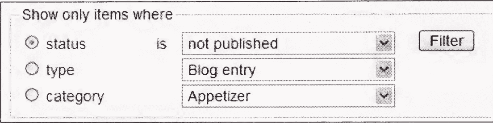

- 7. Drupal 现在将仅显示那些应被审核的项目，如下面的截图所示：

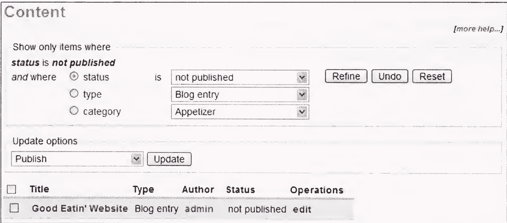

- 8. 要批准帖子，您可以选中其**标题**旁边的复选框，将**更新选项**设置为**发布**，然后点击**更新**。或者，您可以编辑帖子并在帖子的**工作流**设置中选中**已发布**复选框。

## 基于关键词自动审核内容

Good Eatin' 目标：根据帖子中输入的内容，添加帖子的自动审核功能。

所需附加模块：操作（核心）、触发器（核心）。

### 基本步骤

强制所有帖子进入审核的一种替代方案是允许帖子自动发布，但如果特定帖子不符合您的指南，则强制对其进行审核。这可以帮助您减少审核时间，并允许大多数帖子在撰写后立即可用。

- 1. 我们将首先创建一个新操作，用于取消发布帖子。从**管理**菜单中选择**站点配置**，然后选择**操作**，以打开操作管理器。
- 2. 选择一个新的操作**取消发布包含关键词的帖子**，然后点击**创建**。

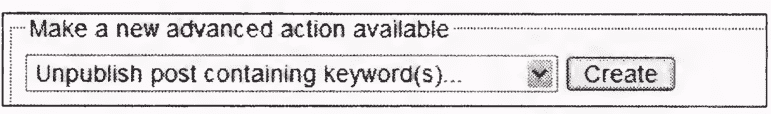

Drupal 现在将显示一个表单，您可以在其中输入帖子应包含的关键词（如果要将其保留以进行审核）。请输入以逗号分隔的词语。如果要用作筛选条件的术语包含逗号，则必须将整个术语括在引号中。

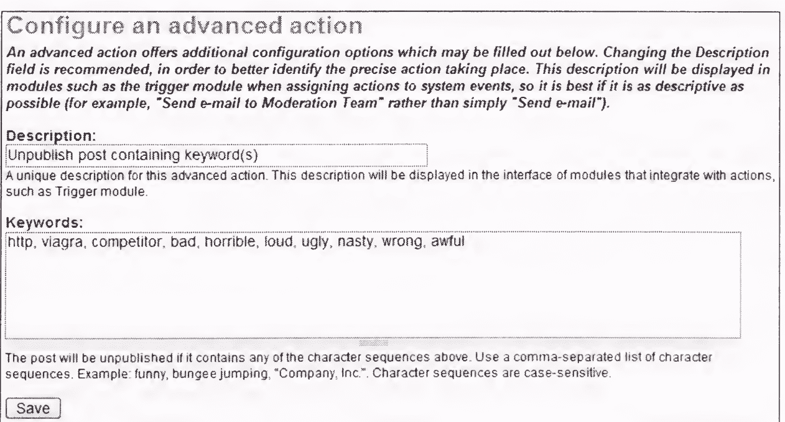


对于可公开访问的博客，您需要输入垃圾邮件中常用的术语，如 http、viagra 等。对于公司内部博客，您可能需要根据竞争对手名称或可能表示贬损性帖子的术语来进行审核。当您对术语列表感到满意后，点击**保存**。

- 3. 现在，我们需要在创建新博客文章时触发新操作。从“管理”菜单中选择**站点构建**，然后选择**触发器**。
- 
- 4. 为确保新帖子和编辑过的帖子都是干净的，我们将设置触发器，以便当用户保存新帖子或更新现有帖子时，执行我们新建的“取消发布包含关键字的内容”操作。

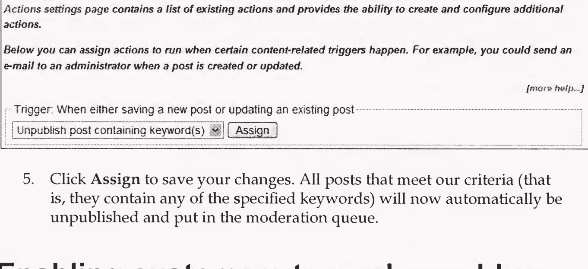

- 5. 点击**分配**以保存您的更改。所有符合我们条件（即包含任何指定关键字）的帖子将自动取消发布并放入审核队列。

## 让客户能够阅读您的博客

为了充分利用我们的博客，我们需要确保客户能够轻松找到并阅读它们。

在本节中，我们将探讨向客户展示博客的各种方式。

## 显示可用博客列表

*美食佳肴目标：* 修改网站以显示可用博客列表，以便访问者快速找到他们最喜欢的博客。

*所需附加模块：* 博客（核心）。

既然我们可以创建新的博客文章，就需要让访问者知道这些文章。我们将添加一个链接到博客的菜单，以及一个显示博客中最新帖子的区块。

## 创建博客菜单

- 1. 要启用博客的菜单链接，请从“管理”菜单中依次选择“站点构建”、“菜单”，最后选择“导航”，打开菜单管理器。
- 2. 在菜单项列表底部，您将找到“博客”菜单项，如下所示：
- 3. 要激活“博客”菜单，只需选中“已启用”复选框，然后点击屏幕底部的“保存配置”按钮。新的“博客”项将显示在“导航”菜单中。如果您想更改菜单项的名称，可以点击“操作”列中的“编辑”链接。
- 4. 当用户点击“博客”链接时，他们将被带到一个包含所有博客最新帖子的页面，如下面的截图所示：

| 菜单项 | 已启用 | 展开 | 操作 |
|---|---|---|---|
| 博客（已禁用） | ☐ | ☐ | 编辑 |
| 我的博客 | ☑ | ☐ | 编辑 |

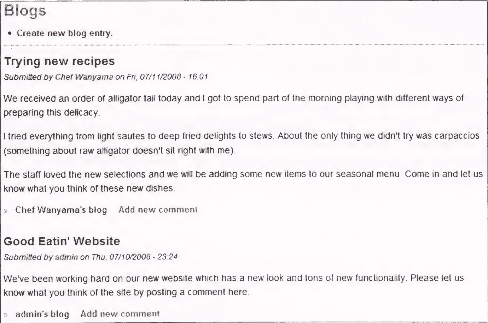

## 创建公司博客

在此页面上，用户可以阅读最近的帖子、创建新的博客条目（如果他们有权发布）、评论帖子，或者通过点击用户博客的链接查看该用户发布的所有帖子。

## 创建博客区块

- 1. 通过从“管理”菜单中选择**站点构建**，然后选择**区块**，打开**区块管理器**，即可启用博客区块。
- 2. **最近博客帖子**区块将位于**已禁用**部分。将**区域**更改为**左侧边栏**，然后点击**保存区块**。
- 3. 保存区块后，**最近博客帖子**区块将显示在屏幕最左侧。它看起来类似于这样：

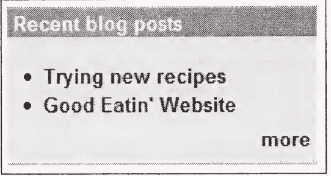

## 为新闻阅读器创建RSS源

*美食佳肴目标：* 使用RSS源发布博客，以便客户可以在他们喜欢的新闻阅读器中关注博客。

*所需附加模块：* 博客（核心）。

每个博客都会自动为其创建RSS源。RSS代表真正简单的聚合，是一种允许读者通过新闻阅读器自动从一个或多个站点检索帖子的技术。新闻阅读器按指定的时间间隔检查新内容，然后自动下载可用的新帖子。这是用户定期获取公司更新的绝佳方式。

要将您网站的RSS源添加到他们的新闻阅读器中，用户需点击RSS链接图标，该图标出现在所有博客的底部，看起来像这样：

实际订阅过程会因网站访问者使用的Web浏览器而有所不同。在Firefox中，过程如下（其他浏览器也使用类似过程）：

点击订阅图标后，系统将询问用户想使用哪个程序来关注该源，如下面的截图所示。

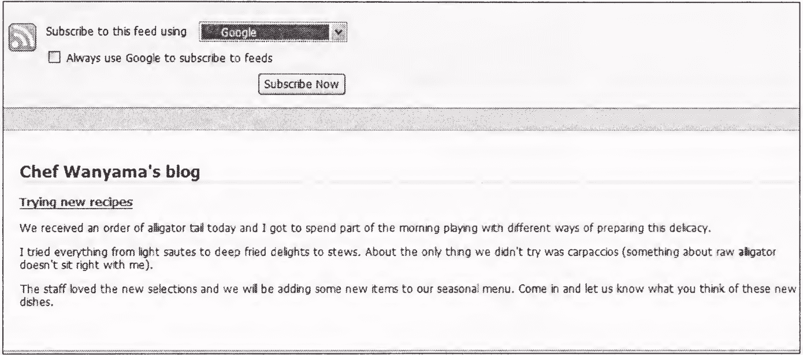

用户可以从几种常见的新闻阅读器中选择，也可以选择他们喜欢的应用程序。要完成订阅，他们只需点击“立即订阅”按钮。

## 添加订阅按钮

*美食佳肴目标：* 通过提供订阅按钮，使用户能够轻松地将新闻源添加到他们喜爱的阅读器中。

*所需附加模块：* FeedButtons（http://drupal.org/project/feedbuttons）。

## 基本步骤

通过添加一组按钮，您可以让访问者更轻松、更明显地订阅您的博客，这些按钮会自动将您的博客添加到他们的新闻阅读器中。

- 1. 首先在您的网站上安装并激活FeedButtons模块。
- 2. 通过从**管理**菜单中选择**站点配置**，然后选择**Feed Buttons**设置，即可访问FeedButtons模块的设置。

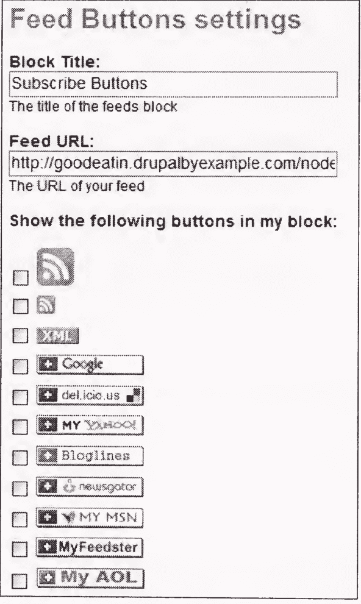

上面显示的按钮只是您可以添加的按钮中的一小部分示例。

- 3. 选择您希望访问者能够使用的按钮，然后点击**保存配置**。
- 4. 现在我们需要激活该区块。从**管理**菜单中选择**站点构建**，然后选择**区块**，打开区块管理器。将**订阅按钮**区块的位置更改为**右侧边栏**，然后点击**保存区块**按钮。

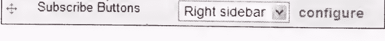

5. 由于订阅按钮有些分散注意力，并且博客不是“美食佳肴”网站的主要功能，我们将限制此区块仅在博客页面上显示。为此，点击该区块的“配置”链接，然后按如下方式设置可见性设置。

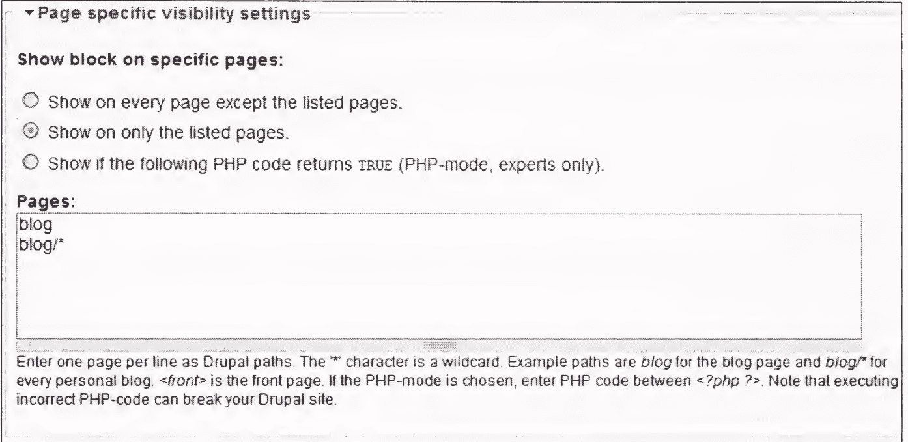

## 包含来自其他博客的信息

在本节中，我们将把其他网站上与客户相关的博客内容添加到我们的网站。这有助于客户将您视为您所在领域的权威，并使网站对他们更有用。

## 允许您的网站阅读内容

*美食佳肴目标：* 设置聚合器模块以收集其他博客的帖子，并将其显示在“美食佳肴”网站上。

*所需附加模块：* 聚合器（核心）。

## 基本步骤

- 1. 在模块管理器中激活聚合器模块。
- 2. 现在可以通过从“管理”菜单中点击“内容管理”，然后点击“Feed聚合器”来访问Feed聚合器。

## 创建公司博客

- 3. Feed聚合器有几个可用设置；这些设置可以通过点击**设置**选项卡找到。这些设置如下所示：

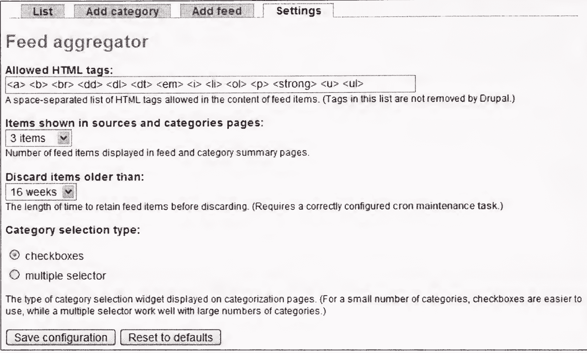

对于“美食佳肴”网站，默认值都是可以接受的。

- 4. 如果您计划从不同来源导入许多源，最好对它们进行分类，以便访问者轻松找到他们想要的信息。“美食佳肴”网站将有两个类别：食谱和餐厅经营。

- 5. 要添加新类别，请点击**添加类别**选项卡。Drupal将显示一个表单，允许您为类别输入**标题**和**描述**，如下面的截图所示：

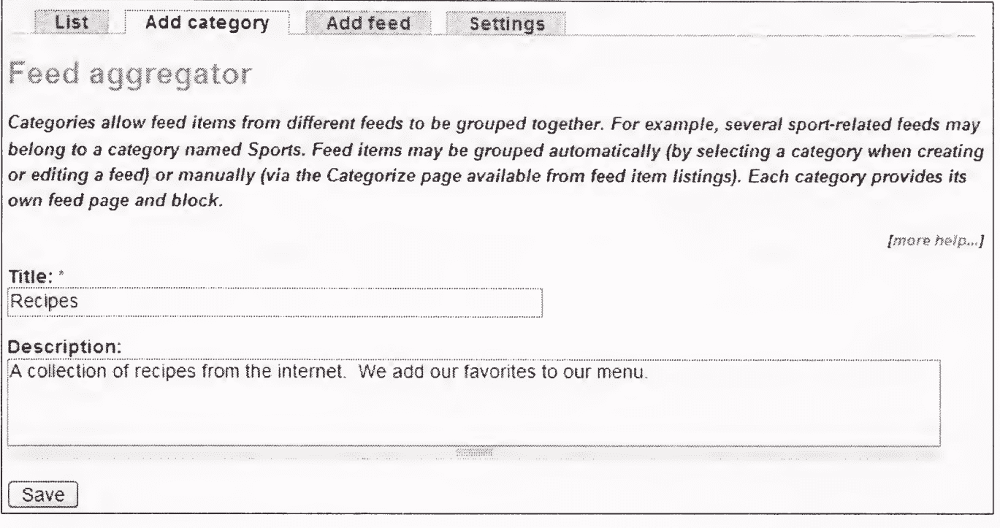

- 6. 创建类别后，您可以通过点击**列表**选项卡来编辑它们。

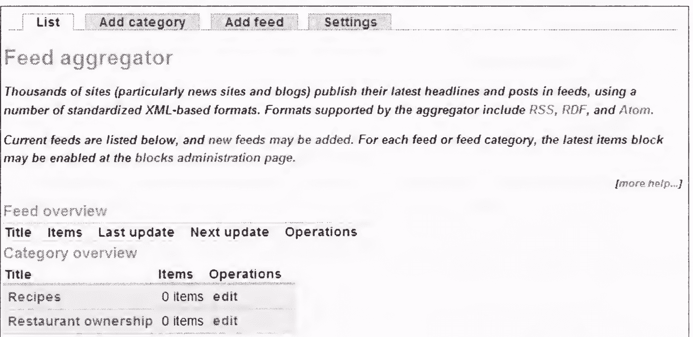

| 标题 | 项目 | 最后更新 | 下次更新 | 操作 |
|---|---|---|---|---|
| 类别概览 |  |  |  |  |

| 标题 | 项目 | 操作 |
|---|---:|---|
| 食谱 | 0 个项目 | 编辑 |
| 餐厅经营 | 0 个项目 | 编辑 |


7. 要向Feed聚合器添加新feed，请单击“添加feed”选项卡。Drupal会显示一个表单，你可以在其中输入feed的URL以及feed的附加信息，如下所示：

## Feed聚合器

以RSS、RDF或Atom格式添加feed。一个feed只能有一个条目。

标题：*
AllRecipes.com Main Dishes
feed的名称（或提供feed的网站名称）。

URL：*
http://rss.allrecipes.com/daily.aspx?hubID=80
feed的完整URL。

更新间隔：
6小时
feed更新之间的时间长度。（需要正确配置cron维护任务。）

新闻条目分类：
☑ Recipes
☐ Restaurant ownership
新的feed条目会自动归入选中的分类。

保存

为了减少接收feed的网站流量，你应该尝试将“更新间隔”设置与该网站的更新频率保持一致。例如，如果网站声明feed每天或每周只更新一次，那么没有理由每15分钟轮询一次。

8. 对选择满意后，单击“保存”按钮。

9. 创建feed后，它会显示在“列表”页面上，如下面的截图所示：

| 标题 | 条目 | 上次更新 | 下次更新 | 操作 |
|---|---|---|---|---|
| AllRecipes.com Main Dishes | 0个条目 | 从未 | 从未 | 编辑 移除条目 更新条目 |

10. 如你所见，这个feed没有可用条目，且从未更新过。要手动更新feed，请单击“更新条目”链接。

## 查看feed

Good Eatin'目标：演示feed将如何在Good Eatin'网站上显示。

其他所需模块：无。

### 基本步骤

1. 为了让feed对用户可见，你必须更新用户角色权限。在“管理”菜单中选择“用户管理”，然后选择“权限”。为你希望看到feed的每个用户角色选中“访问新闻feed”复选框，如下面的截图所示：
2. 如果用户有权限查看新闻feed，他们将在导航菜单中看到“Feed聚合器”菜单项。如果需要，你可以在菜单项中修改或禁用此菜单项。
3. 当用户单击“Feed聚合器”链接时，会显示当前帖子的列表，如下面的截图所示：

| 权限 | 匿名用户 | 认证用户 | 博客作者 | VIP用户 |
|---|---|---|---|---|
| 聚合器模块 |  |  |  |  |
| 访问新闻feed | ☑ | ☑ | ☐ | ☐ |
| 管理新闻feed | ☐ | ☐ | ☐ | ☐ |

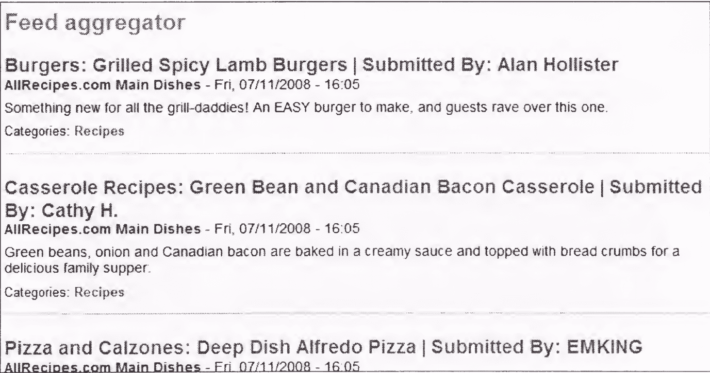

4. 访问者还可以按分类或来源显示新闻条目。分类视图如下面的截图所示：

### 分类

### 食谱

- 主菜鱼类和贝类：意大利面包屑鳕鱼 | 提交者：Verona 7小时51分钟前，AllRecipes.com Main Dishes
- 酿辣椒：快速简易酿辣椒 | 提交者：Jen 7小时51分钟前，AllRecipes.com Main Dishes
- 油炸：燕麦脆皮鱼 | 提交者：Pierre 7小时51分钟前，AllRecipes.com Main Dishes

更多

来源视图如下：

### 来源

### AllRecipes.com Main Dishes

- 主菜鱼类和贝类：意大利面包屑鳕鱼 | 提交者：Verona 7小时53分钟前
- 酿辣椒：快速简易酿辣椒 | 提交者：Jen 7小时53分钟前
- 油炸：燕麦脆皮鱼 | 提交者：Pierre 7小时53分钟前

更多

5. 我们还可以通过块管理器为feed添加一个块。除了特定feed的类别外，每个新闻feed分类都有一个块。你可以通过更改位置然后保存块，将这些块添加到站点的任何部分。

| | Feed块 | 位置 | 操作 |
|---|---|---|---|
| | AllRecipes.com Main Dishes feed最新条目 | <none> | 配置 |
| | 食谱分类最新条目 | <none> | 配置 |
| | 餐厅所有权分类最新条目 | <none> | 配置 |

## 使用cron作业自动更新feed

Good Eatin'目标：设置一个cron作业，定期自动读取新闻feed并更新Good Eatin'站点。

其他所需模块：无。

### 基本步骤

我们可以通过单击Feed聚合器管理器中的“更新条目”链接手动更新每个feed。然而，如果每天或更频繁地对每个feed执行此操作，可能会耗时且容易出错。Drupal允许你通过cron作业自动执行更新feed的过程。

cron作业是一种按特定时间间隔运行的自动化任务。通过访问http://yoursite.com/cron.php来激活cron作业。每次启动cron作业时，每个已激活的模块都可以运行任务。即使你不使用聚合器，也应该设置cron，因为Drupal使用cron作业执行维护任务，许多其他模块也使用cron执行维护。

设置cron作业的方法取决于你使用的操作系统。如果你的web服务器上运行着控制面板（如cPanel或Plesk），你可能可以在控制面板内配置cron作业。在所有情况下，你都需要指示操作系统按特定时间间隔自动加载你网站上的http://yoursite.com/cron.php页面。

### 在Unix或Linux中设置cron作业

要在Unix或Linux中使用cron作业，你需要安装lynx或wget，并且运行cron作业的用户必须可以使用它们。

1. 使用SSH或其他合适的工具登录服务器。
2. 在命令行中，输入 `crontab -e` 编辑你的crontab文件。
3. 使用以下格式在文件中添加新行。
   mm hh dd MM ww command
   其中：
   mm：命令应运行的分钟（0-59）
   hh：命令应运行的小时（0-23）
   dd：命令应运行的月份中的某天（1-31）
   MM：命令应运行的年份中的月份（1-12）
   ww：命令应运行的星期几（0-6），其中0为星期日

要为某个字段指定所有可用时间间隔，请使用 * 作为该字段。

要为某个字段指定多个值，请用逗号分隔。

要指定一个值范围，请用连字符分隔起始值和结束值。

4. 保存文件。

例如，要使用wget每周每天每15分钟运行一次cron，请输入：

```
0,15,30,45 * * * * /usr/bin/wget -O - -q http://yoursite.com/cron.php
```

要使用lynx在周一至周五的上午10点和晚上7点每天运行两次cron，请输入：

```
0 10,19 * * 1-5 /usr/bin/lynx -source http://yoursite.com/cron.php
```

### 在Windows中设置cron作业

Windows使用**计划任务**按特定时间间隔运行任务。

1. 通过选择**开始 | 所有程序 | 附件 | 系统工具 | 计划任务**打开“计划任务”对话框。
2. 单击**添加计划任务**，打开计划任务向导。

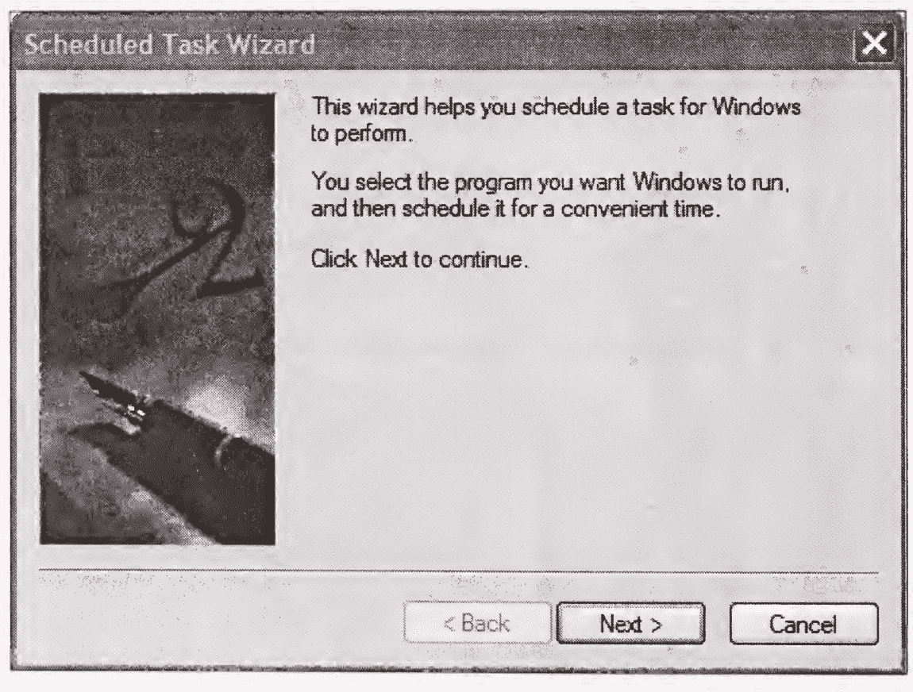

3. 单击“下一步”，计划任务向导将允许你选择要运行的程序。

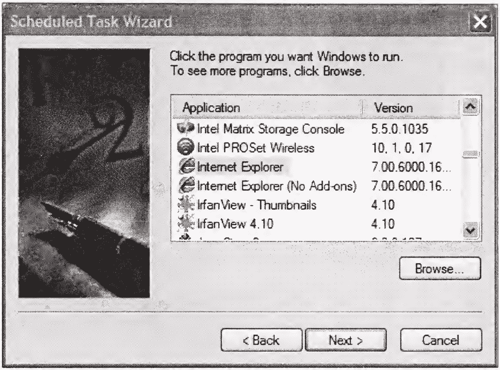

你可以使用Internet Explorer、Firefox或你选择的任何其他浏览器加载页面。

4. 单击“下一步”，你可以更改任务的运行时间间隔。

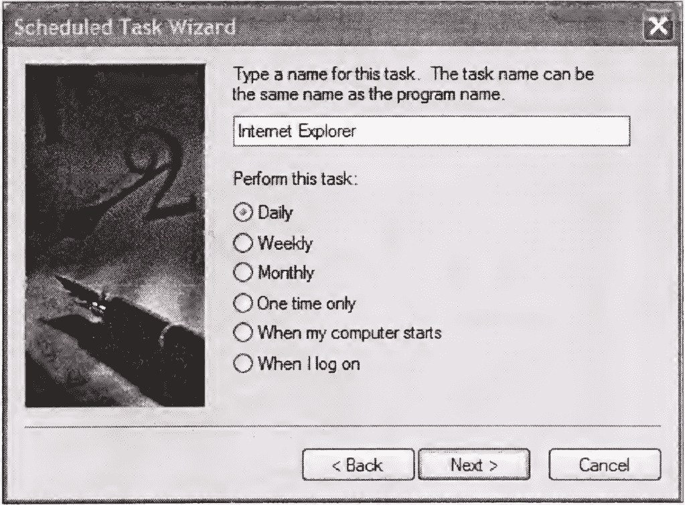

5. 单击“下一步”，你可以选择要加载页面的时间。

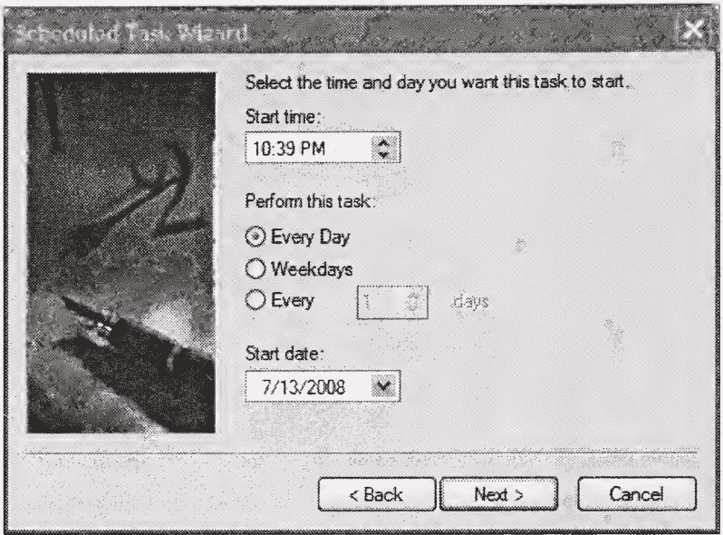

6. 如果你想以特定用户身份运行该任务，可以在下一步中输入用户名和密码。在“高级选项”中，你需要修改任务以加载你的cron页面，如下所示：

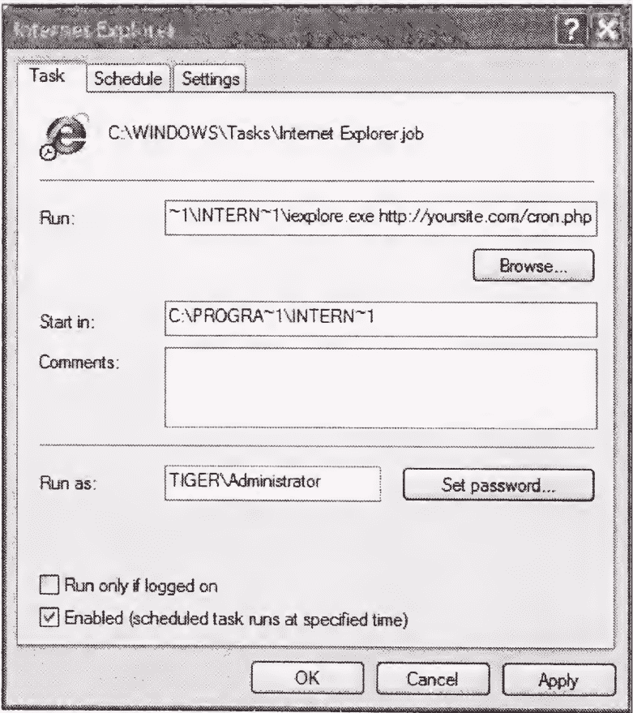

7. 你还可以通过“计划”选项卡修改任务，使任务每天运行多次。

## 设置cron的其他方式

Drupal网站上有关于在各种其他系统上设置cron的丰富信息，请访问 http://drupal.org/cron。

### 使用poormanscron作为更新feed的替代方法

Good Eatin'目标：为没有其他方法创建cron作业的网站设置一个“cron”作业。

其他所需模块：Poormanscron (http://drupal.org/project/poormanscron)。

Poormanscron在每次页面加载时检查是否需要运行cron。这使你可以在一个难以配置传统cron作业的站点上运行cron。这种便利是以性能为代价的，因为Drupal会在每次访问者加载页面时检查是否需要加载cron，这可能会产生显著影响，尤其是在流量很大的网站上。

1. 安装并激活Poormanscron模块。
2. 在“管理”菜单中选择“站点配置”，然后选择“Poormanscron”，即可获得Poormanscron的设置。设置如下面的截图所示：

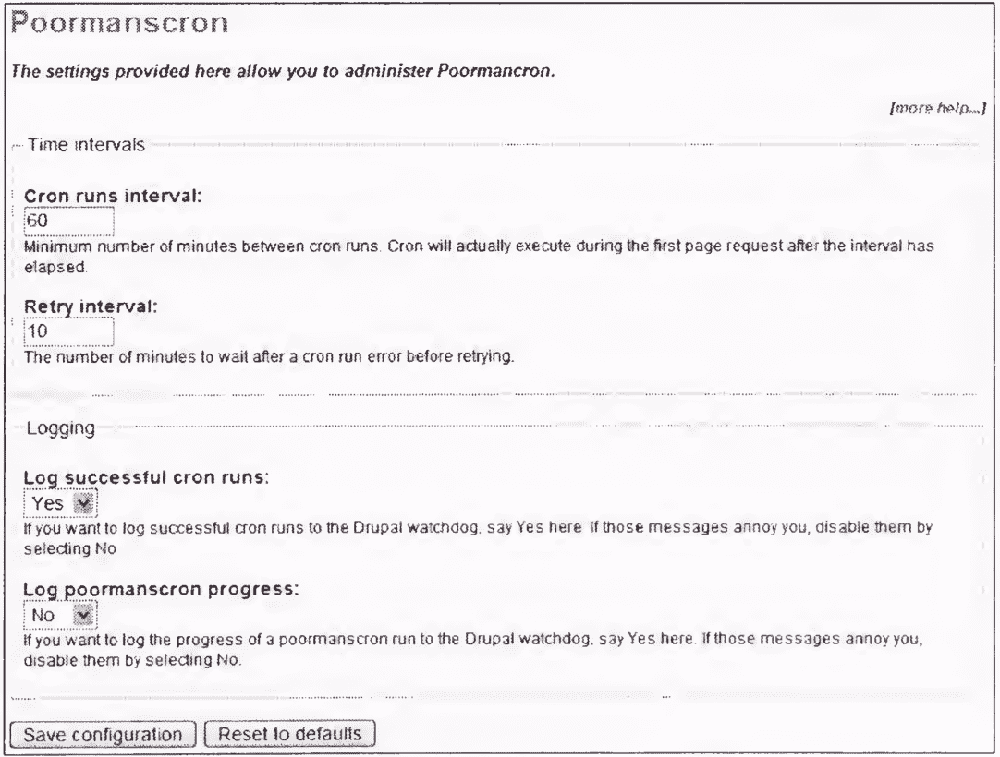


