# 6

# 新闻通讯与日历

在本章中，我们将添加新功能，让 Wanyama 大厨能够随时向顾客通报 Good Eatin' 餐厅的最新动态。

我们将提供两种新的沟通方式。第一个功能是季刊新闻通讯，顾客可以订阅。新闻通讯将包含 Wanyama 大厨提供的宝贵信息，包括优惠券、新闻、食谱等。

第二个功能是日历，帮助顾客了解 Good Eatin' 餐厅的近期活动。

## 创建新闻通讯

新闻通讯是一种很好的方式，可以让顾客无需访问你的网站就能及时了解最新信息。顾客喜欢设计精美的新闻通讯，因为这让他们无需定期查看每一个网站，就能随时掌握自己喜爱的场所的动态。

## 创建新闻通讯

Good Eatin' 目标：在 Good Eatin' 网站上创建一个新的新闻通讯，其中包含餐厅的相关新闻，并按季度发送给订阅者。

需要的额外模块：Simplenews (http://drupal.org/project/simplenews)。

## 基本步骤

新闻通讯是各期内容的容器。例如，你可以有一个名为“季节性餐饮指南”的新闻通讯，每年有四期（夏季、秋季、冬季和春季）。顾客订阅新闻通讯后，每一期发布时都会发送给他们。

1. 首先安装并激活 Simplenews 模块，如下所示：

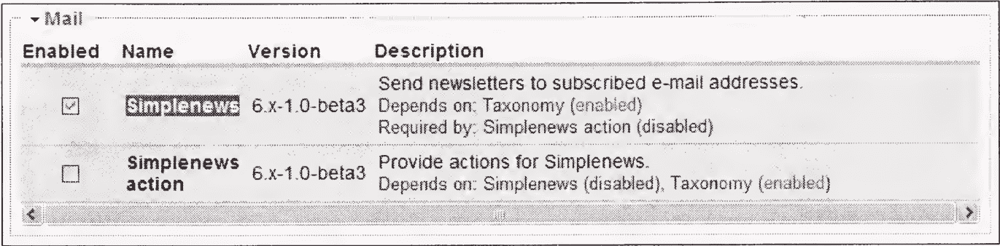

此时，我们只需要启用 Simplenews 模块，Simplenews 操作模块可以保持禁用。

2. 接下来，从“管理”菜单中选择“内容管理”，然后选择“新闻通讯”。Drupal 将显示一个管理区域，分为以下几个部分：

+   a) 已发送的期次
+   b) 草稿
+   c) 新闻通讯
+   d) 订阅

3. 点击“新闻通讯”选项卡，Drupal 将显示一个类似于下面的页面：

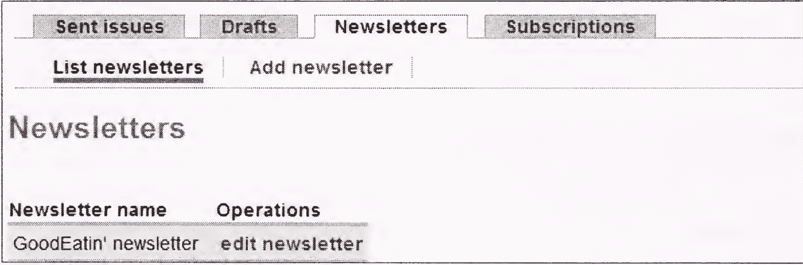

正如你所看到的，系统已经自动为我们创建了一个以我们网站名称命名的默认新闻通讯。我们可以编辑这个默认新闻通讯，也可以点击“添加新闻通讯”链接来创建新的新闻通讯。

4. 让我们点击**添加新闻通讯**选项来创建我们的季节性新闻通讯。Drupal 将显示一个标准表单，我们可以在其中输入新闻通讯的名称、描述和相对重要性（相对重要性权重）。

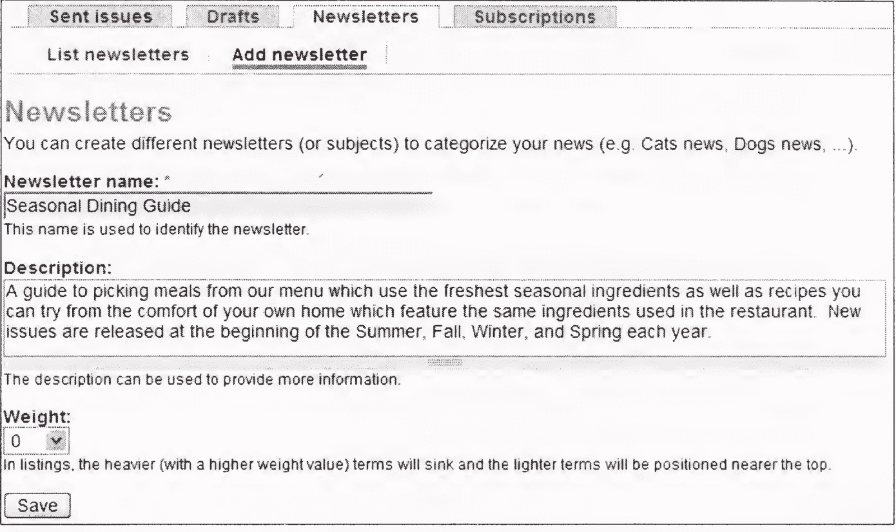

5. 点击**保存**以保存新闻通讯。现在它将出现在可用新闻通讯列表中。

6. 如果你想修改新闻通讯的**发件人信息**，使用不同于网站默认名称或电子邮件地址的替代信息，你可以在添加新闻通讯时展开**发件人信息**部分，或者点击**编辑新闻通讯**并修改**发件人信息**，如下面的截图所示：

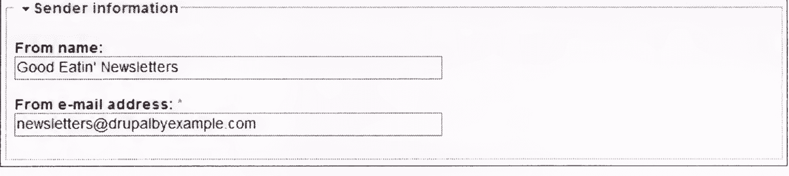

## 允许用户注册新闻通讯

Good Eatin' 目标：演示注册用户和未注册用户如何注册新闻通讯，并配置注册流程。

需要的额外模块：Simplenews (http://drupal.org/project/simplenews)。

## 基本步骤

+   1. 为了允许顾客注册新闻通讯，我们首先向页面添加一个区块。

+   2. 从“管理”菜单中选择“网站构建”，然后选择“区块”，打开区块管理器。为你希望允许顾客订阅的新闻通讯添加区块，如下面的截图所示：

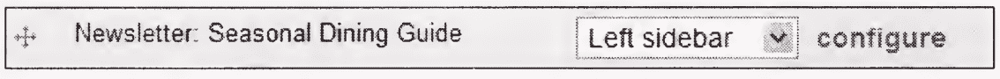

+   3. 现在我们需要通过从“管理”菜单中选择“用户管理”，然后选择“权限”，授予用户订阅新闻通讯的权限。我们将授予所有用户订阅新闻通讯和查看新闻通讯链接的权限，如下所示：

| 权限 | 匿名用户 | 认证用户 | 博主 | VIP 用户 |
|---|---|---|---|---|
| simplenews 模块 |  |  |  |  |
| 管理新闻通讯 | ☐ | ☐ | ☐ | ☐ |
| 创建新闻通讯 | ☐ | ☐ | ☐ | ☐ |
| 删除任何新闻通讯 | ☐ | ☐ | ☐ | ☐ |
| 删除自己的新闻通讯 | ☐ | ☐ | ☐ | ☐ |
| 编辑任何新闻通讯 | ☐ | ☐ | ☐ | ☐ |
| 编辑自己的新闻通讯 | ☐ | ☐ | ☐ | ☐ |
| 发送新闻通讯 | ☐ | ☐ | ☐ | ☐ |
| 订阅新闻通讯 | ☑ | ☑ | ☑ | ☑ |
| 查看区块中的链接 | ☑ | ☑ | ☑ | ☑ |

4. 如果顾客没有订阅新闻通讯的权限，区块将显示为如下面的截图所示：

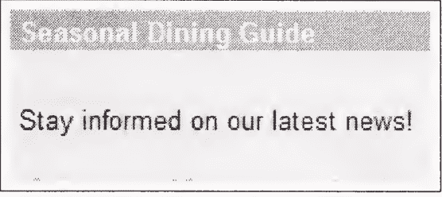

但是，如果顾客拥有订阅新闻通讯的权限并且已登录网站，区块将显示为如下面的截图所示：

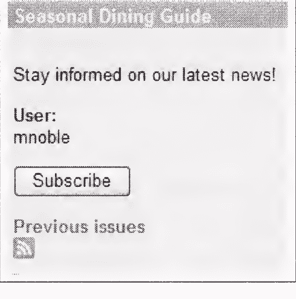

如果顾客有订阅权限但未登录，区块将显示如下。

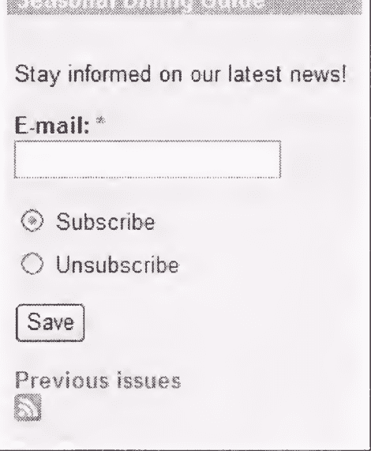

+   5. 顾客只需点击**订阅**按钮即可订阅新闻通讯。一旦订阅成功，**订阅**按钮将变为**取消订阅**，以便用户可以轻松退出新闻通讯。如果用户没有该网站的有效账户，他们需要确认确实想要订阅。

## 管理注册信息

*Good Eatin' 目标：*生成所有已注册新闻通讯用户的列表，并演示如何移除可疑用户。

*需要的额外模块：* Simplenews (http://drupal.org/project/simplenews)。

## 基本步骤

在顾客开始注册你的新闻通讯后，你可以通过从**管理**菜单中选择**内容管理**，然后选择**新闻通讯**，最后点击**订阅**，查看所有现有订阅的列表。Drupal 将显示一个类似于下面图片的页面：

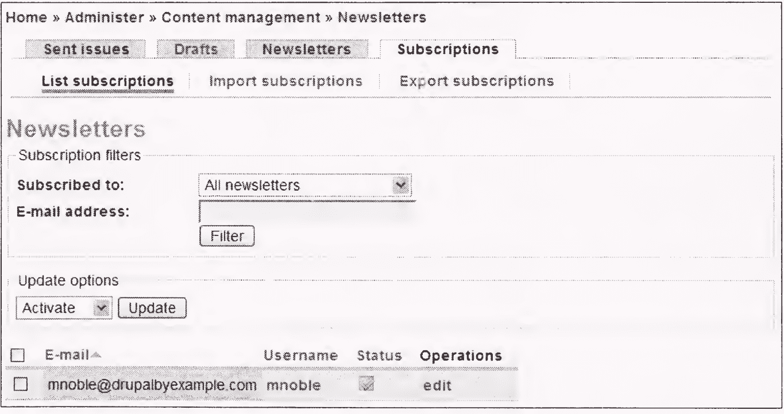

你可以筛选显示内容，仅列出特定的新闻通讯，或仅列出某个特定顾客订阅的新闻通讯。要编辑单个订阅，请点击编辑链接。这将显示一个类似于下面的页面：

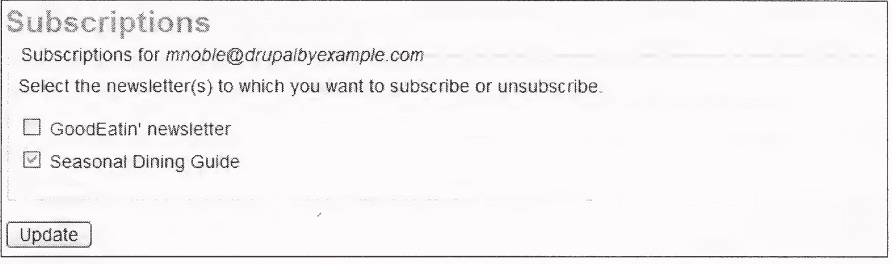

你也可以通过选择要修改的订阅，在“更新选项”下拉列表中选择相应操作，然后点击“更新”按钮，来激活、停用或删除订阅。这允许你移除订阅了你新闻通讯的恶意用户。如果你收到大量无效注册，你可能需要在注册表单中添加验证码。

## 从现有列表导入订阅

Good Eatin' 目标：从你开始使用 Simplenews 管理新闻通讯之前所使用的另一个列表管理系统中导入订阅。

需要的额外模块：Simplenews (http://drupal.org/project/simplenews)。

## 基本步骤

如果你已经有大量新闻通讯订阅者，你可能不想丢弃这个列表，因为一个好的联系人列表需要时间来积累，并且可能为你带来可观收益。

## 新闻通讯与日历

你可以通过点击**新闻通讯**管理页面中的**批量订阅**链接，导入逗号分隔的电子邮件地址列表。这将显示一个类似于下面的页面：

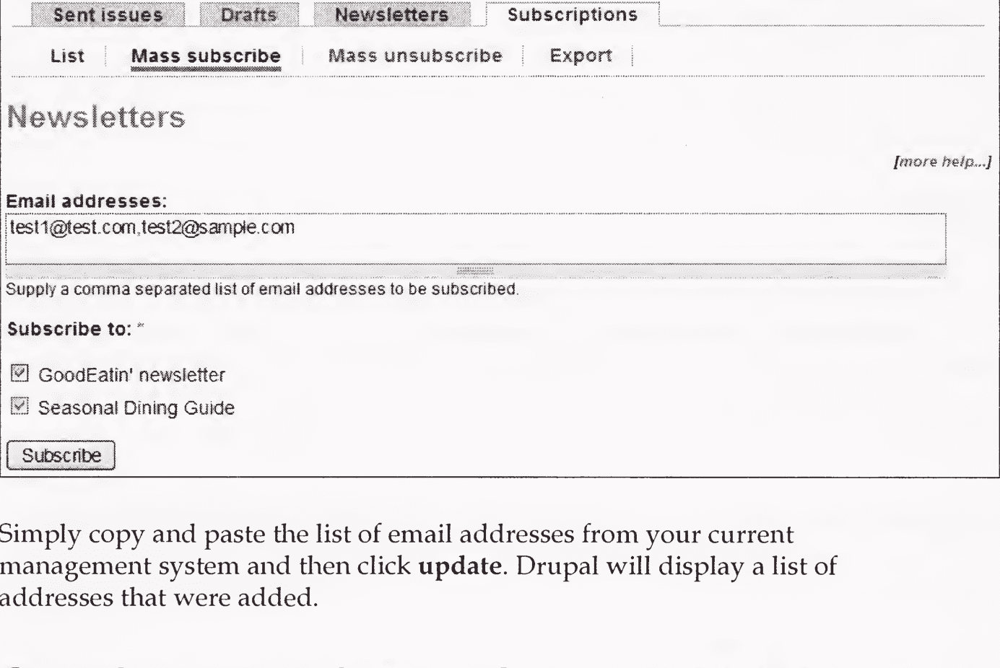

只需从你当前的管理系统中复制并粘贴电子邮件地址列表，然后点击**更新**。Drupal 将显示已添加的地址列表。

## 创建新闻通讯的新一期

*Good Eatin' 目标：*制作一期新的季节性特惠新闻通讯，准备发送给新闻通讯订阅者。

*需要的额外模块：* Simplenews (http://drupal.org/project/simplenews)。

## 基本步骤

+   1. 创建新的新闻通讯期次与在 Drupal 中创建任何其他页面类似。我们首先点击**创建内容**，然后点击**新闻通讯期次**。


## 新闻通讯与日历

强烈建议您在将新闻通讯发送给整个订阅列表之前，先发送一份测试新闻通讯，以避免最终版本出现错误。测试地址默认为您站点的管理邮箱地址。您可以在“Simplenews设置”页面中更改测试地址，该页面可通过从“管理”菜单中选择“站点配置”，然后选择“Simplenews”来访问。可用设置如下截图所示：

测试地址
提供以逗号分隔的电子邮件地址列表，用作测试地址。覆盖功能允许您在新闻通讯编辑表单中覆盖这些地址。
电子邮件地址：
admin@drupalbyexample.com
允许覆盖测试地址

- 4. 当您对内容满意后，单击“保存”按钮。
- 5. 在您发送了测试邮件并确认其已正确送达后，您可以通过编辑草稿并将“新闻通讯发送选项”更改为“发送新闻通讯”，将通讯发送给所有订阅者。
- 6. 一旦新闻通讯被安排发送，每次运行 cron 时，它将发送给订阅者列表中的一部分人。这样做是为了避免使网络过载。您可以通过编辑新闻通讯的“邮件后端设置”来配置每次调用 cron 时发送的电子邮件数量，该设置可通过从“管理”菜单中选择“站点配置”，然后选择“Simplenews”来访问。可用设置如下截图所示：

邮件后端选项
使用 cron 发送新闻通讯
选中后，将使用 cron 发送新闻通讯（推荐）。测试新闻通讯和确认邮件将立即发送。测试目的可保持未选中状态。
Cron 节流：
20
设置每次 cron 运行发送的新闻通讯数量。发送失败也会被计数。
邮件假脱机过期时间：
立即
新闻通讯邮件会进行假脱机处理。成功发送后，消息必须在假脱机队列中保留多长时间？将消息保留在假脱机队列中便于进行邮件统计（尚未实现）。如果不使用 cron，建议立即过期。
记录电子邮件
选中后，所有发出的 simplenews 电子邮件都会记录在系统日志中。已记录的电子邮件并不能保证已发送或将被送达。它仅表示消息已发送到 PHP 的 mail() 函数。PHP 的 mail() 函数不提供有关送达状态的信息。

默认情况下，每次运行 cron 时只发送 20 封电子邮件。如果您频繁运行 cron，这没有问题；但如果运行频率较低，您可能希望增加每次发送的电子邮件数量。一些网络托管公司为了帮助防止垃圾邮件发送者利用他们的服务器，只允许每个小时发送特定数量的电子邮件。在向大型邮寄列表发送新闻通讯之前，您应该与您的主机服务商确认，以确保您遵守他们的政策。

### 添加日历

日历是吸引顾客定期访问您的网站和店铺的绝佳方式，这样他们就能享受到特价、促销和其他限时活动。

我们将为 Good Eatin' 餐厅创建一个基本的事件日历，用于显示音乐会、特殊活动等信息。

### 向日历添加新事件

Good Eatin' 目标：创建一个将显示在日历上的事件。

所需附加模块：Event (http://drupal.org/project/event)。

#### 基本步骤

- 1. 要添加事件，您必须先在“模块管理器”中安装并启用 Event 模块，如下截图所示：

   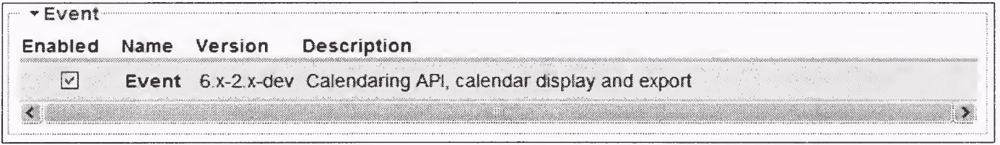

   启用 Event 模块将创建一个新的 Event 内容类型。还有一些设置可以控制事件的显示方式以及时区的处理方式。

- 2. 要修改时区设置，请从“管理”菜单中选择“站点配置”，然后选择“事件”，最后选择“时区处理”。

- 3. Drupal 将显示一个类似于下图的页面：

   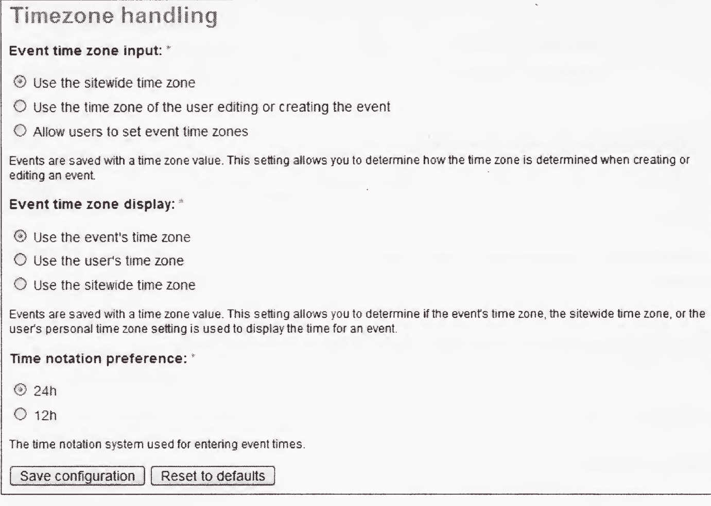

- 4. 您需要根据大多数用户所在的位置以及您举办的活动类型来自定义这些设置。例如，如果大多数用户在美国，12 小时制可能比较合适；但如果大多数用户在欧洲，24 小时制更好。如果活动在线举办，且用户分布在不同时区，那么以用户所在时区显示活动时间是合理的。但是，如果活动在单一地点举办，则使用活动当地时间更合理。对于 Good Eatin' 网站，我们将使用网站时区来设置活动，以活动时区显示活动时间，并使用 12 小时制。

- 8. 输入事件的标题和描述，如下截图所示，然后设置事件的开始时间，并可选地设置结束时间。

   创建事件

   标题：*
   2008年冬季菜单派对

   菜单设置

   正文：
   欢迎加入我们，共同揭晓我们的 2008 年冬季时令菜单。您可以品尝新菜单中的所有菜肴，并享用免费饮品，这些饮品旨在提升菜单的风味。

   在光标处拆分摘要

   输入格式

   CAPTCHA

   ☑ 事件有时间
   时间对此事件是否重要？如果事件持续一整天，请取消选中。

   开始日期：
   2008年9月1日 18:00

   ☑ 事件有结束日期
   如果要为此事件指定结束日期，请选中，然后在下方选择结束日期。

   结束日期：
   2008年9月1日 22:00

- 9. 当您对事件设置满意后，单击“保存”。

### 显示事件

Good Eatin' 目标：以各种格式在网站上显示事件，包括即将发生的事件块、事件表格和事件日历。

所需附加模块：Event (http://drupal.org/project/event)。

#### 基本步骤

Event 模块提供了几种让顾客查看事件的方法。我们将逐一探讨这些方法。

- 1. 让访问者浏览事件的最简单方式是使用事件页面，可通过 http://yoursite.com/event 访问。页面显示如下：

   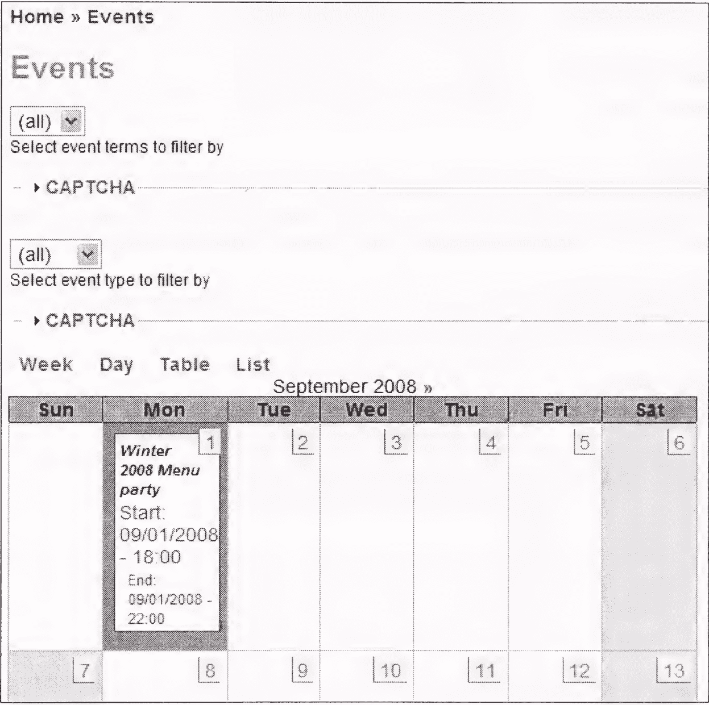

- 2. 如果您希望用户无需预先知道 URL 就能访问此页面，可以为该页面创建菜单项。从“管理”菜单中选择“站点构建”，然后选择“菜单”，打开“菜单管理器”。

- 3. 选择要添加菜单项的菜单，然后点击“添加项目”选项卡。

- 7. 新块将如下所示：

   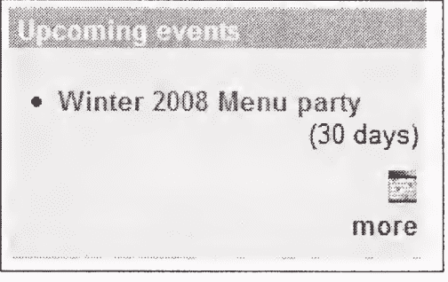

- 8. 显示日历条目的最后一种方法是使用一个以日历视图显示即将发生事件的块。要添加此块，请从“管理”菜单中选择“站点构建”，然后选择“块”，打开“块管理器”。将“用于浏览事件的日历”区域设置为“右侧边栏”。

   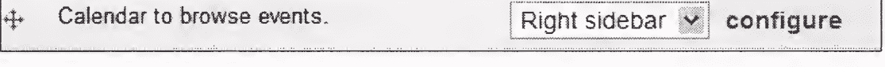

- 9. 日历的显示效果如下所示：

| 周日 | 周一 | 周二 | 周三 | 周四 | 周五 | 周六 |
|---|---|---|---|---|---|---|
|   |   |   |   |   | 1 | 2 |
| 3 | 4 | 5 | 6 | 7 | 8 | 9 |
| 10 | 11 | 12 | 13 | 14 | 15 | 16 |
| 17 | 18 | 19 | 20 | 21 | 22 | 23 |
| 24 | 25 | 26 | 27 | 28 | 29 | 30 |
| 31 |   |   |   |   |   |   |

您可以根据用户使用您网站的方式，决定在自己的网站中使用这些方法中的哪一种。

### 将其他内容类型添加到事件日历

Good Eatin' 目标：讨论如何将自定义内容类型添加到事件日历。

所需附加模块：Event (http://drupal.org/project/event)。

向现有事件日历添加其他内容类型的一种简单方法是修改内容类型，然后设置“事件日历”选项。

- 1. 从“管理”菜单中选择“内容管理”，然后选择“内容类型”，打开“内容管理器”。
- 2. 编辑要添加到事件日历的内容类型。
- 3. 打开“事件日历”部分并修改选项，如下所示：

   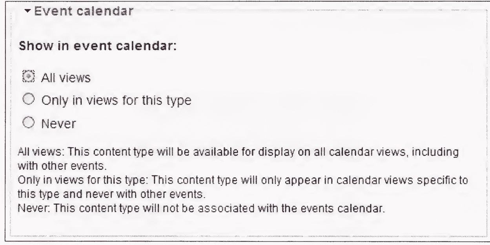

   如果您希望只为该类型创建日历，可以使用“仅在此类型的视图中使用”选项。

- 4. 保存对内容类型的更改，事件日历将自动更新。

### 使用 CCK 创建事件

Good Eatin' 目标：使用 CCK 模块和 Date 模块而不是 Event 模块来构建事件，从而对事件进行额外控制。

所需附加模块：CCK (http://drupal.org/project/cck)、Date (http://drupal.org/project/date)。


## 基本步骤

根据你的站点，使用 CCK 和 Date API 来构建日期可能更方便。这种策略还能让你对事件中包含的信息以及显示方式有额外的控制权。此外，在每次新的 Drupal 发布后，所有必需的模块都应能更快地得到更新。然而，如果你使用这种策略，则需要对事件和显示进行更多的初始设置。

- 1. 如果尚未安装，请安装并激活 CCK 和 Date 模块。
- 2. 通过从管理菜单中选择内容管理然后内容类型，打开内容类型管理器。
- 3. 点击添加内容类型开始创建你的新事件类型。我们将此类型命名为 Event CCK 以避免与 Event 模块冲突，如下所示：

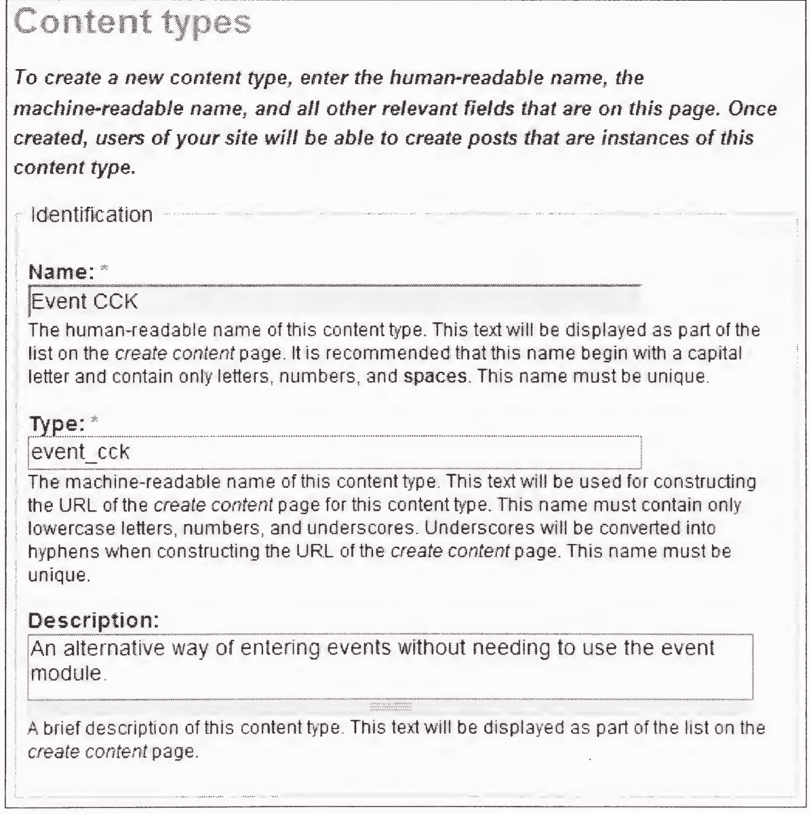

4. 对新内容类型的信息感到满意后，点击保存内容类型以创建新的事件类型。

5. 我们现在需要添加字段来存储事件的日期和时间。点击添加字段链接开始此过程。

6. 我们将字段命名为 event_time_cck 并将其类型设为 Datetime 字段，以便我们可以输入事件发生的日期以及开始的时刻，如以下屏幕截图所示：

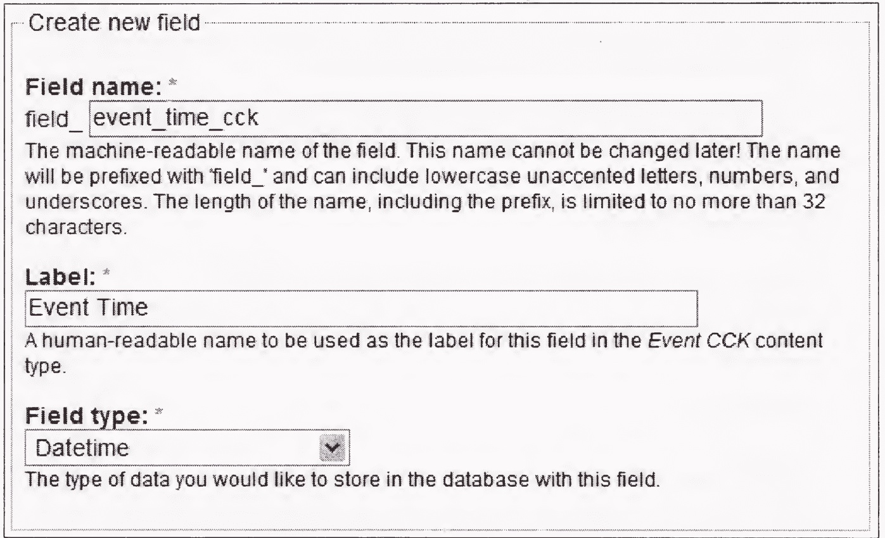

7. 点击继续以保存新字段。现在你需要为该字段选择显示小部件。带 jQuery 弹出日历的文本字段是合适的。点击继续以完成字段定义。你可以 optionally 修改与字段显示相关的各种设置。你应将时间设为必填。如果想要为事件定义结束日期或时间，应将到日期修改为可选或必填。

8. 你现在可以使用与创建其他内容相同的技术创建基于 CCK 的事件——只需从主导航菜单中选择创建内容然后 Event CCK 即可。

9. 输入事件信息，如以下屏幕截图所示：

# 创建 Event CCK

标题： *

Swingin' at Good Eatin'

菜单设置

正文：

在光标处拆分摘要

Good Eatin' 很高兴欢迎 Herbert Henry 及其大乐队在 8 月 30 日星期六来到 Good Eatin' 舞台。加入我们，共度一个充满美食和舞蹈的愉快夜晚。

输入格式

CAPTCHA

事件时间

开始日期： *

30/08/2008 18:00

格式：02/08/2008 13:49 格式：02/08/2008 13:49

结束日期：

30/08/2008 23:00

空的“结束日期”值将使用“开始日期”值。格式：02/08/2008 13:49

10. 对事件感到满意后，点击保存以将新事件添加到站点的日历中。

## 使用视图和 CCK 显示日历

Good Eatin' 目标：显示一个比块视图提供更多细节的日历页面。

所需额外模块：Calendar (http://drupal.org/project/calendar)、Views(http://drupal.org/project/views)、Date API (http://drupal.org/project/date)。

## 基本步骤

现在我们可以使用 CCK 创建事件，我们需要在站点上显示它们。我们将首先创建一个页面，让访客可以使用方便的日历浏览所有即将到来的事件。

- 1. 如果尚未安装，请先安装并激活 Views 和 Calendar 模块。注意，2008 年 6 月 28 日之前发布的某些版本的 Calendar 要求你同时激活 Calendar 和 iCal。如果在安装 Calendar 模块时遇到错误，请升级到最新的开发模块或同时安装这两个模块。
- 2. 使用日历构建新视图的最简单方法是克隆默认的日历视图并根据需要对其进行自定义。
- 3. 通过从管理菜单中选择站点构建然后 Views，前往视图管理器。
- 4. Drupal 将显示站点上目前已建立的所有视图的列表。如果滚动列表，你将看到默认节点视图：calendar，如以下屏幕截图所示：
- 5. 通过点击启用链接暂时启用默认视图。
- 6. 视图激活后，将出现一组新的链接，标记为：编辑、导出、克隆和禁用。
- 7. 点击克隆链接以复制日历。Drupal 允许你更改视图的名称和描述。将名称更改为 event_calendar，然后点击下一步以编辑视图。
- 8. 视图的默认设置如下图所示。我们将为我们的目的编辑几个设置。

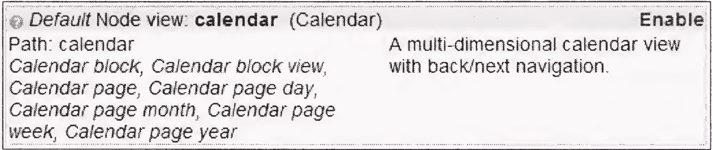

16. 我们需要在参数中对视图进行的最后一次更改。选择参数部分中的 Date:Date 链接。

17. Drupal 将显示可用于自定义参数的列表。

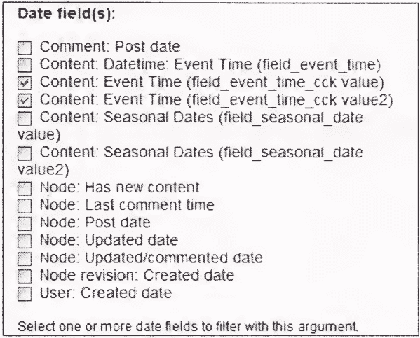

我们需要将其更改为使用我们的内容事件时间字段，然后点击更新以保存更改。

18. 现在所有必需的更改都已完成，点击保存以完成视图的构建。

19. 我们现在可以通过点击列表链接返回所有视图的列表，并通过选择默认日历视图的禁用链接来禁用默认日历视图。

20 现在我们的视图已完全设置好，我们可以使用它来浏览我们的事件。我们用作起点的日历视图提供了多种显示内容的方法，如下所示：

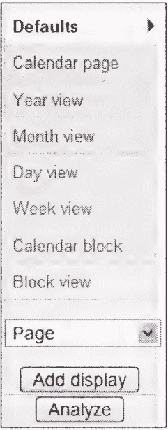

## 新闻通讯和日历

你可以使用这些视图中的任何一个，也可以根据站点需求添加更多视图。如果不想使用某种显示类型，可以将其删除。如果你点击 **Calendar Page** 显示类型并查看 **Page settings**，你会看到已提供一个页面，可以通过路径 `http://yoursite.com/calendar` 访问。未提供菜单。你可以在此处添加菜单链接，或根据需要使用 **Menu Manager**。如果打开日历页面，显示如下：

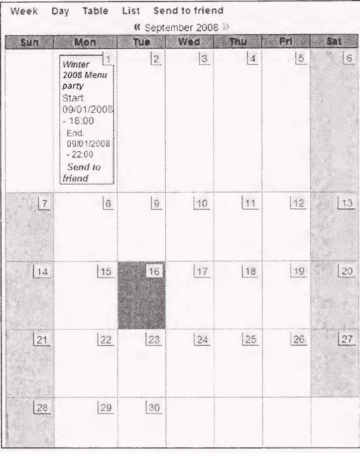

21. 日历视图还提供了几个块显示，可以通过 **Block Manager** 激活并添加到你的站点。这些块包括一个与事件块提供的显示类似的 **Calendar** 块，以及一个 **Legend** 块，可用于让访客更轻松地理解日历中的信息。

## 摘要

恭喜！你现在已向你的站点添加了新闻通讯和事件。这些将提供宝贵的沟通方式，让你的客户继续回到你的网站，更重要的是回到你的业务。

在下一章中，我们将利用 YouTube、Flickr 和 Google 等站点为厨师 Wanyama 的 Good Eatin' 网站提供高级功能。

## 流行语合规：
加入一些 Web 2.0

现在我们对构建内容感到自如，我们将开始添加在其他网站上开发和维护的更多内容。其中一些内容将由你构建，而一些可能由你社区中的其他人，甚至世界各地的人创建。

你可能会想知道为什么要将内容存储在你无法控制的另一个站点上，尤其是当我们已经展示了使用 Drupal 构建内容是多么容易时。虽然你确实放弃了一些控制权，但使用这些资源有几个很好的理由：

- 1. 带宽可能很昂贵。如果你的站点很受欢迎并且大量使用大图片或视频，你很容易超出每月带宽限制。通过将图片和视频存储在别人的服务器上（可能免费），你可以避免超额费用。
- 2. 他们的服务器比你的更好。用于存储和提供图片和视频的服务器通常是最顶级的服务器。因为它们用于存储来自许多不同人的数据，所以实际成本被分摊，你不必支付全部费用。
- 3. 你可以利用其他社区成员的工作来帮助你构建和维护内容。如果内容经常变化或你想收集其他人创建的内容，这一点尤其重要。例如，如果你想提供你所在城镇的图片，你可以使用 Flickr 存储图片，并链接到其他人拍摄并发布在 Flickr 上的图片。请确保在使用前获得使用这些图片的许可！


4. 通过允许第三方站点单独维护内容，您还可以利用他们对其站点技术所做的任何改进。我们描述的链接站点都非常庞大且积极维护。它们还倾向于频繁发布新功能，而自行实现这些功能可能困难且昂贵。

## 在线烹饪课程

在本节中，我们将添加来自 YouTube 的视频内容，演示餐厅中使用的各种烹饪技巧。

### 使用过滤器嵌入 YouTube 视频

*Good Eatin' Goal:* 将存储在 YouTube 上的视频添加到现有页面。

*Additional modules needed:* Video Filter (http://drupal.org/project/video_filter)。

### 基本步骤

YouTube (www.youtube.com) 是一个流行的视频分享网站，您可以在此观看全球各地人们创建和提交的视频。YouTube 允许您链接到存储在其网站上的视频，以便与自己的访客分享，而无需承担带宽费用。事实上，如果您拥有 Google AdSense 账户，您甚至可以从视频中获得收入。

要将视频插入页面，我们将使用以下流程：

- 1. 安装并激活 **Video Filter** 模块。
- 2. 我们现在需要构建一个新的输入格式来处理该过滤器。为此，请从 **Administer** 菜单中选择 **Site configuration**，然后选择 **Input formats**。
- 3. 点击 **Add input format** 链接。
- 4. 我们将输入格式命名为 YouTube，并仅允许管理员使用此格式。根据您站点的需求，您需要决定谁可以使用输入格式。只需确保任何有权访问此格式的人都将遵守您站点的条款，并且不会链接到您不希望出现在站点上的视频。
- 5. 最后，启用 **Video Filter** 过滤器并 **Save the configuration**。

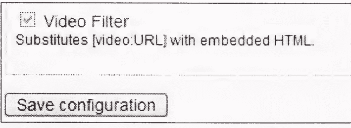

6. 我们现在可以在新页面中使用新的输入格式。我们将通过点击 **Create content** 然后点击 **Page** 来创建页面。

7. 我们将新页面的标题设为 **Cooking Classes**，并按如下方式输入描述：

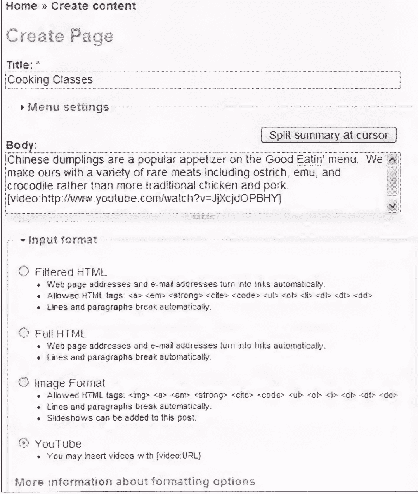

保存页面后，最终结果将如下所示：

## Cooking Classes

Page Cooking Classes has been created.

Chinese dumplings are a popular appetizer on the Good Eatin' menu. We make ours with a variety of rare meats including ostrich, emu, and crocodile rather than more traditional chicken and pork.

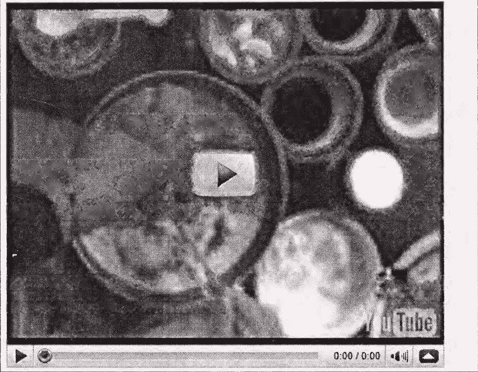

您还可以使用 Video Filter 模块通过使用相同的技术来显示来自 Google Video、GodTube、DailyMotion、Eyespot、Jumpcut、Revver 和 Vimeo 的视频。要使用这些替代来源，只需在过滤器中输入要嵌入的页面的完整 URL 即可。

在将 YouTube 视频添加到您的站点之前，请确保您遵守 YouTube 的使用条款，并检查该材料是否未受版权保护。有关更多详细信息，请参阅 http://www.youtube.com/t/terms。

## 创建 YouTube 播放列表并显示随机视频

Good Eatin' Goal: 增强 YouTube 过滤器以从视频列表中播放，并探索 Video Filter 模块的其他功能。

Additional modules needed: Video Filter (http://drupal.org/project/video_filter)。

### 基本步骤

现在您可以在页面中添加单个视频，您可能希望添加更多以随机顺序显示的视频，自动在页面加载时开始视频，或控制视频大小。所有这些都可以通过使用 Video Filter 实现。

要向过滤器添加多个视频，您只需添加多个视频并用逗号分隔。例如，您可以输入：

```
video:http://www.youtube.com/watch?v=0Q2aPi9ZEgs,
http://www.youtube.com/watch?v=dTDVKDzVOcg,http://www.youtube.com/watch?v=eV__oOckAPM
```

如果您希望视频自动开始，您需要在过滤器中添加 autoplay:1，并与过滤器的其余部分用空格分隔。例如：

```
video:http://www.youtube.com/watch?v=DqoqFymiGkk autoplay:1
```

要调整视频大小，您需要输入视频的宽度和高度，再次与过滤器的其余部分用空格分隔。过滤器将确保视频的纵横比正确，并且实际宽度和高度不超过您指定的大小。下面是一个示例：

```
video:http://www.youtube.com/watch?v=BYhrHdvI6m8 width:240
height:160
```

最后的格式选项是控制页面上视频的对齐方式。请注意，您目前只能指定对齐方式为左或右。这是通过 align 选项控制的，如下所示：

```
video:http://www.youtube.com/watch?v=wPhBiu6Sx_w align:right
```

## 使用嵌入式媒体字段增强内容

Good Eatin' Goal: 将 YouTube 视频集成到现有内容类型中，而不是使用过滤器。

Additional modules needed: Embedded Media Field (http://drupal.org/project/emfield)。

### 基本步骤

在最后两个主题中，我们探讨了将 YouTube 视频插入现有内容的方法。但如果您想为特定内容类型的所有实例添加视频字段怎么办？例如，如果您有一个烹饪课程的内容类型，您可以包含以下字段：

- Class Name
- Class Description
- Class Dates
- Video giving a preview of the class

在这种情况下，最好为视频设置一个特定字段，而不是使用过滤器将其嵌入文本中。

让我们使用 Embedded Media 模块来添加视频字段来构建上面的示例。

- 1. 首先在模块管理器中安装并启用 **Embedded Media Field** 和 **Embedded Video Field** 模块。
- 2. 我们现在可以通过从 **Administer** 菜单中选择 **Content Management** 然后选择 **Content types** 来创建新的内容类型。最后，点击 **Add content type**。
- 3. 我们将按如下方式填写内容类型的基本信息：

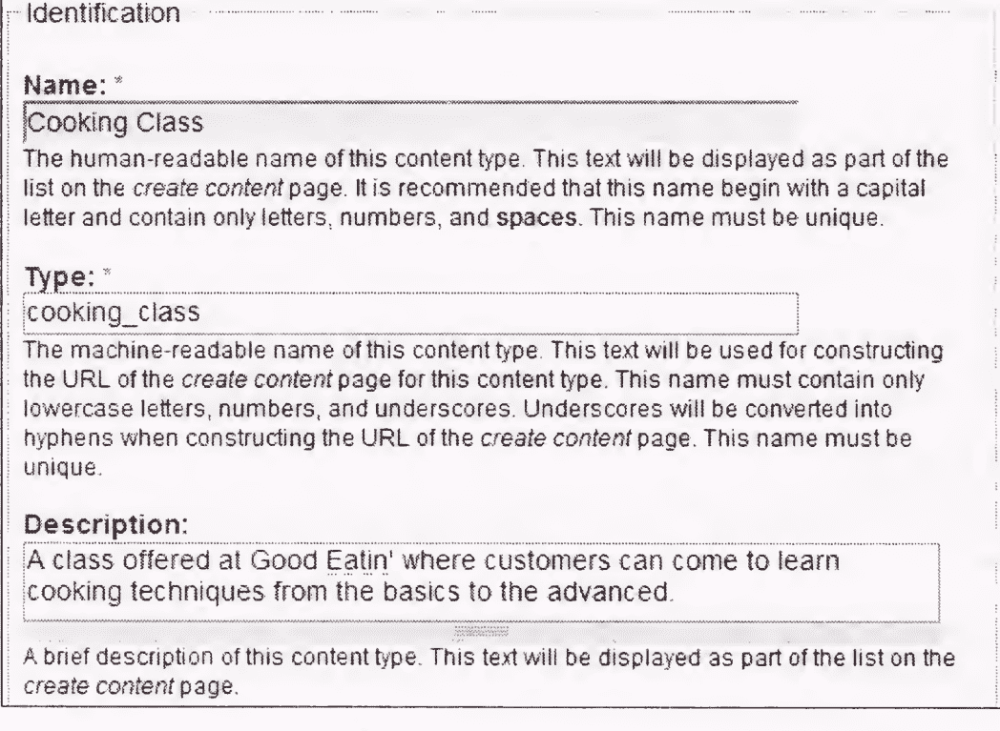

点击 Save content type 保存类型。

9. 可能的提供商完整列表如下所示。我们将仅为我们的字段选择 YouTube。

### Providers Supported

从下面的列表中选择您希望允许此内容类型的第三方提供商。如果未选中任何复选框，则将支持所有提供商。当用户提交新内容时，他们输入的 URL 将与提供商匹配，前提是该提供商在此处被允许。

Providers:

- Blip.tv
- Brightcove
- Dailymotion
- Google
- GUBA
- IMEEM
- JumpCut
- Last.fm
- Live Video
- MetaCafe
- MySpace
- Revver
- Sevenload
- Spike TV
- Tudou
- Veoh
- Vimeo
- YouTube
- Custom URL

10. 下一组设置是显示和预览设置，每个设置都包含以下屏幕截图中显示的相同选项集：

### Video Display Settings

这些设置控制此视频以其全尺寸显示的方式，默认值为 425x350。

Video display width: *
425
视频的宽度。默认为 425。

Video display height: *
350
视频的高度。默认为 350。

Autoplay
如果提供商支持，选中此框将导致视频在全尺寸时加载后自动开始。

您可以使用预览设置在某些情况下显示较小的视频。我们将保留所有其他设置使用其默认值。

11. 下一组设置控制预览图像，如以下屏幕截图所示：

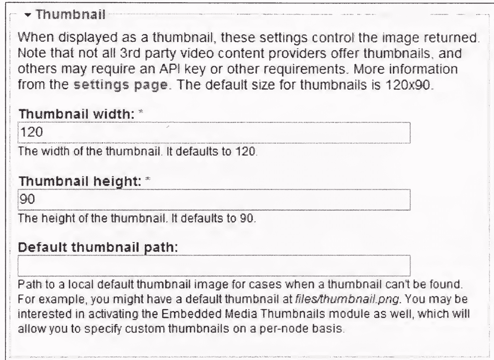

12. 最后，全局设置可以按如下所示设置。我们将把该字段标记为 Required。

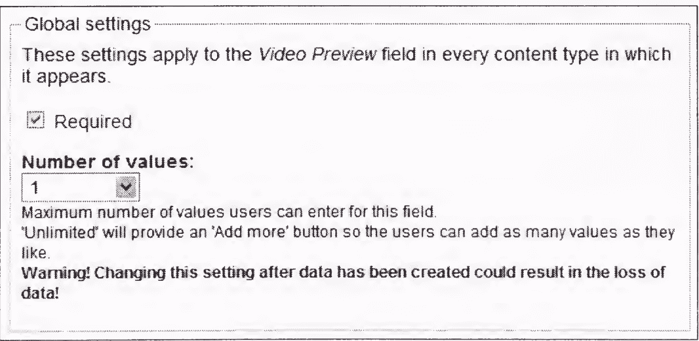

13. 点击 Save field settings 按钮以完成添加字段。


既然内容类型已经完整定义，我们就可以使用这种新的内容类型来构建内容了。

+   1. 首先点击“创建内容”，然后点击“烹饪课程”。
+   2. 按下图所示输入课程信息，然后点击“保存”完成新课程的添加。

## 创建烹饪课程

标题：*
饺子课程
菜单设置
正文：
学习制作美味的中国饺子，在您的下一次晚宴上大显身手。我们将探索饺子的方方面面，包括制作几种不同的馅料、从零开始制作饺子皮，以及正确地蒸制和煎制饺子。
在光标处拆分摘要
输入格式
视频预览：*
http://www.youtube.com/watch?v=JjXcjdOPBHY
在此输入 URL 或嵌入代码。嵌入的第三方内容将被解析并相应地显示。
支持以下服务：YouTube
课程日期
“结束日期”为空时，将使用“开始日期”的值。
开始日期：
08/19/2008
格式：08/19/2008
结束日期：
08/20/2008
格式：08/19/2008

3. 最终页面将如下所示：

## 饺子课程

烹饪课程 饺子课程 已创建。

由 admin 于 周二，08/19/2008 - 22:55 提交

学习制作美味的中国饺子，在您的下一次晚宴上大显身手。我们将探索饺子的方方面面，包括制作几种不同的馅料、从零开始制作饺子皮，以及正确地蒸制和煎制饺子。
本课程适合所有经验水平的人士。

视频预览：

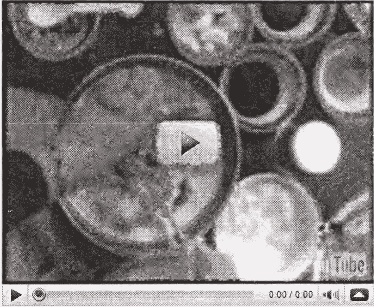

## Flickr 集成：图片和幻灯片的另一种选择

Flickr 是一个非常受欢迎的网站，允许您与世界各地的朋友分享图片。您可以将自己的图片上传到 Flickr 进行存储，也可以将其他人拍摄的图片嵌入到自己的网站中。当然，在将任何图片用于您的网站之前，您需要检查所有要嵌入的图片的许可。

## 从 Flickr 嵌入媒体

“美食好味道”目标：使用 Flickr 为我们的“烹饪课程”内容类型添加预览图片。

所需附加模块：嵌入式媒体字段 (http://drupal.org/project/emfield)。

## 基本步骤

我们之前已经使用嵌入式媒体字段模块在网站上显示 YouTube 视频。在这一步中，我们还将使用它来显示来自 Flickr 的图片。

+   1. 如果您尚未安装并激活“嵌入式媒体字段”模块，请立即安装并激活。我们还需要激活“嵌入式图片字段”模块，该模块将允许 Flickr 集成。
+   2. 在从 Flickr 添加内容之前，我们需要申请一个 Flickr API 密钥。您可以在 http://www.flickr.com/services/api/keys 申请 API 密钥。如果您还没有 Yahoo 帐户，系统会提示您创建一个。
+   3. 登录您的 Yahoo 和 Flickr 帐户后，您可以接受服务条款来申请 API 密钥。您需要指定该密钥是用于商业用途还是非商业用途，并输入您的姓名和电子邮件帐户。注册完成后，您将收到一个用于 Flickr 的长密钥。您应该将此密钥存放在安全的地方。
+   4. 我们可以通过选择“内容管理”，然后选择“嵌入式媒体字段配置”来输入嵌入式媒体字段的 Flickr 密钥。展开“嵌入式图片字段”部分，如下所示，然后输入您的密钥。

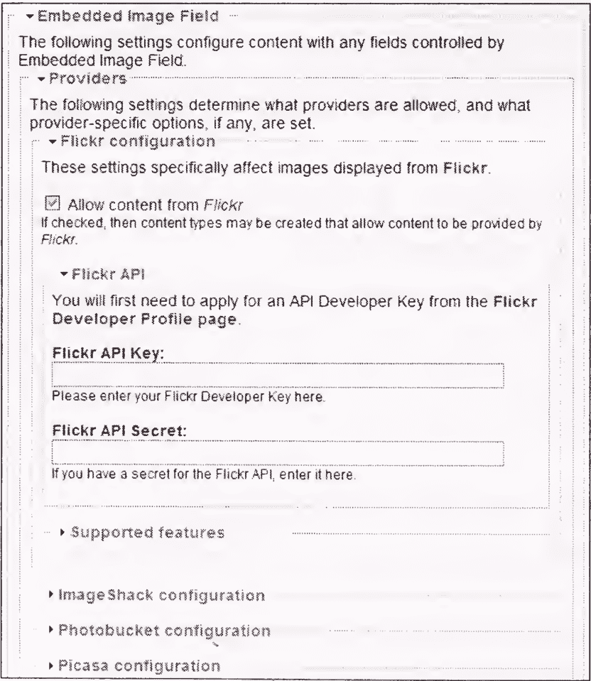

+   5. 从“管理”菜单中选择“内容管理”，然后选择“内容类型”，打开**内容类型管理器**。
+   
+   6. 点击“烹饪课程”内容类型旁边的**添加字段**链接。
+   
+   7. 如下方截图所示，输入新字段的**名称**和**标签**，并确保将**字段类型**设置为**嵌入式图片**。

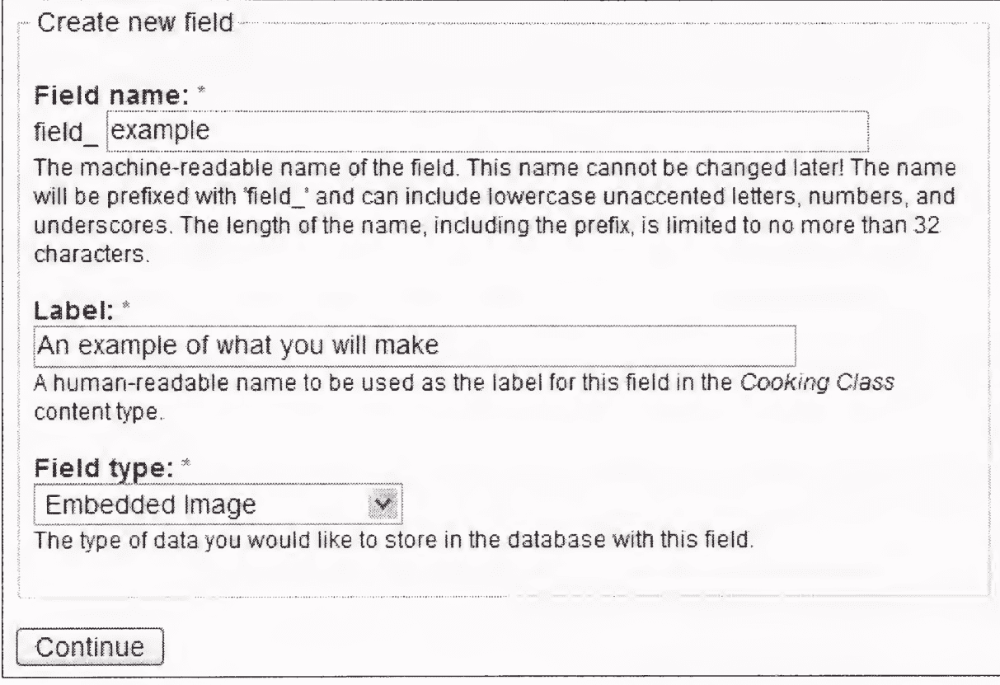

+   8. 点击**继续**以选择窗口小部件类型。唯一可用的类型是**第三方图片**，因此我们将保留该设置，然后再次点击**继续**。
+   
+   9. 现在我们可以为该字段设置多个选项，包括允许的提供商，以及以完整尺寸、预览尺寸或缩略图尺寸显示图片时的大小。

10. 我们首先将提供商设置为仅允许来自 Flickr 的图片。根据您的网站，您可能还需要添加其他提供商。

## 烹饪课程设置

这些设置仅适用于“烹饪课程”内容类型中显示的“您将制作内容的示例”字段。

## 支持的提供商

从下面的列表中选择您希望允许用于此内容类型的第三方提供商。如果未选中任何复选框，则支持所有提供商。当用户提交新内容时，他们输入的 URL 将与提供商匹配（假设该提供商在此处被允许）。

提供商：

+   - ☑ Flickr
+   - ☐ ImageShack
+   - ☐ Photobucket
+   - ☐ Picasa

11. 图片大小调整选项包含以下可能性：

## 完整尺寸显示设置

这些设置控制此图片在完整尺寸下的显示方式，默认为 500x800。请注意，如果其中一个维度为 0，则图片将调整为不大于另一个维度。

完整尺寸显示宽度：*
500
图片的宽度。默认为 500。如果您希望保持图片的原始宽高比，请将其设置为 0。

完整尺寸显示高度：*
800
图片的高度。默认为 800。如果您希望保持图片的原始宽高比，请将其设置为 0。

完整尺寸链接：
提供商链接
图片在完整尺寸显示时的链接位置。“内容”链接到内容页面，“提供商”链接到提供商的图片页面，“无”则显示不带链接的图片。

在我们的情况下，默认值是可以接受的，因此我们将保留它们。

12. 点击“保存字段设置”以完成新字段的定义。

13. 现在我们可以创建一个新的烹饪课程，或者编辑之前创建的课程，以便向我们的新字段添加信息。

无论哪种情况，编辑字段都将如下所示：

您将制作内容的示例：
http://www.flickr.com/photos/kendiala/40170940/
在此输入 URL 或嵌入代码。嵌入的第三方内容将被解析并相应地显示。
支持以下服务：Flickr

14. 只需输入信息并点击“保存”即可添加图片。

## 使用 Flickr 模块通过过滤器插入照片

“美食好味道”目标：使用过滤器向现有文本块添加图片。

所需附加模块：Flickr 模块 (http://drupal.org/project/flickr)。

## 基本步骤

尽管嵌入式媒体字段作为字段添加图片非常方便，但有时您可能希望在文本块中显示图片。为此，我们将使用 Flickr 模块。

+   1. 首先安装并激活 Flickr 模块。其中包含几个可用的模块，但我们只需要 Flickr 和 Flickr 过滤器模块。

| 已启用 | 名称 | 版本 | 描述 |
| --- | --- | --- | --- |
| ☑ | Flickr | 6.x-1.0-alpha1 | Flickr 与 Drupal 集成。依赖于：Flickr 区块（已禁用）、Flickr 过滤器（已禁用）、Flickr 照片集（已禁用）、Flickr 标签（已禁用）、Flickr 字段（已禁用） |
| ☐ | Flickr 区块 | 6.x-1.0-alpha1 | 用于在内容中插入照片的 Flickr 区块。依赖于：Flickr（已禁用） |
| ☑ | Flickr 过滤器 | 6.x-1.0-alpha1 | 用于在内容中插入照片的 Flickr 过滤器。依赖于：Flickr（已禁用） |
| ☐ | Flickr 照片集 | 6.x-1.0-alpha1 | 向 Flickr 模块添加照片集功能。依赖于：Flickr（已禁用） |
| ☐ | Flickr 标签 | 6.x-1.0-alpha1 | 向 Flickr 模块添加标签功能。依赖于：Flickr（已禁用） |

如果您只打算使用来自 Flickr 的图片，您可以使用**Flickr 字段**而不是**嵌入式媒体字段**来向内容类型添加图片字段。

+   2. 我们需要配置 Flickr 模块以输入我们的 API 密钥。我们可以通过从“管理”菜单中选择**网站配置**，然后选择**Flickr**来完成。

+   3. Drupal 将显示一个类似于下图的页面，您可以在其中输入 API 密钥和共享密钥。

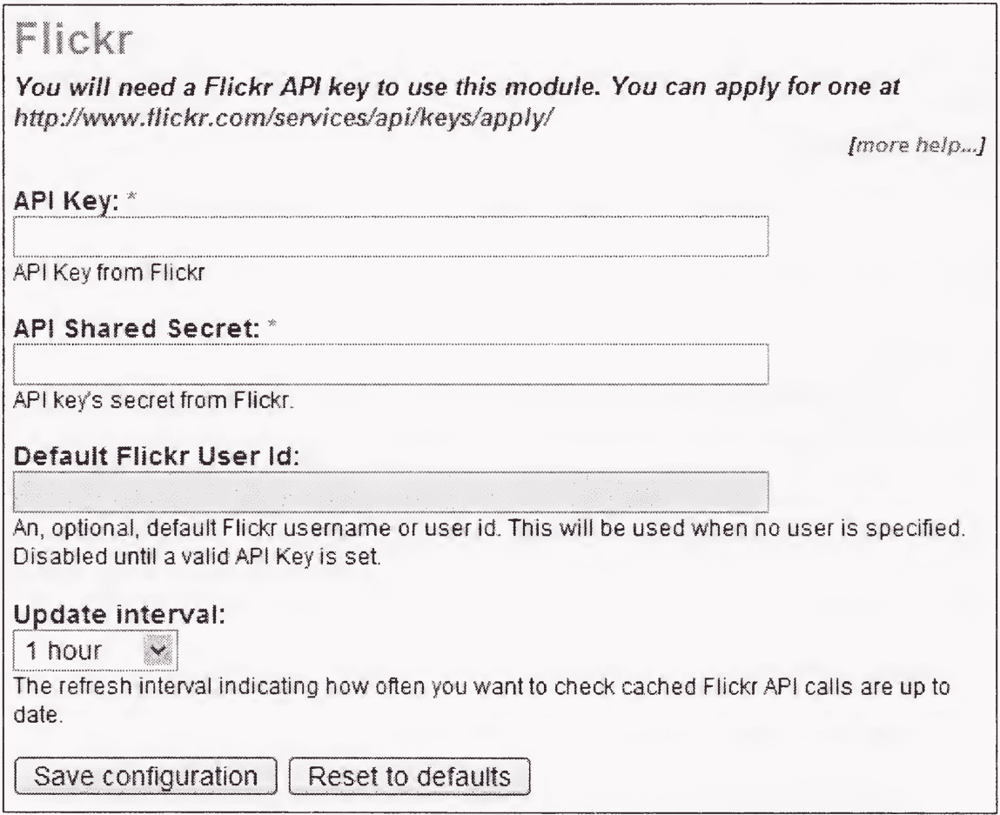

+   4. 输入此信息后，点击**保存配置**。

+   5. 现在我们可以通过从“管理”菜单中选择**网站配置**，然后选择**输入格式**，来构建一个允许我们将 Flickr 图片嵌入内容的输入格式。

+   6. 接下来，点击**添加输入格式**开始构建新格式。


7. 我们将把输入格式命名为 **Flickr**，并仅启用 **Flickr linker** 过滤器。

```
☑ Flickr linker
Insert photos or photosets from Flickr without tags: [flickr-photo:id=230452326]
```

8. 点击 **Save configuration** 以完成输入格式的构建。

9. 我们现在可以在新页面或现有页面中使用新的输入格式。我们将修改 **About page** 以包含来自 Flickr 的图片。导航到 **About page** 然后选择 **Edit** 链接。

10. 我们将修改描述以包含 Flickr 图片，并将 **Input format** 更改为 **Flickr**，如下截图所示：。

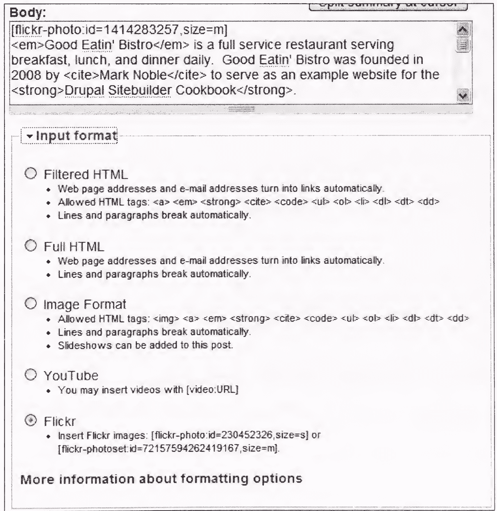

11. 保存后，结果页面如下所示：

# About Good Eatin'

Page About Good Eatin' has been updated.


Good Eatin' Bistro is a full service restaurant serving breakfast, lunch, and dinner daily. Good Eatin' Bistro was founded in 2008 by Mark Noble to serve as an example website for the Drupal 6 Site Builder Solutions

12. 除了嵌入图片外，您还可以嵌入 photosets，这是一种一次向网站添加多个图片的简便方法。要使用 photoset，首先在 Flickr 上创建 photoset，然后使用以下形式的过滤器将其嵌入 [flickr-photoset:id=72157594262419167,size=m]。

## Adding Google maps

地图对于引导客户前往您的商店，或帮助他们了解某个地区、社区或城镇非常宝贵。Google 提供了一个非常强大的映射解决方案，您可以免费将其嵌入到您的网站中。

## Getting a Google maps API key

Good Eatin' Goal: 获取 Google Maps API 密钥，这将使我们能够将地图嵌入到我们的网站中。

Additional modules needed: None.

## Basic steps

如果您想在网站上使用一个或多个 Google 地图，Google 要求您从他们那里获取一个密钥。这是一个非常简单的过程。

- 1. 完整流程在 Google 的网站上描述，网址为：
  `http://code.google.com/apis/maps/signup.html.`
  
- 2. 如果您还没有 Google 账户，您需要注册一个新账户。
  
- 3. 注册账户后，您需要阅读并接受服务条款，输入您网站的 URL，然后点击 **Generate API Key**，如下截图所示：

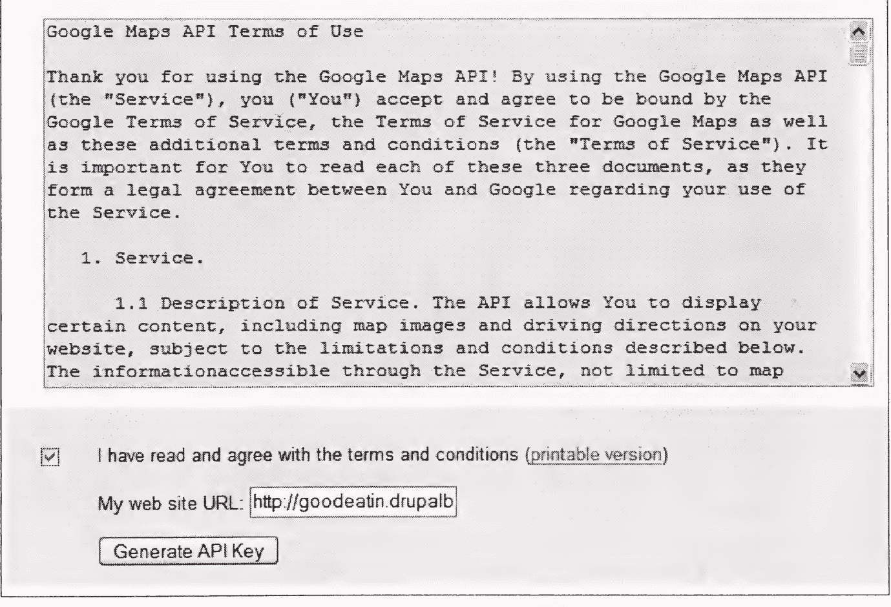

- 4. 点击 **Generate API Key** 后，Google 将向您发放一个长字符串，您需要将其用作密钥。请确保将此密钥保存在安全的地方，以便以后使用。

## Insert a simple map with GMapEZ

Good Eatin' Goal: 在网站的新页面中添加一个基本地图。我们将控制其居中位置以及缩放级别。

Additional modules needed: GmapEZ (http://drupal.org/project/gmapez).

## Basic steps

- 1. 首先安装并激活 GmapEZ 模块。
- 2. 我们现在需要通过点击 Site configuration 然后点击 GmapEZ 来输入我们的 API 密钥。配置选项如下截图所示：

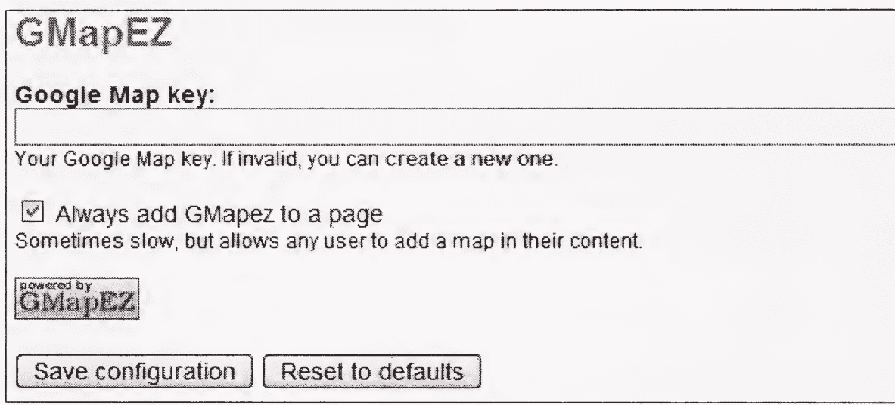

只需输入您的地图密钥然后点击 Save configuration。您现在可以开始向页面添加地图了。

- 3. 我们将创建一个包含名为 Our Locations 的地图的新页面。选择 Create content 然后从导航菜单中选择 Page。
- 4. 要将地图插入页面，您需要在页面上输入类似以下内容的块。您还需要将输入格式修改为包含 div 的格式。您甚至可以专门为地图创建一个格式。

```
<div class="GMapEZ GSmallMapControl" style="width: 600px; height: 480px;">
<a href="http://maps.google.com/maps?q=111%20Main%20Street, %20Parker,%20CO"></a>
</div>
```

- 5. 按照上述信息，页面将如下所示：

# Our Locations

Page Our Locations has been updated.

Good Eatin' has several locations offering our fine cuisine. Just click on a location to get information.

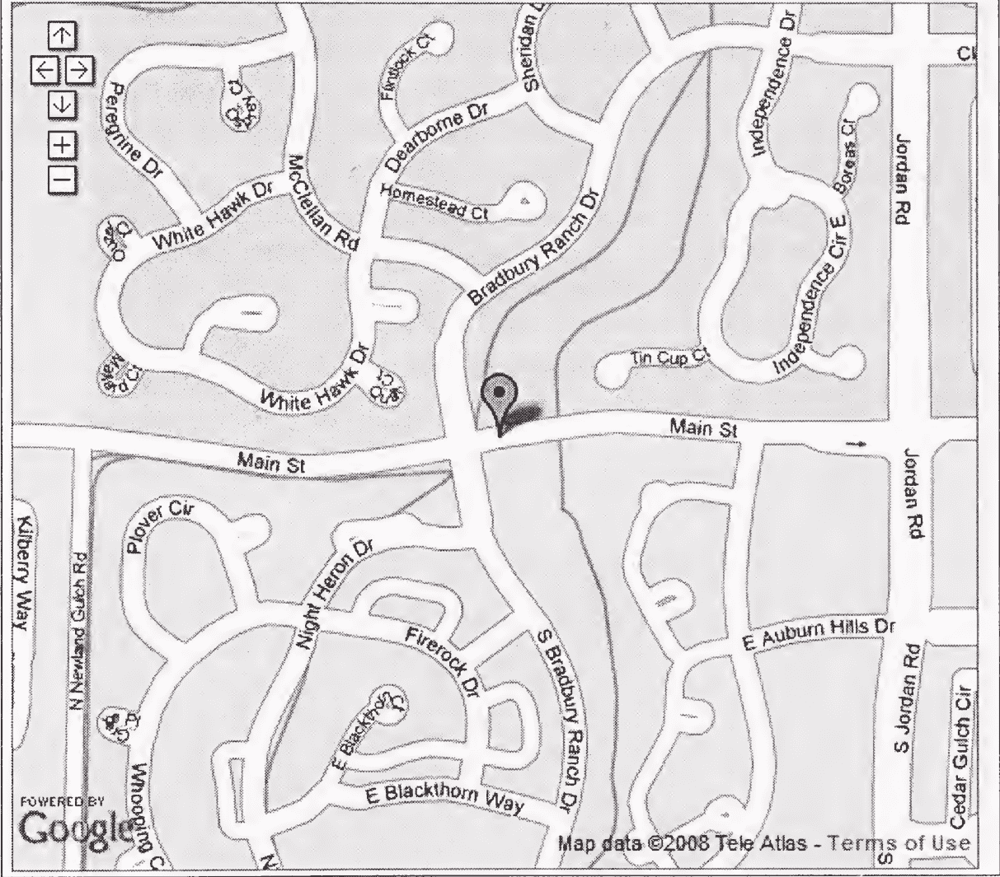

6. 您可以通过修改 URL 中 q 之后的部分来指定地图的中心。这可以是实际的街道地址、知名建筑或纪念物的名称，或特定的纬度和经度。您可以通过在 maps.google.com 上检查来验证 Google 是否能够找到该地址。

基于地址或地名的 URL 示例是：

```
q=Washington+Monument
```

基于特定纬度和经度的 URL 示例是：

```
ll=39.521985,-104.784765
```

您可以从 GPS 或 Google 地图获取纬度和经度。

构建自己的 URL 时，请确保将所有空格替换为 + 符号或 %20，因为 URL 中不允许有空格。

- 7. 您也可以通过在 Google 地图上找到所需位置然后将其复制并粘贴到 `<a>` 标签中来构建 URL。
  
- 8. 要更改页面上地图的大小，只需修改 div 标签中指定的宽度和高度即可。
  
- 9. 如果地图未出现，请确保您的输入过滤器允许在内容中包含 div 标签。如果默认设置不允许 div，您可能需要更改页面的活动 **Input filter**。
  
- 10. 如果您想在地图上指定多个位置，您只需以 `<a>` 标签的形式添加多个链接即可。使用多个标记时，您必须在所有链接中包含纬度和经度。如果不包含，则只会显示第一个标记。
  
- 11. 带有多个标记的地图示例如下截图所示：

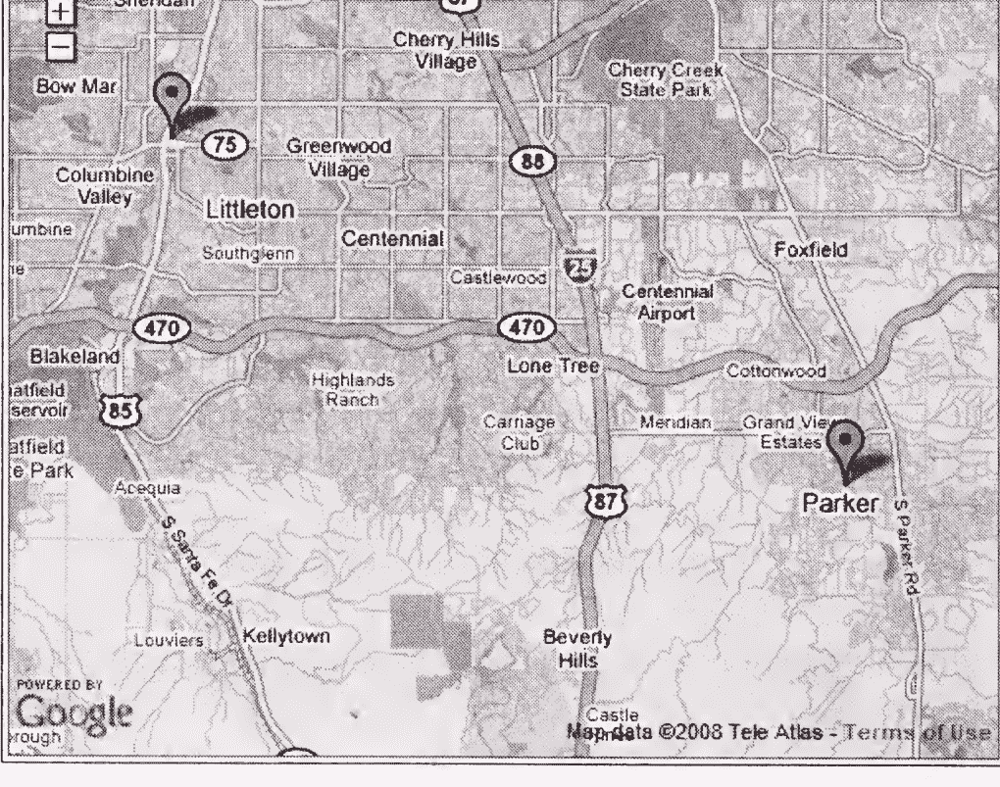

## Displaying content in pop-ups

Good Eatin' Goal: 通过在访客点击我们的图钉时显示弹出气球来增强我们的地图位置。

Additional modules needed: GmapEZ (http://drupal.org/project/gmapez).

## Basic steps

如果您玩过您的地图，您可能已经注意到点击图钉时没有可用信息。Google 允许您在图钉中显示信息。为此，我们将使用以下步骤：

- 1. 向位置添加弹出信息窗口非常容易。您只需添加一个包含信息窗口内容的 div 标签即可。
- 2. 编辑包含地图的页面以便更改内容。
- 3. 我们现在将使用以下信息编辑 Parker 位置以添加信息窗口：
- 4. 当用户点击时，结果信息窗口将如下所示：

```
<a href="http://maps.google.com/maps?q=111+Main+Street,+Parker,+CO&ie=UTF8&ll=39.521985,-104.784765&spn=0.030853,0.077248&z=14&iwloc=cent">
</a>
<div>
Our original Parker location sets the bar.
At 111 Main Street
Call 555-111-2222 for reservations
</div>
```

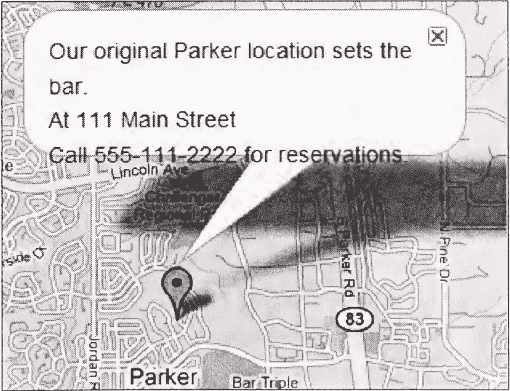

- 5. 您还可以将图片添加到信息窗口中，除了文本之外。
- 6. 如果您向一个链接添加多个 div，信息窗口将以多个标签显示，每个 div 一个。

## Using links to change the map

Good Eatin' Goal: 为每个餐厅位置添加链接并使地图自动放大到该位置。

Additional modules needed: GmapEZ (http://drupal.org/project/gmapez).

## Basic steps

如果您希望客户能够轻松地从一个位置跳转到另一个位置，您可以在地图周围的文本中添加链接，这将导致 GmapEZ 自动将地图重新居中到您链接到的位置。

- 1. 您首先需要为每个锚点 (<a>) 标签添加 ID。
- 2. 例如，我们将按如下方式修改我们的链接。
  ```
  <a id="original" href="http://maps.google.com/maps?q=111+Main+Street,+Parker,+CO&ie=UTF8&ll=39.521985,-104.784765&spn=0.030853,0.077248&z=14&iwloc=cent">
  </a>
  ```
- 3. 我们现在可以通过创建如下另一个锚点标签从文本链接到该位置：
  ```
  <a href="#original" class="ZOOM">Original Location</a>
  ```
- 4. #original 表示浏览器应链接到同一页面上 ID 为 original 的锚点标签。

## Content sharing, bookmarking, and twittering—oh my!

在为您的网站构建高质量内容后，您需要确保每个人都知道它。做到这一点的最佳方法之一是让您的客户将您内容添加到 Digg、del.ico.us、technorati 等社交书签网站。

## Diggin' Digg It with DiggThis

Good Eatin' Goal: 给我们的客户提供在 Digg 上投票的机会，以帮助吸引流量到该网站。


需要额外模块：DiggThis (http://drupal.org/project/diggthis)。

### 基本步骤

Digg 是人们在互联网上发现内容的热门场所。其工作原理是允许社区成员将内容提交到该网站，然后允许任何人通过选择 Digg It 为内容投票，或通过选择 Bury It 对内容投票。访客还可以对内容发表评论，以提供有关其投票的更多信息。投票数最多的内容会排在主页和网站各部分的顶部。

1. 首先安装并激活 DiggThis 模块。
2. 你可以通过从 Administer 菜单中选择 Content management 然后选择 DiggThis 来配置 DiggThis 模块。
3. 第一个配置选项控制链接的显示方式以及应为其添加 Digg 按钮的内容类型。

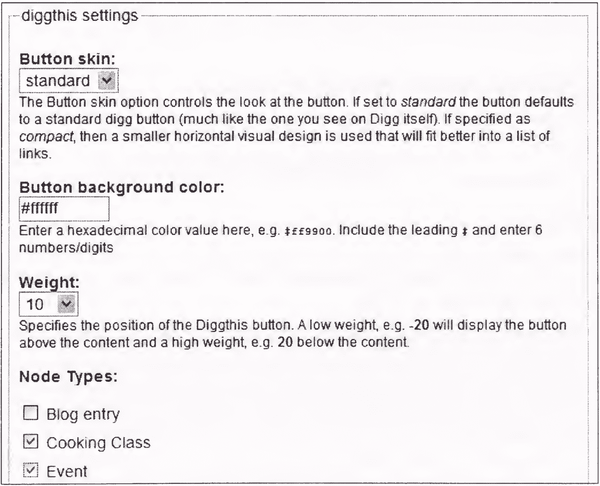

4. 我们还可以控制 Digg 的一些额外 **API settings**。这些设置控制 Digg 更新的频率，以及显示中应使用的域名。

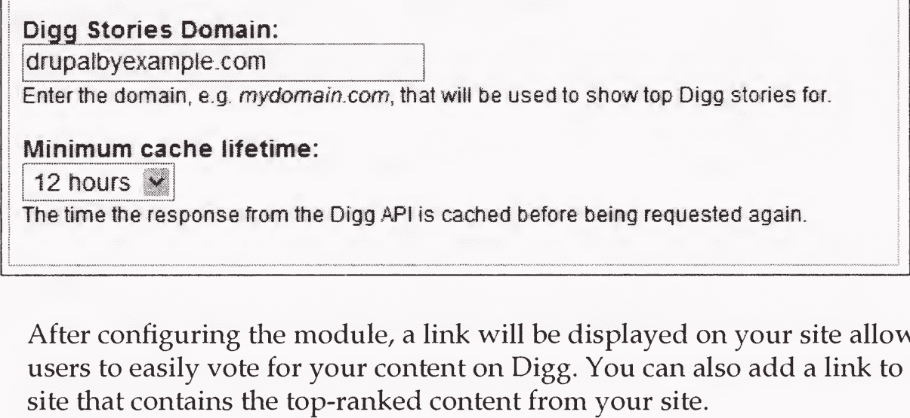

5. 配置模块后，你的网站上将显示一个链接，使用户可以轻松地在 Digg 上为你的内容投票。你还可以添加一个链接到包含你网站上排名靠前的内容的站点。

## 为 del.icio.us 标记内容！

*Good Eatin' Goal:* 允许你根据指定的标签从 `del.icio.us` 消费内容。

*Additional modules needed:* Delicious (`http://drupal.org/project/delicious`)。

### 基本步骤

**del.icio.us** 或 **delicious.com**，允许你使用一个或多个标签来组织你的书签。你还可以与其他用户共享你的书签列表，并按受欢迎程度或按标签搜索书签。

1. 要开始使用 **del.icio.us**，请安装并激活 **del.icio.us** 模块。
2. 要配置 **del.icio.us** 模块，请从 **Administer** 菜单中选择 **Site configuration** 然后选择 **delicious**。请注意，由于 “delicious” 的第一个字母未大写，该模块可能出现在页面的底部。
3. **del.icio.us** 模块提供了多个设置，控制是否尝试自动生成标签，以及应在哪些页面上生成 **del.icio.us** 标签。

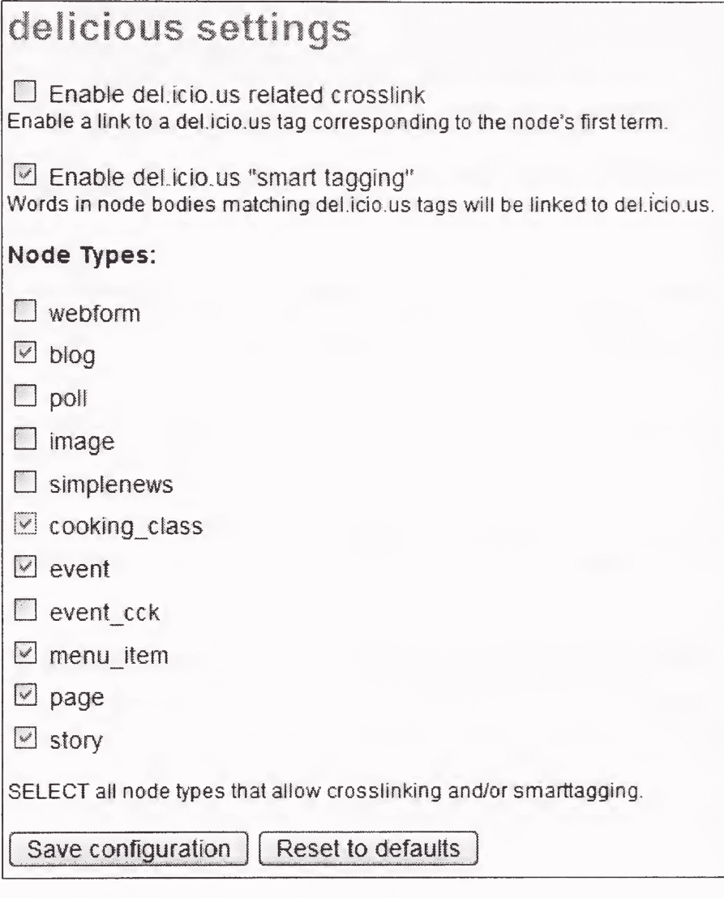

我们将 **cooking_class** 和 **event** 类型添加到模块提供的默认值中。

4. 你需要设置多个权限才能正确访问标签。

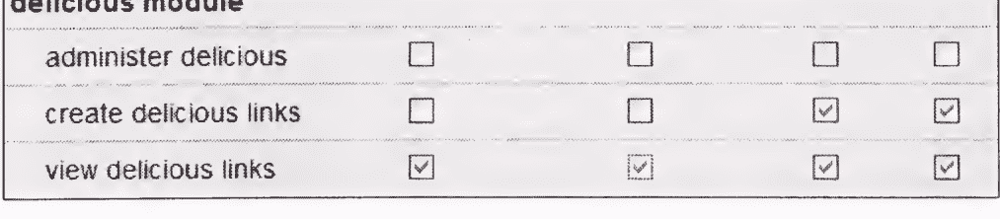

5. 可以通过从 **Administer** 菜单中选择 **User management** 然后选择 **Permissions** 来设置权限。

## 发布时推特

*Good Eatin' Goal:* 每次网站内容更新时提供 Twitter 通知，以确保客户始终保持最新状态。

*Additional modules needed:* Twitter (`http://drupal.org/project/twitter`)。

### 基本步骤

Twitter 允许用户以频繁的间隔发布非常简短的消息，以便其他人可以了解他们正在做什么。你可以订阅某人以跟随他们所做的一切，或搜索特定帖子。

安装并激活 **Twitter module** 后，每当具有所需权限的用户添加新帖子时，都会通过 Twitter 发送一条消息。你可以控制要向 Twitter 发送消息的节点类型，以及帖子应如何格式化，设置在 **Twitter settings** 中。可以通过从 **Administer** 菜单中选择 **Site configuration** 然后选择 **Twitter setup** 来访问 Twitter 设置。

## 使用服务链接进行社交书签

*Good Eatin' Goal:* 允许客户轻松地将我们的内容添加到多个不同的社交书签网站。

*Additional modules needed:* Service Links (`http://drupal.org/project/service_links`)。

### 基本步骤

如果你想同时显示多个社交书签链接，可以使用 **Service Links** 模块。如果你需要许多链接并且不需要对每个单独站点进行特定控制，这将很有用。

1. 首先安装并激活 **Service Links** 模块。
2. 可以通过从 **Administer** 菜单中选择 **Site configuration** 然后选择 **Service Links** 来配置 Service Links 选项。
3. 需要做的第一个配置是设置要为其显示链接的节点类型，如下所示：

我们还可以选择包含搜索链接，如以下屏幕截图所示：

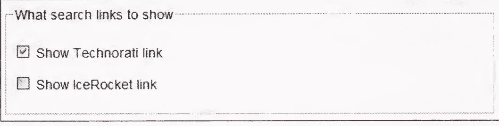

6. 最后的配置步骤是告诉 **Service Links** 模块链接应显示在何处，以及它们应显示为图像链接、文本链接还是两者兼有。

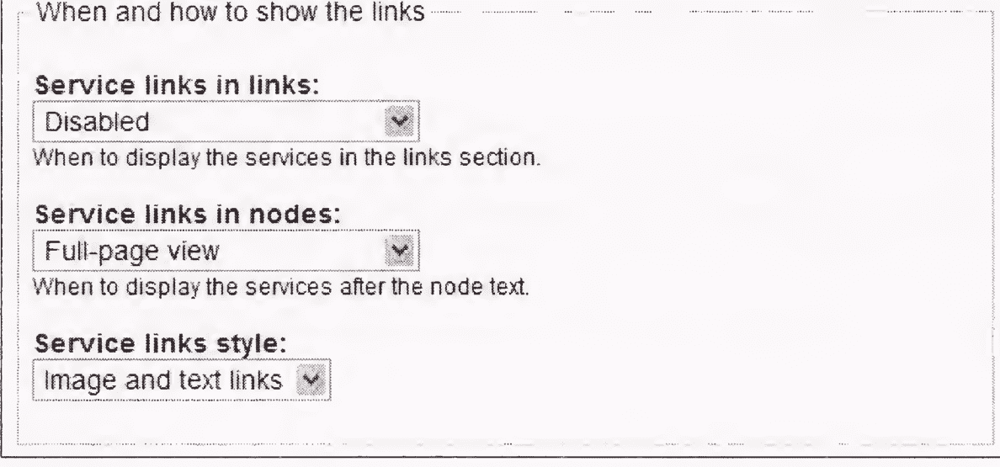

7. 使用这些设置，最终显示将如下所示：

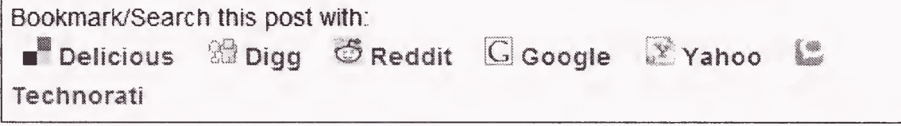

## 总结

在本章中，我们探索了多种将你的网站与世界各地其他开发人员和其他公司创建的网站集成的方法，要么将他们网站的信息包含到你的网站中，要么将你网站的信息发布给他们。

包含来自其他网站的内容是构建新内容的一种极其强大的方式，而无需花费数百和数千小时以及宝贵的资源来开发其他开发人员已经创建的功能。这使你能够专注于你的核心业务以及对你的网站成功至关重要的功能的开发。

在下一章中，我们将讨论提供免费内容给访客的各种方式，以及通过下载菜单、图片、宣传册或其他内容向他们传输信息的方式。

## 免费赠品和下载

在本章中，我们将探索向你的网站添加下载的各种方式，以提供免费内容，或向用户提供付费内容。我们还将讨论页面自动转换为 PDF 文件的过程，你的用户可以下载以阅读或打印。

免费内容是建立客户忠诚度的绝佳方式。根据你提供的内容，你还可以让你的品牌始终呈现在人们面前。例如，一个简单且做工精美的屏幕保护程序或桌面背景可以始终将你的标志保留在客户的桌面上。当然，你需要确保免费内容的质量尽可能高，以确保客户实际上会使用该内容。

许多访客希望打印内容或将其保存到计算机上，以便在不在线或不在计算机上时稍后使用。我们将自动构建 PDF 文件，以为访客提供这种便利。

如果你允许访客从你的网站下载内容，你需要小心确保你的网站安全性是可靠的，这样不法用户就无法下载你不希望他们访问的内容。我们将在本章中讨论如何保护你的内容。

### 向网站添加下载和 PDF

在本节中，我们将讨论如何向网站添加下载和 PDF。

### 控制文件如何下载

*Good Eatin' Goal:* 确保 Drupal 对上传的任何文件都有完全控制权，以便我们可以指定谁可以下载文件。

*Additional modules needed:* 无。

### 基本步骤

Drupal 允许你将下载设置为 Public 或 Private。公共设置没有任何额外的下载安全。私有设置允许 Drupal 保护和管理下载的文件。

你可以使用文件系统设置来控制此功能，该设置可通过从 Administer 菜单中选择 Site configuration 然后选择 File system 获得，如以下屏幕截图所示：

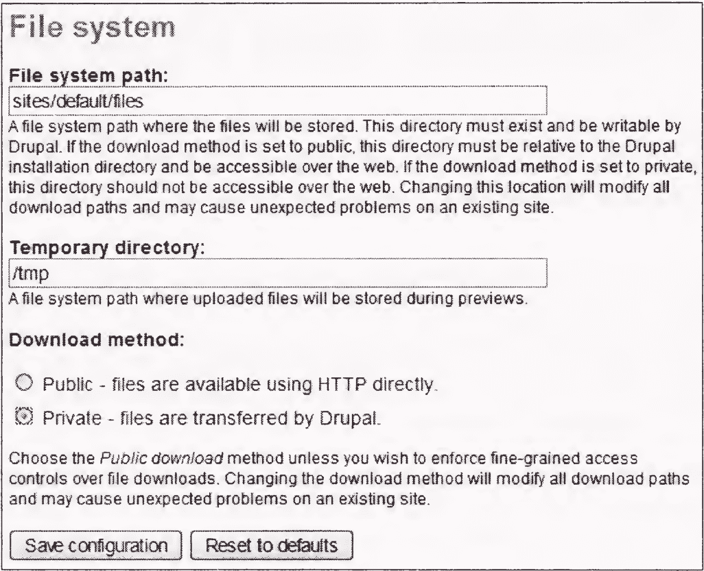

由于我们希望 Drupal 为下载的文件提供额外的安全性，我们将选择 Private 设置然后保存配置。

你还可以控制文件在网站上的存储位置，并指定在文件传输期间使用的临时位置。在大多数情况下，默认值是可以接受的。但是，你可能需要根据服务器和网站的配置自定义目录。如果你使用私有下载方法，文件系统路径不应通过网络浏览器访问。为了确保目录无法通过网络浏览器访问，你应该选择一个不在 Drupal 安装内的文件夹。它也不应位于你的根网络文件夹内。在大多数系统上，根网络文件夹名为 htdocs。如果你不确定你的根网络文件夹是什么，请咨询你的网络托管商。一些托管公司不允许你在根网络文件夹之外创建文件夹。如果是这种情况，你可以联系你的主机，看看他们是否可以破例，否则你将不得不使用公共下载方法。


5. 要将文件添加到页面，请展开文件附件部分。该部分显示如下：

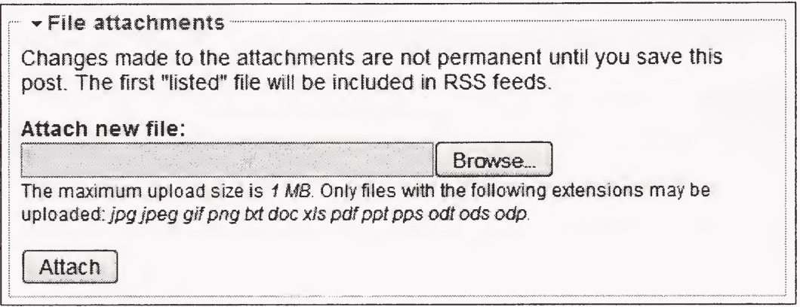

6. 现在您可以浏览要上传的文件，然后在选择后单击附加。

7. 文件附加后，它将按如下所示列在表单上：

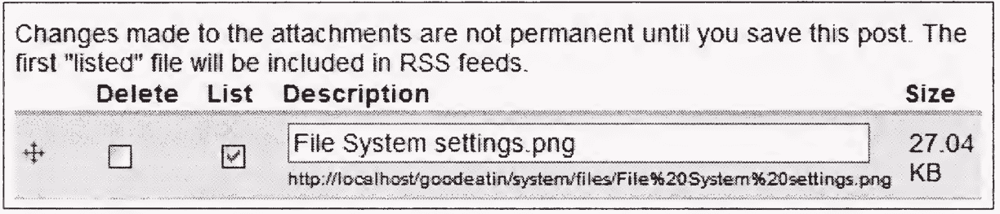

8. 保存新页面后，具有适当权限的用户可以通过单击链接下载文件。您也可以在页面的文本中添加链接。

## 向用户发送正确的文件类型

Good Eatin' Goal：确保向浏览器发送正确的文件类型，以便访客计算机能够准确确定如何处理它。

Additional modules needed：File MIME (http://drupal.org/project/filemime)。

### Basic steps

随着您向站点添加可下载文件，重要的是要确保访客的浏览器知道如何显示文件。对于网站，这是通过设置文件的 MIME 类型来完成的。一些常见 MIME 类型是：

- text/html：标准网页
- text/csv：逗号分隔文件
- `text/plain`：无格式纯文本
- `audio/mpeg`：音频 mpeg1 和 mpeg2 文件
- `audio/mp4`：音频 mp4 文件
- `image/jpeg`：JPEG 编码图像文件
- `image/gif`：GIF 编码图像
- `application/pdf`：PDF 文档
- `application/javascript`：用 Javascript 编写的脚本文件

Drupal 如何处理每种文件类型的完整列表可以在以下位置找到：

`http://api.drupal.org/api/function/file_get_mimetype`。

**File MIME** 模块会根据文件扩展名自动检测文件类型，并设置适当的 MIME 类型，然后将其返回给浏览器。

要使用 File MIME 模块，请执行以下步骤：

- 1. 下载、安装并激活 **File MIME** 模块。
- 2. 通过从 **Administer** 菜单中选择 **Site configuration** 然后选择 **File MIME** 来配置模块。该模块允许您指定 `mime.types` 文件的位置，该文件随您的 Web 服务器一起安装。Apache Web 服务器将此文件安装在 `httpd.conf` 文件所在的同一目录中。

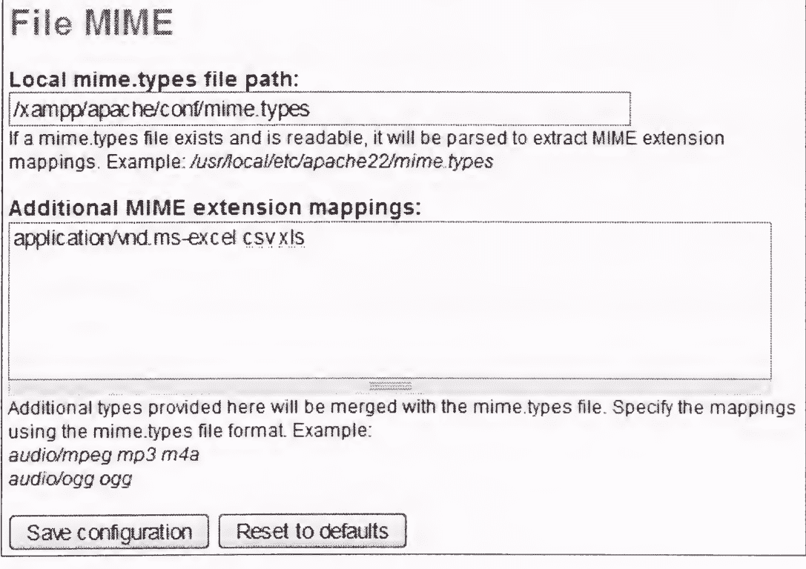

3. 您还可以为特定文件类型添加额外的映射。例如，如果您知道大量用户运行基于 Windows 的机器并希望将 .csv 文件下载到 Excel 中，您可能希望将 .csv 文件视为 Microsoft Excel 文件。您可以通过在设置中添加以下行来实现，如前面的屏幕截图所示：

```
application/vnd.ms-excel csv xls.
```

4. 模块正确配置后，每次下载文件时，模块都会自动设置正确的 MIME 类型。

## 强制文件下载

Good Eatin' Goal：即使文件可以在浏览器中显示，也强制下载文件。

Additional modules needed：File Force (http://drupal.org/project/file_force)。

### Basic steps

在上一节中，我们讨论了自动设置 MIME 类型，以便浏览器可以正确处理文件。但是在某些情况下，您可能希望文件始终保存到用户的计算机，即使它是浏览器可以读取的常见文件类型。例如，您可能希望 PDF 文件或图片下载到客户计算机，即使所有现代浏览器都可以在浏览器中显示这些类型的文件。

要使用 File Force 模块，请下载、安装并激活它。

File Force 模块不需要任何配置，因此您可以立即开始使用。要使用 File Force 模块，您只需在任何可下载内容的链接前加上文本 download。因此，如果您有一个名为的链接：

/sites/default/files/song.mp3

您希望用户始终下载，您将链接替换为 /download/sites/default/files/song.mp3。File Force 然后会修改返回给浏览器以指示文件应下载而不是显示或播放的信息。

```
/download/sites/default/files/song.mp3
```

如果您未在链接中添加 download 前缀，File Force 模块将不会更改下载行为，因此您可以将文件作为下载或作为立即播放链接提供。

## 跟踪下载次数

Good Eatin' Goal：跟踪已完成的下载次数，以便我们可以衡量促销的有效性。

Additional modules needed：Download Count (http://drupal.org/project/download_count)。

### Basic steps

如果您想确定下载的有效性，您应该跟踪每个文件被下载的次数。Download Count 模块专门设计用于帮助您完成此操作。

- 1. 首先，下载并安装 Download Count 模块。
- 2. 下载计数器可以通过从 Administer 菜单中选择 Site configuration 然后选择 Download counter 来配置。
- 3. 最重要的配置是定义应包含在下载计数器中的文件扩展名，以及应忽略的文件扩展名。

忽略某些文件扩展名

Excluded file extensions:
jpg jpeg gif png
该模块仅考虑使用上传模块上传并成为文件附件的文件。但是，如果您使用的是贡献模块来上传图像并在节点正文中显示它们，则这些文件每当访客或机器人查看节点页面时都可能被标记为已下载，因为严格来说它们是文件附件。这在使用 img_assist 模块时会发生。请注意，这不会发生在 imce 模块中，因为 imce 将内联图像视为节点。如果您不想为图像文件设置下载计数器，请在此处列出其扩展名。用空格分隔扩展名，不要包含前导点。例如，您可以列出这些扩展名：jpg jpeg gif png。如果您不想排除任何文件，请将该字段留空。

根据站点的配置方式，您可能希望在要从统计中排除的扩展名列表中添加或删除扩展名。

4. 您还可以配置是否向管理员显示下载计数器，并且还可以向统计页面添加更多信息，该页面位于 yoursite.com/download_counter。这些选项在以下屏幕截图所示：


5. 您还可以通过从 Administer 菜单中选择 User management 然后选择 Permissions 来配置下载计数权限。可用权限在以下屏幕截图所示：

| Permission | anonymous user | authenticated user | blogger | moderator | Store Administrator | VIP user |
|---|---|---|---|---|---|---|
| download_count module |  |  |  |  |  |  |
| administer download counter | ☐ | ☐ | ☐ | ☐ | ☐ | ☐ |
| view all downloads count | ☐ | ☐ | ☐ | ☐ | ☐ | ☐ |
| view all downloads count in nodes | ☐ | ☐ | ☐ | ☐ | ☐ | ☐ |
| view own nodes downloads count | ☐ | ☐ | ☐ | ☐ | ☐ | ☐ |
| view own nodes downloads count in nodes | ☐ | ☐ | ☐ | ☐ | ☐ | ☐ |

6. 单个页面的下载计数显示如下：

| Attachment | Size | Hits | Last download |
|---:|---:|---:|---|
| File System settings.png | 27.04 KB | 2 | 4 sec ago |
| 6403_03_1stDraft.odt | 865.5 KB | 1 | 24 sec ago |
| 6403_02_1stDraft_WIP.odt | 2.77 MB | 0 | Not yet downloaded |

正如您所见，此页面显示每个文件被下载的次数以及上次下载的时间。

7. 您还可以通过导航到 yoursite.com/download_counter 来查看所有可下载文件的统计信息。生成的页面格式如下：

### Download counter

| filename | hits | last download | action |
|---:|---:|---:|---|
| File System settings.png | 2 | 2 min 29 sec ago | view Page |
| 6403_03_1stDraft.odt | 1 | 2 min 49 sec ago | view Page |

此页面显示所有已下载的文件，无论它们在哪个页面上，您还可以根据需要对文件进行排序。

## 允许用户浏览文件

*Good Eatin' Goal：* 为用户提供直观的界面，以便查看哪些文件可供下载，并为每个文件提供附加信息。

*Additional modules needed：* Filebrowser (http://drupal.org/project/filebrowser)。

### Basic steps

filebrowser 模块允许访客轻松浏览站点上的可下载文件。

- 1. 首先下载并安装 **filebrowser** 模块。
- 2. 为了在目录中显示文件列表，我们需要创建一个 **Directory Listing** 页面。为此，首先从 **Navigation** 菜单中选择 **Create content** 然后选择 **Directory listing**。


- 5. 点击文件名会在浏览器中打开该文件，点击目录则会打开该目录。

- 6. filebrowser 模块提供多种权限，让你控制谁可以创建目录列表，以及谁可以编辑和删除目录列表。

| Permission | anonymous user | authenticated user | blogger | VIP user |
|---|---|---|---|---|
| filebrowser module |  |  |  |  |
| create directory listings | ☐ | ☐ | ☐ | ☐ |
| delete any directory listings | ☐ | ☐ | ☐ | ☐ |
| delete own directory listings | ☐ | ☐ | ☐ | ☐ |
| edit any directory listings | ☐ | ☐ | ☐ | ☐ |
| edit own directory listings | ☐ | ☐ | ☐ | ☐ |
| view directory listings | ☐ | ☑ | ☐ | ☐ |

你可能只想允许已认证用户查看目录列表，以提供额外的注册激励。

## 自动为页面生成 PDF 文件

Good Eatin' 目标：生成我们页面的 PDF 文件，以便用户可以自动下载页面以便打印或离线使用。

所需额外模块：Printer、email 和 PDF (http://drupal.org/project/print)。

### 基本步骤

随着你继续完善你的网站，你会发现许多用户希望访问你的内容，即使他们不在线。使用 Printer、email 和 PDF 模块，你可以轻松且自动地以各种格式提供内容以供离线使用。

- 1. 首先，下载并安装 Printer、email 和 PDF 模块。


- 2. 现在你可以通过从 Administer 菜单中选择 Site configuration 然后选择 Printer-friendly pages 来配置模块的基本选项。

- 3. 通过点击 Settings 选项卡可以访问常规设置。这些设置如下所示，包括美化可打印页面的选项，以及确定是否在页面上显示 URL 和评论。你还可以控制页面如何打开，以及在页面上显示哪些徽标。


通过展开 **Source URL** 部分，你可以使页面的 URL 包含在打印输出中。你还可以选择性地将页面生成时的日期和时间添加到打印输出中。

- 4. 可打印页面（网页）配置选项包括多种选项，用于控制可打印版本链接的显示方式，以及可打印页面的显示方式。


- 5. 我们已将 **Printer-friendly page link** 修改为位于 **Content corner** 而非 **Links area**。你还可以选择性地在新窗口中显示可打印页面并自动调用打印功能，按需进行。

- 6. 打开 **Advanced link options** 会为你提供有关链接如何显示以及应在哪些页面上显示的额外选项，如以下屏幕截图所示：


- 7. **Robots META tags** 部分允许你阻止搜索引擎索引你的可打印版本，这将有助于确保访客仅被引导至你的在线内容。这还可以帮助防止搜索引擎因重复内容而施加惩罚。

- 8. 要创建 PDF，我们需要安装第三方工具来处理转换。你可以从以下位置获得的 TCPDF 或 dompdf 中选择：

  - `TCPDF`: http://tcpdf.org
  - `dompdf`: http://www.digitaljunkies.ca/dompdf/faq.php

你可以安装并使用其中任何一个。你也可以同时安装两者，并在评估哪一个最能满足你网站需求时在两者之间切换。

- 9. 安装 TCPDF 和/或 dompdf 后，你可以在 Printer-friendly pages 配置中访问 PDF 选项卡页。

- 10. PDF 生成选项与可打印网页选项类似，但有一些补充。首先，你需要选择要使用的生成工具，如以下屏幕截图所示：


- 11. 你还可以控制 PDF 中使用的纸张尺寸和方向，以及字体大小，以及 PDF 创建后是否应显示，如以下屏幕截图所示：


- 15. 允许访客通过电子邮件向其他用户发送页面，其配置方式与配置 PDF 生成类似。在 Printer-friendly pages 配置页面中，你只需点击 e-mail 选项卡以编辑设置，如以下屏幕截图所示：


- 16. 设置较低的每小时阈值以限制可以发送的电子邮件数量是个好主意，以防止用户滥用此功能。保持启用 Send only the teaser 选项是确保电子邮件收件人被引导至你的网站阅读其余内容的绝佳方式。

- 17. 当客户想要通过电子邮件发送内容时，他们只需点击页面上出现的 Send to a friend 链接。Drupal 然后会显示类似以下屏幕截图的表单：


- 18. 客户点击 Send e-mail 后，网站将为客户生成电子邮件并发送给指定收件人。

### 总结

在本章中，我们回顾了一些充分利用可下载内容的方法。只要你提供高质量的可下载内容，你的客户就会感谢你提供的有用内容。作为回报，你获得了向客户营销的机会。

网站的可下载内容数量将根据网站的目标以及网站访客的需求而有所不同。

我们还讨论了为离线使用以及打印自动创建 PDF 文件。这是一种让用户即使在不主动在线浏览网站时也能使用网站的好方法。

在下一章中，我们将创建一个外带菜单，让我们的客户可以从中订购，然后在线支付订单。

## 在线订单和支付

许多商业网站的常见目标是将其网站与其商店集成，接受预订并接受付款。

例如，零售商店可能会允许客户浏览其商店库存，然后购买商品以便送货或在商店提货。沙龙可能会允许顾客查看可用的预约时间，选择预约时间，并选择在线预付预约费用。

对于 Good Eatin' 网站，我们将允许客户查看外带菜单，选择他们想要购买的商品，然后在线支付订单。订单提交后，订单将通过电子邮件发送给厨房工作人员，以便他们开始准备订单。订单也可在网上查看。

### 外带订购

为了扩展其服务，Good Eatin' 正在增加一个外带菜单，允许顾客从可供取用的特殊菜单中选择。顾客下单后，他们可以在线支付或在店内支付。订单发送到厨房准备食物。当顾客到达 Good Eatin' 时，他们的热餐已准备好等待他们带回家给家人。

### 设置购物系统

Good Eatin' 目标：设置系统，允许访客从网站购买外带商品。

所需额外模块：Ubercart (http://drupal.org/project/ubercart)。

### 基本配置

要在网站内使用电子商务解决方案，你必须从头构建解决方案或使用现成的解决方案。由于从头构建专业的电子商务解决方案需要一整本书和数周或数月的时间，我们很幸运拥有 Ubercart，这是一个为 Drupal 量身定制的专业质量电子商务解决方案。

要开始使用 Ubercart，请下载并安装该模块。要使用 Ubercart，你还需要安装 Token 模块，可从 http://drupal.org/project/token 下载。我们将首先安装 Cart、Order、Product、Store 和 Conditional actions 模块。还有多种可选启用的模块。我们将在未来主题中探索其中一些。

Ubercart 在 Administer 菜单中安装了一个名为 Store administration 的新菜单，其中包含以下屏幕截图所示的选项：


要开始使用 Ubercart，我们需要编辑配置设置，如以下屏幕截图所示：


点击 **Store settings** 链接可以配置多个选项，这些选项控制站点上信息的显示方式，并可指定站点的一些基本联系信息。

## Name and contact information

- Store name is *not set*.
- Store owner is *not set*.
- Store e-mail is *not set*.
- Store phone number is not set.
- Store fax number is not set.
- Store address is:

## Display settings

- Store admin page display type:
    - Dashboard with collapsed submenu links
- Customer billing address used in lists.
- Footer using random message.

## Format settings

- Default currency: USD
- Currency format: $1,234.56
- Weight format: 36 lb.
- Date format: 08/18/2007

## Reporting settings

- Version information is being reported to Ubercart.org.

要编辑某个部分的设置，请点击该部分标题。在 **Store settings** 页面上，我们只需更新商店的 **Name and contact information**。

如果您的商店不在美国，您还需要修改 **Format Settings**。如果您不在美国或加拿大，**Country settings** 也需要更改。

## Permissions

您还应该通过点击 User management 然后 Roles 来为商店管理创建一个角色。我们将我们的角色命名为 Store Administrator。

| Name | Operations |
|---|---|
| anonymous user | locked edit permissions |
| authenticated user | locked edit permissions |
| blogger | edit role edit permissions |
| VIP user | edit role edit permissions |
| Store Administrator | Add role |

点击 Add role 以完成角色的构建。添加角色后，点击该角色的 edit permissions 链接以定义新角色的权限。

Ubercart 包含多个权限部分，所有这些都以 uc_ 开头，包括：

### Store permissions

| Permission | Store Administrator |
|---|---|
| uc_store module | |
| administer store | ☑ |
| view customers | ☑ |
| view store reports | ☑ |

### Product permissions

| Permission | Store Administrator |
|---|---|
| uc_product module | |
| administer product classes | ☑ |
| administer product features | ☑ |
| administer products | ☑ |
| create products | ☑ |
| create takeout_item products | ☑ |
| delete all products | ☑ |
| delete all takeout_item products | ☑ |
| delete own products | ☑ |
| delete own takeout_item products | ☑ |
| edit all products | ☑ |
| edit all takeout_item products | ☑ |
| edit own products | ☑ |
| edit own takeout_item products | ☑ |

### Order Permissions

| Permission | Store Administrator |
|---|---|
| uc_order module | |
| administer order workflow | ☑ |
| create orders | ☑ |
| delete any order | ☑ |
| delete orders | ☑ |
| edit orders | ☑ |
| view all orders | ☑ |

如果您的网站有员工，您可能还想创建一个单独的角色（或多个角色），以便员工无法完全控制商店。例如，您可能不希望员工能够创建或删除产品，但希望他们能够接收新订单。

## Blocks

为了让网站访客更轻松地查看他们已订购的内容并结账，您可以使用 Block manager 启用 Shopping Cart 块，该管理器可通过从 Administer 菜单中选择 Site building 然后 Blocks 来访问。

| Block | Region | Operations |
| --- | --- | --- |
| Shopping cart* | Left sidebar | configure |

安装模块后需要进行的基本配置选项就是这些。

## Building the take-out menu

Good Eatin' Goal: 创建访客可以订购的外卖菜单。

Additional modules needed: Ubercart (http://drupal.org/project/ubercart)。

### Basic steps

现在我们已经完成了商店的基本配置，我们可以开始向商店添加产品。

1. 产品通过 Product manager 添加到 Ubercart，该管理器可通过从 Administer 菜单中选择 Store administration 然后 Products 来访问。
2. 我们现在可以选择 Manage classes，这将允许我们定义用于构建产品的 content types。我们将输入一个新类，其设置如以下屏幕截图所示：

### Manage classes

[more help...]

| Class ID | Name | Description | Operations |
|---|---|---|---|
| No product classes have been defined yet. | | | |

### Add a class

Class ID: *
takeout_item

此 content type 的机器可读名称。此文本将用于构建此 content type 的创建内容页面的 URL。此名称只能由小写字母、数字和下划线组成。不允许使用破折号。下划线在构建创建内容页面的 URL 时将被转换为破折号。此名称必须对该 content type 唯一。

Class name: *
Take out Item

Description:
可用于外卖或送货的商品。
此文本向管理员描述为此产品类创建的 content type。

Submit

3. 点击 Submit 保存新类。
4. 我们现在可以通过点击 Create content 然后 Take out Item 来创建一个新的 Take out Item。
5. 我们首先输入外卖商品的基本信息，包括名称、SKU、价格和运输信息。如果您将通过送货服务运送产品，您应该输入重量和尺寸，以便 Ubercart 正确计算运费。

### Create Take out Item

Name: *
Pork Dumplings
产品的名称。

Menu settings

Product information

SKU: *
01-01-001
产品 SKU/型号。

List price:
$
标价 MSRP。

Cost:
$
1.57
您商店的成本。

Sell price: *
$
4.49
客户购买价格。

产品及其衍生产品可运输。

SKU（库存保管单位）号码是唯一标识您目录中产品的号码。如果您已有现有目录，您应在此处使用该号码。如果您还没有目录，您可以在此处创建自己的系统。虽然您只需输入商品的售价，但输入 List price 和 Cost 可以帮助您计算每件商品的利润。

6. 您还需要输入商品的描述以及数量信息，如以下屏幕截图所示：


在上面的示例中，我们指定每个饺子订单包含六个单独的饺子。

7. 当您对产品定义满意时，点击 Save 按钮。

8. 生成的产品将类似于以下屏幕截图中显示的产品：

### Pork Dumplings

Take out Item Pork Dumplings has been created.

Submitted by admin on Sat, 09/13/2008 - 10:14

01-01-001

PDF version

$4.49

Delicious Pork dumplings with a fabulous soy ginger dipping sauce. 6 per order.

Price: $4.49

CAPTCHA

Add to cart

Add new comment   Send to friend

9. 要显示完整的产品目录，我们需要激活 Catalog 模块。

10. 一旦 catalog 模块被激活，您可以在 yoursite.com/catalog 访问完整的产品目录。如果您现在打开目录，您会注意到目录是空白的，我们的饺子没有出现。这是因为目录显示取决于 Catalog Taxonomy 是否应用于内容。为了允许分类法应用于我们的“外卖”项目类型，我们需要选择 Content Management 然后 Taxonomy 以打开 Taxonomy manager。然后，编辑 Catalog Taxonomy 并启用 Take out item，如以下屏幕截图所示：

### Content types

Content types:

- Blog entry
- Cooking Class
- Directory listing
- Event
- Event CCK
- Image
- Menu Item
- Newsletter issue
- Page
- Poll
- Product
- Story
- Take out Item
- Webform

Select content types to categorize using this vocabulary

11. 一旦 catalog taxonomy 已添加到 Take out item 类型，我们需要向分类法添加新术语，以便生成目录。我们将使用与构建菜单项分类法时相同的技术构建 breakfast、lunch、dinner 和 dessert 的术语。添加新的 Breakfast 术语的表单如以下屏幕截图所示：


您可以选择为每个术语添加图像。图像将在目录页面上显示，这可以使目录看起来更美观。

12. 我们现在可以编辑我们的 Pork Dumpling 外卖商品以添加正确的分类法项目，如下所示。


13. 可以通过 www.yoursite.com/catalog 访问目录。目录显示如下：


14. 当客户点击目录中的一个类别时，他们会看到该板块中所有可用物品的列表，如下面的“晚餐”类别示例所示：


15. 为了方便客户找到您的目录，您应该创建一个指向目录的菜单项。这可以通过“菜单管理器”完成，其过程与我们在第 2 章中使用的方法相同。您还可以在“区块管理器”中激活“目录”区块。我们将把目录区块添加到右侧边栏，如下面的示例所示：


目录区块现在显示如下：


## 设置支付处理器

Good Eatin' 目标：为网站添加一个支付处理器，该处理器将接受客户的信用卡付款并将款项转给您。

需要的其他模块：Ubercart (http://drupal.org/project/ubercart)。

### 基本步骤

在允许访问者订购我们的产品之前，我们需要设置一个支付处理器，以便通过互联网接受访问者的付款。

- 1. 我们首先添加与付款相关的模块。由于这只是一个演示网站，我们只启用“测试网关”，它允许您在不使用真实货币的情况下测试网站功能。我们还需要启用“付款”模块，该模块将允许我们接受付款。这些模块显示在以下屏幕截图中：


2. 启用这些模块后，我们需要配置付款设置：从“管理”菜单中选择“商店管理”，然后选择“配置”，最后选择“付款设置”。可用设置如下：


因为我们只配置测试付款网关，所以只需要关注“付款方式”部分。

3. 在“付款方式”页面上，如果您接受多种付款方式，则可以设置付款方式的显示优先级。您还可以配置多项设置，以控制信用卡信息在您网站上的处理和存储方式。

4. 第一个也是最重要的部分是“信用卡数据安全”部分。该部分控制信用卡详细信息在您网站上的加密方式。


您需要指定用于存储安全密钥的文件夹。该文件夹应尽可能让最少的用户访问。出于测试目的，您可以选择“在信用卡调试模式下运行”选项，但请记住，在开始接受真实付款之前，应将其禁用。

5. “结账工作流”部分允许您控制信用卡号码在提交给处理器之前是否应进行验证，以及提交订单时是否应处理信用卡。除非您正在测试网站，否则这两个设置都应保持开启。

结账工作流

这些设置会改变结账期间信用卡数据的收集和使用方式。

☑ 在结账时验证信用卡号码。

无效的卡号将向用户显示错误消息，以便他们进行更正。

除非您处于调试模式，否则建议启用此功能。

☑ 在结账时尝试处理信用卡付款。

失败的尝试将阻止结账完成，并显示上面的错误消息。

如果您不在调试模式下，则必须勾选此框才能处理客户的信用卡。

6. 接下来，您可以指定访问者结账时必须填写的字段。

信用卡字段

指定除卡号外还需要从客户那里收集哪些信息。

☑ 在结账表单中启用 CVV 文本字段。

CVV 是信用卡上的一项附加安全措施。在 Visa、Mastercard 和 Discover 卡上，它是一个三位数字；在 AmEx 卡上，它是一个四位数字。如果您的信用卡处理器或付款网关要求此信息，您应在此处启用此功能。

☐ 在结账表单中启用持卡人文本字段。

☐ 在结账表单中启用卡片启用日期字段。

☐ 在结账表单中启用卡片发行号文本字段。

☐ 在结账表单中启用发卡银行文本字段。

☐ 在结账表单中启用卡类型选择。

如果启用，请在下面的文本区域中指定要用哪些卡选项填充选择框。

卡类型选择框选项：

Visa

Mastercard

Discover

American Express

每行输入一种卡类型。如果启用了卡类型选择框，这些字段将填充该选择框。

在大多数情况下，默认设置是可以接受的，除非您的商店遇到大量欺诈交易。如果是这种情况，要求提供更多信息可能会减少欺诈。但是，要求过多的信息可能会使合法访问者更难从您的网站订购。

7. 接下来，您可以指定要接受的卡类型。如果您的商家账户不允许您处理特定类型的卡，您需要在此处将其禁用。

接受的卡类型（用于验证）

使用复选框指定您接受哪些卡类型进行付款。选中的卡类型将在付款方式选择列表中显示其图标，并用于卡号验证。

☑ Visa

☑ Mastercard

☑ Discover

☑ American Express

8. 最后，您可以设置要向客户显示的消息，让他们知道订购时需要提供哪些信息；您还可以定义一条失败消息，在信用卡处理器拒绝购买时显示。

客户消息

您可以在此处修改向使用信用卡的客户显示的消息。

信用卡付款政策：

您的账单信息必须与下面输入的信用卡账单地址一致，否则我们将无法处理您的付款。

显示在结账页面信用卡字段上方的客户说明。

卡处理失败消息：

我们无法处理您的信用卡付款。请核对您的卡信息后重试。如果问题仍然存在，请联系我们完成您的订单。

当结账时尝试付款失败时向客户显示的错误消息。

9. 当您准备通过商家账户、PayPal 或其他类型的付款网关让网站接受付款时，应参阅 Ubercart 文档和您的商家账户文档以获取更多信息。

## 设置订单完成时的通知

Good Eatin' 目标：确保客户提交订单时厨房收到通知，以便厨房能够为客户准备餐点。

需要的其他模块：Ubercart (http://drupal.org/project/ubercart)。

### 基本步骤

- 1. 为了在每次下订单时收到通知，我们将使用**条件操作**。通过从**管理**菜单中选择**站点配置**，然后选择**条件操作**来进行配置。
- 2. 从下面的屏幕截图可以看出，安装 Ubercart 时会自动添加几个操作。


3. 要添加新操作，请单击“添加谓词”链接。这将打开如下所示的表单，您可以在此定义操作的触发器以及操作的名称。


为您的操作输入所需信息，然后单击“保存谓词”。

4. 您现在可以向谓词添加其他条件，以细化触发操作的标准。在我们的案例中，无需进一步细化。

元数据

条件

操作

将订单发送到厨房

条件组

运算符：

● AND。如果所有这些条件都为 TRUE。

○ OR。如果这些条件中的任何一个为 TRUE。

可用条件：

检查订单是否可以发货

添加条件

移除组

添加条件组

保存更改

5. 现在，我们可以通过单击“操作”选项卡来生成我们希望执行的操作。这将显示可以执行的可能操作列表。在我们的案例中，“发送订单电子邮件”操作正是我们需要的。

元数据

条件

操作

将订单发送到厨房

操作

当此谓词通过条件评估时，将按顺序执行这些操作。

可用操作：

发送订单电子邮件

添加操作

保存更改


6. 在你选择了 **发送订单邮件** 操作后，点击 **添加操作**，系统会提示你配置该操作。该操作允许你自定义邮件的发送对象。在我们的案例中，我们希望邮件发送给厨房工作人员。我们还会自定义邮件正文，为他们提供有关订单的额外信息。方括号中的信息 [ ] 在邮件发送前会被实际订单中的信息替换。你可以通过展开 **替换模式** 部分查看所有可能的替换模式列表。


7. 当你对邮件内容满意时，点击 **保存更改**。Drupal 将会在新订单下单时自动向厨房发送通知邮件。

## 示例订单

*Good Eatin' Goal:* 从客户的角度[content]
6. 在你选择了 **Send an order email** 操作后，点击 **Add action**，系统会提示你配置该操作。该操作允许你自定义邮件的发送对象。在我们的案例中，我们希望邮件发送给厨房工作人员。我们还会自定义邮件正文，为他们提供有关订单的额外信息。方括号中的信息 [ ] 在邮件发送前会被实际订单中的信息替换。你可以通过展开 **Replacement patterns** 部分查看所有可能的替换模式列表。


7. 当你对邮件内容满意时，点击 **Save changes**。Drupal 将会在新订单下单时自动向厨房发送通知邮件。

## Example order

*Good Eatin' Goal:* 从客户的角度[content]
6. 在你选择了 **Send an order email** 操作后，点击 **Add action**，系统会提示你配置该操作。该操作允许你自定义邮件的发送对象。在我们的案例中，我们希望邮件发送给厨房工作人员。我们还会自定义邮件正文，为他们提供有关订单的额外信息。方括号中的信息 [ ] 在邮件发送前会被实际订单中的信息替换。你可以通过展开 **Replacement patterns** 部分查看所有可能的替换模式列表。


7. 当你对邮件内容满意时，点击 **Save changes**。Drupal 将会在新订单下单时自动向厨房发送通知邮件。

## Example order

*Good Eatin' Goal:* 从客户的角度走一遍购买流程。

*Additional modules needed:* Ubercart (http://drupal.org/project/ubercart)。

### Basic steps

1. 你可以提供一个链接到 **Catalog** 页面，也可以提供自定义视图或菜单链接，让访客从中选择产品页面。

2. 当访客找到想要订购的产品时，他们可以通过点击 **Add to cart** 按钮将商品加入购物车。

3. 所选商品随后会出现在 **Shopping cart** 中，客户可以在其中增加想要购买的商品数量，或将商品从购物车中移除。


4. 客户对订单满意后，会点击 **Checkout** 继续购买流程。

5. 会显示订单摘要，客户可以输入其账单信息。


客户还需要为订单输入信用卡信息。


6. 当客户对所提供的信息满意时，他们会点击 Review order 按钮。此时，Ubercart 会验证信用卡详细信息并向客户显示订单以供审阅。

### Review order

Your order is not complete. Please review the details of your order and click Submit order if all the information is correct. You may use the Back button to make changes to your order if necessary.

| Cart contents | |
| --- | --- |
| 1x Pork Dumplings | $4.49 |
| Customer information | |
| E-mail: admin@drupalbyexample.com | |
| Billing information | |
| Address: MARK TEST<br>2144 SWALE<br>DENVER, CO 80111 | |
| Payment method | |
| Subtotal: $4.49 | |
| Total: $4.49 | |
| Paying by: Credit card | |
| Card Number: 40120000000011 | |
| Expiration: 4/2012 | |
| CVV: 123 | |
| ► CAPTCHA | |
| Back | Submit order |

7. 如果用户确定信息正确，他们将点击 Submit order 按钮以完成订单处理。

8. 订单完成后，用户会收到通知，订单将出现在订单列表中。

9. 你可以通过从 Administer 菜单中选择 Store administration 然后选择 Orders 来检查任何待处理订单。所有活动订单也将显示供你审阅。


10. 你可以通过点击 **View** 图标查看订单，该图标是 **Actions** 下最左侧的图标，如上图所示。这将按以下屏幕截图所示显示订单：


11. 你还可以使用其他几个视图。如果你接受订单的部分付款，可以使用 **Payments** 选项卡输入每笔分期付款。

## Summary

In this chapter, we have truly integrated the web site into our business by allowing users to order from our menu and place orders from the site. You can apply many of the same techniques to your own site to make the most of your web site.

For more information about running an online store with Drupal, check out *Drupal e-Commerce* by Michael Peacock, also published by Packt:
`http://www.packtpub.com/drupal-ecommerce/book`.

In the next chapter, we will discuss essential tasks for administering your web site and ensuring that your site stays up-to-date. We will cover backups, installing updates to Drupal, and third party modules, along with moderating content.
