## 10 Keeping a Clean Kitchen

Now that we have built our site and integrated it into our business, we need to ensure that our site stays clean and up-to-date. In this chapter, we will explore various maintenance tasks to keep our site operating at peak performance.

We will begin by discussing how to back up our web site and then restore it again, to protect it against hardware failures or malicious users. Next, we will discuss performance tuning to ensure that your site can meet any level of traffic demand. Finally, we will review managing and moderating content.

At the end of this chapter, you will be prepared to publish your web site to the world, knowing that you are prepared for anything.

## Web site backups

A strong backup plan is critical for any successful web site. A good backup plan will protect against hardware failure, allow you to transfer your web site to another host, and allow you to recover from malicious hacking into your web site.

When you create a backup plan, you should also test the restoration from this backup to make sure that the backup works correctly.

In this section, we will explore ways of performing backups regardless of the host that you are using. Your hosting provider may also offer a solution that will back up files and databases either one time, or on a recurring basis. If your host does provide backup capabilities, you should review them to see if they suit your needs completely, or if you want to augment them or replace them with the techniques in this section.

### Manually backing up a site

*Good Eatin' Goal:* Back up the web site without using a custom backup module.

*Additional modules needed:* None.

### Basic steps

If you do not want to use a dedicated module to perform your backups, you can manually download the files and the database information that make up the site. However, this can be more time-intensive and error-prone than using a custom backup module.

A manual backup has two steps, in which you must first back up the files that make up the site and then back up the database information.

To back up the files for the web site, use the following procedure:

1. Begin by opening the utility that you use to transfer files to the web site. This could be an FTP client, or an online file manager. My favorite FTP client is FileZilla, which is a freely-available open source client. The FileZilla client can be downloaded from http://filezilla-project.org/.

2. Select the backup location on your local computer to which you want to copy the files, and select the root directory of your web server as the remote directory. You may want to date the backup folder so that you can maintain a history of the site.

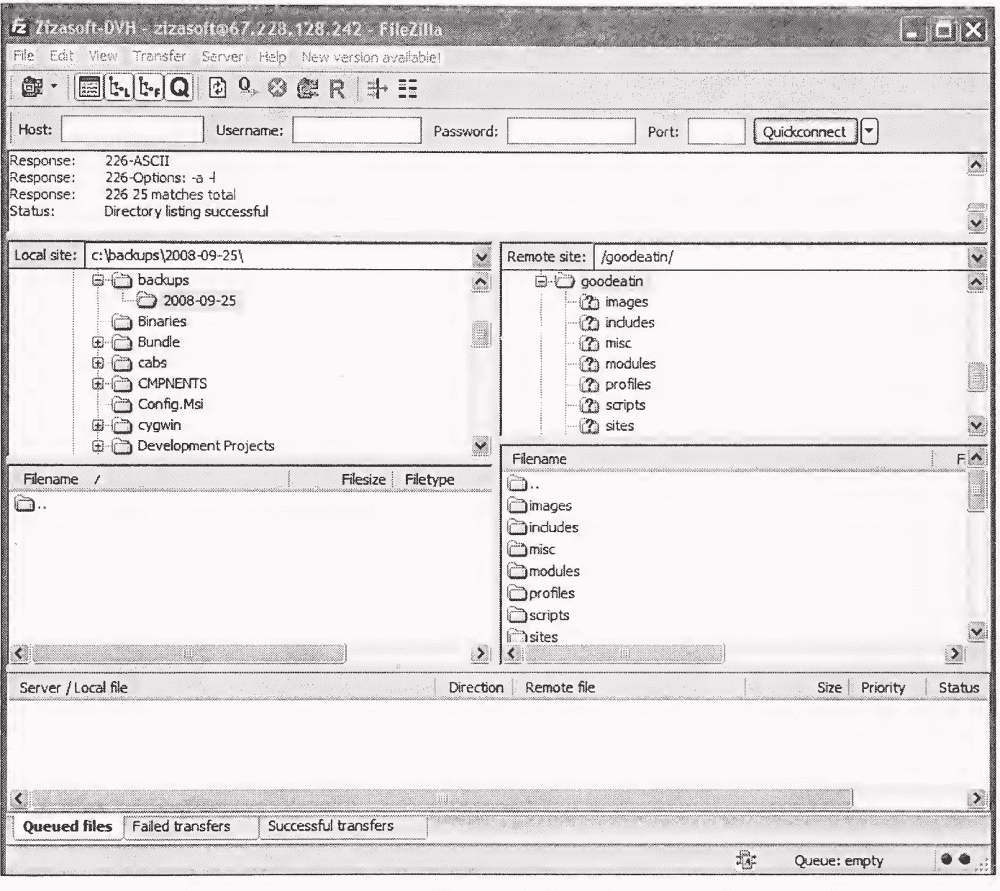

3. Next, download the files to your local directory. If you want, you can compress the files into a ZIP file or a compressed archive.

4. To reduce the amount of data that you need to download, you should be able to download just the `sites` directory, because that folder contains all of the custom files, pictures, themes, and modules that you have added to the site, assuming that you have followed all of the guidelines in this book.

To back up the database information, you can use your web site provider's database management utility. Many hosts provide phpMyAdmin for this purpose. If you are unsure whether or not your host gives you access to phpMyAdmin, you can contact their customer support group to check.

1. Begin by opening phpMyAdmin and selecting the database that has your site information within it. The screen should be similar to the following:

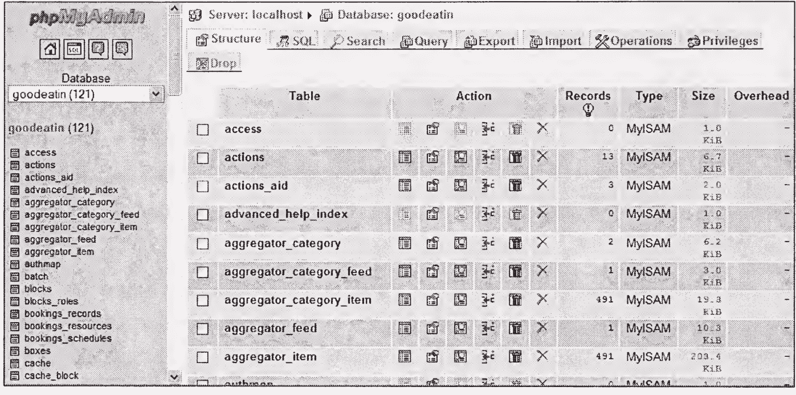

2. If you have multiple databases available on the host, you may need to select the database that you want to work with in the drop-down list at the upper left corner of the screen.

3. Next, select the Export tab at the top of the screen. phpMyAdmin will prompt you to select the tables that you want to download and the format that you want to download in, as shown in the following screenshot:

当你准备好从备份恢复网站时，你只需反向执行该过程。

1. 你应始终导入到一个空白数据库中，以避免与现有数据发生冲突。你可以删除或清空现有数据库中的所有表，或者创建一个新数据库来导入数据。
2. 清理完数据库后，在 phpMyAdmin 中选择 Import 选项卡。

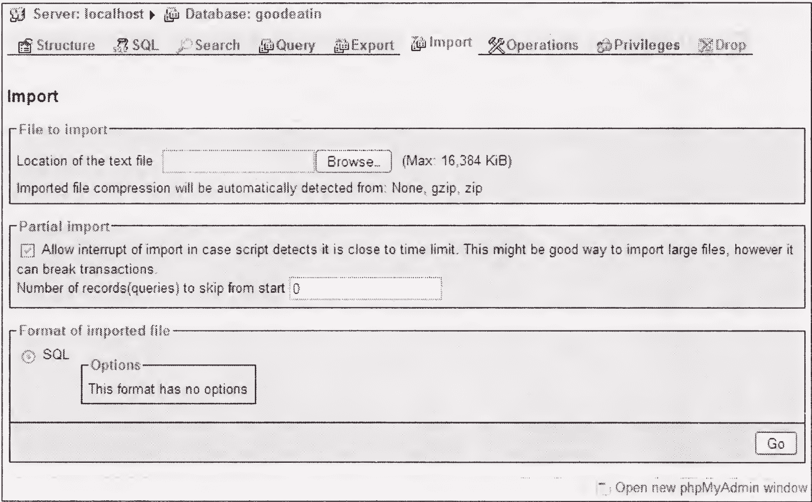

3. 现在导航到你之前导出的文件，然后点击 Go 开始导入。你可能需要在导入数据之前删除数据库中的所有表，具体取决于你在导出数据时选择了哪些选项。
4. 要重新加载文件，只需打开你的 FTP 客户端，选择创建备份时所使用的相同目录，然后上传文件，而不是下载它们。

## 自动网站备份

Good Eatin' Goal: 备份网站以便轻松恢复。

Additional modules needed: Backup and Migrate (http://drupal.org/project/backup_migrate)。

### 基本步骤

虽然你可以手动备份文件和数据库，但此过程可能耗时且容易出错。幸运的是，Backup and Migrate 模块使此过程变得更容易，并优化备份以排除不必要的数据。

1. 首先下载并安装 Backup and Migrate 模块。
2. 你现在可以通过从 Administer 菜单中选择 Content management 然后 Backup and Migrate 来备份你的数据。
3. Backup and Migrate 模块允许你完全自定义创建的备份文件。你可以控制备份中包含哪些表，以及是否备份表中的数据。默认情况下，Backup and Migrate 模块不会备份缓存信息、会话信息或 watchdog 信息，因为这些表中的数据是临时的，可以轻松重新创建。

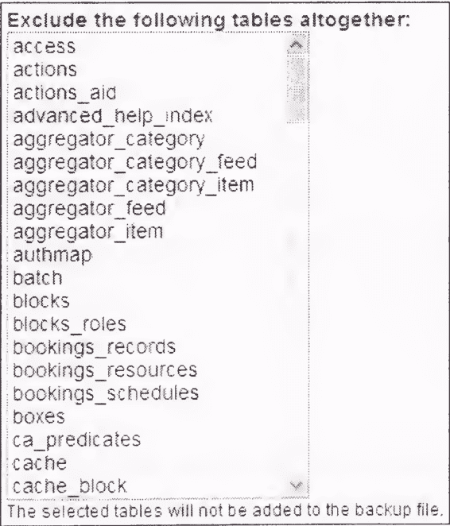

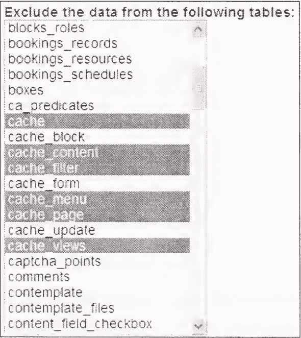

4. 你还可以从多种其他选项中进行选择，这些选项控制结果文件的命名方式、压缩方式以及保存位置。

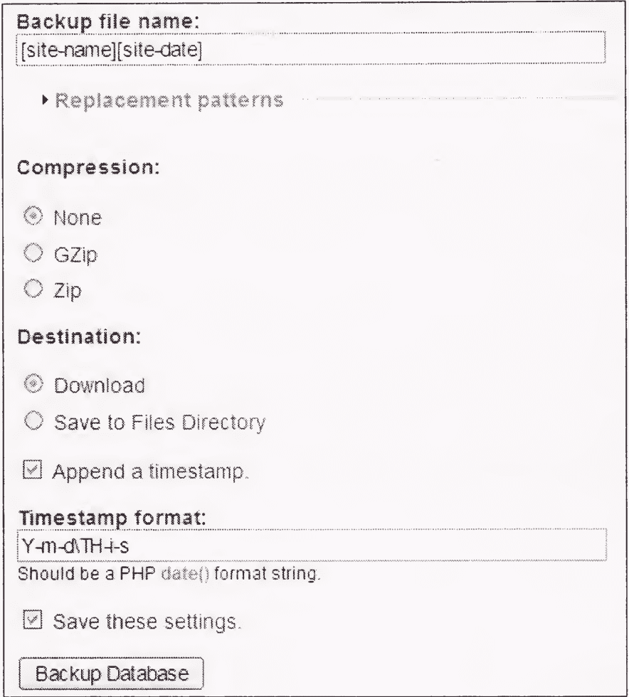

5. 设置好选项后，点击 Backup Database 开始备份过程。如果你选择了 Download 选项，文件将被发送到你的计算机以便存储。如果你选择 Save to Files Directory 选项，备份文件将保存在服务器上，以便你稍后可以直接从服务器或使用 Saved Backups 选项卡下载。

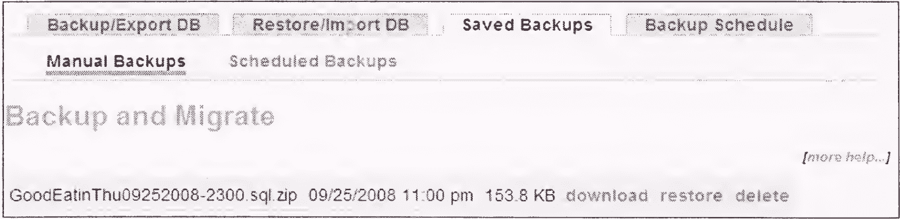

6. 如果你希望 Backup and Migrate 模块定期自动备份你的数据库，你可以通过点击 Backup Schedule 选项卡按指定间隔安排备份，如图所示：

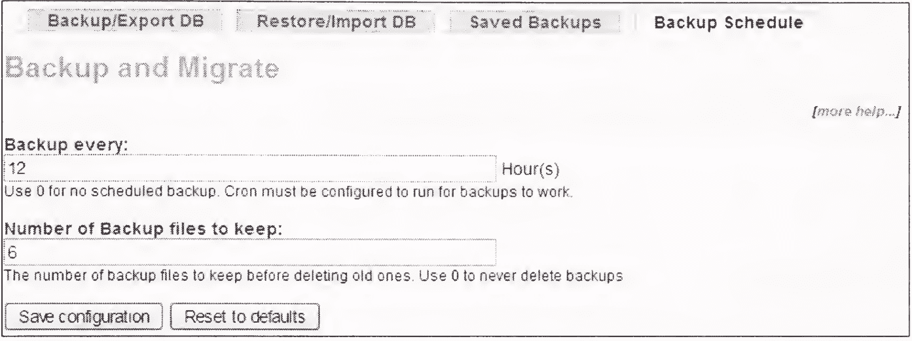

请注意，Backup and Migrate 模块创建的备份不包括网站文件，因此你仍需独立备份这些文件。你可以通过仅备份用户可以上传的文件来最小化备份文件大小。这些文件通常存储在 files 目录中。备份文件的过程与手动备份部分中使用的过程相同。

## 从备份恢复网站

Good Eatin' Goal: 从 Backup and Migrate 模块创建的备份文件恢复信息。

Additional modules needed: Backup and Migrate (http://drupal.org/project/backup_migrate)。

### 基本步骤

恢复由 Backup and Migrate 模块创建的备份是一个简单的过程。

1. 通过从 Administer 菜单中选择 Content management 然后 Backup and Migrate 导航到 Backup and Migrate 管理器。

2. 接下来，点击 Restore/Import DB 选项卡。

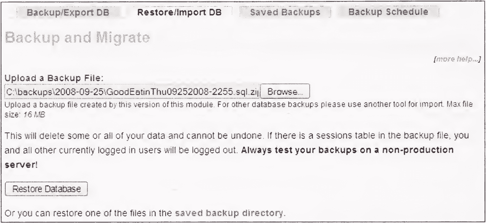

3. 导航到你的备份文件的位置。

4. 选择备份文件后，点击 Restore Database 开始恢复过程。请仔细阅读所有显示的警告，并在在生产站点上运行之前先在站点的测试安装上测试导入。如果你确定要继续导入，请同意确认并点击 restore。

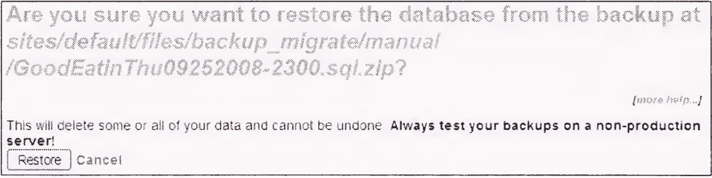

5. 如果服务器文件系统未完全更新，你可能还需要导入任何已保存的文件。我们之前在手动备份部分讨论过这一点。

## 网站优化

如果你的网站有中等到大量的访客，你应该为最佳性能调整你的网站。这将确保所有访客都有良好的体验，而不会因加载页面或访问网站的延迟而感到沮丧。

我们将讨论优化后端数据库和向访客显示信息的前端网站的方法。

### 优化数据库表

*Good Eatin' Goal:* 优化存储站点内容的数据库，以确保最佳性能。

*Additional modules needed:* DB Maintenance (http://drupal.org/project/db_maintenance)。

#### 基本步骤

当数据库像 Drupal 数据库一样频繁使用时，随着时间的推移它可能会变得不够优化，因为在每个表中插入和删除大量记录会导致数据库出现浪费空间的情况。所有数据库都允许你运行优化过程，该过程会删除未使用的空间并重建索引以使信息搜索更快。

**DB Maintenance** 模块可以在 cron 运行期间自动为你执行优化过程。

1. 首先下载并安装 **DB Maintenance** 模块。
2. 你可以通过从 **Administer** 菜单中选择 **Site configuration** 然后 **DB maintenance** 来编辑 **DB Maintenance** 模块的设置。
3. 设置允许你控制多个选项，包括：
   - a) 是否在每次优化时写入日志。

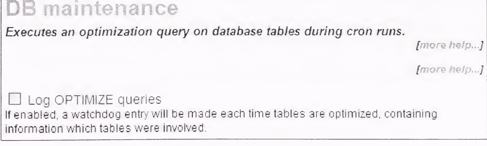

   - b) 表优化的频率，选项从每小时到双月，或每次 cron 运行。

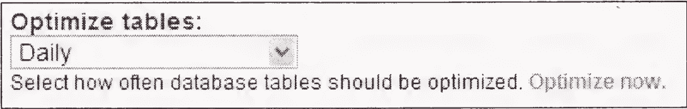

   - c) 最后，你可以控制优化哪些表。这允许你不对不经常更改的表进行优化，从而使维护任务更快完成。

配置好设置后，你只需保存设置，DB maintenance 模块将在指定的间隔自动执行优化。

### 使用缓存提高性能

Good Eatin' Goal: 使用缓存提高内容显示的性能。

Additional modules needed: None.

#### 基本步骤

由于动态生成的页面，例如使用 Drupal 创建的页面，生成起来可能耗时且资源密集，Drupal 使用复杂的缓存机制来预加载内容部分以供用户显示。

要设置 Drupal 缓存，请执行以下步骤：

1. 通过从 Administer 菜单中选择 Site configuration 然后 Performance 来访问 Drupal 缓存的设置。

2. 设置的第一部分与 Page cache 有关，该缓存用于缓存整个页面数据。Page cache 系统仅为匿名用户缓存页面，以防止一个用户的个人数据被其他用户看到，并且因为只有在为匿名用户提供缓存内容时才能更简单地确保页面被成功缓存。

#### Page cache

启用页面缓存将提供显著的性能提升。Drupal 可以存储并发送匿名用户请求的压缩缓存页面。通过缓存网页，Drupal 无需每次查看时都重建页面。

##### Caching mode:

- Disabled
- Normal (recommended for production sites, no side effects)
- Aggressive (experts only, possible side effects)

正常缓存模式适用于大多数站点且不会产生任何副作用。激进缓存模式会导致 Drupal 在提供缓存页面时跳过已启用模块的加载（boot）和卸载（exit）。这会带来额外的性能提升，但可能导致不必要的副作用。

以下已启用模块与激进模式缓存不兼容，将无法正常运行：poormanscron, uc_cart, uc_store。

大多数站点应启用 Normal 缓存，因为这可以在没有任何不良副作用的情况下显著改善访客的加载时间。

3. 如果你选择使用 Aggressive site caching，你需要了解可能出现问题的模块。Drupal 会为你识别这些模块并以红色突出显示。只有在没有潜在不兼容性时，或模块维护者声明潜在不兼容的模块可与 Aggressive caching 一起使用时，才应启用 Aggressive 缓存。一些模块由于在页面正常加载时运行的初始化或清理代码，而在激进缓存时不运行，因此与 Aggressive 模式不兼容。

4. 如果你的站点异常繁忙，你可能希望强制执行最小缓存生命周期，即 Drupal 在重建缓存页面之前等待的最短时间。如果你站点更新不频繁，你可以通过将此数字增加到与更新计划相匹配来获得性能提升。

##### Minimum cache lifetime:

5 min

在高流量站点上，可能需要强制执行最小缓存生命周期。最小缓存生命周期是在缓存被清空并重新创建之前经过的最短时间，并适用于页面和块缓存。更大的最小缓存生命周期提供更好的性能，但用户将更长时间看不到新内容。

5. 页面压缩控制缓存的页面是否被压缩。除非你的 Web 服务器自动缓存所有网页，否则此项可保持启用状态。

页面压缩：
○ 已禁用
● 已启用
默认情况下，Drupal 会压缩其缓存的页面以节省带宽并提高下载速度。当使用执行压缩的 Web 服务器时，应禁用此选项。

6. Drupal 还提供块缓存，它仅缓存块的内容而不是整个页面。与页面缓存不同，块缓存适用于匿名用户以及已登录网站的用户。

块缓存
启用块缓存可以通过防止每次页面加载时重建块，从而为所有用户提供性能提升。如果页面缓存也已启用，则启用块缓存带来的性能提升主要惠及已认证用户。
块缓存：
○ 已禁用
● 已启用（推荐）
请注意，当启用定义内容访问限制的模块时，块缓存处于非活动状态。

7. Drupal 提供的最后一种优化类型与最小化发送给用户的内容量有关，通过将每个模块创建的 CSS 文件和 JavaScript 文件合并为单个 CSS 文件和单个 JavaScript 文件，用户只需下载一次。这些选项在你使用私有文件系统时会被禁用。如果你想使用这些选项，你需要在网站上使用公共文件系统。

## 带宽优化

Drupal 可以自动优化外部资源，如 CSS 和 JavaScript，这可以减少对网站发出的大小和请求数量。CSS 文件可以聚合并压缩为单个文件，而 JavaScript 文件会被聚合（但不压缩）。这些可选优化可能会降低服务器负载、带宽需求和页面加载时间。

如果你尚未设置文件目录，或下载方法设置为私有，则这些选项将被禁用。

### 优化 CSS 文件：

- 已禁用
- 已启用

此选项可能会干扰主题开发，应仅在生产环境中启用。

### 优化 JavaScript 文件：

- 已禁用
- 已启用

此选项可能会干扰模块开发，应仅在生产环境中启用。

8. 尽管 Drupal 缓存使你的网站更快并为用户提供更好的体验，但它可能会干扰你对网站的开发，因为缓存可能会阻止你看到网站最新更改。如果你是这种情况，你可以通过单击清除缓存数据按钮来清除缓存数据。

## 清除缓存数据

缓存数据可提高性能，但在排查新模块、主题或翻译时，如果已缓存过时信息，可能会导致问题。要刷新网站上的所有缓存数据，请单击下面的按钮。警告：高流量网站在重建缓存数据时将出现性能下降。

清除缓存数据

## 维护内容

随着你继续向网站添加内容，你需要确保内容得到适当审核，旧内容被删除，并且对网站内容的更改得到跟踪。

### 创建内容修订

*Good Eatin' Goal:* 创建内容的修订版以确保你拥有网站内容更改的完整记录。

*Additional modules needed:* 无。

#### 基本步骤

在本书中，我们只是根据需要更新页面以添加新功能和内容。然而，如果你有许多编辑、内容经常更改、需要查看页面的历史记录，或需要轻松返回页面的旧版本，你将希望存储页面的多个修订版。

为此，请执行以下步骤：

1. 编辑你想要创建新修订的内容。
2. 根据需要进行更改，并在保存之前展开 **Revision information** 部分。

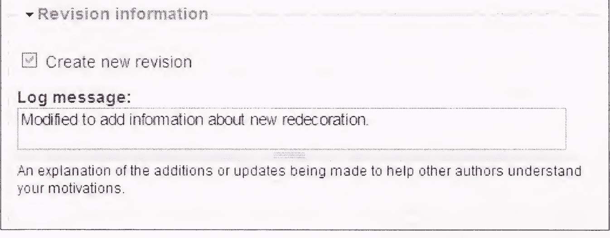

3. 选择 **Create new revision** 选项并输入描述对节点所做更改的消息。
4. 保存内容后，你将看到一个名为 **Revisions** 的新标签。单击此标签将显示为该页面创建的所有修订列表。

## 比较内容修订

*Good Eatin' Goal:* 比较页面两个不同修订版的文本。

*Additional modules needed:* Diff (`http://drupal.org/project/diff`)。

### 基本步骤

尽管 Drupal 中创建修订的内置功能运行良好，但很难审查每个修订中进行的更改。**Diff** 模块使比较修订变得非常容易。

1. 首先安装并激活 **Diff** 模块。
2. 要使用 **Diff** 模块，只需查看任何页面的修订。你会注意到 **Revisions** 列表已更改，允许你选择要比较的修订。

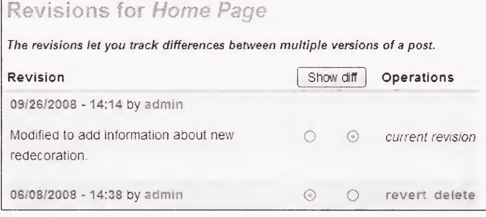

3. 选择要比较的修订，然后单击 **Show diff** 按钮。Drupal 然后将显示有关已更改、添加或删除的文本的信息。

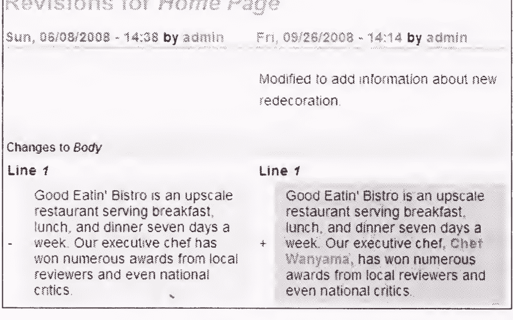

## 审核内容

*Good Eatin' Goal:* 找到可疑或冒犯性的内容，并轻松将其从网站中删除。

*Additional modules needed:* Modr8 (http://drupal.org/project/modr8)。

### 基本步骤

网站在互联网上存在的一个不幸副作用是，在某个时候，恶意用户会尝试在你的网站上发布不适当的内容。如果你的网站非常繁忙，你可能会发现自己需要审查和批准大量内容。

**Modr8** 模块可以帮助你管理工作量，并可以向用户发送电子邮件，让他们知道其内容何时被批准或拒绝。

1. 首先安装并激活 **Modr8** 模块。
2. **Modr8** 模块的设置可以通过从 **Administer** 菜单中选择 **Site configuration** 然后 **Modr8** 来访问。
3. 基本设置控制日志被删除的频率。或者，你也可以选择永久保留日志。你还可以更改一次显示在审核队列中的项目数量，以及需要审核的内容的默认操作。

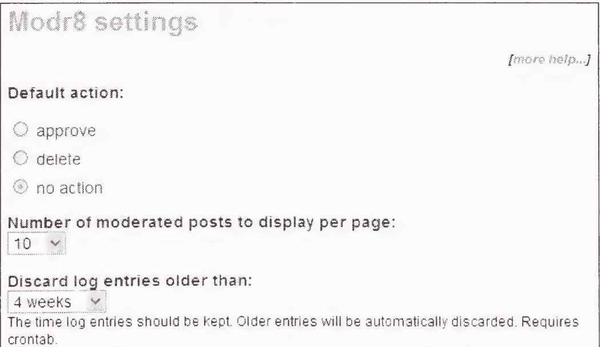

4. 你还可以配置审核队列的电子邮件设置，包括电子邮件的文本，以及在用户的内容被批准和/或被拒绝时是否向发布内容的用户发送电子邮件。你还可以选择在审核员未对项目采取行动并且想要向作者发送通知时发送电子邮件。

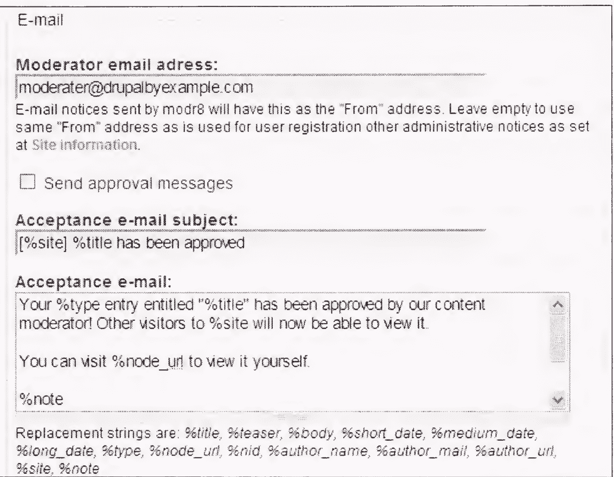

5. 如果你希望新内容自动添加到审核队列中，你可以编辑内容类型并在工作流部分中选择 In moderation queue 设置。

6. 要查看审核队列，请从 Administer 菜单中选择 Content management 然后 Moderated content。

7. 审核队列如下所示：

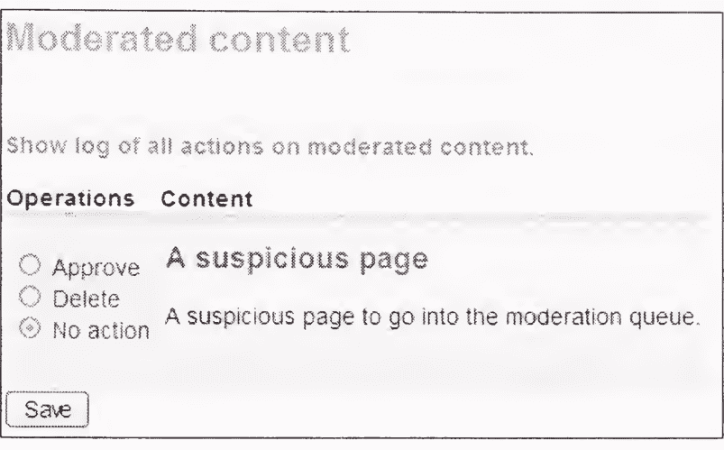

8. 从此页面，你可以批准、删除或推迟对任何需要审核的内容采取行动。做出更改后，单击 Save 以完成你的选择。你还可以通过单击 Reports 然后 Content moderation log 来显示所有审核操作的日志。审核日志如下所示：

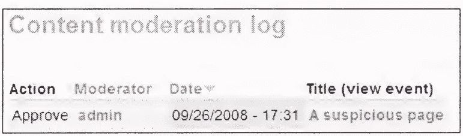

## 允许用户举报可疑或冒犯性内容。

Good Eatin' Goal: 获取用户的反馈以了解他们认为冒犯的内容，以便可以删除有问题的內容。

Additional modules needed: Abuse (http://drupal.org/project/abuse)。

### 基本步骤

在上一个任务中，我们回顾了允许你审核添加到网站的每条内容的方法。然而，如果你收到的可疑内容比例很低，这可能是一项耗时的任务。如果是这种情况，你可以允许用户帮助你审核内容，使用 Abuse 模块，让他们报告他们认为冒犯的项目。

该策略有几个优点。首先，你无需在内容发布前预先批准所有内容，从而免除了维护负担。其次，它确保内容符合社区标准，而不是让你或你的编辑负责定义社区标准。

Abuse 模块还包含一个 Watchlist 组件，允许你将内容标记为可疑或禁止，并自动将其移入管理员审核队列。

- 1. 首先下载并安装 Abuse 和 Watchlist 模块，两者均包含在 Abuse 安装包中。
- 2. 我们将首先编辑 Watchlist 设置，可通过 Administer 菜单选择 Site configuration 然后 Watchlist settings 来访问。

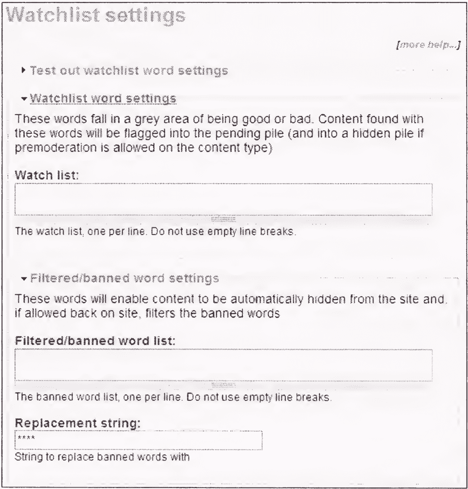

- 3. 你可以根据目标受众和网站需求，在 Watch 列表和 Filtered/banned 词列表中添加任意词语；只需确保每行输入一个词。Watch 列表中的项目可在审核队列中查看，而 Filtered/banned 词列表中的项目在审核前会被隐藏。

4. 你还可以根据上面配置的 Watchlist 词设置，控制哪些项目会自动添加到 Watch 列表或禁止列表中。

Enable moderation from the watchlist and banned list for these content types

如果在 watchlist 中找到匹配项，内容将被标记到待处理堆中（用户仍可查看该项目）。如果匹配项来自 bannedlist，内容将被标记到隐藏堆中（对用户隐藏）。用户仅会针对禁止词进行验证。

☐ webform
☑ blog
☐ poll
☐ dir_listing
☐ image
☐ product

5. 你还可以强制对更容易被滥用的特定类型进行审核。

Enable pre-moderation from the watchlist and banned list for these content types

内容将根据滥用模块设置被标记

☐ webform
☐ blog
☐ poll
☐ dir_listing
☑ image

6. 我们现在可以通过 Administer 菜单选择 Site configuration 然后 Abuse Moderation settings 来修改 Abuse Moderation 设置。

如果你的网站有多个审核员，可以选择 **Abuse Assigned Moderators** 选项。如果使用此选项，你还需要存储添加到审核员队列中因滥用而被标记的最大项目数。如果审核员位于不同时区，可以设置一天中的某个小时清空所有审核队列，以便项目不会在审核队列中停留过长时间。

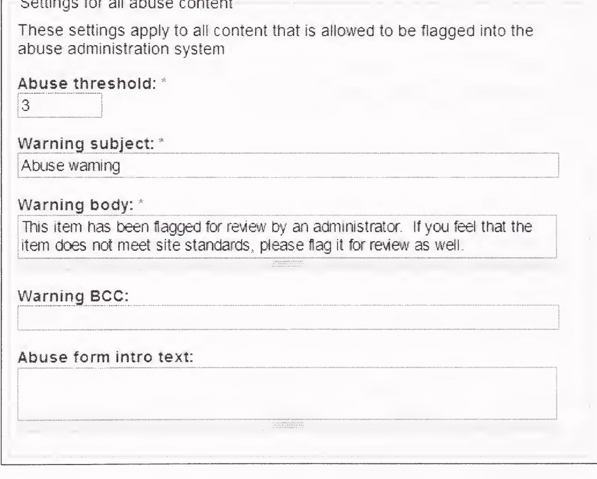

**Abuse threshold** 控制在项目被移入审核队列前必须注册的投诉数量。3 是一个不错的起点，但你可以根据网站需求增加或减少阈值。

10. 你可以通过选择 Site configuration，然后 Abuse Moderation settings，最后 Abuse Moderation reasons，从 Administer 菜单编辑标记项目为滥用的原因。

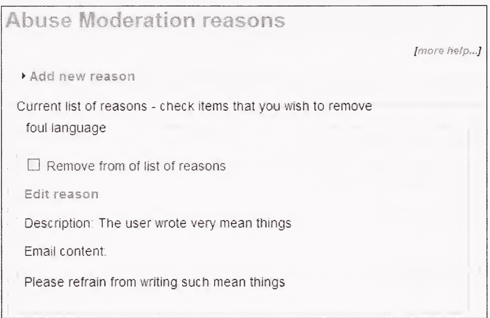

所有可用原因将以与上方示例类似的格式列在页面上。你可以从此页面添加新原因、删除原因或更改原因文本。

11. 在激活滥用模块之前，你需要为用户分配权限，以便他们可以标记内容以供审核。

| Permission | anonymous user | authenticated user | blogger | Store Administrator |
|---|---|---|---|---|
| abuse module | | | | |
| administer abuse reports | ☐ | ☐ | ☐ | ☐ |
| administer all abuse reports | ☐ | ☐ | ☐ | ☐ |
| configure abuse administration settings | ☐ | ☐ | ☐ | ☐ |
| direct flag | ☐ | ☐ | ☐ | ☐ |
| report abuse | ☐ | ☐ | ☐ | ☐ |

12. 激活滥用模块的内容将新增一个 Flag as offensive 链接，如以下截图所示：

# Good Eatin' Website

Submitted by admin on Thu, 07/10/2008 - 23:24

我们一直在努力打造我们的新网站，它拥有全新的外观和大量新功能。请通过在此处发布评论告诉我们你对该网站的看法。

admin's blog   Login or register to post comments   Flag as offensive

13. 当用户点击 Flag as offensive 链接时，他或她将被 presented with a form，可在其中指定联系信息，以及他或她认为内容冒犯的原因。

# Flag

from: *

email: *

about:
Good Eatin' Website

reason: *

message:

send   cancel

14. 管理员可以通过点击 **Content management** 然后 **Moderate** 来审核已被标记为冒犯的内容。

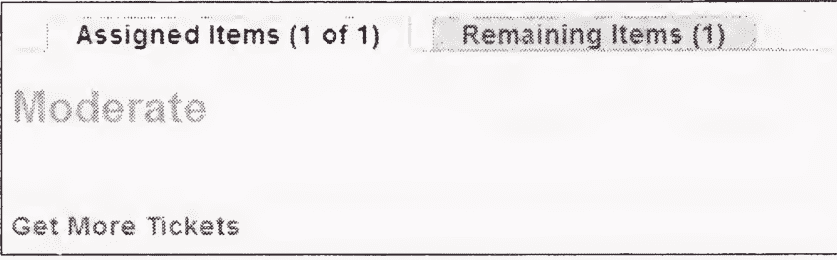

15. 管理员可以点击 **Get More Tickets** 链接以分配更多项目给他们。

16. 一旦工单分配给他们，管理员可以查看提交内容的用户的相关信息以及标记内容的用户的相关信息，并选择对内容采取什么行动。

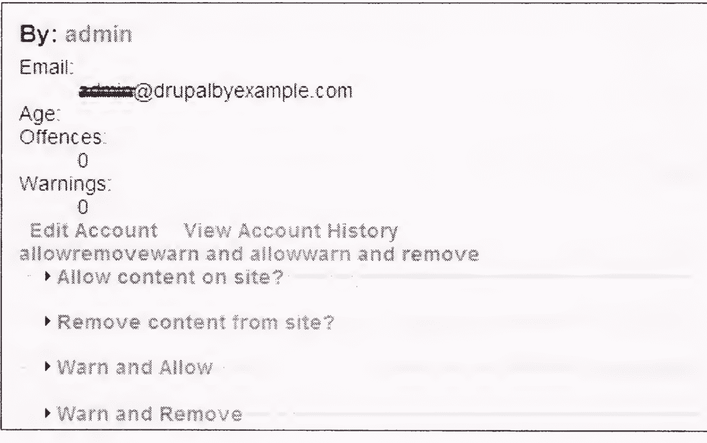

管理员可以允许内容，或从网站上移除内容。管理员也可以选择性地向用户发送警告而不采取进一步行动。

## Upgrading to new versions of Drupal

Drupal 的一大优点是它不断发展以提供新功能和改进功能。然而，这要求你定期检查 Drupal 以及已安装的任何贡献模块的更新。

在本节中，我们将讨论如何查找更新、测试它们并将它们安装到你的网站上。

你会遇到两种类型的更新。次要更新将修正安全问题或用户发现的问题，并可能具有最小的功能增强。重大更新通常具有更多功能，并且可能与以前的版本不兼容。

Drupal 的版本号包含用点分隔的两个数字。例如，版本 6.5 表示主版本 6，次版本 5。

自定义模块将以其兼容的 Drupal 版本开头，后跟模块本身的主版本和次版本。如果模块与 Drupal 主版本的所有次要版本兼容，则次版本将用 x 表示。例如，版本 6.x-1.5 表示该模块与任何 Drupal 6 版本兼容，并且模块的主版本为 1，次版本为 5。模块还可能通过在版本末尾添加 —dev 来表示开发版本，通过添加 —beta1 来表示 beta 版本，或通过在版本后添加 —rc1 来表示候选发布版本。多个 beta 和候选发布版本分别通过递增 beta 或 rc 后的数字来表示。

## Checking for new updates to Drupal and modules

*Good Eatin' Goal:* 确保我们使用的是 Drupal 和网站使用的贡献模块的最新版本。

*Additional modules needed:* None (core).

### Basic steps

Drupal 6 及更高版本使检查 Drupal 和已安装模块的更新变得容易。默认情况下，每次运行 cron 时 Drupal 都会检查系统更新。

你可以通过 Administer 菜单选择 Reports 然后 Available updates 来检查系统的当前状态。如果 Drupal 检测到 Drupal 或相关内容已过时，它将在你导航到任何管理页面时显示警告。

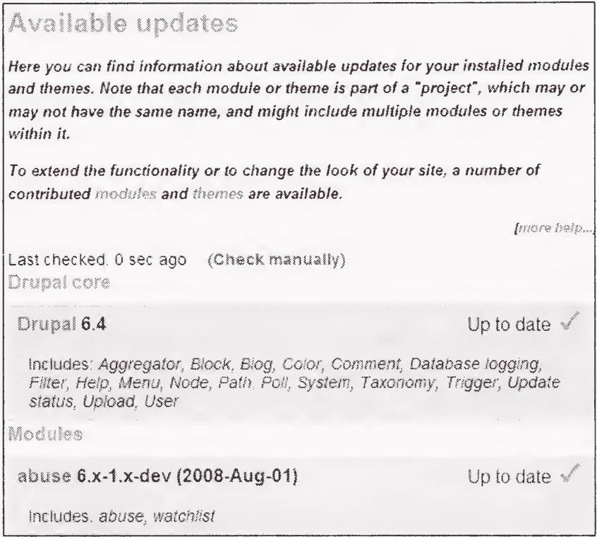

如果你愿意，可以点击 Check manually 链接以确保所有模块都是最新的。

如果有任何模块已过时，它们将如下所示。

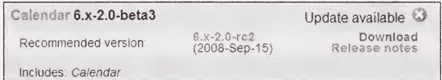

显示包括你当前安装的版本、应安装的推荐版本、下载新版本的链接以及新版本的发行说明链接。发行说明将包括对模块所做的更改列表。在接下来的几个任务中，我们将讨论升级你的安装。

## Upgrading minor releases

Good Eatin' Goal: 在次要版本之间升级。

Additional modules needed: None (core).

## 基本步骤

当 Drupal 检测到有新版本可用时，它会像前面提到的那样通知您。

- 1. 在下载并安装新版本之前，您应该阅读新版本的所有发布说明，以确定它是否与您已安装的其他模块存在潜在的不兼容问题。
- 2. 如果您根据发布说明没有发现任何潜在问题，就可以开始自行测试新版本。
- 3. 在安装新版本之前，请对您的网站进行完整备份，包括所有文件和数据库。
- 4. 在将新版本安装到正式网站之前，您应该先在非生产环境的测试网站上对新版本进行测试。如果您还没有建立测试网站，可以在本地计算机上、虚拟主机的其他位置或另一台虚拟主机上创建测试网站。如果您选择将测试网站托管在虚拟主机上，则应确保访客无法公开访问该网站。这将有助于确保您的访客不会通过搜索引擎被引导到您网站的错误版本。
- 5. 打开您网站的更新页面，网址为 http://yoursite.com/update.php。要访问此页面，您必须使用管理员帐户登录，也就是您创建的第一个用户。

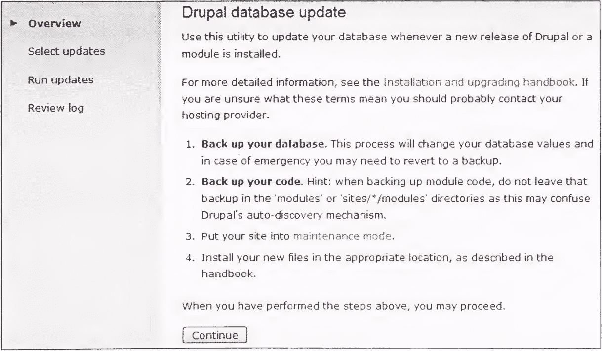

- 6. 如果您的测试网站不对外公开，则无需担心将网站置于维护模式的问题。

## 升级到新的主版本

Good Eatin' 目标：将 Drupal 升级到新的主版本。

所需附加模块：无（核心）。

## 基本步骤

将 Drupal 升级到新的主版本可能是一个复杂的过程，您需要谨慎操作。

- 1. 首先，确认您使用的贡献模块已经升级为与最新版 Drupal 兼容。您可以通过查看 Drupal.org 网站上模块的项目页面来确认这一点。
- 2. 如果某个模块尚未移植到最新版 Drupal，您可以寻找合适的替代模块，等待该模块完成升级，或者从您的网站中移除该模块提供的功能。最新版 Drupal 发布并投入使用后，维护者可能需要几个月的时间才能完成模块的移植。您可以联系维护者，了解他们是否有开发计划，或者您是否可以提供捐助以帮助分担开发成本。
- 3. 当您安装的所有模块都可以更新后，就可以开始实际的安装过程了。和之前一样，您应该先在测试网站上测试安装过程，然后再在正式网站上执行，以确保不会遇到问题。
- 4. 如果您正在升级正式网站，请从“管理”菜单中选择“站点配置”，然后选择“站点维护”，将网站置于维护模式。

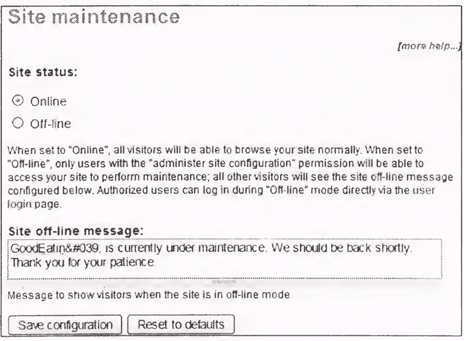

将状态更改为“离线”，然后单击“保存配置”按钮。

- 5. 对组成您网站的所有文件和数据库表进行完整备份。
- 6. 禁用您安装的所有自定义模块。这样您可以在稍后对它们进行升级。
- 7. 切换到 Drupal 核心安装附带的默认主题。
- 8. 将新的 Drupal 文件上传到您的网站。
- 9. 按照上一个任务中的描述，在 http://yoursite.com/update.php 运行升级页面。
- 10. 下载并安装您网站的自定义模块。
- 11. 下载并安装您网站的主题。
- 12. 再次运行升级脚本。
- 13. 备份以下文件，然后从您的网站中删除它们。
    a) `install.php`
    b) `CHANGELOG.txt`
    c) `INSTALL.txt`
    d) `INSTALL.mysql.txt`
    e) `INSTALL.pgsql.txt`
    f) `LICENSE.txt`
    g) `MAINTAINERS.txt`
    h) `UPGRADE.txt`
- 14. 测试您的网站，确保所有功能都能正常工作。
- 15. 如果您的网站运行正常，您可以在正式网站上重复上述步骤，或者将测试网站复制到正式网站。
- 16. 如果任何功能无法正常工作，您可以利用备份再次尝试升级过程，或者联系无法正常工作的功能的维护者，以便他们帮助您解决任何问题。
