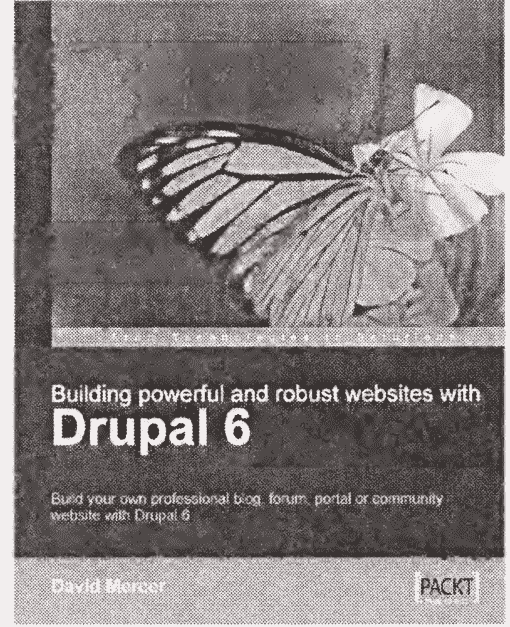
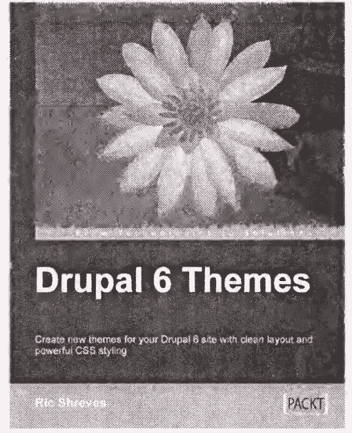
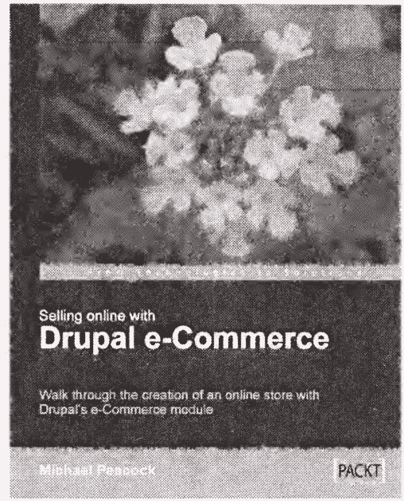
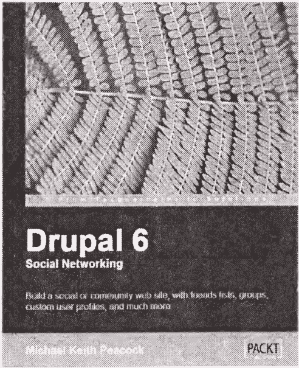
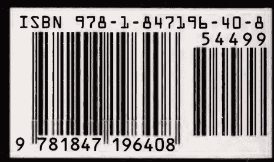

## 索引

### 符号

- 7-Zip，下载 45
- moderation，设置博客文章 153，154
- moderator role，创建 152，153

### A

- alias，创建 42，43
- argument，菜单项
  - 添加 104-106

### B

- blog list，显示
  - blog block，创建 158
  - blog menu，创建 157
  - RSS feed，为新闻阅读器创建 158，159
  - subscription buttons，添加 159-161
- blogs
  - block，创建 158
  - content，从其他博客添加 161
  - 创建 149
  - customers，使其能够阅读博客 157
  - list，显示 157
  - menu，创建 157
  - RSS feed，为新闻阅读器创建 158，159
  - subscription buttons，添加 160，161
- blogs，内容从其他博客添加
  - aggregator module 使用 161-165
  - feeds，查看 165，166
  - feeds 自动更新，cron jobs 使用 167
  - 步骤 161-165
- blogs，创建
  - blog post，添加 151
  - blog system，设置 149，150
  - keyword content，自动审核 155，156

### C

- calendar
  - 添加 183
  - content types，添加到事件日历 190
  - 显示，CCK 使用 194-198
  - 显示，views 使用 194-198
  - events，显示 186-189
  - events 创建，CCK 使用 190-193
  - new events，添加 183-186
- CCK module
  - additional modules 71
  - 安装 70，72
- clean URLs，Drupal 网站
  - blog style home page 30，31
  - 创建 29
  - home page，想法 33
  - home page，设置 30
  - traditional home page，创建 31-33
- comments
  - 添加 124
  - 添加，步骤 124
  - automatic notification，设置 126，127
  - 启用，用于节点 123，124
  - 管理 125
  - 管理，步骤 125
  - 工作 122
- content，管理
  - abuse module 295-302
  - content，审核 293-295
  - content revisions，创建 290
  - content revisions，比较 292
  - content revisions，创建 291
  - Diff module 292
  - Modr8 module 293-295
  - users，允许报告滥用 295-302
- Content Creation Kit. 参见 CCK module
- custom module，Drupal 网站
  - 安装，步骤 45-47
  - 安全 47

### D

- del.icio.us 224
- developer，招聘
  - developer，资格 322
  - 来自 Drupal.org 323，324
  - graphic designer，资格 322，323
- Digg 223
- downloads
  - 添加，到网站 231
  - count，跟踪 237-239
  - file，强制下载 236，237
  - filebrowser module 239-241
  - file downloads，控制 231-233
  - file force module 236
  - file MIME types 236
  - files，上传到网站 233，234
  - file types，发送给用户 234-236
  - PDF files，自动生成 241-249
  - upload module 233，234
  - users，允许浏览文件 239-241
- Drupal
  - available updates，检查 303，304
  - 安装 15-20
  - 升级，到主要版本 307，308
  - 升级，到次要版本 304-306
  - 升级，到新版本 302
- Drupal 网站
  - abuse module 295-302
  - additional modules 71，72
  - 备份，自动 281-283
  - 备份，手动 276-280
  - backup，恢复 283，284
  - back up and migrate module 281-283
  - caching 使用，以提高性能 286-289
  - calendar，添加 183
  - clean URLs，创建 29
  - comments 122
  - company blog，创建 149
  - content，管理 290
  - content，审核 293-295
  - Content Creation Kit (CCK) module 70
  - content 增强，嵌入式媒体文件使用 203-209
  - content publication，安排 67
  - content revisions，比较 292
  - content revisions，创建 290，291
  - content sharing，del.icio.us 使用 224-226
  - content sharing，Digg 使用 223，224
  - content sharing，service links 使用 226-228
  - content sharing，Twitter 使用 226
  - custom module 44
  - custom module，安装步骤 45-47
  - database tables，优化 285，286
  - DB maintenance module 284-286
  - developer，招聘 321，322
  - development，外包 317
  - Diff module 292
  - download count，跟踪 237-239
  - downloads，添加 231-233
  - file，强制下载 236
  - filebrowser module 239-241
  - file downloads，控制 231-233
  - file force module 236，237
  - file MIME types 234，236
  - files，上传到网站 233，234
  - file types，发送给用户 234，236
  - Flickr 209
  - freebies 231
  - Good Eatin’ 网站，增强方式 311
  - Good Eatin’ 网站，示例 24
  - Good Eatin’ 网站，关键目标 8
  - Good Eatin’ 网站，结构 8，9
  - Good Eatin’ 网站，技术选择 9
  - Google maps，添加 216
  - Google maps，内容在弹出窗口中显示 221
  - Google maps 重新定位，链接使用 222
  - graphical editor，设置 67
  - hosting company，选择 317
  - image assist module 66
  - image field module 87
  - images 插入，HTML 使用 48

images inserting, image module used 52
Lightbox2 module 59, 60
lists, creating 26, 27
map inserting, GMapEZ used 218-220
menu, building 33
menu item, access controlling 87, 88
menu item, designing 72-77
menu item, image adding for 84-86
menu item, meal fields adding 84
menu item, price adding to 77-79
menu item, seasonal information adding to 79-82
Modr8 module 293-295
modules, enabling 41
multiple page aliases, creating 43
navigation, setting up 33
newsletters, creating 173-175
optimizing 284-286
order, example 270-274
order, permissions 255
order completion, notification setting up 266-270
orders 251
other business, building 314
other examples 314
page, adding 24, 25
page, deleting 43, 44
page, editing 28
page aliases 42, 43
page aliases, creating automatically 43
pages, linking to 27, 28
payment processor, setting up 261-266
PDF files, generating automatically 241-249
polls 135
product, permissions 255
security 28, 29
slideshow, adding 55
store, basic configuration 252, 253
store, blocks 256
store, permissions 254
store, setting up 251
store, Ubercart module used 252
take out menu, creating 256-261
taxonomy 88
taxonomy, classifying 89
themes 63
upload module 233, 234
user ratings, setting up for content 127
users 115
users, allowing to browse files 239-241
users, allowing to report abuse 295-302
user survey 140
video content adding, YouTube used 200
video embedding, video filter used 200-202
Drupal web site, other business
advertising 315
bed and breakfast 316
donations 315
informational blogging 314
membership 316
photography 316
retail store 316
E
editing, page 28
enabling, modules 41
F
feeds, updating
cron job, setting up in Linux 167, 168
cron job, setting up in Unix 167, 168
cron job, setting up in Windows 168-170
cron job, setting up ways 171
cron jobs used 167
Poormanscron used 171, 172
feeds, viewing 165, 166
Flickr
about 210
images inserting, filter used 213-216
media, embedding 209-213
G
good eatin’ web site, example
about 7, 24
abuse module 295-302
available updates, checking for 303, 304
backing up, automatically 281-283
backing up. manually 276-280
backup, restoring 283, 284
back up and migrate module 281-283
birthday parties 312
caching used, to improve performance 286-289
content, managing 290
content, moderating 293-295
content enhancing, embedded media field used 203-208
content revisions, comparing 292
content revisions, creating 290, 291
content sharing, del.icio.us used 224-226
content sharing, Digg used 223, 224
content sharing, service links used 226-228
content sharing, twitter used 226
database tables, optimizing 285, 286
DB maintenance module 285, 286
Diff module 292
download counts, tracking 237-239
downloads, adding 231-233
employment 313
enhancing, ways 311
file, forcing to download 236, 237
filebrowser module 239-241
file downloads, controlling 231-233
file force module 236, 237
file MIME, types 234-236
files, uploading to web site 233, 234
file types, sending to user 234-236
gift certificates 312
Google maps, adding 216
Google maps, content displaying in pop-ups 221
Google maps API key, adding 217, 218
Google maps relocating, links used 222
key goals 8
loyalty rewards 313, 314
map inserting, GMapEZ used 218-220
Modr8 module 293-295
order, example 270-274
order, permissions 255
order completion, notification setting up 266-270
orders 251
payment processor, setting up 261-266
PDF files, generating automatically 241-249
product, permissions 255
random video, displaying 203
store, basic configuration 252, 253
store, blocks 256
store, permissions 254
store, setting up 251
store, Ubercart module used 252
structure 8, 9
take out menu, creating 256-261
technology, selecting 9
Ubercart, permissions 254
upgrading, to Drupal major versions 307, 308
upgrading, to Drupal minor versions 304-306
upload module 233, 234
users, allowing to browse files 239-241
users, allowing to report abuse 295-302
video content adding, YouTube used 200
YouTube playlist, creating 203
YouTube video embedding, video filter used 200-202

## Google maps
adding 216
adding, GMapEZ used 218-220
API key, adding 217, 218
content, displaying in pop-ups 221
content, tagging for del.icio.us 224-226
content sharing, twitter used 226
del.icio.us module 224-226
DiggThis module 223, 224
relocating, links used 222
social bookmarking, service links used 226-228

## H

## hosting company, selecting
accessing ease 320
additional features 321
basic hardware needs 317, 318
hosting, plans 318
hosting plans, Drupal-specific 319
reviews 320

## I

## images, Drupal web site
creating 52, 53
deleting 54
input format, changing 49
input format, creating 49-52
input format, editing 52
inserting, HTML used 48
inserting, image module used 52
resizing 53, 54

## J
**JQuery plugin module, downloading site** 55
**JQuery cycle module, downloading site** 59

## K
**keyword**
  content based, moderating automatically
  155, 156

## L
**Lightbox2 module, Drupal web site**
  automatic image handling settings 62
  general settings 60, 61
  HTML content settings 62
  images, displaying above page 59, 60
  slideshow, viewing 62
  slideshow settings 61
  version, issues 62

## M
**menu, Drupal web site**
  building 33
  custom menu items, adding 38
  custom menu items, creating 37, 39
  designing 34, 35
  items, order setting 39, 40
  page, adding 35, 36
  page, deleting 40
  security 41
  types 34
  types, navigation menu 34
  types, primary links menu 34
  types, secondary links menu 34
  version, differentiating 41

**menu items**
  access, controlling 87, 88
  advanced search, views used 108
  argument, adding 104-106
creating, by meal view 100-102
designing 72-77
filter, content type based 102-104
image, adding 84-87
index, building for vocabularies 112-114
price, adding 78, 79
seasonal information, adding 79-82
sort criteria, adding 106, 107

**menu item type.** *See also menu items*
  content template, downloading 98
  creating 95, 96
  display, customizing 96
  fields order, modifying 96
  titles, modifying 97

## N
**newsletters**
  creating 173, 174
  new issue, creating 180-183
  sign-up, users allowing to 176, 177
  sign-ups, managing 178, 179
  subscriptions, importing 179

## O
**online cooking class, good eatin’ web site**
  content enhancing, embedded media field
  used 203-209
  images inserting, Flickr used 213-216
  media embedding, Flickr used 210-213
  random video, displaying 203
  YouTube playlist, creating 203
  YouTube video embedding, video filter
  used 200-202

**orders**
  blocks 256
  completion, notifications setting up 266, 267-270
  example 270-274
  payment processor, setting up 261-266
  permissions 254
  shopping system, setting up 251
  store, basic configuration 252, 253
  store, setting up 251
  take out menu, creating 256-261

## P
page, Drupal web site
adding 24, 25
aliases, creating 43
aliases, using 42, 43
basic formatting 26
deleting 43
editing 28
linking, to other pages 27
lists, creating 26, 27
multiple page aliases, creating 43
security 28, 29

page aliases, Drupal web site
about 42, 43
mutiple page aliases, creating 43
page, deleting 43, 44
page aliases, creating automatically 43

polls
adding, to homepage 137
advanced poll module 140
creating 135
creating, steps 135-137
results, viewing 139
submitting 138

## Q
qualifications
developer 322
graphic designer 322, 323

## R
registration, user
steps 115, 116

## S
service links 226, 227
slideshow creator module, Drupal web site
configuration, settings 55
configuration options 58, 59
downloading 55
images displaying above page, Lightbox2 module used 59, 60
Lightbox2 module, automatic image handling settings 62
Lightbox2 module, general settings 60, 61
Lightbox2 module, HTML content settings 62
Lightbox2 module, slideshow settings 61
Lightbox2 module, version, issues 62
slideshow, setting up 56, 57
slideshow, viewing 62
slideshow inserting, steps 56
version, issues 59

## T
taxonomy
course type vocabulary, creating 89-91
course type vocabulary, terms adding to 91-93
ingredients list vocabulary, adding 93
vocabularies, adding as CCK fields 93-95

themes, Drupal web site
about 63
configuring 65
creating 65
installing 63-65
selecting 63
version, issues 66

twitter 226

## U
upgrading, Drupal
available updates, checking for 303, 304
to major versions 307, 308
to minor versions 304-306
to new versions 302

user ratings
content, viewing by rating 129-133
display, changing 134
fivestar content ratings, adding to node 127-129
setting up, for content 127

users
assigning, to VIP role 118, 119
email action, creating 120, 121
new user trigger, creating 121, 122
registration, steps 115, 116
sign-up notification, creating 119
VIP role, creating 117, 118
working with 115

**用户调查**
- 分析，第147页
- 回答，步骤145、146
- 清晰，第148页
- 创建 140
- 创建，步骤140-143
- 下载，第148页
- 保护，使用 Captcha 模块 143-145
- 提交，第147页
- 调查结果，查看 146
- 表格，第148页

## V

**视频内容**
- 添加，使用 YouTube 200

**视图**
- 高级搜索 108
- 参数，添加 104-106
- 创建 108
- 显示页面，创建 107
- 字段，添加 109、110
- 过滤，基于内容类型 102-104
- 过滤器，添加 110、111
- 索引，为词汇表构建 112-114
- 菜单，创建 112
- 菜单项，通过菜单视图创建 100-102
- 菜单项组，显示 98
- 菜单页面，创建 108
- 模块 99
- 页面，创建 111
- 搜索表单，使用 112
- 排序条件，添加 106、107
- UI 模块 99

**视图模块** 99、100

## W

**网站，备份**
- 自动 281-283
- 备份，恢复 283、284
- 备份和迁移模块 281-283
- 手动 276-280

**网站，构建技术**
- Drupal 内容管理系统 12
- Drupal 内容管理系统，优点 13
- Drupal 内容管理系统，缺点 13
- PHP 和 MySQL，优点 11
- PHP 和 MySQL，缺点 11
- 静态网页，优点 10
- 静态网页，缺点 10

**网站，优化**
- 使用缓存，以提高性能 286-289
- 数据库表，优化 285、286
- DB 维护模块 285、286

## Y

**YouTube**
- 播放列表，创建 203
- 随机视频，显示 203
- 视频内容，添加 200
- 视频嵌入，使用视频过滤器 200-202

## 感谢您购买《Drupal 6 Site Builder Solutions》

### Packt 开源项目版税

当我们销售基于开源项目的书籍时，我们会直接向该项目支付版税。因此，通过购买《Drupal 6 Site Builder Solutions》，Packt 将把收到的部分款项给予 Drupal 项目。

从长远来看，我们将自己和您——我们书籍的客户和读者——视为开源生态系统的一部分，为我们出版的项目提供可持续的收入。我们在 Packt 的目标是建立出版版税作为服务和支持的重要组成部分，并支持一种可持续开源的商业模式。

如果您正在与一个开源项目合作，希望我们对其出版并随后支付版税，请与我们联系。

### 为 Packt 撰稿

我们欢迎所有有意撰稿的人的咨询。书稿提案应发送至 author@packtpub.com。如果您的书的想法仍处于早期阶段，您希望在撰写正式书稿提案之前先讨论一下，请联系我们；我们的其中一位约稿编辑会与您联系。

我们不仅寻找已出版的作者；如果您具有强大的技术技能但没有写作经验，我们经验丰富的编辑可以帮助您发展写作生涯，或仅仅为您提供专业知识的额外回报。

### 关于 Packt Publishing

Packt，读作 'packed'，于2004年4月出版了首本书《Mastering phpMyAdmin for Effective MySQL Management》，随后继续专注于出版关于特定技术和解决方案的高度聚焦的书籍。

我们的书籍和出版物分享了您同行 IT 专业人士在适应和定制当今系统、应用程序和框架方面的经验。我们的解决方案型书籍为您提供定制您正在使用的软件和技术以完成工作的知识和能力。Packt 的书籍比您过去看到的 IT 书籍更具体、更少泛化。我们的独特商业模式使我们能够为您提供更聚焦的信息，让您获得所需了解的更多内容，而非不需要的内容。

Packt 是一家现代而独特的出版公司，专注于为开发者、管理员和新手社区生产高质量的尖端书籍。如需更多信息，请访问我们的网站：www.PacktPub.com。

## 使用 Drupal 6 构建强大而稳健的网站

ISBN: 978-1-847192-97-4      平装：362页

使用 Drupal 6 构建您自己的专业博客、论坛、门户或社区网站

- 设置、配置和部署 Drupal 6
- 利用 Drupal 世界级的内容管理系统
- 设计和实现您网站的外观和感觉
- 轻松添加令人兴奋且强大的功能
- 推广、管理并维护您的实时网站

## Drupal 6 主题

ISBN: 978-1-847195-66-1      平装：291页

使用干净的布局和强大的 CSS 样式为您的 Drupal 6 网站创建新主题

- 学习创建新的 Drupal 6 主题
- 无需 Drupal 主题经验
- 创建和修改主题的技术和工具
- 系统可主题化元素的完整指南

请查看 www.PacktPub.com 获取我们书籍的信息

## 使用 Drupal e-Commerce 在线销售

ISBN: 978-1-847194-06-0      平装：245页

逐步了解如何使用 Drupal 的 e-Commerce 模块创建在线商店

- 设置基本的 Drupal 系统并规划您的商店
- 设置您的商店并收款
- 优化您的网站以便销售和更好的报告
- 管理和营销您的网站

## Drupal 6 社交网络

ISBN: 978-1-847196-10-1      平装：245页

构建一个社交或社区网站，具有好友列表、群组、自定义用户资料等等

- 分步说明如何使用 Drupal 6 搭建社交网络网站
- 使用模块和主题自定义您的 Drupal 安装，以匹配几乎任何社交网络网站的需求
- 允许用户在您的网站上协作和互动
- 无需任何 Drupal 或 PHP 经验；但即使是经验丰富的 Drupal 用户也会发现将其现有安装修改为社交网站很有用

请查看 www.PacktPub.com 获取我们书籍的信息

## Drupal 6 Site Builder Solutions

每个人都知道企业需要一个网站来促进其发展并提供客户界面。然而，如果您自己动手，构建网站可能既困难又耗时。简单的网站软件无法让您访问现代功能，并且 resulting 网站可能难以维护。聘请网站设计师构建完整的定制网站可能非常昂贵，而且每次您想做简单的更改时都需要付费。

Drupal 是一个强大、免费的系统，任何人都可以用来创建自己的网站。拥有如此强大的工具在手，您就不再需要付费给专业人士设计网站，因为您可以完全免费地自己完成同样的工作。

本书是您在 Drupal 中构建企业网站的分步指南，其中包含博客、活动日历、产品和服务目录等。这些功能将帮助您更好地与客户建立联系，并找到增加收入的方法。

### 本书面向谁

本书主要面向希望为其公司创建新网站或升级现有公司网站以使其更易于维护并具有高级功能的企业主。

无论您是否了解 Drupal，本书都将成为您构建强大网站的指南。

### 您将从本书中学到什么

- 创建用户友好、专业外观、品牌化的网站，具有清晰的导航
- 加入博客或“最新消息”页面，让客户了解新产品、宣布特别优惠、发布公司新闻并分享吸引潜在客户的信息
- 构建具有分类、产品图片和自定义信息的产品目录
- 添加电子商务功能，让客户在线订购和购买产品
- 使用内置的“活动日历”宣传即将举行的特别活动和场合
- 通过与 Flickr 和 YouTube 上的用户生成内容集成来建立社区
- 使用 Google 地图在“如何找到我们”页面上显示专业地图，并让客户轻松找到您

$ 44.99 US
£ 27.99 UK

价格不含当地销售税或增值税（如适用）

PACKT
PUBLISHING
"Community Experience Distilled"

