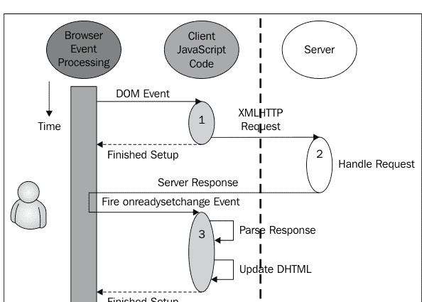

## 致谢

| 角色 | 姓名 |
| --- | --- |
| 作者 | Sami Salkosuo |
| 编辑团队负责人 | Mithil Kulkarni |
| 审阅者 | Jason Crow, Matthew Henry, Sujit Pal |
| 项目经理 | Abhijeet Deobhakta |
| 项目协调员 | Rajashree Hamine |
| 收购编辑 | Adil Ahmed |
| 索引 | Rekha Nair |
| 开发编辑 | Usha Iyer |
| 校对 | Chris Smith |
| 技术编辑 | Darshana D. Shinde |
| 生产协调员 | Rajni R. Thorat |
| 复制编辑 | Sumathi Sridhar |
| 封面设计 | Rajni R. Thorat |

## 关于作者

**Sami Salkosuo** 是 IBM Software Group 芬兰的软件 IT 架构师。他在 Java、Web 和集成技术方面拥有超过十年的经验。

Sami 为 IBM developerWorks 撰写了多篇文章，也是 IBM Redbook *Portalizing Domino Applications* 的合著者。

> 我感谢审阅者 Sujit Pal、Matthew Henry 和 Jason Crow 的评论，他们帮助我改进了我的写作。感谢 Rajashree Hamine、Usha Iyer、Darshana Shinde 以及 Packt Publishing 的其他人让这本书得以实现。
>
> 我还要衷心感谢我的家人给予的耐心和支持。

## 关于审阅者

**Jason Crow** 是佛罗里达州德尔雷海滩 Office Depot, Inc. 的首席 Java 开发人员。他擅长将自己在 Java、DWR、HTML、CSS 和 jQuery 方面的专业知识融合起来，以增强可用性并为 officedepot.com 带来动态功能。他通过自己的博客 http://greatwebguy.com 积极为社区做出贡献。

**Matthew Henry** 是 LeTourneau University 的编程服务经理。Matthew 在 IT 和计算机相关领域担任程序员已有 30 年。他合著了 *Upgrading to Lotus Notes 7*，并为特定计算机行业杂志撰写了多篇文章。

**Sujit Pal** 二十年前开始编程，此后从未回头。他目前在 Healthline Networks, Inc. 工作，该公司专注于健康领域的搜索垂直行业，担任其研究与开发团队的一员。除了工作之外，他最喜欢的消遣是探索新的软件技术、技巧和语言，并在 sujitpal.blogspot.com 上撰写自己的实验。

## 前言

AJAX 能够在浏览器中实现类似桌面级的丰富用户界面，并能够实现交互式界面，甚至可以取代传统用户界面。浏览器与服务器之间的通信在后台进行，并且由于只有数据在浏览器和服务器之间传输，AJAX 应用程序对用户来说似乎很快，而且实际上也响应迅速。

DWR，Direct Web Remoting，是一个开源 Java 框架，采用商业友好的 Apache Software License v2 许可，用于构建 AJAX 应用程序。DWR 的主要思想是将 AJAX 实现细节，如 XMLHttpRequest 等，从开发人员面前隐藏起来。开发人员可以专注于应用程序和业务对象的开发，而将 AJAX 细节留在幕后，那里才是它们应有的位置。

DWR 允许服务器端的 Java 类在浏览器中使用（它就像 JavaScript 函数与服务器端 Java 之间的 RPC），并且还允许 JavaScript 函数在服务器中使用（反向 AJAX）。DWR 通过基于 XML 的配置从 Java 类动态生成 JavaScript 函数，这些函数可以通过 DWR JavaScript 库从浏览器调用。服务器端的 DWR servlet 接收请求并调用实际的 Java 实现。DWR 包含几个使 DWR 正常工作所需的 JavaScript 库，这些库对开发人员也很有帮助。

当服务器用于查询和/或控制客户端浏览器行为时，就使用了反向 AJAX 的术语。DWR 支持三种不同的方法在应用程序中进行反向 AJAX：Piggyback、Polling（由客户端进行）和 Comet（服务器推送）。

您可能有一个正在进行的项目，您可能希望使用 JSF 或 Spring 等框架来构建整个解决方案。在这些情况下，AJAX 和 DWR 只是整体图景的一部分，因此 DWR 需要很好地与其他框架集成，并且做得非常成功！


## 序言

DWR 项目对安全性进行了非常彻底的思考。DWR 框架考虑了许多安全问题，DWR 网站上有大量关于安全性的讨论。

本书是为有兴趣学习 DWR 和 AJAX 框架的专业 Java 开发人员而写。本书从 DWR 主要特性和功能的教程开始，然后介绍开发环境的搭建，最后以一些示例应用程序结束。

后续章节充满了示例应用程序的示例代码，以帮助理解。

## 本书涵盖内容

- *第 1 章*简要介绍 AJAX 技术和 DWR。它还讨论了 DWR 社区，并简要描述了互联网上可以找到的关于 DWR 的信息。

- *第 2 章*描述了我们在本书示例中使用的 DWR 特性——从高层次视角介绍 DWR 如何让开发人员的工作更轻松。它讨论了反向 AJAX、DWR JavaScript 库、转换器、创建器、过滤器和签名。它还包括一个关于将 DWR 与其他项目集成的部分，以及另一个关于安全性的部分。

- *第 3 章*通过描述如何设置开发环境以及如何测试和调试我们的示例应用程序，为开发做好准备。它涵盖了 DWR 支持的浏览器和环境、配置、错误处理、打包和部署。

- *第 4 章*是第一个专门介绍示例代码的章节。本章中的示例包括典型的用户界面元素，如表格和列表，以及如何使用 DWR 来实现它们。它还有一个字段补全的示例。

- *第 5 章*讨论如何在更高级的用户界面元素中使用 DWR，例如表单、导航树和滚动地图。

- *第 6 章*展示了如何将 DWR 应用程序集成到数据库、Web 服务或消息系统中。

- *第 7 章*包含两个示例应用程序：协同图书创作，展示了如何使用 DWR 创建基于 Web 的多用户创作环境；以及聊天室——一个使用 DWR 的典型多用户聊天室应用程序。

## 阅读本书所需准备

本书面向希望通过示例学习 DWR 的专业 Java 开发人员和架构师。要充分利用本书，需要具备或最好具备几项技能。

首先，需要具备 Java 开发技能，尤其是使用 Java 企业版（JEE）、Servlet 和 JSP 等 Java 技术进行 Web 开发的经验。了解其他 Web 技术（如 JavaScript、HTML 和 CSS）也很有用。

你应该熟悉 Eclipse 工具，其他有用的技能包括了解 JEE 应用服务器，以及具备 XML 等常见技术的经验。

了解 AJAX 技术的基础知识会有所帮助。不过，本书也会介绍 AJAX 的基础知识。

## 本书读者对象

本书是为有能力的 Java 开发人员编写的，并假设您是专业人士而非业余爱好者。您应该熟悉编程、Web 2.0 和 AJAX 的概念。

## 排版约定

在本书中，您会看到多种文本样式，用于区分不同种类的信息。以下是这些样式的一些示例及其含义的解释。

正文中的代码字如下所示：“我们可以通过使用 include 指令来包含其他上下文。”

代码块将如下所示：

```
<?xml version="1.0" encoding="UTF-8"?>
<!DOCTYPE dwr PUBLIC
  "-//GetAhead Limited//DTD Direct Web Remoting 2.0//EN"
  "http://getahead.org/dwr/dwr20.dtd">
<dwr>
  <allow>
    <create creator="new" javascript="HorizontalMenu">
      <param name="class" value="samples.HorizontalMenu" />
    </create>
  </allow>
</dwr>
```

当我们希望引起您对代码块中某一部分的注意时，相关的行或项目将以粗体显示：

```
public boolean submitOrder(String name, String address,
                           String creditCardNumber, String expiryDate)
{
    CreditCardValidatorSoapProxy ccValidatorProxy =
                                      new CreditCardValidatorSoapProxy();
    int rv = -1;
    try {
        rv = ccValidatorProxy.validateCard(creditCardNumber,
                                           expiryDate.replace("/", ""));
        if (rv != 0) {
            System.out.println("Credit card check failed: " + rv);
        }
    }
    catch (RemoteException e) {
        e.printStackTrace();
    }
    if(rv==0)
    {
        //credit card valid, submit to order system
        new OrderSystem(name,address,creditCardNumber,expiryDate);
    }
    return rv == 0;
}
```

任何命令行输入和输出都将按照以下格式书写：

```
deploy -user system -password manager deploy d:\temp\HelloWorldServlet.war
```

**新术语和重要词汇**以粗体字形式出现。你在屏幕上（例如菜单或对话框中）看到的文字会以这样的形式出现在我们的文本中：“点击**下一步**按钮将进入下一个屏幕”。

> 警告或重要提示会出现在这样的框中。

> 提示和技巧会像这样出现。

## 读者反馈

我们始终欢迎读者的反馈。请告诉我们您对本书的看法，喜欢或可能不喜欢的地方。读者反馈对我们开发让您真正受益匪浅的图书非常重要。

要向我们发送一般反馈，只需发送电子邮件至 feedback@packtpub.com，并请务必在邮件主题中提及书名。

如果您需要某本书并希望我们出版，请通过 www.packtpub.com 上的**推荐书名**表单告诉我们，或发送电子邮件至 suggest@packtpub.com。

如果您在某方面拥有专长，并且有兴趣撰写或参与撰写一本书，请参阅 www.packtpub.com/authors 上的作者指南。

## 客户支持

既然您已成为 Packt 图书的骄傲拥有者，我们有许多服务可帮助您充分利用所购内容。

## 下载本书示例代码

访问 http://www.packtpub.com/files/code/2936_Code.zip 直接下载示例代码。


> 可下载的文件包含使用说明。

## 勘误

尽管我们已尽一切努力确保内容的准确性，但错误仍然可能发生。如果您在我们的某本书中发现错误——也许是文本或代码中的错误——我们将不胜感激您向我们报告。这样做可以避免其他读者受挫，并有助于改进本书的后续版本。如果您发现任何勘误，请访问 http://www.packtpub.com/support，选择您的书，点击**告知我们**链接，然后输入勘误详情。您的勘误一经核实，您的提交将被接受，勘误也会添加到现有勘误列表中。您可以通过从 http://www.packtpub.com/support 选择您的书名来查看现有勘误。

## 盗版

互联网上对版权材料的盗版是所有媒体持续存在的问题。在 Packt，我们非常重视对版权和许可的保护。如果您在互联网上以任何形式遇到我们作品的非法副本，请立即提供位置地址或网站名称，以便我们采取补救措施。

请联系 copyright@packtpub.com，并提供疑似盗版材料的链接。

我们感谢您帮助我们保护作者，并让我们能够继续为您带来有价值的内容。

## 疑问

如果您在本书的某些方面遇到问题，可以通过 questions@packtpub.com 联系我们，我们将尽力解决。

AJAX 技术的主要组成部分是 XmlHttpRequest，它是一个 JavaScript 对象，于 2002 年首次得到 Mozilla 的支持。该概念最初由微软于 1999 年为 Internet Explorer 5.0 开发，当时称为 XMLHTTP。以下链接提供了 XmlHttpRequest 的详细信息和历史：
http://en.wikipedia.org/wiki/XMLHttpRequest。

XmlHttpRequest 用于在客户端和服务器之间异步传输数据。下图展示了 AJAX 时序图以及 XmlHttpRequest 的使用方式：



许多书籍（如 Head Rush Ajax 这本 AJAX 的“大脑友好指南”）以及互联网站点都对 AJAX 进行了详细阐述。此外，我们假设你们中的大多数人已经了解 AJAX，并且阅读本书的原因不仅仅是学习 AJAX 基础知识。
