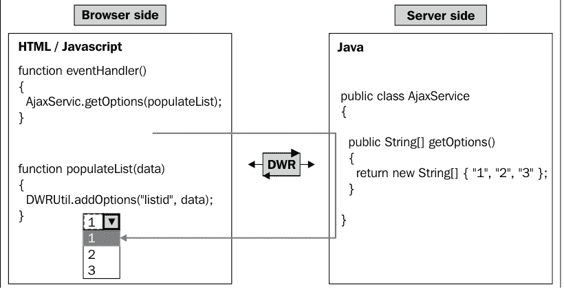

# DWR：面向 Java 开发者的 AJAX

Direct Web Remoting（http://www.directwebremoting.org）是一个开源 Java 框架，采用对商业友好的 Apache 软件许可证 v2（http://www.apache.org/licenses/LICENSE-2.0.html）授权，用于构建 AJAX 应用。DWR 的主要思想是将 XMLHttpRequest 等 AJAX 实现细节对开发者隐藏。开发者可以专注于应用程序和业务对象的开发，将 AJAX 细节留在它们应当所处的幕后。


## Introduction

DWR 允许在浏览器中使用服务器端的 Java 类（它就像 JavaScript 函数与服务器端 Java 之间的 RPC）并且还允许在服务器中使用 JavaScript 函数（Reverse AJAX）。通过基于 XML 的配置，DWR 动态生成 Java 类的 JavaScript 函数，可通过 DWR JavaScript 库从浏览器调用。服务器端的 DWR servlet 接收请求并调用实际的 Java 实现。

下图显示了 DWR 在用户应用程序中的定位，并取自 DWR 网站（http://directwebremoting.org/dwr/overview/dwr）。



在上图中，JavaScript 函数 **eventHandler()** 响应某些浏览器事件，如点击按钮。事件处理程序使用 **AjaxService** 对象并调用 **getOptions()** 方法，就好像 **AjaxService** 是一个普通的 JavaScript 对象一样。开发人员可以实现客户端和服务器端代码，并将客户端与服务器之间的通信交给 DWR 处理。

从 JavaScript 调用服务器端 Java 会导致很多事情发生，并且在幕后也需要很多事情发生：

- 当请求一个启用了 DWR 的网页时，DWR 根据配置从 Java 类动态生成 JavaScript 函数。
- 当函数 **eventHandler()** 被调用时，例如点击按钮时，开发人员调用一个动态生成的函数（上图中显示的 **AjaxService.getOptions(populateList)**），DWR JavaScript 库获取参数，对其进行序列化，并调用服务器上的 DWR servlet。
- DWR servlet 接收请求，并根据配置，servlet 实例化一个 Java 对象，例如 **AjaxService**，并调用所需的方法，例如 **AjaxService.getOptions(populateList)**。
- 当 Java 方法执行完毕后，返回值（一个 String 数组）返回给 DWR servlet，servlet 对返回值进行序列化并将响应发送到浏览器上的 DWR JavaScript 函数。
- DWR JavaScript 函数在浏览器上接收响应，并根据参数 **populateList**（这是 **AjaxService.getOptions()** 函数中的回调函数名），DWR 使用来自 Java 方法的返回值作为参数调用 **populateList** 函数。**AjaxService.getOptions()** JavaScript 函数由 DWR 动态生成，并在幕后与 DWR servlet 通信。
- 回调函数（由开发人员编写）对返回值执行所需的操作，例如更新浏览器页面并向下拉字段添加新选项。

DWR 非常适合 Java 开发人员，因为这种方法很容易上手。

## The DWR Community

DWR 为 DWR 用户提供了非常活跃的邮件列表：

- Java.net (https://dwr.dev.java.net/servlets/SummarizeList?listName=users)
- Nabble (http://www.nabble.com/DWR---Users-f13934.html)
- Gmane (http://dir.gmane.org/gmane.comp.java.dwr.user)

这些邮件列表包含大量信息，对任何 DWR 用户都有帮助，任何人都可以参与其中。

还有一个用于 DWR 安全的邮件列表，在此讨论 DWR 安全问题。为了参与其中，必须单独申请加入该列表，并且必须包含公司电子邮件地址和职称或其他身份识别方式。单独申请是为了可以在不公开传播的情况下讨论 DWR 安全问题（并非旨在保密安全问题）。申请加入安全邮件列表可通过 http://groups.google.com/group/dwr-security 进行

## Introduction

DWR 开发邮件列表如下：

- Java.net (`https://dwr.dev.java.net/servlets/SummarizeList?listName=dev`)
- Nabble (`http://www.nabble.com/DWR---Dev-f13937.html`)

DWR 创建者 Joe Walker 的博客（`http://directwebremoting.org/blog/joe`）包含有关 DWR 的新闻和关于 Web 开发的思考。

SitePen（`http://sitepen.com/services/support.php`）还提供商业支持。有多个支持包可供选择，并且还可以根据特定需求定制支持包。

DWR 被数千名开发人员使用，并且已被 American Airlines、Walmart、Citigroup、Mastercard 等公司使用。DWR 同时用于公共网站和 Intranet 网站。

DWR 也是 Dojo Foundation 的一部分，Dojo Foundation 是一个独立的法律实体，为开发提供基础设施。成员包括 IBM 和 SitePen。除了 DWR，Dojo Foundation 还赞助 Dojo Toolkit、OpenRecord 和 Cometd 项目。以下网站提供有关 Dojo Foundation 的更多信息：

```
http://dojotoolkit.org/foundation
```

## Summary

本章简要介绍了 AJAX 和 DWR。AJAX 是一种基础技术，使用基于浏览器的 JavaScript 构建 Internet 应用程序，其用户体验优于典型的请求-响应 Web 应用程序。

DWR 是一个用于构建 AJAX 应用程序的 Java 框架，主要面向不希望实现使 AJAX 工作所需的底层“东西”的 Java 开发人员。

本书的其余部分介绍 DWR 功能和可在您自己的项目中使用的示例代码。后面的章节中的示例展示了一些使用 DWR 的常见情况以及如何使用它。
