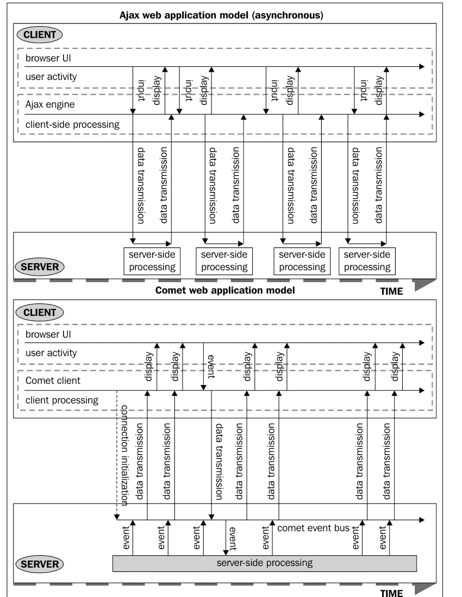

# 2 DWR Features

本章描述了一些 DWR 的主要功能：Reverse AJAX、安全、DWR JavaScript 库以及 DWR 与其他项目的集成。

Reverse AJAX 基本上是一种从服务器端 Java 类调用客户端 JavaScript 的方法。安全部分讨论了 DWR 为防止利用 DWR 功能对服务器进行非授权访问所做的工作。

DWR 包含一些有用的 JavaScript 库，在这里一起解释了如何将 DWR 与其他项目（如 Struts 或 JSF）一起使用。

本章涵盖以下部分：

- Ease of Use — 从高层次来看 DWR 如何让开发人员的生活更轻松
- Reverse AJAX — 描述 Reverse AJAX 的含义
- DWR JavaScript Libraries — 描述随 DWR 提供的 JavaScript 库：`engine.js`、`util.js` 和 `gi.js`
- Converters — 介绍 DWR 如何编组/解组对象
- Creators, Filters, and Signatures — 介绍重要的 DWR 配置元素
- Integration with Other Projects — 简要描述 DWR 如何与其他项目集成
- Security — 给出 DWR 安全性的概述

除了本章描述的功能外，DWR 的错误处理和配置等功能将在第 3 章 *Getting Started* 中介绍。

## Ease of Use

DWR 的主要功能是其易用性。DWR 隐藏了许多开发人员不需要的细节。这意味着我们可以利用 AJAX 功能，而无需了解例如 `XmlHttpRequest`，或如何将 Java 对象发送到浏览器等等。DWR 拥有自己的框架，用于执行 Java 对象到 JavaScript 及其反向所需的编组/解组。

DWR 的设置包括将 `dwr.jar` 文件复制到应用程序 WAR 文件中的 **WEB-INF/lib** 目录，并在开始使用之前将应用程序安装到服务器。我们的 Java 类无需实现特殊接口，甚至可以完全透明地开发一个 Java 对象，使其不知道任何 DWR 特定类。DWR 为我们提供了文档完善的 API，我们可以在开发例如 Reverse AJAX 应用程序时利用它。

最后，我们可以利用现有的 Java 技能，因为 DWR 不强迫我们替换现有代码，而是与非 AJAX 应用程序并行存在，并允许我们逐步将应用程序的所需部分更改为 AJAX 功能。

## Reverse AJAX

当服务器用于查询和/或控制客户端浏览器行为时，使用 Reverse AJAX 术语。这可能会引起一些疑问，因为听起来我们的浏览器在访问世界各地的网页时现在容易受到攻击。

幸运的是情况并非如此，因为服务器无法打开到浏览器的连接。浏览器必须始终是连接的发起者。因此，关于安全性的问题确实有效，但问题意味着相关网站的设计和实现是为了造成伤害。

DWR 支持三种不同的方法在应用程序中进行 Reverse AJAX：Piggyback、Polling（由客户端）和 Comet（服务器推送）。

## Piggyback

Piggyback 方法的工作方式是，每当服务器有更新要发送给客户端时，它会等待客户端打开连接并请求服务器上的某些内容。当这种情况发生时，服务器会在响应中包含新的更新，并将其传递给客户端，DWR 识别该更新并相应地采取行动，并在用户的网页上进行更新。


Piggyback 方法是 DWR 中 Reverse AJAX 的默认方法，被称为 Passive Reverse AJAX（其他方法被称为 Active Reverse AJAX），并且无需任何配置。对于我们这些忙碌的开发者来说，它通常是一个足够好的解决方案（顺便提一句，学会何时停止、何时开发“足够好的软件”是从熟练工迈向大师的一步；参见安德鲁·亨特和大卫·托马斯所著的*《程序员修炼之道：从小工到专家》*）。

Piggyback 的一个缺点是，服务器端发生的任何更新可能需要很长时间才能对用户可见。根据应用的不同，这可能不是问题，但如果确实是个问题，那么可以使用另外两种方法：Polling 和 Comet，它们都是 Active Reverse AJAX 方法。

使用 Reverse AJAX 需要在服务器端的应用程序代码中使用 DWR 类。DWR 有一个名为 ScriptProxy 的类，用于在客户端执行 JavaScript 函数。例如，下面的代码片段（可能位于远程 Java 方法中）获取给定页面 mainpage.jsp 的所有脚本会话（本质上是 HTTP 会话，但针对脚本），然后添加一个函数调用，该调用会在所有已知且打开了 mainpage.jsp 的客户端中被调用。

```
Collection<ScriptSession> sessions = serverContext.getScriptSessionsByPage(contextPath + "/mainpage.jsp");
ScriptProxy proxy = new ScriptProxy(sessions);
proxy.addFunctionCall("newMessage",newMessage);
```

在 mainpage.jsp 中，我们会有以下函数 newMessage，它用于更新网页中的某个字段。

```
function newMessage(newMessageParam)
{
    elementToBeUpdated=document.getElementById("messageArea");
    elementToBeUpdated.innerHTML=newMessageParam;
}
```

使用 Piggyback 方法的 Reverse AJAX 不需要任何配置，它在 DWR 中默认启用。使用 Piggyback 时，客户端在向服务器应用发出 AJAX（DWR）请求后会收到更新。DWR 随后会将所有更新（来自 Reverse AJAX 方法）与实际响应一起发送给客户端，DWR 在客户端更新网页（如上一个例子所示）。

## Polling

Polling 是一种“无需动脑”的实现 Reverse AJAX 的方法，尽管它实际上并不是反向的，因为 DWR 会定期轮询服务器，检查应用程序服务器端是否有需要更新网页的事件。

在某些情况下，这种方法可能很好，特别是在不担心轮询对网络和服务器造成额外负载，或者对客户端的更新不需要像 Comet 那样（近乎）实时的情况下。

当我们为 Reverse AJAX 使用 Polling 方法时，代码与 Piggyback 部分中的示例代码相同，只需要更改配置。为了使用 Polling，我们需要将 DWR 配置为使用 Active Reverse AJAX。这可以通过在 web.xml 文件中向 DWR servlet 添加以下初始化参数来完成。

```
<init-param>
    <param-name>activeReverseAjaxEnabled</param-name>
    <param-value>true</param-value>
</init-param>
```

我们还需要为 Reverse AJAX 启用网页。可以通过将以下行添加到用于接收来自服务器的 Reverse AJAX 请求的网页中来完成。

```
dwr.engine.setActiveReverseAjax(true);
```

上述配置实际上就是使用 Comet 方法所需的全部配置，这一点可以在下一节中看到。对于 Polling 方法，我们还需要在 web.xml 文件中添加一个额外的初始化参数：

```
<init-param>
    <param-name>org.directwebremoting.extend.ServerLoadMonitor</param-name>
    <param-value>org.directwebremoting.impl.PollingServerLoadMonitor</param-value>
</init-param>
```

还有一个可选的初始化参数用于指定轮询间隔。默认间隔为 5 秒，可以通过以下初始化参数进行更改。

```
<init-param>
    <param-name>disconnectedTime</param-name>
    <param-value>60000</param-value>
</init-param>
```

## Comet

Comet，有些人称之为长连接 HTTP，是一个非常新的术语（2006 年 3 月由 Alex Russell 首次使用 http://alex.dojotoolkit.org/?p=545），指的是一种服务器推送方法：浏览器打开连接并保持连接打开，这样服务器可以在需要时将更新推送到浏览器，更新延迟非常低。下图展示了 Comet 与普通 AJAX 模型的对比：

### Ajax Web 应用模型（异步）

### Comet Web 应用模型



从图中可以看出，Comet 使服务器能够响应事件发送更新，几乎是实时的，并且无需等待用户打开连接或使用 Polling。

如上一节所述，Comet 只需要在初始化参数中启用 Active Reverse AJAX，并在网页中启用 Reverse AJAX。使用 Comet 的 Active Reverse AJAX 有两种模式：完整流模式（Full Streaming Mode）（DWR 2.0.3 及更早版本中的默认模式）和提前关闭模式（Early Closing Mode）（DWR 2.0.4 及更高版本中的默认模式）。

完整流模式的响应时间最快，当服务器上发生事件时，它能向客户端提供近乎实时的响应。在这种模式下，DWR 每 60 秒通过关闭连接并重新打开来检查浏览器是否处于活动状态。另一方面，提前关闭模式会让 DWR 在浏览器收到输出后关闭连接，然后重新打开。对于提前关闭模式，有一个名为 maxWaitAfterWrite 的初始化参数，其值表示在收到服务器的输入后，等待关闭连接（并重新打开）的时间（以毫秒为单位）。

在 DWR 应用中使用 Comet 时，有几点需要注意，特别是对于拥有大量用户的应用。由于客户端保持到服务器的连接打开，服务器资源可能会被这些连接及其线程消耗。这会使 DWR 应用的基础设施需求不必要地增加。解决办法是使用 maxWaitAfterWrite 初始化参数，并将其调整到合适的值。其他解决方案是使用 Polling 或 Passive Reverse AJAX。

在 Piggyback、Polling 和 Comet 这三种方法中，DWR 都展现了其优势，因为我们不需要真正了解 Reverse AJAX 的实现细节。DWR 在后台处理这些细节，并隐藏了 Comet 和 Polling 方法的细节，我们只需以正确的方式配置 DWR，就可以使用这三种方法中的任何一种。

## DWR JavaScript 库

DWR 包含几个 JavaScript 库，这些库既是 DWR 运行所必需的，也对开发者很有帮助：engine.js、util.js 和 gi.js。

第一个 JavaScript 库 engine.js 是 DWR 浏览器端功能的核心，所有使用 AJAX 和 DWR 的页面都需要它。第二个库 util.js 包含有用的实用函数，但 DWR 并不需要它。第三个库 gi.js 用于将 DWR 与 TIBCO General Interface（GI）集成，用于 AJAX 应用。

### engine.js

```
dwr.engine.setPreHook(requestStart);
dwr.engine.setPostHook(requestEnd);

function requestStart()
{
  alert('Request start');
}

function requestEnd()
{
  alert('Request end');
}
```

engine.js 的其他功能包括可以批量调用服务器，其中一个或多个远程函数被一起调用。以下代码在一次批量调用中调用三个远程方法，超时时间为 5 秒。

```
dwr.engine.beginBatch();
WorldMap.getEvents(callback:function(results){...});
WorldMap.getArea(coordinates, showPreview);
WorldMap.sendEvents(events, result);
dwr.engine.endBatch({
  timeout:5000
});
```

DWR 还有一个称为“调用排序”（call ordering）的功能。启用后，远程调用的响应会按照发送顺序依次接收。默认情况下，调用排序未启用，如果启用，可能会降低应用的速度。如果需要调用排序，可以通过在网页中添加 dwr.engine.setOrdered(true) 来启用，并且它会影响该网页中的所有 DWR 调用。

### util.js

util.js 库包含许多可在我们的应用中使用的有用 JavaScript 函数。这个库被设计为即使没有 DWR 的其他部分也可以使用，因为它不需要完整的 DWR 功能（只有一个例外：useLoadingMessage() 函数）。

该库包含用于操作 HTML 元素的函数，包括表格、列表和图像。以下是 util.js 中的函数表，并附有每个函数的简短说明。


## DWR 功能

| 函数 | 语法 | 描述 |
|---|---|---|
| addOptions | `dwr.util.addOptions(id, [ "one", "two", "three" ])` | 允许在不刷新页面的情况下向由 ID 指定的列表和选择元素 (`ol`, `ul`, 和 `select`) 添加元素。 |
| addRows | `dwr.util.addRows(id, array, cellfuncs, [options])` | 向指定的表格元素添加行。`array` 参数用于填充数据，使得每个数组元素对应一行。创建表格的伪代码如下：<br><code>for each member in array<br>&nbsp;&nbsp;&nbsp;&nbsp;for each function in cellfuncs<br>&nbsp;&nbsp;&nbsp;&nbsp;&nbsp;&nbsp;&nbsp;&nbsp;create cell from cellfunc(array[i])</code> |
| byId | `dwr.util.byId()` | 此函数查找当前 HTML 文档中具有给定 ID 的元素。这可以替代 `document.getElementById` JavaScript 函数使用。 |
| getValue() | `dwr.util.getValue(id)` | 从诸如 `div` 和 `input` 元素等 HTML 元素获取值。 |
| getText() | `dwr.util.getText(id)` | 专为选择列表设计，并返回当前选项的显示文本而不是值。 |
| getValues() | `dwr.util.getValues({ div:null, textarea:null })` | 此函数获取指定元素的值。函数参数是一个映射，其中键是 HTML 元素 ID，值在执行此函数后保存元素值。 |
| onReturn() | `dwr.util.onReturn(event, submitFunction)` | 当在文本元素上按下回车时捕获事件的有用函数。这适用于 `onkeypress` 或 `onkeydown` 事件绑定到 `onReturn` 函数的文本元素：<br><code>&lt;input type="text"<br>&nbsp;&nbsp;&nbsp;&nbsp;&nbsp;&nbsp;&nbsp;onkeypress="dwr.util.onReturn(event, submitFunction)"/&gt;<br>&lt;input type="button"<br>&nbsp;&nbsp;&nbsp;&nbsp;&nbsp;&nbsp;&nbsp;onclick="submitFunction()"/&gt;</code> |
| removeAllOptions() | `dwr.util.removeAllOptions(id);` | 从由 ID 指定的 `ul`、`ol` 或 `select` 元素中移除所有选项。 |
| removeAllRows() | `dwr.util.removeAllRows(id)` | 从由 ID 指定的表格中移除所有行。 |
| selectRange() | `dwr.util.selectRange(id,start,end)` | 在输入框中选择从起始位置到结束位置之间的文本范围。 |
| setValue() | `dwr.util.setValue(id,value)` | 设置指定 HTML 元素的值。与大多数 HTML 元素兼容，最重要的是输入元素和 div。 |
| setValues() | `dwr.util.setValues({name:value})` | 与 `setValue()` 类似，但函数参数是一个包含名称/值对的对象。名称是 HTML 元素的 ID，值是元素的新值。 |
| toDescriptiveString() | `dwr.util.toDescriptiveString(id,detailLevel,options)` | 一个有用的漂亮打印函数，以人类可读形式打印 JavaScript 对象，并可选择详细程度。 |
| useLoadingMessage() | `dwr.util.useLoadingMessage()` | DWR 专用的加载消息，在网页右上角显示“loading”。 |

表中的描述仅供参考。以下章节中的 DWR 示例展示了如何使用这些实用函数，而 DWR 主页更详细地解释了这些函数。当然，对于有兴趣深入了解细节的人来说，JavaScript 源代码也是可用的。

值得一提的一个参数选项是 `escapeHTML:false`。默认情况下，escapeHTML 为 true，意味着所有 HTML 元素都会被转义（尤其是 &lt;、&gt;、&amp;、双引号和单引号；这是为了防止跨站脚本攻击）。

### gi.js

`gi.js` 库有助于将 DWR 与 TIBCO General Interface (GI) for AJAX Applications 集成，这是一个开源库，包含数十个现成的 AJAX 组件以及帮助使用 TIBCO General Interface 开发 AJAX 应用的工具。

DWR 的 `gi.js` 提供了与 TIBCO GI 集成的有用函数，例如 `dwr.gi.toCdfDocument()`，它可从 JavaScript 对象生成 CDF (**Common Data Format**) 文档。CDF 是 TIBCO GI 的通用格式，允许在 TIBCO GI 组件之间共享数据、执行数据映射以及在客户端控件之间传输数据。

有关 TIBCO GI 的更多信息可在 TIBCO Developer Network 上找到，`http://www.tibco.com/devnet/gi/default.jsp`。

### 转换器

转换器是 DWR 在客户端和服务器之间编组数据的手段。有许多基本转换器默认启用，并且也可以创建新的转换器。

签名在 dwr.xml 中指定，它们用于指示 DWR 正确操作包含在集合中的类型，例如 `java.util.List`。例如，如果我们有一个远程方法签名为 `void setAddresses(List addresses)`，DWR 没有办法知道列表中包含的类型是 String。这就是为什么我们需要在 dwr.xml 中提供以下签名来指示 DWR 正确行为的原因。

```
<signatures>
  <![CDATA[
  import java.util.List;
  import myclasses.AllAddresses;
  AllAddresses.setAddresses(List<String> allAddresses);
  ]]>
</signatures>
```

### 与其他项目的集成

通常，DWR 并不是单独使用。也许你有一个正在进行的项目，其中已决定使用 JSF 或 Spring 等框架来构建整个解决方案。在这些情况下，AJAX 和 DWR 只是整体图景的一部分，因此 DWR 需要很好地与其他项目集成。而它确实做到了。

DWR 集成以下项目：

- JSF (http://java.sun.com/javaee/javaserverfaces/)，用于构建用户界面的 Java Server Faces
- Spring (http://www.springframework.org/)，一个完整的 Java/JEE 应用框架
- WebWork (http://www.opensymphony.com/webwork/)，一个 Web 应用开发框架
- Hibernate (http://www.hibernate.org/)，一个对象/关系持久化和查询服务
- 集成到诸如 Apache Jetspeed 的门户中使用 JSR 168 portlets 也是可行的；例如，参见 IBM developerWorks 上的文章 (http://www.ibm.com/developerworks/java/library/j-ajaxportlet/)
- 以及许多其他项目，其集成由 DWR 或其他项目本身提供

在此解释所有集成超出了范围，但作为示例，JSF 集成相当直接。

DWR 包含两个用于 JSF 集成的扩展点；一个是 JsfCreator，用于从 DWR 应用访问 JSF 的 ManagedBeans，另一个是 DWR/Faces servlet 过滤器，允许我们从 FacesContext 访问 Java bean。

过滤器需要在 web.xml 文件中配置才能使用 JsfCreator：

```xml
<filter>
    <filter-name>DwrFacesFilter</filter-name>
    <filter-class>uk.ltd.getahead.dwr.servlet.FacesExtensionFilter</filter-class>
</filter>

<filter-mapping>
    <filter-name>DwrFacesFilter</filter-name>
    <url-pattern>/dwr/*</url-pattern>
</filter-mapping>
```

在 dwr.xml 文件中我们插入 JSF ManagedBeans 配置：

```xml
<allow>
    ...
    <create creator="jsf" javascript="ScriptName">
        <param name="managedBeanName" value="beanName"/>
        <param name="class" value="your.class"/>
    </create>
    ...
</allow>
```

配置后，我们能够从 DWR 应用中使用 JSF ManagedBeans。

### 安全

安全始终很重要，DWR 项目已非常周全地考虑了安全问题。DWR 框架已考虑到许多安全问题，DWR 网站上关于安全的讨论很多，足以填满几本书。

在乎安全的人中包括像你我这样的开发者。软件只做我们指示它做的事情，因此我们在开发期间必须有安全意识，并尽力限制利用我们工作的可能性。

在使用 DWR 时，我们手动在 dwr.xml 配置中指定（除非我们创建了一些自动代码生成软件来为我们做这件事）我们想要远程到 JavaScript 的哪些 Java 类和方法。这样我们可以确保没有攻击者能够利用除我们明确远程的 Java 对象之外的任何其他对象（并且我们可以集中精力使这些对象尽可能安全）。


`dwr.xml` 中的配置还包括每个远程 Java 类的 create 条目。我们可以使用 singleton、new 或其他机制。我们还可以使用 `dwr.xml` 中的 include 和 exclude 元素来限制允许的方法。`web.xml` 配置文件中的安全参数也有 `allowScriptTagRemoting` 和 `crossDomainSessionSecurity`，当启用时，可能会带来巨大的安全风险。因此，如果你要启用这些参数，请确保你了解自己在做什么。

有一个配置参数在开发 DWR 应用程序时非常有用，但在生产（尤其是公开）站点中却是安全风险。以下 init-param、debug 和 test 模式可以添加到 web.xml 中。

```
```xml
<init-param>
    <param-name>debug</param-name>
    <param-value>true</param-value>
</init-param>
```
```

当启用 debug/test 模式时，DWR 会生成测试页面（第 4 章中有示例屏幕），这些页面是了解 DWR 功能的有用工具。

也可以使用 JEE 访问控制机制并限制对特定 JEE 角色的 DWR 本身的访问。这些在 web.xml 文件中指定。在 DWR 内部，还有对远程 Java 对象方法的基于角色的访问控制。DWR 还可以与 Spring Security（也称为 Acegi Security）集成，`http://www.acegisecurity.org/`，它是 Spring Portfolio 的官方安全项目。Acegi 与 DWR 集成的描述可在 `http://java-x.blogspot.com/2007/08/handling-security-with-ajax-dwr-and.html` 找到。

DWR 还设计为攻击者无法访问和操作 DWR 核心文件并更改安全参数等情况。

## 最小化风险

安全不是一个微不足道的问题，我们可以在安全领域花费数年时间仍然会留下很多未完成的工作。作为开发者，我们的工作是确保安全风险降到最低，至少要意识到如果我们远程某个 Java 方法可能会发生什么。

DWR 网站上的一个非常好的例子是，如果我们对名为 `appendStringToFile()` 的方法进行远程调用，该方法将给定的字符串附加到预定义的文件中，那么可能的攻击者可以发送大量请求并用无意义的内容填满文件系统，从而导致意外的服务器停机。停机的成本可能从轻微不便到数百万美元不等。

为了防止无意中提供可能造成危害的访问，我们必须思考我们想要做什么并检查输入参数。检查输入参数是我们作为开发者可以做到的最重要的事情，以确保事故不会发生。

在前面的例子中，如果我们远程了 `appendStringToFile()` 方法，我们可以做很多检查，例如文件系统是否正在填满，是否是一个适用于其目的的字符串（例如日志文件中的日志条目），请求者是谁等等。

另外请确保使用 `escapeHTML` 以防止跨站脚本（XSS）攻击。XSS 是值得了解的东西。因此请参阅维基百科（http://en.wikipedia.org/wiki/Cross-site_scripting）以获取详细描述。

## 总结

本章介绍了 DWR 功能的概述，包括 JavaScript 库（`util.js`、`engine.js` 和 `gi.js`）、安全性和 Reverse AJAX，以及 DWR 工作方式的基本操作元素。

除了本章讨论的主题外，DWR 还有许多其他可能与开发者相关或不相关的有用功能。这取决于应用程序。本章中的主题旨在提供高层次的概述，但它们将为你从 DWR 网站（http://directwebremoting.org/dwr/documentation）甚至从 DWR 源代码中了解更多信息提供良好的起点。

非常经常，大多数开发者在开始一个项目时不需要该技术的全部功能。在项目进行一段时间后，我们可能会发现解决方案已经成熟，包含了该技术的大部分甚至全部功能。但这通常不是初始情况，而且，我们必须从某个地方开始，逐步迈出小步是实际的做法，就像学步的幼儿学习走路一样。
