# 3 安装与配置
入门

在本章中，我们将为在后续章节中进行的编码工作设置开发环境。我们还将查看支持的环境、配置、测试和调试。

作为本书示例代码的开发环境，我们有以下组件：Eclipse 作为 IDE，Apache Geronimo 2.x.x 作为应用服务器，Java 1.5.x 作为 Java 运行时，Firefox 2.0.0.x 作为客户端，以及 Windows 作为操作系统（Linux 同样适用）。

本章包括以下部分：

- 支持的浏览器和环境 – 描述 DWR 支持的软件组件
- 配置 – 介绍 DWR 配置，包括 `dwr.xml` 和 `web.xml` 文件
- 设置开发环境 – 有设置开发组件的步骤
- 测试和调试 – 描述如何在使用 DWR 开发应用程序时进行测试和调试
- 错误处理 – 描述 DWR 如何处理错误处理，以及如何配置它
- 打包和部署 – 展示如何使用 Eclipse 和 Geronimo 打包和部署 DWR 应用程序

## 支持的浏览器和环境

由于 DWR 应用程序基于 Java，运行 DWR 应用程序的服务器必须是 Java 服务器。JDK 1.3 和 servlet 规范 2.2 是最低要求。几乎所有 Java 应用服务器都支持 DWR 应用程序。Apache Tomcat、Apache Geronimo、WebSphere、Weblogic 以及许多其他服务器都受支持。在本书中，我们使用了 Apache Geronimo。

DWR 支持大多数最新浏览器：

- Firefox 1.x 及更高版本受支持。
- Internet Explorer 6.0 及 Windows 的更高版本受支持（IE Mac 不受支持）。IE 5.5 也可能工作，但 IE 5.0.2 不受支持。
- 基于 Mozilla 的浏览器从 1.7 版本开始受支持。
- Opera 7.5.4 及更高版本受支持（包含空值的字符串存在一个小问题报告）。
- OSX 上的 Safari 浏览器从 1.2 版本开始受支持。
- Konqueror 浏览器及其最新版本可能可以工作，但未经过 DWR 团队测试。

总体而言，大多数当前浏览器都受 DWR 支持，在任何当前或未来的开发项目中，浏览器支持不太可能成为问题。尤其是当项目面向 SMB（中小企业）或企业客户时，他们很可能有公司首选浏览器的政策，而该浏览器很可能就是两大主流浏览器之一。

## 配置

DWR 使用 XML 文件、注解或 Fluent Interface 风格进行配置。使用 XML 文件是 DWR 配置最典型的方法，有两个文件：web.xml 和 dwr.xml。第一个 web.xml 对于其他配置方法也是必需的。注解和流式配置可以用在 dwr.xml 的位置。本节描述配置方法以及如何使用它们。

### web.xml

配置从在 Web 应用程序的 web.xml 配置文件中定义 DWR servlet 开始。这当然是强制性的，因为没有它 DWR 就无法工作。最小配置不包含任何 init 参数，示例如下：

DWR servlet 的初始化参数还包括几个用于服务器负载保护的参数。负载保护的 init 参数在下表中列出：

| 参数 | 描述 |
|---|---|
| activeReverseAjaxEnabled | 当设置为 true 时，启用 reverse AJAX 支持、轮询和 Comet。默认值是 false。 |
| maxWaitingThreads | 等待请求的线程最大数量。默认值是 100。 |
| maxHitsPerSecond | 每秒应获得的轮询请求数量。默认值是 40。 |

其他 init 参数也存在，例如 sessionCookieName 和 overridePath。DWR 网页列出了所有参数，包括一些未记录的参数。

### dwr.xml

DWR 的另一个 XML 配置文件是 dwr.xml。该文件用于将远程 Java 类配置为 JavaScript 函数，是 DWR 功能的基础。

dwr.xml 文件具有以下结构：

```
<!DOCTYPE dwr PUBLIC "-//GetAhead Limited//DTD Direct Web Remoting 2.0//EN" "http://getahead.org/dwr/dwr20.dtd">
<dwr>
  <init>
    <creator id="cr1" class="org.mysource.CreatorClass1"/>
    <converter id="co1" class="org.mysource.ConverterClass1"/>
  </init>
  <allow>
    <create creator="new" javascript="ServerClass"/>
    <convert converter="co1" match="org.mysource.MyDataClass"/>
  </allow>
</dwr>
```

最重要的条目在 allow 元素内。没有 allow 元素，DWR 就毫无用处，因为没有任何东西被允许。init 元素内的条目很少使用，除非扩展 DWR。除了 init 和 allow 元素外，还可以有一个 signatures 元素来保存方法签名，并在我们的远程对象具有 Collection 参数（如 List）时使用。当方法具有 List 参数时，DWR 没有办法知道 List 包含什么类型。这就是为什么使用 signatures 来告诉 DWR List 包含例如 String 对象。


## 使用 Creator 及其属性

在 `allow` 元素中存在 creator 和 converter。Creator 用于创建在浏览器中使用的 JavaScript 对象。以下是 `create` 元素的结构：

```
```xml
<create creator="..." javascript="..." scope="...">
    <param name="..." value="..."/>
    <auth method="..." role="..."/>
    <exclude method="..."/>
    <include method="..."/>
</create>
```
```

只有 creator 和 javascript 属性是强制性的，其余均为可选。

creator 属性指定 DWR 如何创建 Java 对象。它可以是：

- `new`—这使用 Java 对象的 new 操作符。这是使用最广泛的。
- `none`—它不创建任何对象。这假定对象已由其他人创建或要调用的方法是静态的。
- `scripted`—它使用脚本语言创建对象。例如当远程的 Java 对象是单例时很有用。这需要 BSF（Apache 的 Bean Scripting Framework http://jakarta.apache.org/bsf/）以及 BeanShell 等脚本语言包在 Web 应用的类路径中。
- `spring`—它使用 Spring Framework 来提供对 Java 对象的访问。
- `jsf`—它使 JSF 管理的 Bean 能够被远程访问。
- `struts`—它使 Struts FormBeans 作为远程对象。
- `pageflow`—它提供对 Weblogic/ Beehive PageFlow 对象的访问。

`javascript` 属性为 Java 对象提供一个在浏览器端使用的名称。

`scope` 元素用于指定 Bean 可用的位置。例如，scope 可以有值：`application`、`request`、`session`、`page` 和 `script`。前四个与 Servlet 开发中的相同，而 `script` 允许 Bean 与页面中的 ID 绑定而不是 HTTP 会话 Cookie。默认作用域为 page。

`param` 元素用于配置所选的 creator。例如，new creator 有一个名为 `class` 的参数，其值是我们想要远程的 Java 类的全限定类名。使用 new creator 时会使用默认构造函数创建 Java 对象。

## 入门

auth 元素用于指定用于访问控制检查的 J2EE 角色级别。

`include` 和 `exclude` 两个元素用于限制对类方法的访问。其中一个元素可用于限制访问。当使用 `include` 元素时，DWR 假定除 include 元素中指定的方法之外的所有其他方法都被限制。另一方面，`exclude` 元素则具有相反的效果，它允许访问除 exclude 元素中指定的方法之外的所有方法。默认情况下，远程对象中的所有方法都是可访问的。例如，以下代码片段有两个远程对象，JavaObjectOne 和 JavaObjectTwo，其中第一个对象仅允许访问一个方法，而第二个对象允许访问除 exclude 元素中指定的方法之外的所有方法。

```
```xml
<create creator="new" javascript="accessorOne">
    <param name="class" value="my.JavaObjectOne"/>
    <include method="getOptionElementsForUser"/>
</create>

<create creator="new" javascript="accessorTwo" scope="session">
    <param name="class" value="my.JavaObjectTwo"/>
    <exclude method="setInternalVariable"/>
</create>
```
```

## 使用 Converter 元素

converter 元素用于指定如何将方法参数从 JavaScript 转换为 Java。如果参数基于 Java 原始类型、字符串、`java.util.Date` 或上述对象的数组/集合，则不需要转换器。

对于自定义 JavaBean 和其他参数需要转换器。例如，对于如下 JavaBean，我们必须指定 Bean 转换器。

```
```java
package my.package;
public class StockInfo
{
    public void setClosingPrice(double price) { ... }
    public void setVolume(long volume) { ... }
}
```
```

Bean 转换器由 DWR 提供，它将 JavaBean 对象转换为 JavaScript 关联数组，反之亦然。`dwr.xml` 中的条目为：

```
```xml
<convert converter="bean" match="my.package.StockInfo"/>
```
```

需要手动指定转换器，因为 DWR 需要知道允许它触及我们的代码。此功能对安全性有益，因为它让我们负责给予某些操作的权限，而不是 DWR 默认执行我们不想要的操作。

除了 Bean 转换器之外，还有一些其他转换器。有一个 Object 转换器，它直接作用于对象成员而不是像 Bean 转换器那样的 getter 和 setter。然后还有用于数组、Java 集合、DOM 对象和枚举的转换器。也可以开发自定义转换器，但在需要自定义转换器的情况下很少见。

## 使用注解

注解在 Java 5 中引入，DWR 支持通过注解进行配置，而不是（或与）XML 配置一起使用。为了使用注解，web.xml 文件中的 DWR servlet 条目必须在 classes 初始化参数中指定所有带注解的类，如以下示例所示。

```
```xml
<init-param>
    <param-name>classes</param-name>
    <param-value>
        my.class.StockInfo,
        my.class.OtherInfo
    </param-value>
</init-param>
```
```

以下是 DWR 的带注解类的示例。

```
```java
@RemoteProxy(name="market")
public class StockMarket
{
    @RemoteMethod
    public double getLatestPrice(String symbol) { ... }
}
```
```

注解 @RemoteProxy 使类可用于远程访问，其 name 属性指定对象的 JavaScript 名称。我们需要远程访问的所有方法都必须具有 @RemoteMethod 注解。通过 @DataTransferObject 和 @RemoteProperty 注解可实现对自定义 bean 类的转换。

相比之下，上述 StockInfo 类将在 dwr.xml 配置中具有以下条目。

```
<create creator="new" javascript="market">
  <param name="class" value="my.class.StockMarket"/>
  <include method="getLatestPrice"/>
</create>
```

## 使用 DWR 的 Fluent 配置

Fluent 配置风格由 Martin Fowler（http://www.martinfowler.com/bliki/FluentInterface.html）在几年前描述。单词“Fluent”来自于能够“流畅地”描述配置的能力。参考以下示例（来自 DWR 网站）：

```
public void configure() {
    withConverterType("dog", "com.yourcompany.beans.Dog");
    withCreatorType("ejb", "com.yourcompany.dwr.creator.EJBCreator");
    withCreator("new", "ApartmentDAO")
        .addParam("scope", "session")
        .addParam("class", "com.yourcompany.dao.ApartmentDAO")
        .exclude("saveApartment")
        .withAuth("method", "role");
    withCreator("struts", "DogDAO")
        .addParam("class", "com.yourcompany.dao.DogDAO")
        .include("getDog")
        .include("getColor");
    withConverter("dog", "*.Dog")
        .addParam("name", "value");
    withSignature()
        .addLine("import java.util.List;")
        .addLine("import com.example.Check;")
        .addLine("Check.setLotteryResults(List nos);");
```

Fluent 配置通过程序化配置启用，为了在 DWR 中使用它，web.xml 文件中的 customConfigurator 初始化参数必须指向一个继承自抽象 org.directwebremoting.fluent.FluentConfigurator 类的类，并且其 configure 方法。

## 入门

- 启动 Eclipse 后，我们为 Geronimo 指定一个新的服务器运行时。转到 **New | Other**，**Select a wizard** 对话框打开。

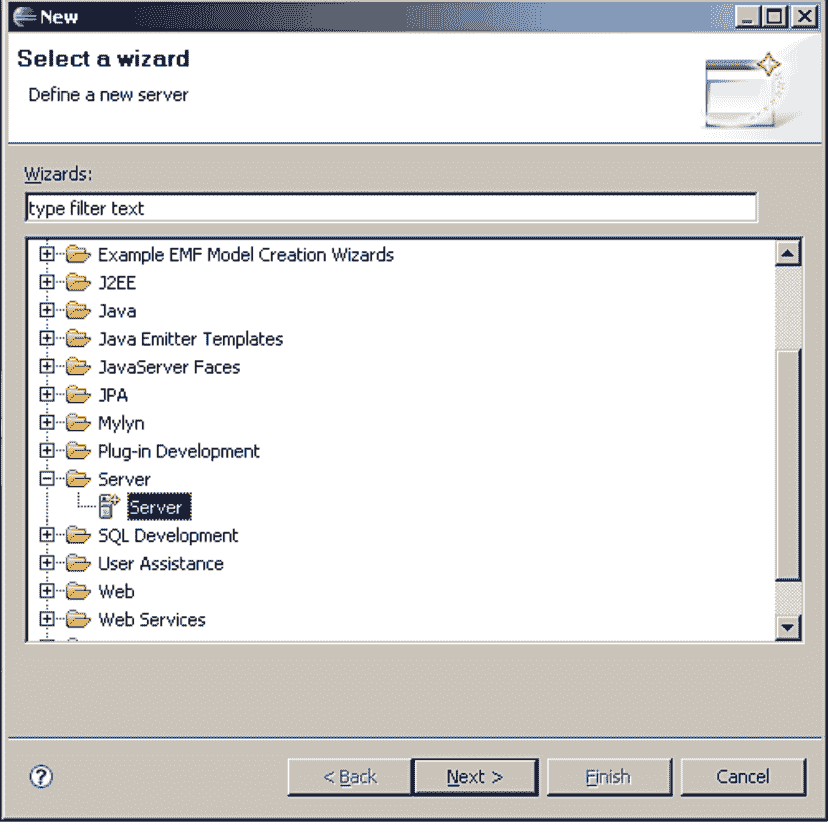

- 单击 **Next** 后，**Define a New Server** 屏幕打开。

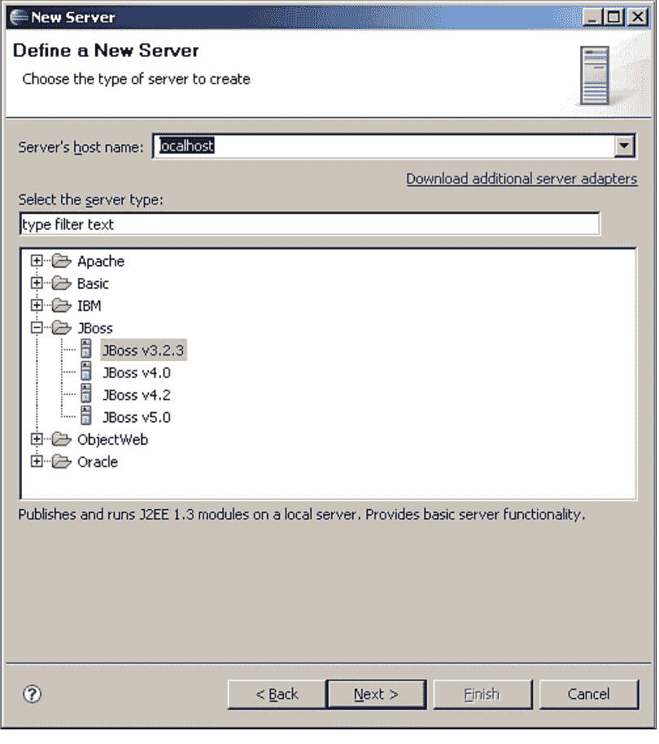

## 入门

- 我们通过单击 **Download additional server adapters** 为 Eclipse 设置 Geronimo 服务器。然后，**Install New Adapter** 对话框打开。我们选择 **Geronimo Core Feature** 并单击 **Next** 继续接受许可屏幕。接受许可后，Eclipse 下载并安装插件。

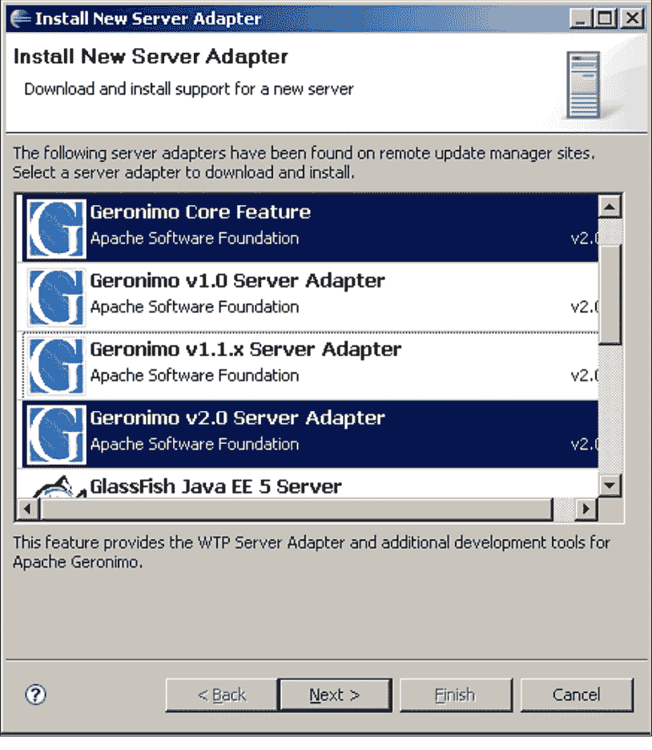

- 我们对 **Geronimo v2.x Server Adapter** 重复上一步。


现在，开发环境已准备就绪，可以进行编码了。我们有一个 IDE 和一个测试服务器，这差不多就是我们真正需要的一切。

## Apache Geronimo

Apache Geronimo 的网站是 `http://geronimo.apache.org`，那里提供了独立应用服务器的下载。尽管我们刚刚安装了一个包含 Geronimo 服务器运行时的开发环境，但我们仍需要安装独立的 Geronimo。

Geronimo 的安装再简单不过了！只需下载 Geronimo 发行版的 ZIP 文件（我们使用带有 Tomcat 的那个）并将其解压到某个目录。使用 **bin** 目录中的 **startup** 脚本启动 Geronimo，使用 **shutdown** 脚本停止它。

## 测试与调试

DWR 应用程序是普通的 Web 应用程序，因此可以使用 Eclipse IDE 中提供的常规调试工具对其进行测试和调试。网上有关于在 Eclipse 中进行调试的信息，例如 IBM developerWorks 网站上的文章（`http://www.ibm.com/developerworks/opensource/library/os-ecbug/`）。还有一些关于 Eclipse 及其功能的书籍。

另一种调试方法是日志记录。这听起来可能有些“老套”，但这里引用 Brian W. Kernighan 和 Rob Pike 所著的 *编程实践* 中的一段话（Apache 的 Log4J 网站上也有这段引用）：

> > 就个人选择而言，我们倾向于只使用调试器来获取堆栈跟踪或一两个变量的值。原因之一是，人们很容易迷失在复杂数据结构和控制流的细节中；我们发现单步执行程序的效率较低。通常，这种情况发生在服务器会话过期时，服务器会显示一个登录页面或关于会话过期的信息页面。

处理程序是在客户端的 JavaScript 代码中使用 engine.js 包中的一个函数设置的：

```
dwr.engine.setErrorHandler(handlerFunction);
```

异常由 exceptionHandler 或 errorHandler 处理。默认情况下，当异常发生时，DWR 不会在错误消息中包含任何关于异常的信息。例如，一个异常对象可能如下所示：

```
{
  javaClassName:'java.lang.Throwable',
  message:'Error'
}
```

“Error”只表明显然出了某些问题，但未说明具体可能是什么错误。通过向 dwr.xml 中添加以下行，可以启用更详细的异常信息。

```
<convert match="java.lang.Exception" converter="exception"/>
```

Exception 转换器能够提供易于理解的错误消息：

```
{
  javaClassName:'org.xml.sax.SAXParseException',
  lineNumber:42,
  publicId:'somePublicId',
  message:'Missing >'
}
```

此外，使用 dwr.xml 中的 <convert match="java.lang.StackTraceElement" converter="bean"/> 行启用堆栈跟踪，可以简化开发工作，让我们在错误发生时直接看到错误并立即进入调试模式。

会话过期由 textHtmlHandler 处理，其用法如下：

```
dwr.engine.setTextHtmlHandler(function() {
  window.alert("Your session has expired, please login again.");
  document.location = '/mycontext/login';
});
```

由于 Eclipse 内置的工具，打包非常容易。

- 我们选择项目名称并右键单击以打开上下文菜单；在 **导出** 菜单项下，我们找到 **WAR** 选项。

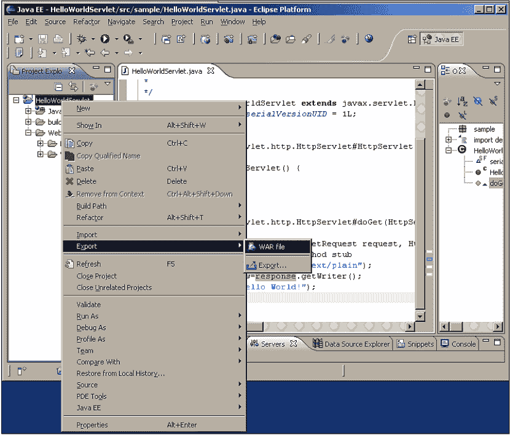

- 点击 **WAR** 选项后，会打开一个 **WAR 导出** 对话框，我们可以在其中选择 **目标** 以及 WAR 文件的名称：d:\temp\HelloWorldServlet.war。

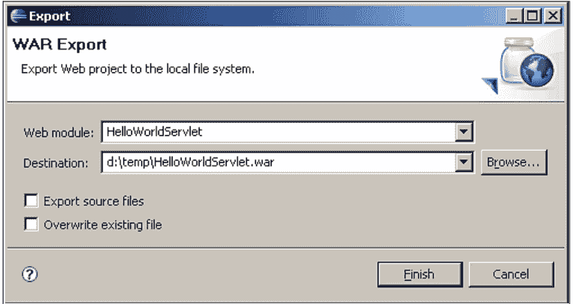

- 为了进行部署，我们已经安装了一个独立的 Geronimo 应用服务器。使用 **startup** 脚本文件运行 Geronimo（并记得设置 `JAVA_HOME` 环境变量）。以下截图展示了使用 **startup** 脚本启动 Geronimo 服务器时的典型输出。

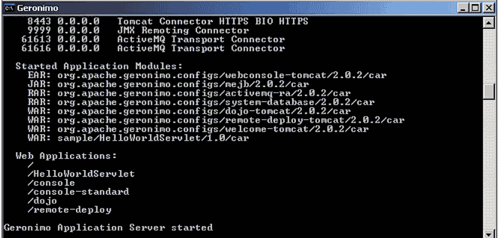

## 使用管理控制台进行部署

可以使用 Geronimo 管理控制台进行部署。

- 1. 启动 Geronimo 服务器后，打开 Geronimo Web 控制台。默认位置是 http://127.0.0.1:8080/console。默认管理员用户名为 system，密码为 manager。登录系统后，我们将看到 Geronimo 管理控制台。左侧有用于管理任务的菜单，右侧有指向常见任务、文档和其他资源的链接。

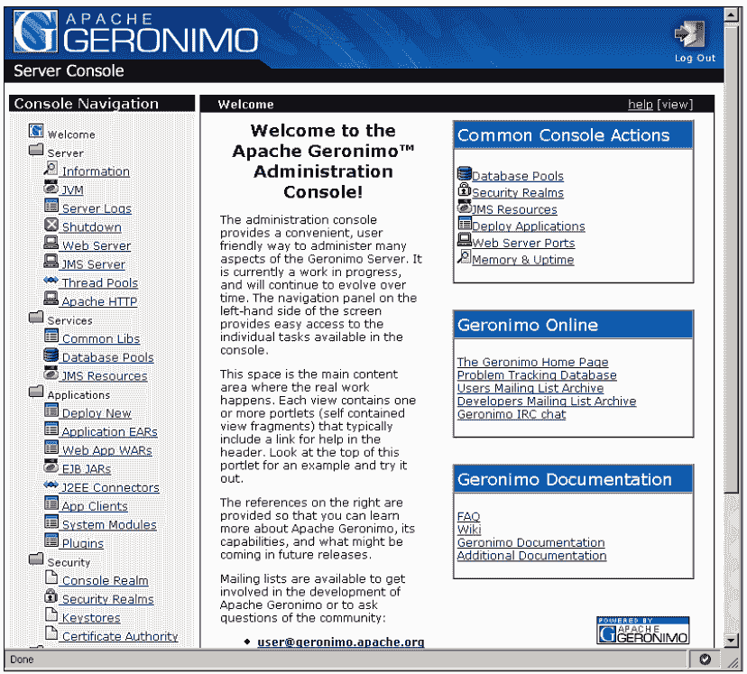

## 入门指南

2. 安装是一项简单直接的任务。我们选择“常用控制台操作”框中的“部署应用程序”，或选择“控制台导航”左侧的“部署新应用程序”。随后会打开如下屏幕，我们可在其中指定 HelloWorldServlet.war 文件。

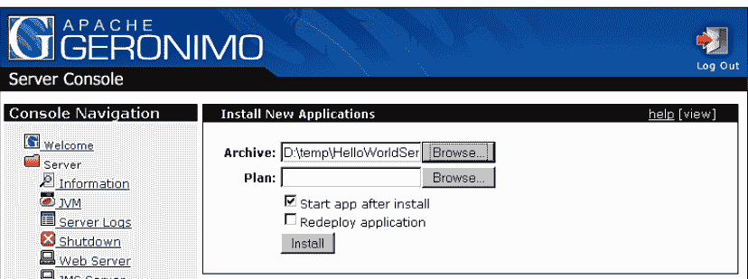

3. 点击“安装”后，Geronimo 会显示操作状态。

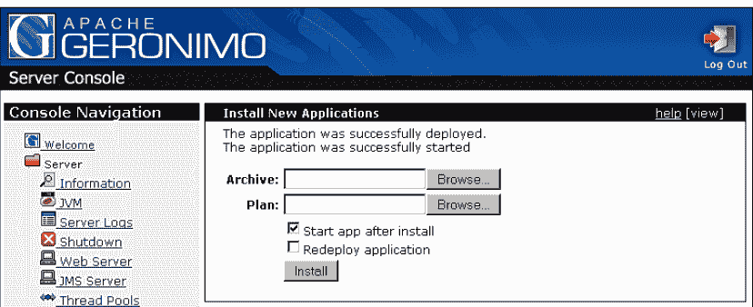

既然应用程序已经安装完成，我们就可以对其进行测试了。我们需要知道两件事：上下文路径和 Servlet 映射。我们在开发期间指定了 Servlet 映射，并从 web.xml 文件中获取；它是 HelloWorld。我们从 Geronimo 获取上下文路径。

4. 单击“控制台导航”中的“Web App WAR”链接，会打开“已安装的 Web 应用程序”屏幕，在那里我们会看到应用程序列表，URL 列中显示的就是上下文路径。

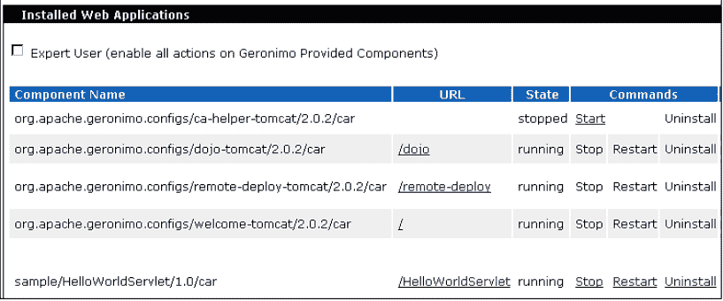

5. 现在我们有了上下文路径和 Servlet 映射，可以在浏览器中打开我们的 Servlet：http://127.0.0.1:8080/HelloWorldServlet/HelloWorld，然后就能看到这个举世闻名的消息。

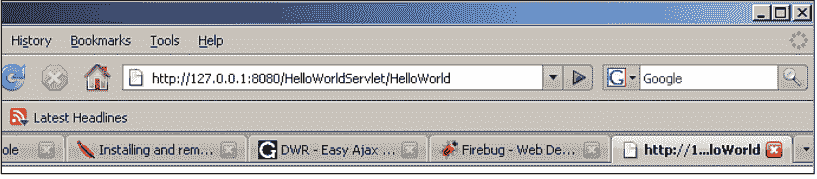

卸载、停止和重新启动应用程序都可以通过“已安装的 Web 应用程序”屏幕完成。

管理控制台非常有用，尤其是当我们开始进行开发工作或偶尔在 Geronimo 中测试某些应用程序时。但在开发过程中，最好使用基于命令行的部署工具。


## 使用 Deployer 工具部署

Deployer 工具是一个命令行工具，主要用于在 Geronimo 中安装和卸载应用程序。该工具位于 **bin** 目录下，根据操作系统不同为 `deploy.bat` 或 `deploy.sh`。

工具语法为：

```
deploy.[bat|sh] [general options] command [command options]
```

要安装新的 WAR 文件，我们使用 deploy 命令：

```
deploy -user system -password manager deploy d:\temp\HelloWorldServlet.war
```

我们会得到以下关于安装成功的确认屏幕：

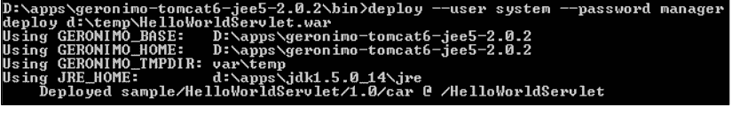

请注意，使用命令行工具安装时获得的信息比使用管理控制台安装时更多。我们可以看到模块名称以及从提示中得到的上下文根。模块名称很重要，因为它用于卸载应用程序。卸载命令为：

```
deploy -user system -password manager undeploy sample/HelloWorldServlet/1.0/car
```

另一个重要命令是 `list modules`，它显示当前在应用程序服务器中运行的所有已安装模块。deploy 命令的其他所有命令都可以在 Geronimo 文档中找到。

deployer 工具可能是部署的最有用方式。它允许自动化部署过程，并且我们可以最大限度地减少手动错误。更不用说，让脚本进行部署比手动使用管理控制台安装要快得多、快得多。

## 使用热部署部署

热部署是最简单的安装方法。在这里，我们只需将示例 WAR 文件复制到 Geronimo 的 **deploy** 目录，Geronimo 就会完成其余工作。我们可以使用 deployer 工具的 `list modules` 命令来验证安装。

卸载也很简单。我们从 deploy 目录删除 WAR 文件，Geronimo 就会卸载应用程序。

热部署对于快速且可能不太规范的应用程序安装很有用。在现实生活中，可能最好使用 deployer 命令行工具，因为它具有脚本功能，以及由此产生的部署过程自动化。

## 总结

现在，我们已经设置了开发环境，并查看了支持的环境、测试、调试、打包和部署。我们还介绍了 DWR 的配置。因此，一切都已准备就绪，可以开始使用 DWR。

本书的其余部分将集中于实际代码，我们将看到在本章和前几章中介绍的 DWR 功能。
