## 用户界面：基本元素

在本章中，我们将进入实际动手操作。我们将基于 DWR 开发示例，展示如何动态更改常见的用户界面元素，如表格和列表以及字段补全。我们还将为本书中的所有示例制作一个动态用户界面骨架。

动态用户界面部分展示了如何开始 DWR 应用程序，并介绍了一个用户界面骨架，该骨架将用于容纳表格和列表示例，以及字段补全（又名 autosuggest/autocomplete）示例。下一章中的示例将使用相同的用户界面骨架，除了第 7 章中的示例应用程序。

本章包含以下部分：

- 创建动态用户界面——从创建 Web 项目和本章中提及的示例的基础开始
- 实现表格和列表——向我们展示如何使用 DWR
- 实现字段补全——提供典型的字段补全示例

### 创建动态用户界面

动态用户界面的想法是为所有示例提供一个通用的“框架”。我们将创建一个新的 Web 应用程序，然后在继续过程中向应用程序添加新功能。用户界面看起来类似于以下图示：

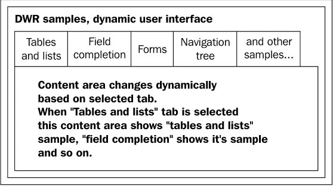

用户界面有三个主要区域：静态的标题/标志、动态的标签页，以及显示实际内容的区域。

此实现的想法是使用 DWR 功能生成标签页并获取标签页内容。标签式用户界面是使用 Dynamic Drive CSS Library 中的 CSS 模板创建的（http://dynamicdrive.com/style/csslibrary/item/css-tabs-menu）。标签是从属性文件读取的，因此可以动态地向网页添加新标签。以下屏幕截图显示了用户界面。

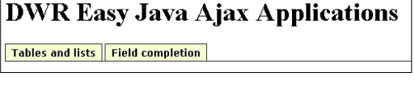

以下序列图显示了从逻辑角度看的应用程序流程。由于内置的 DWR 功能，我们不必太担心异步 AJAX“东西”是如何工作的。这当然是一件好事。

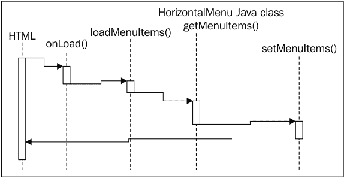

现在我们将使用 Eclipse IDE 和上一章中设置的 Geronimo 测试环境来开发应用程序。

#### 创建新的 Web 项目

1. 首先，我们将创建一个新的 Web 项目。使用 Eclipse IDE，我们执行以下操作：选择菜单 File | New | Dynamic Web Project。
2. 这将打开 New Dynamic Web Project 对话框；输入项目名称 DWREasyAjax 并单击 Next，并在所有页面上接受默认值，直到最后一页，在那里创建 Geronimo Deployment Plan，如以下屏幕截图所示：

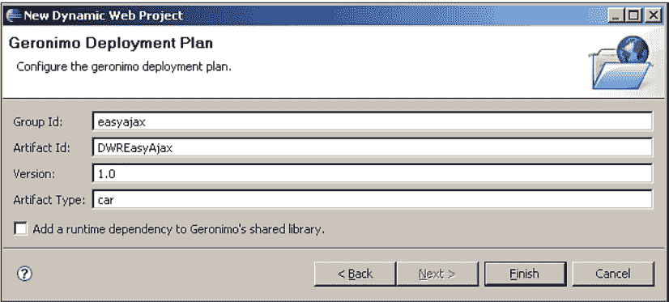

#### 配置 Web 应用程序

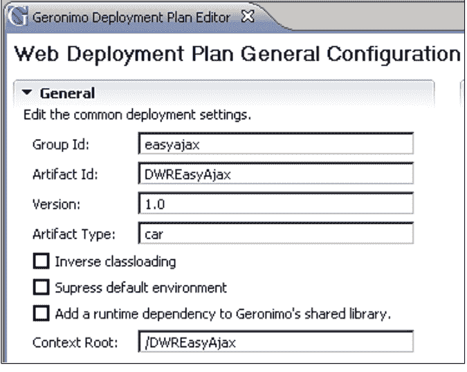

上下文根值得注意（在上面的屏幕截图中可见）。我们在测试应用程序时需要它。

另一个 XML 文件 web.xml 非常重要，我们都知道。这个 XML 将保存 DWR servlet 定义和其他可能的初始化参数。以下代码显示了我们将使用的 web.xml 文件的完整内容：

```xml
<?xml version="1.0" encoding="UTF-8"?>
<web-app xmlns:xsi="http://www.w3.org/2001/XMLSchema-instance"
    xmlns="http://java.sun.com/xml/ns/javaee"
    xmlns:web="http://java.sun.com/xml/ns/javaee/web-app_2_5.xsd"
    xsi:schemaLocation="http://java.sun.com/xml/ns/javaee http://java.sun.com/xml/ns/javaee/web-app_2_5.xsd"
    id="WebApp_ID" version="2.5">
    <display-name>DWREasyAjax</display-name>
    <servlet>
        <display-name>DWR Servlet</display-name>
        <servlet-name>dwr-invoker</servlet-name>
        <servlet-class>
            org.directwebremoting.servlet.DwrServlet
        </servlet-class>
        <init-param>
            <param-name>debug</param-name>
            <param-value>true</param-value>
        </init-param>
    </servlet>
    <servlet-mapping>
        <servlet-name>dwr-invoker</servlet-name>
        <url-pattern>/dwr/*</url-pattern>
    </servlet-mapping>
    <welcome-file-list>
        <welcome-file>index.html</welcome-file>
        <welcome-file>index.htm</welcome-file>
        <welcome-file>index.jsp</welcome-file>
        <welcome-file>default.html</welcome-file>
        <welcome-file>default.htm</welcome-file>
        <welcome-file>default.jsp</welcome-file>
    </welcome-file-list>
</web-app>
```

我们已经在第 3 章的配置部分看到了 servlet 定义。我们在这里使用相同的 `debug` 参数。Servlet 映射是常用的 `/dwr/*`。

我们记得 DWR 不能在没有 `dwr.xml` 配置文件的情况下运行。因此我们需要创建配置文件。我们使用 Eclipse 在 **WEB-INF** 目录中创建一个新的 XML 文件。以下内容是用户界面骨架所需的。它已经包含了我们基于 DWR 的菜单的 `allow` 元素。

```xml
<?xml version="1.0" encoding="UTF-8"?>
<!DOCTYPE dwr PUBLIC
    "-//GetAhead Limited//DTD Direct Web Remoting 2.0//EN"
    "http://getahead.org/dwr/dwr20.dtd">
<dwr>
    <allow>
        <create creator="new" javascript="HorizontalMenu">
            <param name="class" value="samples.HorizontalMenu" />
        </create>
    </allow>
</dwr>
```

在 `allow` 元素中，有一个用于我们在这里要实现的水平菜单 Java 类的 creator。我们在这里使用的 creator 是 new creator，这意味着 DWR 将使用空构造函数为客户端创建 Java 对象。名为 `class` 的参数保存完全限定的类名。


## 开发 Web 应用程序

既然我们已经定义了将用于创建菜单的 Java 类的名称，下一步就是实现它。`HorizontalMenu` 类的思路是它用于读取一个属性文件，该文件保存将出现在网页上的菜单。

我们向名为 `dwrappplication.properties` 的文件添加属性，并将其创建在与 `HorizontalMenu` 类相同的 `samples` 包中。菜单项的属性文件如下：

```
menu.1=Tables and lists,TablesAndLists
menu.2=Field completion,FieldCompletion
```

菜单属性的语法是它包含由逗号分隔的两个元素。第一个元素是菜单项的名称。这对用户可见。第二个是 HTML 模板文件的名称，该文件将保存菜单项的页面内容。

该类只包含一个方法，该方法由 JavaScript 使用并通过 DWR 来检索菜单项。完整的类实现如下所示：

```
package samples;

import java.io.IOException;
import java.io.InputStream;
import java.util.List;
import java.util.Properties;
import java.util.Vector;

public class HorizontalMenu {
    public HorizontalMenu() {
    }

    public List<String> getMenuItems() throws IOException {
        List<String> menuItems = new Vector<String>();
        InputStream is = this.getClass().getClassLoader().
            getResourceAsStream(
                "samples/dwrappplication.properties");
        Properties appProps = new Properties();
        appProps.load(is);
        is.close();
        for (int menuCount = 1; true; menuCount++) {
            String menuItem = appProps.getProperty("menu." + menuCount);
            if (menuItem == null) {
                break;
            }
            menuItems.add(menuItem);
        }
        return menuItems;
    }
}
```

实现很简单。`getMenuItems()` 方法使用 `ClassLoader.getResourceAsStream()` 方法加载属性，该方法在类路径中搜索指定的资源。然后，在加载属性后，使用 for 循环遍历菜单项，然后将 String 对象的 List 返回给客户端。客户端是我们稍后会看到的 JavaScript 回调函数。DWR 会自动将 String 对象的 List 转换为 JavaScript 数组，因此我们不必担心这个问题。

## 测试 Web 应用程序

我们现在还没有完成任何客户端代码，但让我们还是测试一下代码。测试使用 Geronimo 测试环境。

- 1. 项目上下文菜单具有我们用于测试应用程序的 Run As 菜单，如以下屏幕截图所示：

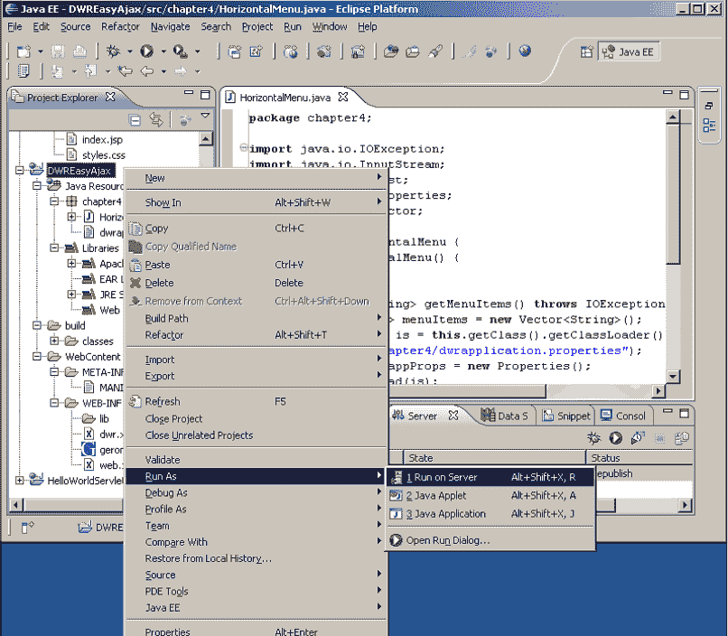

2. **Run on Server** 打开一个向导来定义新的服务器运行时。以下屏幕截图显示 Geronimo 测试环境已经设置好，我们只需单击 **Finish** 即可运行应用程序。如果测试环境未设置，我们可以在此对话框中手动定义一个新环境：

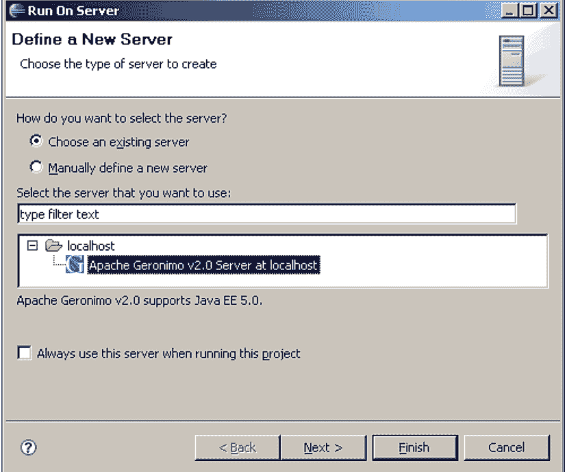

3. 单击 **Finish** 后，Eclipse 启动 Geronimo 测试环境以及我们的应用程序。当服务器启动时，Eclipse 中的 **Console** 选项卡会通知我们它已启动。

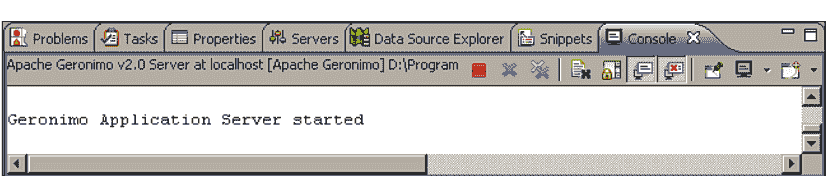

## 用户界面：基本元素

Servers 选项卡显示服务器已启动并且所有代码已同步，即代码是最新的（同步在我们保存某些已部署文件上的更改时发生）。Servers 选项卡还列出了服务器下部署的应用程序。在 Servers 选项卡中可以看到我们正在测试的唯一一个应用程序。

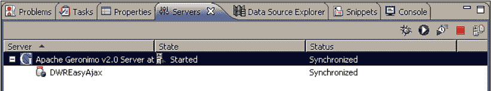

现在到了有趣的部分——如果我们还没有真正实现任何东西，我们要测试什么？如果我们查看 web.xml 文件，我们会发现我们定义了一个初始化参数。Debug 参数为 true，这意味着 DWR 为我们的远程 Java 类生成测试页面。我们只需将浏览器（我们使用 Firefox）指向 URL http://127.0.0.1:8080/DWREasyAjax/dwr，然后以下页面就会打开：

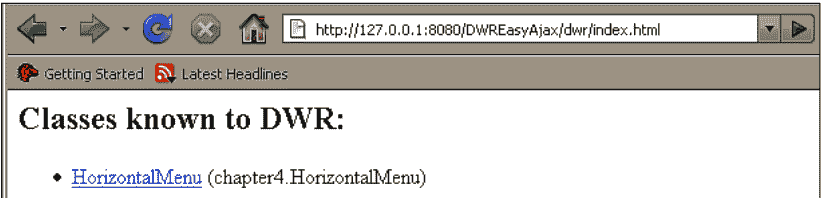

此页面将显示我们允许远程的所有类的列表。当我们单击类名时，会打开一个测试页面，如以下屏幕截图所示：

然后可以测试远程方法。当我们测试我们自己的方法 `getMenuItems()` 时，我们会在一个 alert 框中看到响应：

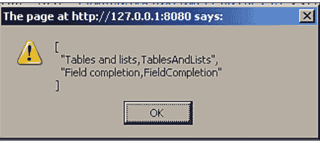

屏幕截图中 alert 框中的数组是我们的方法返回的 JavaScript 数组。

## 开发 Web 页面

下一步是添加网页。请注意，我们可以让测试环境继续运行。每当我们更改应用程序代码时，它都会自动发布到测试环境，因此我们不必每次更改并想要测试应用程序时都停止和启动服务器。

CSS 样式表来自 Dynamic Drive CSS Library。该文件名为 styles.css，位于 Eclipse IDE 中的 WebContent 目录。CSS 代码如下所示：

```
/*URL: http://www.dynamicdrive.com/style/ */
.basictab{
padding: 3px 0;
margin-left: 0;
font: bold 12px Verdana;
border-bottom: 1px solid gray;
list-style-type: none;
text-align: left; /*set to left, center, or right to align the menu as desired*/
}
.basictab li{
display: inline;
margin: 0;
}
```

```
.basictab li a{
text-decoration: none;
padding: 3px 7px;
margin-right: 3px;
border: 1px solid gray;
border-bottom: none;
background-color: #f6ffd5;
color: #2d2b2b;
}

.basictab li a:visited{
color: #2d2b2b;
}

.basictab li a:hover{
background-color: #DBFF6C;
color: black;
}

.basictab li a:active{
color: black;
}

.basictab li.selected a{ /*selected tab effect*/
position: relative;
top: 1px;
padding-top: 4px;
background-color: #DBFF6C;
color: black;
}
```

出于完整性的考虑，这里展示了此 CSS，我们不会详细介绍 CSS 样式表。足以说 CSS 提供了一种创建具有良好展示效果的网站的绝佳方法。

下一步是实际的网页。我们在 WebContent 目录中创建一个 index.jsp 页面，它将具有菜单以及我们示例的 JavaScript 函数。需要注意的是，虽然在此示例中所有 JavaScript 代码都添加到单个 JSP 页面中，但在“真实”项目中，可能更有用的是为 JavaScript 函数创建单独的文件，并使用如下代码片段将 JavaScript 文件包含在 HTML/JSP 页面中：
<script type="text/javascript" src="myjavascriptcode/HorizontalMenu.js"/>.

我们稍后将为每个示例添加 JavaScript 函数。以下是使用远程 `HorizontalMenu` 类显示菜单的 JSP 代码。

```
```jsp
<%@ page language="java" contentType="text/html; charset=ISO-8859-1"
         pageEncoding="ISO-8859-1"%>
<!DOCTYPE html PUBLIC "-//W3C//DTD HTML 4.01 Transitional//EN"
"http://www.w3.org/TR/html4/loose.dtd">
<html>
<head>
<meta http-equiv="Content-Type" content="text/html; charset=ISO-8859-1">
<link href="styles.css" rel="stylesheet" type="text/css"/>
<script type='text/javascript' src='/DWREasyAjax/dwr/engine.js'></script>
<script type='text/javascript' src='/DWREasyAjax/dwr/util.js'></script>
<script type='text/javascript' src='/DWREasyAjax/dwr/interface/HorizontalMenu.js'></script>
<title>DWR samples</title>
<script type="text/javascript">

function loadMenuItems()
{
    HorizontalMenu.getMenuItems(setMenuItems);
}

function getContent(contentId)
{
    AppContent.getContent(contentId,setContent);
}

function menuItemFormatter(item)
{
    elements=item.split(',');
    return '<li><a href="#" onclick="getContent(\''+elements[1]+'\');return false;">'+elements[0]+'</a></li>';
}

function setMenuItems(menuItems)
{
    menu=dwr.util.byId("dwrMenu");
    menuItemsHtml='';
    for(var i=0;i<menuItems.length;i++)
    {
        menuItemsHtml=menuItemsHtml+menuItemFormatter(menuItems[i]);
    }
    menu.innerHTML=menuItemsHtml;
}

function setContent(htmlArray)
{
{
```


```javascript
var contentFunctions='';
var scriptToBeEvaled='';
var contentHtml='';
for(var i=0;i<htmlArray.length;i++)
{
    var html=htmlArray[i];
    if(html.toLowerCase().indexOf('<script>')>-1)
    {
        if(html.indexOf('TO BE EVALED')>-1)
        {
            scriptToBeEvaled=html.substring(html.indexOf('>')+1,
                                            html.indexOf('</'));
        }
        else
        {
            eval(html.substring(html.indexOf('>')+1,html.indexOf('</')));
            contentFunctions+=html;
        }
    }
    else
    {
        contentHtml+=html;
    }
}

contentScriptArea=dwr.util.byId("contentAreaFunctions");
contentScriptArea.innerHTML=contentFunctions;
contentArea=dwr.util.byId("contentArea");
contentArea.innerHTML=contentHtml;
if(scriptToBeEvaled!='')
{
    eval(scriptToBeEvaled);
}
}
</script>
</head>
<body onload="loadMenuItems()">
<h1>DWR Easy Java Ajax Applications</h1>
<ul class="basictab" id="dwrMenu">
</ul>
<div id="contentAreaFunctions">
</div>
<div id="contentArea">
</div>
</body>
</html>
```

这段 JSP 是我们的用户界面。HTML 只是普通的 HTML，包含 head 元素和 body 元素。head 中引用了样式表以及 DWR JavaScript 文件，engine.js、util.js 和我们自己的 HorizontalMenu.js。util.js 文件是可选的，但由于它包含非常有用的函数，可以将其包含在所有使用 util.js 中函数的网页中。

body 元素在菜单下方有一个 contentArea 占位符，用于内容页面。它还包含特定内容的 JavaScript 函数的内容区域。body 元素的 onload 事件在页面加载时执行 loadMenuItems() 函数。loadMenuItems() 函数调用 HorizontalMenu Java 类的远程方法。HorizontalMenu.getMenuItems() JavaScript 函数的参数是回调函数，当 Java 方法执行完毕并返回菜单项时，DWR 会调用该回调。

setMenuItems() 函数是 loadMenuItems() 函数的回调，如上一段所述。在加载菜单项时，HorizontalMenu.getMenuItems() 远程方法以字符串列表的形式将菜单项作为参数返回给 setMenuItems() 函数。菜单项使用 menuItemFormatter() 辅助函数进行格式化。

menuItemFormatter() 函数创建菜单文本的 li 元素。菜单被格式化为链接，(a href)，并且它们具有 onclick 事件，该事件调用 getContent 函数，而 getContent 又调用 AppContent.getContent() 函数。

AppContent 是一个远程 Java 类，我们尚未实现它，其目的是根据用户点击的菜单项从文件中读取 HTML。AppContent 和内容页面的实现在下一节中描述。

我们的动态用户界面如下所示：

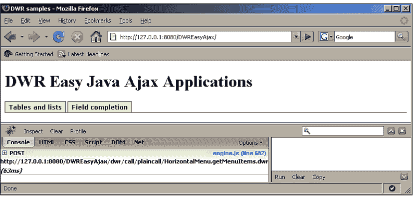

注意浏览器屏幕底部的 Firebug 窗口。截图中的 Firebug 控制台显示了一次对我们的 HorizontalMenu.getMenuItems() 方法的 POST 请求。Firebug 的其他功能在开发工作中非常有用，我们发现 Firebug 在整个开发工作中都已启用，这很有用。

## 回调函数

我们第一次看到回调函数的参数是在 HorizontalMenu.getMenuItems(setMenuItems) 函数中，由于回调是 DWR 中的重要概念，在我们看到其首次使用后，现在进一步讨论它们会很有好处。

回调用于对从远程方法返回的数据进行操作。由于 DWR 和 AJAX 是异步的，RPC（远程过程调用）中典型的返回值，如 Java 调用中的返回值，并不适用。DWR 隐藏了调用回调函数的细节，并在我们从远程 Java 方法返回一个值到接收返回值的回调函数的整个过程中内部处理一切。

使用回调函数时推荐两种方法。

我们已经在 `HorizontalMenu.getMenuItems(setMenuItems)` 函数调用中看到了第一种方法。请记住，`getMenuItems()` Java 方法没有参数，但在 JavaScript 调用中，我们在参数列表末尾添加了回调函数的名称。如果 Java 方法有参数，则 JavaScript 调用类似于 `CountryDB.getCountries(selectedLetters,setCountryRows)`，其中 selectedLetters 是 Java 方法的输入参数，setCountryRows 是回调函数的名称（我们稍后会看到其实现）。

使用回调的第二种方法是远程 JavaScript 调用中的元数据对象。示例（完整实现将在本章后面显示）如下所示：

```
CountryDB.saveCountryNotes(ccode,newNotes, {
    callback:function(newNotes)
    {
        //function body here
    }
});
```

这里，函数是匿名的，其实现包含在对远程 Java 方法的 JavaScript 调用中。一个优点是代码易于阅读，并且在我们从 Java 方法获得返回值后立即执行代码。另一个优点是我们可以在调用中添加额外的选项。

额外的选项包括超时和错误处理程序，如以下示例所示：

```
CountryDB.saveCountryNotes(ccode,newNotes, {
    callback:function(newNotes)
    {
        //function body here
    },
    timeout:10000,
    errorHandler:function(errorMsg) { alert(errorMsg); }
});
```

也可以为那些不返回值的方法添加回调函数。将回调添加到没有返回值的 methods 在远程调用完成后获取通知时很有用。

## 后记

我们的第一个示例已准备就绪，它也是后续示例的基础。我们还查看了如何在 Eclipse 环境中测试应用程序。

使用 DWR，我们可以将浏览器上的 JavaScript 代码和服务器上的 Java 代码视为一体。可能需要一段时间才能习惯，但它将改变我们开发 Web 应用程序的方式。逻辑上，不再有客户端和服务器，而只是一个物理上分离的单一运行时平台。但在实践中，当然，使用 DWR、客户端 JavaScript 和服务器端 Java 的应用程序仍在使用典型的客户端-服务器交互。在逻辑上单一的运行时平台中编写应用程序时应记住这一点。

## 实现表格和列表

第一个实际示例在应用程序中非常常见：表格和列表。在此示例中，表格使用 DWR 实用函数和远程 Java 类进行填充。示例代码还展示了如何使用 DWR 进行内联表格编辑。当双击表格单元格时，会打开一个编辑框，用于保存新的单元格数据。

示例将具有国家数据的 CSV 文件：国家名称、正式名称、两位字母代码、首都和用户定义的备注。表格示例的用户界面如下所示：

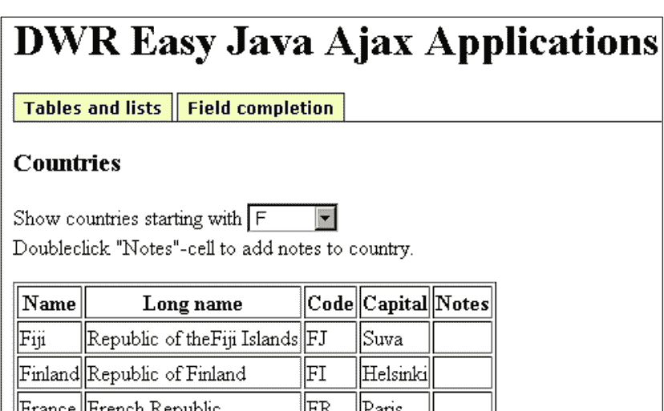

### 表格和列表的服务器代码

首先要做的是获取国家数据。国家数据位于 CSV 文件中（名为 `countries.csv`，位于 samples Java 包中）。以下是 CSV 文件内容的摘录（数据来自 `http://www.state.gov`）。

```
Short-form name,Long-form name,FIPS Code,Capital

Afghanistan,Islamic Republic of Afghanistan,AF,Kabul

Albania,Republic of Albania,AL,Tirana

Algeria,People's Democratic Republic of Algeria,AG,Algiers

Andorra,Principality of Andorra,AN,Andorra la Vella

Angola,Republic of Angola,AO,Luanda

Antigua and Barbuda,(no long-form name),AC,Saint John's

Argentina,Argentine Republic,AR,Buenos Aires

Armenia,Republic of Armenia,AM,Yerevan

...
```

每次客户端请求国家数据时都会读取 CSV 文件。虽然这不是非常高效，但在本文中已经足够好。其他替代方案包括内存缓存或真实数据库，如 Apache Derby 或 IBM DB2。作为示例，我们创建了一个 CountryDB 类，用于读取和写入国家 CSV。我们还有另一个类 DBUtils，它包含一些辅助方法。DBUtils 代码如下：

```
package samples;

import java.io.BufferedReader;
import java.io.File;
import java.io.FileReader;
import java.io.FileWriter;
import java.io.IOException;
import java.io.InputStream;
```


```java
import java.io.InputStreamReader;
import java.io.PrintWriter;
import java.util.List;
import java.util.Vector;

public class DBUtils {
    private String fileName=null;
    public void initFileDB(String fileName)
    {
        this.fileName=fileName;
        // copy csv file to bin-directory, for easy
        // file access
        File countriesFile = new File(fileName);
        if (!countriesFile.exists()) {
            try {
                List<String> countries = getCSVStrings(null);
                PrintWriter pw;
                pw = new PrintWriter(new FileWriter(countriesFile));
                for (String country : countries) {
                    pw.println(country);
                }
                pw.close();
            } catch (IOException e) {
                e.printStackTrace();
            }
        }
    }

    protected List<String> getCSVStrings(String letter) {
        List<String> csvData = new Vector<String>();
        try {
            File csvFile = new File(fileName);
            BufferedReader br = null;
            if(csvFile.exists())
            {
                br=new BufferedReader(new FileReader(csvFile));
            }
            else
            {
                InputStream is = this.getClass().getClassLoader()
                    .getResourceAsStream("samples/"+fileName);
                br=new BufferedReader(new InputStreamReader(is));
                br.readLine();
            }

            for (String line = br.readLine(); line != null; line = br.readLine()) {
                if (letter == null
|| (letter != null && line.startsWith(letter)) {
    csvData.add(line);
}
}
    br.close();
} catch (IOException ioe) {
    ioe.printStackTrace();
}
    return csvData;
}
}
```

DBUtils 类是一个简单的工具类，它将 CSV 内容作为字符串列表返回。它还会将原始 CSV 文件复制到我们可能运行的任何应用服务器的运行时目录。这可能不是最佳实践，但它使操作 CSV 文件变得更容易，并且我们始终拥有原始的 CSV 文件，如果需要回退到原始版本时不会被修改。

以下是 CountryDB 的代码：

```java
package samples;

import java.io.FileWriter;
import java.io.IOException;
import java.io.PrintWriter;
import java.util.Arrays;
import java.util.List;
import java.util.Vector;

public class CountryDB {

    private DBUtils dbUtils = new DBUtils();
    private String fileName = "countries.csv";

    public CountryDB() {
        dbUtils.initFileDB(fileName);
    }

    public String[] getCountryData(String ccode) {
        List<String> countries = dbUtils.getCSVStrings(null);
        for (String country : countries) {
            if (country.indexOf("," + ccode + ",") > -1) {
                return country.split(",");
            }
        }
        return new String[0];
    }
}
```

```java
public List<List<String>> getCountries(String startLetter) {
    List<List<String>> allCountryData = new Vector<List<String>>();
    List<String> countryData = dbUtils.getCSVStrings(startLetter);
    for (String country : countryData) {
        String[] data = country.split(",");
        allCountryData.add(Arrays.asList(data));
    }
    return allCountryData;
}

public String[] saveCountryNotes(String ccode, String notes) {
    List<String> countries = dbUtils.getCSVStrings(null);
    try {
        PrintWriter pw = new PrintWriter(new FileWriter(fileName));
        for (String country : countries) {
            if (country.indexOf("," + ccode + ",") > -1) {
                if (country.split(",").length == 4) {
                    // no existing notes
                    country = country + "," + notes;
                } else {
                    if (notes.length() == 0) {
                        country = country.substring(0, country
                            .lastIndexOf(","));
                    } else {
                        country = country.substring(0, country
                            .lastIndexOf(","))
                            + "," + notes;
                    }
                }
            }
            pw.println(country);
        }
        pw.close();
    } catch (IOException ioe) {
        ioe.printStackTrace();
    }
    String[] rv = new String[2];
    rv[0] = ccode;
    rv[1] = notes;
    return rv;
}
```

CountryDB 类是一个远程类。getCountryData() 方法根据国家代码以字符串数组形式返回国家数据。getCountries() 方法返回以指定参数开头的全部国家，而 saveCountryNotes() 将用户添加的注释保存到由国家代码指定的国家。

为了使用 CountryDB，必须将以下脚本元素添加到 index.jsp 文件中，与其他 JavaScript 元素一起。

```html
<script type='text/javascript' src='/DWREasyAjax/dwr/interface/CountryDB.js'></script>
```

我们还需要创建并远程化的另一个 Java 类。那就是 AppContent 类，它已存在于主页的 JavaScript 函数中。AppContent 类负责读取 HTML 文件的内容并解析其中的可能 JavaScript 函数，使其可被 index.jsp 文件中现有的 JavaScript 函数使用。

```java
package samples;

import java.io.ByteArrayOutputStream;
import java.io.IOException;
import java.io.InputStream;
import java.util.List;
import java.util.Vector;
public class AppContent {

    public AppContent()
    {

    }

    public List<String> getContent(String contentId)
    {
        InputStream is = this.getClass().getClassLoader().getResourceAsStream(
            "samples/"+contentId+".html");
        String content=streamToString(is);
        List<String> contentList=new Vector<String>();
        //Javascript within script tag will be extracted and sent separately to client
        for(String script=getScript(content);!script.equals("");script=getScript(content))
        {
            contentList.add(script);
            content=removeScript(content);
```
```
//content list will have all the javascript
//functions, last element is executed last
//and all other before html content
if(contentList.size()>1)
{
    contentList.add(contentList.size()-1, content);
}
else
{
    contentList.add(content);
}
return contentList;
}

public List<String> getLetters()
{
    List<String> letters=new Vector<String>();
    char[] l=new char[1];
    for(int i=65;i<91;i++)
    {
        l[0]=(char)i;
        letters.add(new String(l));
    }
    return letters;
}

public String removeScript(String html)
{
    //removes first script element
    int sIndex=html.toLowerCase().indexOf("<script ");
    if(sIndex==-1)
    {
        return html;
    }
    int eIndex=html.toLowerCase().indexOf("</script>")+9;
    return html.substring(0, sIndex)+html.substring(eIndex);
}

public String getScript(String html)
{
    //returns first script element
    int sIndex=html.toLowerCase().indexOf("<script ");
    if(sIndex==-1)
    {
        return "";
    }
}
```

## 用户界面：基本元素

```java
int eIndex=html.toLowerCase().indexOf("</script>")+9;
return html.substring(sIndex, eIndex);
}

public String streamToString(InputStream is)
{
    String content="";
    try
    {
        ByteArrayOutputStream baos=new ByteArrayOutputStream();
        for(int b=is.read();b!=-1;b=is.read())
        {
            baos.write(b);
        }
        content=baos.toString();
    }
    catch(IOException ioe)
    {
        content=ioe.toString();
    }
    return content;
}
}
```

`getContent()` 方法根据 `contentId` 从文件中读取 HTML 代码。`ContentId` 在 `drawapplication.properties` 文件中指定，并且 HTML 就是包目录中 `contentId` 加上扩展名 `.html`。还有一个 `getLetters()` 方法，它只是列出从 A 到 Z 的字母并返回一个字母列表到浏览器。

如果我们现在测试应用程序，我们将得到如下截图中所示的错误：

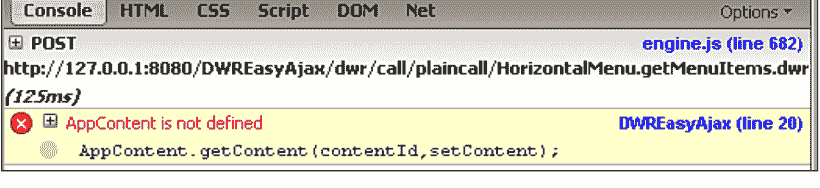


我们知道为什么会发生 **AppContent is not defined** 错误，因此通过在 `dwr.xml` 文件的 `allow` 元素中添加 `AppContent` 来修复它。我们也在 `allow` 元素中添加了 `CountryDB`。我们要做的第一件事是在 `dwr.xml` 文件中添加所需的元素。我们在 `dwr.xml` 文件的 `allow` 元素中添加以下 creators。

```
<create creator="new" javascript="AppContent">
    <param name="class" value="samples.AppContent" />
    <include method="getContent" />
    <include method="getLetters" />
</create>
<create creator="new" javascript="CountryDB">
    <param name="class" value="samples.CountryDB" />
    <include method="getCountries" />
    <include method="saveCountryNotes" />
    <include method="getCountryData" />
</create>
```

我们使用 `include` 元素显式定义要远程调用的方法。这是一种良好的实践，因为我们不会意外允许访问不打算远程调用的任何方法。

## Client Code for Tables and Lists

我们还需要在 `index.jsp` 页面中添加一个 JavaScript 接口。将以下内容与 `index.jsp` 文件中的其他脚本一起添加。

```
<script type='text/javascript' src='/DWAREasyAjax/dwr/interface/AppContent.js'></script>
```

在测试之前，我们需要内容区域的示例 HTML。以下 HTML 位于 **samples** 目录下的 `TablesAndLists.html` 文件中：

```
<h3>Countries</h3>
<p>Show countries starting with
<select id="letters" onchange="selectLetter(this);return false;"> </select><br/>
Doubleclick "Notes"-cell to add notes to country.
</p>
<table border="1">
    <thead>
        <tr>
            <th>Name</th>
            <th>Long name</th>
            <th>Code</th>
            <th>Capital</th>
            <th>Notes</th>
        </tr>
    </thead>
    <tbody id="countryData">
    </tbody>
</table>

<script type='text/javascript'>
//TO BE EVALED
AppContent.getLetters(addLetters);
</script>
```

末尾的 script 元素由我们的 Java 类提取，并在客户端 JavaScript 接收到 HTML 时由浏览器进行求值。这里有 select 元素，其 onchange 事件调用 selectLetter() JavaScript 函数。我们稍后将实现 selectLetter() 函数。

JavaScript 函数在 index.jsp 文件中添加，并在 head 元素内。函数也可以放在单独的 JavaScript 文件中，但这里嵌入的脚本就足够了。

```
function selectLetter(selectElement)
{
    var selectedIndex = selectElement.selectedIndex;
    var selectedLetter= selectElement.options[selectedIndex ].value;
    CountryDB.getCountries(selectedLetter,setCountryRows);
}
function addLetters(letters)
{
    dwr.util.addOptions('letters',['letter...']);
    dwr.util.addOptions('letters',letters);
}

function setCountryRows(countryData)
{
    var cellFuncs = [
        function(data) { return data[0]; },
        function(data) { return data[1]; },
        function(data) { return data[2]; },
        function(data) { return data[3]; },
        function(data) { return data[4]; }
    ];
    dwr.util.removeAllRows('countryData');
    dwr.util.addRows( 'countryData',countryData,cellFuncs, {
        cellCreator:function(options) {
            var td = document.createElement("td");
            if(options.cellNum==4)
            {
                var notes=options.rowData[4];
                if(notes==undefined)
                {
                    notes='&nbsp;';// + options.rowData[2]+' notes';
                }
                var ccode=options.rowData[2];
                var divId=ccode+'_Notes';
                var tdId=divId+'Cell';
                td.setAttribute('id',tdId);
                var html=getNotesHtml(ccode,notes);
                td.innerHTML=html;
                options.data=html;
            }
            return td;
        },
        escapeHtml:false
    });
}

function getNotesHtml(ccode,notes)
{
    var divId=ccode+'_Notes';
    return "<div onDblClick=\"editCountryNotes('"+divId+"','"+ccode+"');\" id=\""+divId+"\">"+notes+"</div>";
}

function editCountryNotes(id,ccode)
{
    var notesElement=dwr.util.byId(id);
    var tdId=id+'Cell';
    var notes=notesElement.innerHTML;
    if(notes=='&nbsp;')
    {
        notes='';
    }
    var editBox='<input id="'+ccode+'NotesEditBox" type="text" value="'+notes+'"/><br/>';
    editBox+="<input type='button' id='"+ccode+"SaveNotesButton' value='Save' onclick='saveCountryNotes(\""+ccode+"\");'/>&nbsp;";
    editBox+="<input type='button' id='"+ccode+"CancelNotesButton' value='Cancel' onclick='cancelEditNotes(\""+ccode+"\");'/>";
    tdElement=dwr.util.byId(tdId);
    tdElement.innerHTML=editBox;
    dwr.util.byId(ccode+'NotesEditBox').focus();
}
```

```
function cancelEditNotes(ccode)
{
    var countryData=CountryDB.getCountryData(ccode, {
    callback:function(data)
    {
        var notes=data[4];
        if(notes==undefined)
        {
            notes='&nbsp;';
        }
        var html=getNotesHtml(ccode,notes);
        var tdId=ccode+'_NotesCell';
        var td=dwr.util.byId(tdId);
        td.innerHTML=html;
    }
    });
}
function saveCountryNotes(ccode)
{
    var editBox=dwr.util.byId(ccode+'NotesEditBox');
    var newNotes=editBox.value;
    CountryDB.saveCountryNotes(ccode,newNotes, {
    callback:function(newNotes)
    {
        var ccode=newNotes[0];
        var notes=newNotes[1];
        var notesHtml=getNotesHtml(ccode,notes);
        var td=dwr.util.byId(ccode+"_NotesCell");
        td.innerHTML=notesHtml;
    }
    });
}
```

有很多用于表格示例的函数，我们逐一介绍它们。

第一个是 selectLetter() 函数。此函数从 select 元素获取选定的字母并调用 CountryDB.getCountries() 远程 Java 方法。回调函数的 setCountryRows。此函数接收来自 Java getCountries() 方法的返回值，即 List<List<String>>，一个字符串列表的列表。

第二个函数是 addLetters(letters)，它是 AppContent.getLetters() 方法的回调方法，该方法仅返回从 A 到 Z 的字母。addLetters() 函数使用 DWR 实用程序函数填充字母列表。

然后是 CountryDB.getCountries() 方法的回调方法。函数的参数是按指定字母开头的国家/地区数组。每个数组元素的格式为：Name、Long name、(country code) Code、Capital、Notes。此函数的目的是使用国家/地区数据填充表格；让我们看看它是如何完成的。变量 cellFuncs 保存用于检索列中每个单元格数据的函数。参数 data 是从 Java 类返回的国家/地区数据数组。

表格使用 DWR 实用程序函数 addRows() 进行填充。cellFuncs 变量用于获取表格单元格的正确数据。cellCreator 函数用于为表格单元格创建自定义 HTML。默认实现仅生成 td 元素，但我们的自定义实现生成带有用户注释占位符 div 的 td 元素。

getNotesHtml() 函数用于生成带有双击事件监听器的 div 元素。

editCountryNotes() 函数在双击表格单元格时被调用。该函数创建用于编辑注释的输入字段以及保存和取消按钮。

cancelEditNotes() 和 saveCountryNotes() 函数取消对新注释的编辑，或通过调用 CountryDB.saveCountryNotes() Java 方法保存它们。

以下屏幕截图显示了填充表格的示例的外观：

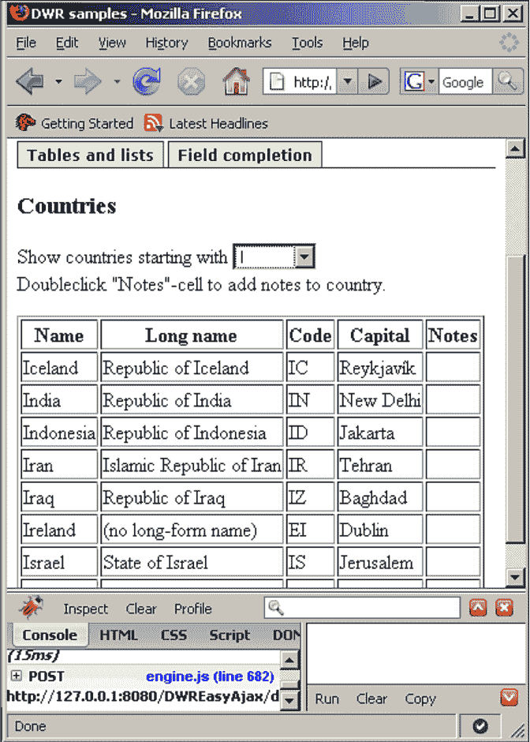

现在我们已将必要的函数添加到网页中，我们可以测试应用程序。

## Testing Tables and Lists

如果我们在开发期间一直运行测试环境，应用程序应该已准备好进行测试。Eclipse 在任何内容更改时都会自动将我们的新代码部署到服务器。因此我们可以直接前往测试页面 `http://127.0.0.1:8080/DWREasyAjax`。点击 **Tables and lists** 我们可以看到我们开发的页面。通过选择某个字母，例如 "I"，我们会得到所有以字母 "I" 开头的国家/地区列表（如前一个屏幕截图所示）。

现在我们可以为国家/地区添加注释。我们可以双击 **Notes** 下的任何表格单元格。例如，如果我们想为 **Iceland** 输入注释，我们双击 Iceland 表格行中的 **Notes** 单元格，我们会得到如下所示的注释编辑框：

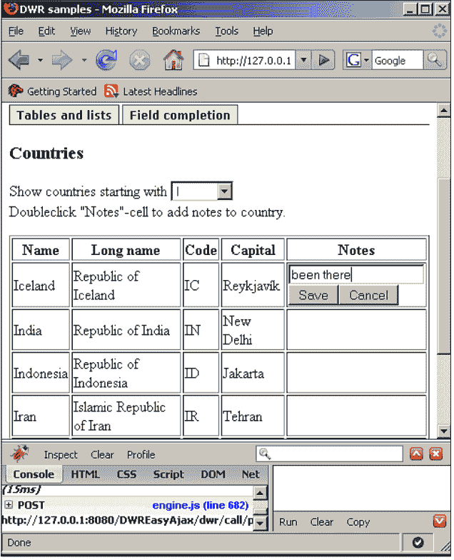


编辑框是一个简单的文本输入字段。我们没有使用任何表单。保存和取消编辑是通过JavaScript和DWR完成的。如果我们按下取消按钮，则会通过DWR从CountryDB Java类中获取原始笔记，保存操作也使用DWR来保存数据。CountryDB.saveCountryNotes()接受国家代码和用户在编辑框中输入的笔记，并将它们保存到CSV文件中。当有笔记时，应用程序会将其与其他国家信息一起显示在国家表格中，如下面的截图所示：

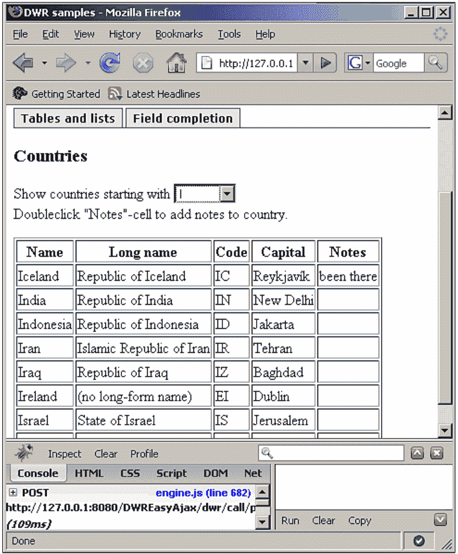

## 字段补全的服务器端代码

我们将重用上一节中开发的一些类。AppContent用于加载示例页面，DBUtils类在LicenseDB类中使用。LicenseDB类如下所示：

```
package samples;

import java.util.List;
import java.util.Vector;

public class LicenseDB{

    private DBUtils dbUtils=new DBUtils();

    public LicenseDB()
    {
        dbUtils.initFileDB("licenses.csv");
    }

    public List<String> getLicensesStartingWith(String startLetters)
    {
        List<String> list=new Vector<String>();
        List<String> licenses=dbUtils.getCSVStrings(startLetters);
        for(String license : licenses)
        {
            list.add(license.split(",")[0]);
        }
        return list;
    }

    public String getLicenseContentUrl(String licenseName)
    {
        List<String> licenses=dbUtils.getCSVStrings(licenseName);
        if(licenses.size()>0)
        {
            return licenses.get(0).split(",")[1];
        }
        return "";
    }
}
```

`getLicensesStartingWith()`方法遍历许可证名称，并返回有效的许可证名称及其URL。与上一节中的数据类似，许可证数据位于包目录下名为`licenses.csv`的CSV文件中。以下是文件内容的摘录：

```
Academic Free License, http://opensource.org/licenses/afl-3.0.php
Adaptive Public License, http://opensource.org/licenses/apl1.0.php
Apache Software License, http://opensource.org/licenses/apache1-1.1.php
Apache License, http://opensource.org/licenses/apache2.0.php
Apple Public Source License, http://opensource.org/licenses/apsl-2.0.php
Artistic license, http://opensource.org/licenses/artistic-license-1.0.php
...
```

有相当多的开源许可证。有些许可证比其他许可证更受欢迎（如Apache软件许可证），有些则不能重用（如IBM公共许可证）。

我们想要暴露`LicenseDB`类，因此我们向`dwr.xml`文件添加以下内容。

```
<create creator="new" javascript="LicenseDB">
    <param name="class" value="samples.LicenseDB"/>
    <include method="getLicensesStartingWith"/>
    <include method="getLicenseContentUrl"/>
</create>
```

## 字段补全的客户端代码

以下`script`元素将放在`index.jsp`页面中。

```
<script type='text/javascript' src='/DWREasyAjax/dwr/interface/LicenseDB.js'></script>
```

字段补全的HTML如下：

```
<h3>Field completion</h3>
<p>Enter Open Source license name to see its contents.
</p>
<input type="text" id="licenseNameEditBox" value="" onkeyup="showPopupMenu()" size="40"/>
<input type="button" id="showLicenseTextButton" value="Show license text" onclick="showLicenseText()"/>
<div id="completionMenuPopup"></div>
<div id="licenseContent"></div>
```

我们输入许可证名称的input元素监听onkeyup事件，该事件调用showPopupMenu() JavaScript函数。点击按钮会调用showLicenseText()函数（JavaScript函数稍后解释）。最后，两个div元素分别是弹出菜单和显示许可证内容的iframe元素的占位符。

对于弹出框功能，我们使用现有代码并针对我们的目的进行了修改（非常感谢http://www.jtricks.com）。以下是popup.js文件，位于WebContent | js目录下。

```
//<script type="text/javascript"><!--
/* Original script by: www.jtricks.com
 * Version: 20070301
 * Latest version:
 * www.jtricks.com/javascript/window/box.html
 *
 * Modified by Sami Salkosuo.
 */
// Moves the box object to be directly beneath an object.
function move_box(an, box)
{
    var cleft = 0;
    var ctop = 0;
    var obj = an;

    while (obj.offsetParent)
    {
        cleft += obj.offsetLeft;
        ctop += obj.offsetTop;
        obj = obj.offsetParent;
    }

    box.style.left = cleft + 'px';

    ctop += an.offsetHeight + 8;

    // Handle Internet Explorer body margins,
    // which affect normal document, but not
    // absolute-positioned stuff.
    if (document.body.currentStyle &&
        document.body.currentStyle['marginTop'])
    {
        ctop += parseInt(
            document.body.currentStyle['marginTop']);
    }
}
```

```
box.style.top = ctop + 'px';
}

var popupMenuInitialised=false;
// Shows a box if it wasn't shown yet or is hidden
// or hides it if it is currently shown
function show_box(html, width, height, borderStyle,id)
{
    // Create box object through DOM
    var boxdiv = document.getElementById(id);
    boxdiv.style.display='block';
    if(popupMenuInitialised==false)
    {
        //boxdiv = document.createElement('div');
        boxdiv.setAttribute('id', id);
        boxdiv.style.display = 'block';
        boxdiv.style.position = 'absolute';
        boxdiv.style.width = width + 'px';
        boxdiv.style.height = height + 'px';
        boxdiv.style.border = borderStyle;
        boxdiv.style.textAlign = 'right';
        boxdiv.style.padding = '4px';
        boxdiv.style.background = '#FFFFFF';
        boxdiv.style.zIndex='99';
        popupMenuInitialised=true;
        //document.body.appendChild(boxdiv);
    }

    var contentId=id+'Content';
    var contents = document.getElementById(contentId);
    if(contents==null)
    {
        contents = document.createElement('div');
        contents.setAttribute('id', id+'Content');
        contents.style.textAlign= 'left';
        boxdiv.contents = contents;
        boxdiv.appendChild(contents);

    }
    move_box(html, boxdiv);

    contents.innerHTML= html;

    return false;
}
```

```
function hide_box(id)
{
    document.getElementById(id).style.display='none';
    var boxdiv = document.getElementById(id+'Content');
    if(boxdiv!=null)
    {
        boxdiv.parentNode.removeChild(boxdiv);
    }
    return false;
}
//--></script>
```

popup.js文件中的函数用作编辑框正下方的菜单选项。

show_box()函数接受以下参数：弹出窗口的HTML代码、弹出窗口的位置以及“父”元素（与弹出框相关联的元素）。然后该函数使用DOM创建弹出窗口。move_box()函数用于将弹出窗口移动到编辑框下方的正确位置，hide_box()函数通过将弹出窗口从DOM树中移除来隐藏它。

为了使用popup.js中的函数，我们需要向index.jsp文件添加以下script元素：

```
<script type='text/javascript' src='js/popup.js'></script>
```

我们自己的字段补全JavaScript代码位于index.jsp文件中。以下是JavaScript函数，代码后附有解释：

```
function showPopupMenu()
{
    var licenseNameEditBox=dwr.util.byId('licenseNameEditBox');
    var startLetters=licenseNameEditBox.value;
    LicenseDB.getLicensesStartingWith(startLetters, {
    callback:function(licenses)
    {
        var html="";
        if(licenses.length==0)
        {
            return;
        }
        if(licenses.length==1)
        {
            hidePopupMenu();
```

```javascript
licenseNameEditBox.value=licenses[0];
}
else
{
    for (index in licenses)
    {
        var licenseName=licenses[index];//.split(",")[0];
        licenseName=licenseName.replace(/\//g, "&quot;");
        html+="<div style=\"border:1px solid #777777;
                    margin-bottom:5;\" onclick=
                    \"completeEditBox('"+licenseName+"');
                    \"\">"+licenseName+"</div>";
    }
    show_box(html, 200, 270, '1px solid','completionMenuPopup');
}
}
});
}

function hidePopupMenu()
{
    hide_box('completionMenuPopup');
}

function completeEditBox(licenseName)
{
    var licenseNameEditBox=dwr.util.byId('licenseNameEditBox');
    licenseNameEditBox.value=licenseName;
    hidePopupMenu();
    dwr.util.byId('showLicenseTextButton').focus();
}

function showLicenseText()
{
    var licenseNameEditBox=dwr.util.byId('licenseNameEditBox');
    licenseName=licenseNameEditBox.value;
    LicenseDB.getLicenseContentUrl(licenseName,{
    callback:function(licenseUrl)
    {
        var html='<iframe src="'+licenseUrl+'" width="100%"
                              height="600"></iframe>';
        var content=dwr.util.byId('licenseContent');
        content.style.zIndex="1";
        content.innerHTML=html;
    }
    });
}
```


每次用户在输入框中输入字符时，都会调用 `showPopupMenu()` 函数。该函数获取输入字段的值，并调用 `LicenseDB.getLicensesStartingWith()` 方法。回调函数在函数参数中指定。回调函数获取所有匹配该参数的许可证，并根据参数（它是一个数组）的长度，要么显示一个包含所有匹配许可证名称的弹出框，要么——如果数组长度为一——隐藏弹出框并将完整的许可证名称插入文本字段。在弹出框中，许可证名称被包裹在带有 `onclick` 事件监听器的 `div` 元素内，该监听器会调用 `completeEditBox()` 函数。

`hidePopupMenu()` 函数仅用于关闭弹出菜单，而 `completeEditBox()` 函数会将点击的许可证文本插入输入框，并将焦点移动到按钮上。当我们点击“Show license text”按钮时，会调用 `showLicenseText()` 函数。该函数调用 `LicenseDB.getLicenseContentUrl()` 方法，回调函数会创建一个 `iframe` 元素，以直接显示来自 http://www.opensource.org 的许可证内容，如下面的截图所示：

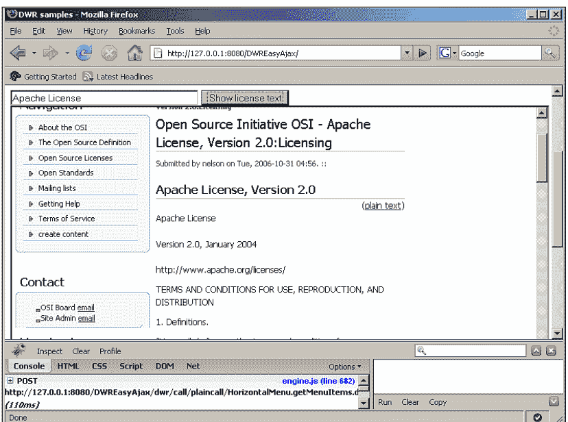

### 后记

字段补全功能改善了网页的用户体验，本节的示例代码展示了使用 DWR 实现该功能的一种方式。

需要说明的是，这里展示的字段补全示例仅用于演示目的。

### 小结

本章提供了几个网页开发中常见任务的示例：表格和列表、字段补全，甚至为我们的示例代码提供了一个通用框架——称为动态用户界面。表格和列表示例以及字段补全示例都使用了一个非常简单的基于 CSV 的“数据库”来保存数据，并且两者都有一个远程方法，DWR 通过该方法从服务器获取数据并在客户端显示。

我们还看到了一些很好的 HTML、CSS 和 JavaScript 示例。事实上，如果不了解 JavaScript，编写 Web 应用程序将会非常困难。

多年前，正如你们一些人可能记得的，JavaScript 在网页开发中是一个不受欢迎的词，没有自尊的开发者会碰 JavaScript。但变化是生活的一部分，在这种情况下，变化是朝着更好的方向。JavaScript 和 Java 通过 DWR 很好地协同工作。

下一章继续讨论用户界面部分，并展示更多示例，包括地图滚动功能，类似于流行的 Google Maps 网站中的功能。
