# 5 用户界面：高级元素

本章包含三个示例：表单、导航树和地图滚动。几乎所有 Web 应用程序中都有表单，示例展示了如何使用 DWR 进行表单验证和处理。导航树包括一个简单的导航树，其中包含一个用于保存菜单元素的 Java Bean，这些菜单元素通过 DWR 访问。本章的最后一个示例是地图滚动示例，展示了如何使用 Java、JavaScript 和 DWR 实现地图的缩放和滚动。

以下是本章讨论的各个部分：

- 创建表单 — 包括表单处理的示例
- 构建导航树 — 展示了在导航树实现中使用 DWR 的一种方式
- 使用 DWR 实现地图滚动 — 在网页地图（本示例中使用的是火星地图）中展示了 DWR 的功能

### 创建表单

本示例涉及表单、表单验证以及表单提交流程。在本示例中，我们要处理的表单非常简单，只有几个字段，其重点是展示使用 DWR 进行表单验证和使用 DWR 提交表单。表单外观如下面的截图所示：

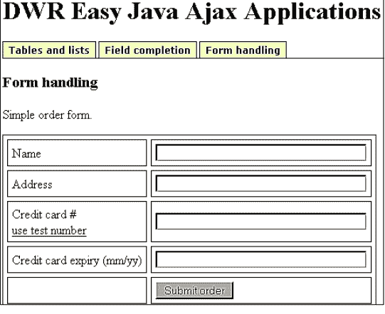

#### 开发用户界面

**Name**（姓名）和 **Address**（地址）字段并没有什么特别之处，也许除了现实中的地址字段几乎从来不会是一个简单的文本字段之外。**Credit card**（信用卡）号码在输入字段中输入时会进行验证。**Credit card expiry**（信用卡有效期）字段在输入时也会进行验证。

首先要做的是为我们在上一章设计的动态用户界面添加新的菜单项。这是通过向 `dwapplication.properties` 文件中添加菜单项属性来完成的。我们已经为本章稍后将开发的导航树和地图滚动示例添加了菜单项：

```
menu.3=Form handling,FormHandling
menu.4=Navigation tree,NavigationTree
menu.5=Map scrolling,MapScrolling
```

我们的 FormHandling.html 文件的 HTML 代码如下：

```
<h3>Form handling</h3>
<p>Simple order form.</p>
<div id="formFeedback"></div>
<table border="1" cellspacing="5" cellpadding="5">
  <tr>
    <td>Name</td>
    <td><input type="text" id="nameEditBox" value=""
        size="40" /></td>
  </tr>
  <tr>
    <td>Address</td>
    <td><input type="text" id="addressEditBox" value="" size="40" /></td>
  </tr>
  <tr>
    <td>Credit card #<br><a href="#" onclick="useTestCreditCardNumber();return false;">use test number</a></td>
    <td><input type="text" id="creditCardEditBox" value="" onkeyup="isValidCreditCard()" size="40" /></td>
  </tr>
  <tr>
    <td>Credit card expiry (mm/yy)</td>
    <td><input type="text" id="expiryEditBox" value="" onkeyup="checkExpiryDate()" size="40" /></td>
  </tr>
  <tr>
    <td>&nbsp;</td>
    <td><input type="button" id="submitOrderButton" value="Submit order" onclick="submitOrder()" /></td>
  </tr>
</table>
```

信用卡号码和有效期输入字段的 `onkeyup` 事件，以及“使用测试号码”链接和提交按钮的 `onclick` 事件中，指定了相应的 JavaScript 函数。以下 JavaScript 函数位于 index.jsp 文件中：

```
function useTestCreditCardNumber()
{
    var creditCardEditBox=dwr.util.byId('creditCardEditBox');
    creditCardEditBox.value='555555555554444';
}

function isValidCreditCard()
{
    var creditCardEditBox=dwr.util.byId('creditCardEditBox');
    creditCardNumber=creditCardEditBox.value;
    FormHandler.isValidCreditCard(creditCardNumber,{
        callback:function(valid)
        {
            var feedback=dwr.util.byId('formFeedback');
            var html="";
            if(!valid)
            {
                html='<p><font color="red">Credit card number is not valid.</font></p>';
            }
            feedback.innerHTML=html;
        }
    });
}
```

第一个函数 `useTestCreditCardNumber` 会向信用卡字段插入一个测试号码，这样我们就不必使用自己的卡号了。

`isValidCreditCard()` 函数在信用卡输入字段中输入内容时被调用。该函数调用一个服务器端 Java 方法（稍后将实现该方法），并接收到 `true` 或 `false`。如果信用卡号码未通过验证，用户会通过更改带有 `formFeedback` ID 的 `div` 元素的内容而得到提示。

`checkExpiryDate()` 函数与上一个函数类似，只是它检查的是有效期日期的语法。

最后一个函数是 `submitOrder()` 函数，它会读取表单字段值，并调用远程 Java 类中的 `submitOrder()` 方法。该 Java 方法返回 `true` 或 `false`，订单提交的状态会显示给用户。

#### 创建 FormHandler 类

接下来要做的是 FormHandler Java 类。该类的实现如下：

```
package samples;

public class FormHandler {
    public boolean submitOrder(String name,String address,String creditCardNumber,String expiryDate)
    {
        boolean validExpiryDate=checkExpiryFormat(expiryDate);
        boolean validCreditCardNumber=
            isValidCreditCard(creditCardNumber);
        //submit order to orderprocessing system
        boolean orderSubmitted=true;

        return validCreditCardNumber && validExpiryDate &&
            orderSubmitted;
    }

    public boolean checkExpiryFormat(String expiryDate) {
        if (expiryDate.length() != 5) {
            return false;
        }
        if (expiryDate.indexOf("/") == -1) {
            return false;
        }
    }
}
```


## 用户界面：高级元素

```java
String[] expDate = expiryDate.split("/");
try {
    int month = Integer.parseInt(expDate[0]);
    int year = Integer.parseInt(expDate[1]);
    if ((month >= 1 && month <= 12) && (year >= 8 && year
        <= 99)) {
        return true;
    }
    return false;
} catch (Exception e) {
    e.printStackTrace();
    return false;
}
}
/*
 * The next two methods perform credit card validation.
 * Only the format is checked, it is not checked
 * against a card holder.
 *
 * Methods provided by Michael Gilleland in his essay
 * "Anatomy of Credit Card Numbers"
 * http://www.merriampark.com/anatomycc.htm
 */
private String getDigitsOnly(String s) {
    StringBuffer digitsOnly = new StringBuffer();
    char c;
    for (int i = 0; i < s.length(); i++) {
        c = s.charAt(i);
        if (Character.isDigit(c)) {
            digitsOnly.append(c);
        }
    }
    return digitsOnly.toString();
}

public boolean isValidCreditCard(String cardNumber) {
    String digitsOnly = getDigitsOnly(cardNumber);
    int sum = 0;
    int digit = 0;
    int addend = 0;
    boolean timesTwo = false;
```

```
for (int i = digitsOnly.length() - 1; i >= 0; i--) {
    digit = Integer.parseInt(digitsOnly.substring(i, i + 1));
    if (timesTwo) {
        addend = digit * 2;
        if (addend > 9) {
            addend -= 9;
        }
    } else {
        addend = digit;
    }
    sum += addend;
    timesTwo = !timesTwo;
}
int modulus = sum % 10;
return modulus == 0;
```

第一个方法 `submitOrder()` 将姓名、地址和信用卡信息作为参数，并在将订单发送到订单处理系统（本示例中未实现）之前验证输入，然后根据订单是否成功返回 true 或 false 值。

第二个方法 `checkExpiryFormat()` 将信用卡有效期作为参数，并验证其格式是否正确，即 MM/YY，其中 MM 和 YY 分别是 1-12 和 8-99（2008-2099 年）范围内的整数。

最后两个方法验证信用卡号的格式是否正确。该代码由 Michael Gilleland 编写，并发表在他的文章《信用卡号剖析》（http://www.merriampark.com/anatomycc.htm）中。文章解释了信用卡中所有数字的含义，以及如何使用卢恩算法验证给定号码是否真的是信用卡号（更多信息请参阅该文章）。

## 测试表单

接下来要做的是将 FormHandler 添加到 HTML 页面，并将远程类添加到 dwr.xml。我们在 index.jsp 文件中添加以下内容：

```
<script type='text/javascript' src='/DWREasyAjax/dwr/interface/FormHandler.js'></script>
```

## 用户界面：高级元素

我们还要在 dwr.xml 文件中添加以下内容：

```xml
<create creator="new" javascript="FormHandler">
    <param name="class" value="samples.FormHandler"/>
    <include method="checkExpiryFormat"/>
    <include method="isValidCreditCard"/>
    <include method="submitOrder"/>
</create>
```

现在订单表单已准备就绪。这是一个非常简单的订单表单，但思路很清晰。可以在用户输入文本时验证表单字段。因此，当用户提交表单时，所有字段很可能都是正确的。下面的截图显示了正在进行的表单填写过程：

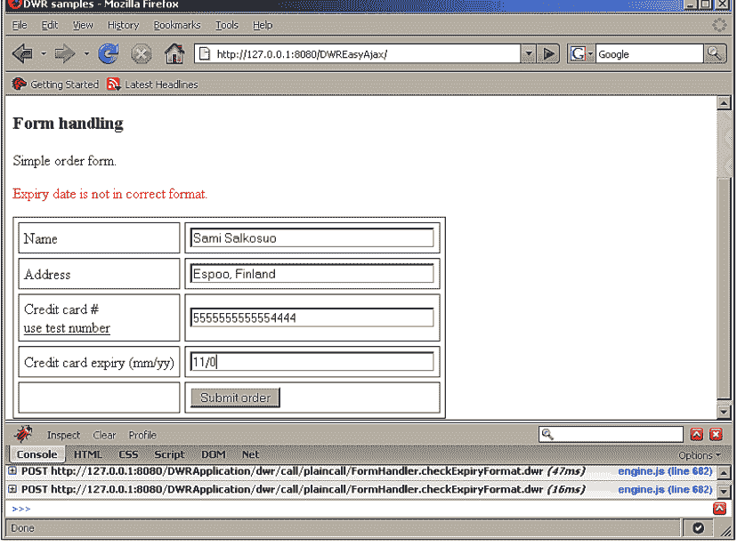

注意信用卡有效期字段仍然不完整。Firebug 窗口显示了 DWR 请求，每次在该字段中输入一个字符时，都会调用 `checkExpiryFormat()` 方法。注意，在这种情况下，每次输入一个字符都调用服务器会引入大量网络流量，并给服务器代码带来额外开销。然而，在本示例中，一个说明性的示例值得服务器承担额外开销。或许在其他情况下，相对于良好的用户体验和即时反馈，额外开销也可以被视为次要因素。

当字段正确并提交订单后，订单会被发送到订单处理系统。订单完成后，用户会收到订单成功的确认信息，如下面的截图所示：

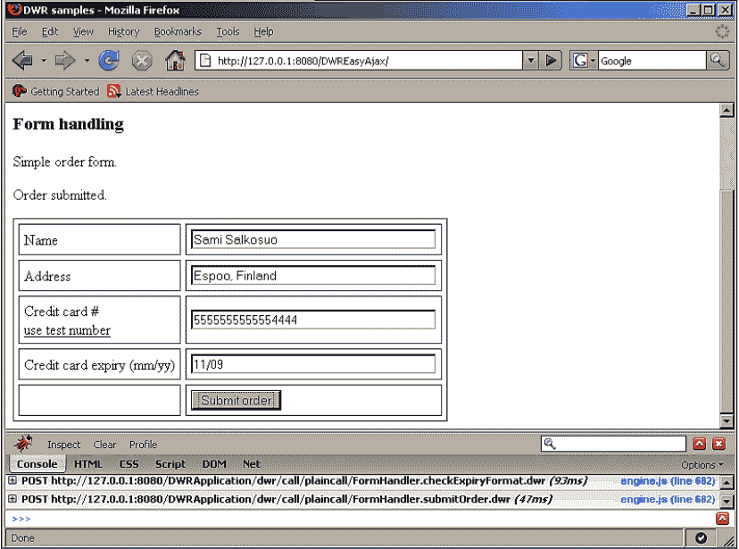

当然，在现实生活中，用户会收到订单收据，而不是绿色的**订单已提交**文本。

## 后记

本节中的示例表单演示了 DWR 如何在表单处理中使用。DWR 在表单上的应用包括表单字段的实时验证。我们还看到了检查信用卡号有效性的算法。

## 构建导航树

这是一个构建导航菜单的示例，菜单内容通过 DWR 从服务器获取。以下是我们将在本节中开发的菜单的截图：

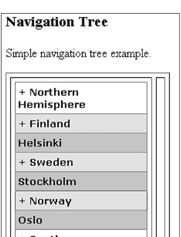

## 开发用户界面

在上一节中，我们已经将导航树菜单项添加到 dwrappplication.properties 中，因此我们可以从 HTML 文件开始开发。以下 HTML 文件位于 samples 目录中，名称为 NavigationTree.html。

```
<h3>Navigation Tree</h3>
<p>Simple navigation tree example.</p>
<table border="1" cellspacing="5" cellpadding="5">
```

```
<tr>
    <td><div class="wireframemenu" id="treeMenu"></div></td>
    <td><div id="treeMenuContent"></div></td>
</tr>
</table>

<script type='text/javascript'>
//TO BE EVALED
NavigationTree.getRootElements(createTreeMenu);
</script>
```

注意，树菜单位于具有 treeMenu ID 的 div 元素中。它还有一个样式类 wireframemenu。该样式来自 Dynamic Drive CSS 库。以下样式被添加到 styles.css 文件中。

```
/*Credits: Dynamic Drive CSS Library */
/*URL: http://www.dynamicdrive.com/style/ */

.wireframemenu{
border: 1px solid #C0C0C0;
background-color: white;
border-bottom-width: 0;
width: 170px;
}

* html .wireframemenu{ /*IE only rule. Original menu width minus all left/right paddings */
width: 164px;
}

.wireframemenu ul{
padding: 0;
margin: 0;
list-style-type: none;
}

.wireframemenu a{
font: bold 13px Verdana;
padding: 4px 3px;
display: block;
width: 100%; /*Define width for IE6's sake*/
color: #595959;
text-decoration: none;
border-bottom: 1px solid #C0C0C0;
}
```

```
.wireframemenu a:visited{
color: #595959;
}

html>body .wireframemenu a { /*Non IE rule*/
width: auto;
}

.wireframemenu a:hover{
background-color: #F8FBBD;
color: black;
}
```

## 创建 NavigationTree 类

在 NavigationTree.html 文件中，有一个对 NavigationTree.getRootElements() 的 JavaScript 调用。这是一个远程 Java 类，所以让我们实现这个 Java 类。源代码如下所示：

```
package samples;

import java.util.Hashtable;
import java.util.List;
import java.util.Map;
import java.util.Random;
import java.util.Vector;

public class NavigationTree {
    private String[] rootLevel={"Northern Hemisphere","Southern Hemisphere"};

    private Map<String,List<String>> level_1=new Hashtable<String,List<String>>();
    private Map<String,List<String>> level_2=new Hashtable<String,List<String>>();

    private String[] ncap={"Helsinki","Stockholm","Oslo"};
    private String[] scap={"Wellington","Canberra","Port Louis"};

    public NavigationTree()
    {
        List<String> countries=new Vector<String>();
        //set northern hemisphere
        countries.add("Finland");
        countries.add("Sweden");
        countries.add("Norway");
```

```javascript
var html="<ul>";

for (index in rootElements)
{
    var element=rootElements[index];
    NavigationTree.hasChildren(element,{
        async:false,
        callback:function(hasChildren)
        {
            if(hasChildren)
            {
                html+='<li><a href="#" onclick="expandElement(this);\n                              return false;"> + '+element+'</a></li>';
            }
            else
            {
                html+='<li><a href="#" onclick="expandElement(this);\n                              return false;">'+element+'</a></li>';
            }
        }
    });
}

html+="</ul>";
treeMenu.innerHTML=html;

}

function expandElement(element)
{
    var value=element.text.replace(' + ','');
    var html="";
    NavigationTree.getChildren(value,{
        async:false,
        callback:function(childElements)
        {
            for (index in childElements)
            {
                var element=childElements[index];
                NavigationTree.hasChildren(element,{
                    async:false,
                    callback:function(hasChildren)
                    {
                        if(hasChildren)
```


```
{
    html+='<li><a href="#" onclick="expandElement(this);return false;">'+element+'</a></li>';
}
else
{
    html+='<li style="background-color:#dddddd"><a href="#" onclick="showContent(this);return false;">'+element+'</a></li>';
}
});
});
var parentNode=element.parentNode;
var childNodes=parentNode.childNodes;
if(childNodes.length>1)
{
    for(var i=1;i<childNodes.length;i++)
    {
        parentNode.removeChild(childNodes[i]);
    }
    var treeMenuContent=dwr.util.byId('treeMenuContent');
    treeMenuContent.innerHTML="";
}
else
{
    var ul = document.createElement("ul");
    ul.innerHTML=html;
    ul.style.backgroundColor="#eeeeee";
    parentNode.appendChild(ul);
}

function showContent(element)
{
    var value=element.text.replace(' ','');
    NavigationTree.getContent(value,{
        callback:function(content)
        {
            var treeMenuContent=dwr.util.byId('treeMenuContent');
            treeMenuContent.innerHTML=content;
        }
    });
}
```

第一个函数是 getRootElements() Java 调用的回调函数。该函数的功能是获取根元素，并针对每个元素检查是否存在子元素，然后据此编写菜单元素的 HTML 代码。请注意，菜单是 li 元素，我们的 wireframemenu 样式规定了如何在菜单中处理这些 li 元素。我们看到的不是项目符号列表，而是一个菜单。请注意 NavigationTree.hasChildren() 远程调用中的一个参数：async:false。这很有趣，因为它强制对服务器的调用变为同步调用，就像任何给定编程语言中的普通方法调用一样。在 A(同步)JAX 中使用同步调用时必须格外小心——它可能会显著降低应用程序的速度。

下一个函数是 expandElement()。它也会检查子元素，并写入指向菜单或内容的新链接。

第三个函数是 showContent()。它调用远程 Java 方法并检索给定元素的内容。

至此，这个示例菜单树就完成了。尽管菜单是硬编码的，但它为开发由数据库或其他机制支持的动态树菜单提供了一个良好的起点。

## 测试导航树

启动导航树示例时，会看到一个顶层树，如下图所示：

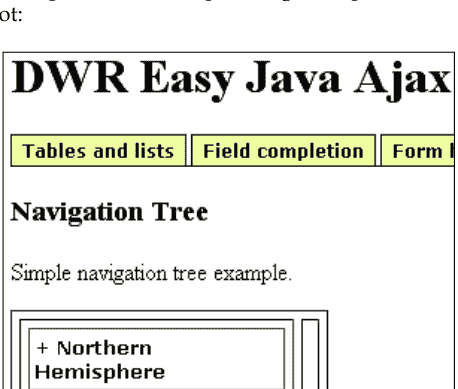

我们可以展开菜单元素，如下面的两个截图所示：先展开**北半球**，再展开**芬兰**。图中会显示**芬兰**的首都，点击它即可获取其描述。

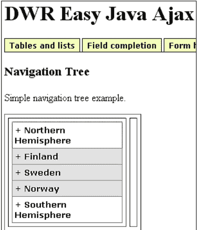

当我们展开**芬兰**并点击**赫尔辛基**时，会得到如下图所示的内容：

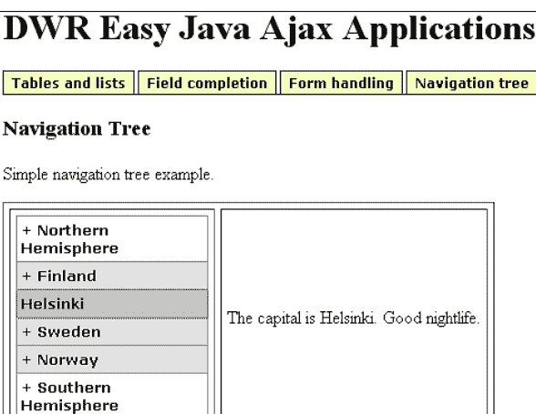

## 后记

本示例演示了导航树，以及 DWR 如何用于动态提供菜单元素。

## 使用 DWR 实现地图滚动

本章的最后一个示例是使用 DWR 实现的地图滚动示例。自谷歌地图发布以来，基于浏览器的、由鼠标控制的滚动地图已变得非常流行。

实现本示例的主要思想是：取一张足够大的地图，把它分割成大小相等的小方块。然后，根据位置，将一定数量的小方块插入到可见的地图窗口中；当用户按下鼠标左键并在地图窗口中拖动鼠标来滚动地图时，从服务器检索新的地图方块（其他实现也可能下载可见地图窗口周围的地图方块）。

在本示例中，我们使用了由美国地质调查局天体地质学研究计划（http://astrogeology.usgs.gov/）提供的火星坦佩-马雷奥蒂斯区域地质图。关于地图的直接链接和其他信息，请参阅 http://astrogeology.usgs.gov/Projects/MapBook/fulllisting.jsp?mapNumber=1170。

下面的截图展示了本示例所使用的坦佩-马雷奥蒂斯区域的完整地图。

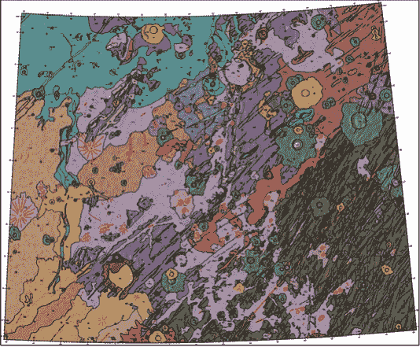

我们使用两个缩放级别。缩放级别 0 的原始图像尺寸为 1000x825 像素，缩放级别 1 的图像尺寸为 2000x1632。两幅原始图像都被分割成每个 100x100 像素的小方块，但地图底部除外，因为其高度不能被 100 整除。

以下是地图方块的几个随机示例：

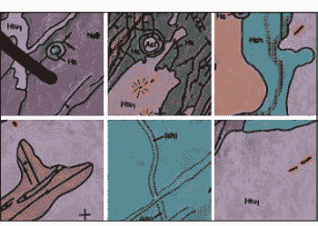

由于原始图片相当大，缩放级别 0 共有 90 个地图方块，缩放级别 1 共有 340 个方块。

示例代码演示了如何使用 DWR 和 JavaScript 实现滚动地图应用程序。我们开发的应用程序如下图所示。图像方块带有边框，以便可视化地图的构建方式。

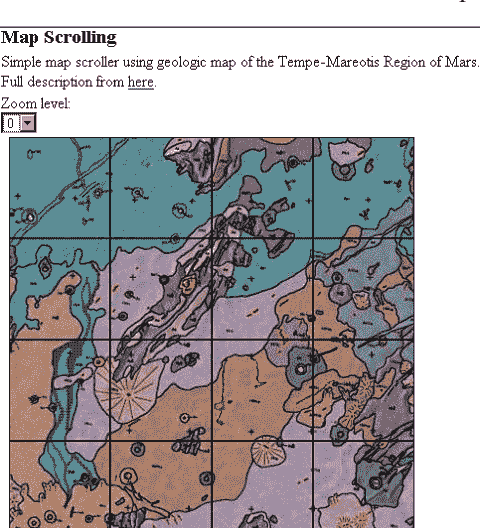

## 开发用户界面

我们从 HTML 文件开始开发。地图滚动器的 HTML 代码如下：

```
<h3>Map Scrolling</h3>
<p>Simple map scroller using geologic map of the Tempe-Mareotis Region of Mars.<br/> Full description from <a href="http://astrogeology.usgs.gov/Projects/MapBook/fullisting.jsp?mapNumber=1170">here</a>.</p>
<div id="mapArea">
Zoom level: <form id="zoomLevelForm"><select id="zoomLevel" onchange="setZoomLevel(this);return false;"><option>0</option><option>1</option></select></form><br/>
<iframe width="430" height="440" scrolling="no" frameborder="0" src="MapArea.html">
</iframe>
</div>
```

用于缩放的控制元素是一个选择框，它使用 JavaScript 函数为地图设置新的缩放级别。setZoomLevel() 函数位于 index.jsp 文件中。函数代码如下：

```
function setZoomLevel(element)
{
    var selectedIndex = element.selectedIndex;
    var value= element.options[selectedIndex].value;
    var frames=window.frames;
    frames[0].setZoomLevel(value);
}
```

该函数接收 select 元素，从中提取一个值，然后调用位于 MapArea.html 文件中的另一个 setZoomLevel() 函数。

地图区域是一个 iframe 元素，其源代码位于 MapArea.html 文件中，如下所示。该文件位于 WebContent 目录下。

```
<!DOCTYPE html PUBLIC "-//W3C//DTD HTML 4.01 Transitional//EN" "http://www.w3.org/TR/html4/loose.dtd">
<html>
<head>
<script type='text/javascript' src='/DWREasyAjax/dwr/interface/MapScroller.js'></script>
<script type='text/javascript' src='/DWREasyAjax/dwr/engine.js'></script>
<script type='text/javascript' src='/DWREasyAjax/dwr/util.js'></script>
<script type="text/javascript">
```

```
var zoomLevel = 0;
var mapPositionIndex= 0;

var refGridX=0;
var refGridY=0;

function getRowIndex()
{
    var tempIndex=0;
    if(zoomLevel==0)
    {
        if(mapPositionIndex>=10)
        {
            tempIndex=parseInt(mapPositionIndex.toString().substring(1));
        }
        else
        {
            tempIndex=mapPositionIndex;
        }
    }
    else
    {
        if(mapPositionIndex>=100)
        {
            tempIndex=parseInt(mapPositionIndex.toString().substring(1));
        }
        else
        {
            tempIndex=mapPositionIndex;
        }
        while(tempIndex>16)
        {
            tempIndex-=20;
        }
        if(tempIndex<0)
        {
            tempIndex=16;
        }
    }
    return tempIndex;
}
```

```
function setZoomLevel(newZoomLevel)
{
    if(newZoomLevel==0)
    {
        oldMapPositionIndex=mapPositionIndex;
        newRow=Math.round(Math.round(mapPositionIndex/17.0)/2.0)-1;
        if(newRow>5)
        {
            newRow=5;
        }
        else
        {
            if(newRow>=1 && newRow<=5)
            {
                newRow--;
            }
        }
        newColumn=Math.floor(getRowIndex()/2.0)-1;
        if(newColumn>6)
        {
            newColumn=6;
        }
        mapPositionIndex=(newRow*10)+newColumn;
        if(oldMapPositionIndex==208)
        {
            mapPositionIndex=43;
        }
        if(oldMapPositionIndex==214)
        {
            mapPositionIndex=46;
        }
        if(mapPositionIndex<0)
        {
            mapPositionIndex=0;
        }
    }
    else
    {
        mapPositionIndex=(Math.floor(mapPositionIndex/10.0)*40)+40+(2*(getRowIndex()+1));
    }
    zoomLevel=newZoomLevel;
    getMapImages(zoomLevel,mapPositionIndex);
}
```


function getMapImages(zoomLevel,mapPositionIndex)
{
    MapScroller.getMapImages(zoomLevel,mapPositionIndex, {
        callback:function(images) {
            setImages(images, zoomLevel);
        }
    });
}

function setRefGrid(event)
{
    refGridX=Math.floor(event.clientX/100.0);
    refGridY=Math.floor(event.clientY/100.0);
}

function startScroll(event)
{
    setRefGrid(event);
    document.addEventListener("mousemove", mouseMove,  true);
    document.addEventListener("mouseup",  stopScroll, true);
    document.addEventListener("mouseout",  stopScrollOnOut, true);
    document.addEventListener("mouseover",  stopScrollOnOut, true);
    event.preventDefault();
}

function stopScroll(event)
{
    document.removeEventListener("mousemove", mouseMove,  true);
    document.removeEventListener("mouseup",  stopScroll, true);
    document.removeEventListener("mouseout",  stopScrollOnOut, true);
    document.removeEventListener("mouseover",  stopScrollOnOut, true);
}

function stopScrollOnOut(event)
{
    var src=event.target;
    if(src.id=="scrollingMapArea")
    {
        stopScroll(event);
    }
}

```javascript
function mouseMove(event)
{
    x=event.clientX;
    y=event.clientY;
    newGridX=Math.floor(x/100.0);
    newGridY=Math.floor(y/100.0);
    deltaX=newGridX-refGridX;
    deltaY=newGridY-refGridY;
    if(deltaX==0 && deltaY==0)
    {
        return;
    }
    var update=false;
    var tilesInRow=10;
    if(zoomLevel==1)
    {
        tilesInRow=20;
    }
    tempIndex=getRowIndex();

    if(deltaX>0)
    {
        if((tempIndex<6 && zoomLevel==0) || (tempIndex<16 && zoomLevel==1))
        {
            mapPositionIndex++;
            update=true;
        }
    }
    else
    {
        if(deltaX<0)
        {
            if(tempIndex>0)
            {
                if(mapPositionIndex-1>=0)
                {
                    mapPositionIndex--;
                    update=true;
                }
            }
        }
    }
}
```

```javascript
if(deltaY>0)
{
    var tempYIndex=50;
    if(zoomLevel==1)
    {
        tempYIndex=260;
    }
    if(mapPositionIndex<tempYIndex)
    {
        mapPositionIndex+=tilesInRow;
        update=true;
    }
}
else
{
    if(deltaY<0)
    {
        if(mapPositionIndex>0 && mapPositionIndex>=tilesInRow)
        {
            mapPositionIndex-=tilesInRow;
            if(mapPositionIndex<0)
            {
                mapPositionIndex=0;
            }
            update=true;
        }
    }
}

if(update)
{
    setRefGrid(event);
    getMapImages(zoomLevel,mapPositionIndex);
}

function setImages(images,zoomLevel)
{
    var mapArea=dwr.util.byId('scrollingMapArea');
    mapArea.innerHTML="";
    for(index in images)
    {
        var imageName=images[index];
        var mapPart = document.createElement("img");
        mapPart.setAttribute('border','1');
        mapPart.setAttribute('src','mapimages/'+imageName);
        mapArea.appendChild(mapPart);
    }
}
```

}
</script>
</head>
<body onMouseDown="startScroll(event)">
<div id="scrollingMapArea"></div>
</body>

<script type="text/javascript">
getMapImages(zoomLevel,mapPositionIndex);
</script>
</html>.

该 HTML 文件包含与地图滚动相关的所有内容。在 body 元素中有一个单一的 div 元素，用于存放地图方块。我们记得 iframe 的宽度和高度为 430x430，而地图方块为 100x100，因此地图视口总共将有 16 张地图图像。

在 JavaScript 代码中，mapPositionIndex 变量是视口左上角的数组索引。例如，当地图显示左上角 mapPositionIndex 为 0 时，并逐行滚动到底部时，mapPositionIndex 会变为 10（缩放级别 0）或 20（缩放级别 1）。

首先，getRowIndex() JavaScript 函数计算可见视口顶部的行。

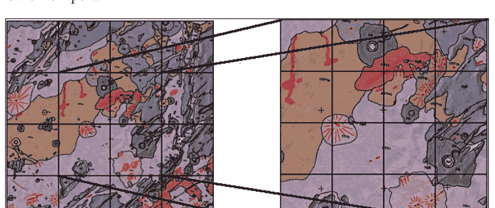

第二个重要函数是 setZoomLevel()。它计算新缩放级别的 mapPositionIndex。放大时，中心四个方块会被放大显示，缩小 时，可见方块位于中心。上面的截图是缩放对用户可见效果的示例。左图为缩放级别 0，右图为缩放级别 1。

使用 zoomLevel 和 mapPositionIndex，通过 getImages() 函数检索图像。它只是调用远程 Java 方法，其中 Java 方法的回调 函数为 setImages()。

setImages() 函数从 Java 方法接收图像名称数组，并使用 for 循环创建 img 元素，这些元素被追加到地图区域 div 元素中。

setRefGrid()、startScroll()、stopScroll()、stopScrollOnOut() 和 mouseMove() 函数用于处理地图滚动。滚动的工作方式是，当用户按下鼠标按钮时调用 startScroll() 函数。然后该函数为 mousemove、mouseup、mouseout 和 mouseover 事件添加事件监听器。当鼠标按钮按下并移动鼠标时，就会调用 mouseMove() 函数。

mouseMove() 函数计算鼠标所在的网格位置（请记住地图视口为 4x4 方块）。参考位置由 setRefGrid() 函数设置（按钮按下时也会调用）。如果鼠标光标移动到新的网格位置，则使用新的 mapPositionIndex 调用 getImages() 函数，并在页面中更新地图方块。

当释放鼠标按钮时，会调用 stopScroll() 函数，并移除所有事件监听器。当用户将鼠标光标移出地图区域 div 元素时也会发生这种情况。

实际的地图图像位于 WebContent | mapimages 目录中。缩放级别 0 的地图方块图像为 tempe-mareotis-zlevel-0-0.jpg 到 tempe-mareotis-zlevel-0-89.jpg，缩放级别 1 为 tempe-mareotis-zlevel-1-0.jpg 到 tempe-mareotis-zlevel-1-339.jpg，因此仅两个缩放级别就超过 400 张图像。

## 创建 MapScroller Java 类

最后，我们需要返回图像名称的 Java 类。Java 代码如下：

```
package samples;

import java.util.List;
import java.util.Vector;

public class MapScroller {

    private int[] imagesInRowInZLevel = { 10, 20 };
    private String imageName = "tempe-mareotis-zlevel-";
```

```
public List<String> getMapImages(int zoomLevel,
    int mapPositionIndex) {
    List<String> images = new Vector<String>();
    String imageName = this.imageName + zoomLevel + "-";
    for (int rowIndex = 0; rowIndex < 4; rowIndex++) {
        for (int i = 0; i < 4; i++) {
            int index = mapPositionIndex + i;
            images.add(imageName + index + ".jpg");
        }
        mapPositionIndex = mapPositionIndex
            + imagesInRowInZLevel[zoomLevel];
    }
    return images;
}
```

MapScroller 类中只有一个方法 getMapImages()。该方法为 HTML 页面中的当前视图返回 16 个图像名称。参数 mapPositionIndex 是图像的左上角，用于计算其他图像的索引。

不要忘记将远程类添加到 dwr.xml 文件中：

```
<create creator="new" javascript="NavigationTree">
    <param name="class" value="samples.NavigationTree" />
</create>
```

至此，地图滚动示例完成。大多数功能都在浏览器端的 JavaScript 函数中。但如果没有 AJAX，这种功能是不可能实现的。这看起来是一个非常简单的实现，因为 DWR 隐藏了浏览器与服务器之间异步通信的底层细节，并允许我们仅用一个 Java 类中的几行服务器端代码和一堆地图方块图像即可开发地图滚动功能。

## 测试地图滚动器

以下三个截图显示了地图滚动器的运行情况。请注意鼠标光标和手绘箭头，显示了光标的移动。

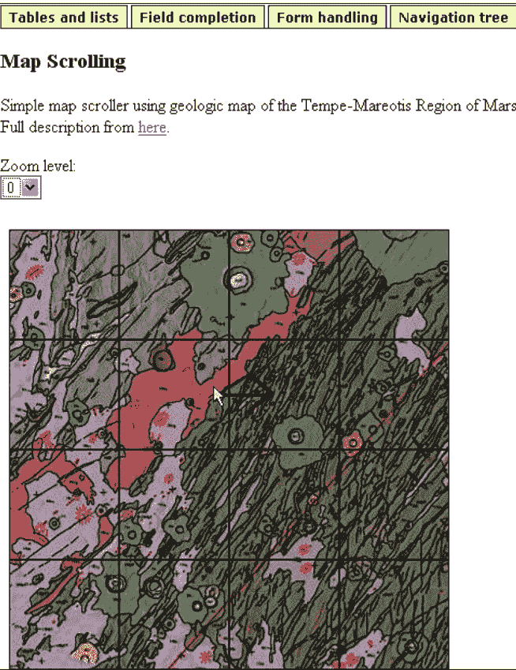


