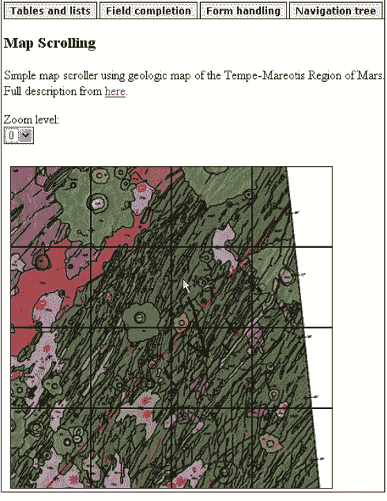
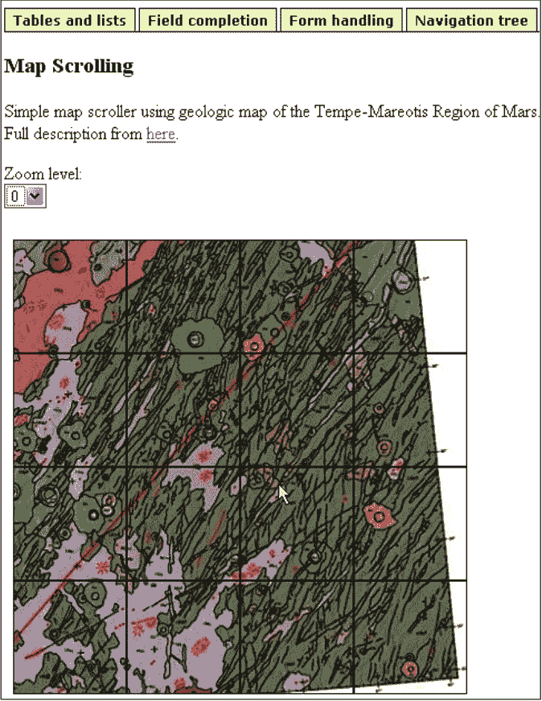
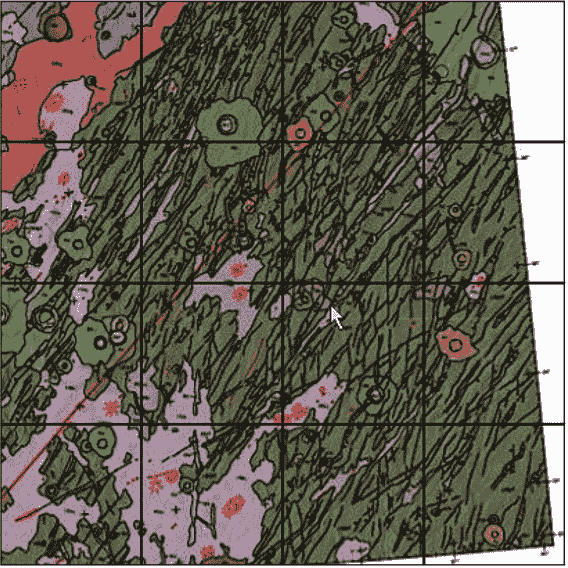

## 用户界面：高级元素

### 地图滚动

在这个示例中，按下鼠标按钮，然后将光标向右移动。当光标越过黑色边框时，我们通过已编写的 JavaScript 代码感知到这一动作，它便会触发地图滚动并更新图像。在截图中将鼠标向右移动并越过边框后，地图向右滚动，如下图所示：

上面的截图还包含一个手绘的黑色箭头。当我们（按住按钮）将光标向下移动时，再次越过边框，地图向下滚动，如下图所示：

使用火星坦佩-马雷奥蒂斯区域地质图的简单地图滚动器。
完整描述见[此处]。

缩放级别：

### 后记

这个地图滚动器示例展示了一种非常用户友好的滚动地图或图像的方法。我们还看到该实现非常以客户端为中心，因为我们服务器端的 Java 代码（通过远程调用）只有一个类和一个方法。

### 小结

本章介绍了许多应用程序中可用的用户界面组件。所有接受用户输入的应用程序中都有表单。导航树对用户友好，而在特定应用程序中，地图滚动被视为必需功能。

使用 DWR 可以轻松地使用这些用户界面组件。DWR 使为应用程序添加非常动态的行为变得容易。尽管示例或多或少是硬编码的，但主要思想已经呈现，示例代码是开发非硬编码应用程序的良好起点。
