# 6 后端集成

本章介绍如何将 Web 应用程序与各种后端服务集成。几乎所有应用程序都涉及数据库，因此本章的第一个示例展示了一种从 DWR 应用程序访问数据库的方法。第二个示例与标准 Web 服务集成，而第三个示例使用 JMS 消息传递来访问后端服务。JMS 示例还演示了如何使用 DWR 实现反向 AJAX（Comet）。

本章包含以下部分：

- 将数据库与 DWR 集成——展示如何使用 DWR 访问数据库
- 与 Web 服务集成——使用 Eclipse 工具为我们的 DWR 应用程序生成 Web 服务客户端
- 与消息系统集成——使用 ActiveMQ 和 JMS 将我们的 DWR 应用程序与基于 Python 的“订单系统”集成

### 使用 DWR 集成数据库

这里，我们通过一个远程 Java 类公开数据库表，从而将数据库与 DWR 集成。我们的 Java 类使用 JDBC 直接连接数据库，相关的 SQL 语句也包含在该类中。其他访问数据库的方式包括 EJB、Hibernate 及许多其他方式。

这里的示例替换了第 4 章“表格和列表”中的第一个示例，使国家数据来自数据库而不是 CSV 文件。从应用程序的角度来看，只需要修改 `dwr.xml` 文件，即将条目改为指向处理数据库访问的 Java 类。在我们实现 Java 类之前，必须先设置并填充数据库。这里我们使用 Apache Derby 数据库，它随 Geronimo 应用服务器一起发布。

3. 以下 SQL 命令创建一个国家数据表。

```
CREATE TABLE country_data (
    id INTEGER generated always as identity,
    short_name VARCHAR(64) NOT NULL,
    long_name VARCHAR(256) NOT NULL,
    code CHAR(2) NOT NULL,
    capital VARCHAR(64) NOT NULL,
    notes VARCHAR(256) DEFAULT ''
);
ALTER TABLE country_data ADD CONSTRAINT pkey PRIMARY KEY (id);
```

4. 将 SQL 插入命令区域，然后点击“运行 SQL”按钮。

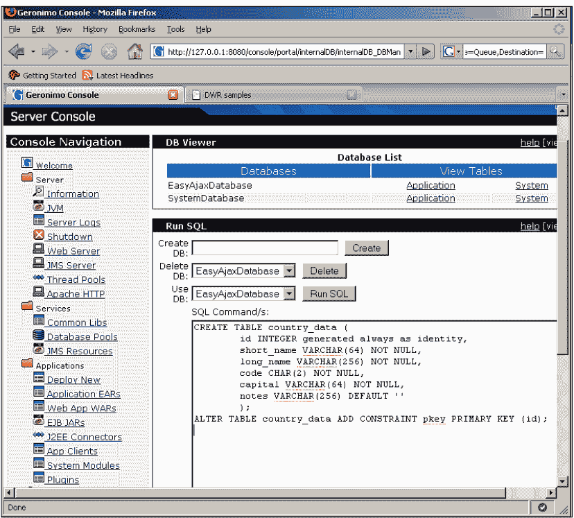

我们可以使用 **Geronimo 控制台**查看数据库中的表。下面的截图中有一个**数据库列表**，其中包含用于查看应用程序表及其内容的链接：

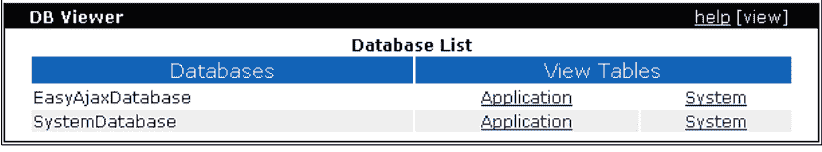

下面的截图显示了**数据库列表**中带有查看表内容链接的应用程序表：

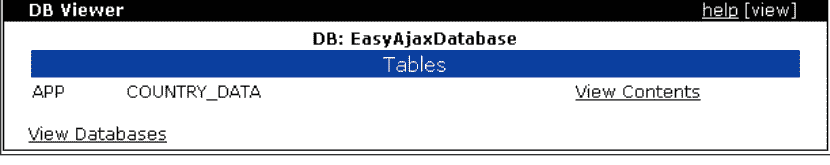

表的内容如下：

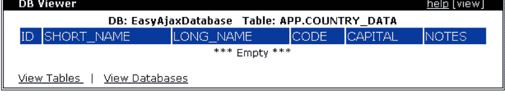

该表是空的，以下是用国家数据填充该表的 SQL 语句摘录：

```
insert into country_data (short_name,long_name,code,capital) values ('El Salvador','Republic of El Salvador','ES','San Salvador');
insert into country_data (short_name,long_name,code,capital) values ('Ethiopia','Federal Democratic Republic of Ethiopia','ET','Addis Ababa');
insert into country_data (short_name,long_name,code,capital) values ('Fiji','Republic of the Fiji Islands','FJ','Suva');
insert into country_data (short_name,long_name,code,capital) values ('Finland','Republic of Finland','FI','Helsinki');
...
```

在数据库管理器中执行这些命令后，我们会在 Geronimo 数据库查看器中看到表的内容。

| ID | 短名 | 长名 | 代码 | 首都 | 备注 |
|---|---|---|---|---|---|
| 1 | 阿富汗 | 阿富汗伊斯兰共和国 | AF | 喀布尔 |  |
| 2 | 阿尔巴尼亚 | 阿尔巴尼亚共和国 | AL | 地拉那 |  |
| 3 | 阿尔及利亚 | 阿尔及利亚人民民主共和国 | AG | 阿尔及尔 |  |
| 4 | 安道尔 | 安道尔公国 | AN | 安道尔城 |  |
| 5 | 安哥拉 | 安哥拉共和国 | AO | 罗安达 |  |
| 6 | 安提瓜和巴布达 | （无长名） | AC | 圣约翰 |  |
| 7 | 阿根廷 | 阿根廷共和国 | AR | 布宜诺斯艾利斯 |  |
| 8 | 亚美尼亚 | 亚美尼亚共和国 | AM | 埃里温 |  |
| 9 | 澳大利亚 | 澳大利亚联邦 | AS | 堪培拉 |  |
| 10 | 奥地利 | 奥地利共和国 | AU | 维也纳 |  |
| 11 | 阿塞拜疆 | 阿塞拜疆共和国 | AJ | 巴库 |  |
| 12 | 巴哈马 | 巴哈马联邦 | BF | 拿骚 |  |
| 13 | 巴林 | 巴林王国 | BA | 麦纳麦 |  |
| 14 | 孟加拉国 | 孟加拉人民共和国 | BG | 达卡 |  |
| 15 | 巴巴多斯 | （无长名） | BB | 布里奇顿 |  |
| 16 | 白俄罗斯 | 白俄罗斯共和国 | BO | 明斯克 |  |

5. 既然我们已经有了表和内容，就需要数据源来访问内容。我们在 Geronimo 中指定数据源，我们的 Java 类将使用服务器提供的数据源来访问数据库。这样，Geronimo 处理连接的细节，并提供一个连接池，这在我们有大量并发用户时非常有用。数据源在 **Geronimo 控制台**的**服务 | 数据库池**中指定。

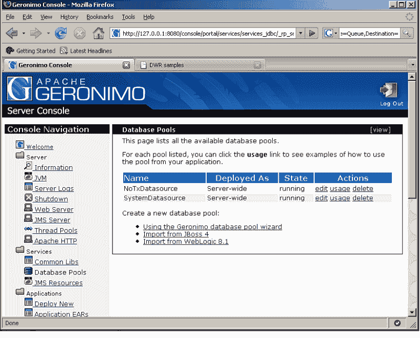

6. 新的数据库池通过一个向导创建，该向导位于**使用 Geronimo 数据库池向导**链接后面。

7. 我们使用 **EasyAjaxDBPool** 作为数据库池名称，数据库类型为 **Derby 网络**。

```
private void closeConnection(Connection con) {
    try {
        con.close();
    } catch (SQLException e) {
        e.printStackTrace();
    }
}

public List<List<String>> getCountries(String startLetter) {
    List<List<String>> allCountryData = new Vector<List<String>>();
    try {
        Connection con = getConnection();
        PreparedStatement pstmt = con
            .prepareStatement("select short_name,long_name,code,capital,notes from country_data where short_name like ?");
        pstmt.setString(1, startLetter + "%");
        ResultSet rs = pstmt.executeQuery();
        while (rs.next()) {
            List<String> countryData = new Vector<String>();
            for (int i = 1; i <= 5; i++) {
                if (i == 5) {
                    String notes = rs.getString(i);
                    if (notes.length() == 0) {
                        notes = "&nbsp;";
                    }
                    countryData.add(notes);
                } else {
                    countryData.add(rs.getString(i));
                }
            }
            allCountryData.add(countryData);
        }
        rs.close();
        pstmt.close();
    } catch (Exception e) {
        e.printStackTrace();
    }
    finally {
        closeConnection(con);
    }
    return allCountryData;
}
```


```java
public String[] getCountryData(String ccode) {
    List<String> countryData = new Vector<String>();
    Connection con = getConnection();
    try {
        PreparedStatement pstmt = con
            .prepareStatement("select short_name,long_name,code,capital,notes from country_data where code=?");
        pstmt.setString(1, ccode);
        ResultSet rs = pstmt.executeQuery();
        if (rs.next()) {
            for (int i = 1; i <= 5; i++) {
                if (i == 5) {
                    String notes = rs.getString(i);
                    if (notes.length() == 0) {
                        notes = "&nbsp;";
                    }
                    countryData.add(notes);
                } else {
                    countryData.add(rs.getString(i));
                }
            }
        }
    } catch (SQLException e) {
        e.printStackTrace();
    }
    closeConnection(con);
    String[] cdata = new String[5];
    return countryData.toArray(cdata);
}

public String[] saveCountryNotes(String ccode, String notes) {
    Connection con = getConnection();
    try {
        PreparedStatement pstmt = con
            .prepareStatement("update country_data set notes=? where code=?");
        pstmt.setString(1, notes);
        pstmt.setString(2, ccode);
        pstmt.executeUpdate();
    } catch (SQLException e) {
        e.printStackTrace();
    }
    closeConnection(con);
    String[] rv = new String[2];
    rv[0] = ccode;
    rv[1] = notes;
    return rv;
}
}
```

该类具有与使用 CSV 文件作为数据源的类相同的 方法。请注意，最好为类似的类定义一个接口，然后使用例如工厂类在运行时选择正确的实现。

`getConnection()` 方法使用指定的数据源名称从 Geronimo 运行时获取连接，而 `closeConnection()` 方法关闭连接（或将其返回到 Geronimo 池）。

该类中检索或更新数据库中国家的其他方法都是使用简单直接的 JDBC 调用和 SQL 脚本的。

为了在我们的应用程序中使用此类，我们需要将其配置为访问 Geronimo 数据库池。为此，我们在 web.xml 和 geronimo-web.xml 中添加数据源条目。在 geronimo-web.xml 文件中，我们将之前创建的数据库池映射到我们在 web.xml 文件中指定的数据源。

以下条目在 geronimo-web.xml 文件中将我们的数据库池配置为应用程序的依赖项：

```xml
<sys:dependencies>
  ...
  <sys:dependency>
    <sys:groupId>console.dbpool</sys:groupId>
    <sys:artifactId>EasyAjaxDBPool</sys:artifactId>
    <sys:version>1.0</sys:version>
    <sys:type>rar</sys:type>
  </sys:dependency>
  ...
</sys:dependencies>
```

此外，在 geronimo-web.xml 中，有一个将数据源名称映射到数据库池的条目。以下条目位于 XML 文件中 context-root 元素之后。

```xml
<resource-ref>
  <ref-name>jdbc/CountryDataSource</ref-name>
  <resource-link>EasyAjaxDBPool</resource-link>
</resource-ref>
```

下一个配置是 web.xml 文件中的配置，我们在其中设置资源引用，以便我们的类可以使用它。以下条目位于 web.xml 文件的末尾。

```xml
<resource-ref>
  <res-ref-name>jdbc/CountryDataSource</res-ref-name>
  <res-type>javax.sql.DataSource</res-type>
  <res-auth>Container</res-auth>
  <res-sharing-scope>Shareable</res-sharing-scope>
</resource-ref>
```

最后，我们在这里做的最后一个配置是更改 dwr.xml 文件中的远程类为新的 CountryDerbyDB 类。在 DWR 配置中，我们更改 CountryDB 的 class 参数。

```xml
<create creator="new" javascript="CountryDB">
  <param name="class" value="samples.CountryDerbyDB" />
  <include method="getCountries" />
  <include method="saveCountryNotes" />
  <include method="getCountryData" />
</create>
```

## 测试数据库集成

我们通过更改某个国家的注释然后检查这些注释是否已保存到数据库来验证它是否有效。在此示例中，我们更改了巴哈马的注释，然后使用 Geronimo 控制台检查巴哈马的注释是否确实已存储到数据库中，如以下屏幕截图所示：

| ID | SHORT_NAME | LONG_NAME | CODE | CAPITAL | NOTES |
|---|---|---|---|---|---|
| 1 | Afghanistan | Islamic Republic of Afghanistan | AF | Kabul |  |
| 2 | Albania | Republic of Albania | AL | Tirana |  |
| 3 | Algeria | People's Democratic Republic of Algeria | AG | Algiers |  |
| 4 | Andorra | Principality of Andorra | AN | Andorra la Vella |  |
| 5 | Angola | Republic of Angola | AO | Luanda |  |
| 6 | Antigua and Barbuda | (no long-form name) | AC | Saint John's |  |
| 7 | Argentina | Argentine Republic | AR | Buenos Aires |  |
| 8 | Armenia | Republic of Armenia | AM | Yerevan |  |
| 9 | Australia | Commonwealth of Australia | AS | Canberra |  |
| 10 | Austria | Republic of Austria | AU | Vienna |  |
| 11 | Azerbaijan | Republic of Azerbaijan | AJ | Baku |  |
| 12 | Bahamas | The Commonwealth of The Bahamas | BF | Nassau | In the Caribbean |
| 13 | Bahrain | Kingdom of Bahrain | BA | Manama |  |
| 14 | Bangladesh | People's Republic of Bangladesh | BG | Dhaka |  |
| 15 | Barbados | (no long-form name) | BB | Bridgetown |  |
| 16 | Belarus | Republic of Belarus | BO | Minsk |  |
| 17 | Belgium | Kingdom of Belgium | BE | Brussels |  |

## 后记

数据库集成非常容易实现，实际上不会以任何方式影响 DWR 功能。访问数据库只需使用另一个 Java 类，如果我们将其远程化，就可以使用 DWR 从浏览器访问它。

## 集成 Web 服务

在本章中，我们使用第三方 Web 服务进行信用卡验证。此信用卡验证服务是在互联网上（经过快速搜索）找到的，并且适合我们的示例。Web 服务由 Hypercom 公司托管（http://www.hypercom.com）。

### 开发 Web 服务客户端

该服务是一个标准的 Web 服务，具有 WSDL 描述，这使得我们很容易将其集成到我们的应用程序中。WSDL 位于 http://www.tpisoft.com/smartpayments/validate.asmx?WSDL。正如 URL 所显示的那样，该服务不是基于 Java 的。在 Web 服务世界中，只要接口是标准的，实现方式并不重要。

我们使用 Eclipse 的内置工具为信用卡验证 Web 服务生成客户端代码。

- 1. Web 服务是使用 Eclipse IDE 中的向导创建的。选择项目 DWREasyAjax，在 File | New | Other 菜单中，有一个创建 Web Service Client 的向导。

  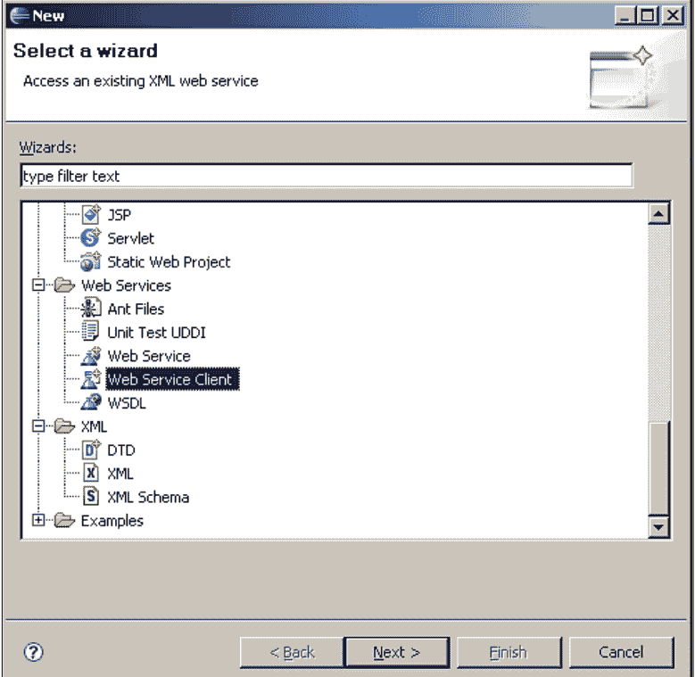

- 3. 服务定义具有 WSDL URL。我们可以保持其他设置不变；按下 **Finish** 将为 **Web Service Client** 生成类。

片刻之后，Eclipse 为 **CreditCardValidator** Web 服务创建了客户端类。默认位置是项目的 **source** 目录。以下屏幕截图显示了生成的类：

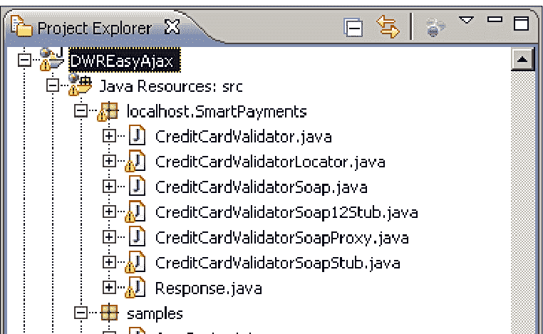

我们只需要几个类：CreditCardValidatorSoap，它实际上是一个接口并被间接使用，以及 CreditCardValidatorSoapProxy，它负责实例化 CreditCardValidatorSoap 接口的实现类并充当实现类的代理。以下是 CreditCardValidatorSoap 接口的源代码。此接口是从 WSDL 自动生成的，并且由于 WSDL 文件包含 Web 服务操作的文档，Eclipse 工具也提供了生成的方法的文档，如下所示：

```java
/**
 * CreditCardValidatorSoap.java
 *
 * This file was auto-generated from WSDL
 * by the Apache Axis 1.4 Apr 22, 2006 (06:55:48 PDT) WSDL2Java
 * emitter.
 */
```

package localhost.SmartPayments;

public interface CreditCardValidatorSoap extends java.rmi.Remote {

    /**
     * 根据卡号返回发卡机构，如 Visa、MasterCard、AMEX 等。
     */
    public java.lang.String getCardType(java.lang.String cardNumber)
        throws java.rmi.RemoteException;

    /**
     * 如果该卡是已知的商业卡，则返回（T/F）。商业卡需要提供客户代码和销售税额，才能享受优惠折扣定价。
     */
    public boolean isCommercialCard(java.lang.String cardNumber)
        throws java.rmi.RemoteException;

    /**
     * 通过根据卡类型检查卡长度来验证信用卡，执行模 10 校验和并验证有效期。
     * 如果正常返回 0，1001 - 无卡号，1002 - 无有效期，
     * 1003 - 无效卡类型，1004 - 无效卡长度，
     * 1005 - 模 10 校验失败，1006 - 无效有效期。
     */
    public int validCard(java.lang.String cardNumber, java.lang.String
        expDate) throws java.rmi.RemoteException;

    /**
     * 通过根据卡类型检查卡长度来验证信用卡长度，返回（T/F）。
     */
    public boolean validCardLength(java.lang.String cardNumber)
        throws java.rmi.RemoteException;

    /**
     * 通过确保日期有效且卡片未过期来验证有效期，返回（T/F）。
     */
    public boolean validExpDate(java.lang.String expDate)
        throws java.rmi.RemoteException;
}

/**
 * 通过对卡号执行模 10 校验和来验证信用卡，返回（T/F）。
 */
public boolean validMod10(java.lang.String cardNumber)
    throws java.rmi.RemoteException;

/**
 * 使用卡号查找借记网络 ID。网络 ID 是一个 3 个字符的字符串。
 * 如果匹配，该卡可用作借记卡并通过借记网络处理。
 * 可能的网络 ID：ACL — Accel，AFN - AFFN，AKO — Alaska Option，
 * C24 — CU24，
 * ILK — Interlink，JEN - Jeanie，MAC — Star Northeast (MAC)，
 * MAE — Maestro，
 * NET - NETS，NYC — NYCE，PUL — Pulse，SES — Star Southeast，
 * SHZ — Shazam，
 * STX — Star West，TYM - TYME
 */
public localhost.SmartPayments.Response getNetworkID(java.
lang.String userName, java.lang.String password, java.lang.String
cardNumber) throws java.rmi.RemoteException;
}

该类中定义了几个方法，但我们只使用 validCard() 方法，如果信用卡有效，该方法返回 0。

CreditCardValidatorSoapProxy 类的源代码在下面的代码片段中进行说明。该类实现了 CreditCardValidatorSoap 接口。

此处展示 CreditCardValidatorSoapProxy 的源代码仅用于示例，以便我们真正体会到 Eclipse 提供的工具的强大之处。手动开发 Web 服务客户端意味着需要编写大量代码并理解 SOAP 及其他相关 Web 服务标准，但由于 Eclipse 提供了根据 WSDL 生成所需实现类的工具，我们实际上不必担心 SOAP 细节或其他 Web 服务的“东西”（当然，除了如何使用客户端之外）。

```
package localhost.SmartPayments;

public class CreditCardValidatorSoapProxy implements localhost.
SmartPayments.CreditCardValidatorSoap {
    private String _endpoint = null;

private localhost.SmartPayments.CreditCardValidatorSoap
    creditCardValidatorSoap = null;

public CreditCardValidatorSoapProxy() {
    _initCreditCardValidatorSoapProxy();
}

public CreditCardValidatorSoapProxy(String endpoint) {
    _endpoint = endpoint;
    _initCreditCardValidatorSoapProxy();
}

private void _initCreditCardValidatorSoapProxy() {
    try {
        creditCardValidatorSoap = (new localhost.SmartPayments.
            CreditCardValidatorLocator()).
            getCreditCardValidatorSoap();
        if (creditCardValidatorSoap != null) {
            if (_endpoint != null)
                ((javax.xml.rpc.Stub)creditCardValidatorSoap)._
                    setProperty("javax.xml.rpc.service.endpoint.address",
                        _endpoint);
            else
                _endpoint = (String)((javax.xml.rpc.Stub)
                    creditCardValidatorSoap).
                    _getProperty("javax.xml.rpc.service.
                        endpoint.address");
        }
    }
    catch (javax.xml.rpc.ServiceException serviceException) {}
}

public String getEndpoint() {
    return _endpoint;
}

public void setEndpoint(String endpoint) {
    _endpoint = endpoint;
    if (creditCardValidatorSoap != null)
        ((javax.xml.rpc.Stub)creditCardValidatorSoap)._
            setProperty("javax.xml.rpc.service.endpoint.address",
                _endpoint);
}

public localhost.SmartPayments.CreditCardValidatorSoap
getCreditCardValidatorSoap() {
    if (creditCardValidatorSoap == null)
        _initCreditCardValidatorSoapProxy();
    return creditCardValidatorSoap;
}

public java.lang.String getCardType(java.lang.String cardNumber)
throws java.rmi.RemoteException{
    if (creditCardValidatorSoap == null)
        _initCreditCardValidatorSoapProxy();
    return creditCardValidatorSoap.getCardType(cardNumber);
}

public boolean isCommercialCard(java.lang.String cardNumber) throws
java.rmi.RemoteException{
    if (creditCardValidatorSoap == null)
        _initCreditCardValidatorSoapProxy();
    return creditCardValidatorSoap.isCommercialCard(cardNumber);
}

public int validCard(java.lang.String cardNumber, java.lang.String
expDate) throws java.rmi.RemoteException{
    if (creditCardValidatorSoap == null)
        _initCreditCardValidatorSoapProxy();
    return creditCardValidatorSoap.validCard(cardNumber, expDate);
}

public boolean validCardLength(java.lang.String cardNumber) throws
java.rmi.RemoteException{
    if (creditCardValidatorSoap == null)
        _initCreditCardValidatorSoapProxy();
    return creditCardValidatorSoap.validCardLength(cardNumber);
}

public boolean validExpDate(java.lang.String expDate) throws java.
rmi.RemoteException{
    if (creditCardValidatorSoap == null)
        _initCreditCardValidatorSoapProxy();
    return creditCardValidatorSoap.validExpDate(expDate);
}

public boolean validMod10(java.lang.String cardNumber) throws java.
rmi.RemoteException{
```

```java
if (creditCardValidatorSoap == null)
    _initCreditCardValidatorSoapProxy();
return creditCardValidatorSoap.validMod10(cardNumber);
}

public localhost.SmartPayments.Response getNetworkID
    (java.lang.String userName, java.lang.String password,
     java.lang.String cardNumber) throws java.rmi.RemoteException{
    if (creditCardValidatorSoap == null)
        _initCreditCardValidatorSoapProxy();
    return creditCardValidatorSoap.getNetworkID(userName, password,
                                                cardNumber);
}
}
```

上述代理类由 Eclipse 工具自动生成，在大多数情况下，无需了解生成类的细节。代理类基本上会为 CreditCardValidatorSoap 接口初始化另一个自动生成的类，该类包含实际调用远程 Web 服务的代码。

## 实现 Web 服务调用

在我们的示例中，将使用 CreditCardValidatorSoapProxy 类。我们修改 FormHandler 类，并将 submitOrder() 方法的实现替换为以下代码：

```
```java
public boolean submitOrder(String name, String address,
                           String creditCardNumber, String expiryDate) {
    CreditCardValidatorSoapProxy ccValidatorProxy = new
    CreditCardValidatorSoapProxy();
    int rv = -1;
    try {
        rv = ccValidatorProxy.validCard(creditCardNumber,
                                        expiryDate.replace("/",
                                                           ""));
        if (rv != 0) {
            System.out.println("Credit card check failed: " + rv);
        }
    } catch (RemoteException e) {
        e.printStackTrace();
    }
    return rv == 0;
}
```
```


在上述方法中，我们首先实例化 `CreditCardValidatorSoapProxy` 对象，然后调用其 `validCard()` 方法来执行信用卡验证。`validCard()` 方法通过 Internet 调用远程 Web 服务。如果信用卡无效，则向 `System.out` 写入一条通知，并且 `submitOrder()` 方法返回 `false`。如果信用卡有效，则 `submitOrder()` 方法返回 `true`。

利用 Eclipse 中现有的工具，只需几行代码，我们就能将标准 Web 服务集成到示例中。

## 测试 Web 服务集成

我们使用表单示例来测试 Web 服务集成。由于我们刚刚更新了表单示例，使其使用 Web 服务进行信用卡验证，因此我们可以使用例如 Wireshark 网络协议分析器（http://www.wireshark.org）或 Eclipse 工具自带的 TCP/IP 监视器来验证是否调用了 Web 服务。下面是从 Geronimo 发送到 Web 服务提供商的 Web 服务请求截图：

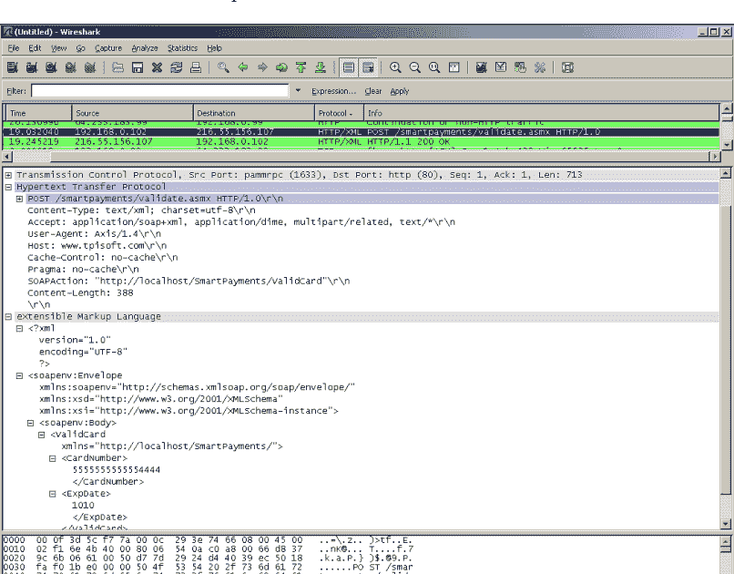

Wireshark 还捕获了来自 Web 服务的响应。以下是响应截图：

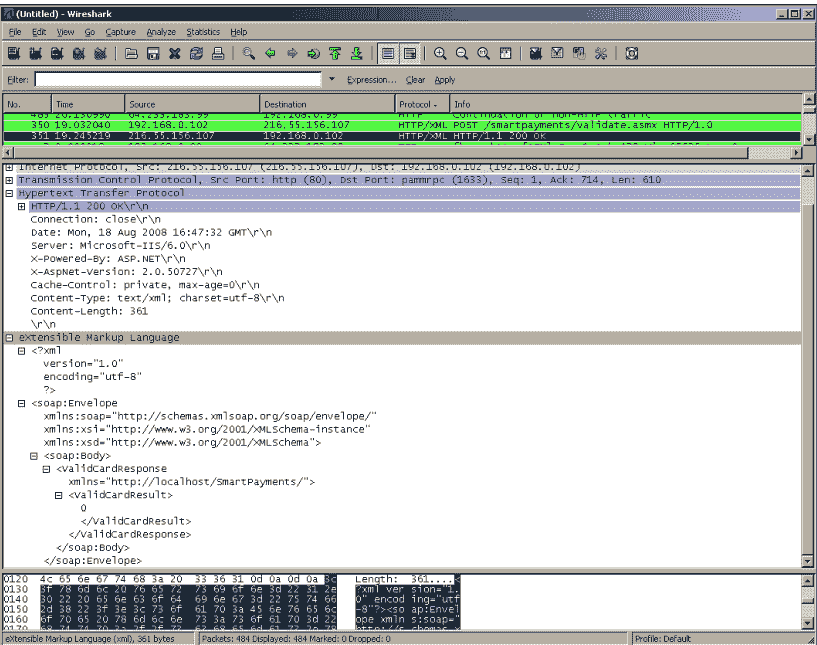

## 结语

Web 服务集成就像上一节中展示的数据库集成一样简单。同样，DWR 和用户界面并不知道远程 Java 类的实现，因此 Web 服务集成对用户来说是完全透明的。

## 与消息系统集成

消息示例背后的思路是：我们的应用程序将使用 JMS 将订单表单发送到后端系统。这里的后端系统是一个 Python 脚本，它访问 JMS 消息服务器 ActiveMQ。

## 在 Geronimo 中设置队列

在这个消息示例中，我们使用开源 JMS 消息服务器 ActiveMQ，它是 Geronimo 应用服务器的一部分。ActiveMQ 非常适合测试我们的应用程序，因为它支持一种名为 STOMP（流文本定向消息协议，一种基于文本的协议）的协议。STOMP 使多种编程语言能够参与 JMS 消息传递（甚至 Telnet 也可以；这对于快速测试很有用），因此我们可以在示例中使用现有工具作为“订单系统”。当“订单系统”（一个 Python 程序）收到订单时，它会对其进行验证。然后，我们手动将订单确认消息发送回 ActiveMQ 消息系统和我们的应用程序。随后，我们的应用程序使用 Comet 机制更新网页。

1. 首先要做的是在 ActiveMQ 中创建队列，用于发送订单和接收订单确认。我们使用 Geronimo 服务器控制台中的向导来创建队列。JMS 资源可在控制台的“服务 | JMS 资源”中找到。

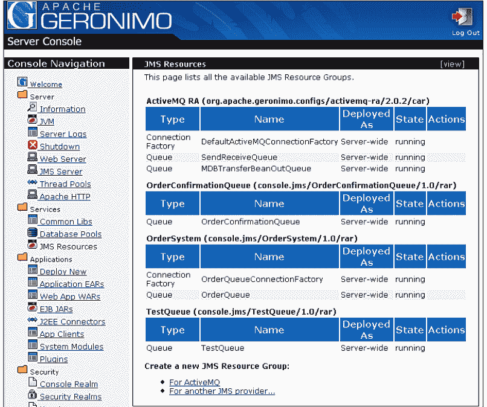

2. 为了创建新队列，我们通过点击“为 ActiveMQ 创建新的 JMS 资源组”链接来设置新资源。该链接会打开一个向导，用于创建新的资源组，如下面的截图所示：

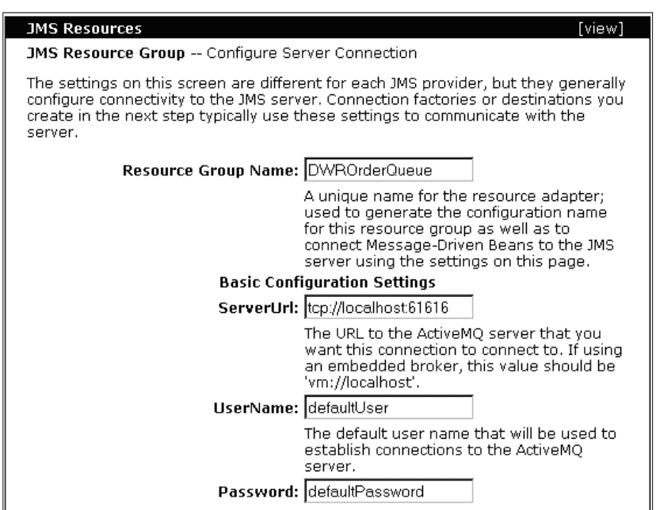

3. 我们只需要为资源组设置名称。我们使用名称 DWROrderQueue 作为提交订单的队列名称。所有其他配置项可以保留默认值。单击“下一步”按钮将打开如下界面：

JMS 资源

JMS 资源组 -- 当前进度

到目前为止，您已经输入了 JMS 资源组所需的基本配置信息。现在您可以创建连接工厂和目的地。当您完成添加连接工厂和目的地后，可以查看此 JMS 资源组的 Geronimo 部署计划，或直接部署它。

添加连接工厂

添加目的地

取消

4. 我们想要设置一个新的目的地，因此单击“添加目的地”按钮会打开“选择目的地类型”界面。

JMS 资源

JMS 资源组 -- 选择目的地类型

JMS 目的地类型：

javax.jms.Queue

此资源适配器声明了几种可能的目的地接口。请为此目的地选择所需的接口类型。

下一步

JMS 资源组 DWROrderQueue 的当前状态

- 0 个连接工厂
- 1 个目的地
  - 进行中

取消

5. 我们使用 Queue 作为目的地，在下一个界面中，我们为队列配置目的地名称和物理名称。两者都命名为 DWROrderQueue。

JMS 资源

JMS 资源组 -- 配置目的地

消息目的地名称：DWROrderQueue

连接工厂的唯一名称；当从应用程序组件映射资源引用时，用于引用此连接工厂。

目的地配置设置

物理名称：DWROrderQueue

下一步

JMS 资源组 DWROrderQueue 的当前状态

0 个连接工厂

1 个目的地

进行中

取消

6. 单击“下一步”按钮将打开一个摘要界面，显示我们到目前为止创建的内容。

JMS 资源

JMS 资源组 -- 当前进度

这些是您迄今为止添加到 JMS 资源组的连接工厂和目的地。当您完成添加连接工厂和目的地后，可以查看此资源组的 Geronimo 部署计划，或直接部署它。

资源组 DWROrderQueue

| 类型 | 名称 | 接口 |
|------|------|-----------|
| 目的地 | DWROrderQueue | javax.jms.Queue |

添加连接工厂 添加目的地 显示计划 立即部署

取消

7. 在这里，我们可以添加目的地或添加连接工厂。“立即部署”按钮会将队列部署到 Geronimo。

```java
import org.directwebremoting.ServerContextFactory;
import org.directwebremoting.WebContext;
import org.directwebremoting.WebContextFactory;

public class OrderSystem implements Runnable {
    protected Thread worker;
    private ServerContext serverContext;
    private String scriptId = null;
    private String name;
    private String address;
    private String creditCardNumber;
    private String expiryDate;

    public OrderSystem(String name, String address,
                       String creditCardNumber,
                       String expiryDate) {
        this.name = name;
        this.address = address;
        this.creditCardNumber = creditCardNumber;
        this.expiryDate = expiryDate;
        WebContext webContext = WebContextFactory.get();
        ServletContext servletContext = webContext.getServletContext();

        serverContext = ServerContextFactory.get(servletContext);

        // A bit nasty: the call to serverContext.
        //     getScriptSessionsByPage()
        // below could fail because the system might need to read
        //                         web.xml which
        // means it needs a ServletContext, which is only available
        //     using
        // WebContext, which in turn requires a DWR thread. We can cache
        //     the
        // results simply by calling this in a DWR thread, as we are
        //     now.
        webContext.getScriptSessionsByPage("");

        scriptId = webContext.getScriptSession().getId();
        worker = new Thread(this, "OrderSystem");
        worker.start();
    }

    public void run() {
        String returnFromOrderSystem = "";
        try {
            Properties props = new Properties();
            props.setProperty(Context.INITIAL_CONTEXT_FACTORY,
                    "org.apache.activemq.jndi.ActiveMQInitialContextFactory");
            props.setProperty(Context.PROVIDER_URL,
                    "tcp://localhost:61616");
            props.setProperty("queue.DWROrderQueue", "DWROrderQueue");
            props.setProperty("queue.DWROrderConfirmationQueue",
                    "DWROrderConfirmationQueue");
            javax.naming.Context ctx = new InitialContext(props);
            ConnectionFactory connectionFactory = (ConnectionFactory) ctx
                .lookup("ConnectionFactory");
            Connection connection = connectionFactory.createConnection();
            connection.start();

            Session session = connection.createSession(false,
                    Session.AUTO_ACKNOWLEDGE);
            Destination destination = (Destination)
                    ctx.lookup("DWROrderQueue");
            MessageProducer producer =
                    session.createProducer(destination);
            producer.setDeliveryMode(DeliveryMode.NON_PERSISTENT);

            String orderMessage = "Order from: " + name + ","
                    + address + ","
                    + creditCardNumber + "," + expiryDate
                    + ". Please return order ID.";
            String receiverQName = "DWROrderConfirmationQueue";
            orderMessage = "ReceiverQueue: " + receiverQName + "|| "
                    + orderMessage;
            TextMessage message = session.createTextMessage(orderMessage);
            producer.send(message);
            Destination receiveDestination = (Destination) ctx
                    .lookup(receiverQName);
            MessageConsumer consumer = session
                    .createConsumer(receiveDestination);
            TextMessage returnMessage = (TextMessage)
                    consumer.receive(60000);
            if (returnMessage == null) {
                returnFromOrderSystem = "<p><font color=\"red\">Order confirmation not received. Please contact administrator.</font></p>";
            } else {
                returnFromOrderSystem = "<p><font color=\"green\">Order confirmation received. Order ID: "
                    + returnMessage.getText() + ".</font></p>";
            }
            session.close();
            connection.close();
        }
    }
}
```

} catch (Exception e) {
    e.printStackTrace();
}
Collection<ScriptSession> sessions = serverContext
    .getAllScriptSessions();
for (Iterator<ScriptSession> iterator = sessions.iterator();
    iterator.hasNext();) {
    ScriptSession scriptSession = iterator.next();
    if (scriptSession.getId().equals(scriptId)) {
        ScriptBuffer script = new ScriptBuffer("orderProcessed('"
            + returnFromOrderSystem + "')");
        scriptSession.addScript(script);
    }
}
}

本类使用了 DWR 反向 AJAX 功能。这里关于反向 AJAX 的有趣之处在于，它是从非 Web 线程中使用的。在这种情况下，提交订单时，会启动一个新线程，该线程通过 JMS 向 OrderSystem 发送消息并等待响应。当响应到达或发生超时时，会使用 DWR 方法向网页发送消息。

OrderSystem 类的构造函数使用 DWR 功能来获取调用网页的 Web 上下文。该代码由 DWR 提供，并且正如源代码中的注释所示，它有点“hacky”。在构造函数的末尾，我们获取调用页面的脚本会话 ID，以便将响应发送回正确的网页，并且 orderProcessed() 函数可以处理 index.jsp 文件中的响应。最后，构造函数启动工作线程并将控制权返回给调用方法。

run() 方法首先初始化 JNDI 初始上下文，然后启动到本地 ActiveMQ 的 JMS 连接。使用标准 JMS 方法发送订单消息，然后在 DWROrderConfirmationQueue 中等待响应到达。

## 为消息传递设置应用程序

在本节中，我们通过开发 JavaScript 函数和用于提交订单的 Java 类来设置示例应用程序以进行消息传递。我们还在本节中设置了反向 AJAX。

## 后端集成

在网页中接收订单确认的 JavaScript 函数如下，我们将其与大多数其他 JavaScript 函数一起添加到 index.jsp 中。

```javascript
function orderProcessed(orderConfirmationMessage)
{
    var feedback=dwr.util.byId('formFeedback');
    var html="";
    html=orderConfirmationMessage;
    feedback.innerHTML=html;
}
```

为了将订单系统与提交过程集成，我们修改了 FormHandler 类中 `submitOrder()` 方法的代码。该方法的代码如下：

```java
public boolean submitOrder(String name, String address,
        String creditCardNumber, String expiryDate) {
    CreditCardValidatorSoapProxy ccValidatorProxy = new
    CreditCardValidatorSoapProxy();
    int rv = -1;
    try {
        rv = ccValidatorProxy.validCard(creditCardNumber,
                expiryDate.replace("/", ""));
        if (rv != 0) {
            System.out.println("Credit card check failed: " + rv);
        }
    } catch (RemoteException e) {
        e.printStackTrace();
    }
    if(rv==0)
    {
        //credit card valid, submit to order system
        new OrderSystem(name,address,creditCardNumber,expiryDate);
    }
    return rv == 0;
}
```

这里的新增内容是在对 `CreditCardValidator` 的 Web 服务调用之后（如前面代码中的粗体所示）。如果信用卡有效，则实例化 `OrderSystem` 类。由于它的构造函数会启动一个新线程进行处理，因此不需要任何变量。当线程完成时，将不再有对 `OrderSystem` 类的引用，Java 的垃圾收集器将清理剩余对象。

5. 我们按照以下截图所示的方式将订单确认返回给 Web 应用程序：

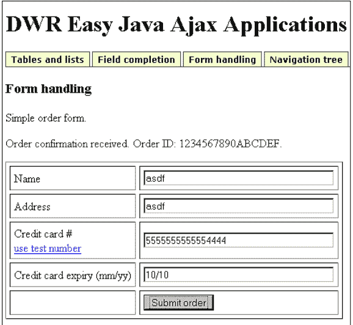

## 后记

在 DWR 应用程序中使用消息传递很容易，就像使用数据库或 Web 服务一样。在这种情况下，消息传递为平台在使用反向 AJAX 时直接与用户通信提供了很好的渠道。

## 总结

在本章中，我们有三个后端集成示例：数据库、Web 服务和消息传递。几乎所有这些示例都会出现在应用程序中，并且如示例所示，DWR 与后端集成无关。可以使用最熟悉的技术来访问数据库和其他后端服务，并让 DWR 仅处理前端用户界面。

我们还看到了 Comet 技术如何用于 DWR 消息传递示例，其中 Comet 是一种自然的选择，通过在浏览器和服务器之间提供事件式消息传递。
