## 示例应用程序

本章包含两个示例应用程序，它们使用了前面章节示例中介绍的某些功能。第一个示例应用程序是协作书籍创作，它允许多个用户共同创作同一本书。第二个示例应用程序是一个简单的聊天室应用程序。

这些示例侧重于 DWR 功能，这意味着真实生产级应用程序的许多功能在示例应用程序中缺失。然而，这些示例展示了 DWR 的使用方式，并且以示例作为开发起点和创意来源，应该很容易将应用程序增强到生产级。

本章中的两个示例应用程序如下：

- 协作书籍创作 – 展示 DWR 如何用于创建基于 Web 的多用户创作环境
- 聊天室 – 一个使用 DWR 的典型多用户聊天室应用程序

### 协作书籍创作

协作书籍创作示例应用程序允许多个用户同时处理相同或不同的书籍。其理念是，作者登录系统后，可以看到所有正在进行中或已出版的书籍。任何人都可以开始一本新书，任何人都可以为书籍做出贡献（所以这是一个相当开放的过程）。同样，在书籍内部，任何人都可以开始新章节，并且任何人都可以编辑章节内容。该系统的构建方式使得只有一个作者可以编辑章节。如果有人正在编辑章节内容，而另一个用户试图编辑它，他/她将看到章节内容的最新保存版本。

当书籍完成时，作者将投票决定是否出版。每位作者只能投票一次，投票不能撤回。当所有作者都投票支持出版时，书籍将移至已出版状态，并排版为适合阅读的格式。

## 启动项目

我们通过使用名称 **DWRBookAuthoring** 在 Eclipse 中创建一个新的 Web 项目来启动该项目。在这种情况下，开发从 HTML 页面开始。我们需要一个登录页面、登录失败页面和将包含所有 JavaScript 函数的主页面。我们还将像前面章节一样使用 Dynamic Drive 的 CSS。

以下截图显示了我们要开发的用户界面类型：

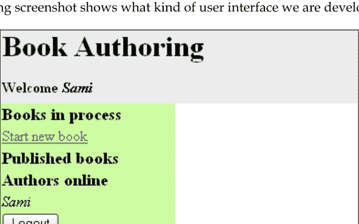

## 开发用户界面

我们从用户界面开始应用程序开发。首先，我们获取样式表。样式表的源代码如下。和前面章节中的样式表一样，这个 CSS 也来自 Dynamic Drive CSS 库，http://www.dynamicdrive.com/style/。

```
body{
margin:0;
padding:0;
line-height: 1.5em;
}
```

```
b{font-size: 110%;}
em{color: red;}

#topsection{
background: #EAEAEA;
height: 90px; /*Height of top section*/
}

#topsection h1{
margin: 0;
padding-top: 15px;
}

#contentwrapper{
float: left;
width: 100%;
}

#contentcolumn{
margin-left: 200px; /*Set left margin to LeftColumnWidth*/
}

#leftcolumn{
float: left;
width: 200px; /*Width of left column*/
margin-left: -100%;
background: #C8FC98;
}

#footer{
clear: left;
width: 100%;
background: black;
color: #FFF;
text-align: center;
padding: 4px 0;
}

#footer a{
color: #FFFF80;
}

.innertube{
margin: 10px; /*Margins for inner DIV inside each column (to provide padding)*/
margin-top: 0;
}
```


## index.jsp

我们的第一个页面是登录页面。它位于 WebContent 目录下，名为 index.jsp。下面给出该页面的源代码（顺便提一下，登录页面不使用样式表）。

```
<%@ page language="java" contentType="text/html; charset=ISO-8859-1" pageEncoding="ISO-8859-1"%>
<!DOCTYPE html PUBLIC "-//W3C//DTD HTML 4.01 Transitional//EN" "http://www.w3.org/TR/html4/loose.dtd">
<html>
<head>
<meta http-equiv="Content-Type" content="text/html; charset=ISO-8859-1">
<title>Book Authoring</title>
<script type='text/javascript' src='/DWRBookAuthoring/dwr/interface/Login.js'></script>
<script type='text/javascript' src='/DWRBookAuthoring/dwr/engine.js'></script>
<script type='text/javascript' src='/DWRBookAuthoring/dwr/util.js'></script>
<script type="text/javascript">
function login()
{
  var userNameInput=dwr.util.byId('userName');
  var userName=userNameInput.value;
  Login.doLogin(userName,loginResult);
}
function loginResult(newPage)
{
  window.location.href=newPage;
}
</script>
</head>
<body>
<h1>Book Authoring Sample</h1>
<table cellpadding="0" cellspacing="0">
<tr>
<td>User name:</td>
<td><input id="userName" type="text" size="30"></td>
</tr>
<tr>
<td>&nbsp;</td>
<td><input type="button" value="Login" onclick="login();return false;"></td>
</tr>
</table>
</body>
</html>
```

登录界面使用 DWR 功能来处理用户登录（Java 类将在网页之后介绍）。`loginResult` 函数根据登录操作的结果打开失败页面或主页面。

## loginFailed.html

如果登录不成功，会向用户显示一个非常简单的 `loginFailed.html` 页面，其源代码如下：

```
<!DOCTYPE html PUBLIC "-//W3C//DTD HTML 4.01 Transitional//EN"
    "http://www.w3.org/TR/html4/loose.dtd">
<html>
<head>
<meta http-equiv="Content-Type" content="text/html;
    charset=ISO-8859-1">
<title>Login failed</title>
</head>
<body>
<h2>Login failed.</h2>
</body>
</html>
```

## mainpage.jsp

如果登录成功，我们就会进入主页面 `mainpage.jsp`：

```
<!DOCTYPE html PUBLIC "-//W3C//DTD XHTML 1.0 Transitional//EN"
    "http://www.w3.org/TR/xhtml1/DTD/xhtml1-transitional.dtd">
<html xmlns="http://www.w3.org/1999/xhtml" lang="en" xml:lang="en">
<head>
<meta http-equiv="Content-Type" content="text/html;
    charset=iso-8859-1" />
<title>Book Authoring</title>
<link href="styles.css" rel="stylesheet" type="text/css" />
<%
    if (session.getAttribute("username") == null
        || session.getAttribute("username").equals("")) {
        //if not logged in and trying to access this page
        //do nothing, browser shows empty page
        return;
    }
%>
<script type='text/javascript'
    src='/DWRBookAuthoring/dwr/interface/Login.js'></script>
<script type='text/javascript'
src='/DWRBookAuthoring/dwr/interface/BookDatabase.js'></script>
<script type='text/javascript'
    src='/DWRBookAuthoring/dwr/engine.js'></script>
<script type='text/javascript' src='/DWRBookAuthoring/dwr/util.js'>
</script>

<script type="text/javascript">
dwr.engine.setActiveReverseAjax(true);

function logout()
{
    Login.doLogout(showLoginScreen);
}

function showLoginScreen()
{
    window.location.href='index.jsp';
}

function showUsersOnline()
{
    var cellFuncs = [
        function(author) {

            return '<i>'+author+'</i>';
        }
    ];
    Login.getUsersOnline({
    callback:function(authors)
    {
        dwr.util.removeAllRows('authorsOnline');
        dwr.util.addRows("authorsOnline",authors, cellFuncs,
            { escapeHtml:false });
    }
    });
}

function getBookLists()
{
    var cellFuncs = [
        function(title) {

            return '<a href="#" onclick="getChapters(this);">'+title+
                '</a>';
        }
    ];
BookDatabase.getBooksInProgressTitles({
  callback:function(titles)
  {
    dwr.util.removeAllRows('booksInProgress');
    dwr.util.addRows( "booksInProgress",titles , cellFuncs,
                     { escapeHtml:false });
  }
});

var cellFuncs2 = [
  function(title) {
    return '<a href="#" onclick="showBook(this);">'+title+'
                                      </a>';
  }
];
BookDatabase.getPublishedBookTitles({
  callback:function(titles)
  {
    dwr.util.removeAllRows('publishedBooks');
    dwr.util.addRows( "publishedBooks",titles , cellFuncs2,
                     { escapeHtml:false });
  }
});

function getChapters(element)
{
  var bookTitle=element.firstChild.nodeValue;
  getChaptersForTitle(bookTitle);
}

function showBook(element)
{
  var bookTitle=element.firstChild.nodeValue;
  BookDatabase.getRenderedBook(bookTitle,
      callback:function(bookContent)
      {
        clearContentAreas();
        //title area is used to show published book
        var contentArea=dwr.util.byId('bookTitleContentArea');
        contentArea.innerHTML=bookContent;
      }
  );
}
function getChaptersForTitle(bookTitle)
{
    clearContentAreas();
    BookDatabase.getChapters(bookTitle,{
        callback:function(titles)
        {
            var titleArea=dwr.util.byId('bookTitleContentArea');
            var html='<h3>Chapters for <div id="chaptersForTitle"><i>'
                +bookTitle+'</i></div></h3>';

            BookDatabase.getAuthors(bookTitle,{
                async:false,
                callback:function(authors)
                {
                    html+='Authors: '+authors;
                }
            });
            titleArea.innerHTML=html;
            var cellFuncs = [function(title) {

                return '<a href="#" onclick="getChapterContent(\''+bookTitle+'\', \''+title+'\');">'+title+'</a>';
            }
            ];
            dwr.util.removeAllRows('bookChapters');
            dwr.util.addRows( "bookChapters",titles , cellFuncs,
                { escapeHtml:false });
            var insertChapterArea=dwr.util.byId('insertChapterArea');

            var numberOfVotes=0;
            BookDatabase.getNumberOfVotes(bookTitle,{
                async:false,
                callback:function(n)
                {
                    numberOfVotes=n;
                }
            });

            var totalNumberOfAuthors=0;
            BookDatabase.getNumberOfAuthors(bookTitle,{
                async:false,
                callback:function(n)
                {
                    totalNumberOfAuthors=n;
                }
            });
});
var voteDisabled='';
BookDatabase.haveIVoted(bookTitle,{
    async:false,
    callback:function(haveIVoted)
    {
        if(haveIVoted==true)
        {
            voteDisabled='DISABLED';
        }
    }
});

insertChapterArea.innerHTML='<a href="#" onclick="addChapter(\\\''+bookTitle+'\\\')">Add new chapter</a>';
BookDatabase.amIAuthor(bookTitle,{
    async:false,
    callback:function(amIAuthor)
    {
        if(amIAuthor==true)
        {
            var voteArea=dwr.util.byId('voteArea');
            var voteAreaHtml='<input type="button" value="Vote for publish" '+voteDisabled+' onclick="voteForPublish(\\\''+bookTitle+'\\\')">';
            voteAreaHtml+='<br/>Total votes: '+numberOfVotes+' /'+totalNumberOfAuthors+'.';
            voteArea.innerHTML=voteAreaHtml;
        }
    }
});
}
});
}
});
}
}
    });
}
}

function refreshChapterIfVisible(bookTitle)
{
    var chaptersForTitle=dwr.util.byId('chaptersForTitle');
    if(chaptersForTitle!=null || chaptersForTitle!=undefined)
    {
        if(chaptersForTitle.innerHTML.indexOf(bookTitle)>-1)
        {
            getChaptersForTitle(bookTitle);
        }
    }
}

function clearChapterViewIfVisible(bookTitle)
{
    var chaptersForTitle=dwr.util.byId('chaptersForTitle');
    if(chaptersForTitle!=null || chaptersForTitle!=undefined)
    {
        if(chaptersForTitle.innerHTML.indexOf(bookTitle)>-1)
        {
            clearContentAreas();
        }
    }
}

function notifyBookPublished(bookTitle)
{
    alert('Book '+bookTitle+' is published. Authors have voted.');
    clearChapterViewIfVisible(bookTitle);
}

function getChapterContent(bookTitle,chapterTitle)
{
    var readonly="";
    var editor="";
    BookDatabase.isChapterEdited(bookTitle,chapterTitle,{
        async:false,
        callback:function(isEdited)
        {
            if(isEdited!=null)
            {
                readonly="readonly";
```


## 示例应用

```html
editor=isEdited;
}
}
});
BookDatabase.getChapterContent(bookTitle,chapterTitle,{
    callback:function(chapterContent)
    {
        var editChapterArea=dwr.util.byId('editChapterArea');
        var html='<h3>'+chapterTitle+'</h3>';
        if(editor!="")
        {
            html+='Edited by '+editor+'<br/>';
        }
        html+='<textarea '+readonly+' id="chapterContentTextArea" rows="10" cols="60">'+chapterContent+'</textarea><br/>';
        if(readonly=="")
        {
            html+='<input type="button" value="Save" onclick="saveChapterContent(\''+bookTitle+'\',\''+chapterTitle+'\');">';
            html+='<input type="button" value="Cancel" onclick="cancelChapterContentEdit(\''+bookTitle+'\',\''+chapterTitle+'\');">';
        }
        else
        {
            html+='<input type="button" value="Cancel" onclick="closeChapterContentEdit();">';
        }
        editChapterArea.innerHTML=html;
    }
});
    return false;
}

function cancelChapterContentEdit(bookTitle,chapterTitle)
{
    BookDatabase.cancelChapterEdit(bookTitle,chapterTitle);
    var editChapterArea=dwr.util.byId('editChapterArea');
    editChapterArea.innerHTML='';
    return false;
}

function closeChapterContentEdit()
{
    var editChapterArea=dwr.util.byId('editChapterArea');
    editChapterArea.innerHTML='';
    return false;
}

function saveChapterContent(bookTitle,chapterTitle)
{
    var editChapterArea=dwr.util.byId('chapterContentTextArea');
    var content=editChapterArea.value;
    BookDatabase.saveChapterContent(bookTitle,chapterTitle,content,{
        callback:function()
        {
            setFeedback('Content saved.');
        }
    });
    return false;
}

function setFeedback(feedback)
{
    var feedbackArea=dwr.util.byId('feedbackArea');
    feedbackArea.innerHTML=(new Date())+"<br/>"+feedback;
}

function startNewBook()
{
    var bookTitle=prompt("Book title:");
    if(bookTitle!=null)
    {
        BookDatabase.addNewBook(bookTitle,refreshBookLists);
    }
    return false;
}

function addChapter(bookTitle)
{
    //dialog to ask book title
    var chapterTitle=prompt("Chapter name:");
    if(chapterTitle!=null)
    {
        BookDatabase.insertChapter(bookTitle,chapterTitle,{
            callback:function()
            {
                getChaptersForTitle(bookTitle);
            }
        });
    }
    return false;
}

function refreshBookLists()
{
    getBookLists();
}

function clearContentAreas()
{
    var area=dwr.util.byId('feedbackArea');
    area.innerHTML='';

    area=dwr.util.byId('bookTitleContentArea');
    area.innerHTML='';

    dwr.util.removeAllRows('bookChapters');

    area=dwr.util.byId('insertChapterArea');
    area.innerHTML='';

    area=dwr.util.byId('voteArea');
    area.innerHTML='';

    area=dwr.util.byId('editChapterArea');
    area.innerHTML='';
}

</script>

</head>
<body onload="showUsersOnline();">
<div id="maincontainer">

<div id="topsection">
<div class="innertube">
<h1>Book Authoring</h1>
<h4>Welcome <i><%= (String) session.getAttribute("username") %></i></h4>
</div>
</div>

<div id="contentwrapper">
<div id="contentcolumn">
<div id="bookContent" class="innertube">
<div id="feedbackArea"></div>
<div id="bookTitleContentArea"></div>
<table cellpadding="0" cellspacing="0">
    <tbody id="bookChapters">
    </tbody>
</table>

<div id="insertChapterArea"></div>
<div id="voteArea"></div>

<div id="editChapterArea"></div>

</div>
</div>
</div>

<div id="leftcolumn">
<div class="innertube">
<table cellpadding="0" cellspacing="0">
    <thead>
        <tr>
            <td><b>Books in process</b></td>
        </tr>
    </thead>
    <tbody id="booksInProgress">
    </tbody>
    <tfoot>
        <tr>
            <td><a href="#" onclick="startNewBook();">Start new book</a></td>
        </tr>
    </tfoot>
</table>

<table cellpadding="0" cellspacing="0">
    <thead>
        <tr>
            <td><b>Published books</b></td>
        </tr>
    </thead>
    <tbody id="publishedBooks">
    </tbody>
</table>

<table cellpadding="0" cellspacing="0">
    <thead>
        <tr>
            <td><b>Authors online</b></td>
        </tr>
    </thead>
    <tbody id="authorsOnline">
    </tbody>
</table>

<input id="logoutButton" type="button" value="Logout"
onclick="logout();return false;"></div>

</div>
<div id="footer">Stylesheet by <a
href="http://www.dynamicdrive.com/style/">Dynamic Drive CSS
Library</a></div>

</div>
<script type="text/javascript">
getBookLists();
</script>
</body>
</html>
```

由于所有客户端逻辑都包含在此 HTML 页面中的 JavaScript 函数中，因此这是一个相当大的页面。让我们浏览一下页面源代码。

在页面开始处，在声明 DWR 函数之前，有一段 Java 代码，其目的是检查页面请求是否有效。它是通过检查用户会话来完成的，如果从会话中找到用户名，则请求有效，如果从会话中找不到用户名，则向用户显示一个空屏幕。这是因为我们不希望用户直接访问主页面（在进一步开发时，可以在此处显示登录页面，而不是空页面）。

在检查用户会话后，我们加载 DWR 脚本。此示例应用程序中只有两个 Java 类，即 Login 和 BookDatabase。

在 script 元素开始处，我们为我们的使用启用了反向 AJAX（Comet）。前两个函数执行注销，并将用户重定向到登录屏幕，而第三个函数 showUsersOnline() 在屏幕左侧显示已登录用户。正如我们稍后会看到的，反向 AJAX 用于在新用户登录系统时调用每个用户的页面上的此函数。该函数还使用 DWR 实用程序函数用用户名填充表格。

getBookLists() 函数调用 BookDatabase Java 类并检索正在进行中的书籍列表和已发布的书籍列表。它在 HTML 页面的左侧导航中显示列表。对于正在进行的书籍，会创建一个打开章节页面的链接，对于已发布的书籍，会创建一个打开书籍页面的链接。

getChapters() 函数调用 getChaptersForTitle() 函数，后者调用 BookDatabase 类并获取所点击书籍的章节标题。该函数还为作者插入投票按钮，并显示投票的当前情况，并显示已投票作者的数量占总数的比例。

showBook() 函数从 BookDatabase 中检索渲染后的书籍并在 HTML 页面中显示它。

voteForPublish() 函数接收用户的投票并更新指定书籍的投票状态。refreshChapterIfVisible() 函数在书籍内容发生变化时更新用户的屏幕，而 clearChapterViewIfVisible() 函数在用户正在查看书籍且书籍被投票发布时清除书籍内容。

notifyBookPublished() 函数通知用户书籍已发布，并在书籍可见时清除书籍内容。

getChapterContent() 函数在可编辑文本区域中显示章节内容，用户可以在其中编辑章节。如果其他人当前正在编辑该章节，则向用户显示只读文本区域，并且该区域的内容是作者保存的最新内容。

cancelChapterContentEdit()、closeChapterContentEdit() 和 saveChapterContent() 函数对应于章节编辑页面中同名按钮。保存函数还调用 setFeedback() 函数以向用户显示保存事件的时间。

startNewBook() 和 addChapter() 函数用于添加书籍或书籍中的章节。refreshBookLists() 函数只是调用 getBookLists() 函数以获取用户界面中的当前书籍。最后一个函数 clearContentAreas() 清除书籍内容。

页面的其余部分是 HTML 代码，内容包括标题和占位符以及 JavaScript 函数使用的 div 元素。

## 配置 Web 应用程序

在进入 Java 代码之前，我们需要为我们的 Web 应用程序设置 DWR。我们将 dwr.jar 文件复制到 WEB-INF/lib 目录并按如下所示设置 web.xml 文件：

```xml
<?xml version="1.0" encoding="UTF-8"?>
<web-app xmlns:xsi="http://www.w3.org/2001/XMLSchema-instance" xmlns="http://java.sun.com/xml/ns/javaee" xmlns:web="http://java.sun.com/xml/ns/javaee/web-app_2_5.xsd" xsi:schemaLocation="http://java.sun.com/xml/ns/javaee http://java.sun.com/xml/ns/javaee/web-app_2_
```


```xml
<web-app xmlns="http://java.sun.com/xml/ns/javaee" xmlns:xsi="http://www.w3.org/2001/XMLSchema-instance" xsi:schemaLocation="http://java.sun.com/xml/ns/javaee http://java.sun.com/xml/ns/javaee/web-app_2_5.xsd" id="WebApp_ID" version="2.5">
    <display-name>DWRBookAuthoring</display-name>
    <servlet>
        <display-name>DWR Servlet</display-name>
        <servlet-name>dwr-invoker</servlet-name>
        <servlet-class>
            org.directwebremoting.servlet.DwrServlet
        </servlet-class>
        <init-param>
            <param-name>debug</param-name>
            <param-value>true</param-value>
        </init-param>
        <init-param>
            <param-name>activeReverseAjaxEnabled</param-name>
            <param-value>true</param-value>
        </init-param>
    </servlet>

    <servlet-mapping>
        <servlet-name>dwr-invoker</servlet-name>
        <url-pattern>/dwr/*</url-pattern>
    </servlet-mapping>

    <welcome-file-list>
        <welcome-file>index.html</welcome-file>
        <welcome-file>index.htm</welcome-file>
        <welcome-file>index.jsp</welcome-file>
        <welcome-file>default.html</welcome-file>
        <welcome-file>default.htm</welcome-file>
        <welcome-file>default.jsp</welcome-file>
    </welcome-file-list>
</web-app>
```

DWR 的配置在 dwr.xml 文件中，内容如下：

```xml
<?xml version="1.0" encoding="UTF-8"?>
<!DOCTYPE dwr PUBLIC
        "-//GetAhead Limited//DTD Direct Web Remoting 2.0//EN"
        "http://getahead.org/dwr/dwr20.dtd">

<dwr>
    <allow>

<create creator="new" javascript="Login">
    <param name="class" value="bookauthoring.Login" />
</create>

<create creator="new" javascript="BookDatabase">
    <param name="class" value="bookauthoring.BookDatabase" />
</create>

</allow>
</dwr>
```

在 DWR 配置中，有我们在本项目中使用的两个 Java 类，即 Login 和 BookDatabase。

## 开发 Java 类

### Login.java

```java
package bookauthoring;

import java.util.Collection;
import java.util.List;

import javax.servlet.ServletContext;
import javax.servlet.http.HttpServletRequest;
import javax.servlet.http.HttpSession;

import org.directwebremoting.ScriptSession;
import org.directwebremoting.ServerContext;
import org.directwebremoting.ServerContextFactory;
import org.directwebremoting.WebContext;
import org.directwebremoting.WebContextFactory;
import org.directwebremoting.proxy.ScriptProxy;

public class Login {
    public Login() {
    }

    public String doLogin(String userName) {
        UserDatabase userDb=UserDatabase.getInstance();
        if (!userDb.isUserLogged(userName)) {
            userDb.login(userName);
            WebContext webContext= WebContextFactory.get();
            HttpServletRequest request = webContext.getHttpServletRequest();
            HttpSession session=request.getSession();
            session.setAttribute("username", userName);
            String scriptId = webContext.getScriptSession().getId();
            session.setAttribute("scriptSessionId", scriptId);
            updateUsersOnline();
            return "mainpage.jsp";
        }
        else {
            return "loginFailed.html";
        }
    }

    public void doLogout() {
        try {
            WebContext ctx = WebContextFactory.get();
            HttpServletRequest request = ctx.getHttpServletRequest();
            HttpSession session = request.getSession();
            Util util = new Util();
            String userName = util.getCurrentUserName(session);
            UserDatabase.getInstance().logout(userName);
            session.removeAttribute("username");
            session.removeAttribute("scriptSessionId");
            session.invalidate();
        } catch (Exception e) {
            System.out.println(e.toString());
        }
        updateUsersOnline();
    }

    private void updateUsersOnline() {
        WebContext webContext= WebContextFactory.get();
        ServletContext servletContext = webContext.getServletContext();
        ServerContext serverContext = ServerContextFactory.get(servletContext);
        webContext.getScriptSessionsByPage("");
        String contextPath = servletContext.getContextPath();
        if (contextPath != null) {
            Collection<ScriptSession> sessions =
                serverContext.getScriptSessionsByPage(contextPath + "/mainpage.jsp");
            ScriptProxy proxy = new ScriptProxy(sessions);
            proxy.addFunctionCall("showUsersOnline");
        }
    }

    public List<String> getUsersOnline() {
        UserDatabase userDb=UserDatabase.getInstance();
        return userDb.getLoggedInUsers();
    }
}
```

`doLogin()` 方法处理用户登录。请注意，本示例应用程序中没有密码检查。如果用户尚未登录，则用户名将被添加到 UserDatabase 类中（其源代码稍后会给出），并且用户名将被添加到 HTTP 会话中。`doLogin()` 方法返回显示给用户的页面的名称，无论是主页面还是登录失败页面。

`doLogout()` 方法执行相反的操作，从 UserDatabase 和 HTTP 会话中移除用户名。

`updateUsersOnline()` 方法使用反向 AJAX 更新已登录用户在已登录用户的网页中的在线用户列表。`getUsersOnline()` 方法从 UserDatabase 类返回已登录用户列表。

### UserDatabase.java

```java
package bookauthoring;

import java.util.List;
import java.util.Vector;

//this class holds currently logged in users
//there is no persistence
public class UserDatabase {

    private static UserDatabase userDatabase=new UserDatabase();

    private List<String> loggedInUsers=new Vector<String>();

    private UserDatabase() {
    }

    public static UserDatabase getInstance() {
        return userDatabase;
    }

    public List<String> getLoggedInUsers() {
        return loggedInUsers;
    }

    public boolean isUserLogged(String userName) {
        return loggedInUsers.contains(userName);
    }

    public void login(String userName) {
        loggedInUsers.add(userName);
    }

    public void logout(String userName) {
        loggedInUsers.remove(userName);
    }
}
```

UserDatabase 类是一个非常简单的单例，仅在 List 对象中跟踪已登录的用户。没有持久性，但在该类中很容易添加。

### Util.java

```java
package bookauthoring;

import java.util.Hashtable;
import java.util.Map;

import javax.servlet.http.HttpServletRequest;
import javax.servlet.http.HttpSession;

import org.directwebremoting.WebContext;
import org.directwebremoting.WebContextFactory;

public class Util {

    public Util() {

    }

    public String getCurrentUserName() {
        //get user name from session
        WebContext ctx = WebContextFactory.get();
        HttpServletRequest request = ctx.getHttpServletRequest();
        HttpSession session=request.getSession();
        return getCurrentUserName(session);
    }

    public String getCurrentUserName(HttpSession session) {
        String userName=(String)session.getAttribute("username");
        return userName;
    }
}
```

两个方法 `getCurrentUserName()` 和 `getCurrentUserName(HttpSession)` 用于从 HTTP 会话中获取用户名，并在应用程序的各个地方使用。因此，为它们引入一个实用程序类是有意义的。

### Book.java

```java
package bookauthoring;

import java.util.Collection;
import java.util.LinkedHashMap;
import java.util.List;
import java.util.Map;
import java.util.Vector;

public class Book {

    private String title="";
    private List<String> authors=new Vector<String>();
    private Map<String,String> chapters=new LinkedHashMap<String,String>();

    private List<String> votesForPublish=new Vector<String>();

    private boolean isPublished=false;

    public Book() {

    }
```


## 示例应用

```java
import java.util.Vector;

import javax.servlet.ServletContext;

import org.directwebremoting.ScriptSession;
import org.directwebremoting.ServerContext;
import org.directwebremoting.ServerContextFactory;
import org.directwebremoting.WebContext;
import org.directwebremoting.WebContextFactory;
import org.directwebremoting.proxy.ScriptProxy;

public class BookDatabase {

    private static Map<String, Book> booksInProgress = new LinkedHashMap<String, Book>();
    private static Map<String, Book> publishedBooks = new LinkedHashMap<String, Book>();
    private static Map<String, String> editedChapters = new Hashtable<String, String>();

    public BookDatabase() {
    }

    public List<String> getBooksInProgressTitles() {
        return getTitles(booksInProgress.values());
    }

    public List<String> getPublishedBookTitles() {
        return getTitles(publishedBooks.values());
    }

    public Collection<String> getChapters(String bookTitle) {
        Book book = getBook(bookTitle);
        if (book != null) {
            return book.getChapterTitles();
        }
        return null;
    }

    public String isChapterEdited(String bookTitle, String chapterTitle) {
        String isEdited = editedChapters.get(bookTitle + chapterTitle);
        return isEdited;
    }

    public void cancelChapterEdit(String bookTitle, String chapterTitle) {
        editedChapters.remove(bookTitle + chapterTitle);
    }

    public List<String> getAuthors(String bookTitle) {
        Book book = getBook(bookTitle);
        if (book != null) {
            return book.getAuthors();
        }

        return null;
    }

    private List<String> getTitles(Collection<Book> books) {
        List<String> titles = new Vector<String>();
        for (Book book : books) {
            titles.add(book.getTitle());
        }
        return titles;
    }

    private Book getBook(String bookTitle) {
        return getBook(bookTitle, false);
    }

    private Book getBook(String bookTitle, boolean getFromPublishedBook) {
        if (getFromPublishedBook) {
            if (publishedBooks.containsKey(bookTitle)) {
                return publishedBooks.get(bookTitle);
            }
        } else {
            if (booksInProgress.containsKey(bookTitle)) {
                return booksInProgress.get(bookTitle);
            }
        }
        return null;
    }

    public void addNewBook(String title) {
        if (!booksInProgress.containsKey(title)) {
            Book newBook = new Book();
            newBook.setTitle(title);
            String userName = (new Util()).getCurrentUserName();
            newBook.addAuthor(userName);
            booksInProgress.put(title, newBook);
            refreshBookList();
        }
    }

    public void insertChapter(String bookTitle, String chapterTitle) {
        Book book = getBook(bookTitle);
        if (book != null) {
            String userName = (new Util()).getCurrentUserName();
            if (!book.getAuthors().contains(userName)) {
                book.addAuthor(userName);
            }
            book.insertChapter(chapterTitle, "");
            refreshChapterIfVisible(bookTitle);
        }
    }

    public String getChapterContent(String bookTitle, String chapterTitle) {
        Book book = getBook(bookTitle);
        String content = "";
        if (book != null) {
            content = book.getChapter(chapterTitle);
            if (content == null) {
                content = "";
            }
        }
        String key = bookTitle + chapterTitle;
        if (!editedChapters.containsKey(key)) {
            editedChapters.put(key, (new Util()).getCurrentUserName());
        }

        return content;
    }

    public void saveChapterContent(String bookTitle, String chapterTitle, String content) {
        Book book = getBook(bookTitle);
        if (book != null) {
            String userName = (new Util()).getCurrentUserName();
            if (!book.getAuthors().contains(userName)) {
                book.addAuthor(userName);
            }
            book.insertChapter(chapterTitle, content);
        }
    }

    public boolean amIAuthor(String bookTitle) {
        Book book = getBook(bookTitle);
        if (book != null) {
```

`BookDatabase` 类包含三个静态 Map 变量：`booksInProgress`、`publishedBooks` 和 `editedChapters`。这些变量保存着图书创作系统的当前状态，包括哪些书正在进行中，哪些已经发布。请注意，这些图书数据不是持久化的。

`getBooksInProgressTitles()` 和 `getPublishedBookTitles()` 方法使用 `getTitles()` 方法，该方法接收一个图书集合，从 `Book` 对象中提取书名，并将标题列表返回给浏览器。

`getChapters()` 方法返回指定 `Book` 对象中的章节标题集合。

`isChapterEdited()` 方法检查指定图书中的指定章节当前是否正在被某个用户编辑。如果该章节没有被编辑，则返回 `null`。

`cancelChapterEdit()` 方法从正在编辑的章节列表中移除一个章节。

`getAuthors()` 方法返回指定图书的作者列表。

`getBook()` 方法从 `booksInProgress` 列表或 `publishedBooks` 列表中返回一个 `Book` 对象。

`addNewBook()` 和 `insertChapter()` 方法用于开始一本新书或向现有图书插入新章节，同时更新必要的变量，并使用反向 AJAX 将所有更改通知到所有浏览器。

`getChapterContent()` 方法返回章节内容，如果当前没有人在编辑该章节，则将其标记为正在编辑。`saveChapterContent()` 方法保存章节，并在必要时更新作者列表。

`amIAuthor()` 方法检查当前用户是否为图书作者之一。

`haveIVoted()`、`getNumberOfAuthors()` 和 `voteForPublish()` 方法用于检查用户是否已经投票以及为发布进行投票，在这种情况下，会通过反向 AJAX 更新用户界面，使其反映新的投票状态。

`getRenderedBook()` 方法返回渲染后的图书内容。图书的渲染发生在 `Book` 对象的 `toString()` 方法中。

`getScriptProxyForSessions()` 方法用于反向 AJAX，它返回应用于应用程序主页中所有用户的 DWR 对象 `ScriptProxy`。`ScriptProxy` 对象用于调用主页中的一个命名 JavaScript 函数。

`refreshBookList()`、`refreshChapterIfVisible()` 和 `informBookPublished()` 方法调用主页中的 JavaScript 函数，并向已登录到应用程序的用户通知相关更改。

### 测试协作式图书创作

现在，我们的图书创作示例应用已准备好进行测试。我们这里使用的测试场景是一个用例，其中两位作者登录系统并共同编写同一本书。以下截图展示了协作式图书创作的实际工作方式。

两位用户 Smith 和 Brown 正在共同编写同一本书。登录界面是用户输入姓名并进入示例应用主页的地方。

Smith 首先登录，看到如下页面：

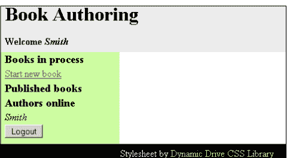

“在线作者”表格最初只显示 Smith。当 Brown 登录后，Smith 的屏幕会更新，在“在线作者”表格中出现新的用户名，如下截图所示：

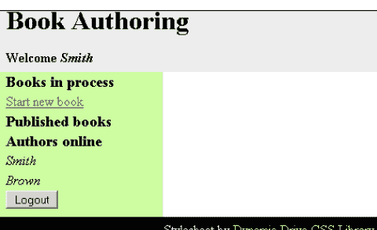

现在 Brown 已经登录，他通过单击**开始新书**链接创建了一本新书，随后弹出一个对话框，要求输入书名。

在 **Brown** 输入书名后，两个浏览器中的“进行中的书籍”列表都会更新。在下面的截图中，Smith 现在可以看到这本正在进行中的新书：

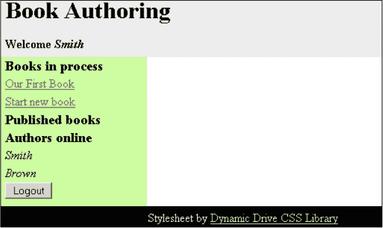

Smith 单击**我们的第一本书**链接，会打开一个显示章节列表的屏幕，他可以看到 Brown 目前是这本书的唯一作者。

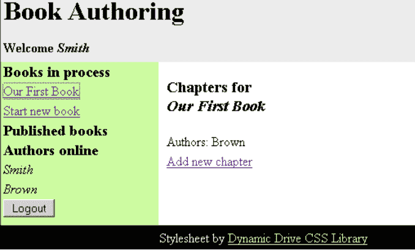

Smith 决定开始一个新章节。他单击**添加新章节**链接并输入章节名称。


现在两个用户都能看到书中只有一个章节，并且由于 Smith 添加了一个章节，他被列为作者。两个用户现在都有投票按钮。下面的截图说明了当前情况：

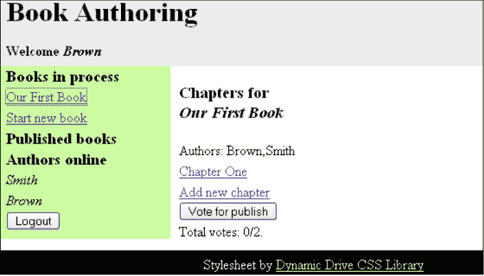

Brown 决定编辑 **Chapter One**，他点击链接打开章节并编辑章节，如下面的截图所示：

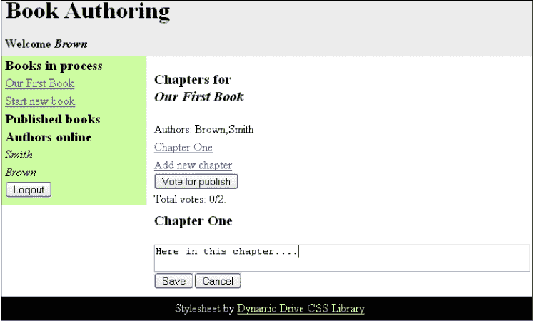

Brown 编辑时，Smith 也想编辑同一章节。他也点击了章节链接，但他无法编辑，因为他看到 Brown 同时正在编辑该章节。章节内容仍然为空，因为 Brown 还没有保存章节。

Smith 取消了编辑，同时 Brown 保存了章节。稍后，Smith 决定编辑同一章节。现在他可以编辑章节并看到 Brown 写的內容，并添加了一些新內容。

这样，两个用户可以共同撰写同一本书，准备好后作者可以投票发布。

添加了两个章节，Brown 已经投票发布。Smith 点击 Vote for publish 按钮，并被告知他无法收回投票。因为 Brown 已经投票，而这本书只有两位作者，所以该书将被发布并移至左侧导航的 Published books 表格中。

所有已登录用户都会收到一本书已发布的通知，如下面的截图所示：

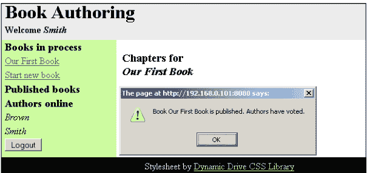

当用户在对话框中点击 OK 时，用户界面会更新以反映已发布的书籍。查看已发布的书籍时，它会被渲染为 HTML 以便更好地查看，类似于下面的截图：

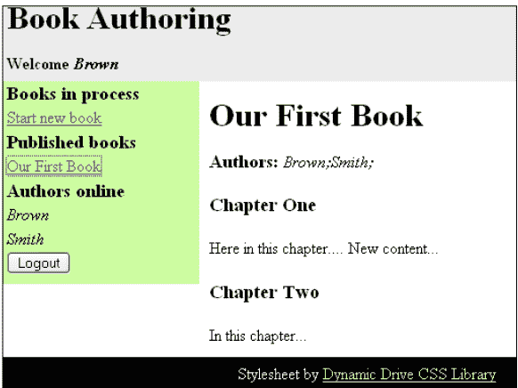

web.xml 的源代码如下：

```
<?xml version="1.0" encoding="UTF-8"?>
<web-app xmlns:xsi="http://www.w3.org/2001/XMLSchema-instance"
xmlns="http://java.sun.com/xml/ns/j2ee" xmlns:web="http://java.sun.
com/xml/ns/javaee/web-app_2_5.xsd" xsi:schemaLocation="http://java.
sun.com/xml/ns/javaee http://java.sun.com/xml/ns/javaee/web-app_2_
5.xsd" id="WebApp_ID" version="2.5">
    <display-name>DWRChatRoom</display-name>
    <servlet>
        <display-name>DWR Servlet</display-name>
        <servlet-name>dwr-invoker</servlet-name>
        <servlet-class>
            org.directwebremoting.servlet.DwrServlet
        </servlet-class>
        <init-param>
            <param-name>debug</param-name>
            <param-value>true</param-value>
        </init-param>
        <init-param>
            <param-name>activeReverseAjaxEnabled</param-name>
            <param-value>true</param-value>
        </init-param>
    </servlet>
    <servlet-mapping>
        <servlet-name>dwr-invoker</servlet-name>
        <url-pattern>/dwr/*</url-pattern>
    </servlet-mapping>
    <welcome-file-list>
        <welcome-file>index.html</welcome-file>
        <welcome-file>index.htm</welcome-file>
        <welcome-file>index.jsp</welcome-file>
        <welcome-file>default.html</welcome-file>
        <welcome-file>default.htm</welcome-file>
        <welcome-file>default.jsp</welcome-file>
    </welcome-file-list>
</web-app>
```

## Developing the User Interface

我们下一步要做的是创建用于展示的文件：样式表和 HTML/JSP 文件。在这里，我们重用了之前的 DWRBookAuthoring 示例中的文件。样式表相同，loginFailed.html 相同，index.jsp 只有一个更改，那就是页面的标题。这些页面在此未展示，其功能在上一节中已描述。

```
return '<i>'+user+'</i>';
}
];
Login.getUsersOnline({
callback:function(users)
{
dwr.util.removeAllRows('usersOnline');
dwr.util.addRows("usersOnline",users, cellFuncs,
{ escapeHtml:false });
}
});
}

function getPreviousMessages()
{
ChatRoomDatabase.getChatContent({
callback:function(messages)
{
var chatArea=dwr.util.byId('chatArea');
var html="";
for(index in messages)
{
var msg=messages[index];
html+=msg;
}
chatArea.innerHTML=html;
var chatAreaHeight = chatArea.scrollHeight;
chatArea.scrollTop = chatAreaHeight;
}
});
}

function newMessage(message)
{
var chatArea=dwr.util.byId('chatArea');
var oldMessages=chatArea.innerHTML;
chatArea.innerHTML=oldMessages+message;
var chatAreaHeight = chatArea.scrollHeight;
chatArea.scrollTop = chatAreaHeight;
}

function sendMessageIfEnter(event)
{
if(event.keyCode == 13)
```

```
</tr>
</thead>
<tbody id="usersOnline">
</tbody>
</table>

<input id="logoutButton" type="button" value="Logout" onclick="logout();return false;"></div>

</div>

<div id="footer">Stylesheet by
<a href="http://www.dynamicdrive.com/style/">Dynamic Drive CSS Library</a></div>

<script type="text/javascript">
getPreviousMessages();
</script>

</body>
</html>
```

页面开头的功能与之前的 DWRBookAuthoring 示例中的 mainpage.jsp 页面相同。

第一个特定于聊天室的 JavaScript 函数是 getPreviousMessages()。该函数在 mainpage.jsp 的末尾被调用，它检索该聊天室的先前聊天消息。

newMessage() 函数由服务器端 Java 代码在新消息发布到聊天室时调用。该函数还会自动滚动聊天区域以显示最新消息。

sendMessageIfEnter() 和 sendMessage() 函数用于将用户消息发送到服务器。HTML 代码中包含消息文本的输入字段，sendMessageIfEnter() 函数监听输入字段中的 onkeyup 事件。如果用户按下回车键，则调用 sendMessage() 函数将消息发送到服务器。

HTML 代码包含指定大小且具有自动滚动的聊天区域。

## Developing the Java Code

聊天室示例的 Java 代码使用了与 DWRBookAuthoring 示例相同的类。Login、UserDatabase 和 Util 类相同，只是包名不同。服务器端聊天室功能的逻辑在 ChatRoomDatabase 类中。ChatRoomDatabase 的源代码如下：

```
package chatroom;

import java.util.Collection;
import java.util.Date;
import java.util.List;
import java.util.Vector;

import javax.servlet.ServletContext;

import org.directwebremoting.ScriptSession;
import org.directwebremoting.ServerContext;
import org.directwebremoting.ServerContextFactory;
import org.directwebremoting.WebContext;
import org.directwebremoting.WebContextFactory;
import org.directwebremoting.proxy.ScriptProxy;

public class ChatRoomDatabase {

    private static List<String> chatContent = new Vector<String>();
    public ChatRoomDatabase() {
    }

    public void postMessage(String message) {
        String user = (new Util()).getCurrentUserName();
        if (user != null) {
            Date time = new Date();
            StringBuffer sb = new StringBuffer();
            sb.append(time.toString());
            sb.append(" <b><i>");
            sb.append(user);
            sb.append("</i></b>:  ");
            sb.append(message);
            sb.append("<br/>");
            String newMessage=sb.toString();
            chatContent.add(newMessage);
            postNewMessage(newMessage);
        }
    }

    public List<String> getChatContent() {
        return chatContent;
    }

    private ScriptProxy getScriptProxyForSessions() {
        WebContext webContext = WebContextFactory.get();
        ServletContext servletContext = webContext.getServletContext();
        ServerContext serverContext = ServerContextFactory.get(servletContext);
        webContext.getScriptSessionsByPage("");
        String contextPath = servletContext.getContextPath();
        if (contextPath != null) {
```


```
Collection<ScriptSession> sessions =
        serverContext.getScriptSessionsByPage
                (contextPath + "/mainpage.jsp");
ScriptProxy proxy = new ScriptProxy(sessions);
return proxy;
}
return null;
}

public void postNewMessage(String newMessage) {
    ScriptProxy proxy = getScriptProxyForSessions();
    if (proxy != null) {
        proxy.addFunctionCall("<newMessage>",newMessage);
    }
}
}
```

聊天室代码出人意料地简单。聊天内容存储在一个 `Vector` 的 `Strings` 中。`getChatContent()` 方法只是将聊天内容 `Vector` 返回给浏览器。

当用户发送新的聊天消息时，会调用 `postMessage()` 方法。该方法验证用户是否已登录，并将当前时间和用户名添加到聊天消息中，然后将消息附加到聊天内容中。

该方法还调用 `postNewMessage()` 方法，该方法用于向所有已登录用户显示新的聊天内容。注意 `postMessage()` 方法不返回任何值。我们让 DWR 和反向 AJAX 功能将聊天消息显示给所有用户，包括发送消息的用户。

`getScriptProxyForSessions()` 和 `postNewMessage()` 方法使用反向 AJAX 用新消息更新所有已登录用户的聊天区域。

就这样！聊天室示例非常直接，基本功能已经就位，应用程序已准备好进行进一步开发。

## 测试聊天

Smith 和 Brown 登录系统并交换了一些消息。两者在登录并开始聊天时看到空的聊天室。

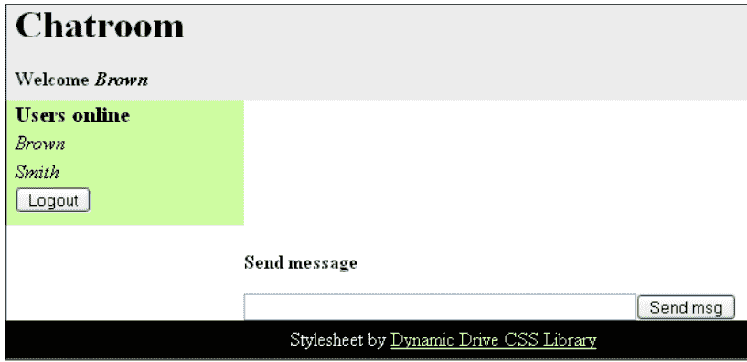

发送消息输入字段上方保留的空区域用于聊天内容。Smith 和 Brown 交换了一些消息，如以下屏幕截图所示：

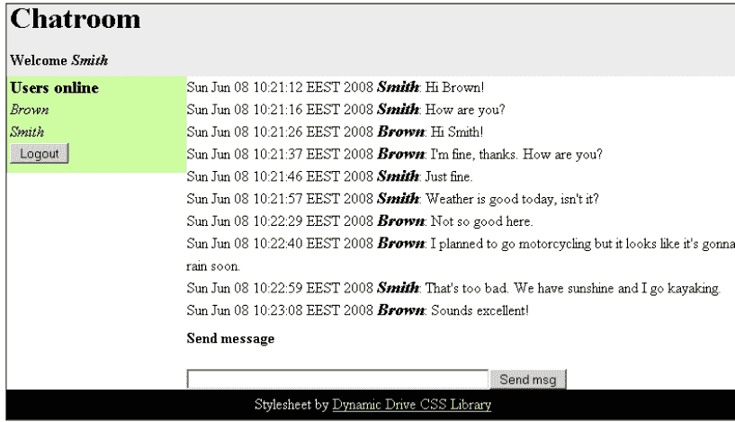

第三个用户 Jones 加入聊天并在聊天室中看到所有之前的消息。Jones 然后与 Smith 和 Brown 交换了一些消息。Smith 和 Brown 从系统中注销，留下 Jones 单独在聊天室中，直到她也注销为止。这在以下屏幕截图中可见：

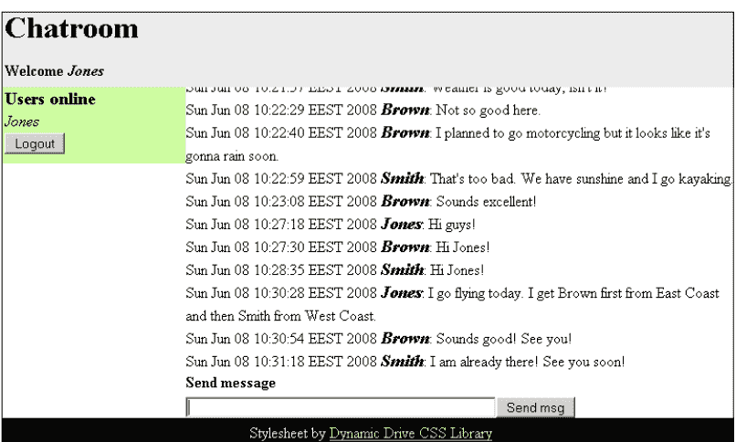

## 后记

本示例应用程序展示了如何在聊天室应用程序中使用 DWR。其功能与之前的图书作者应用程序类似。

## 摘要

本章中介绍的两个示例应用程序，协作式图书创作和聊天室，很明显 DWR 使开发此类协作应用程序变得非常容易。

DWR 本身甚至在应用程序中没有发挥很大的作用。DWR 只是应用程序的一个透明功能。因此，开发人员专注于实际项目和诸如数据持久性和整洁用户界面之类的方面，而不是 AJAX 的低级细节。
