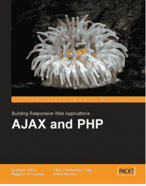
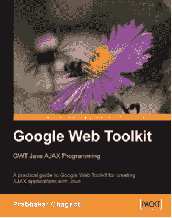

## 索引

### A

- **AJAX**
  - about 7
  - components 9
  - history 7
  - principle 8
  - uses 8
- **Asynchronous JavaScript XML.** *See* **AJAX**

### B

- **backend OrderSystem, messaging system**
  - testing with 163-165

### C

- **callback function, dynamic user interface**
  - advantages 70
  - methods 70
  - using 69
- **Chatroom**
  - about 202
  - chat, testing 209-211
  - Java code, developing 207-209
  - project, starting with 202
  - user interface, developing 203-207
- **client code, field completion**
  - JavaScript functions 92-94
- **client code, for tables and list**
  - HTML samples, using 79, 80
  - JavaScript function 80-83
- **Collaborative Book Authoring**
  - about 167, 168
  - Java class, developing 184
  - project starting with 168
  - testing 197-201
  - user interface, developing 168, 169
  - web application, configuring 182, 184
- **creator attributes, dwr.xml**
  - jsf 33
  - new 33
  - none 33
  - pageflow 33
  - scripted 33
  - spring 33
  - struts 33

### D

- **database, DWR**
  - configuring, in Geronimo 132-138
  - CountryDerbyDB java class, creating 138-142
  - integrating with 131
  - integration, testing 142, 143
- **deployment**
  - deployer tool, using 50
  - Geronimo Administration Console, using 47-49
  - hot deployment, using 51
  - steps 46
- **development environment, setting up**
  - DWR, using 37
  - Eclipse IDE, using 37-41
  - Firefox, using 37
- **Direct Web Remoting.** *See* **DWR**
- **DWR**
  - about 7-12
  - AJAX, for Java developers 9-11
  - applications, debugging 42
  - applications, testing 41-42
  - database, integrating with 131
  - error, handling 42, 43
  - mailing lists 11
  - messaging system, integrating with 153
  - supported browsers 30
  - user application positioning 10
  - web services, integrating with 143
- **dwr.xml, DWR configuration**
  - annotations, working with 35, 36
  - auth element, using 34
  - convertor element, using 34, 35
  - creator attributes 33
  - creators 33
  - exclude element, using 34
  - fluent configuration, using 36
  - include element, using 34
  - javascript attributes 33
  - param element, using 33
  - scope element, using 33
  - structure 32
  - using 32
- **dynamic user interface**
  - callback function 69
  - callback function, using 69
  - creating 53
- **dynamic user interface, creating**
  - sequence diagram 54
  - structure 54
  - web application, configuring 57-59
  - web application, developing 59, 60
  - web project, creating 55, 56

### E

- **Eclipse IDE, using**
  - Apache Geronimo 41
- **error, handling**
  - errorHandler used 42
  - exceptionHandler used 43
  - textHtmlHandler used 43
  - warningHandler used 42

### F

- **field completion**
  - feature 95
  - implementing 87
- **field completion, implementing**
  - client code 89-92
  - server code 88, 89
- **files, DWR configuration**
  - dwr.xml 30
  - web.xml 30
- **forms**
  - about 97
  - viewing 98
- **forms, creating**
  - FormHandler class, implementing 101-103
  - testing 103
  - user interface, developing 98-101
- **forms, testing**
  - form filling procedure 104-106

### G

- **Geronimo Administration Console, deployment** 47-49

### H

- **hot deployment, deployment** 51

### J

- **Java class, Collaborative Book Authoring**
  - Book.java class 188-190
  - BookDatabase.java class 190-196
  - BookDatabase.java class, static map variables 196
  - developing 184
  - Login.java class 184-186
  - UserDatabase class 186, 187
  - util.java class 187, 188

### M

- **map scrolling**
  - DWR, using 115, 116
  - Java class, creating 124, 125
  - map scroller, testing 126-128
  - map square, examples 116
  - user interface, developing 117
- **messaging application, messaging system**
  - JavaScript function, developing 162
  - reverse Ajax, enabling 163
- **messaging system, DWR**
  - backend OrderSystem, testing with 163-165
  - Comet mechanism used 154-158
  - integrating with 153
  - messaging application, setting up 161
  - OrderSystem Java class, developing 158-161
  - queues, setting up in Geronimo 154-158
  - STOMP (Streaming Text Oriented Messaging Protocol) 154
  - using 165

### N

- **navigation tree**
  - about 106
  - building 106
- **navigation tree, building**
  - functions 110-113
  - NavigationTree class, creating 108-110
  - part 2 user interface, developing 110-113
  - testing 113, 114
  - user interface, developing 106, 107

### O

- **OrderSystem Java class, messaging system**
  - developing 158-161
  - reverse Ajax functionality used 161

### P

- **packaging**
  - about 44
  - steps 45, 46
- **project, Chatroom**
  - dwr.xml file's source code 202
  - starting with 202
  - web.xml's source code 203

### R

- **reverse AJAX, messaging application**
  - enabling 163

### S

- **sample applications**
  - about 167
  - Chatroom 167, 202
  - Collaborative Book Authoring 167
- **supported environments** 30

### T

- **tables and list**
  - implementing 71
  - testing 85, 86
- **tables and list, implementing**
  - client code 79
  - server code 72-79

### U

- **user interface, Collaborative Book Authoring**
  - developing 168, 169
  - index.jsp page 170, 171
  - loginFailed.html page 171
  - mainpage.jsp page 171-181
  - mainpage.jsp page, DWR scripts 181, 182
- **user interface, forms**
  - developing 98, 99
  - JavaScript functions used 99-101
- **user interface, map scrolling**
  - developing 117-124
  - HTML file, using 117-124
  - JavaScript functions, using 123

### W

- **web.xml, DWR configuration**
  - about 30
  - load protection parameters 32
  - security parameters 31
- **web application, dynamic user interface**
  - developing 59, 60
  - testing 60-64
  - web pages, developing 64-69
- **web project, dynamic user interface**
  - creating 55, 56
- **web services, DWR**
  - client-side code, developing 144-151
  - integrating with 143
  - integration, testing 152, 153
  - web service call, implementing 152

## 感谢您购买
DWR Java AJAX Applications

## Packt 开源项目版税

当我们销售一本基于开源项目的书籍时，我们会直接向该项目支付版税。因此，通过购买《Learning DWR Java AJAX Applications》，Packt 已将收到的部分款项捐赠给了 The Dojo Foundation 项目。

从长远来看，我们将自己和您——我们书籍的客户和读者——视为开源生态系统的一部分，为我们出版的项目提供可持续的收入。我们在 Packt 的目标是建立出版版税作为服务和支持的重要组成部分，并支持一种可持续开源的商业模式。

如果您正在使用一个开源项目，并且希望我们对其进行出版并随后支付版税，请与我们联系。

## 为 Packt 撰稿

我们欢迎所有有意撰稿的作者的咨询。书稿提案请发送至 author@packtpub.com。如果您的书稿想法仍处于早期阶段，并且您希望在撰写正式书稿提案之前先进行讨论，请联系我们；我们的其中一位约稿编辑会与您联系。

我们不仅寻找已出版的作者；如果您拥有强大的技术技能但没有写作经验，我们经验丰富的编辑可以帮助您发展写作生涯，或为您提供专业知识的额外回报。

## 关于 Packt Publishing

Packt，读作 'packed'，于 2004 年 4 月出版了第一本书《Mastering phpMyAdmin for Effective MySQL Management》，随后继续专注于出版关于特定技术和解决方案的高度聚焦的书籍。

我们的书籍和出版物分享了您同行 IT 专业人士在适应和定制当今系统、应用程序和框架方面的经验。我们的解决方案型书籍为您提供定制您正在使用的软件和技术以完成工作的知识和能力。Packt 的书籍比您过去看到的 IT 书籍更具体、更少泛泛而谈。我们独特的商业模式使我们能够为您带来更聚焦的信息，让您获得更多所需知识，减少不必要的内容。

Packt 是一家现代而独特的出版公司，专注于为开发者、管理员和新手社区生产优质、前沿的书籍。有关更多信息，请访问我们的网站：www.PacktPub.com。

## AJAX and PHP

ISBN: 190-4-811-82-5　　Paperback: 275 pages

使用本实践教程通过 AJAX 增强您的 PHP 网站用户体验，其中包含详细的案例研究

- 1. 为下一代 Web 应用程序奠定坚实的基础
- 2. 使用更好的 JavaScript 代码实现强大的 Web 功能
- 3. 利用 PHP 和 MySQL 的强大功能创建强大的后端功能，并使其与智能 AJAX 客户端和谐协作

## Google Web Toolkit

ISBN: 978-1-847191-00-7　　Paperback: 240 pages

创建 AJAX 应用程序的 Google Web Toolkit 实用指南，使用 Java 快速开发。

- 1. 以 Gmail、Google Maps 和 Google Calendar 的风格创建丰富的 Ajax 应用程序
- 2. 与 Web API 接口，创建消费 Web 服务的 GWT 应用程序
- 3. 完全实用，从第一章开始就提供动手示例和完整教程

