## 第 1 部分：微服务、设计和架构陷阱概述

在本节中，您将了解微服务的基础知识、领域驱动设计的重要性、架构陷阱和分解策略。本节包含以下章节：

- *第 1 章，为微服务事业设定心态*
- *第 2 章，失败于理解 DDD 的作用*
- *第 3 章，微服务架构陷阱*
- *第 4 章，保持棕地应用再平台化的简易性*

### 为微服务事业设定心态

微服务是一种架构风格，它将应用程序结构化为多个服务，这些服务封装业务能力。与传统服务相比，这些微服务通常在范围和功能方面要小得多。它们具有逻辑和物理上的分离，并通过网络上的消息相互通信以形成一个应用程序。

采用微服务架构是一段旅程，需要能够拥抱文化、流程和实践变化的心态。从本质上讲，组织需要经历多项变革，以提高敏捷性和适应性，实现目标并交付业务价值。


在本章中，我们将帮助您理解微服务的理念以及帮助组织实现数字化转型的各个方面。我们还将学习微服务设计原则及其组件，以及它们的优势和挑战。最后，我们将讨论领导力的作用，以及如何通过采用行业中广泛接受的做法来起步。

本章将涵盖以下主题：

- 微服务的理念
- 微服务设计原则
- 构建团队以更快地交付业务价值
- 微服务的好处
- 微服务的挑战
- 微服务架构组件
- 审视领导责任
- 定义企业的核心优先事项
- 使用十二要素应用方法论
- 现代云原生应用的附加因素

本章旨在帮助您理解微服务的关键概念及其为组织带来变革、推动业务增长的潜力。此外，我们将讨论领导力在转变思维方式中的作用，通过建立拥抱变革的有效团队来更快地交付业务价值。最后，我们将深入探讨“十二要素应用”方法论，它帮助许多组织成功采用了微服务。

## 微服务的理念

数字革命正在颠覆每一个行业，以满足用户尚未得到满足的需求，并拥抱数字化转型来转变其现有业务。数字化转型使企业能够快速适应不断变化的业务状况，并为其最终用户创造价值。数字化转型关乎赋能员工、吸引客户、改造产品和优化运营。数字化转型的本质在于成长型思维，组织通过投资改进内部能力、流程和系统，以推动带来商业和社会成果的变革。这些系统中有许多亟需变革，以便能够快速创新，重新构想未来，提供令人兴奋的体验。在过去的几十年里，这些系统大多采用单体架构构建，随着其发展并变得复杂，这种架构相对难以更改和维护。尽管面向服务的架构（SOA）是相对于单体架构的一大改进，但它也有自身的挑战，例如当应用程序增长时，它会变成分布式单体应用，这同样难以维护或扩展。SOA 的重点更多在于可重用性和集成，服务之间不断交换消息以执行任务。消息平台是 SOA 的支柱，负责服务发现、编排、路由、消息转换、消息增强、安全和事务管理。SOA 的主要缺点是信息是共享的，业务领域的知识分散在**企业服务总线（ESB）**中，这使得服务难以更改。

微服务是架构风格的一种演进，它解决了其他架构风格的痛点，以实现快速变化和扩展。微服务还支持业务能力的持续交付。通过专注于将业务能力在单个服务中相互分离，组织可以构建具有模块化、隔离性和松耦合特性的系统。这些特性在帮助组织建立专注于交付工程速度的专门团队方面发挥着至关重要的作用。团队可以独立开发和部署微服务，而无需进行大量协作。然而，如果服务之间存在依赖关系，且服务建模不当，它们将需要大量协作，从而违背了隔离作为优势的本意。微服务架构还使组织能够构建具有自主性的服务，这种自主性拥抱变化，并因服务独立性而降低了故障风险。

微服务改变了应用开发的范式，新的基础要素已经浮现，并在构建和运营微服务方面取得了成功。组织需要以正确的心态起步，并在小团队中建立主人翁文化，以持续向最终用户交付价值。

现在您已经对微服务背后的理念有了基本了解，接下来我们将介绍微服务设计原则。

## 微服务设计原则

在构建微服务的过程中，您需要做出多种选择，这些选择将给您的微服务架构及其随时间演进带来不同的风格。微服务设计原则为评估可能影响基于微服务架构设计的关键决策提供了指导。原则上，微服务支持松耦合和服务模块化。其他原则也可以支配微服务架构的设计，但它们的重要性可能各不相同。我们将在以下章节中介绍这些原则。

### 单一职责原则与领域驱动设计

一个微服务应负责提供单个功能或一组相关功能，以交付一种业务能力。微服务接口应该改变的唯一原因，是微服务所提供的业务能力发生了变化。这有助于系统按照真实世界的领域进行设计，并帮助我们将系统和架构视为现实世界问题的映射。领域驱动设计是一种有助于领域建模和定义微服务边界的方法，它帮助我们实现模块化并降低耦合度。

### 封装与接口隔离

每个微服务都拥有自己的数据，服务与其他服务通信的唯一方式是通过定义良好的接口。这些接口在设计中会充分考虑其客户端。与其在客户端应用中使微服务端点过载，一种流行的替代方案是引入 API 网关，本章稍后将对此进行解释。这种技术有助于将通信责任委托给 API 网关，并使微服务专注于交付业务能力。

### 自主、所有权与共享治理的文化

微服务架构允许由不同团队拥有的业务能力得以交付。这些团队可以独立工作，无需大量跨团队协作。每个团队不一定只分配一个业务能力；相反，他们可以从属于单个领域的相关能力中进行选择。当您允许团队拥有自主权时，微服务架构会蓬勃发展，因为他们可以选择他们认为正确的方式来交付所需的业务能力。但这并不意味着团队可以为所欲为，它确实赋予了他们在正式商定原则的框架下做出决定的自由。这些原则被称为共享治理，它使团队之间就如何处理不同的横切关注点，或者他们想尝试不同技术到什么程度达成共识。构建微服务的团队拥有该微服务，并负责其运营。此类横切关注点将在*第7章“横切关注点”*中详细讨论。

### 可独立部署

单个微服务应该是可独立部署的，允许团队在不影响其他微服务的情况下推出更改。作为共享治理的一部分，团队应继续寻找能够帮助他们实现更好独立性的技术和实践。这一特性对于大规模运营微服务极为有用。

### 自动化文化

自动化是一个重要的概念，它提倡寻找机会用脚本化程序替代手动步骤，以实现一致性并减少开销。持续集成、持续部署、自动化测试和基础设施自动化都是不同形式的自动化，可以帮助您降低管理微服务的总体开销。


## 为故障而设计

微服务被设计为高度可用且可扩展。这些服务会发生故障，但应设计为能够快速恢复。其理念是，一个微服务的故障不应影响其他微服务，这有助于避免级联故障，并使服务能够尽可能快地恢复以恢复所需功能。为故障而设计服务需要对用户行为和期望有良好的理解。目标是在服务不可用时保持系统响应性，同时功能有所降低。然而，服务故障是不可避免的，需要一种务实的方法来支持实验以发现系统漏洞。这可以通过受控实验来实现，受控实验制造混乱以确定系统在不同情况下的行为会如何不同。这种方法被归类为混沌工程。

通过混沌工程，你对系统的特定区域进行实验以识别其弱点。混沌工程是一种实践，你故意引入故障以发现未被发现的系统问题。这样，你就可以在它们意外发生并影响你的业务和用户之前修复它们。此练习也有助于理解动荡条件下的风险和影响、事件响应、观测性方面的差距，以及团队应对事件的能力。许多工具可用于执行混沌工程，例如 Litmus、Gremlin 等。

## 可观测性

可观测性是你作为微服务架构的一部分构建的能力，使你能够识别并推理系统的内部状态。它还有助于在生产环境中监控、调试、诊断微服务及其核心组件。在微服务架构中，你收集日志、指标和追踪以帮助团队分析服务行为。可观测性的另一个重要方面是分布式追踪，它有助于理解事件在不同微服务之间的流动。在实践中，指标比其他形式的监控更重要。许多组织投入大量资源于指标，确保它们实时可用，然后将它们用作解决生产问题的首要工具。

在下一节中，我们将揭示微服务的核心基础，以构建独立自主的团队，从而带来敏捷性。

- **赋能团队：** 赋能团队的角色是为流对齐团队提供支持和指导，帮助他们采用工具、技术和实践，从而提升绩效。赋能团队的成立是为了识别改进领域并通过让整个组织了解新技术和最佳实践来推广学习心态。根据其目的，赋能团队在组织中可以是短期存在或长期存在。然而，它们与流对齐团队的互动仅持续短暂时间。一旦所需能力实现，赋能团队就会转向支持其他团队。
- **复杂子系统团队：** 复杂子系统团队的成立是为了满足复杂子系统的需求，这些子系统会给流对齐团队带来显著的认知负担并影响其专注于业务领域的能力。它们负责开发和运营这些系统，以确保在消费其他价值流时其服务可用性。
- **平台团队：** 平台团队负责提供基础设施支持，以使流对齐团队能够持续交付价值。它们确保平台提供的能力具有吸引力，并为消费和诊断这些平台服务提供良好的开发人员和运维体验。这些服务应通过 API 访问，从而实现自助服务和自动化。平台团队与产品生命周期保持一致，并保证流对齐团队能够及时获得正确的支持以履行其职责。这些服务通常规模更大，由更大规模的团队支持。

当你采用微服务与 DevOps 时，个人负责处理微服务的开发和运维。这些微服务的构建在产品经理和产品负责人提供的指导下进行。在现实世界中，团队从小开始，直到变得庞大并增加复杂性，然后再细分为多个团队以确保自主性和独立性。例如，你的应用可能需要构建多个渠道与客户互动，并希望与具备 iOS 和 Android 能力的团队合作，或者他们可能需要添加通知功能，这需要一个完全独立的团队。在这些团队中，个人承担共同责任，其中设计决策通常由高级工程师主导，并在实施前与团队讨论。

现在，让我们了解微服务带来的优势。

## 上市时间

微服务架构是可插拔的，因此支持能够替换微服务及其组件。这有助于团队专注于构建新的微服务以增加或替换业务能力。团队不再等待来自不同团队的更改被纳入后再发布新的业务能力。大多数横切关注点是单独处理的，这有助于团队实现更快的上市时间。这些横切关注点将在 *第 7 章，横切关注点* 中详细介绍。

## 技术多样性

微服务架构允许团队选择合适的工具和技术来构建微服务，而不是被过去做出的决策所锁定。技术多样性也有助于团队进行实验和创新。

## 提高可靠性

微服务架构本质上是分布式的，其中单个微服务可以在基础设施中多次部署以构建冗余。微服务架构的两个重要特性有助于提高整体系统的可靠性：

- 通过在各自的边界中运行每个微服务来隔离故障
- 通过设计微服务优雅地处理其他微服务的故障来容忍故障

到目前为止，我们已经了解了微服务的好处。然而，实施微服务确实会带来一些需要考虑的挑战。我们将在下一节中查看这些挑战。

## 微服务的挑战

在本节中，我们将讨论你在微服务之旅中可能面临的不同挑战。

### 组织文化

转向微服务的主要障碍之一是组织文化，团队最初是围绕技术能力而非交付业务能力构建的。这需要一个不断发展的组织、重组团队以及改变遗留实践。

### 可观测性

在大规模管理、监控和控制微服务是一个困难的问题。你需要有良好的可观测性来理解系统不同部分之间的交互和行为。你需要收集指标、日志、调用栈、触发警报并实施分布式追踪来帮助你推理系统。

### 端到端测试

对微服务进行端到端测试更具挑战性，因为它需要可靠有效的沟通以让所有团队参与其中。端到端测试也可能阻碍你的发布频率。设置测试环境很困难，需要跨团队协调。

### 双重抵押期

如果你正从单体应用迁移到微服务，那么你需要生活在混合世界中一段时间，以同时支持遗留应用和新应用。这并不容易，需要在修复错误和添加新功能时进行仔细规划，从而影响敏捷性和生产力。

### 平台投资

组织需要投资平台团队，这些团队负责构建平台服务并解决横切关注点。这些横切关注点将在 *第 7 章，横切关注点* 中详细介绍。这些团队还构建工具和框架来帮助其他团队完成工作。

前面的章节为我们提供了微服务的良好概述，以及它们的 design principles、优势和挑战。我们现在将查看微服务的各种架构组件及其在构建可扩展和健壮应用时的交互。

## 微服务架构组件

微服务是一组松耦合的服务，协同工作以实现共同目标。除了微服务之外，还有其他组件在微服务架构中发挥着至关重要的作用。帮助建立微服务基础的组件集如下图所示：


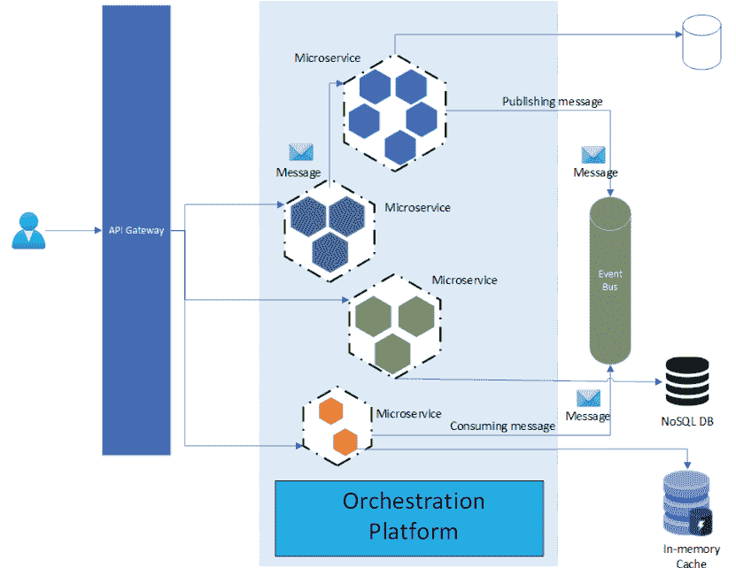

上图展示了不同微服务架构组件之间的交互。这些微服务托管在编排平台上，负责确保微服务的自愈能力和高可用性。这些微服务随后使用编排或编舞模式相互通信。在编排中，一个微服务负责调用其他微服务接口，而在编舞中，消息通过事件总线交换。客户端可以通过 API 网关消费微服务，其中消息被中继到特定的微服务进行实际处理。每个团队在为其微服务选择合适的存储机制方面拥有完全的自主权，如上图所示，不同的微服务正使用 SQL 数据库、内存数据库和 NoSQL 数据库来满足其数据存储需求。

我们将在以下章节讨论每个组件。

## 审视领导职责

在本节中，我们将了解组织在寻求采用持续交付价值的文化时，不同角色所承担的职责。

### 业务/技术领导者必须了解的内容

任何组织的业务领导者都必须定义并传达组织的愿景，并专注于必要的基层转型。他们必须识别增长机会、市场趋势、竞争，并应对潜在风险，以创造一个激发创新的环境，让新的商业模式得以实现。由反馈循环驱动的创新创造了一种文化，在这种文化中，新想法会被倾听、设计、迭代和完善。他们应通过主动学习、获取洞察和实验来专注于价值创造。随着业务价值随时间变化，这要求业务优先级的改变，这些优先级应被明确定义并在整个组织中传达，以便作为指导未来决策的原则。

技术领导者负责阐述技术战略并推动组织内的技术计划。他们还负责通过投资于人员、流程、产品、服务、平台，并培养商业敏锐度，以具有成本效益的方式为客户带来愉悦体验，从而建立能力。技术领导者在引领业务系统演进、理解挑战并建立持续创新的能力方面发挥着重要作用。他们还应走出组织之外，寻找与团队协作以进行头脑风暴和创新的机会。此外，他们通过实施流程改进模型，确保服务质量，并借助广泛采用的框架来帮助交付高质量服务，满足绝大多数客户的需求。CMMI、GEIT 和 ITIL 是可以帮助采用服务交付、开发、治理和运营实践的几个框架。这些框架及其实践的采用在行业中差异很大。小型组织可以从小做起，专注于其中一些相关实践，而可能希望达到一定成熟度水平的企业可以探索整个模型。

## 架构师必须了解的内容

架构师的角色是理解业务驱动因素和技术变化的需求及其对软件架构的影响。他们与业务利益相关者密切合作，以识别新需求并制定计划来适应这些变化，从而推动业务价值。由于变化是唯一不变的，架构师应拥抱软件系统的架构模块化，以便在隔离中演进。他们需要将架构决策与业务优先级保持一致，并理解其对业务系统的影响。架构师应展示领导力、指导和在团队间的辅导，以促进变革。他们有责任通过提供必要的学习机会来使软件团队具备能力，以获得有效交付所需的技能。这些学习机会不仅限于技术培训和认证，还应特别强调理解业务系统、业务领域和变革管理。对于敏捷团队而言，架构师的角色通常由高级工程师或开发经理担任。

在实践中，了解业务领域和数据至关重要。这些架构师应与业务用户协作，以理解业务成果并强调领域驱动设计。他们还应分析应用程序的不同部分如何消费不同的数据集，以便将它们重新建模为微服务。了解数据的使用模式使我们能够构建或选择支持业务需求的正确服务。

## 产品经理、产品负责人和 Scrum Master 的角色

产品经理负责通过理解客户需求、业务目标和市场来制定产品的愿景。他们处于业务、技术和用户体验的交汇点，而产品负责人则与利益相关者密切合作，为产品或功能策划详细的业务需求。他们负责将产品经理的愿景转化为可执行项目，以帮助跨职能团队构建正确的产品。Scrum Master 是作为开发团队与产品负责人之间的调解人而充当教练，确保开发团队的工作与产品待办事项保持一致。他们在团队中营造高绩效和持续改进的环境。

到目前为止，我们已经了解了领导者在塑造文化以适应变革方面的角色。接下来，我们将讨论在开始微服务之旅之前设定优先级的 importance。领导者应不断重新审视这些优先级，以确保其与业务目标保持一致。

## 为业务定义核心优先级

由于微服务架构正在获得动力，越来越多的组织开始思考采用新的构建应用程序方式。这些组织正在为自己设定一段旅程。初创公司面临资源有限的挑战，并需要决定哪些功能内部构建，哪些外包。大组织希望采用新的方式更快地为终端客户交付价值。他们正在构建新应用程序，同时也在寻求将遗留应用程序转变为微服务，以获得更敏捷灵活的好处。随着他们在旅程中推进，他们需要做出决策并处理大量权衡。

首先，重要的是根据业务优先级概述章程。如果重点是构建新功能并提高团队速度，那么创新应优先于可靠性和效率。下图描绘了需要根据业务优先级进行优先排序的不同维度：

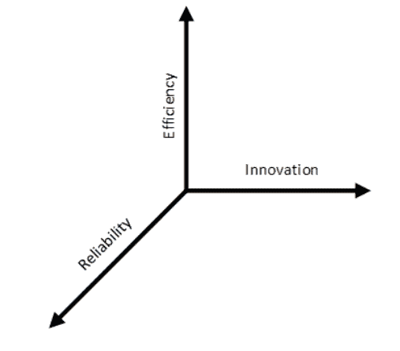

图 1.2 – 业务优先级的不同维度

如果为客户提供可靠的服务是你的主要目标，那么可靠性应优先于创新和效率。如果效率更重要，那么你必须专注于做出正确的改变，成为一个高效的组织。这样做，创新和可靠性可能需要在价值链的后期解决。例如，更高效能够以低成本进行实验，从而让团队更频繁地尝试新事物。

技术领导者需要确保团队已准备就绪，并必须意识到文化变革、新的沟通方式、学习新工具和技术、在服务领域决策方面的自主权，以及为确保治理而开放协作。技术领导者应通过定义和传达正确的架构给团队来带来清晰度。

作为架构师，你需要确保捕获所有共同商定的决策、其收益和权衡。你还负责记录和传达这些决策的影响。记录这些决策将帮助你回顾并找到做出这些决策的原因。这将使你能够在未来做出更明智的决策。识别微服务的良好候选者并围绕业务能力对其建模至关重要。你应从对业务不关键的服务开始，并逐步演进你的架构。

构建新应用程序或将遗留应用程序转变为微服务是对组织而言的关键决策。几乎不可能为此类计划制定详细的计划，但新服务应以能够满足当前和新兴业务需求的方式设计。然而，了解当前系统可以帮助识别可以产生最大影响的领域。另一个重要方面是观察应用程序不同部分的使用模式，以了解客户端和应用程序不同部分如何相互交互。对于许多组织而言，现代化遗留应用程序并添加新功能以满足客户需求是相互竞争的优先级。当团队开始将这些应用程序转换为微服务时，主要采用三种方法：

- 用使用新工具和框架构建的新微服务替换现有功能，以避免任何技术债务。这需要在前期投入大量投资以充分了解遗留系统。通常建议用于小型遗留系统或大型遗留应用程序中提供有限功能的模块。
- 将存在于不同模块中的现有功能提取为微服务。这种方法建议用于在整个生命周期中维护良好且结构良好的遗留应用程序。
- 随着应用程序的不断增长，在其生命周期中几乎不可能遵循初始设计原则。在这种情况下，应采用平衡的方法，允许团队重构旧应用程序。这有助于他们明确定义模块边界，后续可作为从微服务中提取代码的手段。


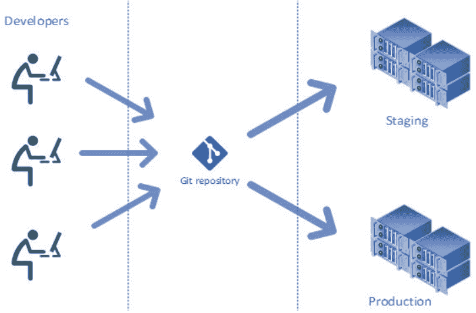

图 1.3 – 不同开发者在同一个代码库上协作

在上图中，一个微服务团队正在同一个代码库上进行修改。一旦这些修改被合并，就会被构建并发布到不同的环境（**预发布和生产环境**）。在实践中，预发布环境运行的版本可能与生产环境不同，尽管两个版本的发布都可以从同一个版本控制中追踪。

## 依赖

在十二要素应用中，依赖应当被隔离，并通过依赖声明清单显式声明。应用不应依赖宿主机上已存在的任何依赖。应用及其所有依赖在每次部署时都一起携带。例如，声明 Node.js 应用依赖的常见方式是 `package.json`，Java 应用是 `pom.xml`，.NET Core 是 `.csproj`。对于容器化环境，你可以使用 Docker 将应用及其依赖打包，以便跨环境部署。下图展示了应用依赖如何在应用仓库之外管理，并在后续作为容器打包的一部分被包含进来：

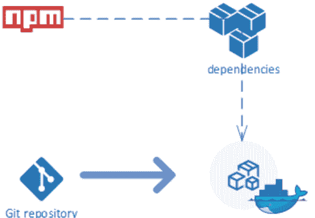

图 1.4 – 应用依赖隔离及其通过 Docker 文件包含依赖

容器帮助将应用部署到不同环境，而无需担心安装应用依赖。**npm** 是一个包管理器，负责管理作为项目本地依赖的包。这些包随后作为容器打包的一部分被包含进来，以构建容器镜像。

## 配置

单一代码库允许你在不同环境中一致地部署应用。任何在不同环境之间变化、且以常量形式保存在代码库中的应用配置，都应通过环境变量来管理。这种方法提供了灵活性，使应用在增长过程中能够以不同配置进行扩展。连接字符串、API 密钥、令牌、外部服务 URL、主机名、IP 地址和端口都是适合作为配置的候选对象。定义配置文件或使用分组（开发、预发布或生产）来管理配置容易出错，应当避免。你还应避免将配置值硬编码为代码库中的常量。例如，如果你将应用部署在 Azure App Service 中，可以在 Azure App Service 实例中指定配置值，而不是放在应用的配置文件中。下图演示了将同一个容器镜像以不同的配置部署到不同环境：

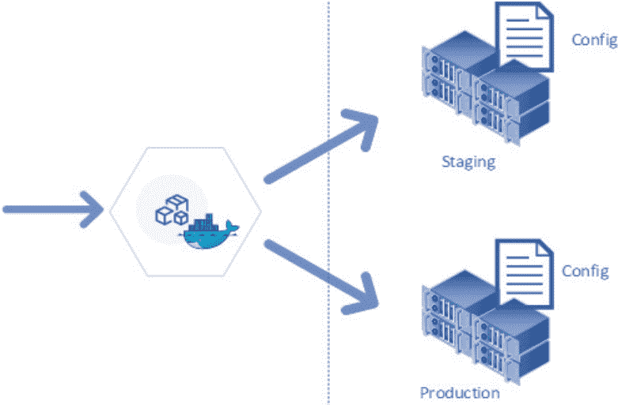

图 1.5 – 应用以不同配置部署到不同环境

容器镜像代表微服务的模板，由应用代码、二进制文件和依赖组成。随后，容器镜像连同其配置被部署到生产环境和预发布环境，以确保同一应用在所有环境中运行。

## 后端服务

后端服务是应用为正常运作而通过网络消费的一种服务依赖。这些服务应被视为可附加的资源。本地服务和远程第三方服务应被同等对待。示例包括数据存储（如 Azure SQL 或 Cosmos DB）、消息传递（Azure Service Bus 或 Kafka）以及缓存系统（Azure Redis Cache）。通过更改配置中的 URL 或定位器/凭据即可替换这些服务，而无需对应用的代码库做任何更改。下图展示了不同的后端服务如何与微服务关联：

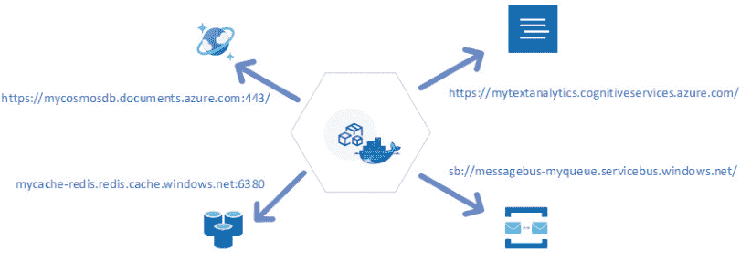

图 1.6 – 应用如何通过更改访问 URL 来访问和替换后端服务

此图描绘了托管在容器内的微服务运行实例。该微服务正在消费通过参数外部化的不同服务。将后端服务外部化有助于微服务轻松替换后端服务。

## 构建、发布和运行

每个应用的部署过程应分为三个独立的阶段（构建、发布和运行），如下所示：

- **构建**阶段编译特定版本的代码库及其资源，然后获取供应商依赖，以生成构建产物。
- **发布**阶段将构建产物与配置组合，为某个环境生成发布版本。
- **运行**阶段通过启动进程、容器或服务，在可执行环境中运行发布版本。

## 端口绑定

传统上，Web 应用部署在 IIS、Tomcat 和 httpd 等 Web 服务器中，以向最终用户提供功能。十二要素 Web 应用是自包含的应用，不依赖 Web 服务器的运行实例。应用应将 Web 服务器库作为依赖包含进来，并将其打包为构建产物用于部署。十二要素 Web 应用将 HTTP 作为服务绑定暴露在某个端口上以供消费。该端口应由环境提供给应用。这对于任何托管应用的服务器以及任何支持端口绑定的协议都适用。端口绑定使不同应用可以通过彼此的 URL 相互引用来进行协作。

## 并发

十二要素应用方法论的松耦合、自包含、无共享特性使其能够水平扩展。水平扩展意味着可以添加更多服务器并启动更多进程，从而以更少的努力实现轻松的可扩展性。微服务架构提倡构建小型、单一用途且多样化的服务，这为扩展这些服务提供了所需的灵活性，以实现更好的密度和可扩展性。Azure 上有多种托管服务，可为你提供基于各种指标配置自动缩放的更好能力。下图展示了不同微服务的扩展模式：

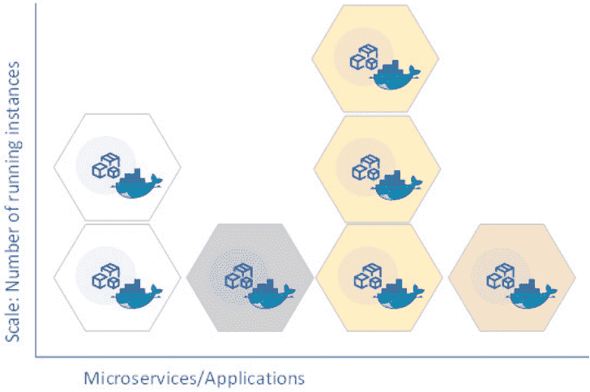

图 1.8 – 不同微服务的可扩展性

在某个给定时刻，运行不同数量的微服务实例以满足用户需求。编排平台负责扩展这些微服务以支持不同的消费模式，这有助于在优化环境中运行微服务。

## 可处置性

十二要素应用方法论应具有快速启动、优雅关闭，并且能够抵御故障。快速启动时间有助于快速生成新进程以应对需求高峰，也有助于在主机之间迁移进程，并用新进程替换失败的进程。优雅关闭应通过 SIGTERM 实现，允许进程在退出前停止监听新请求并释放任何资源。对于长时间运行的进程，确保操作具有幂等性并且能够重新放回队列进行处理非常重要。故障必然会发生；重要的是你如何应对这些故障。优雅关闭和快速启动都是实现韧性的重要方面。

## 开发/生产环境一致性

> “但在我的机器上是好的。”
> 
> — 每个开发者

十二要素应用方法论主张在开发、生产以及两者之间的任何环境之间保持一致性。开发/生产环境一致性符合“左移”策略，即在更早阶段发现问题，从而有更多时间以最小影响解决问题。它也有助于在开发和预发布环境中调试和重现问题。一种常见做法是在开发和生产环境中使用不同的数据库版本；这是违规的。在容器化环境中，请确保在所有环境之间使用相同的容器镜像以保持一致性。具备以最少工作量重建生产环境的能力，对于实现一致性、可重现性和可处置性非常重要。DevOps 实践对于实现开发/生产环境一致性至关重要，开发和运维团队通过持续部署协同发布功能。他们在所有环境中使用同一套工具来观察行为并发现问题。


### Logs

十二要素应用方法将日志视为事件流。它从不关心这些事件如何被路由、处理或存储。在传统的单体应用中，会使用日志库来允许应用程序生成日志文件。云原生开发与传统开发不同，应用程序被构建为微服务。单个请求在产生有意义的结果之前可能需要由多个微服务处理。监控和跟踪协作对于提供整个系统的可观测性非常重要。系统的分布式特性使得日志记录成为一项艰巨的任务，应以统一的方式处理以支持一致性和可扩展性。十二要素应用（微服务）不包含日志库作为其依赖项；相反，它使用日志代理作为单独的进程来流式传输日志。例如，这些事件可以发送到 Azure Event Hub 以实现长期归档和自动化，或发送到 Application Insights 以进行监控或触发警报。

### Admin processes

以与开发和运行任何其他应用程序相同的严谨程度设计管理员/管理流程。它应在与其他进程相同的环境中运行，同时遵循十二要素应用方法中前面讨论的相同实践。管理员流程应维护在代码库中，并使用构建、发布和运行实践将配置发布到环境中。数据库迁移、运行临时脚本以及清除数据都是管理员流程的示例。

十二要素应用是构建云原生应用程序最广泛采用的方法之一，它旨在帮助架构师和开发人员遵循与最佳实践和标准一致的程序，尤其是在构建微服务时。在下一节中，我们将探讨构建云原生应用程序必不可少的几个额外因素。

### Additional factors for modern cloud-native apps

在《超越十二要素应用》中，Kevin Hoffman 讨论了构建现代云原生应用程序时重要的三个额外因素。让我们来看看。

### API first

在 API First 方法中，应用程序的设计意图是保持一致性和可重用性。API 描述语言有助于提供一个契约，该契约规定了 API 的行为。例如，Swagger 提供了使用 OpenAPI 规范开发 API 的工具。

### Telemetry

在云原生环境中，团队对执行环境控制较少。他们依赖云厂商提供的能力。安装调试器和检查器不是一个选项，这使得实时应用程序监控和遥测成为挑战。为了解决遥测问题，你需要确保收集系统/健康数据、应用程序性能数据和特定领域数据，以便在接近实时时对系统有完整的可见性。

### Security

安全是构建良好的云原生应用程序的重要支柱。云原生应用程序构建为在多个数据中心运行，以服务全球客户。他们需要确保访问这些应用程序的客户端经过身份验证和授权。这些应用程序应识别每个请求方并根据其角色授予访问权限。有时，这些请求使用 **Transport Layer Security (TLS)** 进行加密，以确保传输中数据隐私。团队还需要考虑利用不同存储平台的能力来保护静态数据。例如，Azure Cosmos DB 和 Azure SQL Server 允许我们对静态数据进行加密。

前面讨论的 12 个因素和我们在这里查看的三个额外因素使我们对以 API First 思维构建云原生微服务有了透彻的理解。在云原生世界中，安全和遥测不再是事后考虑。以零信任思维对待安全至关重要，同时持续收集数据以监控系统健康状况，使你能够做出必要的调整以实现系统的更高可用性。

### Summary

在本章中，我们了解了开始微服务之旅时设定思维方式的各个方面。我们将微服务架构分解为其组件，并了解了构建微服务的设计原则。采用微服务有诸多好处，从本质上帮助组织更快地为终端用户带来业务价值。我们还讨论了采用微服务的挑战以及如何解决这些挑战。随后，我们讨论了领导力的作用，其中技术领导者有责任提供清晰度以推动整体计划。技术领导者带来正确的关注重点，通过赋予自主权来赋能团队并投资于他们的成长。架构师与利益相关者合作解决业务需求以塑造架构。最后，我们讨论了为业务定义核心优先事项如何影响你在微服务之旅中进行的各种架构决策。我们还讨论了转向云原生并采用十二要素应用方法构建微服务的重要性。有了这些知识，你可以开始规划微服务的采用，通过投资于正确的领域来构建组织能力。

在下一章中，我们将讨论理解领域驱动设计、反模式以及如何解决这些反模式的作用。此外，我们将了解领域驱动设计的重要性、常见陷阱以及在构建微服务架构时必不可少的最佳实践。

### Questions

1. 微服务的设计原则是什么？
2. 微服务的架构组件是什么？
3. 如何构建高度可扩展、可维护且可移植的微服务，使其成为云原生的？

### Further reading

有关本章所涵盖内容的更多信息，请查看以下资源：

- *Team Topologies*，作者 Matthew Skelton 和 Manuel Pais
- *Microservice Patterns and Best Practices*，作者 Vinicius Feitosa Pacheco，Packt Publishing
- *Building Microservices with .NET Core*，作者 Gaurav Kumar Aroraa、Lalit Kale 和 Kanwar Manish，Packt Publishing

# 2 Failing to Understand the Role of DDD

可以认为，在构建微服务时的一种反模式是没有深入理解业务领域或问题空间，然后尝试实现微服务战术模式。这可能导致混乱或一个庞大、分布式且紧密耦合、过于复杂的单体。

微服务是为实现共同目标或服务于特定业务功能而设计的服务集合。微服务必须协同工作以实现这一共同目标。在某些情况下，一个服务可能完全不知道自己在更大图景中的角色，或者可能不知道任何其他微服务。另一方面，构建这些服务的团队应该理解更大的图景，以及每个服务如何帮助实现系统的整体更大目标，或其服务在较大应用程序构成中的位置。

在本章中，我们将重新审视微服务的特征和属性，然后看看 **domain-driven design (DDD)** 在构建微服务方面所扮演的角色。我们将在旅程中探讨以下主题：

- 微服务是什么以及它们如何与 DDD 对齐？
- 微服务与 DDD 相比的优点和挑战
- 缺乏团队一致性
- 缺乏治理
- 整体大于部分之和
- 微服务基于科学
- 复杂还是不复杂——这就是问题所在
- DDD
- 缺乏对利益相关者需求的认识
- 有界上下文

到本章结束时，你将了解理解 DDD 以构建具有有界上下文的凝聚服务的重要性。你还将了解团队建设、治理和利益相关者意识的重要性。

### What are microservices and how do they align with DDD?

我们对微服务的描述越多，就越像是谈论 DDD。因此，让我们再次回顾微服务的定义，看看所谓的微服务与 DDD 之间的关系。我们将探讨 DDD 周围的指导原则，以及这些指导原则如何帮助我们构建满足业务需求的微服务架构。

如果你正在构建微服务，你需要了解它们是什么，为了确保我们都在同一张乐谱上，让我们检查一下微服务的特征。让我们探索它们是什么，然后我们将看到 DDD 如何指导我们在构建满足业务需求的有效微服务方面的旅程。我们将检查微服务的利弊，并看看 DDD 如何帮助我们实现其中的一些优点并解决一些缺点。


在我研究微服务的过程中，我注意到一个始终令我困惑的现象：当一些人在文章、博客以及一些关于微服务的书籍中描述微服务时，很少提到领域驱动设计（DDD）在微服务创建中扮演的角色或对其产生的影响。以我拙见，DDD 实际上就是微服务的蓝图或基础；它在微服务出现之前就已经存在了，而且就我而言，它似乎遭到了冷落。

DDD 和微服务概念大约在同一时期提出，并且具有许多相同的特征，例如单一职责、单一代码库、每个服务拥有独立数据库、团队对齐以及边界。

埃里克·埃文斯的著作*《领域驱动设计》*出版于 2003 至 2004 年期间；不久之后的 2005 年，彼得·罗杰斯在*Web 服务前沿*会议上的一次演讲中引入了“*微 Web 服务*”这一术语。当你研究这些概念时，会发现这两个概念有许多相似之处。

现在，让我们探讨微服务特性与 DDD 之间的相似之处以及它们如何对齐。首先，我们将考察自主微服务和 DDD 的限界上下文。我们还将研究其他微服务和 DDD 的特性并进行比较。

## 自主性

微服务是相互松散耦合的小型单一职责应用。一个开发者团队可以构建、测试、部署和维护单个小型微服务。每个微服务拥有独立的代码库，由一个小型开发者团队管理。这一概念在《领域驱动设计》中描述限界上下文特征时有所阐述，限界上下文拥有自己的代码库，并与单一开发者团队对齐。

## 独立部署

微服务可以独立部署。这使得团队能够更新某个微服务，而无需重建和重新部署整个应用。DDD 也支持这一概念，因为每个领域和支持子域通常都有自己的代码库，并遵循 SOLID 设计中的**单一职责原则（SRP）**。因此，当一个服务中的某些内容发生变化时，我们不应因为另一个微服务的变化而同时部署其他服务。

## 数据所有权

微服务负责持久化其数据状态，也负责与其他服务通信，以便其他服务能够更新其数据状态。这与传统的单一数据库模型不同，传统模型中由独立的数据层处理数据保存。DDD 使用聚合作为事务边界的概念，帮助我们设计数据并发和一致性。聚合应强制执行业务不变量。

## 通信

微服务之间通过基于**超文本传输协议（HTTP）**的接口进行通信，例如使用 **Google 远程过程调用（gRPC）**或**表述性状态转移应用程序接口（RESTful API）**，或者通过消息服务。每个服务的内部实现细节都被封装或对其他服务隐藏。DDD 不仅处理服务间通信，还处理团队间通信。它为团队如何互动和集成提供了明确指导。DDD 提供了成功通信模式的策略，以帮助构建有效的微服务，服务于更广泛的目标或实现系统的共同目标。至于服务间通信和服务间的转换，我们使用 DDD 中一个称为“开放主机”的概念，它负责将一个模型转换为另一个模型，类似于适配器模式。实际上，开放主机不过是一个 RESTful Web API。与 RESTful API 和直接服务间调用不同，我强烈建议尽可能避免直接的同步调用，并实现异步消息服务或队列，以将服务彼此解耦。在某些用例中，您可能需要从一个微服务直接调用另一个微服务，但应尽可能避免这种情况。如果您过度依赖直接的服务间同步调用，这些直接调用可能会变成反模式。这可能导致微服务紧密耦合，并具有直接的服务间相互依赖关系，有时被称为“分布式单体”。

## 技术无关性

微服务不必使用相同的技术栈、库或框架构建。你可以自由使用任何喜欢的语言编写服务。DDD 不关心你使用什么技术或语言。在埃里克·埃文斯的书中，他使用了**面向对象编程（OOP）**，此后，我们见证了使用不同编程范式（如函数式编程）的成功实现，这些实现利用 DDD 概念交付了有价值的解决方案。

## 网关模式服务发现

API 网关是客户端的入口点。客户端不是直接调用服务，而是调用网关，网关智能地将调用路由到适当的后端服务。

使用 API 网关的优势包括：

- 它将客户端与后端服务解耦。这使得服务可以独立进行版本控制和重构，而无需更新其他服务或客户端。
- 服务可以使用消息传递协议，如**高级消息队列协议（AMQP）**用于队列或**发布-订阅（pub-sub）**场景。
- 运行在**第 7 层（L7）**上的 API 网关（如 NGINX）可以执行其他横切关注点，例如身份验证缓存、日志记录、**安全套接字层（SSL）**终止和负载均衡。

微服务的许多优点在 DDD 中同样存在。让我们考察其中几点以比较相似之处。

## 与 DDD 相比，微服务的优势与挑战

与 DDD 相比，微服务提供了多种优势。让我们逐一了解：

- **高度敏捷：** 由于微服务是独立部署的，这使得管理、修复缺陷和添加功能变得更加容易。你可以对某个微服务进行更改而无需重新部署整个应用；或者如果出现问题，我们可以在部署过程中将更新回滚到先前版本。在单体应用的部署中，如果部署期间发现缺陷，可能会阻塞整个发布，需要回滚发布。这可能导致新功能的部署延迟。微服务可独立部署的这一特性与 DDD 关于限界上下文如何部署的规则共享，并且它们都有自己的代码库。因此，你可以清楚地看到，通过理解 DDD，你就理解了如何构建和部署微服务。
- **小团队：** 小团队专注于一个或多个微服务。一个微服务应与一个小型团队对齐，该团队能够构建、测试和部署微服务。较小的团队规模促进更高的敏捷性。大型团队往往生产力较低且更难管理，因为沟通变慢、管理开销增加、敏捷性降低。这些相同原则也适用于领域驱动的限界上下文，因为小团队与限界上下文对齐。随着我们对微服务的进一步考察，我们开始看到微服务和 DDD 之间相同原则的一一映射。在大多数情况下，团队不仅仅管理和控制一个微服务或限界上下文，而是负责并拥有多个共享共同议程或业务功能的微服务。
- **小代码库：** 在单体应用中，随着时间的推移，代码库依赖关系变得如同一团乱麻或“大泥球”是非常常见的。添加新功能或进行更改变得有风险，并且需要在代码中的许多不同位置修改代码。我们不应共享代码库或数据存储；微服务架构最大限度地减少了依赖，这使得添加新功能更加容易。DDD 要求每个限界上下文拥有自己的代码库，并与单一团队对齐。
- **技术混合：** 开发团队可以选择最适合其服务或技能组合的技术或编程语言，并适当地混合使用技术栈。这一概念与 DDD 共享，因为每个限界上下文都可以使用你想要的任何技术或编程语言。
- **数据隔离：** 管理模式更新要容易得多，因为任何更改只会影响单个微服务。在单体应用中，对模式的更新或更改可能变得非常危险且具有挑战性，因为应用的不同部分可能都使用相同的数据或模式，使得对模式的任何修改都有风险。DDD 也具有这一特性，因为每个限界上下文都有自己的数据并对其负责。
- **复杂性：** 与等效的单体应用相比，微服务应用是复杂的。每个服务都有单一职责，但在使用微服务实现解决方案时，整个系统要复杂得多。我们需要利用 DDD 来获取深入的领域知识，将这种复杂性提炼为一个可用于构建微服务的模型。
- **技能要求：** DDD 和微服务需要更高水平的技能，因此你应仔细评估团队是否具备取得成功所需的技能、经验和动力。


我们已经考虑了一些在使用微服务时所面临的优势和挑战，甚至讨论了其中一些挑战和优势是如何围绕团队展开的（例如代码库和技能集），但让我们真正强调团队对齐的重要性，或缺乏对齐的情况。

## 缺乏团队对齐

微服务的一般规则是，一个团队必须对齐或被赋予对一个微服务的责任。理想情况下，每个服务对应一个团队，但由于资源有限，这并不总是可能。然而，一个团队可以负责多个服务，这很常见。一个团队可能负责多个服务，但一个服务绝不应该有多個团队在上面工作。一个团队必须对服务的分析、开发和部署负责。

正如大多数规则一样，存在例外情况，在某些罕见情况下，这可能无法实现，我们可能需要两个团队共同承担一个服务的责任，并且由于组织或其他限制，团队必须共同工作并共享对服务的责任。DDD 将其称为共享内核，这要求共享服务的团队之间保持高度沟通。我们将在本章的 DDD 部分后面深入探讨共享内核。

然而，每个服务对应一个团队可以让团队之间相互依赖性更低，并允许它们以自己的节奏开发和部署服务，而无需依赖其他团队。我们也可以避免其他团队出现合并冲突和集成问题。将单个团队与代码库对齐可以缓解测试、开发和部署方面的许多问题。

现在我们已经研究了优势和挑战以及团队如何与自主服务对齐，我们还需要看看微服务如何协同工作以构成整体系统。

## 缺乏治理

标准的治理是任何组织的重要组成部分。DDD 为治理提供了一个框架——例如，规定面向对象编程和整洁架构，借鉴良好的 SOLID 设计原则，如单一职责到控制反转依赖（IoC）等，都是我们可以列举的几个例子。治理就是关于代码质量和架构方面的标准、规则和指南。拥有坚实的标准很重要，但它们不应限制到阻碍创新，而应制定清晰的标准，以帮助避免在没有明确标准时出现的问题。

治理可以是简单的，例如命名约定，也可以是复杂的，例如架构模式或资源限制。因此，在我们实施编码标准时，它们应与整个组织和各个团队保持一致，以允许灵活性，但同时也应提供清晰的沟通，说明什么是可以接受的，什么是不可以接受的。这可以很简单，例如如何命名事物，到在特定上下文中应使用哪种架构，而上下文在治理方面很重要。一条适用于一个团队的规则不适用于另一个团队。因此，规则和指南应与上下文和范围保持一致；例如，一个微服务的治理可能与另一个服务不同。话虽如此，我们也需要覆盖整个项目或应用程序范围的规则。在每个层级提供清晰的规则和标准，可以让团队为其团队制定规则和标准，同时也执行组织层面的规则和标准。通过建立有效的治理，我们可以确保每个人都在同一张乐谱上，并根据组织规范满足标准。

现在我们已经确定了良好标准和治理的重要性，我们需要探讨如何将这些标准应用并构建满足应用程序整体需求的微服务。

## 整体大于部分之和

要构建微服务，我们首先需要理解微服务的整体视图并采用启发式方法。我们需要了解它们如何相互集成，如何相互交互，以及服务之间的关系。

我们需要了解每个微服务执行其职责所需的数据类型，以及微服务的输出需要是什么，以便它能够满足依赖于其提供数据的服务或端点的需求。正是在我们缺乏对大局的理解时，事情开始分崩离析或引入错误。我们需要了解微服务在大局中扮演的角色。

我们需要了解微服务是否服务于复杂的业务需求，还是提供更直接、更不复杂的东西，例如满足某些基础设施需求。例如，微服务可以实现一些复杂的业务逻辑，也可以提供简单通用的基础设施关注点，例如存储库、消息传递、目录查找和清理作业。了解我们的服务在大局中的作用将为我们成功奠定基础。

当微服务基于复杂的业务功能时，它们需要更仔细的考虑和分析。在微服务负责简单任务（如持久化数据或发送和接收消息）的情况下，这类服务需要的分析较少，可以使用最佳实践来实现。这种责任上的差异需要被分析和理解，以便所有服务能够协同工作以满足业务功能或服务业务域的需求。

微服务将服务组合在一起形成整体系统，但由自主独立的服务组成。让我们探讨它们的自主性。

## 自主性

微服务是自主的，就像 DDD 中的有界上下文一样。它们只关心自己的议程。需要考虑的一些特征如下：

- 它们可能不知道其他服务的存在，甚至不知道其他服务存在。
- 微服务可以单独部署，而不依赖其他服务。
- 微服务可以按自己的方式更改并根据自身需求演进。
- 它们只知道自己的职责和行为，并且就它们而言，这就是它们需要做的全部。
- 它们知道自己需要什么数据，也知道自己需要产生什么数据。
- 它们不关心其他服务的职责，至少从它们自己的世界观来看是如此。

但事实是，微服务依赖于接收到的数据，而提供的数据必须满足服务的数据需求，以便服务能够执行其任务并产生所需的输出。在某些情况下，此数据可以是复杂的聚合，或者它可能是一个简单的对象，只包含几个属性，例如用于查找或保存对外部聚合的引用的**标识符（ID）**。

如果传入的数据无效，服务需要拒绝它，并且不允许该无效的传入数据破坏其自身内部数据。如果服务接收到的数据无效，则微服务将无法履行其职责。因此，微服务可以直接或间接依赖于另一个服务以及该依赖关系为其产生的数据。这在接口法则中很常见，其中接口定义并强制执行契约，而契约必须被遵守和尊重才能使事情正常工作。

理解服务与数据需求之间的这些关系对于微服务整体的成功至关重要。虽然微服务是自主的，但它们仍需要与其他服务交互。它们必须提供契约或接口，并且为了遵守与其他服务的契约，它们必须适应并对其他服务的输出做出反应。

## 先有数据还是先有事件？

可以认为数据先行，因为我们必须先了解数据，然后才能确定需要在该数据上执行的行为或操作，以及在成功完成时需要触发哪个事件。我们需要知道我们需要什么数据，以便下一个事件可以发生。我们是否需要获取外部服务的数据，并且数据是否处于正确的状态？如果数据不在正确的状态，我们需要确定接下来应该发生什么或哪个事件会接下来发生。

在现代应用程序开发中，我们使用事件来告知我们操作成功完成以及事件发生所需的数据类型。事件告知我们命令或操作的完成情况或失败情况，以便我们可以通知系统另一部分发生了事件，并且它可能或可能不会基于先前的事件或某些业务策略采取行动。因此，要使事件成为可能，我们需要了解事件发生所需的数据，并确保其他事件或应用程序按要求发生。事件使用过去时；例如，Order Created 事件是在创建订单的命令成功后发生的事件，而要使命令成功，它将需要执行 CreateOrder 命令所需的所有订单数据。

我们需要了解数据的状态，就像订单的例子一样，因为订单在其生命周期中穿越时间和空间，订单的状态会发生变化。我们需要了解数据是否来自不同的来源并被组合成聚合以满足我们服务的需求。正如 Order Created 事件的情况一样，很可能执行创建订单命令所需的所有数据都来自不同的来源，例如目录服务或客户服务优惠，例如可能来自营销服务或忠诚度服务的折扣。所有这些数据都需要汇集在一起，以便 Order Created 事件可以发生。


我们需要确定这个数据编译过程是否复杂，也就是说，我们并不完全理解数据应该如何组合、需要执行哪些操作，以及它需要处于什么状态。我们需要判断数据是否被充分理解且简单，或者它是一个复合问题还是复杂问题。如果我们确定问题是复合的，可能需要专家进行分析，并推荐如何处理数据编译，或者需要执行哪些操作或行为才能使数据达到满足我们需求的正确状态。如果问题是复杂的，我们需要通过实验和探索来弄清楚我们的数据需求是什么，以及它如何被整合成一个汇总。如果是复合问题，我们可以请专家帮助我们。如果数据和问题本身简单、明显且被充分理解，我们可以采用最佳实践使数据进入正确状态。

为了帮助理解微服务，我认为我们需要审视微服务背后的科学和复杂性理论。那么，让我们探索复杂自适应系统，因为微服务可以从这个角度来看待。让我们探讨这个概念，看看你是否同意。

## 微服务基于科学

当我们审视复杂自适应系统的定义时，我们可以看到它与微服务的许多概念，甚至DDD都有相似之处。我挑战大家更深入地探索复杂自适应系统这一主题，因为在我看来，这些知识是微服务的基础。

复杂自适应系统是一个系统交互的动态网络，但整个系统的行为可能无法根据单个组件或节点的行为来预测。它是自适应的，因为个体和集体行为会随着变化事件或事件集合而变异和自组织。

这些系统与相邻系统存在关系，能够相互交互，并可能满足彼此的一些需求，而这些需求可能是它们无法独立产生的。理解这些关系与理解单个实体或节点本身同样重要。

有些系统对其他相邻系统一无所知。在其他情况下，一个相邻系统可能了解另一个系统并直接交互，而另一些系统则间接交互，但仍然依赖相邻系统来满足某种需求。

下图展示了不同的自治系统；有些系统具有双向关系，有些则具有单向关系或依赖：

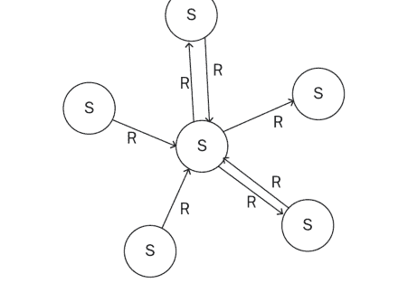

图2.1 – 复杂自适应系统的关系

在本节中，我们探讨了复杂自适应系统。我们可以认为微服务在本质上与复杂自适应系统非常相似。现在我们需要确定我们正在创建的微服务是否复杂，因为这将有助于确定我们构建该微服务的方法。

## 复杂还是不复杂——这是个问题

微服务可以是简单的、复合的或复杂的，如果我们不理解它们，就可能陷入混乱。因此，我们可以使用一个流程——或者更确切地说，一个框架——来帮助我们判断自己面对的是简单、复合还是复杂的情况，以便确定我们正在构建的微服务类型，以及构建该服务需要多少资源和努力，无论是人员、时间还是精力。我们可以判断在简单情况下是否可以直接购买现成产品，或者是否可以实现现有框架。我们也可以判断是否需要请专家告诉我们需要哪些框架和工具，以及如何配置这些工具。最后，我们可以判断自己是否在处理复杂问题，如果是，我们需要分配最优秀的人员、资源和精力来构建微服务。

下图说明了不同微服务可以应对不同程度的复杂性，从简单的服务（如目录查找），到复合的服务（如账户服务或发票服务），再到一些复杂的服务，因为它们负责实现业务逻辑或货物/商品的运输路由。我们可以看到每个服务之间可能存在依赖关系，现在我们需要确定自己面对的是何种复杂性级别：

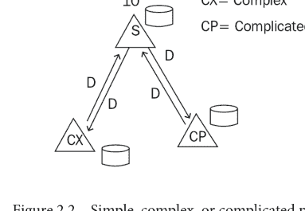

图2.2 – 简单、复杂或复合问题

我想向您介绍一个框架，它有助于判断我们面对的是简单、复合还是复杂问题。在这条道路上能提供帮助的框架是由学者David J. Snowden开发的Cynefin框架。让我们探索这种基于科学的方法。

在下图中，我们看到Snowden的五个决策领域：

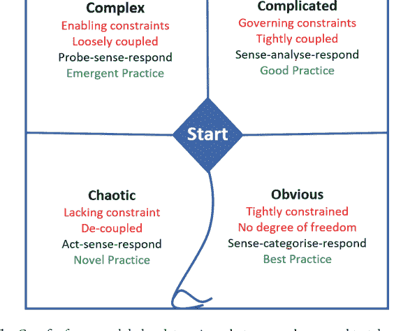

图2.3 – Cynefin框架有助于确定解决问题所需采取的方法

我们将探讨图上的每个区域，看看它如何帮助我们决定需要创建何种类型的微服务，以及该微服务正在解决何种类型的问题。

Cynefin框架包含五个决策背景或“领域”：简单、复合、复杂、混乱，以及中心的失序。

通过理解这五个领域，我们可以评估应该如何着手创建微服务，并根据Cynefin框架对问题领域的定义，确定它们的复杂性以及它们属于哪个领域。

让我们更详细地审视这五个领域中的每一个，以充分理解这与构建微服务的关系。

## 明显情境——“最佳实践领域”

明显情境被称为最佳实践领域。

### 方法

在这种情境下，问题被充分理解，解决方案是清晰的。我们需要感知–分类–响应，如下所示：

- 感知情境
- 分类或组织
- 应用适当的、众所周知的解决方案

明显情境由众所周知的解决方案或过程组成，不需要专家来确定正确的行动方针。

### 风险

最佳实践的危险在于，团队可能会因为之前的成功而尝试应用最佳实践，即使这种做法并不合适。在决定解决方案时，要避免“一刀切”的心态。团队可能会假设以前的方法会再次奏效。这样做可能将团队带入混乱领域，即图2.3中底部在混乱领域和明显领域边界之间的悬崖或波浪符号所示。为避免这种危险，团队应愿意尝试新想法，并听取领域专家和利益相关者的建议。

## Snowden的复合情境——“专家领域”

复合情境属于良好实践领域。

### 方法

在这种情境下，一个问题可以有多种可能的解决方案，需要专家来确定最佳行动方案。团队需要理解需要回答的问题，以及向谁询问以获得答案。

我们需要感知–分析–响应，如下所示：

- 感知情境
- 分析情境并提出正确的问题
- 根据专家的建议应用适当的、众所周知的解决方案

### 风险

在复合情境中，团队变得过于依赖专家，同时忽视了组织内部**主题专家（SMEs）**的创造性解决方案。为了克服这一点，应组建一支由不同资历级别、经验丰富的人员以及组织内各级管理层成员组成的团队。

## Snowden的复杂情境——“涌现领域”

复杂情境属于涌现解决方案领域。

### 方法

在这种情境下，问题的解决方案是未知的，甚至我们需要提出的问题也是未知的。复杂领域需要开发、分析和实验。通过观察重复实验和与领域专家及利益相关者协作的结果，执行并评估以收集知识。复杂领域的目标是将问题转变为复合领域。

我们需要探测–感知–响应，如下所示：

- 探测问题空间
- 通过实验和观察来感知解决方案
- 根据分析获得的知识应用适当的解决方案——实验解决方案只有在被发现后才会变得明显。


# Risk

确保团队在整个过程中包含主题专家和业务领域专家。接受失败可能是学习过程的一部分，并且可以通过使用具有短反馈循环的敏捷开发流程来缓解。我们一开始对领域理解很少，并随着时间的推移构建我们的领域知识，直到我们获得丰富的领域知识并能够将解决方案移入复杂的上下文中。

沟通是成功的关键。组建一个广泛的团队，从领域专家到开发人员，共同设计创造性解决方案来解决复杂问题。使用头脑风暴流程，如事件风暴，通过鼓励业务专家和部署团队成员进行对话并挑战假设来消除歧义，从而深入理解问题。

# 复杂与复杂之间的微妙界限

复杂和复杂的情况在某些方面看起来非常相似，很难分辨你正在经历哪一种。一个好的判断因素可以是，如果你需要基于不完整的数据做出决策，那么你很可能处于复杂的情况中。复杂的情况是 DDD 大放异彩的地方，也是我们需要探究业务领域并通过知识压缩和以迭代敏捷的方式与业务领域专家进行实验来感知解决方案的地方。下面的图表说明了 DDD 在 Cynefin 框架中的位置：

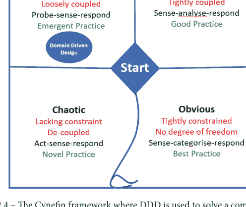

图 2.4 – 在 Cynefin 框架中 DDD 用于解决复杂问题

让我们继续讨论下一个混沌的上下文，并讨论在混沌之中我们应该做什么，即完全掌控。

# Snowden 的混沌上下文 – “新颖解决方案的领域”

混沌上下文处于新颖解决方案的领域。

# Approach

混沌领域是指问题或情况失控，首要任务是稳定情况或遏制当前问题。很多时候，这需要一个快速修复，这可能不是最好的解决方案，但只要它能稳定问题，目前就足够了。

我们需要 行动 – 感知 – 响应，如下：

- 行动以实施快速稳定解决方案
- 感知：评估情况并确定下一步
- 响应：采取行动将问题移至复杂上下文

# Risk

为了使混沌解决方案成功，我们必须进行风险评估以确定风险并对其进行优先级排序。在危机期间，通过有效沟通获得准确信息非常重要。这些信息将帮助你将问题移入复杂领域。再次强调，正如前面提到的，缺乏知识可能使你陷入混沌领域，因此知识应成为优先事项。

很多时候，我们一开始就发现自己处于无序空间中，如图 2.4 所示，因为无序是起点。

# Snowden 的无序上下文 – “中间的空间”

无序上下文是起点的中间空间。

# Approach

无序领域是指你不知道自己身在何处，因此处于无序状态。

我们需要 评估 – 感知 – 移动，如下：

- 评估你所拥有的信息
- 感知你知道什么和不知道什么，然后收集足够的信息
- 根据收集到的信息移动到正确的上下文以开发解决方案

# Risk

在分析瘫痪中，你可能会陷入无休止的分析循环，此时需要寻求专家来帮助评估阶段。

# 我们的道路清晰了

一旦我们确定问题是简单（显而易见）、复杂还是复杂的，我们就能更好地了解应采取何种方法来解决我们试图解决或处理的该业务领域或业务功能相关的问题。

如果问题是简单的（显而易见的），我们可以使用最佳实践——例如，目录查找。如果这是一个常见的业务问题，我们可以购买现成的产品或使用定义良好的框架。这里的重点是我们不必编写自定义代码；我们可以采用一些现有的工具或流程来处理该上下文及其数据和行为。

如果问题是复杂的，我们可以聘请专家来帮助实施良好实践并建议我们需要哪些工具或框架，或它们的组合，以处理该微服务职责的需求。

如果我们确定我们正在处理一个复杂的问题空间，我们可以使用 DDD“探测 感知 响应”并发现随着对问题域理解加深而演变的新兴行为。这可以通过使用事件风暴和 DDD 模型驱动方法来实现，我们将在接下来探索两者。让我们从事件风暴开始。

# Event storming

事件风暴是一种基于研讨会的 methodology，非常有效地帮助你快速了解业务工作流程并获得对业务领域的更深入了解，以便部署满足业务需求的软件。与其他方法相比，它极其轻量且互动性强，故意不需要使用计算机进行，并专注于业务语言。结果以彩色便签表达：橙色表示事件，蓝色表示命令，黄色表示聚合体，浅紫色表示策略，热粉色表示问题，绿色表示读模型（用户为做出决策所需的数据视图），浅粉色表示外部依赖，所有这些都沿着时间线从左到右放置在宽大的墙上。业务流程被“风暴化”为一系列领域事件，以橙色便签表示，业务和开发团队成员在场共同工作，这被称为团队建模。这需要一名引导者。

事件风暴由 Alberto Brandolini 发明，基于 DDD。事件风暴是快速构建逻辑模型、领域模型、工作流、企业集成和企业解决方案需求的快速方法。事件风暴的想法是将软件开发团队和领域专家聚集在一起进行头脑风暴并相互学习。为了使学习过程更高效，事件风暴旨在有趣。它鼓励每个人参与，没有坏主意。时间线上发布的所有内容都将在流程进行过程中受到挑战和完善。受邀参加事件风暴的人对它的成功至关重要。团队由开发团队的五名成员组成，例如开发人员、测试人员、架构师和产品负责人，以及来自组织各个层面的五名业务人员——从分析师和管理人员到团队成员，甚至高级领导，他们具有不同的观点和深厚的领域知识。名称的选择是为了表明重点应放在领域事件上，并且该方法的工作方式类似于头脑风暴或敏捷建模的模型风暴。

# DDD

DDD 由 Eric Evans 在他的蓝皮书 *Domain-Driven Design: Tackling Complexity in the Heart of Software* 中引入。

Eric Evans 描述了三个关键概念，将帮助我们在了解业务需求并构建满足业务需求的微服务的旅程中。这些三个概念将我们的领域提炼成我们可以实现并使微服务实现成功的战术模式的模型。这些概念如下列出：

- 对利益相关者需求缺乏认识
- 知识压缩的领域模型
- **通用语言**（UL）
- 将模型绑定到实现

我们将在下一节中详细讨论这些概念中的每一个。

# 对利益相关者需求缺乏认识

开发软件的主要目的是满足某些利益相关者的需求。如果我告诉你，利益相关者不仅仅是要求开发软件的人呢？事实上，利益相关者包括参与流程中的每个人，包括开发团队和业务用户。每个利益相关者都有不同的需求——业务利益相关者的需求与开发团队的不同，所有利益相关者的需求都必须得到满足。业务人员需要一个应用程序来满足业务需求或提供新功能。开发团队的需求围绕开发软件，虽然每个利益相关者的需求不同，但它们需要得到解决才能成功开发微服务。沟通是满足所有利益相关者需求的关键，DDD 通过提供理解这些需求的过程或框架来帮助我们满足所有需求。DDD 的优势在于理解问题空间，分析和沟通需要首先发生。DDD 帮助将所有这些需求与业务利益相关者的需求联系起来，并且这些需求通过开发领域模型得到满足。开发者的需求由代码模型提供，该模型源自领域模型。领域模型使用 UL 和知识压缩开发，然后，我们通过代码模型的实现将一切结合起来。我们现在可以检查 DDD 如何解决利益相关者的需求并提供我们需要成功的认识。我们将从知识压缩开始。


领域专家、SME 以及你在业务中需要与之进行知识压缩的人，可能对技术术语的理解有限，并且即使他们不懂也会装作懂以避免显得天真，而事实恰恰相反。相信我——领域专家非常聪明，是他们的知识是你需要的，而不是相反。事实上，他们拥有自己非常复杂的语言，而我们开发者需要快速学习并理解他们的语言。我们必须适应去与业务专家交流并理解他们，这将成为我们与业务的共同语言，并形成 UL。不仅我们需要学习业务语言，而且我们还需要在设计中实施它，通过使用业务的语言来命名我们的开发产物，例如服务、对象和模块。

随着项目的增长，越来越多的开发团队参与构建和拥有不同的领域并为这些领域开发微服务，使用 UL 变得非常重要。这种增长会产生对共同语言的更大需求，因为团队需要彼此以及与业务进行沟通，我们都需要使用相同的业务语言进行交流。开发者仍然会有他们彼此交流的语言，但类、服务、方法 and 函数的名称始终应反映业务行为和属性并具有业务名称。我们观察到翻译是一种选择，但这会留下误译的空间。这些翻译可能发生在业务专家和开发者之间，也可能发生在开发团队之间。翻译存在风险，因为总有可能在翻译中丢失某些东西——这是我们都听过的话。

领域专家对软件开发相关的技术术语知之甚少；另一方面，领域专家使用其领域的术语，这可能有各种形式。与领域专家相比，开发者可能会以描述性的技术术语、编程术语和功能术语来理解和讨论一个系统，这些术语在业务领域专家的语言中没有任何意义。开发者还可能开发支持其设计的模型抽象，但这些抽象对领域专家没有任何意义，这会造成混淆并阻碍沟通。

在不同部分工作的问题上的开发者会自行设计概念和描述领域的方式，因此沟通中断或出现歧义是很常见的。跨越这种语言鸿沟，领域专家会含糊地描述他们在应用程序中想要什么。虽然开发者努力理解对他们来说新的领域，不完整的理解会表现为 bug，或者更糟——完全无法满足业务需求。团队中的少数成员可能设法成为双语者，但他们成为信息流的瓶颈，而且在很多情况下他们的翻译并不精确。

## 不是万能药

即使我们不会使用 DDD 来解决所有问题，例如在简单和复杂上下文中开发的情况，正如我们在 Cynefin 框架中探讨的那样，我们将在知识压缩头脑风暴会议期间讨论简单和复杂上下文，以识别什么是复杂、什么不是。然后，我们可以将大部分分析工作和实验集中在复杂领域。你会希望将最好的人才和更多的资源与精力投入到这些复杂领域，或在 DDD 中称为核心领域。

核心领域使我们的业务独一无二，使我们与竞争对手区别开来，并为我们提供优势。核心领域是我们将重点投入大部分努力的领域，而与之相对的是复杂和简单上下文，它们在 DDD 中是支持领域或子领域。子领域处理基础设施问题或简单的数据持久化操作。这些子领域仍然很重要，因为我们需要理解它们在我们问题空间或业务领域的整体视图中的作用。

对我们的问题空间有一个整体视图并理解核心领域和支持领域是什么至关重要。这将告知我们需要创建哪些服务。有了这种理解，我们就可以着手构建我们需要的服务类型，无论是子领域的支持型微服务，还是具有高复杂性的核心领域微服务。我们构建的微服务需要支持领域模型。

DDD 并不是某一种东西，而更像是一组最佳实践，就像 DevOps 一样，它被描述为一群人、流程和工具的集合。DDD 由 Eric Evans 在考虑到敏捷流程和 **持续集成/持续交付 (CI/CD)** 概念的情况下设计，并采用了 Martin Fowler 和 Robert Martin 等人的知名战略和战术模式。它基于 **关注点分离 (SoC)**、整洁架构和 SOLID 原则等最佳实践，并包括 Martin Fowler 的领域模块，等等。DDD 遵循的这些经验教训和最佳实践的集合将帮助我们解决复杂的业务问题，并将我们的业务模型提炼成采用模型驱动设计的抽象。

模型驱动设计本身就是一个概念，但如前所述，DDD 由最佳实践组成，模型驱动设计作为 DDD 的一部分被采用。模型驱动设计为我们提供了一种将业务逻辑模型翻译成我们将用于构建应用程序的软件模型的方法——在我们的例子中，是我们的微服务。通过理解 DDD 所扮演的角色，我们可以构建满足业务领域独特需求的微服务。

接下来，我们将研究如何将业务领域划分为边界。这可以在白板上完成，旨在非正式以促进对话。此时不必担心完美——这更多是关于发现。

## 边界很重要

边界对 OOP 来说并不新鲜，就像封装的概念一样，我们用它来隐藏内部实现细节，只通过一个定义良好的接口暴露它们。随着我们转向微服务架构，我们很快会意识到需要对这些边界有更深入的理解，以及我们在边界内部以及与外部边界的集成方式。边界代表不同的业务概念或支持相似概念，但它们在应用程序自身的整体边界内运行于不同的模型，具有不同的关注点或职责，如下图所示：

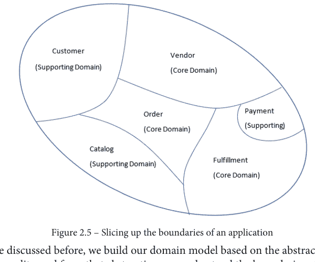

图 2.5 – 划分应用程序的边界

正如我们之前讨论的，我们基于业务现实的抽象构建领域模型，从该抽象中，我们理解我们领域的边界——不仅仅是边界内的内容，我们还需要理解边界的边缘以及我们领域边界之间的关系。我们使用通过与领域专家和开发团队进行知识压缩而开发的 UL 来定义这些上下文边界。这引出了有界上下文的概念。这就是我们开始将领域逻辑模型与模型在代码中的战术实现对齐的过程，这将转化为一个微服务或一组微服务。

有界上下文与我们已识别的领域保持一致，将形成我们的微服务并在其周围建立边界。

## 有界上下文

在构建微服务时，我们将它们与有界上下文对齐，而这些有界上下文与特定的领域模型对齐。有界上下文构成了领域模型的组件，从数据库方案到行为和领域对象。每个有界上下文都有自己的 UL、自己的模型和子模型。

正如我们再次看到的，有界上下文与微服务保持一致，因为每个有界上下文可以是一个微服务或一组微服务。

一旦我们定义了有界上下文，我们需要更好地理解它们之间的关系，我们可以用一种非常松散的草图来做到这一点，即上下文映射，如 *图 2.6* 所示。

## 上下文映射

为了理解我们有界上下文之间的关系以及它们如何在更大的图景中契合，我们创建上下文映射。该映射是开发团队的绝佳沟通工具，有助于促进关于技术、战术和集成问题的对话。上下文映射帮助我们可视化全貌，理解上下文之间的通信，以及分配到不同有界上下文的团队如何相互通信，如下图所示：

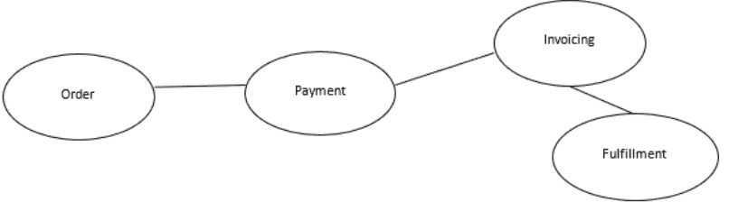

图 2.6 – 上下文映射中的有界上下文


## Open host

开放主机，如下图所示，位于服务层的边缘，为外部有界上下文的多个端点提供翻译，以保护内部模型不被破坏。当我们有许多需要翻译和维护的服务时，维护变得复杂，开放主机可以帮助我们。我们可以通过为每个翻译实现端点来实现开放主机：

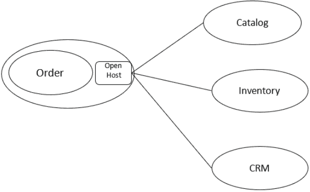

图 2.9 – 开放主机位于服务的边缘

微服务通过 RESTful API 暴露来实现开放主机，如 *图 2.9* 所示。这些 API 具有端点，可提供对内部的访问并在一种模型到另一种模型之间进行翻译。

## Aggregates

在 DDD 中，聚合可能是一个令人困惑的概念。一种看待方式是将其视为代表领域概念的聚合，例如发票或订单。聚合是一个事务边界，通过将与业务规则和不变量相关的实体组合在一次事务中来强制执行业务不变量。

例如，如果订单在收到付款之前就已发货，那么我们就破坏了不变量或业务规则，因为付款必须在订单发货前收到才有意义。在前面的例子中，我们将付款放在了错误的顺序，应用程序现在处于损坏状态，因为业务不变量被破坏了。

## Transactional boundary

保证对复杂业务关联中对象更改的一致性具有挑战性，至少可以说如此，因为我们需要强制执行业务不变量。如果我们的聚合包含地址等常见对象，其他聚合可以引用它们并围绕它们有不同的业务规则，这些常见对象会产生竞争，导致锁定问题，因为聚合可能同时尝试更新同一对象。这些锁定问题会负面影响性能，甚至导致应用程序崩溃。通过基于避免高竞争和收紧严格不变量的平衡分组，我们可以避免锁定问题，并为常见对象提供自己的聚合事务边界，这将使常见对象负责更新自身及其内部对象，如下图所示：

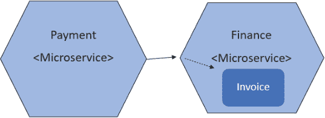

图 2.10 – 更改通过根进行

要将概念上的聚合转化为实现，我们需要遵循所有事务的重要规则。

每个聚合都有一个具有全局身份的根实体，它还具有具有内部身份的内部对象，只能通过根遍历。没有任何外部实体可以直接引用聚合的内部成员。

对聚合及其成员状态的所有更改都通过根进行。如果外部聚合需要来自另一个聚合的内部对象，它们可以从该聚合的根请求副本。聚合的内部成员可以使用全局身份引用外部聚合根。

只有根聚合可以通过直接查询数据库获得。所有其他对象必须通过根聚合关联的遍历找到。

如果执行删除操作，它必须一次删除聚合边界内的所有内容。当聚合边界内对象的状态或更改被提交时，整个聚合的所有不变量必须得到满足。

更改状态的事务本就难以管理，但当我们尝试更新状态并满足某种请求-响应设计时，这会使生活比必要更困难。让我们通过讨论数据流的方向来讨论这个问题。

## Bidirectional communication between services creates complexity.

使用请求-响应模型进行双向通信会使服务紧密耦合并增加复杂性，如以下屏幕截图所示：

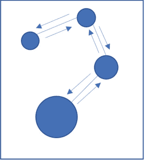

图 2.11 – 双向通信

这通常发生在团队将聚合与 **用户界面 (UI)** 关注点对齐时，这是一个常见的错误。聚合应与业务规则和领域不变量对齐，如我们之前所讨论的，因此避免通过 UI 的视角看待世界的陷阱。为了简化这一点，转向单向方向并分离命令和查询或请求和响应的职责。有时这是不可避免的——在请求返回响应的情况下，可能需要响应才能继续，就像 UI 层需要所有可用项目的目录以便客户选择要购买的项目的情况。在下订单的情况下，这将变成一个命令，并且应为单向命令以创建订单、持久化所选项目的订单并引发事件以表示已创建订单，以便其他服务可以在工作流中执行其角色。

单向设计是更好的选择，因为我们首先需要确保已强制执行业务不变量并且领域对象处于正确状态。这可以通过采用 **命令查询职责分离 (CQRS)** 原则来实现。命令是一个单向概念，如下图所示：

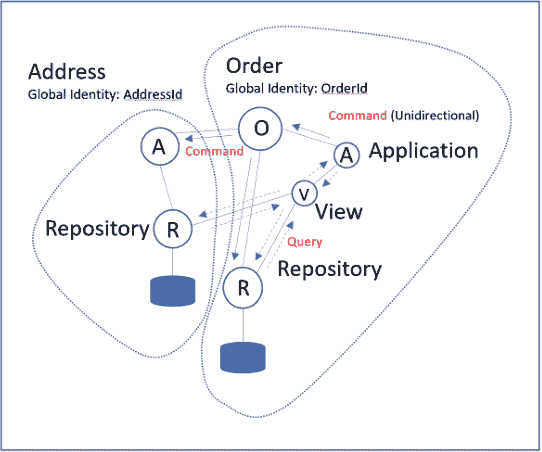

图 2.12 – 命令查询分离

然后，根据以下内容对你的聚合进行分组：

- 业务不变量
- 语言
- 支持业务规则的关联和逻辑分组

如以下图所示，我们根据其事务边界对聚合及其内部实体进行分组，这强制执行业务不变量或业务规则：

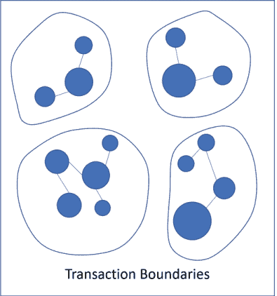

图 2.13 – 按关联分组的事务边界

## Aligned teams

正如我们学习了一些构建微服务的重要准则，一个需要考虑的重要方面是组成将构建微服务的团队的人员。需要考虑的一些重要事项如下：

- 技能组合
- 动力
- 资源
- 文化

正如我们所学，微服务和 DDD 都指出团队与服务或有界上下文对齐，这可以代表一个微服务或在其各自边界内的微服务集合。这些团队负责以敏捷和自主的方式开发、测试、集成和部署这些微服务。这意味着它们不依赖其他团队来部署其服务，因为它们拥有可以独立推送和部署到生产环境的单独代码库。我们需要高度有动力的人来构建复杂的微服务，因为挑战可能相当大且学习曲线陡峭。我们需要构建复杂服务所需的时间和资源，这也意味着人，这是最宝贵的资源。我们希望将最有才华和最熟练的人放在需要构建复杂服务的团队中。我们不能低估整个组织拥抱团队模型构建方法并认同和支持这种方法的重要性。组织的文化必须发展，以认识到整个业务领域专家团队与部署团队在整个开发生命周期中紧密合作的重要性。

## Iterative process

短反馈循环将允许通过在我们的敏捷仪式中深度参与业务领域专家并不断使领域模型与代码模型保持一致来实验和探索领域。我们必须利用 UL 通过与业务专家密切合作来消除歧义。我们可以通过通过共享语言获得深入的领域知识来发展我们的微服务以实现伟大的业务目标。

随着我们知识压缩并获得更深入的领域知识，模型的持续演进就会发生。这使得应用程序能够从我们获得的知识中改进和涌现。我们通过使用采用短反馈循环的敏捷流程来实现这一点，而不是像瀑布方法那样进行大量的前期分析和设计。

我们从 **最小可行产品 (MVP)** 开始并迭代模型。随着我们获得领域知识，模型演进为设计良好的服务的实现。设计仍然是流程的一部分——只是以更小块和更有效的敏捷方式完成。


通过理解DDD在构建微服务中的作用，我们能够更好地构建正确的微服务，并在构建服务时投入合理的精力和资源。我们现在明白，并非所有微服务都相同，它们具有不同的复杂度。我们还认识到，微服务及其构建团队需要相互集成和沟通，而DDD为我们提供了工具，帮助小团队构建、测试和部署微服务。我们已经了解了边界的重要性，以及DDD的限界上下文和聚合如何帮助识别这些边界。在我看来，微服务的一个反模式是不理解DDD，不仅不理解其战术模式，也不理解其分析模型驱动的战略模式以及通用语言（UL）的力量。

## 总结

本章开始时，我们概述了什么是微服务以及它们与DDD的关系，以便你理解它们之间的关系。我们还探讨了与DDD相比，微服务的优点和挑战。

之后，我们学习了DDD如何与微服务的特性相关联，以及团队需要与服务对齐，理想情况下是一个团队对一个微服务的一一对应。每个服务都应该有自己的代码库，由一个团队管理。我们了解到需要从整体上看待微服务架构。我们还讨论了Cynefin框架，以确定我们试图解决的问题类型，从而了解构建微服务所需的精力和资源。

我们讨论了每个边界如何基于聚合的逻辑分组，这些聚合是事务边界并强制执行领域的不变量。我们了解到，我们可能不会第一次就做对，随着对领域知识的加深，边界会随着时间推移而不断变化。最后，我们学习了微服务如何相互通信和集成，以及团队如何沟通和集成。

至此，你应该已经认识到理解DDD对于构建具有限界上下文的内聚服务的重要性，以及团队建设、治理和利益相关者意识的重要性。

## 问题

- 1. DDD对你在构建微服务方面的成功重要吗？
- 2. 哪三个概念有助于将问题空间提炼为模型？
- 3. 关于聚合，最需要理解的是什么？

## 延伸阅读

- *《领域驱动设计——驾驭软件核心的复杂性》* Eric Evans, Pearson.
- *《事件风暴》*，作者：Alberto Brandolini (https://www.eventstorming.com/book/)
- https://docs.microsoft.com/en-us/azure/architecture/

## 微服务

### 架构陷阱

如今，许多组织都希望在产品供应链中引入敏捷性，并通过整合客户反馈来优化其交付过程的各个方面。这些组织中的大多数已经踏上了采用新应用程序构建方式之路。DevOps、云原生、容器和微服务是帮助这些组织在竞争对手中脱颖而出的领跑者。

**微服务**是一种演进式架构，它解决了从先前架构中吸取的教训，以避免潜在的陷阱。理解这些陷阱非常重要，以避免在构建微服务架构时犯同样的错误，甚至使事情变得更糟。微服务有很多优点，但需要仔细规划和设计才能获得其长期的益处。

在本章中，我们将根据微服务设计原则评估不同的架构模式，以了解不同的选择如何影响微服务架构。为了支持这一解释，我们将使用一个电子商务应用程序的示例，并应用不同的架构模式来理解它们的影响。

本章将涵盖以下主题：

- 分层架构及其挑战
- 过度设计微服务
- 过度使用框架和技术
- 未抽象出常见的微服务任务
- 缺乏对微服务平台的了解
- 采用前端单体架构抵消微服务的优势

在本章结束时，你将能够理解微服务中采用的不同架构风格背后的动机、它们的陷阱以及潜在的解决方案。此外，我们将讨论过度设计微服务以及尝试各种工具、技术和框架如何导致微服务的复杂性和管理难度增加。

## 分层架构及其挑战

**分层架构**是一种软件架构方法，其中应用程序被组织为多个层中的一组组件。每层包含多个组件，用于处理特定的关注点，并且每层只能与其关联的下层通信。这种通信方式有助于避免分层架构中的循环依赖。分层架构没有指定层数，但在大多数应用程序中通常有四个层（**表示层**、**业务逻辑层**、**数据访问层**和**数据库层**）。分层架构帮助组织在构建应用程序时创建与不同技术能力对齐的不同团队。

然而，由于不同层之间的紧密耦合，在分层架构中进行更改的能力受到限制。随着应用程序的增长，由于对应用程序内部不同领域缺乏了解，进行更改变得更加耗时。任何更改在实施前都需要由不同团队彻底分析其影响，这增加了团队之间的沟通。这些应用程序的部署频率通常很耗时，需要构建、测试和发布完整的应用程序。如果不同团队在处理不同的功能分支，则这些分支应该合并到主分支。生产环境中的部署通常计划并安排在非工作时间，这会导致应用程序停机。与DevOps相比，分层应用程序的部署节奏通常为每季度一次。

微服务使团队可以自由选择适合其实现的架构风格，无论是层（layer）、级（tier）还是其他方式。让我们仔细看看微服务架构的分层方案。

## 微服务架构

分层架构并不是一种糟糕的做法；它允许团队将代码组织在不同的层中，以帮助他们理解服务。随着你的微服务开始变得更为庞大，采用分层架构来实现微服务可能是正确的选择。然而，根据微服务设计原则，每个团队都拥有完全自主权来选择合适的技术来构建每个微服务。下图是一个电子商务网站微服务架构的示意图：

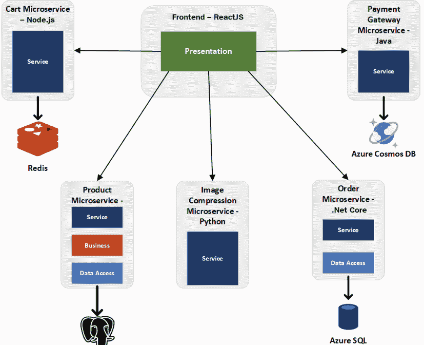

图3.1 – 不同分层方案的微服务

上图展示了一个包含多种微服务的微服务架构，每个微服务都有自己的分层方案。让我们在这里讨论每个微服务：

- **购物车微服务**负责管理顾客购物时的购物车。该服务使用Node.js和Redis缓存，并采用*服务*层开发。服务层包含业务逻辑和数据访问逻辑，以在Redis缓存中持久化数据。
- **产品微服务**负责管理产品。该服务使用PHP和PostgreSQL，并采用多个层（服务层、业务层和数据访问层）开发。
- **图片压缩微服务**负责压缩用于展示的产品图片。它只有一个层，封装了处理图像所需的全部逻辑。
- **订单微服务**负责管理客户订单。该服务使用.NET Core和Azure SQL，并采用多个层（服务层和数据访问层）开发。
- **支付网关微服务**负责管理支付。该服务使用Java和Azure Cosmos DB开发。该微服务只有一个层，封装了处理支付和持久化所需的全部逻辑。

理论上，微服务架构通过允许你选择各种技术，为微服务带来了更多的灵活性和自主性。然而，这有一个需要注意的地方：每种技术都有其自身的陷阱和运营特性。由于这些技术的扩散，组织可能会错失建立内部专业知识和知识库的机会，并且当工程师切换团队时，上手时间会变得更长。此外，由于组织中使用多种语言，创建和拥有共享库组件变得相当困难。在实践中，组织倾向于在更少的技术上进行整合。接下来，我们将探讨设计单个微服务如何影响微服务的可维护性、可部署性和可扩展性。


## 过度设计微服务

**过度架构**或**过度设计**是一个主观术语，存在很大的讨论空间，但在我看来，它指的是你花费时间和精力去解决那些你并不存在或无法预见到的架构问题，最终导致架构难以阅读和遵循。作为架构师，你应该始终努力让整体架构更易于理解和维护，以支持未来的增强。微服务架构本身就可能让团队感到不知所措，从而促使他们在整个系统中寻找相似之处并应用通用解决方案，而不是专注于具体用例。例如，如果在项目早期花费过多时间进行过度架构设计，可能会浪费宝贵的时间，从而导致编码活动启动时出现延误。很多时候，随着团队对用例的了解越来越深入，应用程序设计也会不断演进。在接下来的几节中，我们将讨论过度设计微服务时常见的陷阱。

## 实体微服务

**实体微服务**是一种架构模式，其中微服务被设计为细粒度的，并围绕单个实体进行建模。在大多数情况下，这些微服务包含简单的**创建、读取、更新和删除（CRUD）**方法。下面以购物车微服务的形式展示了一个实体微服务的示例：

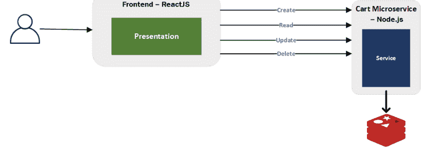

图 3.2 – 实体微服务

在上图中，购物车微服务被设计为一个仅暴露 CRUD 方法的实体微服务。表示层使用 **React.js** 构建，可以调用购物车微服务中可用的方法。使用实体微服务的缺点在于其功能有限，难以满足各种业务用例。在这种情况下，实体微服务的消费者需要实现额外的功能来处理与购物车微服务相关的业务用例。解决这一挑战的另一种方法是构建包含业务能力的聚合微服务。这需要不同实体微服务之间进行协调，以处理各种业务用例，如下图所示：

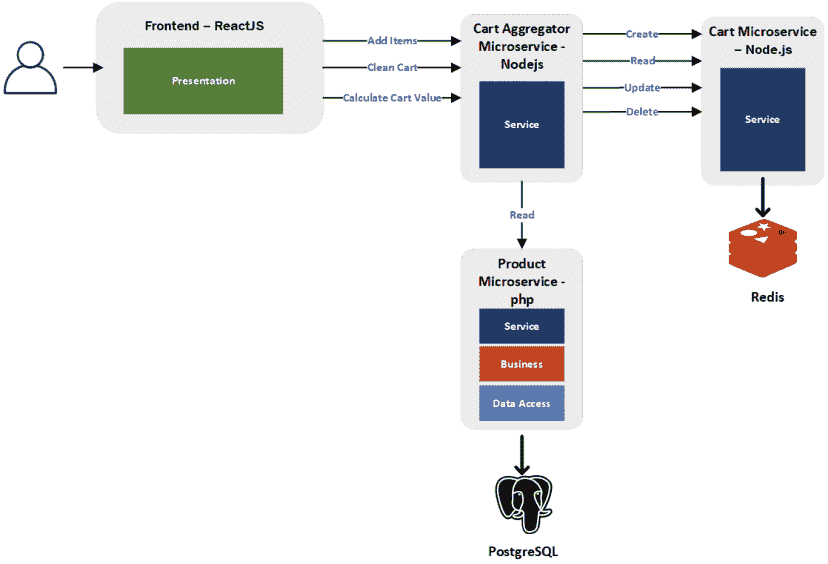

在上图中，引入了购物车聚合微服务来整合额外的业务能力。让我们更详细地看一下：

- **添加商品**是一项业务能力，允许客户将多个商品添加到购物车。你可以通过在将这些商品放入购物车之前检查库存来增强此功能。
- **清空购物车**是一项向最终用户公开的业务能力，用于清空购物篮，而不是从购物车中逐个移除商品。
- **计算购物车价值**是一项业务能力，帮助客户查看购物篮的总价值。购物车微服务调用产品定价微服务中可用的方法来获取产品定价。然后可以通过添加诸如**计算运费**之类的功能来增强此微服务。

下图描绘了一个涉及实体微服务和聚合微服务的微服务架构：

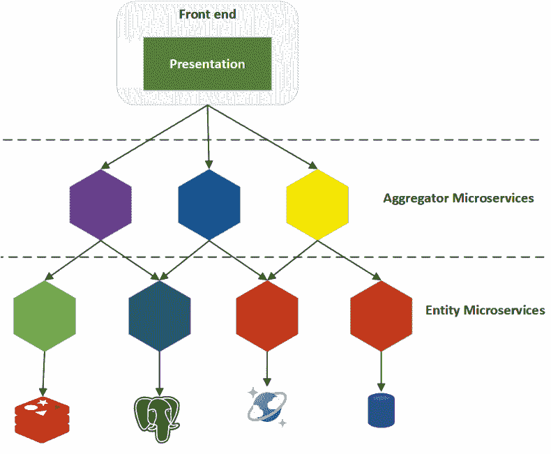

图 3.4 – 实体微服务和聚合微服务的实际应用

上图展示了应用程序中多个实体微服务和聚合微服务之间的交互。由于实体微服务仅提供有限的功能，大多数功能都在聚合微服务中实现，这导致多个微服务之间产生了依赖关系。它还引入了语义耦合，即一个微服务中的变更会引发其他微服务中的变更，从而增加了通信开销，影响了微服务的整体敏捷性。

## 聚合微服务

在微服务架构中，客户端可以通过不同方式与不同的微服务通信。在较小的项目中，你可以直接调用微服务，特别是当你拥有服务器端客户端应用程序（如 ASP.NET）时。然而，处理桌面应用和移动应用等客户端则更加困难，因为每个客户端可能都有自己的限制和要求。随着你开始添加更多微服务，维护与这些微服务的多个连接是另一个需要注意的挑战。

随着应用程序变得越来越复杂，微服务违反限界上下文规则并添加不属于该微服务的额外功能的情况并不少见。处理横切关注点（如数据转换、身份验证、授权和协议转换）不应成为业务微服务的一部分；相反，应将其委托给单独的微服务。我们将此称为 API 网关微服务。该微服务负责管理客户端连接和跨不同微服务的负载分配，同时处理一些横切关注点。这种方法有助于减少客户端的调用次数，以解决架构中部分“聊天式”行为。下图描绘了 API 网关微服务与系统中其他微服务之间的直接交互：

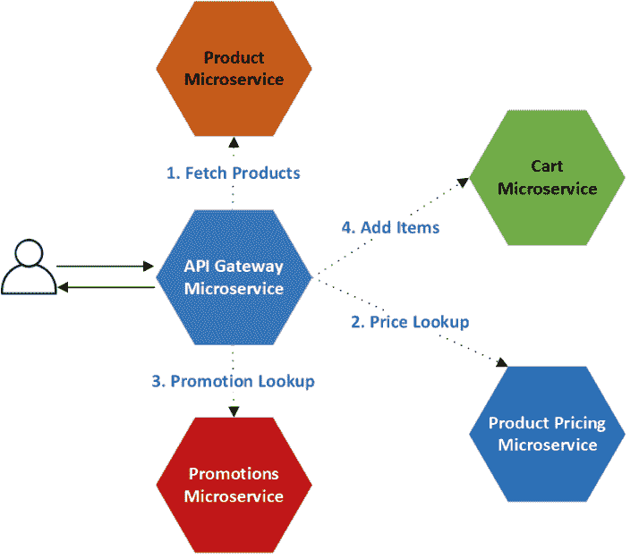

在上图中，API 网关微服务在将商品添加到购物车之前调用了不同的微服务。调用顺序如下：

- 1. API 网关微服务调用**产品微服务**，以获取客户在浏览网站时指定的产品信息。
- 2. API 网关微服务调用**产品定价微服务**，以获取所指定产品的定价信息。如果你在不同国家/地区销售产品，那么 API 网关微服务可能还需要执行货币转换。
- 3. API 网关微服务调用**促销微服务**，以获取所有适用于客户的促销活动，并在编制最终定价之前应用折扣。
- 4. 一旦从不同微服务收集了所有必要信息，API 网关微服务会将商品及其价格和促销活动添加到购物车中。

从某种意义上说，API 网关微服务使业务微服务能够专注于其预期目的，而无需同步调用其他微服务，但这也增加了 API 网关微服务的责任和复杂性。这引出了两个重要问题：

- 我们能否简化 API 网关微服务，并将其与后端微服务解耦？

聚合微服务模式可以帮助你构建负责编排不同微服务之间通信的微服务。聚合微服务充当单一联系点，负责调用不同的微服务并收集数据以执行业务任务，而 API 网关微服务则专门处理横切关注点。下图显示了不同微服务（包括聚合微服务和 API 网关微服务）之间的交互：

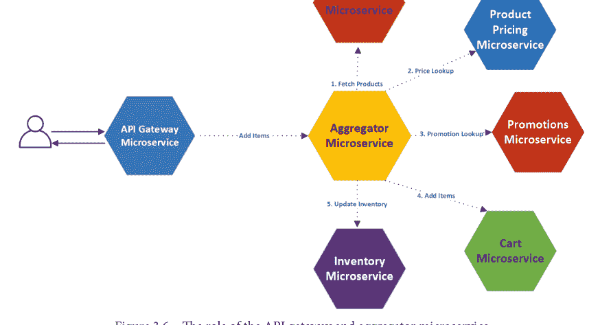

图 3.6 – API 网关和聚合微服务的角色

在上图中，API 网关微服务充当后端微服务的网关，允许不同的客户端连接并消费微服务功能。客户端不了解任何微服务，也不了解用于构建这些微服务的架构。API 网关微服务还负责处理横切关注点。聚合微服务可以作为 API 网关微服务的门面。聚合微服务在填充购物车之前调用必要的微服务以获取相关信息。

不建议自行构建 API 网关微服务。相反，你应该使用 API 网关即服务，它可以为你处理可伸缩性和可用性问题。Azure API 管理是一项托管服务，可以帮助你将 API 发布给不同的客户端以供消费。此外，建议你使用多个 API 网关来暴露有限的业务能力或服务于特定客户端类型（Web、移动或平板）。多个 API 网关将在*第 6 章“通信陷阱与预防”*中详细讨论。

- 我们能否解决架构的“聊天式”特性？

物化视图模式可帮助你保留其他微服务数据的本地副本（读模型），这对于主微服务实现更高的自给自足是必要的。此模式有助于消除对其他微服务的调用，从而提高微服务的响应时间和可靠性。采用此模式将导致数据在微服务之间重复，尽管在云原生应用程序中，数据重复并不被视为反模式。确保只有一个微服务拥有数据；其他微服务可以拥有数据的读模型。读模型在微服务之间同步。读模型通常使用异步消息传递模式（如发布/订阅模式）进行同步。读模型旨在通过额外的索引、聚合和数据存储格式来提供更好的性能，以减少处理时间。物化视图需要首次发布，以确保主服务能够获得必要的数据来正常运行。在构建物化视图时，需要考虑的一个重要方面是维护多份数据副本的成本，以及物化视图中数据过期所带来的业务影响。


下图演示了使用物化视图模式时，购物车微服务与库存微服务之间的交互：

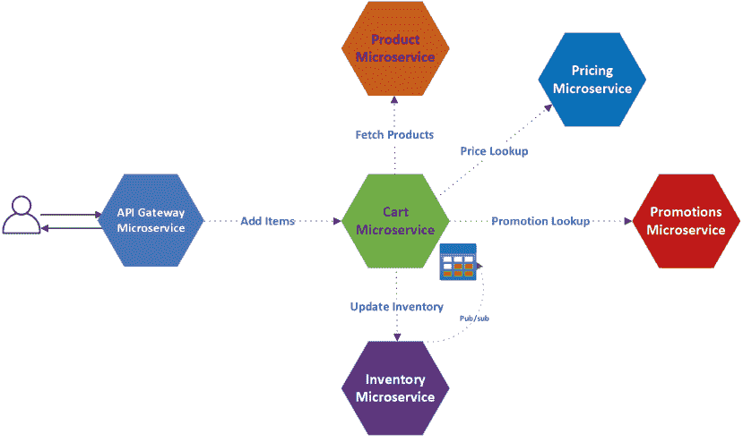

图 3.7 – 物化视图模式

在上图中，购物车微服务维护了一个库存微服务的读模型，它使用发布/订阅模型接收来自库存微服务的更新。一旦商品被添加到购物车，购物车微服务就会通知库存微服务减少其数量，库存微服务再通知所有订阅者。你可以看到，其他微服务仍然通过相同的通信模式访问，这是由这些微服务（子域）的动态特性决定的。例如，定价和促销更具动态性，定价或促销的变化可能带来业务影响。在这种情况下，倾向于使用新鲜数据而不是物化视图是一个好主意。你应该实现最终一致性来同步读模型，并且还考虑实现补偿事务模式来解决任何数据一致性故障。让我们看看另一个用例，其中物化视图更有用：

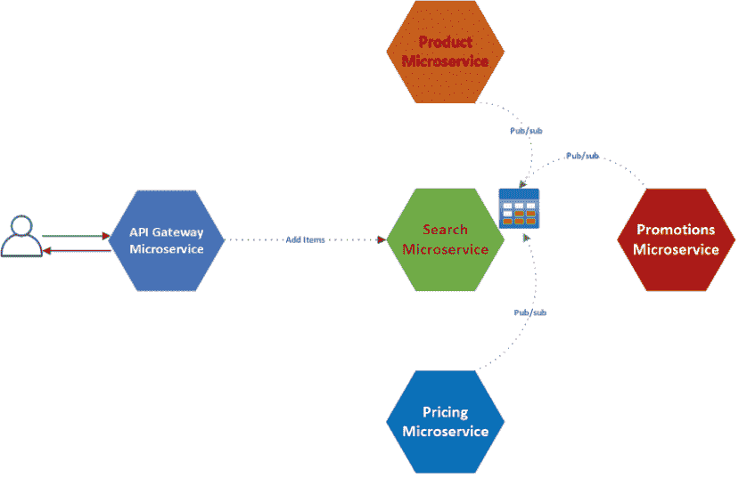

图 3.8 – 搜索微服务的物化视图

在上图中，搜索服务使用读模型存储来自不同服务的数据，以便在服务用户时实现自给自足。此外，重要的是要理解，在搜索结果中呈现过期数据的影响可能与购物车微服务不同。

## 纳米服务

**纳米服务**是一种架构模式，其中服务被设计得比微服务更细粒度。这些服务严格负责单一任务。纳米服务是作为乐高®积木构建的，可以与其他纳米服务一起使用以提供功能。

纳米服务具有以下特性：

- 小且细粒度
- 可独立部署
- 可测试
- 可重用

下图展示了如何将微服务分解为各种纳米服务：

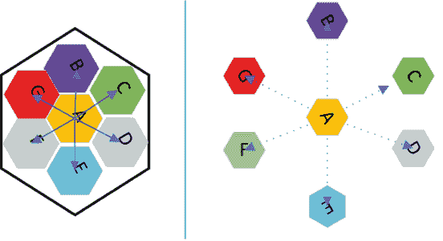

图 3.9 – 纳米服务

在上图中，一个微服务被分解为多个纳米服务以实现更细的粒度，其中纳米服务 A 可以与生态系统中的其他纳米服务通信。这种通信模式并不受限，因为任何这些纳米服务都可以以不同方式调用其他纳米服务，以实现并行处理、流水线、工作流和事件。每个纳米服务都可以独立地构建、测试和部署。在纳米服务架构中，纳米服务可以被其他纳米服务重用以执行某项功能。

与微服务相比，纳米服务粒度过细。纳米服务具有单一职责，但它不遵循领域驱动设计和限界上下文的原则。业务能力通常分散在不同的纳米服务中，这些服务封装了碎片化的业务逻辑，导致纳米服务之间产生通信开销。这影响了单个纳米服务提供任何有意义功能的能力。它还影响了工程速度并增加了维护开销。

团队应专注于通过隔离业务能力来构建微服务，而不是贪婪地让每个服务都变成微服务，从而产生大量纳米服务。理解*领域驱动设计*是构建具有限界上下文以交付业务能力的关键。

> **注意**
> 纳米服务在软件领域有其一席之地，而且在我看来，它们尚未迎来全盛期。无服务器技术在让纳米服务成为主流和推动其采用方面发挥着重要作用。如今，越来越多的架构被设计为包含微服务和纳米服务。

在设计微服务时，理解提供业务能力的业务领域非常重要。粒度过细且功能有限的服务通常会引入依赖关系，从而抵消微服务的好处，并催生分布式单体架构。在下一节中，我们将探讨过度使用框架和技术如何为团队带来可维护性问题，以及如何通过深思熟虑的策略和共享治理模型来解决这些问题。

## 过度使用框架和技术

采用微服务有不同的方式：一方面，团队正在学习并整合新的工具、技术和框架。另一方面，团队也在构建自定义工具以促进其开发和运维。选择多是好事，但如果没有一个共享治理模型来帮助评估工具、技术和框架，那简直就是失败的温床。这可能会影响团队的整体敏捷性，因为他们很有可能将注意力从交付业务价值转移到投资时间和精力在基础设施和工具上。

微服务赋予团队自主权，团队可以为其架构选择合适的技术来帮助提高工程速度。学习和评估不同的运行环境、编程语言、编排平台、事件平台和安全性是微服务工具化的重要方面。这些工具、技术和框架具有各种能力，可帮助组织构建微服务架构。由于微服务是一种架构风格，它没有对工具提供任何具体指导，这可能造成不一致的开发实践，并给系统增加更多复杂性。例如，**断路器模式**是一种常见模式，可以作为微服务代码库、第三方库（Polly 或 Netflix Hystrix）或服务网格（Linkerd 或 Istio）的一部分来实现。

在整个代码库中以一致的方式应用这些模式是一种良好的实践，这将有助于减少代码并提高应用程序的可维护性。用于评估工具、技术和框架的广泛使用的模式之一是能力/特性矩阵。例如，我们在这里使用能力/特性矩阵提供了对不同服务网格技术的评估。服务网格的概念将在第 6 章“通信陷阱与预防”中讨论：

| 特性 | Istio | Linkerd | Consul | Traefik Mesh |
|---|---|---|---|---|
| 架构 |  |  |  |  |
| 平台 | K8s 与虚拟机 | Kubernetes | K8s 与虚拟机 | Kubernetes |
| 入口控制器 | Istio Ingress 或 Istio Gateway | 任意 | Envoy 和 Ambassador | 任意 |
| 高可用 | 是 | 是 | 是 | 是 |
| 安全通信 |  |  |  |  |
| mTLS | 是 | 是 | 是 |  |
| 证书管理 | 是 | 是 | 是 |  |
| 认证与授权 | 是 | 是 | 是 |  |
| mTLS | 是 | 是 | 是 |  |
| 通信协议 |  |  |  |  |
| TCP | 是 | 是 | 是 |  |
| HTTP/1.x | 是 | 是 | 是 |  |
| HTTP/2 | 是 | 是 | 是 |  |
| gRPC | 是 | 是 | 是 |  |
| 流量管理 |  |  |  |  |
| 蓝绿部署 | 是 | 是 | 是 |  |
| 熔断 | 是 | 是 | 是 |  |
| 故障注入 | 是 | 是 | 是 |  |
| 速率限制 | 是 | 是 | 是 |  |
| 可观测性 |  |  |  |  |
| 监控 | 是（Prometheus） | 是（Prometheus） | 是（Prometheus） |  |
| 分布式追踪 | 是 | 部分 | 是 |  |
| 其他特性 |  |  |  |  |
| 运维复杂性 | 高 | 低 | 中 |  |
| 部署 | 通过 Helm 和 Operator 安装 | Helm | Helm |  |
| 多集群 | 是 | 否 | 是 |  |
| 测试 | 是 | 有限 | 否 |  |

表 3.1 – 服务网格比较

在上表中，我们展示了可以帮助你评估不同服务网格的各种因素。这将帮助你为项目选择最合适的服务网格。你还应该考虑将技术支持和社区采用情况作为评估参数。你可以应用类似的技术来评估其他技术——例如，评估不同的日志管理解决方案、不同的 NoSQL 数据库或缓存技术。

微服务是一种演进式架构，这意味着随着新需求的出现，架构也应随之演进。首先，团队应专注于微服务的基础知识来定义和分解它们。最好是先使用所需的工具和技术，然后在深思熟虑后，随着需求的出现再采用新技术。在下一节中，我们将探讨避免抽象常见的微服务任务会如何影响团队降低复杂性和拥抱变化的能力。

## 不抽象常见的微服务任务

**抽象微服务**是一种用于实现微服务架构的实践。大多数情况下，抽象层位于 API 网关层，它提供各种横切关注点来抽象常见任务。然而，市场上有各种工具允许在不向 API 网关层添加抽象的情况下进行抽象，并帮助执行常见任务。

不抽象微服务似乎是一种反模式，因为它需要团队层面的学习投入，而且还会带来与底层技术和你所针对平台的限制相关的挑战。例如，假设你正在用 Go 语言构建一个服务，而消息代理不支持与该服务通信的 SDK。在这种情况下，如果我们可以创建一个与消息代理通信的抽象层，该服务将帮助团队使用它，而不是重复造轮子。如果微服务架构由多语言技术组成，你可以想象所需的工作量。


微服务开发颇具挑战性，因为用于构建分布式应用的可用工具和编程模型运行时非常有限。这些编程模型运行时的语言支持有限，且功能集受到严格控制，针对特定的基础设施平台，跨云和边缘环境的可移植性有限。Dapr 通过抽象后端服务解决了这些问题，使微服务开发变得简单。以下是 Dapr 提供的几个优势：

-   Dapr 将构建分布式应用的常见模式作为构建块提供，可在微服务应用中复用。这些构建块有助于外部化依赖，使开发者能够专注于业务领域，通过整合业务能力为客户创造价值。
-   Dapr 帮助使用任何语言构建云无关的微服务。通过保持应用的可移植性，简化了微服务开发过程。
-   Dapr 是一个开源、跨平台的框架，具有高度可扩展性，可通过 HTTP 和 gRPC API 与任何编程语言配合使用。
-   Dapr 还提供了语言特定的 SDK，使开发者能够使用不同语言轻松开发，而不必仅依赖 HTTP 和 gRPC API。
-   Dapr 代表微服务执行服务发现，使它们无需指定位置即可相互调用。Dapr 还执行服务之间的协议转换，并自动启用基于 mTLS 的通信。

Dapr 是支持抽象化微服务并提供一组构建块来满足常见微服务需求的框架之一。我们将在下一节详细探讨这一点。

## Dapr – 微服务的乐高®

**Dapr** 是一个开源的分布式应用运行时，用于应对分布式系统的复杂性。它还能让你将时间专注于业务逻辑，从而提高开发者的生产力。Dapr 是一个可移植的、事件驱动的运行时，有助于在云和边缘构建基于微服务的应用的各个方面。

Dapr 运行时可以以自托管模式或 Kubernetes 模式运行。在 Kubernetes 模式下，Dapr 将一个 sidecar 注入到 Pod 中，使 sidecar 能够代表应用进行服务调用。这使得应用逻辑简单且轻量，Dapr 负责处理与分布式应用架构相关的开销。应用可以使用不同的语言编写，这意味着它们可以通过可用的 SDK，经由 HTTP 或 gRPC API 来使用 Dapr 运行时。Dapr 以构建块的形式提供其能力，每个构建块处理一组与分布式系统相关的常见挑战，如下图所示：

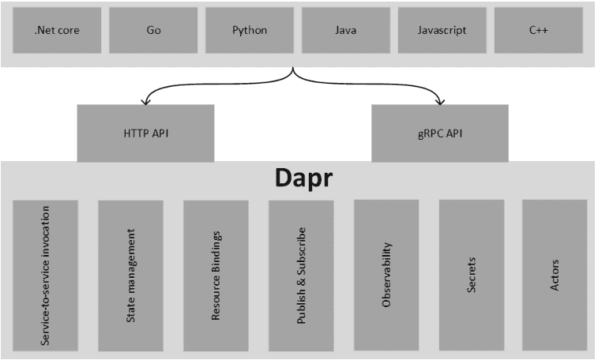

图 3.10 – Dapr 架构

每个构建块都提供了一个规范（API），该规范可以有多种实现，并以 Dapr 组件的形式实现。这有助于你选择适合自己应用的正确实现。在接下来的章节中，我们将更详细地讨论每个构建块。

## 服务到服务调用

在微服务架构中，不同的微服务相互通信以完成业务任务。服务到服务调用有助于解决服务发现、分布式跟踪、错误处理和重试等常见的通信挑战。

## 状态管理

微服务被设计为能够容忍故障。这些微服务具有内部状态，这些状态需要在单个微服务实例的生命周期之后仍然保留，以使这些微服务具有容错能力。Dapr 提供了状态管理构建块，允许你使用任何键/值存储来管理微服务的状态。

## 发布和订阅

发布/订阅模式实现了微服务之间的解耦交互，感兴趣的微服务订阅各个主题，并监听由不同微服务发布的消息。Dapr 提供了发布/订阅构建块，以实现发布/订阅通信模式。

## 资源绑定

绑定提供了一种扩展 Dapr 功能的方式，使外部系统能够与启用 Dapr 的应用进行通信。有两种不同类型的绑定：

-   **输入绑定** 是触发器，使 Dapr 微服务能够响应外部事件。
-   **输出绑定** 允许我们使用 Dapr 调用外部系统。

## Actor

Dapr Actor 运行时是虚拟 Actor 模式的一种实现。它被视为一种隔离的、单一的计算单元。这些 Actor 接收请求，并在单个线程中单独执行。执行完成后，Actor 可以根据配置被垃圾回收。

## 可观测性

Dapr 提供了可观测性构建块，帮助你通过指标、日志和跟踪来观察启用 Dapr 的微服务的行为。Dapr 还支持分布式跟踪，通过关联跨服务边界的跟踪，让你全面了解服务交互情况。

## 机密

Dapr 的机密构建块提供了一组一致的 API，用于将各种机密存储（包括 HasiCorp Vault、Azure Key Vault 和 Kubernetes 机密）与你的微服务集成。启用 Dapr 的微服务可以调用这些 API 来检索机密。

> 注意
> 你可以访问 https://dapr.io/ 了解更多关于 Dapr 的信息。

Dapr 可以托管在多种环境中，包括用于本地开发或部署到一组虚拟机的自托管环境、Kubernetes 以及边缘环境（如 Azure IoT Edge）。在下一节中，我们将讨论了解微服务平台的重要性。

## 缺乏微服务平台相关知识

微服务平台是一种完全托管的平台，用于编排一组机器来部署微服务。Kubernetes 就是这样一个托管微服务的平台，可以帮助你实现更好的可扩展性、可用性和弹性。大规模管理和保护微服务平台需要在技能和工具方面进行大量投资。许多组织已经组建了专门的团队来管理其生产环境中的多个集群。

在接下来的子节中，我们将了解容器、云原生应用和微平台的采用如何加速微服务的开发与运维。

## 拥抱容器

*容器化* 是将应用程序与其依赖项（二进制文件、库和配置文件）打包在一起的过程，不包括操作系统，这使得它们非常轻量且可移植。这个包被称为容器镜像，存储在容器镜像仓库中。容器镜像可以一致地部署到多种环境（私有云、公有云、本地机器和多云），同时保持其功能，以运行多个容器实例来服务用户。每个容器实例都在其隔离的用户空间中运行，以确保一个容器的故障不会影响生态系统中的其他容器。

*虚拟化* 无疑帮助组织获得了灵活性，使他们能够创建多个环境，并利用虚拟机监控程序主机上可用的未使用容量。然而，在虚拟机上托管应用程序仍然是一个漫长的过程，包括安装客户操作系统、库和应用程序。建议为单个应用程序分配专用主机，以避免任何依赖地狱。下图展示了在虚拟机和容器上托管应用程序之间的比较：

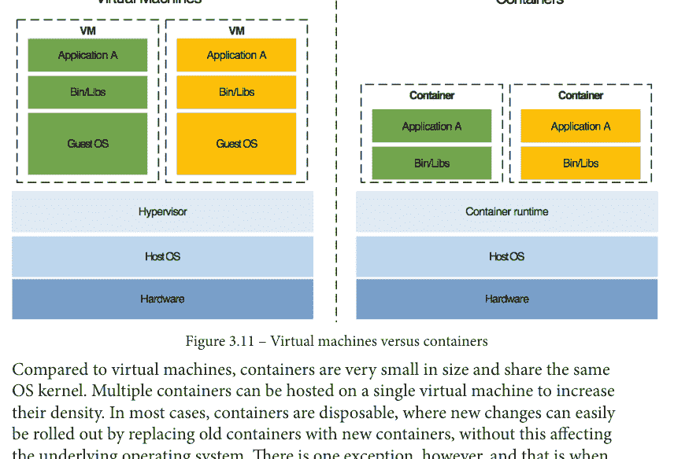

图 3.11 – 虚拟机与容器对比

与虚拟机相比，容器体积非常小，并共享相同的操作系统内核。可以在单个虚拟机上托管多个容器以提高其密度。在大多数情况下，容器是一次性的，可以通过用新容器替换旧容器轻松推出新更改，而不会影响底层操作系统。然而，也有一个例外，即这些容器运行有状态服务（如数据库或持久化存储）时。随着容器在各类业务中的广泛使用，最初作为有状态应用开发的遗留应用正在被重构为以容器方式运行。将此类遗留应用转换为无状态容器需要大量的前期投资。由于这些因素，容器供应商将有状态容器视为容器平台的一个重要方面。


许多企业逐渐意识到混合环境在跨多种环境托管工作负载方面的重要性。这有助于他们解决客户在可扩展性、法规和合规性方面的担忧。在云原生世界中，企业不断探索轻松且一致地管理混合云资产的方法。*用于 Kubernetes 的 Azure Arc* 支持通过单一管理面板管理任何经 CNCF 认证的 Kubernetes 集群。现在，组织可以在其选择的云提供商上部署云原生工作负载，并通过 Azure Arc 轻松管理这些工作负载。

云原生方法还强调采用现代应用设计原则，以构建具有异步消息传递和现代通信协议（gRPC 和 Thrift）的容器化微服务。云原生方法的另一个重要方面是支持跨部署在节点集群上的不同微服务进行可观测性。监控平台可帮助你集中日志和遥测数据，用于监控和告警。在构建可在不同环境中一致部署的不可变基础设施时，自动化代码和基础设施是云原生方法的重要组成部分。持续集成、持续交付和**基础设施即代码（IaC）**是云原生世界中广泛采用的做法。

## 拥抱微平台

*微平台*可以看作一个小型微服务平台，与微服务平台相比，它更容易创建、管理和处置。微平台被视为较小的环境，仅面向属于单个应用的一组服务。许多组织已经采用了管理多个微服务平台的做法，其中每个应用都有自己的微平台，而不是拥有一个提供所有服务的大型平台。微平台的一个优势是它可以保护服务免受级联故障的影响。

这些平台是使用 IaC 实践创建的，因此它们保持一致且可重现。在某些情况下，你可以在本地计算机上部署这些平台。微平台通过授权团队管理平台和微服务来提高团队自主性，并且由于不再依赖其他团队来提供微服务，他们可以更快地行动。与单个微服务平台相比，微平台帮助组织更具弹性，因为组织可以灵活地在混合环境中甚至跨不同云提供商配置多个微平台，以实现更好的弹性。下图展示了微服务平台和微平台之间的比较：

## 通过采用前端单体架构来抵消微服务的优势

在微服务世界中，重点一直是将大型单体后端转换为独立的微服务，由不同的团队管理以获得敏捷性。如今，许多微服务使用功能丰富的浏览器实现来向最终用户展示业务功能。通常，会有一个单独的团队负责通过消费微服务暴露的 API 来构建应用程序用户界面。随着时间的推移，这些前端变得愈发复杂，导致形成前端单体 UI。因此，由于一开始遵循的架构风格，微服务的优势在一定程度上受到了限制。为了克服这一挑战，你应该引入*即插即用架构*，让每个团队都能构建自己的前端。图 3.1 描绘了一个与多个微服务交互的单体前端。为了整合多个微服务，前端团队需要与多个后端微服务团队协作，这增加了管理 UI 不同部分的通信开销，从而影响了敏捷性和生产力。真正的挑战是设计一种支持解耦、可扩展和独立部署的架构。

微前端解决了单体前端的缺点，使团队能够减少通信开销、提高自主性，并帮助组织扩展。我们将在下一节了解微前端。

## 微前端

使用微前端是一种架构风格，它通过为业务领域带来完全自主性来扩展前端开发规模。这使团队能够交付可以组合构建产品的独立 UI。本质上，每个团队负责交付他们的 UI 组件、页面或 JS 文件。主应用程序构建为 UI 组件的容器，每个组件可以使用不同的技术开发。下图是微前端架构的表示：

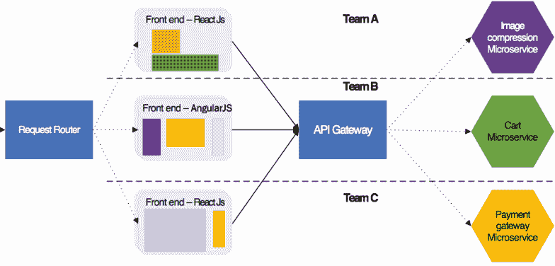

图 3.13 – 带有适用于 Web 的微前端的微服务平台

在上图中，每个团队负责开发属于其子域的 UI 组件。页面由不同团队生成的不同组件组成，组件可以使用预定义接口相互通信，路由在客户端或服务器端进行管理。Single-SPA 和 Web 组件是可以促进多个 UI 组件开发并组合成单个产品的框架。此外，采用微前端可以让跨职能团队拥有完整的业务领域，其中微服务、API 网关和微前端都由一个团队拥有。

## 总结

在本章中，我们学习了构建微服务时各种架构陷阱。我们讨论了分层架构、其复杂性、优点，以及如何将其应用于微服务。我们还讨论了实体微服务和纳米服务如何导致微服务架构中的复杂性，所有这些都可以通过实施不同策略（如 API 网关和聚合器模式）来解决。你选择哪些工具、技术和框架应该经过深思熟虑，并在各团队之间的共享治理模型中讨论，以达成共识。

然后，我们讨论了如何使用 Dapr 解决微服务的架构复杂性。接着，我们讨论了缺乏对容器技术、编排器和云原生平台的了解会如何减缓微服务的采用，以及我们如何通过拥抱这些技术来加速采用。最后，我们讨论了单体前端的缺点，以及它们如何抵消微服务架构的优势，而这可以通过使用微前端来解决。

在下一章中，我们将讨论将单体应用迁移到微服务时的常见陷阱，以及如何处理重构棕地应用的不同方面。我们还将讨论在构建微服务时可用性、可扩展性和可靠性的作用。

## 问题

- 1. 解释聚合器微服务模式。
- 2. 你如何评估用于微服务的不同工具、技术和框架？
- 3. Dapr 的主要构建块是什么？它们在你构建微服务时有何帮助？

## 延伸阅读

有关本章涵盖内容的更多信息，请查看以下资源：

- *使用 Dapr 和 .NET 的实用微服务*，Davide Bedin
- *使用 Kubernetes 的云原生*，Alexander Raul
- *使用开源技术在 Microsoft Azure 上开发微服务架构*，Arvind Chandaka 和 Ovais Mehboob Ahmed Khan
- *微前端实战*，Michael Geers


## 让重平台化棕地应用变得简单

微服务架构最近在行业中被迅速采用。许多组织因为其优势而采用微服务架构，并通过设计新应用（绿地应用）或将现有单体应用（棕地应用）转变为微服务架构来利用它。重平台化单体架构要求你对微服务有详细的理解。你将改变你使用这些实践的态度，以帮助你的旅程。

在本章中，我们不仅会介绍重平台化棕地应用的陷阱，还会学习如何将单体应用分解为微服务架构、应用中可用性、可靠性和可扩展性的重要性，以及如何构建自包含的服务。

本章将涵盖以下主题：

- 重平台化棕地应用时不了解基础知识
- 设计微服务架构时忽视可用性、可靠性和可扩展性
- 使用旧技术共享依赖

本章旨在帮助你理解从单体应用迁移到微服务架构的过程，以及在途中需要意识到并避免的陷阱。此外，我们还将说明在设计微服务架构时需要考虑的几个关键趋势。

### 重平台化棕地应用时不了解基础知识

当谈到将单体应用翻译成微服务架构时，无知并非福音。并非所有微服务项目都始于绿地应用，在绿地应用中，架构师和开发人员有广泛的选择来设计架构并在无需重构或重平台化整个单体的情况下构建系统。单体架构在行业中很常见，但在构建微服务架构时如果采用相同的技术，仍存在某些缺点。

在以下章节中，我们将讨论微服务架构的重要性、需要考虑的因素以及解耦方法。让我们开始吧！

### 为什么我们应该采用微服务架构

让我们看看在将单体应用转变为微服务架构时我们应该考虑的一些事情。

### 易于开发和测试但必须限制开发者采用新技术

单体应用易于开发和测试，因为它们很可能基于一组相关的或经过充分测试的技术栈，并且在技术采用方面学习曲线较浅。由于项目是直接引用的，因此没有网络延迟，并且作为单个进程运行。通常，单体应用有一个包含所有数据库对象的单一数据库，例如表、存储过程和用于执行 **创建、读取、更新和删除（CRUD）** 操作的函数。这是一切集中一处的好处，对于小型公司来说有利于快速开发。然而，随着公司的增长，单体架构会减缓创新和开发的步伐，因为开发人员最终需要投入更多时间来理解和处理各种场景，例如其他团队成员在摆弄他们拥有的数据、由于小问题导致巨大的爆炸半径而产生更多运维工作等等。另一个缺点是它限制了开发人员在构建新功能时引入新技术；他们必须坚持应用所基于的相同技术。随着应用的增长，它变得更加单体化，维护变得困难，适应性下降。从长远来看，这不仅会阻止开发人员使用新兴技术，而且更新、修改、发布或部署也会变得困难。

### n 层架构提供关注点分离但具有紧密耦合

n 层架构是最广泛采用的架构之一，它在层之间分离关注点。另一方面，其紧密耦合使得更快地发布到市场变得更加困难，并且在发布前需要严格的回归测试。一个地方的更改可能会对其他组件产生连锁影响，并且更改需要承担大量风险。

单体应用通常基于 n 层架构，其中表示层包含前端组件，如页面、视图模型、CSS 和 JavaScript 文件。表示层通过向业务层添加直接引用来与服务层或有时直接与业务层通信。业务层包含核心应用逻辑，并与数据访问层通信以执行数据库操作。

下图显示了单体架构和基于微服务的架构之间的区别。单体架构显示了两种 n 层架构，其中左侧显示表示层内部直接引用业务层，这使得层之间存在直接依赖。另一方面，单体架构的右侧通过设置服务层暴露 API 来实现松耦合，从而允许表示层通过 HTTP/HTTPS、HTTP/2 或 gRPC 协议与服务层通信：

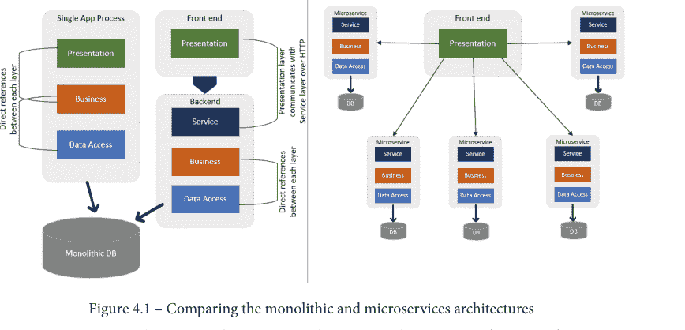

图 4.1 – 比较单体和微服务架构

在微服务架构中，系统被分解为一组各种细粒度的服务，其中每个服务都是一个暴露 HTTP 端点的 RESTful API。表示层包含各种前端组件，并通过前面提到的标准协议与后端服务通信。

### 部署简单但扩展昂贵

单体应用部署简单，因为应用被打包成单个程序集或工件进行部署。与微服务不同，微服务将应用分解为多个服务，手动部署不是一个选项。下图显示了部署方面单体架构和微服务架构之间的区别：

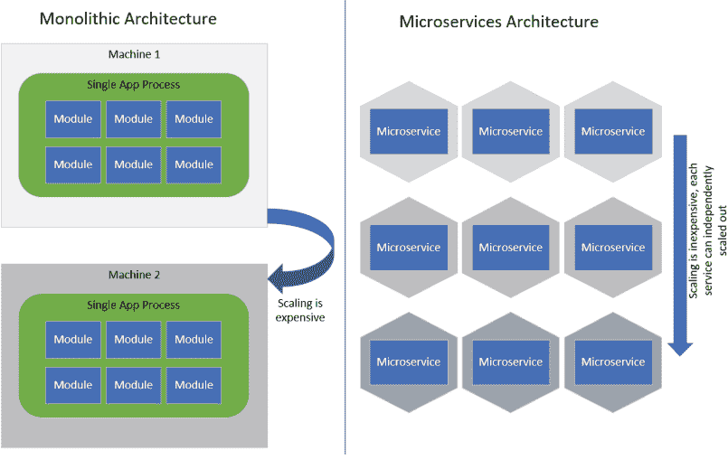

图 4.2 – 关于可扩展性和部署比较单体和微服务架构

前面的图示比较了部署单体和基于微服务的应用程序。与单体应用相比，部署涉及风险，因为它必须整体部署，如果应用很大，在一个地方更改某些内容如果没有经过适当测试可能会带来巨大风险。

在微服务方面，由于服务众多，手动部署不被推荐，手动部署需要更多精力和时间。为克服这一挑战，可以使用 DevOps **持续集成（CI）** 和 **持续部署（CD）** 实践来自动化构建和发布。然而，部署任何服务风险很小，因为应用被分割成各种服务，如果任何部署失败，它只会影响应用的某个部分，并且可以轻松回滚到上一个已知良好的版本。此外，如果需要手动补丁，你应该使用 CD 流水线，就像你对任何常规生产部署一样，以避免进一步的回归。此外，容器化使应用及其依赖项捆绑在一起，以便在环境之间实现容器化微服务，并实现低风险和更快的扩展。由于应用的大小、性质、复杂性、持久性机制和主机环境依赖性，很难将单体应用容器化。在某些情况下，应用需要重构才能容器化，这可能需要比重建应用更大的投入。此外，运行在 VM 上的单体应用的扩展需要与 VM 相似的容量来扩展，并且还需要更多资源来处理单个微服务，导致成本高昂。然而，通过微服务，我们不仅可以使用容器基础设施，还可以独立扩展单个服务，而不会对整体系统和整体业务功能产生影响。单体的另一个巨大缺点是很难理解 CPU 和内存配置并优化工作负载，因为同时运行了太多模块。通过微服务，该问题消失了。

在了解了重平台化的动机之后，让我们继续讨论在执行重平台化时我们必须牢记的因素。

### 重平台化单体到微服务架构时需要考虑的因素

重平台化单体应用的过程并不简单。为了理解这一点，让我们看看从单体架构过渡到微服务架构时我们应该考虑的一些方面。

### 对业务领域的了解

理解应用的业务领域是在重平台化时需要考虑的核心因素。架构师和开发人员应该花费适当的时间不仅了解应用的底层架构和设计，还要了解数据如何基于业务领域进行分解。有时，UI 屏幕对于理解服务边界很有用。


在拆分微服务时，如果只关注技术，并以隔离的方式工作，而不让了解业务、能够指导开发团队基于业务能力和领域进行拆分的业务利益相关者参与进来，这并不是一个好做法。轻视这一环节最终会影响整体架构的设计，使其无法实现敏捷性。如果服务拆分不当，就会产生依赖，导致更改某个特定功能时需要更新多个服务，从而形成一种分布式单体。你必须意识到基础设施的变更。

基于微服务的应用程序被拆分为多个服务。每个服务独立运行，互不影响。这正是带来敏捷性并降低变更风险的原因。然而，与单体相比，它们在托管和管理上并不简单。采用微服务后，我们需要升级基础设施，以支持将每个服务部署到各自独立的空间中。我们可以利用容器基础设施，为每个服务提供隔离和轻松扩展的能力，每个服务都可以在自己的容器中运行，并共享相同的主机操作系统内核和系统资源。你还可以使用托管的 Azure Kubernetes 服务来编排容器，以实现高可用性、自动扩展和更高的可靠性。

另一个需要考虑的因素是网络延迟，如果系统或底层基础设施不够完善，网络延迟会直接影响应用程序的效率。每个服务都有自己的数据库，托管在云端或本地，某些事务可能跨越多个服务，并且会使用一些模式和技术来创建可靠的服务，并在服务之间采用异步通信。在开始这一转变之前，必须提高对所需基础设施改进的认识。

## 选择正确的技术并拥抱学习曲线

微服务的一大优势在于技术的采用。你可以使用任何技术来构建任何服务，这与单体应用不同，单体应用只能依赖底层技术，无论该技术是否已弃用或过时。然而，选择正确的技术至关重要。

在选择技术时，请确保它支持一些库来构建服务并处理横切关注点，例如实现日志记录和仪表、连接数据库或其他存储账户的数据连接器等。

在选择技术之前进行分析，可以节省你花在返工上的时间以及学习该技术的精力。基于所有这些考量，始终要检查该技术是否有足够的社区参与度，以及是否有可以报告问题的论坛。例如，在许多情况下，开源软件公司或个人会维护自己的 GitHub 站点，社区可以在其中贡献代码、查看活跃讨论、提出问题并报告新问题。对于闭源软件，请确保其有可以报告问题的支持站点。

使用微服务架构，你可以自由尝试新兴技术并围绕它们构建服务。这样，你不仅可以将技术能力与当前市场趋势相匹配，使用所需的技术来开发该服务，而且即使存在一些技术特定的限制，风险也会更低，因为它只会影响该微服务所提供的业务能力。

## 迈向云原生

云服务是云原生应用的基础。云原生服务在可用性、可靠性和可扩展性方面提供了更好的 SLA（服务级别协议），这在本地架构中不易实现，并且需要巨额的基础设施投资。

对于微服务应用，服务众多，可扩展性和可用性是最重要的关注点。任何无法响应的服务都会对业务产生影响。

云原生应用需要考虑以下几个要素：

-   应用设计应为微服务
-   API 提供标准化方法的访问
-   服务应利用容器基础设施
-   应避免手动部署，并使用 CI 和 CD 实践
-   应采用 DevOps 实践以遵循敏捷开发
-   应维护集中式日志记录和仪表
-   拥抱左移测试，尽早开始测试

未能遵循这些措施中的任何一项，都会使微服务的管理、维护和修改变得困难。

## 理解重新设计架构与代码重构之间的区别

在应用平台重构方面，重新设计架构和代码重构是一枚硬币的两面。重新设计架构的重点在于高层架构，包括但不限于服务之间如何交互、使用什么通信协议，以及可以采用什么托管平台或部署策略。在重新设计任何应用架构时，应考虑以下一些活动：

-   重新设计架构以开发微服务
-   专注于捕获业务价值
-   替换现有的架构组件、框架、技术或平台，以转变为微服务架构
-   利用现代应用计算概念
-   拥抱云原生应用实践
-   使用 Microsoft Threat Modeling 等工具验证解决方案架构设计

> **注意**
> 
> 要了解有关 Microsoft Threat Modeling 工具的更多信息，请参阅以下链接：`https://www.microsoft.com/en-us/securityengineering/sdl/threatmodeling`。

另一方面，代码重构主要关注如何改进当前代码的设计。其目标是评估使用了哪些设计模式、代码是如何组织的，以及如何改进。在微服务架构的背景下，重构旧版（brownfield）应用时，通常进行的一些活动如下：

-   重构代码以与业务领域对齐
-   在适用时使用 OOP 原则
-   在适用时使用 SOLID 原则
-   在适用时使用设计模式
-   通过删除死代码进行代码优化
-   分析大 O 记号并在适用时优化代码

> **注意**
> 要了解有关 SOLID 原则的更多信息，请参阅以下链接：https://docs.microsoft.com/en-us/dotnet/architecture/microservices/microservice-ddd-cqrs-patterns/microservice-application-layer-web-api-design。

重新设计架构和代码重构都有助于将旧版（brownfield）应用转变为基于微服务的架构，其中重新设计架构侧重于应用的设计和解决方案架构，而代码重构则通过代码修改和其他相关技术来协助实现该架构。

## 理解核心微服务与 API 微服务之间的区别

被其他微服务消费的微服务称为核心微服务，而 API 微服务则由前端消费。核心微服务基于反应式模式，这是一种基于消息驱动架构构建系统的方法，支持弹性、可靠性和伸缩性。架构师和开发人员应了解反应式系统，并使用它们构建核心服务。下图描述了核心微服务与 API 微服务之间通过事件总线进行的交互：

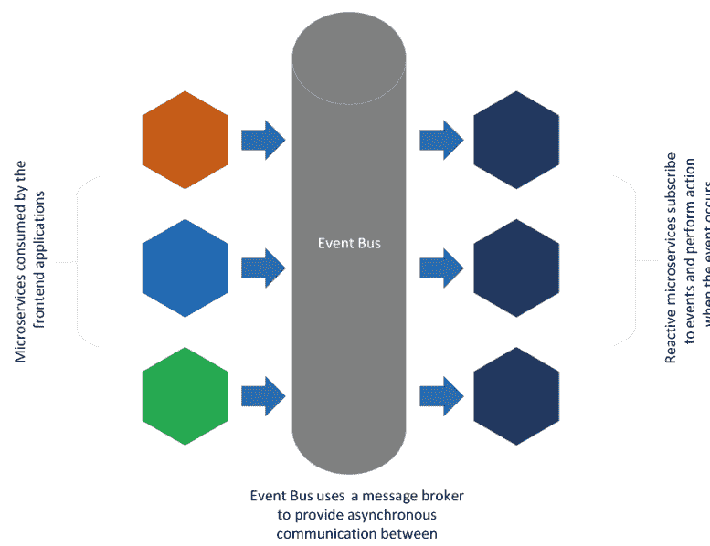

图 4.3 – 使用事件总线在核心微服务和 API 微服务之间进行异步通信

在 Azure 中，可以使用各种服务来构建消息驱动系统。其中一些服务包括但不仅限于服务总线和事件中心。它们都提供发布/订阅模型，服务可以将消息发布到队列中，订阅者可以监听该队列以读取消息。

## 避免闲聊式服务（Chatty 服务）

闲聊式服务包含冗长的操作链，它们依赖多个服务来完成一个单一事务。闲聊式服务不仅降低了采用变更的敏捷性，还严重依赖底层网络、数据库查询、磁盘读取以及其他各种因素。由于 HTTP 通信是无状态的，如果任何服务不可访问或响应时间过长，可能会出现超时异常。如果你的服务相互高度依赖并同步通信，它就会变成分布式单体架构，当目标服务宕机时，你也会经历同样的痛苦。因此，事务中使用的所有服务都必须在事务发生时同时保持运行。


为克服这一挑战，方法是遵循 **领域驱动设计 (DDD)** 进行服务拆分，并基于业务域构建服务。存在仍需与其他服务交互的场景，这可以通过实现消息驱动架构来解决。存在 Saga 等模式，可帮助您避免服务之间的同步通信，并使用消息代理支持异步通信。然而，这并不意味着同步通信是反模式；它取决于使用方式和业务场景。例如，数据服务、通知服务或工作流服务就是同步通信可能是正确选择的一些示例。

版本控制在构建基于 REST 的服务时也发挥着重要作用。当服务契约发生变化时，您应始终对服务进行版本控制。在进行版本控制时，请确保所有更改都向后和向前兼容。一旦所有调用方都迁移到新版本，我们就可以选择性地移除部分向后兼容代码。这避免了破坏依赖于该服务的其他服务，并给开发人员留出按自己的节奏更新的时间。此外，这还允许您逐步部署新服务，并在单盒/金丝雀测试期间出现任何问题时轻松回滚。

## 开发、交付和运营就绪

构建微服务架构并不简单，需要对解决挑战的技术和模式有良好的了解。复杂性可能出现在开发、交付和运营中。

开发复杂性出现在要求开发人员使用不同的模式来应对挑战时。例如，实现分布式设计和服务交互模式（如 Saga 或 CQRS）需要具备实践理解和关于如何使用它们及其方法的知识。由于这些模式通常不与单体架构一起使用，开发人员通常不熟悉它们。此外，由于任何服务都可以基于最适合底层业务场景的技术构建，因此可能需要学习曲线和充分的准备来开发服务。

在数据库方面，由于每个服务可以将其数据保存在自己的数据库中，因此可以轻松构建多语言持久化架构并使用最适合该业务功能的 technology。然而，构建数据库模型可能需要一些努力。因此，要构建一个服务，开发人员不仅应了解设计模式，还应了解何时使用哪种技术。以电子商务系统为例，我们可以选择 Azure Table Storage 来存储购物车信息，而不是使用某些关系数据库。然而，对于订单管理，也可以使用 SQL Server 或任何 NoSQL 数据库。

交付复杂性出现在存在基于不同技术的多个服务时，并且每个服务都需要不同的任务来构建和部署应用程序。容器基础设施在一定程度上解决了这个问题，因为您只需将服务容器化一次，然后使用 DevOps CI/CD 实践将其部署到任何环境。Microsoft Azure DevOps 提供端到端应用程序生命周期管理功能，并提供大量连接器来为任何技术或平台构建 CI/CD 管道并部署到任何环境。

> **注意**
> 您可以在 https://dev.azure.com 为 Azure DevOps Services 设置免费帐户。

运营复杂性出现在您将服务部署到生产或暂存环境时。服务应具有弹性和可扩展性，选择合适的平台非常重要。如果您的服务在容器内运行，您可以使用托管的 **Azure Kubernetes Services (AKS)** 为容器设置期望状态，并设置各种指标以在满足该指标条件时自动扩展您的 AKS 集群或 Pod。对于监控，Azure Application Insights、Grafana、Prometheus 和 Jaeger 等工具可帮助您监控服务并触发警报发送通知。组织应建立共享治理实践，以便投入资源为构建、部署、编排和监控微服务等事项提供公司范围内的标准化解决方案。

现在您已全面了解将单体应用程序重构为微服务架构时需要记住的因素，让我们来看一下解耦方法。

## 解耦方法

解耦方法是在从单体应用程序迁移到微服务架构时可以遵循的过程，并且经历了各个阶段。第一个也是最重要的阶段是了解应用程序的整体业务架构并识别域。遵循 DDD 实践，您可以将业务域分类为核心、支持和通用域，并从最简单的服务开始，该服务可以轻松提取且对整体系统影响较小。另一方面，如果您已有新需求，可以直接将该新需求作为单独的服务构建并与现有系统集成。被归类为通用域的服务比属于核心域的服务更容易解耦。例如，身份验证服务可以归类为通用域，因为它不是应用程序的主要业务，尽管它通过提供用户身份验证和授权来支持应用程序。这类服务易于解耦，过渡也较为顺畅。继续前进，一旦所有通用服务都已解耦，下一个阶段可以开始构建支持域，然后是核心域。以下图表显示了如何将身份验证模块从单体应用程序分解为新的微服务：

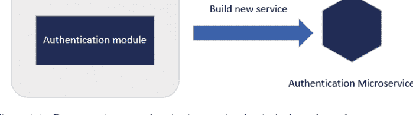

图 4.4 – 将对单体应用程序依赖最小的身份验证服务分解

在解耦服务时，保持依赖关系尽可能最小化。例如，如果对特定业务域进行分解，请取出表并在单独的数据库中重新创建。您不仅可以更改数据库模式，还可以使用任何其他持久化技术来保存其特定域的信息。如果某些事务跨多个服务，请先分解对其他服务依赖最小的服务。

由于从单体到微服务的过渡不是一步完成的，为了保持实际应用程序的运行，您需要复制数据以让系统工作。这在所有服务都分解为独立服务之前都是必要的。

以下图表显示了标准电子商务系统的购买工作流。一旦用户点击结账服务，用户将被带到支付网关进行付款，订单将被生成，并发送电子邮件通知：

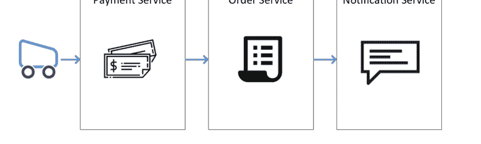

图 4.5 – 在电子商务系统中使用结账操作时发生的系列操作

考虑到前面的示例，第一个过渡的服务是通知服务，因为它对其他服务没有依赖关系。然而，订单生成依赖于此服务，因为当订单生成时，需要发送通知。

在分解服务时，一些服务可能需要调用回现有的单体应用程序以保持功能运行。这是因为如果单体的其他模块在数据库或应用程序级别某处使用相同的功能，我们需要构建反腐败层只是为了同步数据并保持该单体的功能正常工作。在构建反腐败层时，您可以为单体构建新的 API 来与单体应用程序通信，而新的微服务与该单体 API 通信，而不是直接引用或编写代码与现有单体通信。这种做法有助于隔离单体概念。以下图表显示了分解发票生成服务并使用反腐败层使其保持功能的方法：

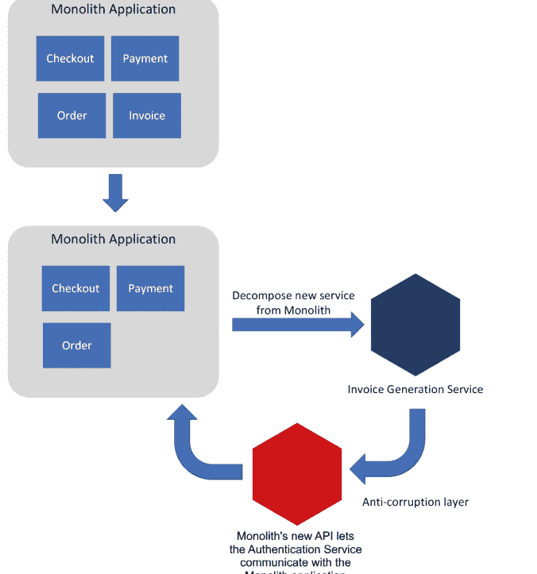

图 4.6 – 在分解服务时添加反腐败层


解耦可以通过基于业务域垂直拆分 n 层架构来实现，逐个分解每个服务，然后为包含特定域模型的每个垂直层创建新服务。你必须创建单独的数据库并使用合适的持久化技术来保存其特定域的信息。一旦服务构建完成，你必须修改前端，使其消费新服务的端点。在所有服务分解完成之前，你可以复制数据以保持单体应用运行，并实现反腐败层，也称为 **粘合代码模式**。前端向新服务发起调用，新服务再向新的单体 API 发起调用以保持单体数据库更新。在分解过程中，你可以采用不同的技术和模式来实现分布式事务、同步和异步通信等。一旦所有服务都已分解，单体数据库就可以归档，每个服务将拥有自己的持久化存储，用于保存其特定域的信息。下面的图表描绘了电子商务应用中的一些模块，以及将其从单体应用分解为微服务架构的步骤：

## 将单体应用转换为微服务的步骤

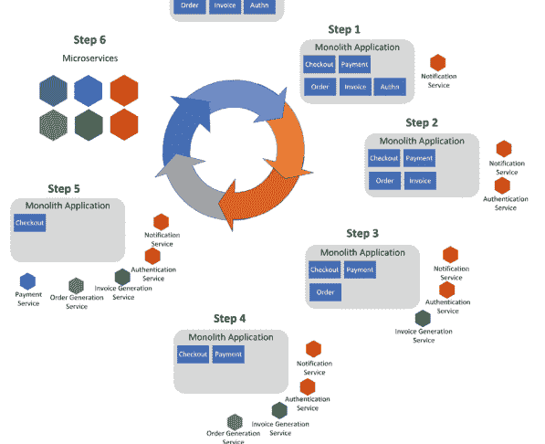

图 4.7 – 将示例单体应用逐步分解为微服务架构的过程

在解耦服务时，你可以重用现有单体应用代码的一部分到你的微服务中，也可以完全重写它。如果应用与其他模块紧密耦合，则无法轻松解耦，重写它是一个更好的权衡。每个应用都有其自身的复杂性，这可以根据解耦所需的努力来确定。此外，对于单体应用而言，你试图分解的服务不必提取并映射到单体业务模块。

在分解单体应用时，你必须解耦那些更简单且依赖较少的服务。在前面的图表中，我们首先分解通知服务，该服务对其他服务的依赖较少，可以轻松拔出。先解耦最基础的服务可以最大限度地降低交付团队无法正确操作微服务并理解分解如何工作的风险。一旦通知服务被分解，身份验证服务可以被分解，然后是发票生成，依此类推。在所有服务分解完成之前，你需要实现前面讨论过的粘合代码模式，以将数据复制到单体数据库以保持系统功能。一旦所有服务都已分解，粘合代码模式就可以被移除。

在分解时，了解可用于构建可靠服务的某些模式至关重要。在下一节中，我们将讨论可用性、可靠性和可扩展性的重要性。

## 设计微服务架构时忽视可用性、可靠性和可扩展性

由于微服务架构本质上是分布式的，并且涉及大量服务通过网络通信，因此可靠性和可用性以及可扩展性变得非常重要。开发人员有时会忽视这些因素的好处，并且不跳出思维定式来构建支持这些关注点的架构。在微服务架构中，服务依赖于其他服务，并且除了异步通信外，还有同步通信，这要求在执行某些操作或为终端用户请求提供服务时，其他服务必须响应。如果服务不可用，它会影响事务。此外，当服务承受大量流量时，需要进行水平扩展，如果底层基础设施不支持快速扩展，这将影响操作并在数据库之间造成不一致。作为旁注，你应该以系统能够自行处理任何轻微不一致的方式构建系统。例如，如果终端用户请求需要写入两个服务，与使用事务相比，更便宜的方法是逐个写入它们，并在读取路径上处理不一致；这样，你就无需担心事务，因为在这种情况下回滚非常棘手。

让我们更仔细地看看为什么可用性、可靠性和可扩展性是需要考虑的主要决定因素。

### 可用性

可用性是指服务处于运行状态并处理请求的时间百分比。我们需要通过创建可实现的目标来保持服务达到商定的可用性水平，这些目标是事先与客户达成一致或承诺的。服务的可用性取决于服务故障的频率以及故障后恢复的速度。作为一般规则，可用性可以使用以下公式计算：

可用性百分比 = (总经过时间 – 总停机时间) / 总经过时间 * 100

可以使用各种模式来构建可靠的服务。其中最常见的是重试模式和断路器模式。

## 重试模式

重试模式用于通过多次尝试连接到因瞬时错误而失败的故障服务，从而在应用中实现弹性。应使用指数退避重试，直到重试计数器达到最大限制。然而，超快的重试会导致重试风暴和级联故障。

在微服务架构中，这种模式非常常见；每个服务都作为单独的服务托管，瞬时和通信错误很常见。所有调用都是通过网络向服务发出的，如果网络连接丢失，会导致服务超时和操作失败。这些瞬时故障通常是自愈的，如果在一段时间后重复该过程，可能就会成功。

如果服务未响应且消费者应用收到错误，它可以使用以下策略处理：

- **重试：** 如果错误是瞬时的，立即再次调用服务以获得成功响应。然而，重试的糟糕实现可能会导致整个服务以及许多其他服务崩溃。例如，如果你配置为在失败时重试 5 次，而上游服务出现问题，它将突然承受 5 倍的负载，并且恢复会更加困难。

- **延迟重试：** 在下一次调用故障服务之前会有一些延迟。重试将基于你设置的重试限制进行。

- **取消：** 如果错误不是瞬时的，可以取消操作，因为即使重复操作也可能不成功，没有理由让消费者继续等待。在这种情况下，最好快速失败并让消费者知道服务失败的原因。

下面的图表描绘了可以使用重试模式的场景：

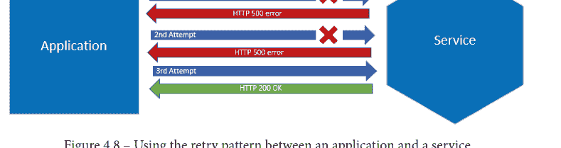

图 4.8 – 应用与服务之间使用重试模式

在前面的图表中，一个应用正在向失败的服务发起调用。该应用实现了重试模式，如果服务失败则最多重试三次。

## 断路器模式

有时，错误不是瞬时的，也与任何网络连接或通信无关。这意味着故障不是暂时的，需要努力进行修复。这些故障可能与服务维护、重新部署、应用中的错误或仅仅是由于终端用户行为导致的流量突然激增有关。将每个请求都发送去进行重试并不是一种好做法。如果服务因其他原因而失败，快速失败并返回回退响应是至关重要的。这就是断路器模式可以发挥作用的地方。

与重试模式一样，断路器模式可以作为微服务实现的一部分来实现。该模式也可以由框架、服务网格或 API 网关实现。它工作在三种状态，如下所示：

- **关闭：** 它就像电子电路一样——如果电路是关闭的，请求将到达目标服务。初始状态是关闭状态，所有请求都发送到目标服务。

- **打开：** 当服务未能响应时，电路会在有限时间内打开。在此状态下，没有任何请求会到达目标服务，并且会快速失败。你也可以向消费者返回回退响应，并附上友好消息，例如 *"我们正在进行维护，请稍后再试。"*

- **半打开：** 一旦在打开状态中等待时间已过，电路就会变为半打开。第一个请求将被允许发送到目标服务。如果服务成功响应，电路将关闭；否则，它将再次打开有限时间，如配置所示。

下面的图表描绘了断路器模式：

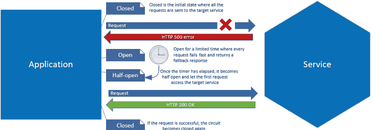

图 4.9 – 应用与服务之间使用断路器模式


在前面的图中，当第一次请求发出时，电路是闭合的。当服务以 HTTP 500 错误响应时，它会在特定时间内打开电路。当电路打开时，没有任何请求会被发送到目标服务。一旦时间过去，电路变为半开状态并允许第一次请求发出。最后，当服务以 HTTP 200 状态码响应时，电路再次闭合。

你也可以将断路器模式与重试模式结合使用，这样当电路闭合且请求失败时，它不会在重试计数器达到最大重试限制之前打开电路。下面的图示展示了将重试模式与断路器模式结合使用：

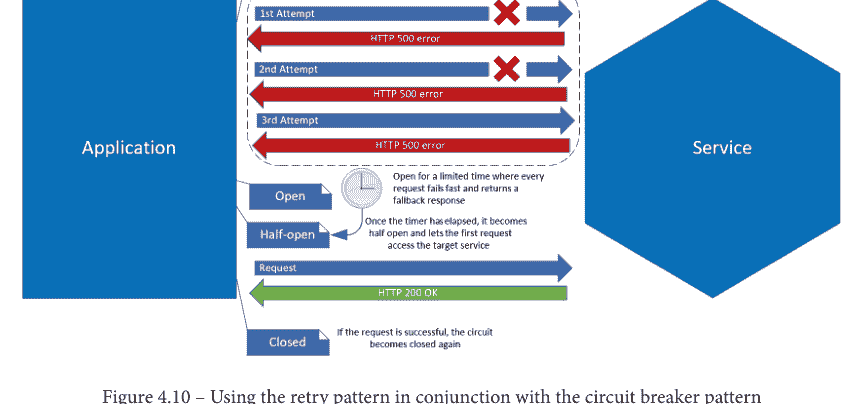

图 4.10 – 将重试模式与断路器模式结合使用

各种库可以让你轻松实现重试和断路器模式。下表显示了最常用于 .NET 和 Java 应用的库：

| Library | Platform | More Information |
|---|---|---|
| Polly | .NET applications | https://github.com/App-vNext/Polly |
| Netflix Hystrix | Java applications | https://github.com/Netflix/Hystrix |

让我们接下来看看在设计微服务时可扩展性有多重要。

## Scalability

微服务的一个关键优势是它们使企业能够单独扩展服务。从单体架构转向微服务架构的公司对如何更新其系统有一个想法，但他们可能难以确定什么可用或如果实施它将如何使他们受益。例如，在 VM 中运行的单体应用程序并不是比在容器中运行的微服务更好的权衡。熟悉 VMware 或 Hyper-V 的基础设施团队可能需要在容器、Kubernetes 等领域建立技能，而开发人员可能需要在采用不同的设计模式、容器知识等方面建立技能。

云原生应用程序通常利用云中托管服务的优势，这些服务提供良好的 SLA 和易于管理。例如，如果你计划在 AKS 实例中托管容器，你可以轻松为集群或 Pod 设置自动扩缩容。此外，如果你计划将应用托管为 App Service，该服务也提供自动扩缩容，还有各种其他服务提供类似功能。

除了基础设施之外，服务本身应以支持可扩展性的方式构建。在许多情况下，应用程序在扩展时会失败。例如，如果你正在构建有状态服务并将缓存保留在容器本身内，它们在扩展时会失败。由于其他容器无法访问该缓存，即使它创建自己的本地缓存，也无法使用相同的状态。为了解决这个问题，你可以例如使用分布式缓存，如 Azure Redis Cache，或在 Azure Service Fabric 上构建服务，后者提供构建有状态服务的完整框架。另一个例子是当你想将日志或特定于应用程序的数据保留为容器私有。扩展容器将使数据分布，导致不一致并使维护更困难。

微服务是独立且自包含的。我们将研究为什么共享依赖项是缺点之一，以及如何在下一节中构建自包含服务。

## Sharing dependencies using older techniques

在 n 层架构中，每一层都直接引用另一层，这使其紧密耦合且相互依赖。对于微服务来说，这是反模式之一。有时一个服务需要调用另一个服务来完成事务。在这种情况下，服务依赖于另一个服务。为克服这一挑战，你可以构建自包含服务。

## Building self-contained services

自包含服务可以帮助你使用 Saga 和 CQRS 等模式与其他服务协作。不是进行直接 HTTP 调用，源服务通过消息代理与另一个服务通信。源服务发布一条消息，另一个服务读取该消息并响应。一个方法是为请求和响应保留两个队列。这样，两个服务就可以通过该通道异步通信。

下面的图示显示了服务通过异步通信通道之间的协作：

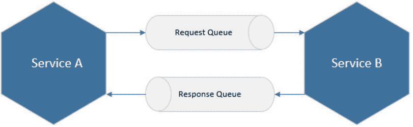

图 4.11 – 实现请求和响应队列以在服务之间建立异步通信

如果 **Service A** 想从 **Service B** 获取一些数据，它必须将消息发布到请求队列。由于 **Service B** 订阅了该队列，它将读取消息、处理它，然后将响应写入响应队列。**Service A** 需要订阅响应队列，以便当响应发布时，由 **Service A** 接收。每个服务维护两个独立的会话，以发布和消费来自请求和响应队列的消息。这种方法有助于减少 I/O 资源，并允许服务以非阻塞模式运行，以及与同步 HTTP 通信相比处理更多请求。将此技术用于所有跨服务通信可能不是最佳选择，应根据业务场景考虑。例如，由于异步通信，它可能参与多次通信，而无法保证响应序列与传入请求的顺序保持一致。为克服这一挑战，你可以在每条消息中添加一个唯一标识符，也称为关联令牌，可用于与原始消息关联。

另一种技术是实现 **Command Query Responsibility Segregation (CQRS)**，其中 **Service A** 可以通过缓存来保留 **Service B** 数据的本地副本。这种两个服务之间的同步可以通过事件驱动方法完成。如果 **Service B** 数据库发生任何更改，它将发布消息以同步 **Service A** 数据库。在这种情况下，**Service A** 可以读取本地数据库副本，而无需调用 **Service B**。要了解有关 Saga 和 CQRS 模式的更多信息，请参阅 *Chapter 5, Data Design Pitfalls*。

## Reinventing is not an anti-pattern in microservices

在单体应用程序中重用和共享依赖项是一种良好实践。许多开发软件的技术公司维护自己的框架以减少开发工作，并在需要时重用任何功能。然而，当将应用程序从单体转变为微服务时，重用现有组件来构建新服务不仅困难，而且还会限制你采用新技术和框架的能力。

在微服务中，重新发明轮子是健康的。如果公司不重新发明，就无法从新技术的技术进步中受益。使用单体框架的现有组件会限制他们采用更新的技术，从而降低他们的敏捷性和技术无关性。

从单体应用程序转向微服务模型通常允许技术团队以自己的速度创新并根据需要扩展。团队可以尝试创新技术来开发新服务。与单体系统相比，风险因素降低，因为如果一个部分失败，不会影响整个系统。

在开发或迁移到微服务架构时，了解此类陷阱至关重要。考虑到所有这些因素将有助于你从单体应用程序无缝过渡到微服务架构。


### Summary

在本章中，我们学习了将单体应用重新平台化为微服务架构的重要性以及如何对其进行分解。从单体架构向微服务架构的转型并非易事，需要考虑诸多因素和陷阱。可用性、可靠性和可扩展性是在分解应用时需要重点考虑的重要因素，而忽视它们正是其中一个陷阱。因此，我们探讨了一些关于可用性和可扩展性的概念，并学习了构建弹性微服务所使用的模式。最后但同样重要的是，我们讨论了继续使用单体应用的相同组件而不重新发明轮子以利用提供更好替代方案的新兴技术的弊端。

有了这些知识，你就可以开始将当前的遗留应用分解为微服务架构，并收获本章所讨论的各项因素带来的益处。下一章将重点关注构建微服务数据架构时应避免的陷阱。你将学习在构建数据架构时应避免的常见反模式，以及如何使用不同的方法来确保数据连续性并帮助构建自主、灵活且健壮的微服务。

### Questions

- 1. 为什么应该从单体应用迁移到微服务架构？
- 2. 将单体应用重新平台化为微服务架构时需要考虑哪些因素？
- 3. 可用性、可扩展性和可靠性为什么重要，以及如何实现它们？

### Further reading

有关本章所涵盖内容的更多信息，请查看以下资源：

- *Practical Microservices*，作者 Umesh Ram Sharma

## Section 2: Overview of Data Design Pitfalls, Communication, and Cross-Cutting Concerns

在本节中，你将学习数据设计陷阱、通信陷阱和横切关注点，并通过示例和替代模式来应对这些挑战。

本节包含以下章节：

- *Chapter 5, Data Design Pitfalls*
- *Chapter 6, Communication Pitfalls and Prevention*
- *Chapter 7, Cross-Cutting Concerns*

### The pitfalls of keeping a single shared database

团队在决定采用微服务时犯的最大错误之一就是试图让多个微服务共享同一个数据库和模式。那么，为什么这是一个糟糕的主意，即使它看起来确实更容易？好吧，让我们从微服务的定义开始。

微服务的定义指出，每个微服务都应拥有自己的数据库或数据存储，并负责维护其数据的状态。因此，在创建微服务时遵循单一数据库的原则是有意义的。也可以合理地得出结论，当我们将单体应用拆分为微服务时，必须将庞大的单体遗留数据库拆分为更小、独立的数据存储，每个微服务一个。这种对成熟遗留数据库的拆分绝非易事，不应掉以轻心。像将成熟数据库拆分为更小数据库这样的活动需要大量的规划和准备。我们需要确保对单体数据库及其关系数据有深入的理解。此外，我们需要获取支持我们正在创建的服务的数据知识，并将该模型从遗留数据库分离到我们的新微服务数据库中。

将庞大的单体数据库拆分为每个微服务的更小数据存储以实现服务之间的松耦合至关重要。如果我们未能做到这一点，我们的微服务将变得紧密耦合。这意味着你只是创建了一个庞大、难以维护和管理的分布式单体。此外，这意味着我们通过分离微服务并创建两个仍然绑定到单体数据库的独立代码库为自己增加了更多复杂性。我们只是让微服务的世界变得更加难以管理，并违背了微服务的初衷。由于微服务被单体数据库紧密耦合，我们将开始在数据库中遇到死锁和高争用情况，其中多个为大量请求提供服务的微服务试图更新数据库中的单条记录。

拆分数据库及其数据有两种不同的方法。一种是先从数据库开始，另一种是先从代码开始。后者有助于我们将数据库拆分为更小的数据库，这些数据库与我们试图为其创建服务的领域或业务功能保持一致。我认为代码优先的方法是最安全的，因为我们通过先构建代码模型，将模型从旧遗留数据库迁移到新服务。通过这样做，我们可以在隔离环境中构建服务，并使用支持的单元测试来首先验证我们的设计。我们可以通过首先从遗留应用中分离代码并设计支持业务功能的模型来实现。然后，我们可以使用代理将流量定向到新服务，以便在测试和了解服务所需数据的同时进行学习。最后，我们可以将此数据及其模型与遗留数据库进行比较和对比。通过采用代码优先的方法，我们可以决定在将模式及其列和属性从遗留数据存储中分离出来时如何进行。此外，我们可以更有信心地使用单元测试来确保我们的断言是正确的。前面我们讨论了微服务拥有自己的独立数据存储并负责保持数据处于正确状态的重要性。但如果该数据需求最好由满足数据本身需求的不同持久化存储来提供会怎样？

如果我们需要提高检索性能，无论是在大数据中还是在某些 CQRS 模式中，我们稍后会讨论这一点？一些 CQRS 的实现具有用于查询的读操作数据库，以及用于存储数据的另一个独立的写操作数据库。然后，存储的数据会复制到用于读操作的读数据库，称为物化视图。物化视图模型已针对读取和查询进行了优化。

关系数据库被设计为主要针对事务性应用优化以行形式存储数据。列式数据库针对更快地检索数据列进行了优化，并在分析应用中得到广泛使用。数据库表的列式存储对于分析查询性能至关重要，因为它大大减少了整体磁盘 I/O 需求并减少了我们需要从磁盘加载的数据量。

如果我们需要列式数据库进行高性能聚合，或需要文档数据库作为我们数据的物化读视图会怎样？这有助于更快地读取或使用关系数据库更好地促进持久事务。

当我们发现数据来源和存储库来自许多不同的地方以及不同的范式，例如大数据、关系数据库或文档数据库时，我们需要探索多语言持久化以及它带来的优势。我们将在下一部分进行此操作。

### Embracing polyglot persistence

那么，我们应该选择 NoSQL 文档数据库还是 SQL 关系数据库？让我们在本节中回答这个问题以及更多问题。我们将探索不同的持久化模型并比较和对比它们，以了解它们与多语言持久化有何关联。

围绕数据持久化的讨论很多，关于在持久化数据及其状态时应采用 SQL 关系数据库还是 NoSQL 文档数据库。 当我们继续数据设计的旅程时，我们被介绍到多语言持久化这一新兴概念。在这里，我们可以使用多种范式，从 NoSQL 到 SQL 关系存储来处理微服务的数据持久化和存储。

多语言持久化是根据应用程序或用例的需求将数据存储在最佳可用数据存储中的方法。例如，这可能是一个大数据湖，用于存储和检索大量原始数据，文档数据库如 MongoDB（CosmosDB）用于更快地读取和写入 JSON 文档，或久经考验的关系数据库如 SQL Server。在某些情况下，你甚至可能会同时使用全部三种，并且需要自定义设计，因为据我所知，没有一种工具可以处理 NoSQL 或关系数据库的持久化。

在最近的历史中，文档数据库在应用开发世界中变得特别流行。原因在于通过 RESTful Web API 在前后端传递数据并以原始 JSON 文档格式持久化数据而无需映射到数据库列的常见做法。这导致了关于在关系数据库或文档数据库之间选择时重要性的众多讨论和争论。文档数据库（NoSQL）和 SQL 数据库（关系型）各有其优缺点。事实上，在某些情况下，你会发现你既需要 NoSQL 存储也需要 SQL 存储，这可以通过存储库模式实现。我们现在可以通过接口抽象数据持久化的细节，例如在存储库模式中，为数据存储提供不同的实现，无论是基于关系还是基于文档的解决方案。多语言持久化使用适合手头工作的最佳数据库模型这一概念。

重要的是要理解并非所有数据需求都相同。有些需要不同的方法和仔细考虑。多语言挑战质疑我们的数据需求是什么，旧模型是否适用于我们的用例，以及我们是否应考虑不同的方法。

根据我们所处的范式对数据建模对于良好的设计至关重要，因此我们将探索不同的方法，例如关系数据存储和 NoSQL 文档数据存储。请注意，在数据建模方面它们非常不同，每种都需要不同的思维方式。


## 规范化读模型

在 SQL 关系型数据库中，规范化完全合理，并且应该通过为每个实体创建一张表来实现。此外，我们还可以为所有子对象创建单独的表，并使用外键标识来映射这些实体之间的关系。

在文档数据库中，这可能会对性能造成损害并且设计不佳，但在某些情况下我们需要规范化文档数据库模型。最佳实践是将所有内容嵌入到父实体中；然而，在嵌入对象可能无界增长的情况下，这会造成文档大小的问题。因此，在这种情况下，我们需要使用引用来建模数据，就像我们在关系世界中使用标识一样。

规范化文档模型的另一个正确时机示例是处理频繁变化的子对象。例如，我们有一个名为客户的父文档，客户有一个股票列表，而股票价格每 5 分钟更新一次。在我们的文档模型中，我们希望将股票从父文档，即客户中移出，并放入一个名为 stocks 的单独文档对象中，该对象是客户股票的集合。这样做是为了避免每次需要更新嵌入对象（即股票）时都要更新父文档（即客户），例如股票价格发生变化时。因此，我们希望将股票对象移入单独的文档对象并通过其 ID 引用它。然后，我们可以更新股票本身，而不更新拥有股票对象的父对象。例如，我们可以查看客户的文档示例，其中我们跟踪其股票并更新这些股票的价格，如图 5.1 所示。但是请注意，文档数据库世界的黄金法则是：有疑问时，嵌入，嵌入，再嵌入。

以下代码块提供了一个客户文档的示例，该文档使用 ID 引用客户的股票文档。客户文档还包括股票名称；这是因为某些查询可能需要检索客户股票列表，而无需发送额外的查询到股票文档以检索客户股票的名称：

```
##### Customer Document With Stock Id and Stock Name
{
    "customerId": "cust123",
    "firstName": "Bob",
    "lastName": "Nelson",
    "Stocks": [{
        "stockId": "stk123",
        "stockName": "Socks Stock"
```

以下是一个包含嵌入地址对象的个人文档示例。在我们的示例中，JSON 文档将如下所示：

```
{
  "firstName": "Bob",
  "lastName": "Nelson",
  "address": {
    "street": "1st Street",
    "city": "Tampa",
    "state": "Florida",
    "postalCode": "33610"
  },
  "isActive": true
}
```

现在，让我们进入下一节，我们将在其中深入讨论 CQRS。

## 理解 CQRS 原则

在本节中，我们将学习 CQRS、不同类型的 CQRS 以及为什么我们可能想要考虑这种模式。CQRS 由 Greg Young 于 2010 年提出。它基于 Bertrand Meyer 于 1988 年提出的 **命令查询分离 (CQS)** 原则。在这种情况下，我们将查询或检索数据的职责与命令分离，命令会导致状态更改或改变我们的数据。CQRS 原则在 CQS 概念的基础上构建，增加了更多细节和功能，例如为读写使用单独的数据库。这会增加复杂性，但提供了一些有用的功能，例如持久化事件，即事件溯源。我们可以重放这些事件，以获得我们数据状态的非常详细的审计跟踪或历史记录：它何时更改、谁更改了它以及为什么。

## 两个数据库

双数据库方法使用两个数据库——一个用于读取，另一个用于写入。这种方法采用最终一致性并引入了一些额外的复杂性，因为我们现在需要保持读写存储处于正确的状态。通过这种方法，读取性能会提高，因为我们也可以使用文档数据库作为针对读取优化的物化视图。我们可以保持命令栈干净高效，并借助关系数据库用于写入以强制执行事务来帮助并发。通常，应用程序更偏向读取，因此通过分离读取并为查询优化读取栈，我们可以提高表示层的性能。图 5.2 说明了双数据库方法以及它如何使用存储过程在每次更新后更新读取。保持读取数据存储处于正确状态的另一种方法是插入服务插入或更新以更新读取存储。虽然这也引入了复杂性，但在某些情况下，这是一个不错的选择：

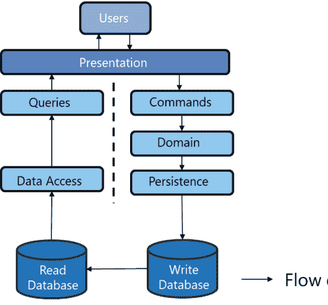

图 5.2 – 双数据库 CQRS

上图说明了双数据库 CQRS 实现。我们可以看到我们有一个读取数据库和一个写入数据库。数据流经命令栈并向下流向写入数据库。然后，它流经读取数据库，继续进入数据访问层。最后，数据流经查询服务层并返回给用户。

## 事件溯源

事件溯源是第三种 CQRS 方法。它是所有 CQRS 类型中最复杂的一种，我们使用事件 ID 将事件存储为实体。我们可以重放事件以达到当前状态并查看事件实体的审计跟踪或历史记录。当状态发生变化时，我们修改事件实体，事件成为事实来源。就像双数据库方法一样，我们需要更新读取数据库；这将是最后一个事件的物化视图以及该事件的当前状态，以优化读取。事件可以被重放，但此操作成本高昂。因此，我们需要为读取提供物化视图。事件溯源非常复杂，只有在审计事件历史的需求，例如在医疗保健或政府合规中，决定这种需求时才应考虑。我们可以进行某一时间点的状态重建并查看它为何更改、如何更改以及用于调试目的。这种能够重放事件的能力可以帮助满足受监管行业的审计和合规要求，并且只有在用例需要此类功能时才应考虑，因为事件溯源涉及复杂性和成本。简单来说，如果你不需要它，就不要使用事件溯源。

下图说明了事件溯源 CQRS 实现：

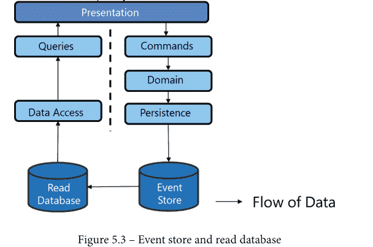

图 5.3 – 事件存储和读取数据库

例如，在读取方面，应用程序可能执行许多不同的查询并返回具有不同组成和大小的 DTO。这可能使对象映射变得复杂和繁琐。模型的写入方面可以实现复杂业务规则和验证。正如你所见，这可能导致一个过于复杂的模型，试图做太多事情。这就是我们需要清理并分离变更和查询关注点的地方。

通常，读取和写入表示之间存在不匹配，我们最终会得到从未使用或实现的属性或列。我们甚至可能需要在操作中从未使用它们的情况下更新这些属性。这种数据竞争问题可能会在两个操作尝试并行访问或更新相同数据时出现。

图 5.4 说明了分层应用程序中的传统栈：

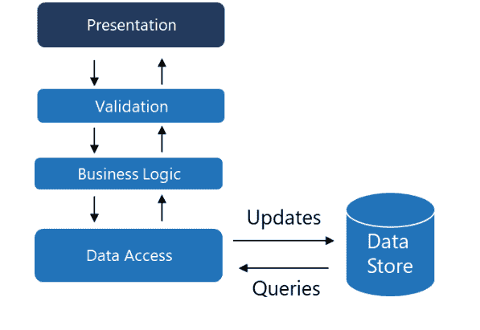

图 5.4 – 查询和更新使用一个模型的问题

乍一看，这似乎是关注点分离的良好示例；它确实如此，并且在许多情况下效果很好。然而，虽然这在简单应用程序中可能有效，但随着应用程序复杂性的增长，混合改变状态的方法以及返回 ViewModel 的职责会增加更多复杂性并破坏单一职责原则。正如你所见，随着请求来自客户端，数据流遍历每一层。因此，每一层都负责读取和写入，不仅是状态的变更，还需要在响应中从 ViewModel 映射回 UI 的逻辑和映射。这可能导致页面加载变慢，因为应用程序必须在同一请求或事务中完成更新并返回响应。更糟糕的是，业务逻辑可能会开始溢出到其他层。此外，业务逻辑不应关心数据访问问题，甚至不应意识到它。业务逻辑只应关心业务规则、策略和不变量，而不是数据访问的后勤问题。

图 5.5 描述了双向请求和响应模式，我们请求对状态的更改，同时需要将视图返回给 UI，这使我们与 UI 实现紧密耦合。这可能在负载下阻碍性能，因为对象在被更新和请求的同时被锁定，然后必须返回响应：

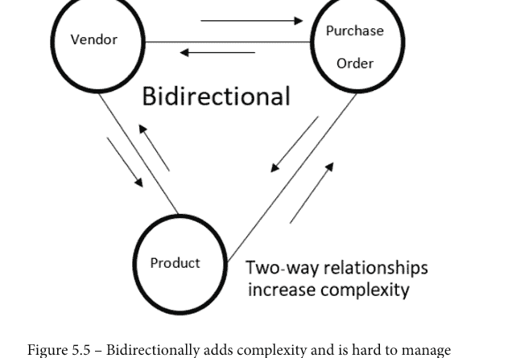

图 5.5 – 双向增加了复杂性且难以管理


## 解决方案

CQRS 通过使用命令更新数据、查询读取数据的方式，将读写分离到两个不同的模型中，从而帮助我们解决单一模型所面临的难题。这种分离为我们提供了一种更为清晰的数据检索方式，使我们能够优化查询以获得更好的性能，并将业务逻辑排除在查询之外。

命令应基于业务逻辑和不变量（invariants）来分配任务，而不是以数据为中心。此外，命令应单向流动，即所谓的单向流（unidirectional），如*图5.6*所示。命令从不向调用方返回任何内容，这有助于实现这种单向流。命令可以放入队列中，并以异步方式处理，而不是同步处理。查询永远不会修改数据库；它们返回一个 DTO，并且不涉及领域知识。这些模型可以被隔离，如*图5.6*所示，你可以在数据库中查看用于写入的模型和用于读取的模型，以及每种职责的流向：

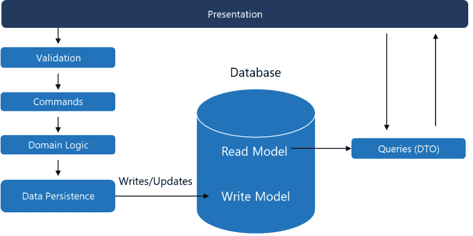

图5.6 – 命令和查询拥有独立的模型

正如我们在*图5.7*中所总结的，单向流方法是指我们通过单向请求来变更数据：

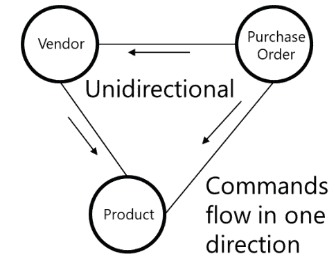

图5.7 – 命令沿一个方向流动并变更数据

这使得命令更加简洁，我们可以专注于业务逻辑。此外，我们可以将命令放入一些消息框架中，例如 Azure Service Bus、Kafka 或 RabbitMQ，并异步处理这些命令。

## 在我们的微服务中实现CQRS模式时的挑战

我们在实现诸如 CQRS 这样的模式时面临的挑战之一是**复杂性**；例如，当我们实现事件溯源时。尽管 CQRS 的基本概念很简单，但它可能会导致更复杂的设计；例如，双数据库方法，以及如前所述的事件溯源，其学习曲线非常陡峭。

**消息传递**虽然不一定是 CQRS 的一部分，但很常见。消息传递框架支持命令，并发布和更新事件，例如领域事件。消息传递会带来额外的复杂性，因为我们现在需要处理消息失败和重复消息。此外，在某些情况下，我们还需要确保消息按特定顺序处理。

**最终一致性**指的是当我们分离读写数据库时的情况。在这种情况下，我们还面临额外的复杂性：既要保持模型的正确状态，又要确保读取的数据不会过期。我们必须确保对写入模型所做的任何更改都能反映到读取模型中。我们现在已经探讨了 CQRS，并演示了该模式如何清理或设计数据，以帮助分离读写数据的职责。此外，我们还研究了如何利用命令来变更或更新数据。现在，我们需要理解事务，以及维持数据关键状态的重要性，以及事务在此过程中的作用。

## 不知道如何处理事务的陷阱

团队面临的一个陷阱是不知道如何处理跨多个微服务的分布式事务。我们将探讨如何在微服务中构建事务，以及当事务涉及多个微服务时如何处理它们。我们将从*第3章“微服务架构陷阱”*中探讨的一个概念开始，我们在该章节讨论了领域驱动设计和聚合（aggregation）的概念。

聚合是事务边界。它们围绕事务形成边界，以强制执行业务规则和业务不变量。然后，这些边界将属于聚合及其事务边界内的相关实体分组。这些事务是一个单一的工作单元，可以由多个操作组成，这些操作存在于该隔离事务的空间内，并产生一个表示聚合及其内部实体状态变化的领域事件。命令是执行状态变化并导致事件发生或触发的操作。这些事件可以通知下一步或整个系统该事务是成功还是失败。如果成功，它们可以触发另一个命令的执行，而该命令又可以触发一个事件。此过程将持续下去，直到所有事务完成或回滚，具体取决于事务的成功或失败完成情况。

事务具有定义特征，它们必须是**原子性、一致性、隔离性和持久性（ACID）**。让我们从微服务的角度来审视这些特征：

- **原子性**：这是一组必须全部成功或全部失败的操作。
- **一致性**：这意味着状态从一个有效状态变为另一个有效状态。
- **隔离性**：这有助于保证事务按顺序并发执行，并产生与先前事务相同的状态变化。
- **持久性**：这确保了无论发生系统故障还是瞬态错误，状态更改都会提交并执行。

虽然每个微服务拥有一个单独的数据库是可取的，但当我们需要保持整个系统处于有效状态时，它也给事务带来了一些挑战。例如，在单体架构中，这是一个容易得多的任务。由于数据是分布式的，这就带来了如何确保整个系统一致性的挑战。这可以通过提供一种编排机制并跨边界管理这些事务来实现。Saga 是一种合适的模式，有助于编排和管理此事务，并在需要回滚时执行任何补偿事务。

## 未选择正确的一致性和并发性

正如我们所了解的，在处理分布式事务时，选择正确的一致性和并发性方法非常重要。

分布式事务 saga 模式可用于管理跨服务或边界的事务，并维护这些边界之间的一致性。Saga 由一系列有序的事务组成，无论是更新、删除还是插入。如果其中一项事务失败，saga 负责回滚所做的任何更改。此过程称为补偿事务，它会抵消之前的任何事务，以使系统恢复到正确的状态。

*图5.8展示了Saga及其封装职责的高级视图：*

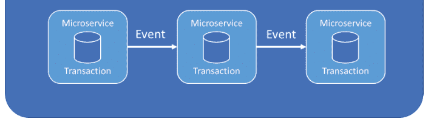

图5.8 – 一个高层级的Saga

编排（choreography）的好处如下：

- 它非常适合仅需要少量服务且不需要复杂协调规则或逻辑的简单工作流。
- 它不需要支持服务来进行实现或维护。
- 它没有单点故障，因为服务需要根据收到的消息执行回滚并完成事务。

编排的挑战如下：

- 当需要额外的步骤时，工作流可能会变得混乱和令人困惑。
- 由于服务会消费彼此的命令，循环依赖可能会在服务之间出现。
- 集成测试可能变得困难，因为需要所有服务都运行才能进行正确测试。

## Saga的编排实现

编排（orchestration）采用集中控制模型，根据特定事件告知服务要执行什么事务。编排器是持久的，因为它存储每个请求步骤的输入和输出，然后确定每个任务的状态以及是否成功。然后，它处理任何失败、重试和恢复操作。编排管理器负责补偿事务，并确保在需要时成功执行回滚。复杂的协调逻辑集中在一个地方，服务之间是解耦的，因为唯一的通信方式是通过流程管理器。流程管理器就是编排器，它像一个状态机一样工作——在整个事务生命周期内维护和更新工作流中服务上的状态。


## 知道如何执行报告

报告对业务很重要；为了能够分析和监控业务结果，我们必须拥有良好的报告策略。在大多数情况下，使用单体应用程序和数据库进行报告是一个直接的过程。我们所做的只是编写存储过程，在数据上使用复杂的连接和聚合来创建数据的视图。在分布式世界中这是不可能的；由于数据是物理分离的，我们无法访问连接。那么，我们如何在分布式微服务架构中执行这些复杂的连接呢？好吧，对这个问题的答案是，我们在应用程序层内存中执行连接，而不是在数据层。这些连接是在报告服务中使用 API 组合模式进行的。

## API 组合模式

组合模式调用每个微服务的各自查询服务，这些查询服务查询数据库。然后，API Composer 服务在内存中对来自分布式服务的数据执行连接，将所有数据组合在适当的视图中以用于报告目的。CQRS 使这变得更容易，因为我们已经创建了一个查询服务，负责查询该服务读模型或读数据库中的数据物化视图。然后，API Composition 服务调用 CQRS 服务内的查询栈，并将来自分布式服务的所有数据组合起来，如图 5.11 所示。这种方法的主要缺点是，当处理大型数据集时，性能可能会受到影响。部分问题可以通过创建报告数据库来缓解，将查询结果持久化到报告数据库中，然后在那里进行连接：

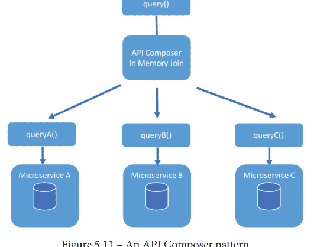

图 5.11 – API Composer 模式

上图说明了 API Composer 的实现，其中 API Composer 向拥有所需数据的微服务发送查询。然后，它将从这些查询中接收到的数据在内存中组合在一起，以将数据提供给 ViewModel 或用于报告。

## 总结

我们探讨了一些可能阻碍微服务数据开发的重要陷阱。其中包括保持单一共享数据库的陷阱，我们了解到应该将数据从单体数据库中分离出来，并将其放置在每个微服务的独立数据库中。复制数据的责任将由拥有该微服务承担。我们讨论了一些通过代码优先方法将数据从单体数据库中分离出来的策略。这是通过先在代码中开发模型并编写单元测试来证明我们的断言来实现的。然后，我们将数据从遗留单体数据库中移出。我们还讨论了数据库优先策略，这可能更复杂且风险更高。

此外，我们还检查了规范化读模型的陷阱。在这里，我们了解到我们并不总是需要像在文档数据库中那样规范化读模型。文档数据库部分由于在父对象内部嵌入子对象而提供高性能查询。这使我们能够通过键值查找来支持我们需要的数据，而无需像关系数据库中那样进行复杂的连接。这些对象由直接存储在文档数据库内部的 JSON 文档组成。

我们检查了不知道如何处理事务的陷阱。我们了解到，我们需要使用聚合的概念来理解事务的边界。这是通过识别构成支持业务规则和不变量的事务的实体来实现的。我们了解了事务的自主性。我们研究了如何使用下一个陷阱，即讨论 Saga，在分布式架构中执行原子事务。我们探讨了在微服务架构的上下文中选择正确的<|message|> 一致性和并发性的陷阱。其分布式特性可能对我们的数据并发性和一致性造成混乱。事务涉及的数据可能跨越微服务构成的整个应用程序。我们讨论了如何使用 Saga 等管理机制来执行这些分布式事务，并确保参与事务的所有服务都成功完成，并且每个服务的数据处于正确的状态。如果事务失败，则 Saga 将执行补偿操作以将数据回滚到先前状态。

最后，我们通过实现一个负责为业务分析构建复杂报告的 API，探讨了不知道如何执行报告的陷阱。该 API 称为 Composer API，它将来自不同服务的数据组合到报告模型中，并在内存中连接数据。

现在，我们可以继续考虑我们的数据设计，并检查一些工具来解决我们在迈向微服务架构的旅程中将面临的挑战。

在下一章中，我们将讨论通信陷阱和预防。特别是，我们将探讨跨进程边界的微服务之间的通信。

## 问题

- 1. 事务必须是原子的。这是真还是假？
- 2. 多样化持久化使用一个数据存储来满足你的数据需求。这是真还是假？
- 3. CQRS 有哪些不同类型？

## 6
### 通信
### 陷阱和
### 预防

微服务架构是分布式系统的实现，其中微服务被设计为细粒度、松耦合和自主的，以便提供业务能力。这些微服务通过托管在网络上的进程边界相互通信，以解决不同的业务用例。网络通信不可靠；因此，微服务应纳入必要的逻辑，以实现跨服务边界的有效通信来构建弹性。设计分布式系统的挑战是众所周知的。它们由 Peter Deutch 描述为开发人员在从单进程应用程序过渡到分布式系统时所做的假设。这些假设被定义为分布式计算的谬误。谬误如下：

- 网络是可靠的。
- 延迟为零。
- 带宽是无限的。
- 网络是安全的。
- 拓扑不会改变。
- 只有一个管理员。
- 传输成本为零。
- 网络是同构的。

在本章中，我们将讨论实现微服务架构不同组件之间信息共享的通信的不同方面。我们还将讨论不同通信方法的挑战以及我们如何使用解决方案来解决它们。本章将涵盖以下主题：

- 微服务通信的基础
- 不同架构及其通信风格
- 直接客户端到微服务通信
- 过于复杂的 API 网关
- 请求超时
- 长链的同步调用 – 重试风暴
- 事件驱动微服务的黑暗面
- 避免服务版本控制
- 服务网格
- Dapr 与服务网格

到本章结束时，你将了解微服务之间相互通信的不同方式、其挑战以及如何使用不同方法解决它们。此外，你还将了解版本控制的重要性及其在微服务的创建和演进中的作用。

## 微服务通信的基础

在开始讨论不同的通信挑战之前，首先，我们将探索微服务架构中通信的基础。在接下来的几个小节中，我们将简要讨论通信的核心概念，因为它们构成了微服务架构的基础。


## 同步与异步通信

为了实现客户端与服务之间的通信，我们将探讨各种替代方案之间的根本差异，以帮助我们为微服务选择合适的通信类型。在**同步通信**中，客户端发送请求并等待服务的响应。同步通信可以是阻塞的也可以是非阻塞的，但客户端只有在收到服务的响应后才能继续后续处理。这种模式也被称为同步**请求/响应模式**。在服务到服务的通信中，请求/响应模式可以是同步的也可以是异步的。在异步 API 调用中，调用会被发出，但调用方服务可以在另一方服务处理响应时自由进行其他处理。这种模式有助于提高服务的吞吐量。

在**异步通信**中，客户端将消息发送到充当客户端与服务之间中间件的消息代理。一旦消息发布到消息代理，客户端将继续处理而不等待响应。服务可以订阅消息代理上的特定消息，并在处理后将响应放回消息代理。客户端和服务彼此 unaware，可以在没有任何依赖的情况下继续演进。

在大多数情况下，微服务应用程序同时使用同步和异步通信来应对不同的用例。然而，如果可能的话，异步通信是首选方法，因为它通过消息在微服务之间提供松耦合和独立性。在下一节中，让我们探索消息及其类型。

## 消息和消息类型

消息被定义为在客户端与其接收者之间发送的数据，作为通过交换信息进行通信的手段。消息有不同类型，根据其意图进行分类。这些消息类型描述如下：

- **命令**被定义为客户端发送的消息，期望接收者执行一个操作。
- **查询**被定义为客户端发送的消息，其意图是期望接收者做出响应。响应可能是成功或失败。如果未收到响应，客户端可以决定重试请求。
- **事件**被定义为表示系统中过去发生的事件的消息，接收者没有任何期望。事件的接收者可以根据事件中提供的信息忽略事件或执行必要的操作。

## 基于异步消息的通信

在事件驱动通信中，服务通过事件相互通信。微服务的任何状态变化都以事件的形式呈现，允许感兴趣的各方订阅这些事件并执行必要的操作。这种模式被称为**发布/订阅**，其中服务可以将消息发布到消息代理，一个或多个消费者可以订阅以处理这些消息。通过引入队列保证每个消息仅由一个且只有一个消费者处理的队列，可以将同步消息转换为异步消息。这种方法有助于解耦服务，使其能够独立更改和扩展。

在了解了微服务通信的基础知识后，让我们继续讨论不同的应用程序架构及其首选的通信方式。

## 不同架构及其通信风格

在本节中，我们将了解进程内通信与进程间通信之间的区别。此外，我们将了解不同架构风格在通信方面的相似性和差异，以及它们如何使用两种通信机制进行信息共享。

**进程内通信**是一种使进程能够使用进程内内存在两个线程之间共享数据的机制，而进程间通信是一种在两个隔离进程之间共享数据的机制，要么使用消息，要么使用**远程过程调用 (RPC)**。这两种通信风格都得到良好支持，尽管了解不同架构如何推动应用程序中一种通信风格相对于另一种通信风格的主导地位非常重要。例如，分布式系统提倡进程间通信优于进程内通信。然而，服务内部组件之间的任何通信都应为进程内通信。让我们借助下图更详细地探索这一点：

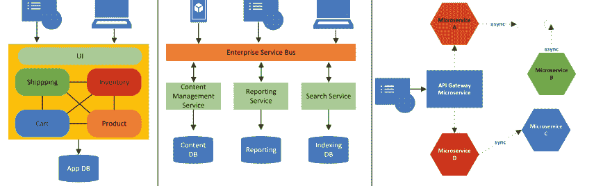

图 6.1 – 单体、SOA 和微服务架构

在**单体架构**中，应用程序作为单个单元构建并作为服务器上的单个进程托管。单体应用程序由不同的组件组成，这些组件本质上是互连且相互依赖的。单体应用程序中同时使用同步通信和异步通信，但大多数情况下，您会发现应用程序组件之间的通信是同步的，而与用户界面和外部系统的通信则更倾向于建模为异步的。

**面向服务的架构 (SOA)**是一种公司范围的方法，用于使用通信协议构建和集成新系统和遗留系统。这些服务之间的通信是通过**企业服务总线** (ESB) 执行的，ESB 负责消息验证、路由和转换。在 SOA 中，更强调集成，而对这些服务的建模则较少强调。

微服务是分布式系统的实现，它提倡微服务之间的服务间通信（即进程间通信）。简单来说，服务间通信可以分为同步通信和异步通信。同步通信可以通过 REST 或 gRPC 等轻量级通用协议实现，而异步通信则通过队列和消息代理支持。建议您使用特定领域的协议来处理服务间通信，例如用于视频流的**实时流传输协议 (RTSP)**。在图 6.1 中，微服务 A 和微服务 B 通过队列使用消息进行通信，而微服务 D 和微服务 C 通过 RPC 进行通信。

在前面的图中，移动应用程序通过直接调用各个微服务直接与电子商务微服务通信。用户旅程始于浏览产品列表、选择产品、申请促销，最后进行结账。作为通信的一部分，客户端需要对每个微服务执行多次往返，这会导致额外的延迟并影响用户体验。为了解决这些挑战，建议您使用 API 网关模式整合用户请求。让我们接下来更详细地探索这一点。

## API 网关模式

API 网关模式在客户端和微服务之间引入了一个反向代理。它充当所有客户端请求进入的单一入口点。API 网关是不同供应商提供的 API 网关模式的实现，负责将客户端请求重定向到微服务以进行进一步处理。它还将客户端应用程序与内部微服务解耦，以实现内部微服务的演进和重构，而不会对客户端应用程序造成任何破坏性更改。最好将 API 网关保留在微服务附近以减少延迟。API 网关是单点故障，应通过高可用性进行保护。您可以使用 Azure API Management 来公开 API、保护客户端免受接口更改的影响、通过添加各种策略强制执行安全性和更多功能。您可以在第 7 章《横切关注点》中了解更多关于 API 网关的信息。

因此，您现在应该对如何使用 API 网关解决直接客户端到微服务通信的挑战有一个基本的了解。接下来，我们将探讨选择单个 API 网关如何导致歧义以及 API 网关的整体维护。

## 过于复杂的 API 网关

单个 API 网关可能对小型微服务应用程序来说是理想的，但如果您处理的是具有各种消费者的众多微服务，它可能会变得过于模糊。以下是使用 API 网关公开 API 时经常讨论的一系列挑战：

- 每个消费者对 API 有不同的信息需求。
- 每个消费者有不同的延迟要求。
- 协议由每个客户端支持。


此外，API网关作为编排后端微服务的一种机制被实现。这种广为人知的API网关实践就是聚合微服务。这一概念将在*第3章“微服务架构陷阱”*中详细解释。在下图中，实现了一个单一的API网关来满足不同消费者的各种需求：


图6.3 – 单体API网关

API网关同时也充当聚合微服务，将编排逻辑引入API网关，因此使其更加复杂且难以维护。这些API网关可能成为整个系统的潜在瓶颈和单点故障源。然而，多个API网关有助于满足不同客户的需求。此外，聚合微服务可用于编排不同的微服务或物化视图模式，这有助于减少微服务之间的通信。接下来，让我们详细探讨这些问题。

## 多个网关——前端的后端

为了保持API网关实现的简单性，你可以根据不同类型的消费者拥有多个API网关。有时，为完全不同的目的设置独立的API网关是有意义的；例如，一个用于外部客户端，一个用于内部服务调用，一个用于合作伙伴消费API，每个API网关包含不同的策略和订阅模式。这还使开发人员能够通过满足每个消费者的数据和延迟需求、减少往返次数以及改善用户体验，为每个消费者提供最优的API。这种方法的另一个好处是，它根据安全性和风险特征对API进行隔离。此外，它还有助于应对单个API网关成为系统瓶颈和单点故障的挑战。许多云提供商将API网关作为服务提供，帮助云原生开发者使用这些服务发布API，而无需重新发明轮子。身份验证、授权、服务发现、速率限制、限流、负载均衡、日志记录、追踪、关联、IP白名单和响应缓存只是API网关支持的众多功能中的一部分。下图描绘了多个API网关，每个都充当前端的后端：


在上图中，实现了三个不同的API网关，以提高整体应用的性能、可用性、可扩展性、安全性和可维护性。每个API网关都实现了针对特定消费者的策略，使微服务与其消费者之间能够通过API网关进行通信。如*图6.4*所示，合作伙伴API网关由于部署失败而不可用，但这并不影响其他API网关，其他渠道将继续无中断地运行。这有助于我们缩小爆炸半径，减少受影响的消费者数量。

通过引入聚合微服务，我们可以进一步简化API网关与后端微服务之间的通信。聚合微服务负责编排后端微服务与API网关之间的通信。这一概念将在*第3章“微服务架构陷阱”*中更详细地解释。

## 物化视图模式

聚合微服务在减少API网关与后端微服务之间的通信方面发挥了重要作用，但它只是帮助我们将问题从API网关转移到了聚合微服务。物化视图模式帮助您保留其他微服务数据的本地副本（即只读模型），这对于主微服务独立运行是必需的。该模式消除了对其他微服务的调用，以缩短响应时间并提高微服务的可靠性。下图展示了通过引入多个API网关和物化视图模式来增强整体微服务架构弹性的尝试：


图6.5 – 带有物化视图模式的多个API网关

在上图中，我们在API网关层拥有多个API网关，以解决高可用性、可扩展性和容错性问题。搜索微服务拥有来自多个微服务的相关数据的只读模型，这是执行其操作所必需的。建议您使用队列或发布/订阅模式异步更新只读模型。对于写操作，您可以选择同步或异步通信；不过，异步通信更受青睐。这一概念将在第3章“微服务架构陷阱”中更详细地解释。

现在你已经很好地理解了如何防止API网关变得过于复杂，接下来让我们讨论在启用服务间通信时需要注意的因素。

### 请求超时

在微服务架构中，服务作为独立进程托管，通过网络通过RPC相互通信。这些微服务使用不同的协议交换消息，以消费这些服务暴露的接口。在同步通信中，消费者需要与服务建立连接以消费其能力。连接服务并调用其能力的能力被定义为服务的**可用性**，而服务响应其消费者所需的时间被称为其**响应性**。

可用性和响应性都是消费者需要考虑的重要方面，以实现服务之间弹性的进程间通信。服务的消费者可以选择无限期等待，或者指定一个超时时间来等待响应，然后再决定下一步操作。虽然指定超时似乎是一个不错的选择，但它可能导致超时反模式。下图描绘了两个微服务之间的进程间通信：


图6.6 – 两个微服务之间的进程间通信

在上图中，微服务A正试图消费微服务B中可用的能力。微服务A实现了重试逻辑，以便在失败时与目标服务重新通信。此外，它还实现了超时功能，以确保服务响应性。超时机制会在发生故障时让微服务A知道微服务B不可用。这两个微服务之间的一系列事件说明如下：

1. 微服务A尝试调用微服务B中可用的功能。然而，微服务A无法连接到微服务B。在这种情况下，微服务A认为微服务B不可用。微服务A可以向客户端回复一条错误消息，说明不可用情况，或者也可以重试。处理这种失败有多种方式。为了避免同步调用，可以选择物化视图模式或发布/订阅模式，我们将在本章后面讨论。

2. 由于微服务A中实现了*重试逻辑*，微服务A将继续尝试调用微服务B。如果在规定时间内未收到响应，则会导致超时。在这种情况下，微服务B被认为无响应。如果未指定超时，微服务A将继续等待微服务B，从而浪费资源。

3. 在理想情况下，微服务A调用微服务B中可用的功能，并在规定时间内收到响应。

乍一看，设置超时值似乎是显而易见的选择，但要找到能够应对高流量、网络延迟、服务不可用或资源过度分配等挑战的合适超时值却很困难。例如，你可能请求从ATM机提取5,000美元现金。你最不希望发生的情况是账户已被扣款，却因服务超时而没有从ATM机收到任何现金。服务超时可能是由于网络延迟或服务负载造成的。你可以再试一次，但你会发现账户已经被扣款了。解决这个问题的一种方法是设置一个较大的超时值，让这些服务在高流量和高负载时能够响应。一种常见的解决方式是将超时值设置为高峰时段响应时间的两倍，如下所示：

*平均响应时间 = 1500 毫秒*

*高峰时段响应时间 = 4500 毫秒*

*超时值 = 4500 毫秒 x 2 = 9000 毫秒 = 9 秒*

你可能想知道为什么这是一种反模式。现在，每个服务都必须等待9秒才能让消费者知道请求失败。在这段时间内，客户端可能会关闭窗口或多次点击提交按钮。这不是良好的体验，应该用更好的策略来解决。

> **注意**
> 对于同步调用的长链路，实现重试模式并不是一个好主意，因为如果重试模式被触发，消费者将经历延迟。我们将在*同步调用的长链路——重试风暴*一节中更详细地讨论长链同步调用的问题。


## 重试模式

重试模式用于应对服务不可用相关的故障。了解不同类型的故障，并仅对瞬时故障应用重试策略，这一点很重要。通过重试模式，你可以基于重试计数器对失败的请求进行重试。每次请求失败后，你都要增加重试计数器的值，并在进行下一次调用前增加等待时间，同时加入一些抖动。一旦达到重试计数器上限，你就可以优雅地处理故障，让客户端知晓服务不可用。建议增加重试请求之间的等待时间，以便服务恢复可用并处理新请求。重试模式背后的意图是为可能成功的操作提供更多执行机会。有关重试模式的更详细说明，请参见第4章“让遗留应用重新平台化变得简单”。

## 熔断模式

有时，服务可能会在较长时间内不可用。在这种情况下，你不应继续重试请求，因为这可能耗尽系统资源，并可能影响其他服务，从而引发级联故障。相反，你应该相对较早地将服务不可用情况告知客户端。熔断模式通过仅允许可能成功的请求通过，帮助你应对此类故障。熔断模式背后的理念是：通过限制请求负载，让服务自动恢复。一旦服务恢复可用，你就可以增加负载以处理更多请求。你可以在第4章“让遗留应用重新平台化变得简单”中了解更多关于熔断模式的内容。

了解微服务在网络通信过程中在不同情况下如何表现非常重要。这种理解将有助于我们提高系统的可用性和响应性。在下一节中，我们将探讨重试风暴，以及如何使用不同方法应对它带来的挑战。

## 同步调用的长链——重试风暴

当多个微服务在长链中相互重复调用时，某个微服务可能会出现响应时间超过预期的情况，从而导致超时。这些超时将会触发额外的重试请求，期望操作能够成功，而这些重试请求的洪流最终可能使系统不可用。这种场景被称为重试风暴，如下图所示：


图6.7——同步调用的长链

在上图中，结账操作通过调用一系列微服务来完成。每个微服务调用都有自己的预计完成时间（ETA），并留有充足的缓冲以应对各种不利情况。然而，由于某些原因，发票微服务正面临负载压力，其 ETA 已不再保持不变。其他服务对此变化毫不知情，仍期望发票微服务保持原来的 ETA。

请注意，1秒后，物流微服务已对发票微服务发起重试请求，如果在规定时间内未收到响应，将继续重试。类似地，支付微服务会在2秒后对物流微服务发起重试请求，而物流微服务又转而向发票微服务发起请求。最后，3秒后，由于购物车微服务的 ETA 未能得到满足，它将对支付微服务发起重试请求，支付微服务随后调用物流微服务，并最终调用发票微服务。

由于这些超时，我们在未通知其他服务的情况下发起了额外的请求：调用者已不再等待先前的响应，这些服务应放弃处理这些请求。因此，宝贵的处理能力被白白浪费了。此外，如果你将所有微服务托管在同一基础设施上，则可能出现级联故障，导致整个系统不可用。

分布式事务（Saga）就是按顺序调用一系列微服务来执行一系列任务的例子。发生故障时，会执行重试以确保跨服务边界的一致性。如果重试未成功，编排器需要进行回滚，以撤销已执行的任务，确保一致性。这一概念将在第5章“数据设计陷阱”中详细讨论。处理重试风暴有多种方法。我们将在后续小节中讨论这些方法。

### 可扩展的基础设施

通过监控应用程序的各个不同方面，你可以使基础设施实现即时扩展，以应对峰值负载。即时扩展意味着服务的启动时间很短。这将帮助我们解决因请求数量过多而导致服务过载的问题。唯一的例外是问题由外部因素引起，例如通过网络从第三方系统读取文件而导致的延迟。在这种情况下，应寻找其他替代方案，我们将在下文解释。

### 负载均衡、限流与请求分类

负载均衡是一种将传入请求分发到部署在不同服务器上的一组服务实例的方法。这样可以确保没有服务器被过度占用，同时每台服务器都能收到公平份额的请求。一旦服务器过载，后端服务应拒绝请求，向客户端告知正确的错误代码，或提供降级响应。此外，请确保根据请求的关键性对其进行分类，并据此优先执行。在本例中，发票生成对于物流服务来说并不是关键操作，可以推迟到服务恢复到满负荷能力后再进行。你可以在不同层面执行限流，包括单个微服务、负载均衡器或API网关层面。

### 指数退避、抖动与熔断

对重试请求采用指数退避策略。指数退避策略提倡在两个重试请求之间采用指数级增长的等待时间。这有助于服务从新请求的冲击中恢复，让已在处理中的请求能够完成执行。此外，你可以在退避策略中引入随机性，以分散请求峰值；这称为抖动。同时，你需要通过实现熔断机制来确保不会无限重试，并给服务以恢复机会。请确保在你的服务中采用一致的重试方式，并避免在不同层面重复重试，例如使用服务网格或SDK。你可以在第3章“微服务架构陷阱”中了解更多关于评估不同服务网格能力的内容。

### 仅允许紧邻层进行重试

在该场景中，物流微服务是关键服务，只允许支付微服务对物流微服务执行重试。如果物流微服务已达到允许的重试尝试次数，则应告知购物车微服务：当前无法处理该请求，应稍后重试。因此，每个上游服务都会获知服务的状态。此外，最好告知上游/客户端服务预计再次可用的时间间隔。在这种情况下，监测系统健康状况至关重要；它可以帮助你在请求生命周期的早期拒绝请求，从而提供更好的客户端体验，并通过减少负载帮助确保服务及时恢复。

现在，你应该已经对重试风暴的缺点、它对整个系统的影响以及可能的解决方案有了扎实的理解。接下来，我们将讨论事件驱动架构、它的陷阱以及克服这些问题的方法。

## 事件驱动微服务的暗面

微服务是一组实现限界上下文的松散耦合的微服务，限界上下文界定了模块边界以及它们之间的交互方式。限界上下文的概念将在第2章“未能理解DDD的作用”中详细讨论。微服务可以设计为事件驱动架构，在这种架构中，微服务通过共享状态变更进行相互通信。下图描绘了一种事件驱动架构：


图6.8——事件驱动微服务


在前面的图中，事件由生产者微服务作为事件流产生，后续由多个消费者微服务消费。事件流由事件代理（或事件总线）提供服务，它将生产者与消费者解耦。事件驱动架构的一个挑战是，很难弄清楚不同的微服务如何通过事件相互通信。解决这一挑战的一种方法是监控这些系统并跟踪事件的流动以及不同系统如何对它们做出反应。在下一节中，我们将讨论设计事件的各种陷阱以及如何使用领域事件来解决它们。让我们继续深入探索它们。

## 事件设计陷阱

事件是实现事件驱动微服务之间通信的核心概念。事件通过允许系统灵活、 resilient 且可扩展来促进解耦。事件驱动架构的所有这些承诺都取决于事件设计的优劣。以下是在设计事件时可能遇到的不同陷阱的列表：

- **事件依赖性：** 一个可能受过去或未来事件影响的事件被认为是有依赖性的事件。在事件驱动架构中，事件应该是原子的、自包含的且独立的。消费者应该能够在无需等待其他事件的情况下处理一个事件。独立事件允许不同的消费者以不同的方式处理同一事件，而无需依赖发布者或发布者对其实践做出假设或意图。
- **实体作为事件：** 另一个常见的反模式是使用数据库实体作为事件。这些实体是服务的内部实现的一部分，可能无法在业务上下文中传达正确的意图。
- **通用事件：** 避免使用通用事件，因为这将要求消费者在决定是否处理消息或丢弃它之前分析消息，这会浪费宝贵的 CPU 周期。
- **CQRS、事件溯源和事件：** 命令查询职责分离（CQRS）和事件溯源一起使用；在这里，命令和事件溯源提供写模型，而事件存储投影和查询为系统提供读模型。在这种架构中，你会观察到团队将命令伪装成事件。命令通常是针对单个消费者的，而事件是 intended for 任何对事件感兴趣的消费者。另一个可以观察到的情况是，将事件存储事件作为不同业务域之间通信的方法。这种方法的缺点是，对事件存储的任何更改现在都与其它业务域相关联，这使得演进变得更困难。CQRS 和事件溯源已在 *Chapter 5, Data Design Pitfalls.* 中进行了详细讨论。

## 领域事件

在 **领域驱动设计（DDD）** 的上下文中，领域事件被归类为业务事件。它们被视为 DDD 中的一等公民，并构成了流对齐团队用来理解业务域的通用语言。通用语言的概念已在 *Chapter 2, Failing to Understand the Role of DDD* 中进行了详细讨论。领域事件是具体的，并且包含必要的信息，作为业务域之间促进通信的契约；例如，属于支付域的 `payment_received` 事件，在客户完成付款后生成。发票生成可以订阅 `payment_received` 并执行必要的操作来生成发票。一旦发票生成，系统将生成一个 `invoice_generated` 事件，可以由通知系统处理以发送通知。

事件是事件驱动架构的关键部分。这是因为它充当微服务之间的数据载体和契约。这些事件应该是领域驱动的并代表业务事件。事件和 API 接口都是实现通信的方式。随着系统的演进，这些接口会经历多次更改，导致服务的多个版本发布。在下一节中，我们将探讨版本控制在微服务架构中的作用。

## 避免服务版本控制

在 Chapter 1, Setting Up Your Mindset for Microservices Endeavor 中，我们谈到了 API-first 方法作为构建云原生应用程序的额外因素之一，除十二因子应用方法论之外。API-first 方法强调定义服务契约，该契约规定了服务的行为。服务 API 是服务与其消费者之间的契约。服务在其生命周期中可能会经历许多更改，这可能需要对其 API 进行更改。服务可能有多个消费者，在进行多次 API 更改时确保向后兼容至关重要，以便不同的消费者能够在不进行任何更改的情况下继续其操作。

API 更改可以大致分为破坏性和非破坏性。破坏性更改要求客户端更新到 API 的较新版本，而非破坏性更改不会影响客户端，允许它们继续使用旧版本的 API。任何接口的删除或更改，包括消息格式、方法签名或响应类型，都被视为破坏性更改。添加新的接口，包括消息格式和消息类型，被认为是非破坏性更改。

根据十二因子应用方法论，拥有微服务的单一代码库至关重要。这种策略适用于非破坏性更改。然而，破坏性更改引入了新的挑战，你可能需要保留不同服务的实例以支持不同的消费者。例如，假设你要将一个单体电商应用程序分解为微服务，其中这些微服务相互调用以解决不同的业务用例。更好的做法是确保每次更改都向后和向前兼容，这可以在许多方面提供帮助，例如允许回滚。在下面的图中，我们将讨论部署具有破坏性更改的这些服务的新版本的影响：

### 独立部署

### 破坏性更改

### 部署新客户端版本

### 锁步部署

### Figure 6.9 – Application versioning

在前面的图中，我们有三个微服务，其中微服务 A 和微服务 B 与微服务 C 通信以完成工作。我们可以说微服务 A 和微服务 B 都依赖于微服务 C，微服务 C 的任何破坏性更改都可能影响这两个微服务。不同微服务的部署及其在不同阶段的影响讨论如下：

- 1. 我们从微服务的独立部署开始。所有微服务都在运行 v1 版本。这允许我们独立部署微服务 A 和微服务 B 的新版本，但我们能对微服务 C 也这样做吗？
- 2. 我们有微服务 C 的新版本，我们称之为 v2。微服务的新版本更新了接口；因此，这是一项破坏性更改，影响了微服务 A 和微服务 B 如何调用微服务 C 的功能。
- 3. 现在，微服务 A 和微服务 B 都已实现微服务 C 引入的更改并部署了其 v2 版本。
- 4. 团队意识到微服务 C 不能独立部署；他们还需要部署依赖服务。这就是我们所说的锁步部署。


版本控制是一个重要概念，它帮助我们识别系统不同组件之间的兼容性问题。避免服务版本控制是开发生命周期早期应解决的一个常见陷阱。在下一节中，我们将探讨语义化版本控制及其在微服务中的工作方式。

## 语义化版本控制

解决服务版本控制挑战的一个流行方法是语义化版本控制。使用语义化版本控制，你可以将服务版本指定为 Major.Minor.Patch（主版本号.次版本号.补丁版本号）。这里，当你做出不兼容的 API 更改时，主版本号递增；当你添加向后兼容的功能时，次版本号递增。此外，补丁版本号用于错误修复和小修补。在 SOA 或微服务世界中，应避免不兼容的更改，因为此类发布的成本极高。即使这意味着编写额外代码，团队也应避免此类更改。下图描绘了软件组件的生命周期以及如何创建不同版本：


图 6.10 – 语义化版本控制

在上图中，一个包已经发布了多次，包括主版本、次版本和补丁更新。最初，v1.0 版本与两个补丁（v1.0.1 和 v1.0.2）一起发布。然后，发布了 v1.1 次版本更新。补丁更新和次版本更新都是非破坏性变更，因此客户端无需进行任何更改。一段时间后，对包进行了主版本更新，从而发布了新的主版本，即 v2.0。

在下一张图中，我们将讨论语义化版本控制如何与微服务协同工作。微服务旨在可独立部署，因此有必要允许同一微服务的多个具有不同契约的版本同时运行。如果我们不使用语义化版本控制，就会陷入锁步部署的陷阱。下图展示了即使部署了破坏性变更，不同的微服务如何继续运行而不中断：


图 6.11 – 微服务中的语义化版本控制

在上图中，我们引入了语义化版本控制，以应对锁步部署的挑战，并展示了同一微服务的不同版本如何在不影响其客户端的情况下同时运行。因此，客户端可以自行更新，而不会造成任何中断或改变部署节奏。以下是该过程的详细说明：

- 1. 部署了具有次要更改的微服务 C 的新版本（v2.1），这不需要任何客户端更新。在这种情况下，微服务 A 和微服务 B 都将继续运行，无需任何更改。
- 2. 微服务 C 中引入了破坏性变更，将其版本从 v2.1 更改为 v3。在这种情况下，我们将让新版本的微服务 C 并排运行，以便微服务 A 和微服务 B 修改它们与微服务 C 的通信通道。
- 3. 微服务 B 已更新其版本以适配微服务 C 的新版本，而微服务 A 继续与旧版本的微服务 C 协同工作。微服务 A 和微服务 B 都可以继续运行并为各自的客户端提供服务，不会造成任何中断。
- 4. 一段时间后，微服务 A 也将其版本更新为 v3，现在我们可以删除旧版本的微服务 C。

作为一种良好实践，请尽量避免破坏性变更。例如，避免从服务接口中移除属性。添加新属性是非破坏性变更。话虽如此，如果旧版本 API 未提供新属性的默认值，服务需要添加必要的逻辑来为新属性设置默认值。

## HTTP/REST API 版本控制方法

从根本上说，我们需要更新 API 版本的两个主要原因：

- 格式版本控制定义为使用不同版本的 API 操作同一底层资源的方式。
- 实体版本控制在底层资源结构发生变化时引入。

有不同方式对 REST API 进行版本控制。我们将在以下小节中探讨它们。

### URI 路径版本控制

使用 URI 路径版本控制，你可以将 API 版本指定为 URI 的一部分。然而，这违反了“一个 URI 应仅指向一个资源”的原则。当 URI 路径版本控制与资源的静态绑定一起使用时，每次新版本发布后都会破坏客户端集成。在以下片段中，版本（v2）被指定为 URI 的一部分：

```text
http://api.hrdept.com/v2/employee
```

### 查询参数版本控制

使用查询参数版本控制，通过查询参数指定 API 的版本。这样，每个 URI 代表一个资源，并且可以通过单个资源处理器来选择正确的资源版本。在以下片段中，版本（v=1.5）被指定为查询参数：

```text
http://api.netflix.com/catalog/titles/series/123?v=1.5
```

### 内容类型版本控制

内容协商版本控制技术强调客户端需要通过 Accept 标头使用自定义媒体类型来指定正确的 API 版本。使用这种方法，你可以维护能够处理多个版本的相同资源 URI。对此请求的响应应在 content-type 标头字段中包含版本信息。以下片段描述了一个 HTTP 请求的 Accept 标头，可用于指定资源版本：

```text
Accept: application/vnd.github.1.param+json
```

### 自定义标头版本控制

你可以使用这种方法在请求中定义一个新的自定义标头，以关联资源版本控制。使用这种方法，你可以在不同的 API 版本之间保持相同的 URI，从而限制 API 版本之间的客户端代码更改。以下片段描述了一个 HTTP 请求的自定义标头，可用于指定资源版本：

```text
x-eCommerceApp-version: 2021-01-01
```

> **注意**
> 
> 要了解更多关于 API 版本控制的信息，请参阅以下链接：
> 
> `https://github.com/Microsoft/api-guidelines/blob/master/Guidelines.md?WT.mc_id=-blog-scottha#12-versioning`

## gRPC 服务版本控制

gRPC 协议支持服务版本控制，既适用于破坏性变更，也适用于非破坏性变更。对于破坏性变更，你应该继续并排运行不同版本的 gRPC 服务，除非所有客户端都已迁移到更新版本的 gRPC 服务。gRPC 包允许你指定可选的说明符，用于版本控制，如下表所示：

| 服务地址 | 包名称 |  | 服务名称 |
|---|---|---|---|
| ecommerce.v1.notification | ecommerce | v1 | Notification |
| ecommerce.v2.notification | ecommerce | v2 | Notification |

表 6.1 – gRPC 版本控制

服务地址由包名称和服务名称组成。服务地址允许多个版本的 gRPC 服务并排托管，以支持多个客户端。

## 事件版本控制

在事件驱动架构中，事件被视为系统的核心部分，负责分布式系统不同部分之间的通信。这些系统作为其核心结构的一部分，产生、存储和消费事件。就像任何其他系统一样，事件驱动系统也在不断演变与系统其他部分通信的方式，通过事件结构提供各种信息。这要求我们仔细思考如何发布事件，使各种消费者无需进行任何更改即可处理这些事件，或者至少为消费者提供足够的时间来更新实现，以适应新的事件结构。


作为经验法则，事件的新版本应该可以从旧版本转换而来；否则，它就是一个新事件。将事件版本作为事件结构的一部分进行指定是一个良好的实践。这是因为它赋予你发布事件多个版本的灵活性，以便不同的消费者可以处理它。另一种方法是采用无事件版本控制，并通过确保不删除或更改事件结构中的字段来保持事件向后兼容。新字段被视为可空值，以便可以稍后重放事件的旧版本。以下图表描述了事件驱动架构中事件版本控制的工作方式：


图 6.12 – 事件驱动架构中的事件版本控制

在前面的图表中，发布者正在生成事件的多个版本，以允许多个消费者对这些事件做出反应。理想情况下，这些消费者应该是幂等的，以避免处理同一事件多个版本带来的副作用。事件代理充当发布者和消费者之间的中继，并提供基于事件数据过滤事件的能力。事件代理有助于解耦发布者和消费者。其思想是允许系统的不同部分独立演进，其中事件有助于实现通信，每个消费者处理相关的事件。

在事件溯源系统中，系统应能够使用在事件源系统生命周期中创建的事件来重建应用程序状态。这意味着系统应处理新旧事件以重建应用程序状态。以下图表描述了事件存储中不同事件的多个版本。稍后，我们将讨论与此方法相关联的挑战以及如何解决它们：


图 6.13 – 事件存储中事件的多个版本

在前面的图表中，事件源系统在事件存储中有同一事件的多个版本，这些版本用于投影，以及下游系统进行消费。多个版本的挑战在于，系统在重建状态时需要选择正确的版本，这使得整体系统复杂且容易出错。事件源系统处理事件的两种方法分别是**强模式**和**弱模式**。强模式基于类型系统，系统只能将事件反序列化为与其模式完全匹配的类型。任何新事件都需要构建序列化支持，这会导致重新部署。

另一方面，弱模式更具适应性，可以用 JSON 或 XML 格式描述。弱模式使用映射技术将 JSON 或 XML 数据映射到事件对象；只要我们不更改字段名称及其语义含义即可。弱模式帮助我们保留事件的最新版本，因为旧事件现在可以转换为最新事件。弱模式是处理事件源系统的推荐方法。其他方法包括通过用新事件替换旧事件来对事件存储进行版本控制，同时保留旧事件存储的备份以供审计。

通过对可在微服务架构中应用的不同版本控制技术的良好理解，你可以确保即使部署了破坏性更改，系统仍将继续不间断运行。在下一节中，我们将探讨服务网格在简化微服务之间进程间通信和扩展方面的作用。

## 服务网格

服务网格在微服务之上提供一个抽象层，以促进进程间通信。服务网格背后的思想是将通信问题与微服务的实现解耦，并在微服务架构中以一致的方式处理它们。以下图表描述了微服务的简单服务网格架构：


图 6.14 – 一个服务网格

服务网格是一个可配置的通信基础设施层，可保证请求在复杂服务拓扑中可靠传递。这使团队能够专注于业务能力，并将通信问题留给服务网格。服务网格由两个组件组成：控制平面和数据平面。数据平面实现为 sidecar 代理，负责拦截网络中的数据包并在转发之前执行各种功能。数据平面还执行路由、健康检查、负载均衡、可观测性、身份验证/授权和服务发现。另一方面，控制平面提供管理和监控方面的功能。它充当控制器，将 sidecar 代理连接起来形成分布式系统。

在服务网格架构中，微服务不知道分布式系统，因为它们只与本地 sidecar 代理通信以与其他微服务通信。服务网格技术正在成熟，越来越多的组织正在采用它。随着服务网格的采用，有一些陷阱你应该注意：

- 服务网格的管理应成为共享治理的一部分，其中使能团队应与价值流团队合作，以确保他们了解好处和挑战，而不是实现不同的通信问题，这些问题可以由服务网格整体处理。
- 与任何其他技术一样，服务网格并不是灵丹妙药，并且需要陡峭的学习曲线。服务网格的部署和运营成本很高。本书前面我们根据其功能比较了不同的服务网格。请参阅 *第 3 章，微服务架构陷阱*。

如果你在扩展微服务之间的进程间通信时遇到困难，服务网格是一个不错的选择。它管理微服务之间的通信，帮助团队专注于业务能力。通常，服务网格由平台团队拥有。在下一节中，我们将比较 Dapr 和服务网格，以帮助你在构建微服务架构时做出正确的选择。

## Dapr 与服务网格

Dapr 和服务网格都提供重叠的功能，这就引发了 Dapr 与服务网格相比如何以及何时应优先使用其中一个的问题。虽然 Dapr 和服务网格的目标都是减少复杂性，但它们的预期受众有所不同。Dapr 专注于通过抽象你的微服务并提供一组构建块来满足常见的微服务需求，从而改善开发人员体验，而服务网格则通过提供解决网络问题的网络服务网格来帮助应用运营者。让我们更仔细地看看两者之间的相似之处和差异，如下表所示：

## 摘要

在本章中，我们了解了可用于促进微服务架构中通信的各种通信风格、其挑战和潜在解决方案。我们讨论了系统通信的基础知识，以及不同的架构风格如何使用它们进行通信。此外，我们分析了直接客户端到微服务通信的缺点，以及如何通过引入充当反向代理的 API 网关来解决它们。我们还探讨了对大型应用程序使用单一 API 网关可能造成的模糊性，以及如何通过不同方法解决这些复杂性。

随后，我们讨论了可用性和响应性这两个重要概念，以及如何使用不同技术实现微服务之间具有弹性的进程间通信。此外，我们还研究了同步调用的长链如何导致重试风暴，从而使整个系统不可用，以及可在不同层面上确保可用性和性能的多种方法。我们还讨论了事件驱动架构及其挑战，以及如何使用不同方法解决它们。我们还讨论了版本控制在微服务的不同方面的作用。最后，我们探讨了服务网格的演进以及它与 Dapr 的比较。

有了这些知识，你可以开始选择合适的通信机制，使用本章介绍的方法实现客户端到服务和服务到服务通信。在下一章中，我们将讨论与横切关注点相关的陷阱，以及如何使用不同解决方案解决它们。

## 问题

- 1. 同步通信和异步通信有什么区别？
- 2. 直接客户端到微服务通信的缺点是什么？
- 3. 什么是重试风暴？
- 4. HTTP/REST API 版本控制有哪些不同方法？
- 5. 什么是服务网格？


## 进一步阅读

- *Hands-On RESTful API Design Patterns and Best Practices*, Packt Publishing, Harihara Subramanian and Pethuru Raj
- *Enterprise API Management*, Packt Publishing, Luis Weir
- *Building Event-Driven Microservices*, O'Reilly Media, Adam Bellemare
- *Mastering Service Mesh*, Packt Publishing, Anjali Khatri and Vikram Khatri
- *Microservice Patterns and Best Practices*, Packt Publishing, Vinicius Feitosa Pacheco
- *Versioning in an Event-Sourced System*, Gregory Young

## 7

## 横切关注点

传统上，当我们开始构建应用程序时，我们会开发称为 *facades* 的组件来执行不同的操作，例如日志记录、健康检查、追踪和授权。在微服务架构中，为每个服务构建这些组件需要适当的时间和精力。微服务是自包含的服务，通常构建所需时间较少，因为它们仅限于单一业务能力。为每个服务构建横切关注点的模块肯定会花费比构建该服务本身更长的时间。作为后果，它会影响敏捷性并需要足够的开发工作。由于每个服务都有自己的组件，修改一个组件以符合组织计划将需要单独更新每个服务，这也具有挑战性。

构建通用模块或重用现有的平台是一个好主意，这些平台允许与不同的微服务轻松快速地集成。微服务应仅包含特定于业务能力的模块或工件，所有横切关注点都应外包以解决问题。例如，与为每个微服务构建单独的日志机制相比，使用集中的监控系统如 **Azure Application Insights** 更为可取，它提供 **SDK** 并可轻松集成到微服务所基于的任何平台。此外，一个 Azure App Insights 资源可以集成到所有微服务中，并提供从单一视图统一访问所有日志的功能。然而，当你为整个系统保留一个资源时，由于隐私或法律需求，限制访问会变得更困难。在这种情况下，你可以根据服务或域对日志资源进行隔离。

在本章中，我们将讨论与横切关注点相关的陷阱，并学习诸如微服务底盘、守门员和服务发现等模式。在整章中，我们将涵盖以下主题：

- 微服务底盘模式
- 横切陷阱

### 微服务底盘模式

在非技术术语中，我们可以将底盘视为汽车的基础框架。它提供了核心层或骨架，汽车在此基础上构建。在微服务的上下文中，我们可以将其视为一个基础框架，提供基本的横切关注点，如日志记录、安全、异常处理、追踪和分发等。以下图表描绘了微服务底盘框架的表示：


图 7.1 – 微服务底盘框架

大型企业的微服务架构有大量服务相互通信，敏捷性是一个非常重要的因素。当需求到来时，你通常会根据业务用例进行估算，而不是思考如何实现安全、开发日志框架或执行异常处理等。提供一个可被服务利用的基础框架来处理这些关注点，不仅减少了构建该服务所需的工作量，还允许你重用作为底盘框架一部分的构建块。

微服务底盘模式指出，所有这些关注点都应卸载到由所有其他服务共享的独立服务或组件。Dapr 是一个很好的例子，它提供了一组构建块来启用日志记录、服务到服务通信、进程间通信、pub/sub 等。它也需要很少的配置，并允许通过使用 HTTP 或 gRPC 端点，或通过 Dapr SDK 快速实现。要了解有关 Dapr 的更多信息，请参阅第 3 章，微服务架构陷阱。

### 微服务应用需求

基于微服务构建了各种场景和用例。微服务不仅依赖于业务能力或数据库中执行的创建、读取、更新和删除（CRUD）操作，还可以构建为响应到达消息队列的事件、与其他系统集成、作为 webhook 暴露以发送某些通知，或执行某些繁重的操作任务，例如图像处理。对于每个服务，你可能需要构建几个与实际服务用例完全无关的组件，这会延迟服务交付。一些应与微服务分开处理但不限于的因素如下：

- 安全和令牌验证
- 重试和断路器
- 幂等性
- 协议转换
- 消息转换
- 日志记录
- 指标收集
- 分布式追踪

在微服务本身中构建所有这些关注点是一种反模式，会增加服务开发时间，从而降低敏捷性。在下一节中，我们将讨论在处理这些关注点时出现的一些陷阱以及应对它们的推荐做法。

### 横切陷阱

本节将介绍构建微服务时与各种横切关注点相关的一些陷阱，并为每个陷阱提供替代方法。

#### 在微服务内部嵌入安全处理

保护服务并允许安全访问服务是在构建服务时的主要需求之一。将从请求对象中验证传入令牌的安全流程嵌入到微服务中将是一项耗时的任务。安全和令牌验证可以从微服务代码中消除，保持微服务代码干净并与其用例相关联。然而，如果服务不验证传入令牌，请确保服务不会直接暴露给消费者而没有诸如 API 网关之类的前端门户。如果服务被暴露，它将容易受到攻击并可能失败。解决此陷阱的方法是通过将安全卸载到 API 网关。

#### 启用节流以保护微服务

节流是一种限制组件允许的请求数量的机制。在微服务架构中，就保护服务而言，它被认为是一个重要因素。如果你没有机制来配置服务可以服务的请求最大数量，它可能导致 **分布式拒绝服务 (DDoS)** 攻击。节流允许你指定限制、配置和策略，从而使服务能够满足其预期的 **服务等级协议 (SLAs)**。

> **注意**
>
> SLA 是服务提供商与客户之间的承诺，确定所需服务和期望的服务水平。

#### 将安全令牌验证卸载到 API 网关

在 Azure 中有各种服务，**Azure API Management** 提供 **JWT** 策略来验证传入令牌并将其路由到后端微服务。你可以将 Azure API Management 与托管在 **Azure Kubernetes Service (AKS)** 集群中的微服务一起设置，允许外部流量到达 Azure API Management 并将其路由到 **VNET** 内的后端服务。以下图表说明了将 Azure API Management 与托管在具有 VNET 配置的 AKS 集群中的微服务结合使用：


图 7.2 – 在 API 网关级别验证令牌

在前面的图表中，AKS 配置了 VNET 配置，微服务仅对 VNET 内的服务可用。Azure API Management 配置了外部 VNET 配置，允许所有来自公共互联网的流量（仅到达该服务）进入 VNET 内部。


## 构建微服务时未考虑弹性

为企业级应用构建 API 的开发人员可能理解重试和断路器模式的需求。我们已在*第 4 章“让棕地应用重新平台化变得简单”*中详细讨论了这些模式。解决此陷阱的方法是使用重试和断路器模式。

### 使用重试和断路器模式

必须应用重试和断路器模式来创建一种稳健机制，使故障服务能够通过多次重试来响应，或者在响应失败频率很高时短暂断开电路。

Azure API 管理提供了一个开箱即用的选项来配置重试策略。然而，要将重试模式与断路器模式结合使用，可以创建一个单独的服务来处理这些关注点。

当请求到达 API 网关时，它会被首先路由到重试服务，然后再路由到后端服务。如果后端服务发生故障，重试服务会多次尝试获取响应，或在有限时间内断开电路。

顺便提一下，有多种 sidecar 提供重试模式的功能，包括 envoy、istio 和 dapr。

## 构建微服务时未考虑幂等性

在微服务中，系统被分解为多个服务，这些服务通过 HTTP 端点进行监听。如今，**RESTful** 服务是构建 API 的行业标准。由于 RESTful 服务依赖底层 HTTP 协议，它们对不同操作使用不同的 HTTP 动词。例如，HTTP GET 方法用于检索数据，HTTP POST 方法用于写入，HTTP PUT 用于更新，HTTP DELETE 用于删除。由于 HTTP POST 方法会在服务器上写入数据，因此它是不安全的。如果同一操作被执行两次，服务器上会创建多条记录。为了保护服务免受这些问题的影响，幂等性是必须考虑的重要因素。

> **注意**
>
> 诸如 **gRPC** 和 **thrift** 之类的二进制协议正在迅速超越 REST，成为构建新服务的首选方式。

## 将协议转换嵌入微服务内部

通常，微服务的核心 API 是独立的、细粒度的服务，并通过 HTTP 交换数据。例如，当将微服务应用与现有 SAP 系统集成时，可能需要使用 TCP 协议发送数据。为了满足特定需求，你可以创建组件或服务，让其他服务通过 HTTP 协议与之通信，而内部使用 TCP 协议连接。解决此陷阱的方法是将协议转换的责任委托给 API 网关。

### 将协议转换委托给 API 网关

在微服务内部构建协议转换本身是一种反模式。你应该将此责任委托给 API 网关，或者构建一个公共服务来执行这种转换，使服务具有通用性，这样其他服务也可以使用同一个转换器。

协议转换允许开发人员专注于编程，而不是如何访问微服务。开发人员无需编写执行协议转换的代码，而是可以专注于设计微服务以覆盖特定业务场景，并将此责任委托给 API 网关。例如，从**单页应用程序（SPA）**发起 REST 调用远比仅适用于 XML 消息的 **SOAP** 协议更简单且更轻量。客户端可以通过 REST API 消费服务，网关则负责所有必要的转换，并通过 SOAP 协议消费目标服务。

下图描述了在 API 网关层进行协议转换的用例：


图 7.4 – API 网关处的协议转换

API 网关帮助开发人员分担协议转换工作，它可以成为一个公共实体，容纳各种有助于协议转换的转换组件。来自客户端的请求首先经过 API 网关，然后路由到相应的微服务。

API 网关通常用于通过调用多个微服务并聚合结果来处理请求。它允许你在 Web 协议（如 HTTP 和 **WebSocket**）与内部使用的非 Web 友好协议之间进行转换。

## 消息转换与微服务耦合

REST 服务是当前构建服务或 API 时使用的主要架构风格之一。然而，在将单体应用拆分为微服务应用时，可能会出现需要与某些遗留服务集成以完成特定功能的情况，例如，将消息转换为不同格式以便目标服务能够接受。解决此陷阱的方法是将此责任委托给 API 网关来转换消息，或者构建一个单独的服务。

### 构建单独服务或使用 API 网关提供消息转换

将消息转换保留在微服务内部本身就是一种反实践。将其嵌入微服务的缺点是降低了可重用性并违反了 SRP（单一职责原则）。推荐的做法是将消息转换下沉到 API 网关层。如果任何服务想要转换消息，它们可以通过 API 网关来执行该工作。

让我们用一个例子来详细说明：前端应用通过 API 网关调用微服务。微服务执行某些工作后，与只接受 HTTP 协议上 SOAP 消息的第三方服务通信。API 网关需要按照 REST 标准接受 JSON 格式的消息，然后将其转换为 SOAP 信封：


图 7.5 – API 网关层的消息转换和协议转换

Azure API 管理提供了一个开箱即用的功能，可将基于 SOAP 的服务暴露为 RESTful 端点。添加 API 时，你可以选择 **WSDL** 定义模板来配置基于 SOAP 的 API，如下图所示：


图 7.6 – API 网关层的消息转换和协议转换

更重要的是，Azure API 管理是在 Azure 中实现微服务底盘模式时最流行的服务之一。它有助于在网关层嵌入各种策略，以保护和控制后端服务。

> **注意**
> 要了解有关 Azure API 管理的更多信息，请参阅 https://docs.microsoft.com/en-us/azure/api-management。

## 将微服务直接暴露给消费者

基于微服务的应用被拆分为许多细粒度服务，每个服务都托管在自己的容器中，并监听不同的 IP 地址或端口。客户端应用连接某些服务来执行工作，但将服务的 IP 地址直接暴露给客户端应用或其他消费者是一种不好的做法。如果由于扩展、故障或升级导致服务 IP 地址发生变化，客户端代码就需要更新，这可能导致延迟，并对业务产生负面影响。

下图描述了客户端应用直接访问服务的方式：


图 7.7 – 直接暴露给消费者的微服务

将服务直接暴露给消费者的缺点如下：

- 消费者应用需要跟踪所有服务的端点。端点一旦发生变化，消费者应用就需要更新。
- 它会在服务与消费者应用之间建立耦合。
- 所有 RESTful 方法都会暴露给消费者，无论是否需要。
- 每个服务都需要处理请求的身份验证和授权。
- 具有公共端点的服务是一种可能的攻击面，必须最小化。

考虑到所有这些缺点，实现一种 *gatekeeper*（看门人）模式是解决此问题的首选方案。

## 使用看门人模式

看门人模式通过提供专用主机实例来保护服务，该实例充当消费者与服务之间的代理。看门人有助于验证和清理请求，并将请求路由到后端服务。它还可以用于以下额外场景：

- 当安全是你的首要关注点，并且你需要通过实施限制和策略来保护后端服务时
- 在将所有传入请求路由到后端服务之前对其进行验证
- 仅暴露那些需要暴露的 API


下图描绘了门卫模式（gatekeeper pattern）的用例，它作为前端和后端应用程序之间的安全中间件来保护它们：


图 7.8 – 使用门卫模式

上图展示了门卫模式的使用方式：在将请求发送到后端服务之前，会先对请求进行验证和清理。门卫模式可以通过在 API 网关中添加代理，将其作为后端服务的代理来实现。**可信主机**是用于托管微服务的系统或平台。在微服务架构中，Kubernetes 可以是**可信主机**的一个示例。

关于门卫模式，有几点注意事项需要理解：

-   门卫不应持有任何令牌或访问密钥信息。
-   门卫不应包含任何执行与服务或数据相关操作的逻辑。
-   门卫应被设计为单点故障，并且不应存在直接访问服务的任何渠道。
-   你应该考虑在网关级别实施监控和日志记录。
-   在与前端或后端服务以及门卫进行通信时，务必使用安全连接。请使用 HTTPS、SSL 和 TLS 等安全连接。

门卫模式是构建企业级应用时最常用的模式之一。在 Azure 中，可以使用 **API 网关**、**Azure Front Door** 和 **Azure API 管理**来实现门卫模式。

## 在微服务内部保存配置

每个业务应用程序都需要与各种系统连接以执行业务操作。要与数据库、消息代理、服务或其他平台等系统通信，你需要提供密钥或连接字符串来访问它们。将这些配置值全部保存在微服务内部是一种简单的选择，但当你想连接到其他环境时，它会引入紧密耦合。解决这一陷阱的方法是将配置值外部化，这样在部署到该环境时，无需在应用程序级别更改值，而是可以从外部系统将这些值切换到目标相应环境。

## 外部化配置

外部化配置是一种将配置值与应用程序解耦的做法。一种方法是在运行应用程序时将配置值设置为参数化值，然后在应用程序内部构建逻辑，在运行时读取这些值。另一方面，你可以创建一个保存所有属性值的数据存储，应用程序可以根据其运行上下文在运行时读取这些值。使用这种方法，应用程序无需重新编译，并且可以方便地维护这些值。

当使用 DevOps 自动化构建和发布周期时，可以在变量集合池中定义配置值，在 Azure DevOps 上下文中也称为*变量组*。这些值可以针对目标环境轻松更改和使用。

## 使用 Azure Key Vault

**Azure Key Vault** 是一种基于云的服务，用于存储机密。你可以将所有配置值或属性保存在 Azure Key Vault 中，并将其用作外部配置存储提供程序。此资源中存储的所有密钥/值都受到高度安全保护，并且它会强制使用 TLS 协议来保护客户端与 Azure Key Vault 之间的传输。

你可以将所有应用程序的机密集中存储在一个受到严格管控和保护的中心位置，然后通过使用其特殊 URI 安全地访问它们。此外，任何访问都需要适当的身份验证和授权。身份验证可以通过多种方式完成，包括 **Azure Active Directory** 身份验证、**基于角色的访问控制（RBAC）**，或通过 Key Vault 访问策略。

> **注意**
>
> 要了解有关 Azure Key Vault 的更多信息，请参阅 `https://docs.microsoft.com/en-us/azure/key-vault/general/basic-concepts`。

使用 Azure Key Vault 时的一些最佳实践如下：

-   为 Azure Key Vault 创建访问策略。
-   为 Azure Key Vault 启用最低权限访问。
-   开启防火墙。
-   如果其他云资源可通过 VNET 访问，则启用 VNET 服务端点。
-   启用软删除以保护你的密钥免遭意外删除。
-   设置自动化，在机密轮换时自动响应。
-   将所有安全证书存储在保管库中。
-   通过启用 Azure Key Vault 的内置保护功能，确保已删除的密钥保管库可恢复。
-   启用监控并设置一些指标，以监控保管库的可用性、饱和度、延迟和错误代码。
-   设置警报，当任何指标条件满足时发送通知。

## 不可发现的微服务

在微服务架构中，服务被单独托管在不同的 IP 和端口上。与单体应用不同，单体应用可以直接添加对所需模块或组件的引用，而在微服务中，你需要通过 HTTP/REST 调用来调用目标服务的操作。由于包含微服务的系统被划分为各种服务集合，你需要构建某种机制来使你的服务可被发现。

服务要么由客户端或前端应用程序消费，要么由其他服务消费以执行服务到服务的调用。为此，在客户端和服务端级别都实现服务发现模式非常重要。为了澄清我们的理解，下一节我们将讨论客户端服务发现和服务端发现模式，并给出示例。

## 实现客户端服务发现模式

微服务通常运行在容器化环境中，单个服务的多个实例可以并行运行，每个实例被分配唯一的 IP 地址或端口。问题是——客户端如何知道 IP 是否更改或是否被动态分配？

解决方案是实现*服务注册表*模式。服务注册表注册集群中运行的所有服务，并允许客户端通过提供服务名称或密钥来请求服务端点。服务注册表可以被视为服务的数据库，包含其实例以及其他信息，如 IP 地址和端口。客户端应用程序搜索服务注册表以获取可用运行实例的列表，并选择最符合负载均衡标准的一个实例。服务注册表使用`heartbeat`函数检查服务的可用性。

客户端必须能够访问服务注册表，并且你必须编写一些代码来连接到服务注册表。在获取活动实例的详细信息后，客户端必须决定使用正确的端点直接连接到该微服务。这种客户端也被称为*注册表感知客户端*。

下图描绘了服务注册表在微服务架构中的用例：


图 7.9 – 客户端服务发现模式

在上图中，前端应用程序是一个注册表感知的客户端应用程序，它通过 HTTP 与服务注册表通信，获取运行实例的详细信息列表以直接访问它们。另一方面，微服务应该能够在启动时自行向服务注册表注册，并在关闭时注销。此外，任何第三方注册服务也可以用于向服务注册表注册/注销服务。

## 实现服务端服务发现模式

使用服务端发现模式时，客户端可以向负载均衡器发出请求，该负载均衡器充当后端服务的入口，并根据负载均衡算法路由流量。在这种场景下，没有客户端可以请求可用端点的服务注册表。相反，它包含一个可用于发起请求的负载均衡器端点。


在 AKS 世界中，带有负载均衡器配置的 Service 类型对象是用于服务端发现模式的示例。Service 类型对象公开了可以被任何客户端应用程序使用的外部 IP 地址，并且在内部它将请求映射到实际容器正在运行的相应 Pod。

下图描述了采用服务端发现模式的架构：


图 7.10 – 服务端服务发现模式

前面的图表描述了在 AKS 集群内部服务端发现模式的实现。它显示了在 Pod 内运行的微服务容器，其中每个 Pod 在 Kubernetes 集群内都被分配了唯一的 IP 地址。由于 Pod 的 IP 地址未暴露给外部世界，因此为每组 Pod 创建了 K8s 服务对象，以帮助负载均衡请求并建立服务与 Pod 之间的映射。配置以及任何其他期望的和当前的状态信息都存储在 ETCD 数据库中，ETCD 是 K8s 中的服务注册中心，以键/值格式存储信息。

前端应用程序可以直接通过公共 IP 地址消费服务，而无需编写代码来获取正在运行实例的列表，然后构建逻辑来消费可用的端点，就像我们在客户端发现模式中所看到的那样。通过这种方法，客户端应用程序不知道服务注册中心，因为它是在服务端维护的。此外，你还可以轻松处理第三方客户端，并且维护量更少。除了暴露诸如负载均衡器之类的服务外，还有多种其他方法，例如 NGINX，可以用作服务端发现负载均衡器。它可以接收来自客户端应用程序的所有请求并将其路由到配置为 Cluster IP 的 K8s 服务对象，然后该对象再将流量定向到微服务容器正在运行的相应 Pod。服务网格通常为服务到服务调用和 API 网关到服务的调用解决服务发现问题。

## 不维护服务模板或框架

许多软件公司都保持着构建可重用的内部框架的实践，以减少开发工作。在微服务架构中，应用程序被分解为多个服务，每个服务由不同的团队或一组开发人员构建。服务与业务能力保持一致，并且将构建用于解决每个微服务团队的横切关注点的组件的责任分配给各团队是一种反模式，并且不被视为可行的解决方案。每个团队都需要花费一些时间，可能为数天或数周，来构建那些可用于执行日志记录、事件消息传递、与数据库的连接以及其他横切关注点的组件。解决此陷阱的替代方案是构建可被所有服务重用的模板或框架。

Azure Application Insights 是 Azure 中最流行的服务之一，它允许轻松集成和扩展监控功能。利用现成的框架或允许快速采用和实现日志记录到服务的服务，正是解决了微服务底盘模式的属性。

## 日志、指标和跟踪

对于监控微服务日志，指标和跟踪是核心要素。每个在应用程序监控方面都发挥着重要作用。让我们探索每一个：

- **日志：** 每个应用程序都需要记录可用于观察应用程序行为或排查错误的信息。日志应以严重级别捕获，以便开发人员或管理员能够轻松过滤并在需要时采取适当措施。通过日志，你可以保留尽可能多的信息并分配一些参数，例如唯一编号或日期时间信息。
- **指标：** 指标包括聚合结果，通常包含名称、时间戳和表示指标值的字段。指标用于衡量应用程序的健康状况以及它是否正在运行或已停止，但为了获取详细信息，你需要访问日志。
- **跟踪：** 跟踪包含有关特定应用程序操作的信息。跟踪提供了应用程序健康状况的完整可见性。跟踪在基础设施或应用程序运行的环境方面提供的信息较少，对于这些信息，你需要检查指标。

## 实现集中式监控

在为基于微服务的应用程序实现监控时，最好将其实现为集中式监控机制。将监控与每个服务分开可以提高发现问题的敏捷性，并且也给予每个团队自主权，可以使用他们认为合适的监控技术。因此，集中式监控减少了理解不同服务实现的不同监控技术的需要，并且还有助于快速过滤信息以解决问题。

集中式监控帮助团队将所有内容记录在一个中心位置，并且也有助于快速轻松地识别问题。考虑一个客户想要通过购物车系统购买商品的场景。当客户结账购物车中的商品时，它首先通过支付服务进入支付网关，该服务还会保存支付信息。一旦支付处理完成，订单就会生成，并且通知将被发送。

现在，在此场景中，涉及四个服务，分别是购物车服务、支付服务、订单服务和通知服务。如果你注意到单个事务跨越四个服务，并且如果其中任何一个事务失败，你需要查找日志来调查或识别问题。如果日志是分开维护的，这将非常困难且耗时。然而，通过集中式日志记录，用户可以轻松查询监控平台以找到问题并完整了解请求何时提出以及在何处失败。

Azure Application Insights 是业界最广泛使用的资源之一，用于监控应用程序。它将遥测数据从应用程序发送到门户，可以分析以确定应用程序的性能和用法。Azure Application Insights 遥测模型是标准化的，使得实现平台和语言无关的监控变得容易。下图描述了使用 Azure Application Insights 作为集中式监控平台的购物车系统的场景：


图 7.11 – 用于集中式监控的 Azure Application Insights

前面的图说明了将 Azure Application Insights 作为集中式监控系统的概念，并且每个微服务都使用 Azure Application Insights SDK 与该服务通信。

> **注意**
> 
> 要了解有关 Azure Application Insights 的更多信息，请参阅 `https://docs.microsoft.com/en-us/azure/azure-monitor/app/app-insights-overview`。

Azure Application Insights 提供了大量指标，包括但不限于请求速率、响应时间、失败率、依赖率、页面浏览量、加载性能等。

## 实现分布式跟踪

*分布式跟踪* 也称为 *分布式请求跟踪*。它是一种监控机制，用于记录请求流路径的跟踪。分布式跟踪允许你跟踪每个单独请求的处理方式并帮助你定位问题。它是在考虑微服务架构中的监控时的重要组件之一。它可以与集中式日志记录机制一起实现，在该机制中，所有来自不同服务的跟踪都可以转储然后进行监控。然而，对于微服务架构来说，这有时具有挑战性，因为系统基于多语言技术，并且监控系统不提供与用于构建微服务的所有平台或技术集成的选项。

Azure Application Insights 也是最适合此场景的云服务之一，因为它提供了与几乎所有现有流行技术的集成选项。无论是 .NET、Java、Python、JavaScript、Angular、React、PHP、Node.js 还是其他任何语言或平台，它都提供了可用于记录跟踪的 SDK。

实施分布式跟踪时应考虑的一些实践如下：

- 每个请求都应分配一个唯一编号。在微服务架构中，我们可以在 API 网关级别分配此编号。
- 将请求 ID 传递给请求上下文中的所有服务。
- 在所有日志消息中包含请求 ID 以获得更好的可追溯性。
- 捕获诸如开始时间、结束时间以及操作性能等信息，以及其他重要属性。
- 将所有内容集中记录到一个监控平台。


## 实现健康检查

*Health checks* 用于为服务提供健康状态。健康检查是一个 REST API，用于检查微服务的健康状况。在开发微服务时，可以公开一些 Web 方法来返回服务的健康状态。健康检查可以访问这些端点以查看服务是否正在运行，并验证包括数据库连接、服务端点连接和其他资源可用性在内的所有区域。Web 方法应检查所有这些信息并返回响应。以下图示演示了健康检查 API 的实现，该 API 调用多个 API 来检查健康状态：


图 7.12 – 在微服务架构中实现健康检查

## 部署陷阱

为基于微服务的系统建立部署需要仔细思考和态度。不仅基于微服务的系统被拆分为独立的服务，而且它们通常使用各种技术。与单体应用程序不同，单体应用程序的部署可以在单一步骤中完成，这种范式需要实施适当的策略。在制定此策略时，了解可能阻碍流程的各种部署陷阱以及如何在整个过程中避免它们至关重要。

在本章中，我们将介绍以下部署陷阱，以及在制定部署策略时应考虑的推荐做法：

- 未建立部署策略
- 使用过时的工具和技术
- 未获得所有团队的合作
- 在了解架构之前选择基础设施
- 未考虑环境设置的 **Infrastructure as Code (IaC)**
- 不了解 DevOps 的核心原则
- 部署印章
- 部署环
- Geode 模式

到本章结束时，您将了解部署陷阱以及如何通过定义适当的部署策略并使用 CI/CD 自动化部署来解决它们。

### 未建立部署策略

有了部署策略，您就可以在相应的部署环境中部署或更新应用程序的版本。基于微服务的应用程序比传统应用程序提供更好的敏捷性和速度。开发人员可以快速进行更改，并且在进行最少的测试后即可发布新版本。然而，任何未经充分测试且存在代码质量问题的代码更改都可能导致失败，并可能影响整体业务。为了缓解这些问题，开发人员应在部署前定义部署策略以检查应用程序的质量，并必须确保其已准备好部署。让我们来看一下您可以为组织选择的部署策略。

### 滚动部署

滚动部署策略使用新实例更新应用程序的所有正在运行的实例。这是部署策略中最简单的一种，您可以逐步部署到应用程序正在运行的所有节点上。当您使用 Kubernetes 来编排容器时，Kubernetes 负责将 Pod 中运行的所有容器更新到最新版本。但是，如果新版本出现问题并失败，则所有实例都将失败，因为在所有地方都使用相同的版本。

### 金丝雀部署策略

在金丝雀部署策略中，应用程序会分阶段向用户开放。也就是说，在部署新应用程序版本后，并非所有流量都定向到新版本；相反，部分流量被定向到新版本，然后逐渐增加。这种方法风险较小，您拥有更多控制权。

下图描绘了金丝雀部署策略，其中微服务将分阶段部署和发布。这有助于您使用真实用户测试新版本并评估新版本的工作方式：


*图 8.1 – 金丝雀部署策略*

在 Kubernetes 上，我们可以通过配置 Ingress 控制器来分配流量百分比并设置一些路由规则来实现金丝雀部署策略。这些路由规则有助于逐步增加对新服务的流量，通过将部分流量定向到新服务，其余流量定向到旧服务。此外，还请考虑 Azure App Service，它使您能够在不同的部署槽上部署新版本，同时进行监控并逐步增加流量百分比。

> **Note**
> 
> 请参阅以下链接以了解有关 Azure App Service 部署槽配置的更多信息：`https://docs.microsoft.com/en-us/azure/app-service/deploy-staging-slots.`

在下一节中，我们将探讨 A/B 测试部署策略以及它与金丝雀部署策略的区别。

### A/B 测试部署策略

A/B 测试与金丝雀部署策略类似，这意味着同一服务的不同版本同时运行。但是，新功能是使用功能标志启用或禁用的。功能标志可以在服务代码中实现以启用代码块。如果启用了特定功能，您可以从管理界面控制它。如果在特定时期启用了功能标志，用户可以访问新功能，然后团队可以监控新版本的行为。以下图示描绘了 A/B 测试：


*图 8.2 – A/B 测试部署策略*

许多工具支持使用功能标志方法实现 A/B 测试。LaunchDarkly 是最受欢迎的工具之一，它可以让您轻松顺畅地实现功能标志。

> **Note**
> 
> 要了解有关 LaunchDarkly 的更多信息，请参阅以下链接：
> 
> `https://launchdarkly.com/`

### 蓝/绿部署策略

蓝/绿部署策略需要在并发运行两个生产环境。这里，一个被认为是稳定的环境，称为蓝色，而另一个被认为是部署新版本的暂存区，称为绿色。您可以轻松地将新版本部署到绿色部署，然后在稳定后将其推广到蓝色环境。推广新版本可以通过部署新版本或切换流量到新环境来实现。

下图描绘了蓝/绿部署策略：


图 8.3 – 蓝/绿部署策略

蓝/绿部署设置简单，风险较小，因为它为测试新版本提供了专用环境。测试简单，回滚不会影响业务。只有在服务稳定后才会将其移至蓝色环境。

另一方面，创建与蓝色（生产）相似的环境很复杂，并且测试可能无法涵盖系统在实时环境中执行的所有方面。为了实现与蓝色环境相似的环境，您需要将资源翻倍，尽管这意味着会产生额外的成本。

### 流量影子部署策略

使用流量影子方法，所有进入蓝色环境的请求也会被路由到绿色部署。与蓝/绿部署策略不同，并非路由特定百分比的流量；相反，所有流量都会在两个环境中镜像。这使我们能够监控所有场景以及它们在新版本中的运行方式。有一些注意事项需要确保如果绿色环境执行某些工作，它不会影响生产数据。建议确保所有端点、数据库连接和其他配置值都引用绿色环境，而不是触及生产环境。

服务网格可帮助您调用作为绿色环境一部分托管的服务。在这里，您可以使用 Istio 和 Envoy 等工具。这些工具可帮助您自动影子流量并提供一些附加信息，说明此请求是否被影子。Envoy 将 -shadow 作为后缀添加到主机名。因此，例如，如果主机名是 `orderservice:5000`，则影子主机变为 `orderservice-shadow:5000`。下图描绘了流量影子部署策略：


图 8.4 – 流量影子

这里，负载均衡器使用 Envoy 同时将流量路由到两个环境。所有进入蓝色环境的所有请求也会进入绿色环境，并且可以在并行情况下测试新版本。


## 在 Kubernetes 中部署 Pod

Kubernetes 是用于编排容器的先驱平台之一，最适合生产工作负载。在 Kubernetes 中，你可以部署和配置各种资源。Kubernetes 中的部署资源保存了 Pod 相关信息，以及副本集，它决定了需要配置的容器数量。

这些资源可以从 K8s 门户配置，也可以使用 `kubectl` 命令进行配置。`kubectl` 命令与 K8s API 服务器交互，后者调度配置该资源的任务。当部署执行时，Pod 会根据部署中定义的期望状态在 K8s 集群中配置。当你重新部署部署并更改配置以引用新的镜像版本时，K8s 会对 Pod 执行多项检查，例如 *存活检查* 和 *就绪检查*，仅举几例。存活检查决定如果应用程序死锁，Pod 是否应自动重启。另一方面，就绪检查决定你的应用程序是否已准备好提供服务。

下图显示了如何将 `order-service` 部署到 K8s 集群中的三个 Pod：


图 8.5 – 流量影子

现在，如果你想部署 `order-service` 的 v2，你可以配置一个新的部署对象。在这种情况下，它将为 2.0 版本创建第一个 Pod（集群中的第四个 Pod），然后执行存活和就绪检查。如果两个检查都成功，一个 Pod 将被删除并创建一个新的 2.0 版本的 Pod。这一循环持续进行，直到根据副本集配置所有 Pod 并删除旧的 Pod。由于这些检查可能需要一些时间以确保不会出现停机，因此 Pod 创建之间可能会出现延迟。

## 部署陷阱

下图描述了 Kubernetes 中的滚动部署模式：


图 8.6 – Kubernetes 中的滚动部署模式

这是 K8s 部署中使用的默认方法。然而，金丝雀设置也可以实现，以便为不同用户分阶段淘汰多个版本进行实时测试。

根据需求和要求的广度选择合适的工具和技术至关重要。在下一节中，我们将了解为什么过时的工具和技术会减慢微服务之旅，以及如何将其降到最低。

## 使用过时的工具和技术

技术会随时间推移而退化，并且会引入更稳健、多功能且无风险的新技术。使用过时的工具和技术会增加对业务的风险。始终使用支持更好的容器化和部署选项的技术，如微服务架构所推荐的那样。在选择特定版本时，选择最新版本或 N-1。在部署微服务时，最重要的要求之一是 DevOps。选择包含自动化开发和部署流程选项的工具。一些可以帮助你执行 CI/CD 的工具是 Azure DevOps 和 GitHub。

## 未获得所有团队的合作

DevOps 倡导开发人员和运维团队之间的协作。传统上，当应用程序部署时，开发人员从其机器或构建服务器创建构建或包，然后将其移交给运维团队在生产服务器上部署。运维团队遵循部署手册并部署应用程序。你可能见过当缺少一个步骤时应用程序失败的情况。当部署的一部分（或有时应用程序）未得到充分测试时，可能会出现错误或 bug。

在微服务架构中，我们谈论的不是一两个应用程序。我们可能有超过 50 个服务已独立部署并在不同的服务器上运行。请注意，手动部署在这里不是一个选项。DevOps 可以帮助建立团队之间的协作，并为两个团队提供关于应用程序如何构建和部署的可见性。构建和部署都可以通过创建定义构建、测试和部署所需执行任务列表的管道来自动化。设置管道的初始结构可能需要一些时间，但一旦设置好，团队就不会面临构建和部署方面的问题。此外，Azure DevOps 还提供了通过添加预审批者、后审批者、质量门等来控制部署的各种其他选项。

基础设施设置是 **Cloud-Native Computing Foundation (CNCF)** 的核心原则之一，在微服务架构中也发挥着至关重要的作用。来自单体应用程序或遗留系统的公司可能无法意识到正确基础设施对正确实现的重要性。采用类似的服务可能不适合基于微服务的应用程序。

例如，微服务采用容器化。如果希望消除部署风险并在各自的环境中隔离运行应用程序或服务，这一点很重要。此外，它还解决了在开发环境中运行良好而在生产环境中失败的问题。如果公司以 Microsoft Azure 为其云平台目标，他们可以使用 Azure Service Fabric 或 Azure Kubernetes Service 来运行和编排其容器。然而，如果由于公司政策，迁移到云受到限制，你可以在本地的本地服务器上设置 Service Fabric，或设置 Kubernetes 并通过 Azure Arc for Kubernetes 进行管理。

## 未考虑为环境设置使用基础设施即代码 (IaC)

设置环境是部署任何应用程序必须执行的重要活动。许多公司都有创建多个环境的策略，例如暂存、金丝雀和生产环境，以帮助部署工作负载进行测试和上线。**Infrastructure as Code (IaC)** 提供了一个平台，用于创建基础设施脚本并将其部署到尽可能多的环境中。想象一下，你手动设置一个基础设施，单个环境需要 5 天完成，而为其他 UAT、暂存和执行金丝雀部署复制它需要额外 15 天。此外，如果环境中的任何部分崩溃，重置将再次花费相同的时间。有了 IaC，由于整个配置以脚本形式编写，你可以在几分钟内部署并轻松复制到多个环境。

**Azure Resource Manager (ARM)**，来自 Microsoft，以及来自开源社区的 Terraform，是当今最流行的两种工具，允许团队以声明方式构建 IaC。此外，它们允许你与 Azure DevOps 集成，按需启动部署、按计划或在构建成功时启动。ARM 和 Terraform 都使用 JSON 格式来定义配置，并且许多工具可用于运行这些脚本，例如 VS Code、Visual Studio、PowerShell、Azure 控制台、Azure CLI 等。

这些工具的一些属性如下：

- **模板驱动：** 所有配置都在基于 JSON 的模板中定义。
- **声明式：** 使用声明式模型而不是命令式模型。
- **幂等：** 如果资源已被配置，反复重新部署模板时资源不会再次配置。
- **多服务：** 单个模板可用于同时部署多个服务。
- **可扩展：** 你可以通过添加更多资源提供程序和资源来扩展模板。

对于 ARM 模板，Microsoft 最近构建了一种名为 Bicep 的语言。Bicep 是一种 **domain-specific language (DSL)**，使用声明式语法在 Azure 上部署资源。与标准 ARM 语法相比，其语法更简洁并遵循类型安全，使其更不复杂且更简化。

> **注意**
> 要了解有关 Bicep 的更多信息并开始使用，请查看以下链接：
> https://docs.microsoft.com/en-us/azure/azure-resource-manager/bicep/overview

## 不了解 DevOps 的核心原则

DevOps 允许开发和运维团队协作，但许多公司并未完全利用这种能力。DevOps 通过缩短周期时间并更快地提供结果来帮助应用程序创新。你可以利用 DevOps 在开发和运维之间自动化流程，让你更快地将软件推向市场，同时学习、监控和衡量生产中的应用程序。DevOps 还支持敏捷方法，通过让团队持续规划、执行和监控工作，为消费者提供价值。它还允许你优化 IT 资源并提高开发人员敏捷性。

Azure DevOps 促进了软件开发生命周期的所有阶段。项目开始时，可以使用各种工作项分离工具（如产品待办事项和产品待办事项）维护待办事项。你可以创建史诗、功能、用户故事、任务和 bug 来记录需要执行的任务。它还提供了许多选项，包括（但不限于）团队容量、Spring 规划、任务分配等。Repos 是 Azure DevOps 中的一个流行功能，允许用户使用 Git 或 **Team Foundation Version Control (TFVC)** 保留其源代码。构建和发布流程可以通过管道自动化，而测试计划可用于测试，工件可用于保留本地源，如 NPM、NuGet 和 Maven 包。


以下图表描述了 Azure DevOps 可使用的区域：


图 8.7 – Azure DevOps 可使用的区域

现在，让我们来看一下可在微服务架构应用中特别采用的一些重要特性。

## 功能管理

微服务应用通常遵循敏捷方法，因为它们支持敏捷开发并快速推向市场。采用敏捷方法时，发布应用新版本的生命周期跨度为 2 到 3 周。在这种情况下，可能出现应用功能尚未完成且无法向终端用户展示的情况。例如，你可能构建了一个电子商务系统，但支付部分尚未完成，前端是可用的，但后端服务不是。

在这种场景下，你也不想展示前端选项，并且需要将其隐藏在 Web 应用中以避免用户访问。注释代码并禁用前端需要在功能完成后取消注释，这需要再次部署前端应用。功能管理应以允许开发人员从应用外部打开和关闭功能的方式进行，然后在需要时启用和禁用它们。LaunchDarkly 可用于实现此目的。

## 敏捷实践

如前所述，微服务应用拥抱敏捷并遵循敏捷方法论。了解敏捷实践是在提高团队生产力时需要考虑的重要因素，因为它有助于他们创建更高质量的产品并持续满足客户。当项目中涉及的所有人员，例如利益相关者、开发人员、测试人员、项目经理和负责人，对目标有共同的理解时，他们更有可能获得预期结果。

敏捷团队在整个项目中持续规划，这有助于他们创建更接近客户期望的应用。为了更详细地阐述敏捷，让我们讨论一些基于敏捷宣言的原则：

- 客户满意度是构建软件时最重要的优先事项。
- 拥抱变更需求，即使在开发周期的后期。敏捷流程利用此类变更帮助客户获得竞争优势。
- 定期交付可用的软件，从几周到几个月不等，优先选择较短的时间框架。
- 在整个项目中，企业人员和开发人员必须定期协作。
- 围绕对所做工作充满热情的人构建计划。给予他们所需的空间和支持并信任他们完成手头的任务。
- 面对面沟通是将信息传递给开发团队并在团队内部传递信息的最有效方式。
- 可用的软件是衡量进展的最重要指标。
- 敏捷流程有助于可持续开发。赞助商、开发人员和消费者都应该能够永远保持节奏。
- 持续关注技术卓越和智能设计可提高敏捷性。
- 简化 – 减少不做工作的量 – 的技术至关重要。
- 自组织团队能产生最佳的架构、需求和设计。
- 团队定期考虑如何变得更成功，然后相应地调整和修改其行为。

敏捷实践通过提供一种将大规模开发分解为更小的工作增量和频繁迭代的方法来拥抱微服务开发，从而最大限度地降低风险和开销。它通过为终端用户提供坚实的协作渠道来支持原型设计方法。

## 回滚策略

微服务可以独立部署，无需干扰其他服务。可能一个团队创建的服务每两个月部署一次，而另一个团队每两周交付一次。当新服务版本交付时，服务应足够自包含，以避免破坏性变更。

为了理解这一概念，让我们假设我们有两个服务，称为微服务 A 和微服务 B。微服务 A 调用微服务 B 执行某些操作。2 周后，部署了微服务 B 的新版本，该版本修改了微服务 A 正在使用的 Web 方法的签名并破坏了服务。

作为解决方案，应考虑版本控制以避免破坏性变更。如果部署了微服务 B 的新版本，应有一种方式让微服务 A 消费旧版本并自行决定升级时间。现在，假设微服务 A 使用的是微服务 B 的最新版本，即 v2，并且该版本存在一些问题 – 在这种情况下，你无法轻松回滚，因为它破坏了微服务 A 执行的操作。回滚策略应定义为调用服务在目标服务版本回滚时不应失败。良好的做法是始终测试你的应用并设置各种部署环境以在发布到生产环境之前进行测试。

## 在 Azure DevOps 中使用门控和审批

每个部署都会经过一系列审批，尤其是生产应用。审批可以是部署前或部署后，并在获得批准时启动部署。Azure DevOps 提供了设置部署前和部署后审批的简便方法，并向相关参与者发送通知；一旦获得批准，该部署阶段将被触发。另一方面，门控用于监控应用。应用部署后，可以使用门控查看应用的性能并确定该版本是否可以推广到多个环境或应停止。

门控可用于各种场景：

- 检查工作项以查看是否报告了任何事件或问题。
- 从 Slack 或 Teams 等外部系统寻求审批。
- 检查通过率和其他指标以验证发布的质量。
- 确保安全扫描，例如代码签名、防病毒检查和策略检查。
- 检查应用的遥测和健康状态。这可以与 Azure Application Insights 集成。
- 等待来自 ServiceNow 等外部系统的变更管理审批。
- 部署后根据合规规则验证基础设施。

每个企业都希望以企业规模部署微服务以实现高可用性和可扩展性。我们将在下一节中探讨的部署印章模式是用于处理这些问题的最重要的模式之一。

## 部署印章模式

部署印章模式涉及将应用或服务的多个副本部署到多个区域。这用于实现应用的高可用性和可扩展性。如果将应用部署到单个区域，你可能会遇到某些限制：

- 针对单个区域会在发生灾难或该区域即使几分钟宕机时影响业务。
- 应用以全球规模运行，许多不靠近应用部署区域的客户可能会面临延迟问题。
- 根据客户位置隔离数据。
- 以受控方式部署更新，例如按区域逐步推出。
- 根据客户偏好部署更新，并将新版本发布给能够处理更新频率的客户。

作为解决方案，考虑将服务部署到多个位置，每个位置都可以独立运行和更新。每个应用可在单个区域内扩展，也可通过部署到多个位置提供高可用性。使用印章时，数据通常是分片的，这允许你将数据独立于其他数据保存。每个印章可能针对不同的版本并使用单独的数据和架构或模型。你可以将其想象为部署到三个不同位置的订单服务，其中订单数据库在每个位置保持分离，并且可能具有不同的数据库架构或应用版本。以下图表详细描述了此模式：


部署印章模式允许你实现部署环，我们将在下一节中讨论。

## 部署环

当用户基数很大时，部署环可以帮助你分阶段部署或推出应用程序。第一阶段针对一小部分用户，然后随着推广的进行逐步增加。与向有限的用户集发布然后在建立信心后回滚相比，向大量用户基数发布主要版本风险更大。部署环可以设置为如下：

- **金丝雀**：用户自愿在功能发布后立即测试功能
- **早期采用者**：能够承担使用预览功能风险的用户。
- **用户**：在金丝雀和早期采用者测试后使用功能的用户。

在 Azure DevOps 发布管道中使用阶段有助于实现部署环。发布一旦构建完成，就部署到金丝雀，然后部署到早期采用者，然后部署到用户。以下图表描述了与 Azure DevOps 结合的部署环：


图 8.9 – 环部署模式

在这里，你可以看到环 1、环 2 和环 3。环 1 部署应用程序供金丝雀测试和使用，环 2 部署应用程序供早期采用者使用，环 3 将程序发送到生产环境供所有人使用。

在下一章中，你将了解测试陷阱以及通过实施左移测试方法如何解决这些陷阱。你还将了解在构建微服务架构时使用的框架的评估方法。

## 问题

- 1. Kubernetes 默认遵循的部署策略是什么？
- 2. IaC 的主要目标是什么？
- 3. 在微服务应用程序中具体采用了哪些 DevOps 核心实践？

## 9