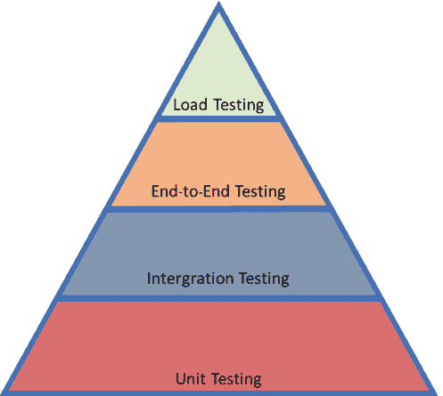
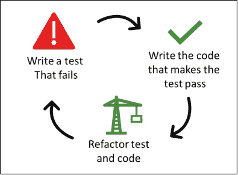
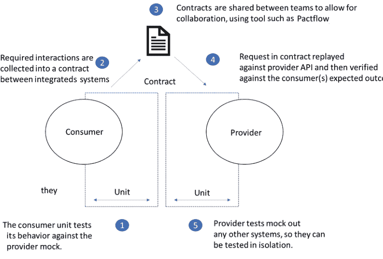

跳过测试

开发团队为什么跳过测试？你有什么理由不测试你的软件？好吧，对许多人来说，测试是一个无聊的话题，有些人宁愿拖到最后一刻。你会听到人们说诸如“我就是没时间。”有些人怪罪业务不愿意在测试软件上花费人力，所以他们从未进行测试，或者测试被推迟到部署当晚。我相信如果业务真正理解了 bug 的成本以及部署带有 bug 的软件的风险，那么它会得出结论，必须在早期和经常为测试软件留出时间。如果你想让业务倾听，那么你必须为你试图让他们理解的任何事情——无论是单元测试、软件测试还是采用敏捷流程——标上美元价值。企业主要受动机驱动的是赚钱和省钱，而一个完善的软件测试策略可以帮助他们实现这两点。

一个重要的问题浮现出来：谁将教育企业了解软件测试的重要性？是开发团队还是架构师？问题的答案是开发团队和架构师应共同努力传达测试的重要性并教育业务。架构师应在架构文档中包含测试计划，并在与业务的规划讨论中提出。

业务受金钱驱动，无论是省钱还是赚钱，所以我们必须包含成本分析数据来证明，从长远来看，由于完善的测试策略，成本将显著降低。我们必须向业务证明测试是一项投资，而不是在时间和资源方面的单纯支出。这些节省应与业务领导层分享，以帮助获得管理层的支持。因此，一旦我们教育了业务了解测试软件的价值，它就会明白跳过测试根本不是一个选项。

因此，跳过测试不是一个好的选择，将是灾难性的。随着系统分布到微服务，测试变得对成功更加重要，因为微服务需要相互集成，团队需要对新增功能或功能不会破坏其代码库或其它依赖服务的代码库有高度信心。通过尽早测试，我们可以避免灾难，解决缺陷，为企业省钱，并更快地进入市场。

现在我们理解了测试的重要性，并希望避免不测试软件的反模式，我们将研究一种良好的软件测试策略，即 **左移测试**，以及支持左移方法的模式。我们将在本章中涵盖以下主题：

- 单元测试
- 端到端测试
- 集成测试
- 负载测试

## 左移测试策略

尽早且经常测试是左移测试背后的思想。通过将测试移至开发生命周期的早期，我们可以防止错误在流程后期或更糟糕的是部署到生产后才被发现。左移测试将测试移入开发和构建阶段，这使团队能够及早发现缺陷和 bug。这使团队能够更快地解决和修复这些问题，在它们造成真正损害之前。

左移测试方法对软件测试的改进极大地增强了部署和发布流程，允许进行更快的发布，在某些情况下可以每天、每周甚至每小时进行。

缺乏测试或未正确实施测试可能导致缺陷和 bug 部署到生产环境，这会导致昂贵的 bug 修复和新功能发布延迟。

让我们在以下各节中查看一些最佳实践和策略，这些将帮助团队实施左移测试方法，这将使部署团队对代码库更有信心，并使业务能够在竞争对手之前将新功能推向市场。左移测试是全方位的双赢。

让我们了解左移测试的一些重要属性：

- **规划：**制定涵盖整个开发生命周期的测试计划，并使计划清晰，让整个开发团队了解他们在支持流程中的角色。设定现实的期望和目标，并逐步成熟。
- **测试融入文化：**测试必须成为自上而下强制执行的文化的一部分。分析师和产品负责人应遵循围绕创建具有良好验收标准的用户故事的最佳实践。在需求会议和整个软件开发生命周期中纳入测试人员。采用测试驱动设计或行为驱动设计。
- **标准：**为代码质量控制测试用户故事。用户故事应完整并具有良好的验收标准。代码应由测试人员、高级开发人员和同行评审。实施良好的 SOLID 设计原则。编写可测试且易于更改的代码。最后但同样重要的是，对工具、框架和第三方库有标准。
- **自动化：**这对测试很重要，应在开发生命周期的早期实施。应在构建阶段和部署阶段自动化测试。在从开发和测试环境迁移到生产环境时必要时使用批准门控。拥有使用任务自动化测试的员工开发管道。测试工具和框架应在开发团队中一致使用。使用 xUnit、NUnit 和 JUnit 等框架运行测试。
- **敏捷团队结构：**Scrum 团队应包括测试人员，并教授测试人员编码技能，开始模糊测试人员和编码人员之间的界限。冲刺应短暂，测试人员应深度参与部署生命周期。
- **测试人员：**测试人员应参与敏捷仪式，如冲刺计划和故事细化。测试人员需要学习如何编码，至少学会阅读代码；拥有对代码感到舒适的测试人员是一个巨大的优势。让开发人员测试并编写自动化或与测试人员深度参与流程一起配置自动化。


## 测试金字塔

在考虑整体测试策略时，我们可以创建一个金字塔来展示在负载测试、端到端测试、集成测试和单元测试方面，每种测试类型的重要性程度以及应投入的努力程度。单元测试占据了我们测试策略的绝大部分，如下图所示：



图 9.1 — 不同测试类型的[content]

## 测试金字塔

在考虑整体测试策略时，我们可以创建一个金字塔来展示在负载测试、端到端测试、集成测试和单元测试方面，每种测试类型的重要性程度以及应投入的努力程度。单元测试占据了我们测试策略的绝大部分，如下图所示：


图 9.1 — 不同测试类型的重要性程度

单元测试绝对是左移的最佳实践，因为它从代码开始，而代码就是可以向左走的最远点，一切都始于编写可测试、可更改的代码，以满足业务的验收标准。

## 单元测试

单元测试通过将测试移至开发阶段来帮助我们实现左移方法，同时也有助于满足自动化部分。开发人员需要通过使用诸如**测试驱动开发 (TDD)**等方法来拥抱单元测试的使用，该方法规定基于良好的验收标准先编写测试。TDD 过程的生命周期是编写失败的测试，然后编写使测试通过的代码，最后重构测试和代码。

### 单元测试生命周期

单元测试生命周期由三个步骤组成；下图演示了该过程：



图 9.2 – 单元测试生命周期

在部署分布式系统时，对代码库具有高度信心至关重要，这也有助于减少引入可能在微服务之间产生连锁效应的 bug 的担忧。单元测试可以证明代码按预期工作，并有助于确保预期输出的正确性。

### 单元测试的类型

单元测试有不同类型。有些用于测试**被测系统 (SUT)**的状态，有些用于测试依赖项之间的交互或交互是否被调用：

- **孤立单元测试：** 在隔离状态下测试一个单元，模拟依赖项。测试领域服务、业务逻辑和不变量是孤立测试。

  测试 RESTful API 的控制器是孤立测试。入站和出站消息应在孤立测试中进行测试。

- **社交单元测试：** 测试一个单元及其与依赖项的交互。测试持久层是社交单元测试。

  测试值对象的集合是社交单元测试。测试 Saga 和事务边界是社交单元测试。

### 单元的范围

微服务中的业务逻辑是通过使用实体和值对象的持久化以及使用 Saga 管理这些事务来实现的。这些服务是领域服务，由类组成。最佳实践是测试这些类及其内部方法，即其行为。这是通过为每个类或 SUT 创建一个测试类并为每个方法或函数编写一个测试来实现的，该测试测试 SUT 行为是否符合预期。

使用孤立单元测试，其中员工模拟单元或 SUT 的依赖项，例如消息和存储库，将极大地有助于测试设置和维护。测试用例是一组为特定目标开发的测试输入、执行条件和预期结果，例如练习特定程序路径或验证是否符合特定要求。

测试应验证 SUT 的行为，或基本上是被测试的软件元素或单元的行为。

一个单元或 SUT 可以小到单个类中方法的测试，也可以大到整个应用程序；它也可能涉及一组类。单元的定义完全取决于团队来决定，但最佳实践是让它们尽可能小，专注于单一职责。在某些情况下，单元可以跨越领域边界，因此在确定单元定义的范围时必须仔细考虑。

### 策略

使单元测试成为测试策略的最大部分，大部分测试集中在代码和各个单元上。

使用 TDD，这对微服务很重要。通过致力于 TDD，我们将确保代码得到测试，因为这是编写代码后要做的第一件事。先写测试是有意义的，因为我们需要证明代码满足业务规范和使用案例的标准。因此，在用户故事或需求文档中拥有可靠的验收标准，可以让质量控制团队成员进行测试，开发人员编写满足需求的代码。

### 工具

有许多工具和框架可以帮助单元测试，有些用于模拟依赖项，有些用于创建匿名测试数据，例如 AutoFixture。这些工具可以帮助您编写单元测试并维护这些单元测试。

### 框架和测试维护

自动化是左移方法的重要组成部分，诸如 xUnit、NUnit 或 JUnit 等测试框架可以自动化运行我们的单元测试，并且可以成为我们 CI/CD 流水线的重要组成部分。测试框架可以使测试维护不那么痛苦。

单元测试的维护可能是一项大工作，并且在时间和精力方面可能代价高昂，因此我建议您采用 AutoFixture、AutoMock、Mock 和 Fluent Assertion 等支持框架。

## 端到端测试

在将微服务部署到生产环境之前，我们需要有高度信心确保它不会对其他服务或基础设施造成问题。尽管端到端测试有价值，但在采用这种类型的测试时仍需仔细考虑，因为它难以执行，并且在时间和资源方面代价高昂。

我们需要确信微服务按预期运行。我们需要编写一个测试来验证相关服务是否与基础设施服务以及其他应用程序和领域服务进行交互。为了成功测试所有这些交互，我们需要所有涉及的服务和数据库都在适当的环境中运行并处于运行状态。

端到端测试速度慢且脆弱，在时间和维护方面可能代价高昂。端到端测试应最小化，并且代表我们测试金字塔中较小的部分，如图 9.1 所示。

端到端测试的最佳策略是它是我们测试中的较小部分。最佳实践是编写与用户在系统中的旅程相关的旅程测试。例如，我们编写一个测试，其中涉及用户交互所需的所有操作，例如创建订单、更新订单和取消订单。

微服务通常由 RESTful API 服务组成，并由不同的团队拥有。我们需要确保团队不会破坏其他团队的功能，通常是通过破坏接口的契约，并且服务具有可靠和稳定的 API。我们需要确保团队不会以破坏 API 网关或其他依赖服务的方式更改其 API。

验证所有服务能否交互的一种方法是让所有相关服务都在运行，并调用 API 或触发与其它服务通信的事件。

当我们需要确保微服务中的服务按预期工作时，我们需要测试每个服务是否正确交互。为了有效地进行端到端测试，我们需要执行以下所有操作：

- 所有应用程序交互的服务都需要运行
- 测试 UI 输入和正确行为
- 测试 UI 输入和正确输出
- 数据库需要运行并已填充数据

### 端到端测试的两种类型

端到端测试有两种类型：垂直和水平。让我们在本节中了解更多相关信息。

**垂直端到端测试**是测试子系统各层的过程，例如测试后端和数据层，然后逐步向上到 UI 等上层。

垂直方法的优点是测试覆盖率高且测试执行更快。测试更专注，并为关键系统功能提供了一层安全保障。

在架构上，垂直测试的重点是一个可以利用**测试驱动部署 (TDD)** 或**行为驱动部署 (BDD)** 的领域。与所有测试一样，确保在制定端到端测试时包含利益相关者，例如测试人员、业务专家、开发人员和产品负责人，以确定测试什么内容很重要以及应如何测试。这很重要，因为我们关注的是业务规则、逻辑和不变量。接下来，我们将讨论测试用户在应用程序中的旅程，以及水平端到端测试如何有助于促进这种方法。

**水平端到端测试**另一方面，是测试工作流或事务的过程，该工作流或事务流经参与工作流的多个微服务，从头到尾，并检查每个微服务是否按预期正确运行。这可能包括我们无法控制的外部端点或微服务，但我们也需要测试该外部资源的输出。外部资源为端到端测试增加了另一层复杂性，需要特别的规划和考虑。

水平测试有一些优点，例如测试专注于用户的旅程或视角。这种类型测试的另一个优点是能够发现用户体验问题或 bug，有助于在发布到生产环境之前识别这些类型的问题。水平测试验证并确保业务不变量没有被破坏，并且业务逻辑得到覆盖和测试。


水平测试会跨多个微服务运行，因此所有相关微服务都必须在测试执行时处于运行状态。这使得这类测试变得复杂，也是端到端测试应只占整体测试策略中较小部分的原因。

水平测试可能包含我们无法控制的外部端点或微服务，这将引出下一个主题：环境类型。

## 白盒与黑盒环境

在白盒类型中，测试用户可以看到正在发生的事情，拥有可交互并执行操作的 UI，并且能够看到结果是否符合预期。

在白盒测试期间，有些操作对用户是不可见的，例如对后端服务的调用，这些服务将返回用户期望的结果。这些不可见的服务被称为黑盒环境。

这些后端服务之所以被称为黑盒环境，是因为这些操作被认为是在暗处执行的，测试人员或用户无法看到。

水平测试的最佳实践是编写与用户在整个系统中的旅程相关的旅程测试，而不是为每个操作单独编写测试。

## 旅程测试

因此，对于旅程测试，编写一个包含相关操作的测试。例如，如果是订单系统，就测试创建订单、取消订单和更新订单，这代表了用户的完整旅程。

端到端测试是验收测试，应当如此对待。最佳实践是使用 Gherkin 和某种框架（如 Cucumber 或 SpecFlow）来运行验收测试。

## 工具

Docker Compose 可以提供一种让所有服务启动并运行的方式。

工具和框架可以让端到端测试更易于管理。使用 SpecFlow、Cucumber 或 Cascade 来自动化这些测试。

SpecFlow 和 Cucumber 是行为驱动设计框架，可与现有测试框架（如 xUnit、NUnit 和 JUnit）配合使用。它们运行基于 Gherkin 语言的测试。

Gherkin 是一种对用户友好的语言，并使用如下一组特殊关键字：

- GIVEN 是当前场景中被测系统所处的上下文或状态。
- WHEN 是用户采取的操作。
- THEN 是操作产生的预期结果。

这些关键字为可执行规范提供了结构和含义。它们构成场景的步骤，并被转换为与测试方法相结合的表达式步骤定义。请考虑以下 Cucumber 框架步骤定义示例：

- 场景：已选择产品
- 给定：我有 3 个产品

根据上述信息，带有表达式和相应 Java 方法的步骤定义如下：

```
@Given("I have {int} products")
public void i_have_products(int int1) { }
```

至此，我们对端到端测试的讨论就结束了。另一种与端到端测试类似但范围更小的测试类型是集成测试，它用于测试两个独立微服务之间的交互。

## 集成测试

微服务需要与其他微服务交互，因此测试这些交互至关重要，但也带来了一些挑战。对于集成测试，主要挑战在于我们需要试运行所有相关服务的实例（例如，在测试与数据库交互的 Web API 时）。这就需要对这些测试进行复杂的设置和维护。在下一节中，我们将探讨应对这些挑战的策略。

## 策略

测试微服务之间的交互至关重要。微服务的集成测试存在一些挑战。我们将探讨一些可用的策略。我们需要测试网关、RESTful API 端点的消费以及领域事件消息是否被正确消费，并测试这些服务产生的数据和状态是否被正确持久化到数据库中。与端到端测试不同，我们不需要所有服务都运行；只需关注较小范围的交互，例如仓储类与订单类之间的交互，测试以确保测试订单被正确持久化。

微服务通常需要以聚合的形式将数据持久化到数据库中，例如订单、文档或某种类型的关系数据库。

我们还拥有采用 CQRS 等模式的服务，这些服务需要多次读写数据，可以使用内存对象进行测试。

Docker 可用于将数据库容器化，从而为测试提供集成数据库。虽然你可以使用这种方法以及模拟方法来测试集成，但它们可能难以管理和维护。这就引出了使用契约概念测试微服务集成的最佳实践。让我们看看契约，以及它们如何帮助我们测试微服务集成。

## 契约测试

**契约**是两个服务之间交互的具体示例。我们构建这些契约的方式取决于所涉及的交互类型。契约测试包含两种契约：消费者和提供者（或生产者）。

下图说明了契约测试的步骤以及消费者与提供者之间的交互：



图 9.3 – 契约测试

契约同时面向消费者和提供者，确保它们在 API 层面上达成一致。每个契约与消费者或提供者的交互以不同方式进行测试：

- 消费者测试使用契约配置模拟提供者的存根（返回值），使你无需运行提供者即可为消费者编写集成测试。
- 提供者测试使用契约测试被测系统（SUT），并模拟 SUT 的依赖。
- 契约测试提供了一种模拟、存根或集成测试的机制。我们可以使用 Pact.io 来提供测试服务与仓库之间集成能力。契约测试可以为 HTTP 请求或消息传递方法提供测试，这类测试称为 pact（契约）：
  1. **HTTP 契约：** 预期请求是消费者预期发起的请求。这反过来又有最小预期响应，也就是消费者希望提供者返回的响应部分。
  2. **消息契约：** 契约支持使用消息传递框架（如 RabbitMQ、Kafka 或 Azure Service Bus）的现代分布式系统。这类交互被称为“消息契约”。这是通过将框架抽象出来，只关注在它们之间传递的消息来实现的。

## 工具

契约测试是微服务集成测试的最佳实践，你可以使用 **Pact.io** 或 **pactflow.io** 等框架来创建契约文件，该文件是一个具体的 JSON 文档，提供提供者和消费者的规范。

Pact 非常适合设计和测试集成场景，在这些场景中，组织内的团队负责控制消费者和提供者的开发，并且消费者团队会推动提供者团队的需求或功能。简而言之，Pact 最适合白盒集成，因为团队对被测系统有充分了解。

我鼓励团队探索用于集成的契约测试。要真正深入了解契约测试，请访问 Pact.io 以获取关于 Pact.io 和 Pactflow.io 的更多信息。

我们已经探讨了集成测试及其实践。现在我们需要确保应用程序能够满足用户的需求并提供良好的用户体验。

## 负载测试

负载测试有助于识别水平与垂直扩展瓶颈，以及线程或连接池等问题，仅举几例。它可以告诉我们如何扩展应用程序，或帮助识别异步操作中的阻塞调用。负载测试可以验证请求和响应在系统网络中流动时的延迟。

微服务可能依赖于其他服务或资源，而这些服务的性能水平可能各不相同。有些可能很快，有时某些服务可能会出现问题，运行速度低于预期。我们需要知道系统将如何应对这些不同的性能水平，以及它们将如何影响我们正在测试的服务。

微服务环境是动态且不断变化的。我们需要测试我们的服务，以确定它们能否应对微服务的这种动态特性，以及这一切将如何应对生产环境中活跃用户的负载。


测试微服务对于成功开发和部署微服务至关重要。测试应在开发生命周期的早期阶段开始，并且应从代码层面着手，贯穿从构建到发布的每一个阶段。

## 总结

总而言之，我们了解了测试对于开发和部署微服务的重要性，以及它如何帮助避免部署带有缺陷的微服务——这些缺陷可能在生产环境中导致代价高昂的问题，甚至更糟，彻底失败。跳过测试并非明智之选，它可能导致微服务出现不必要的故障，因此请将测试左移，尽早并频繁地在软件开发生命周期的所有阶段进行测试。我们已经探讨了一些左移测试策略以及支持这种方法的测试类型。

单元测试是一切测试的起点，并且应占测试工作的大部分比重。我们探讨了端到端测试及其复杂性，以及应如何利用用户在应用中的使用旅程来指导这种方法。集成测试有助于测试服务之间的交互，并确保触发正确的行为。同样，我们学习了性能测试和负载测试，并认识到它们对于确保应用程序能够应对增长的需求和提供良好用户体验的重要性。测试是成功实施微服务的必要条件，并且应在开发生命周期中左移。在我看来，跳过测试只会导致失败。

在下一章中，我们将讨论开发微服务时要考虑的因素，作为一份清单，帮助你在微服务之旅中前行。

## 问题

1. 有效单元测试的关键是什么？
2. 在进行端到端测试之前，必须考虑哪些重要事项？
3. 测试微服务之间集成的关键是什么？
4. 最佳的负载测试策略是什么？
5. 为什么测试对微服务尤其重要？

## 延伸阅读

- **.NET Core 负载测试：** https://docs.microsoft.com/en-us/aspnet/core/test/load-tests?view=aspnetcore-5.0
- **集成测试：** https://docs.microsoft.com/en-us/aspnet/core/test/integration-tests?view=aspnetcore-5.0
- **性能测试：** https://docs.microsoft.com/en-us/azure/architecture/framework/scalability/performance-test
- **测试工具：** https://docs.microsoft.com/en-us/azure/architecture/framework/scalability/test-tools
- **测试清单：** https://docs.microsoft.com/en-us/azure/architecture/framework/scalability/test-checklist
- **JMeter：** https://docs.microsoft.com/en-us/azure/architecture/example-scenario/banking/jmeter-load-testing-pipeline-implementation-reference

## 10
